# API-Bank：面向工具增强型大语言模型的综合基准

**英文题名：** API-Bank: A Comprehensive Benchmark for Tool-Augmented LLMs  
**作者：** Minghao Li、Yingxiu Zhao、Bowen Yu、Feifan Song、Hangyu Li、Haiyang Yu、Zhoujun Li、Fei Huang、Yongbin Li  
**出处：** EMNLP 2023，pp. 3102–3116  
**文档说明：** 以下为按论文结构整理的学术中文译文。图表保持原稿样式，原文页码与截图文件对应；函数名、模型名、路径、原始引用和可执行格式保留英文。

## 摘要

近期研究表明，大语言模型（Large Language Models，LLMs）能够借助外部工具增强自身能力。然而，仍有三个关键问题尚待回答：（1）当前 LLM 使用工具的效果如何？（2）如何提高 LLM 使用工具的能力？（3）要充分利用工具，还须克服哪些障碍？为回答这些问题，我们提出 **API-Bank**，一个专为工具增强型 LLM 设计的综合基准。针对第一个问题，我们开发了一个包含 **73 个 API 工具**、可实际运行的评估系统，并人工标注 **314 段工具使用对话和 753 次 API 调用**，评估模型规划、检索和调用 API 的能力。针对第二个问题，我们构建包含 **1,888 段对话**的综合训练集，覆盖 **1,000 个领域**中的 **2,138 个 API**，并据此以 Alpaca 为初始模型训练工具增强型语言模型 **Lynx**。实验显示，GPT-3.5 的工具使用能力优于 GPT-3，而 GPT-4 在规划方面表现突出，但各模型仍存在很大改进空间。此外，Lynx 的工具使用性能比 Alpaca 提高超过 26 个百分点，接近 GPT-3.5。通过错误分析，我们进一步指出该领域未来需要解决的主要挑战，以回答第三个问题。

## 1 引言（Introduction）

近年来，大语言模型快速发展，代表包括 GPT-3（Brown 等，2020）、Codex（Chen 等，2021）、ChatGPT 和表现突出的 GPT-4（Bubeck 等，2023）。这些模型在广泛的开放领域任务中，展现出越来越接近人类的对话、上下文学习与代码生成能力。然而，LLM 仍受训练语料约束：知识可能迅速过时，且无法覆盖全部应用情境。因此，通过让 LLM 使用外部 API 工具获取最新信息、连接第三方服务，已成为重要研究方向。工具使用曾被视作人类特有的行为，也是灵长类进化过程中的重要里程碑。借用这一类比，我们认为，当前迫切需要回答模型能否有效使用工具、如何增强该能力，以及还存在哪些障碍这三个问题。

为此，我们提出 API-Bank。研究首先访问了 **500 名用户**，了解他们使用工具增强型 LLM 的具体需求，并据此确定基准设计原则：评价应覆盖**规划（Planning）、检索（Retrieval）和调用（Calling）**这三种基本能力；构建数据时还须考虑领域多样性、API 多样性、API 真实性以及评估真实性。随后，我们据此搭建可交互的 API-Bank 评价系统，包含 73 个常见 API、314 段人工标注的工具使用对话和 753 次调用，旨在对真实 API 使用进行可执行的评价。

为提高模型的工具使用能力，API-Bank 进一步提供训练数据集：2,138 个不同 API、1,888 段对话和 4,149 次调用，覆盖三个工具使用能力等级。完全依靠人工标注不仅昂贵且耗时，因此作者提出由 **五个相互协作的 LLM Agent** 组成的 **Multi-agent 数据生成方法**，逐步生成领域、API、用户问题、API 调用及响应，同时控制数据质量。与人工标注相比，该方案降低约 **98% 的成本**。作者利用生成数据对 Alpaca-7B 微调，得到 Lynx 模型。

研究的主要观察包括：Alpaca-7B、ChatGLM-6.2B 等小模型的 API 调用正确率约为 20%，但其 API 检索及规划几乎不可用；大规模 GPT-3 Davinci 的 API 使用能力也很低，这意味着工具使用并非只靠参数规模就自然获得。Lynx 在三种 API 使用能力上的平均性能相较 Alpaca-7B 提高约 24%，已接近 GPT-3.5，但距 GPT-4 仍存在约 21% 的差距。作者最后对 GPT-4 和 Lynx 的错误作了分类，揭示其工具使用障碍。

## 2 API-Bank 的设计原则

由于此前缺少公认的工具增强型 LLM 能力定义与评测标准，作者首先通过问卷与访谈收集 **500 多位有意使用 LLM 外接工具的用户**的需求。在此基础上提出能力划分方式，以及用于训练和评价的数据标准。作者希望这些直接回应实际用户需求的设计原则，可以帮助后续工具使用基准的研究与开发。

### 2.1 能力分级（Ability Grading）

理想的工具增强型 LLM 应允许用户在个人 API 池（API Pool）中定义所需工具，再根据任务在合适时机选择和调用它们。调查得到两个维度：

1. **API 池规模：少量还是大量 API。** 当用户仅定义 2–3 个 API 时，能够直接把所有 API 的名称、定义、输入输出参数及用户问题放进模型上下文，由模型选择即可。但当 API 数量达到数百个时，受输入长度限制，无法完整提供全部描述；模型必须先检索可能有用的 API，再执行调用。
2. **每轮交互：一次还是多次 API 调用。** 复杂需求可能必须组合多个 API。有些用户愿意把需求拆成多个问题，逐步引导模型，每轮只调用一个 API；另一些用户则希望一次给出复杂目标，让模型在同一轮中自主安排多步 API 调用。

两个维度形成四种情形：少量 API＋单次调用、少量 API＋多次调用、大量 API＋单次调用、大量 API＋多次调用。由于已知全部工具时，多次调用的规划难度与一次调用接近，作者将前两种情形合并，最终归纳为三个能力等级：**Call（已知 API 时调用）**、**Retrieval+Call（未知 API 时先检索再调用一个工具）**、**Plan+Retrieval+Call（未知 API 时连续规划、检索和调用多个工具）**。图 1 给出三种能力的示意，图 2 总结用户需求矩阵。

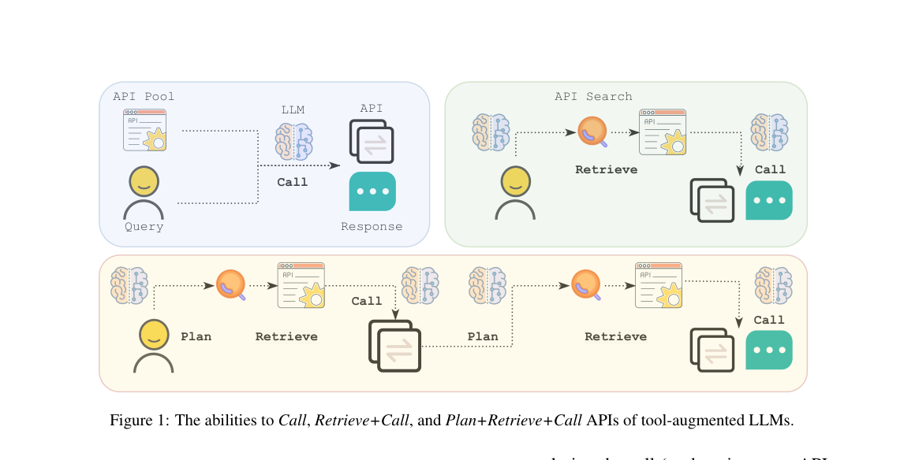

*图 1（原文第 3 页）：工具增强型 LLM 的 Call、Retrieve+Call 与 Plan+Retrieve+Call 三类能力。*

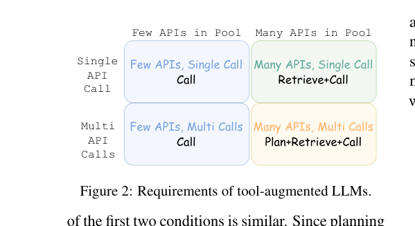

*图 2（原文第 3 页）：按 API 池大小和每轮调用次数划分的需求矩阵。*

### 2.2 数据标准（Data Standards）

除了界定能力，还必须保障基准数据质量。API 调用发生于开放环境，任务所属领域与具体功能无法事先完全确定；调用又具有类似数学运算的严格性，API 名称、参数或调用顺序的错误都可能导致任务失败。因此，基准建设需要遵循以下四项标准：**领域多样性**，尽可能覆盖广泛应用领域；**API 真实性**，工具名称、定义及输入输出参数尽量贴近真实 API；**API 多样性**，涵盖多种工具类型和用途；**评估真实性**，需要真正可运行并能与模型实时交互的系统，按照 API 执行对环境造成的实际影响，判断模型是否满足用户需求，而非仅作文本匹配。

## 3 API-Bank 的评估系统

本节讨论基于上述原则构建的可执行评估系统，包含系统实现、对话标注和评价指标。

### 3.1 系统实现（System Implementation）

研究团队实现 **73 个 API**，包括天气预报等常见日常 API，以及文本生成图像等调用其他 AI 模型的 API。所有 API 由资深研发人员在统一框架下实现，累计投入 **98 人日**。对于数据库操作类 API，需要预先搭建并初始化数据库；对于搜索引擎等外部信息 API，为保证可复现性，作者记录测试对话中的查询及某时刻的检索结果，并将结果固化在 API 内，以维持多次运行的一致性。

其中还开发了特殊工具 **API Search**，供 Retrieval+Call 与 Plan+Retrieval+Call 两类能力使用。这两种情况下，LLM 事先不知道 API 池中有哪些工具，必须通过 API Search 找到可能合适的 API。模型在调用其他 API 前须先调用 API Search，并将用户需求提炼为若干关键词。API Search 分别计算关键词和 API 元信息的句向量，通过余弦相似度排序，返回匹配程度最高的 API 元信息。

### 3.2 对话标注（Dialogue Annotation）

评估集按三个能力等级标注。**Call** 类型首先随机抽取 API；标注人员阅读 API 文档，构造能够由该 API 解决的用户问题，标注调用参数，实际执行 API，并依据执行结果写出目标回答。Call 数据并不局限于单轮，标注者还须围绕同一 API 集合提供多轮用户对话以及相应调用历史。

对于 **Retrieval+Call**，标注者先从工具池选取 **1–5 个 API**，判断它们能否共同解决某一复杂需求；若可以，则把该需求拆成多个简单问题，逐一标注每个问题需要检索并调用的 API、输入参数以及系统返回结果对应的回答。**Plan+Retrieval+Call** 的流程与之相似，但不允许人为提前把复杂问题拆成简单问题；标注者须给出一个复杂需求及其顺序执行的 API 调用链，并标注最后的回答。

API 标注具有较高难度：每段对话通常需要两名标注员讨论，再由另外两人检查格式、逻辑一致性和调用合理性。人工标注平均每段对话花费 **8 美元**。团队最初制作 400 段对话，因各种质量问题剔除 **21.5%**，最终保留 **314 段对话、753 次 API 调用**。

### 3.3 评价指标（Evaluation Metrics）

模型的表现从两个方面衡量：**API 调用的正确性**与**调用后模型回答的质量**。前者使用 Accuracy（正确预测数量／全部预测数量）：每轮评估先把系统与各 API 数据库重置为默认状态，再比较模型预测的 API 调用与人工标注的调用。这里的“一致”指是否进行了相同数据库查询或修改，且返回结果相同。后者使用 **ROUGE-L** 衡量模型自然语言回复质量。因此，API-Bank 同时评估实际工具行为与用户可见回答，而不仅是形式上的 API 名称匹配。

## 4 API-Bank 的训练集

API-Bank 不仅要测量现有模型的工具使用能力，还希望利用训练来增强这一能力。最直接的方式是建立高质量数据集，但在满足领域多样性和 API 真实性的同时降低成本并不容易：评估集人工标注每段对话要 8 美元，而且标注人员实际只设计出约 100 个 API，无法满足训练集的多样性要求。因此，作者提出多 Agent 自动生成数据的方法。

LLM 的出现改变了数据标注范式，自我指令生成（Self-Instruct）是代表性方法。然而，作者发现，自我指令方法在简单写作任务中有效，却难以同时满足工具训练数据涉及的领域多样性、API 真实性，以及规划、检索、调用等多个约束。即使给 ChatGPT 复杂指令，合格数据也仅约 **5%**；换成 GPT-4 后升至 **25%**，仍有大量错误。原因在于一次提供的要求过多，模型难以有效遵守。作者因此把复杂要求拆分为相互依赖的简单步骤。

数据元素包括**领域、API、查询、能力类别、API 调用及回复**。领域决定工具功能；API 与能力类别决定可处理的查询；上述因素共同决定模型应如何调用工具并回复。为模拟这些依赖关系，图 3 所示流程设立五个 Agent：第一个生成医疗、健身等领域；第二个按领域生成候选 API，并借助公共 API 实例增强真实性；第三个随机选择一个或多个 API 及能力类别，构造与之相符、且能由选中 API 解决的任务；第四个根据领域、API、能力和任务模拟 API 调用及执行结果，生成回复；第五个充当**测试器**，自动检查结果是否遵循设计原则，实际剔除了约 **35%** 的样本。五个 Agent 都由向 ChatGPT 提供针对性提示词实现。整体流程不再依赖人工逐条标注，平均每段对话仅 **0.10 美元**，成本下降约 **98%**。

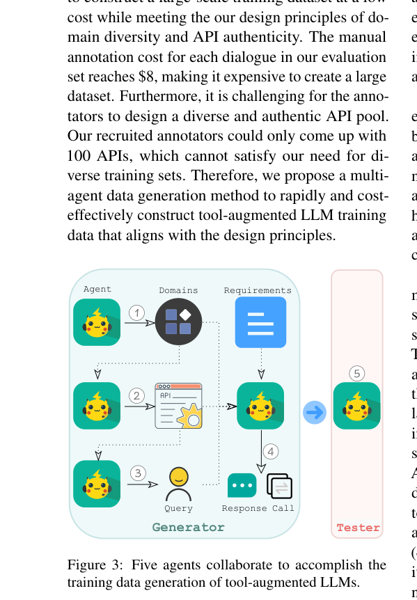

*图 3（原文第 5 页）：五个 Agent 分步骤完成领域、API、查询、调用与回复的生成及检验。*

## 5 基准分析（Benchmark Analysis）

**统计信息。** 最终 API-Bank 共包含 **1,008 个领域、2,211 个 API、2,202 段对话、6,135 轮交互**。其中，Call 类别有 934 段对话，Retrieve+Call 有 769 段，Plan+Retrieve+Call 有 499 段。训练集平均每段对话 2.76 轮，测试集为 2.91 轮。训练数据由 LLM 自动生成，而评估数据来自人工标注，因此二者的领域、API 范围和对话内容均有分布差异；作者有意利用这种分布偏移（distribution shift）测试模型的泛化能力。表 2 提供详细统计，附录展示了样本与运行示例。

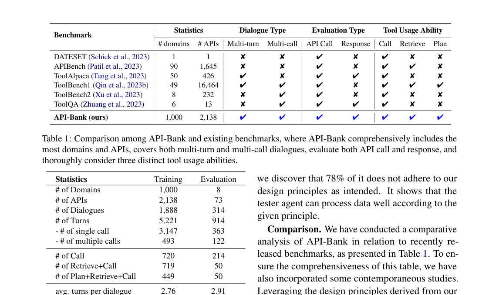

*表 1（原文第 6 页）：API-Bank 与 DATESET、APIBench、ToolAlpaca、ToolBench、ToolQA 的对比，覆盖领域/API 规模、多轮多调用对话、API 调用及响应的评测，以及三种能力。*

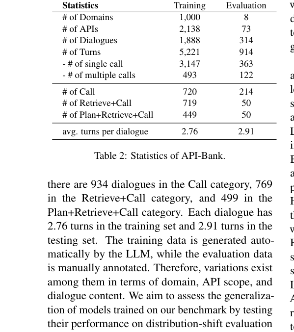

*表 2（原文第 6 页）：训练集与评估集的领域、API、对话、轮次及能力类型分布。*

**质量。** 评估集的每个实例都经过四名标注者审查。针对 Multi-agent 自动生成的训练集，作者随机抽取 100 个样本进行人工检验，合格比例达到 **94%**，较仅使用单个 Agent 的 Self-Instruct 方式高 **89 个百分点**，表明生成数据具有较好可靠性。进一步检查测试器 Agent 自动过滤的数据，发现其中 **78%** 确实不符合设计原则，说明测试器能够依据给定规则有效筛选样本。

**对比。** 表 1 将 API-Bank 与同期工具增强型 LLM 基准进行比较。根据用户需求确定的原则，作者认为 API-Bank 具有三个突出特点：（1）**多样性**：覆盖更多领域及 API；（2）**真实性**：能够模拟现实环境中的多轮交互及单轮多 API 调用；（3）**覆盖广度**：不仅标注 API 调用，也标注响应，同时综合考量规划、检索和调用能力。上述结论均是针对论文发表时已有基准的比较。

## 6 相关工作（Related Work）

近年的语言模型研究尝试利用外部工具补充模型参数中固化的知识。精确计算与实时信息检索可以交给 Python 解释器、搜索引擎等外部模块处理；工具既可以是传统程序，也可以是其他神经网络或语言模型。**Socratic Models** 构建模块化框架，以组合不同模态上的预训练模型；**WebGPT** 与 **ReAct** 使用搜索 API 从外部来源获取自然语言知识；**Toolformer、ART、ToolkenGPT、TRICE** 等方法组合搜索、问答、机器翻译、计算器和其他工具完成 NLP 任务；**ChatGPT Plugins** 和 **TaskMatrix.AI** 展示了语言模型集成海量 API 的前景；**LATM** 与 **CREATOR** 则使用 GPT-4 自主创建工具。

这些研究说明工具增强方法具有潜力，但现有模型实际使用工具的效果、增强途径以及主要障碍仍缺少系统性证据。API-Bank 试图填补这一评测空白，并通过覆盖更丰富、更真实的工具与交互情境，为后续研究提供比较平台。

## 7 实验（Experiments）

作者基于 LLaMA-7B 使用 API-Bank 训练集微调 **Lynx**，训练 **3 个 epoch**，批大小 **256**，学习率 **2×10⁻⁵**。随后在 API-Bank 评估系统上比较 Lynx 与其他模型，所用提示词见附录。实验重点在于定位仍然阻碍 LLM 高效使用工具的问题。

### 7.1 基线（Baselines）

比较模型包括 GPT-3 Davinci；基于 `gpt-3.5-turbo-0613` 检查点的 GPT-3.5-turbo；基于 `gpt-4-0613` 检查点的 GPT-4；拥有 60 亿参数的双语聊天模型 ChatGLM-6B；以及基于 LLaMA-7B、利用约 5.2 万条指令数据调整的 Alpaca-7B。论文发表时，Alpaca 是广为使用的开源大语言模型之一。

### 7.2 主要结果（Main Results）

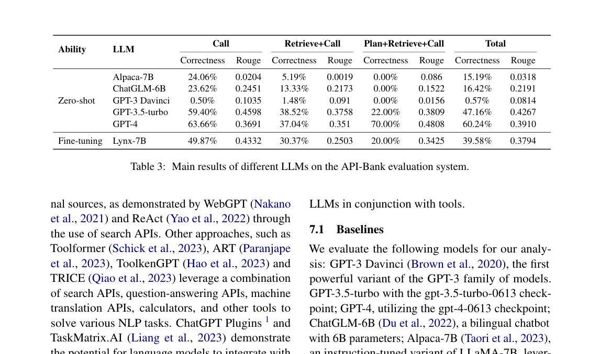

*表 3（原文第 7 页）：Call、Retrieve+Call、Plan+Retrieve+Call 三类任务分别报告调用正确率与回复 ROUGE-L，以及总体结果。*

从表 3 可见，随着任务所需能力提高，模型表现总体下降。在 API 及其描述已知时，调用任务近似于槽位填充（slot filling）。Alpaca-7B 与 ChatGLM-6B 都达到约 20% 的调用准确率，表明普通语言模型具有初步工具使用能力。令人意外的是，尽管 GPT-3 Davinci 拥有 1,750 亿参数，其调用正确率却极低。作者推测，API 调用高度依赖对指令的理解，而 GPT-3 未经过针对性的指令微调。

经过指令微调的 GPT-3.5 表现显著提升：与 Alpaca-7B 相比，API 调用正确率高约 **35 个百分点**，回复 ROUGE-L 提高约 **0.44**。但从简单 Call 转到 Retrieve+Call，GPT-3.5 的正确率降低约 **21 个百分点**；进一步转为 Plan+Retrieve+Call，又下降约 **17 个百分点**。原因是选择 API 和规划调用顺序需要超出一般指令理解的推理能力。GPT-4 的简单 API 调用正确率较 GPT-3.5 仅高约 4 个百分点，Retrieve+Call 则相近；但在最难的 Plan+Retrieve+Call 任务中提高近 **48 个百分点**（22% 对 70%），显示更强的规划推理能力。

基于自动生成训练数据得到的 Lynx 模型，在简单调用任务上的准确率达到 **49.87%**，比原始 Alpaca-7B 的 **24.06%** 提高 **25.81 个百分点**，回复 ROUGE-L 由 0.0204 提高至 0.4332；总体调用正确率达到 **39.58%**，接近 GPT-3.5 的 47.16%。这支持了 Multi-agent 数据生成策略的有效性。

作者还比较同期的 APIBench 和 ToolAlpaca，指出 GPT-3.5 在这些基准上常达到约 80%–90% 的工具调用准确率，而在 API-Bank 上仍存在较大提升空间。可能原因是 API-Bank 测试集采用人工构建，遵循设计原则，更接近真实使用场景；其他一些基准依赖 LLM 自我生成测试问题，领域范围较窄、数据多样性有限。

### 7.3 错误分析（Error Analysis）

论文系统归纳了六类主要错误，定义详见附录。首先，**Alpaca-7B** 中高频出现“不进行 API 调用（No API Call）”，占错误的 **36.77%**。API-Bank 微调后，这一问题在 Lynx 中显著减少。作者认为，Alpaca 原有的 5.2 万条指令数据与真实 API 调用形式之间存在差异，导致其难以正确解读测试系统中的调用指令。

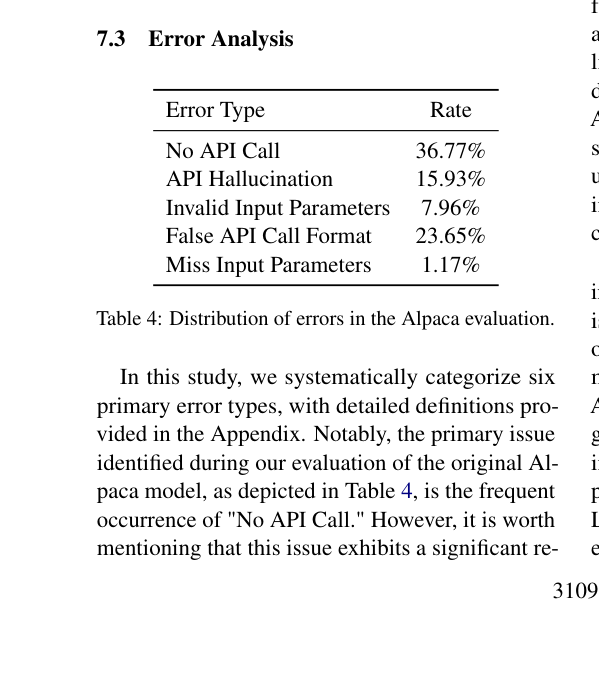

*表 4（原文第 8 页）：Alpaca 错误分布，包括不调用 API、API 幻觉、无效参数、错误调用格式和缺少参数。*

另一突出问题是 **API 调用格式错误（False API Call Format）**。由于评测提示采用零样本（zero-shot）设置，模型只能依据文字说明学习调用格式，这可能使生成格式难以满足解析器要求。微调对此产生明显改善，说明专门的工具使用训练有助于提高格式正确性。

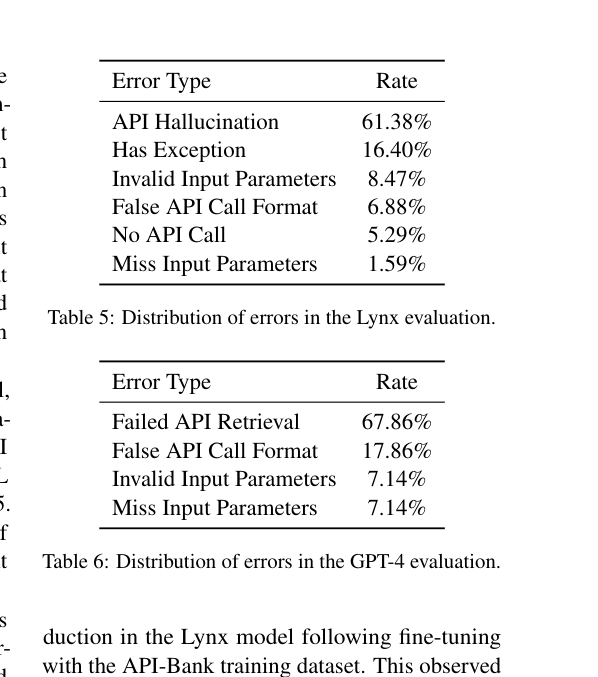

*表 5（原文第 8 页）：Lynx 的错误主要集中于 API 幻觉（61.38%），其次是执行异常、参数无效等。*

在 Lynx 中最常见的错误是调用的 API 名称与人工 Ground Truth 不一致，占全部错误的约 **61%**。某些情况下，模型甚至生成测试提示中不存在、与用户目标无关的虚构 API。这种幻觉可能与模型错误地迁移训练时见过的 API 有关。第二类错误围绕参数展开，包括触发 API 异常、提供无效参数及产生无法解析的调用，合计约占 **32%**。典型情形有用占位字符串充当真实值、日期等格式非法、缺少必需参数，或误解参数含义（例如要求股票代码，却传入公司名称）。还有少量情况是模型伪造用户或助手消息而非调用 API。

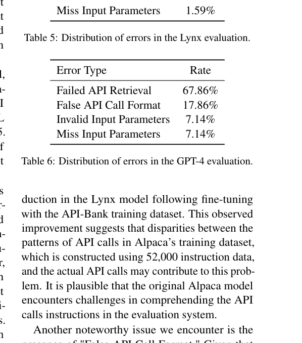

*表 6（原文第 8 页）：GPT-4 最常见的是 API 检索失败（67.86%），其余有调用格式及参数错误。*

GPT-4 的主要障碍是无法有效调用 API Search 检索目标 API，约占错误的 **68%**；这一问题在经 API-Bank 微调的 Lynx 中没有同等突出。作者认为，微调能够更直接地学习 Retrieve+Call 的固定流程；相比之下，仅靠上下文学习更难让模型稳定按预期步骤调用。GPT-4 的另一常见问题是生成的调用无法被评测系统解析，例如一次发出多个并行调用，违反提示中预设的调用顺序和格式约束。

据此作者提出三个值得进一步研究的方向：**改进 API 调用与检索方法**，缓解工具数量增长和检索幻觉引起的困难；**增强 API 解码算法**，强制生成结果遵循参数类型和格式定义；以及**扩充高质量工具使用训练数据**，继续探索更大训练集能否进一步提高模型性能。

### 7.4 数据集比较（Dataset Comparison）

为验证数据质量，作者将 ToolAlpaca 训练数据转换为与本文一致的格式，以此微调 Alpaca。ToolAlpaca 的原始语料约有 3,938 个工具使用实例，覆盖 50 类、400 多个现实 API；转换后获得 **10,366 条训练样本**。由于 ToolAlpaca 不涉及 API 检索，比较只针对 **Call** 能力，避免评价不公平。

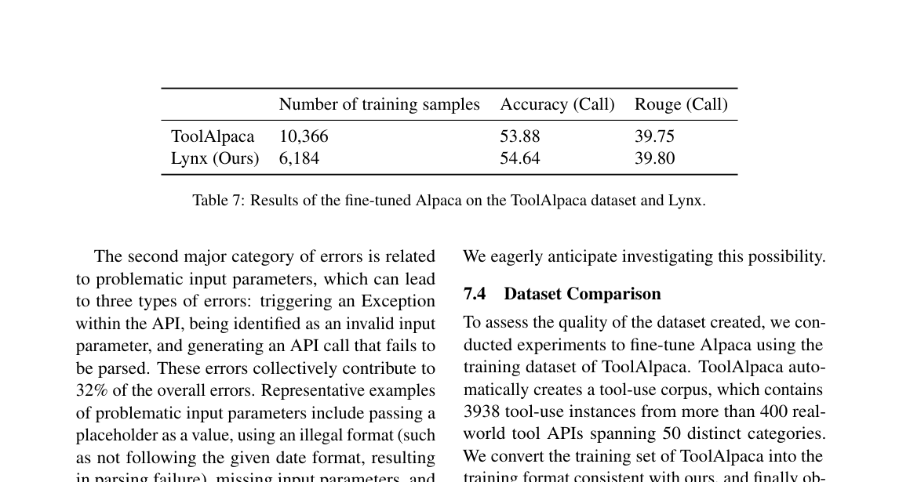

*表 7（原文第 9 页）：ToolAlpaca 模型使用 10,366 条样本，Call 正确率 53.88、ROUGE 39.75；Lynx 使用 6,184 条样本，分别达到 54.64 和 39.80。*

结果显示，虽然 Lynx 使用的样本更少，其在 API-Bank Call 评价中的表现仍略优于使用 ToolAlpaca 数据微调的模型，说明本文构造的数据有较高质量，也支持多 Agent 数据合成的有效性。

## 8 结论（Conclusion）

论文提出 API-Bank，一个涵盖 **1,008 个领域、2,211 个 API 和 2,202 段对话**的工具增强型 LLM 基准，并得到三个主要结论：（1）当前 LLM 已表现出一定的 API 使用能力，但距离在实际服务中持续、可靠地满足用户需求尚有明显差距；（2）构建多样且高质量的训练数据，是增强 LLM 工具使用能力的有效途径；（3）正确选择与调用 API、严格遵守 API 文档及参数规范，仍是核心挑战。API-Bank 为研究人员提供了系统评估及改进工具增强模型的资源，研究有望推动更加智能地整合外部资源、解决人类需求的 AI 系统。

## 9 局限性（Limitations）

API-Bank 虽然遵循较为全面的设计原则，仍存在三项局限。首先，数据只覆盖英语，未来需要研究其他语言下的数据构造和模型评测。其次，作者仅在 API-Bank 上微调 Lynx-7B，尚未研究更大规模的模型，尽管 Lynx-7B 的性能已接近 GPT-3.5。最后，团队在公司内部基于更大的语言模型训练了具备商业应用能力的工具增强模型，但出于匿名性原因无法公开其在线评测结果；计划在未来版本中补充相关分析。

## 10 伦理声明（Ethical Statement）

首先，在调查用户对工具增强型 LLM 的需求前，研究参与者已被告知反馈可能用于产品开发及学术发表，但不会公开个人隐私。其次，数据集中的 API 工具均为作者自行实现，不侵犯已有商业软件权益。最后，基准数据标注聘请了四名标注员，每人时薪为 **15 美元**，高于当地法定最低工资。

## 参考文献（References）

原论文第 10–11 页列有完整参考文献。为确保作者、年份、会议名称、页码及 arXiv 标识的可检索性，参考文献保留英文原始书目信息，并完整收录于 **`英文原文_阅读顺序.md`**（原稿第 10–11 页）与本压缩包原始 PDF 中。主要相关工作包括 *Toolformer*、*ToolLLM*、*ToolAlpaca*、*API-Bench/Gorilla*、*ReAct*、*ToolQA*、*Self-Instruct* 等；本文正文中的引用编号及作者年份关系与英文原稿保持一致。

## 附录 A（Appendix）：提示词与示例

附录原稿第 12–15 页提供实际评价提示词、测试领域统计，以及 Call、Retrieve+Call、Plan+Retrieve+Call 的完整交互实例。为了保持 API 调用格式及提示词复现能力，截图中的 `API-Request`、`[ApiName(key='value')]`、角色名以及各个实际参数值不作中文替换，下面提供对应中文解读。

### 附录 A：API 调用及回复的测试提示

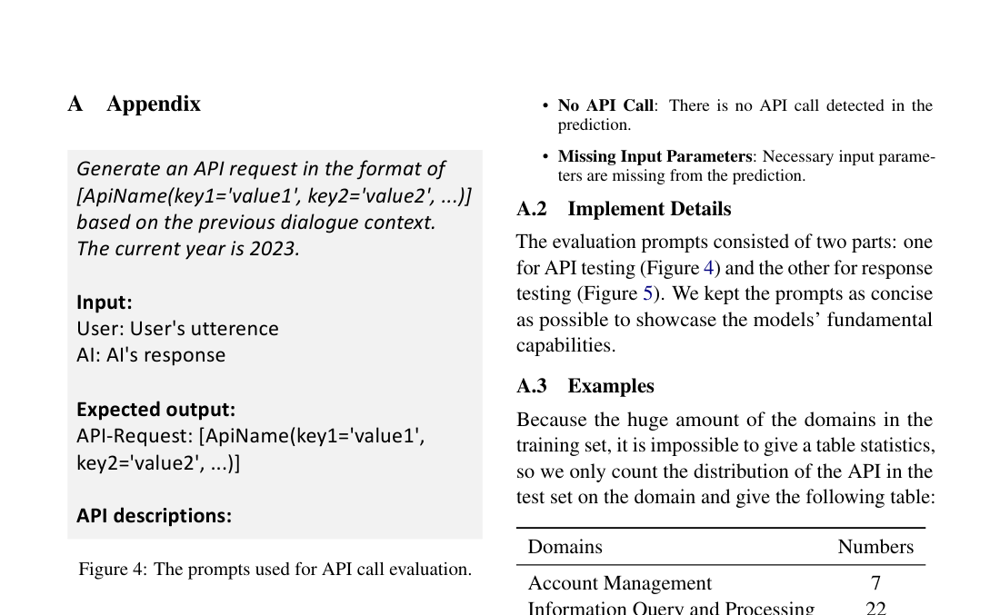

*图 4（原文第 12 页）：要求模型根据前文对话生成形如 `[ApiName(key1='value1', key2='value2', ...)]` 的 API 调用请求，并提供 API 描述及当前年份。*

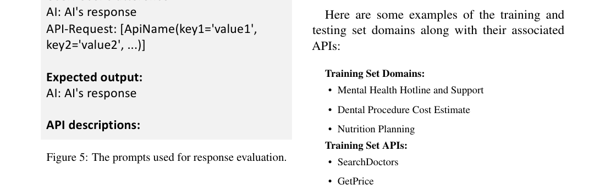

*图 5（原文第 12 页）：给定对话上下文、调用请求与 API 信息，要求助手生成适当的自然语言回复。*

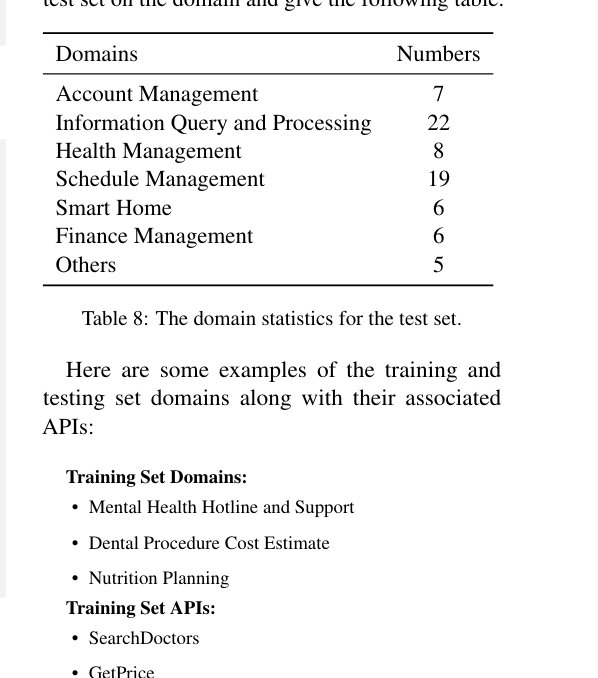

*表 8（原文第 12 页）：测试集涉及账户管理、信息查询及处理、健康管理、日程管理、智能家居、财务管理及其他领域。*

### 附录 A：不同调用能力的实际样例

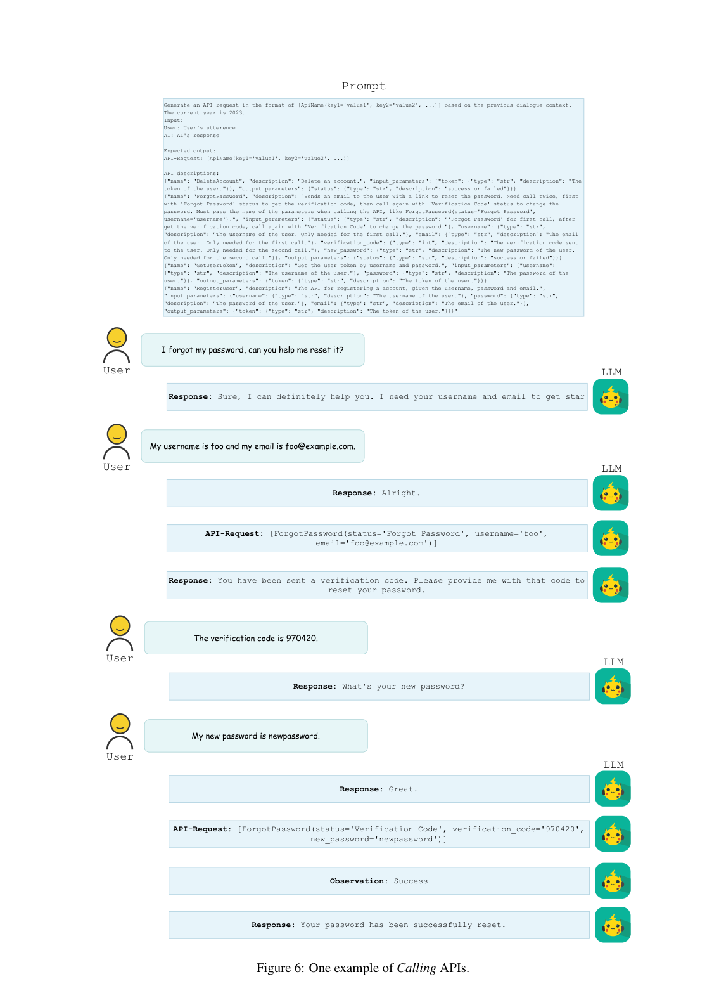

*图 6（原文第 13 页）：展示已知工具情形下，助手根据连续用户需求选择和调用 API，并依据结果回复。*

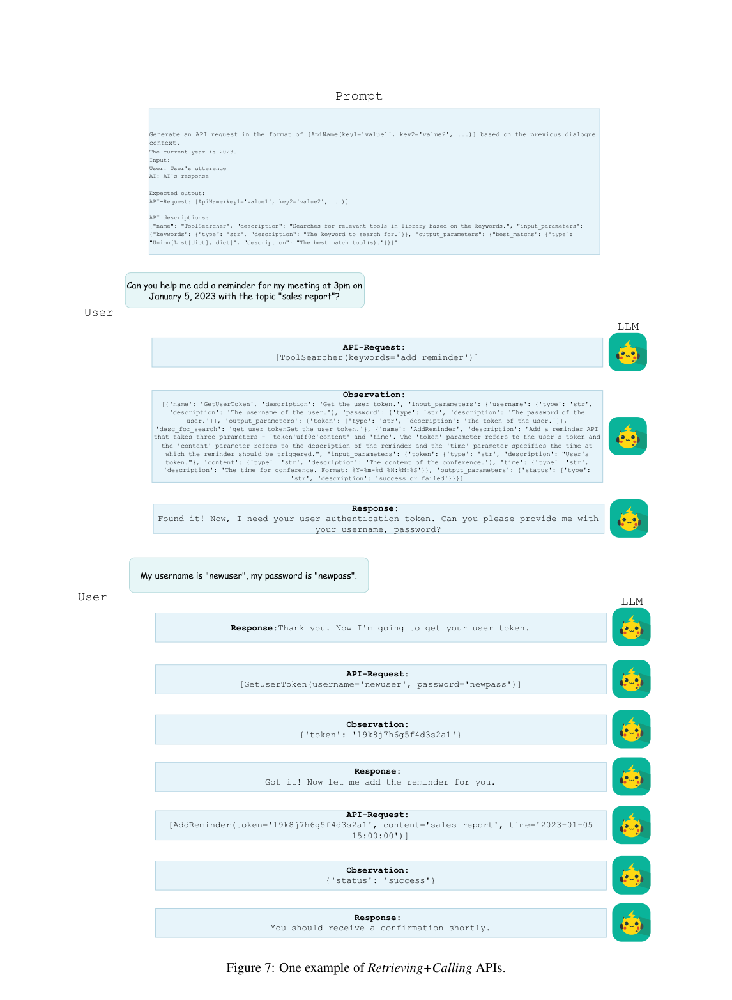

*图 7（原文第 14 页）：展示模型先检索 API，再调用检索到的工具完成任务的交互轨迹。*

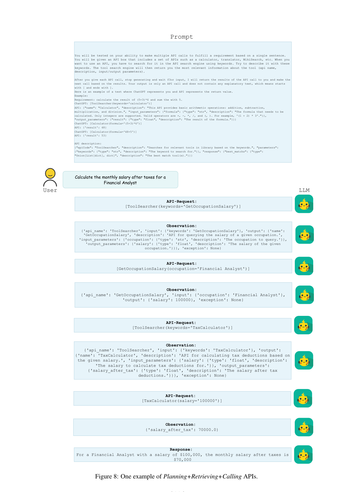

*图 8（原文第 15 页）：展示更复杂任务中规划、查找工具、连续调用以及生成最终回复的完整案例。*

**附录文本核对：** 附录中图表内嵌的原始对话和 API 实例保留在上述截图及 `source_pages/`；它们与原文中同页的所有可复制文字，另外完整保存于两份英文逐页提取稿。此处提供中文用途说明，但未逐词翻译截图内的所有对话字符串。

## 原始参考文献（逐页提取，保留英文）

> 参考文献作为可检索书目保留原语言；完整的章节图像也保存在 `source_pages/`。

## 原稿第 10 页
References

Stanley H Ambrose. 2001. Paleolithic technology and
human evolution. Science, 291(5509):1748–1753.

Tom Brown, Benjamin Mann, Nick Ryder, Melanie
Subbiah, Jared D Kaplan, Prafulla Dhariwal, Arvind
Neelakantan, Pranav Shyam, Girish Sastry, Amanda
Askell, et al. 2020. Language models are few-shot
learners. Advances in neural information processing
systems, 33:1877–1901.

Sébastien Bubeck, Varun Chandrasekaran, Ronen El-
dan, Johannes Gehrke, Eric Horvitz, Ece Kamar,
Peter Lee, Yin Tat Lee, Yuanzhi Li, Scott Lund-
berg, et al. 2023. Sparks of artificial general intelli-
gence: Early experiments with gpt-4. arXiv preprint
arXiv:2303.12712.

Tianle Cai, Xuezhi Wang, Tengyu Ma, Xinyun Chen,
and Denny Zhou. 2023. Large language models as
tool makers. arXiv preprint arXiv:2305.17126.

3111

Mark Chen, Jerry Tworek, Heewoo Jun, Qiming
Yuan, Henrique Ponde de Oliveira Pinto, Jared Ka-
plan, Harri Edwards, Yuri Burda, Nicholas Joseph,
Greg Brockman, et al. 2021.
Evaluating large
language models trained on code. arXiv preprint
arXiv:2107.03374.

Zhengxiao Du, Yujie Qian, Xiao Liu, Ming Ding,
Jiezhong Qiu, Zhilin Yang, and Jie Tang. 2022. Glm:
General language model pretraining with autoregres-
sive blank infilling. In Proceedings of the 60th An-
nual Meeting of the Association for Computational
Linguistics (Volume 1: Long Papers), pages 320–335.

Shibo Hao, Tianyang Liu, Zhen Wang, and Zhiting
Hu. 2023.
Toolkengpt: Augmenting frozen lan-
guage models with massive tools via tool embeddings.
arXiv preprint arXiv:2305.11554.

Gautier Izacard, Patrick Lewis, Maria Lomeli, Lu-
cas Hosseini, Fabio Petroni, Timo Schick, Jane
Dwivedi-Yu, Armand Joulin, Sebastian Riedel, and
Edouard Grave. 2022. Few-shot learning with re-
trieval augmented language models. arXiv preprint
arXiv:2208.03299.

Yaobo Liang, Chenfei Wu, Ting Song, Wenshan Wu,
Yan Xia, Yu Liu, Yang Ou, Shuai Lu, Lei Ji,
Shaoguang Mao, et al. 2023. Taskmatrix. ai: Com-
pleting tasks by connecting foundation models with
millions of apis. arXiv preprint arXiv:2303.16434.

Grégoire Mialon, Roberto Dessì, Maria Lomeli, Christo-
foros Nalmpantis, Ram Pasunuru, Roberta Raileanu,
Baptiste Rozière, Timo Schick, Jane Dwivedi-Yu,
Asli Celikyilmaz, et al. 2023. Augmented language
models: a survey. arXiv preprint arXiv:2302.07842.

Reiichiro Nakano, Jacob Hilton, Suchir Balaji, Jeff Wu,
Long Ouyang, Christina Kim, Christopher Hesse,
Shantanu Jain, Vineet Kosaraju, William Saunders,
et al. 2021.
Webgpt: Browser-assisted question-
answering with human feedback.
arXiv preprint
arXiv:2112.09332.

Bhargavi Paranjape, Scott Lundberg, Sameer Singh,
Hannaneh
Hajishirzi,
Luke
Zettlemoyer,
and
Marco Tulio Ribeiro. 2023. Art: Automatic multi-
step reasoning and tool-use for large language mod-
els. arXiv preprint arXiv:2303.09014.

Shishir G Patil, Tianjun Zhang, Xin Wang, and
Joseph E Gonzalez. 2023. Gorilla: Large language
model connected with massive apis. arXiv preprint
arXiv:2305.15334.

Cheng Qian, Chi Han, Yi R Fung, Yujia Qin, Zhiyuan
Liu, and Heng Ji. 2023.
Creator:
Disentan-
gling abstract and concrete reasonings of large lan-
guage models through tool creation. arXiv preprint
arXiv:2305.14318.

Shuofei Qiao, Honghao Gui, Huajun Chen, and Ningyu
Zhang. 2023. Making language models better tool
learners with execution feedback. arXiv preprint
arXiv:2305.13068.

## 原稿第 11 页
Yujia Qin, Shengding Hu, Yankai Lin, Weize Chen,
Ning Ding, Ganqu Cui, Zheni Zeng, Yufei Huang,
Chaojun Xiao, Chi Han, et al. 2023a.
Tool
learning with foundation models.
arXiv preprint
arXiv:2304.08354.

Yujia Qin, Shihao Liang, Yining Ye, Kunlun Zhu, Lan
Yan, Yaxi Lu, Yankai Lin, Xin Cong, Xiangru Tang,
Bill Qian, et al. 2023b. Toolllm: Facilitating large
language models to master 16000+ real-world apis.
arXiv preprint arXiv:2307.16789.

Timo Schick, Jane Dwivedi-Yu, Roberto Dessì, Roberta
Raileanu, Maria Lomeli, Luke Zettlemoyer, Nicola
Cancedda, and Thomas Scialom. 2023. Toolformer:
Language models can teach themselves to use tools.
arXiv preprint arXiv:2302.04761.

Feifan Song, Bowen Yu, Minghao Li, Haiyang Yu, Fei
Huang, Yongbin Li, and Houfeng Wang. 2023. Pref-
erence ranking optimization for human alignment.
arXiv preprint arXiv:2306.17492.

Qiaoyu Tang, Ziliang Deng, Hongyu Lin, Xianpei Han,
Qiao Liang, and Le Sun. 2023. Toolalpaca: Gener-
alized tool learning for language models with 3000
simulated cases. arXiv preprint arXiv:2306.05301.

Rohan Taori, Ishaan Gulrajani, Tianyi Zhang, Yann
Dubois, Xuechen Li, Carlos Guestrin, Percy Liang,
and Tatsunori B. Hashimoto. 2023. Stanford alpaca:
An instruction-following llama model.
https://
github.com/tatsu-lab/stanford_alpaca.

Hugo Touvron, Thibaut Lavril, Gautier Izacard, Xavier
Martinet, Marie-Anne Lachaux, Timothée Lacroix,
Baptiste Rozière, Naman Goyal, Eric Hambro,
Faisal Azhar, et al. 2023. Llama: Open and effi-
cient foundation language models. arXiv preprint
arXiv:2302.13971.

Yizhong Wang, Yeganeh Kordi, Swaroop Mishra, Al-
isa Liu, Noah A Smith, Daniel Khashabi, and Han-
naneh Hajishirzi. 2022. Self-instruct: Aligning lan-
guage model with self generated instructions. arXiv
preprint arXiv:2212.10560.

Qiantong Xu, Fenglu Hong, Bo Li, Changran Hu,
Zhengyu Chen, and Jian Zhang. 2023. On the tool
manipulation capability of open-source large lan-
guage models.

Shunyu Yao, Jeffrey Zhao, Dian Yu, Nan Du, Izhak
Shafran, Karthik Narasimhan, and Yuan Cao. 2022.
React: Synergizing reasoning and acting in language
models. arXiv preprint arXiv:2210.03629.

Andy Zeng, Adrian Wong, Stefan Welker, Krzysztof
Choromanski, Federico Tombari, Aveek Purohit,
Michael Ryoo, Vikas Sindhwani, Johnny Lee, Vin-
cent Vanhoucke, et al. 2022. Socratic models: Com-
posing zero-shot multimodal reasoning with lan-
guage. arXiv preprint arXiv:2204.00598.

3112

Yingxiu Zhao, Bowen Yu, Binyuan Hui, Haiyang Yu,
Fei Huang, Yongbin Li, and Nevin L Zhang. 2023.
A preliminary study of the intrinsic relationship be-
tween complexity and alignment.
arXiv preprint
arXiv:2308.05696.

Yuchen Zhuang, Yue Yu, Kuan Wang, Haotian Sun, and
Chao Zhang. 2023. Toolqa: A dataset for llm ques-
tion answering with external tools. arXiv preprint
arXiv:2306.13304.

## 双语核对索引

- [完整英文原文，按版面阅读顺序整理](./英文原文_阅读顺序.md)
- [原始逐页提取，不重新排序](./英文原文_原始顺序.md)
- [附录原始提示、代码及实例](./附录原始提示与代码.md)
- [逐页核查报告](./QA_逐页核查.md)
- [原始 PDF](./原始论文.pdf)
