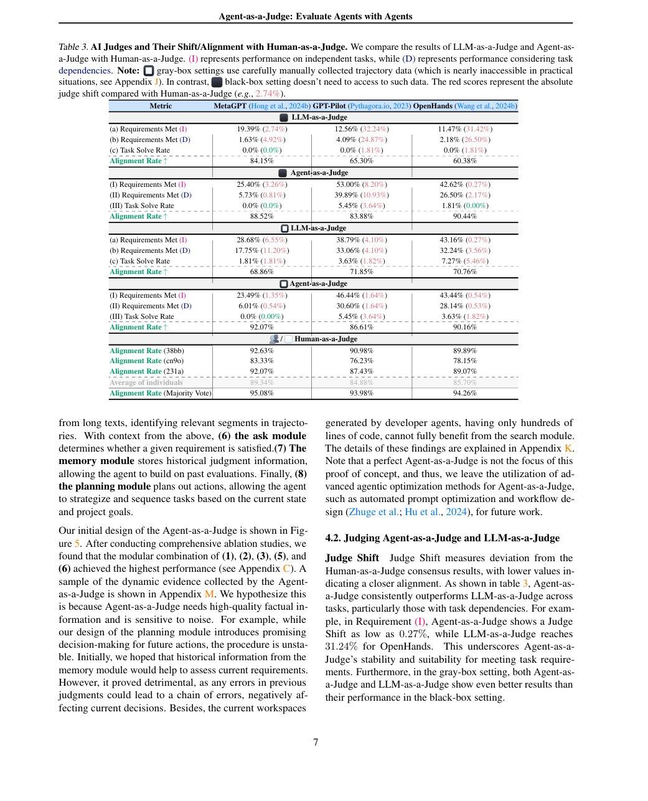

# Agent-as-a-Judge：使用智能体评价智能体

> **翻译状态：部分翻译（摘要全译 + 明确标注的原文节译）。非全文中文精译。**

英文标题：Agent-as-a-Judge: Evaluate Agents with Agents  
发表信息：ICML 2025  
原始 PDF：43 页  
[阅读原始 PDF](./原始论文.pdf) · [英文逐页全文及配图](./英文原文_逐页全文与配图.md) · [参考文献及后续原文](./参考文献及后续原文.md) · [图表索引](./图表索引.md)

## 摘要（全文翻译，PDF 第 1 页）

现有评价技术不足以评价智能体系统。这些方法要么仅关注最终结果——忽略智能体系统逐步展开的思考过程——要么需要大量人工劳动。为解决这一问题，我们引入 Agent-as-a-Judge 框架，即使用智能体系统评价智能体系统。这是 LLM-as-a-Judge 框架的自然扩展，其中融入了智能体特性，能够对整个任务求解过程提供中间反馈，从而实现更精确的评价。我们将 Agent-as-a-Judge 应用于代码生成任务。为了克服现有基准的不足，并为 Agent-as-a-Judge 提供概念验证测试平台，我们提出 DevAI，这是由 55 项真实的 AI 代码生成任务组成的新基准。DevAI 包含丰富的人工标注，例如总计 365 项层次化的解决方案要求，因而特别适合智能体裁判。我们使用 Agent-as-a-Judge 对三个领先的代码生成智能体系统进行基准测试，发现该框架显著优于 LLM-as-a-Judge，并且与人工评价基线一样可靠。总体而言，我们认为这项工作是实现更加复杂的智能体系统的一项具体进展。为推动这方面的发展，我们的数据集和 Agent-as-a-Judge 的完整实现将公开于 https://github.com/metauto-ai/agent-as-a-judge。

[核对原版第 1 页](./source_pages/page-001.jpg)

## 引言（节译）（PDF 第 1 页）

近年来，多模态智能体系统已从偶尔能够解决小型玩具问题，发展到经常被部署以处理富有挑战性的真实世界问题。然而，智能体系统现有的评价方法与可用基准难以跟上这种快速进展，显著阻碍了真正的进步。我们认为，当前智能体评价的问题源于缺乏对这些非传统系统任务求解中间阶段的反馈。智能体系统更像人一样思考，逐步行动，并且往往在内部进行类似人类的自然语言讨论来解决问题。因此，对它们的评价也应像评价人一样，提供考察完整思考与行动轨迹的丰富反馈。使用传统方法评价智能体系统，好比使用选择题评价学生，是一种相对不可靠的估计方法。

[核对原版第 1 页](./source_pages/page-001.jpg)

## 第 4.2 节：Judge Shift（裁判偏移）（PDF 第 7 页）

Judge Shift 衡量与 Human-as-a-Judge 共识结果之间的偏差，数值越低表示与人工共识越接近。表 3 显示 Agent-as-a-Judge 在各任务上持续优于 LLM-as-a-Judge，尤其是具有任务依赖关系的情况。例如，在要求（I）中，对 OpenHands 的 Agent-as-a-Judge 的偏移低至 0.27%，而 LLM-as-a-Judge 在正文中报告为 31.24%（注意：同页表 3 写作 31.42%，原文存在数值不一致，需核对）。这突显了 Agent-as-a-Judge 在满足任务要求方面的稳定性与适用性。此外，在灰盒设置下，两种裁判都表现出比黑盒设置更好的结果。

[核对原版第 7 页](./source_pages/page-007.jpg)

**原文 table 3 · PDF 第 7 页（候选图表区域）**

## 尚未完成的翻译

其余正文、附录、完整图表说明、表内文字及参考文献标题尚未逐段翻译。本文件不是 43 页全文中文版。所有页面的英文文本层与页面截图均在英文逐页文档中保留。

[继续阅读英文原文](./英文原文_逐页全文与配图.md) · [图表索引](./图表索引.md) · [原始 PDF](./原始论文.pdf)

## 研究分类（初步判定，非原文内容）

- 主类别：B
- 阅读优先级：P0
- 归类理由：提出智能体裁判并与人工共识、LLM 裁判对照，直接服务评价器有效性研究。
- 重点阅读：第 3–4 节：人工共识、裁判偏移、一致率与消融；第 7 页表 3。
- 分类尚未完成全部原文及评价代码核验；不代表复现实验成功。
