# 图表索引（原图截图）

> 按 PDF 原始页码索引，图表编号与原文一致。每张图提供裁切图和源页全图。若裁切不完整，以源页图为准。

## 图 1（原 PDF 第 2 页）

**英文原图题**：Figure 1: The illustrative overview of AGENTBOARD. AGENTBOARD consists of a 9 diverse tasks. Agents interact in multi-rounds with partially-observable environments to achieve each subgoal. Furthermore, AGENT- BOARD provides an open-source analytical evaluation framework, as shown in the figure.

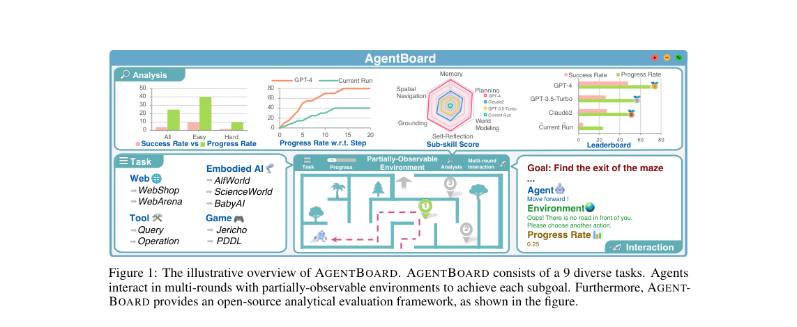

[查看完整原稿第 2 页](./source_pages/page-002.jpg)

## 表 1（原 PDF 第 3 页）

**英文原图题**：Table 1: AGENTBOARD differs from other LLM benchmarks by providing a comprehensive framework that integrates all four guiding principles within its evaluation system. ‡Notably, AgentBench entails both single and multi-round tasks, with mainly the former differentiating open-sourced models. §The GAIA benchmark focuses solely on question answering tasks. †MINT benchmark primarily includes fully-observable environments tasks derived from conventional evaluations such as HumanEval and GSM8K.

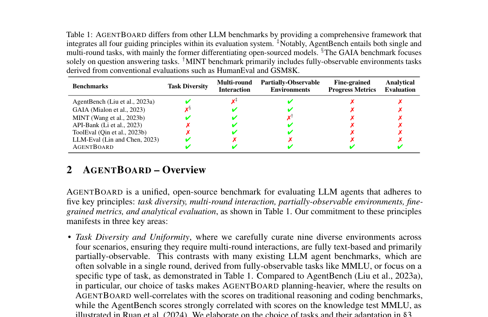

[查看完整原稿第 3 页](./source_pages/page-003.jpg)

## 图 2（原 PDF 第 4 页）

**英文原图题**：Figure 2: (Left) A structural overview of the reflex agent, which iteratively interacts with the environment and makes next step predictions based on the goal and history. (Right) An example of a prompt for our reflex agent.

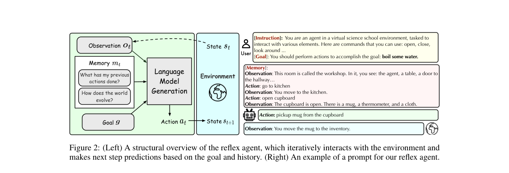

[查看完整原稿第 4 页](./source_pages/page-004.jpg)

## 表 2（原 PDF 第 4 页）

**英文原图题**：Table 2: Examples of goals for the 4 task categories in AGENTBOARD, along with a sampled step of the trajectory and progress rate. The trajectory is generated by GPT-4. Some lengthy observations are omitted with “. . .” for brevity. The task name in the table uses an abbreviation, the full name can be found in §3.

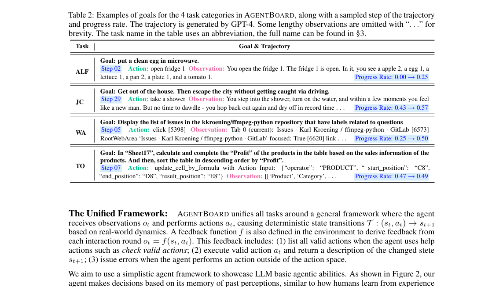

[查看完整原稿第 4 页](./source_pages/page-004.jpg)

## 图 3（原 PDF 第 6 页）

**英文原图题**：Figure 3: Human verification of AGENTBOARD progress rate. The Pearson correlation coefficients ρ compare human evaluations with the progress rates on 60 different trajectories per task. The Fleiss’ kappa κ reflects inter- annotator agreement. The trajectories are generated by three models: GPT-4, GPT-3.5-Turbo, and DeepSeek-67b.

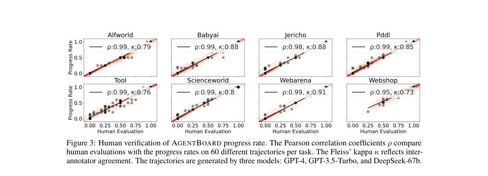

[查看完整原稿第 6 页](./source_pages/page-006.jpg)

## 表 3（原 PDF 第 7 页）

**英文原图题**：Table 3: Performance of different LLMs sorted by success rate. The “Avg." represents the average calculated over all tasks in 9 environments. “A/B" indicates that both “progress rate" and “success rate" are reported. Colors denote proprietary models , open-weight general LLMs , and agent LLMs . Confidence Intervals are

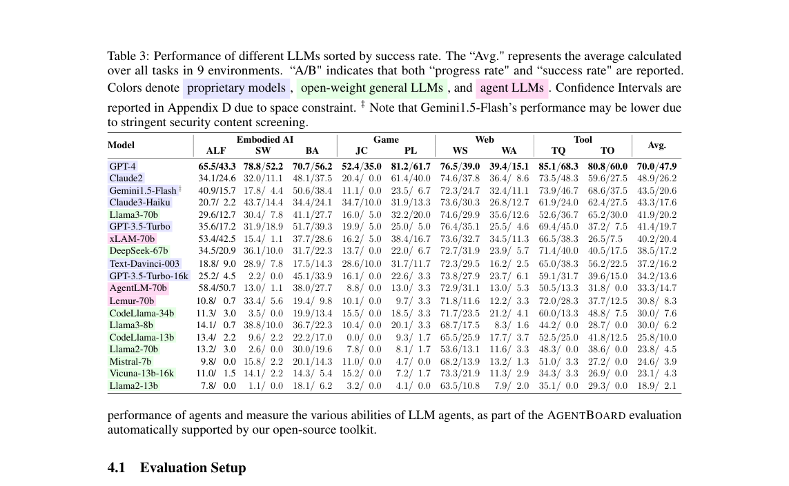

[查看完整原稿第 7 页](./source_pages/page-007.jpg)

## 表 4（原 PDF 第 8 页）

**英文原图题**：Table 4: Grounding accuracy (%) on different categories of tasks.

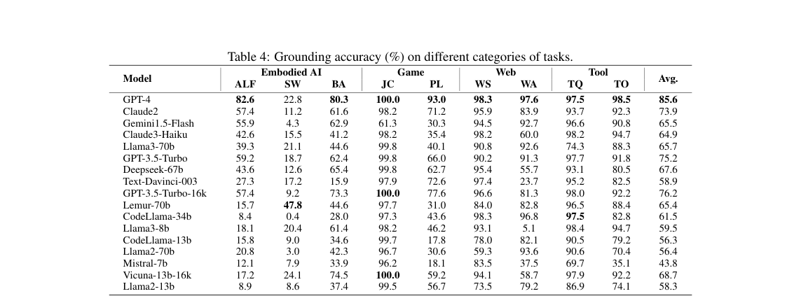

[查看完整原稿第 8 页](./source_pages/page-008.jpg)

## 表 5（原 PDF 第 8 页）

**英文原图题**：Table 5: Progress Rate and Success Rate for easy and hard cases. All models show distinct drop for hard cases.

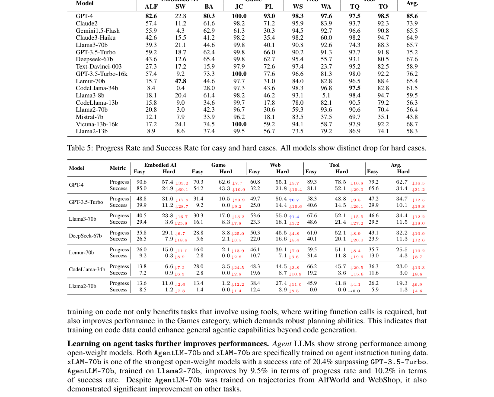

[查看完整原稿第 8 页](./source_pages/page-008.jpg)

## 图 4（原 PDF 第 9 页）

**英文原图题**：Figure 4: Long-range interaction analysis. Specifically, we report the progress rate w.r.t. step of AlfWorld, PDDL, WebArena and Tool-Query.

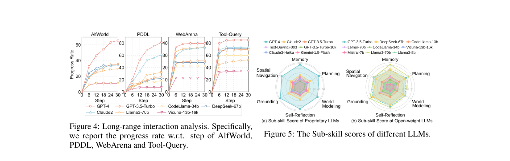

[查看完整原稿第 9 页](./source_pages/page-009.jpg)

## 图 5（原 PDF 第 9 页）

**英文原图题**：Figure 5: The Sub-skill scores of different LLMs.

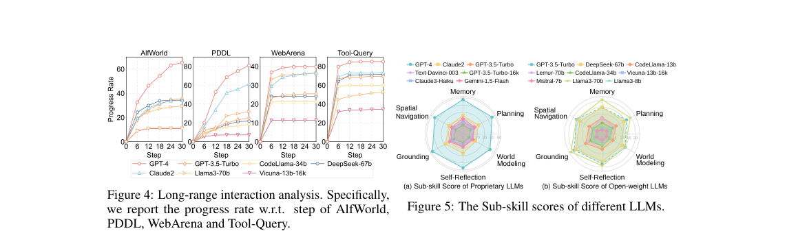

[查看完整原稿第 9 页](./source_pages/page-009.jpg)

## 表 6（原 PDF 第 15 页）

**英文原图题**：Table 6: Confidence Interval of Progress Rate Metrics

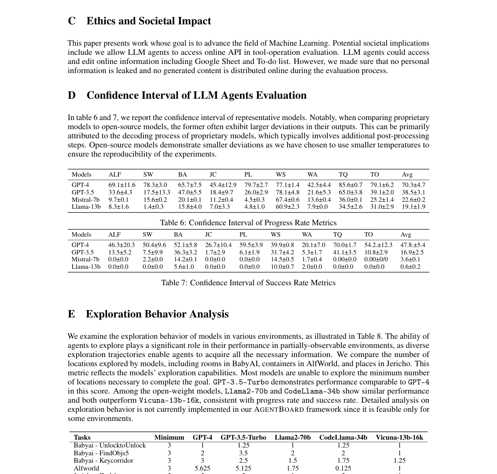

[查看完整原稿第 15 页](./source_pages/page-015.jpg)

## 表 7（原 PDF 第 15 页）

**英文原图题**：Table 7: Confidence Interval of Success Rate Metrics

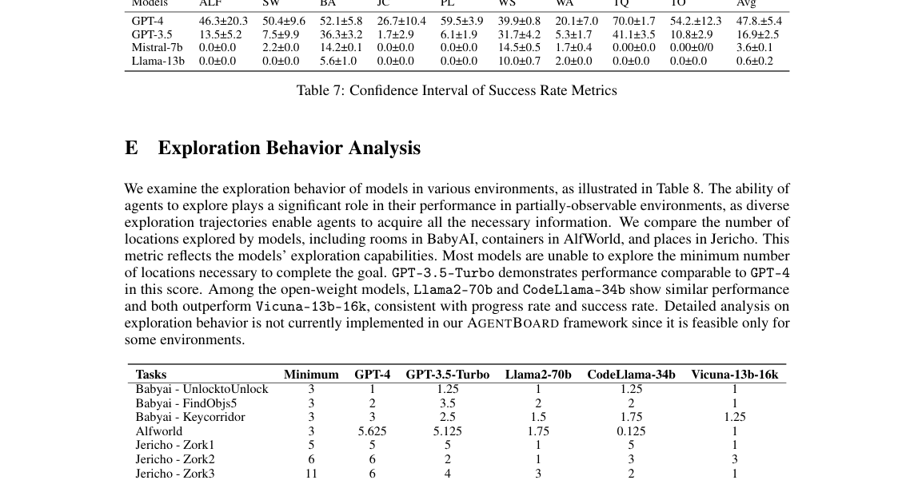

[查看完整原稿第 15 页](./source_pages/page-015.jpg)

## 表 8（原 PDF 第 15 页）

**英文原图题**：Table 8: Comparison of the number of locations(room in babyai, containers in alfworld, and places in Jericho) explored by models. The minimum column states the least number of locations need to explore on average in order to finish the tasks.

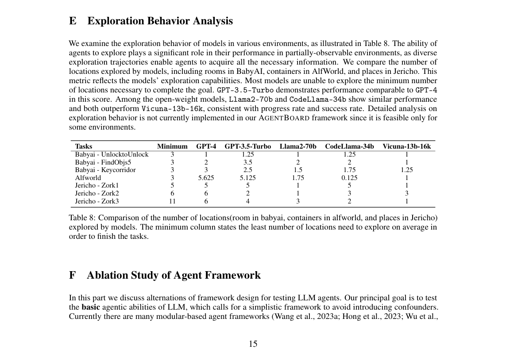

[查看完整原稿第 15 页](./source_pages/page-015.jpg)

## 表 9（原 PDF 第 16 页）

**英文原图题**：Table 9: Comparison of Act and ReAct framework using GPT-3.5-Turbo.

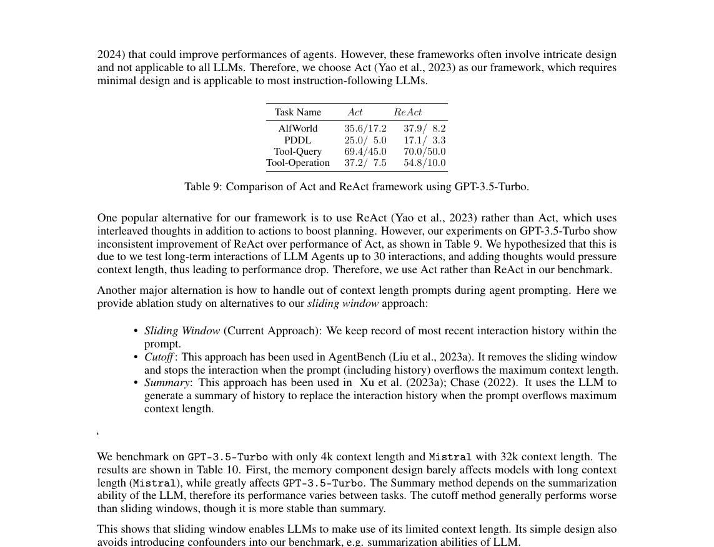

[查看完整原稿第 16 页](./source_pages/page-016.jpg)

## 表 10（原 PDF 第 17 页）

**英文原图题**：Table 10: Comparison of various memory approaches to handle long-context agent prompting.

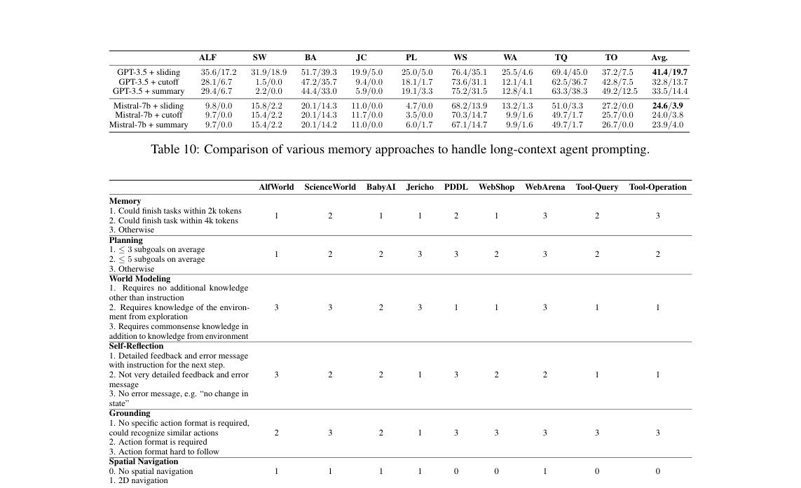

[查看完整原稿第 17 页](./source_pages/page-017.jpg)

## 表 11（原 PDF 第 17 页）

**英文原图题**：Table 11: The sub-skill scores associated with each task in AGENTBOARD.

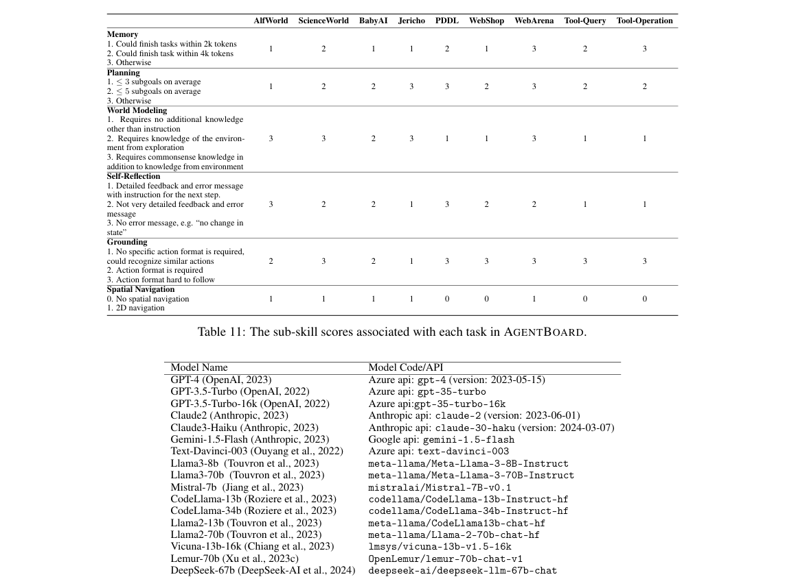

[查看完整原稿第 17 页](./source_pages/page-017.jpg)

## 表 12（原 PDF 第 17 页）

**英文原图题**：Table 12: Model code/API of our evaluated models.

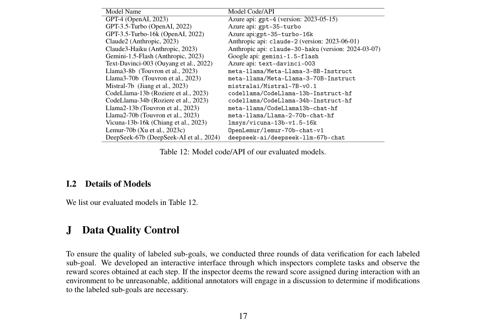

[查看完整原稿第 17 页](./source_pages/page-017.jpg)

## 图 6（原 PDF 第 18 页）

**英文原图题**：Figure 6: Visualization Panel based on WandB, composed of a summary board with all metrics and a task board for each task.

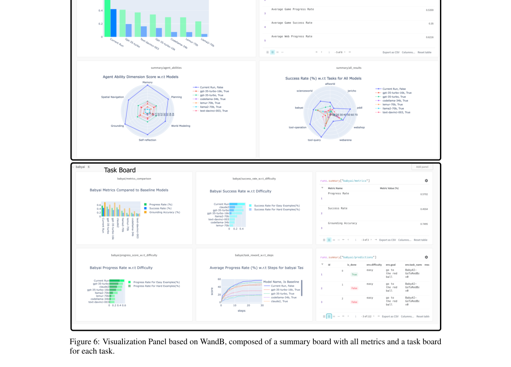

[查看完整原稿第 18 页](./source_pages/page-018.jpg)

## 表 13（原 PDF 第 18 页）

**英文原图题**：AlfWorld 10.0% ScienceWorld 0% Babyai 4.2% Jericho 25% PDDL 5% WebShop 0% WebArena 0% Tool-Query 0% Tool-Operation 0% Table 13: The proportion of environments with annotation errors in the second round of data checking. Environ- ments identified with errors are subsequently analyzed to determine the underlying causes, and any environments exhibiting similar errors are amended collectively.

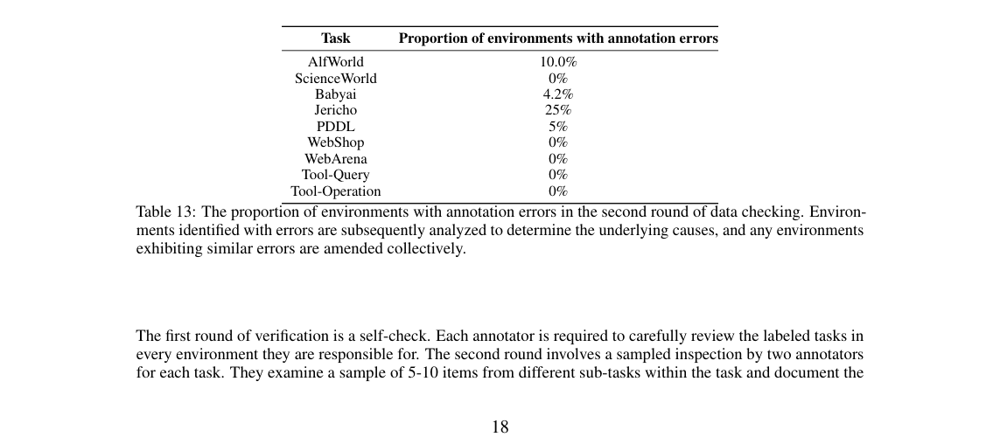

[查看完整原稿第 18 页](./source_pages/page-018.jpg)

## 图 7（原 PDF 第 19 页）

**英文原图题**：Figure 7: A case study for GPT-4 based on Panels from AGENTBOARD.

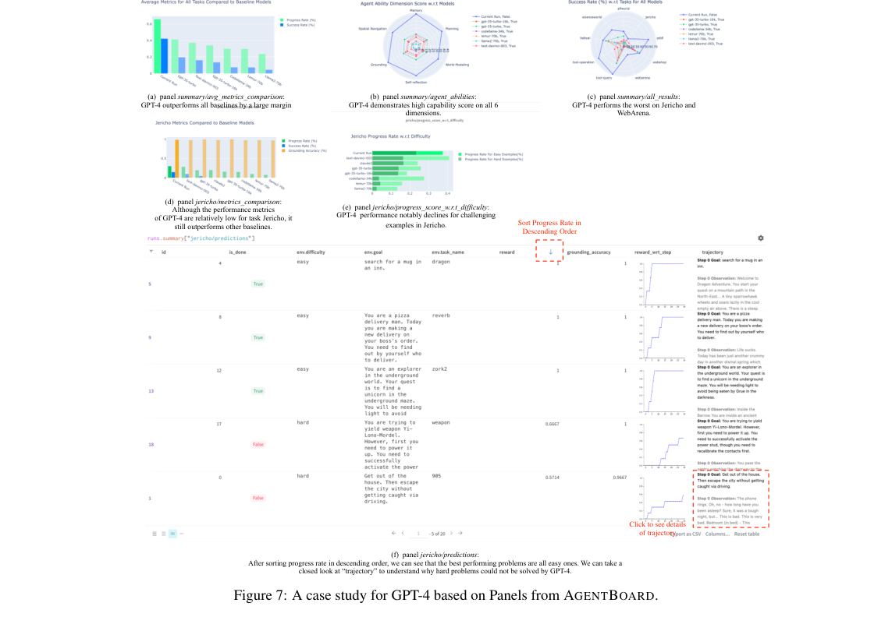

[查看完整原稿第 19 页](./source_pages/page-019.jpg)

## 表 14（原 PDF 第 19 页）

**英文原图题**：Table 14: Statistics of 9 environments in AGENTBOARD. “subgoal” and “match” means 2 different implemen- tations of progress rate rsubgoal and rmatch respectively. †Note that Sheet Environments in Tool-Operation are evaluated with rmatch, while other sub-tasks are evaluated with rsubgoal. ‡For tasks without subgoal label, we state the average number of constraints to satisfy in the goal state, which is essentially the complexity of the problems. For context length, we report the number of tokens generated with Llama2 tokenizer. † We divide problems into hard/easy based on the number of subgoals – problems with a larger number of subgoals than cutoff are viewed as hard.

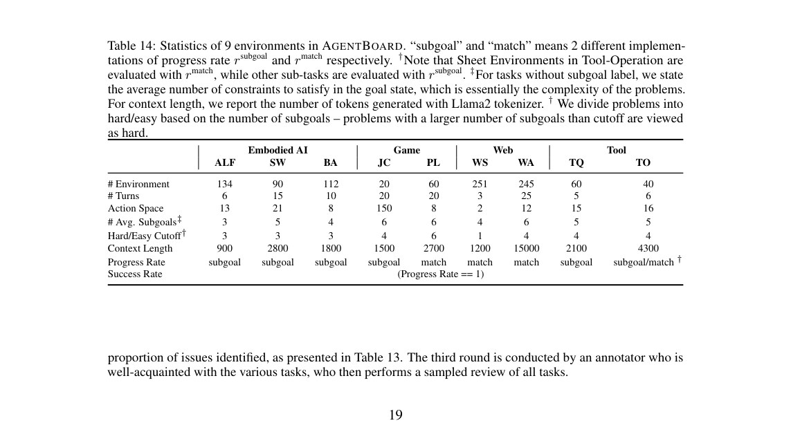

[查看完整原稿第 19 页](./source_pages/page-019.jpg)

## 图 8（原 PDF 第 20 页）

**英文原图题**：Figure 8: An illustration of our sub-goal checking interface. We develop an interactive interface for annotators to checking sub-goals. Firstly, annotators play and pass the game with the interface. The reward score for each step will be given based on the labeled score. If the annotators are dissatisfied with the reward, annotators will record them and the corresponded environment will be discussed by more annotators and annotated again."

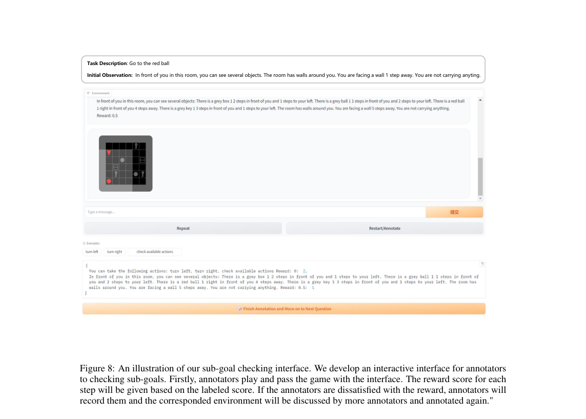

[查看完整原稿第 20 页](./source_pages/page-020.jpg)

## 表 15（原 PDF 第 23 页）

**英文原图题**：Table 15: The proportion of environments that require adaptations for the simple setup of a single set of subgoals.

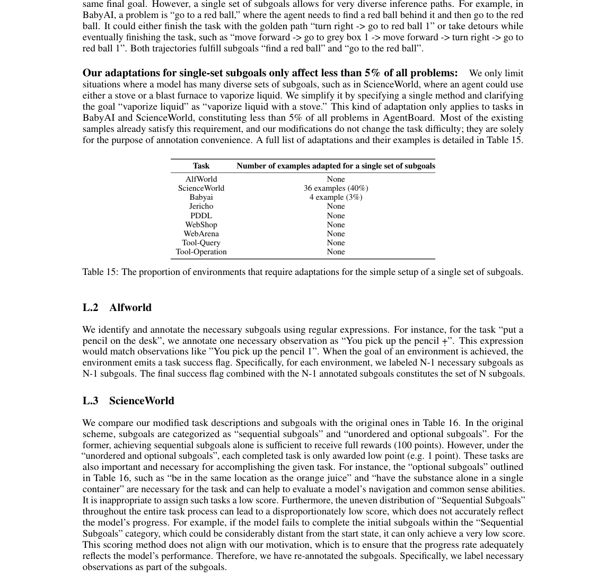

[查看完整原稿第 23 页](./source_pages/page-023.jpg)

## 表 16（原 PDF 第 24 页）

**英文原图题**：Table 16: Comparison between the original task description and subgoals of ScienceWorld and our labeled subgoals(Best viewed in color).

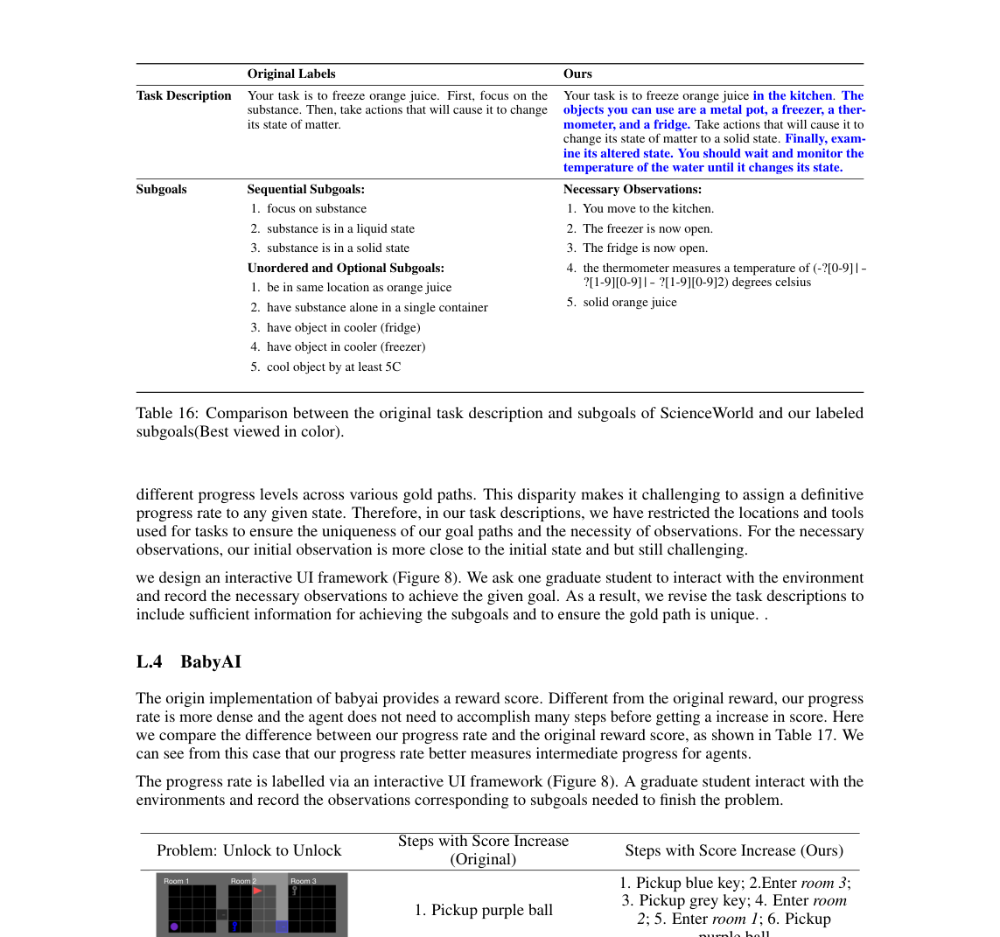

[查看完整原稿第 24 页](./source_pages/page-024.jpg)

## 表 17（原 PDF 第 24 页）

**英文原图题**：Table 17: Comparison between our progress rate for BabyAI and original reward score.

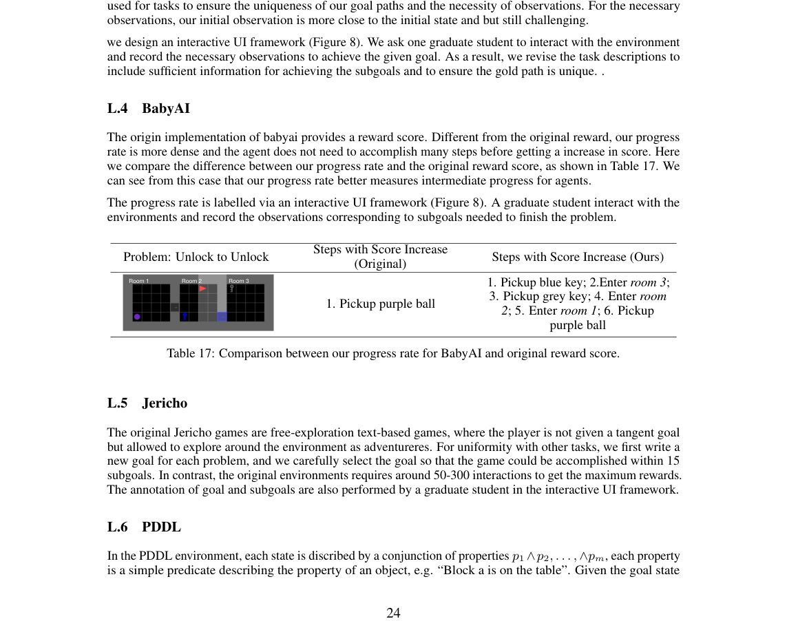

[查看完整原稿第 24 页](./source_pages/page-024.jpg)

## 图 9（原 PDF 第 26 页）

**英文原图题**：Figure 9: An illustration of the process of subgoal annotation for Academia Environment.

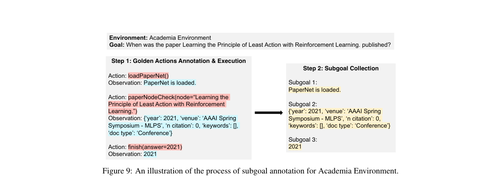

[查看完整原稿第 26 页](./source_pages/page-026.jpg)

## 图 10（原 PDF 第 26–27 页，跨页）

**英文原图题**：Figure 10: The unified prompt template in AGENTBOARD. {text} in blue font represents placeholders, which varies according to different tasks.

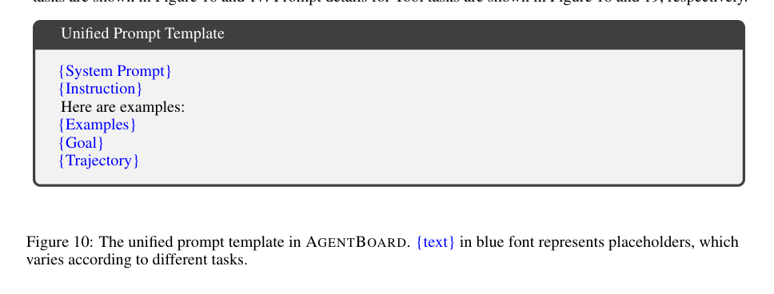

[查看完整原稿第 27 页](./source_pages/page-027.jpg)

## 图 11（原 PDF 第 27 页）

**英文原图题**：Figure 11: Prompt details for AlfWorld. The provided example is changed based on the type of the specific environment instance.

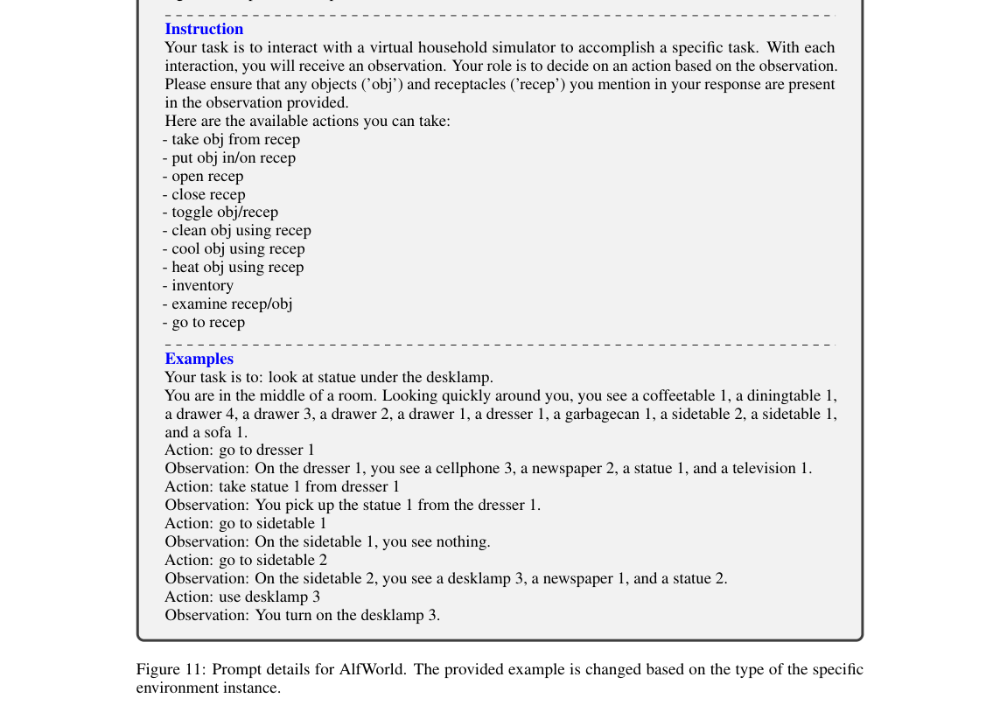

[查看完整原稿第 27 页](./source_pages/page-027.jpg)

## 图 12（原 PDF 第 28 页）

**英文原图题**：Figure 12: Prompt Details for ScienceWorld.

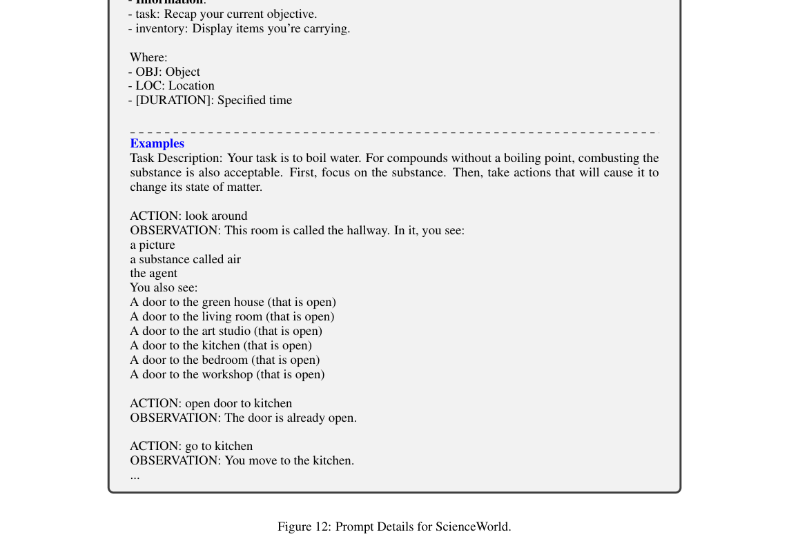

[查看完整原稿第 28 页](./source_pages/page-028.jpg)

## 图 13（原 PDF 第 29 页）

**英文原图题**：Figure 13: Prompt details for BabyAI.

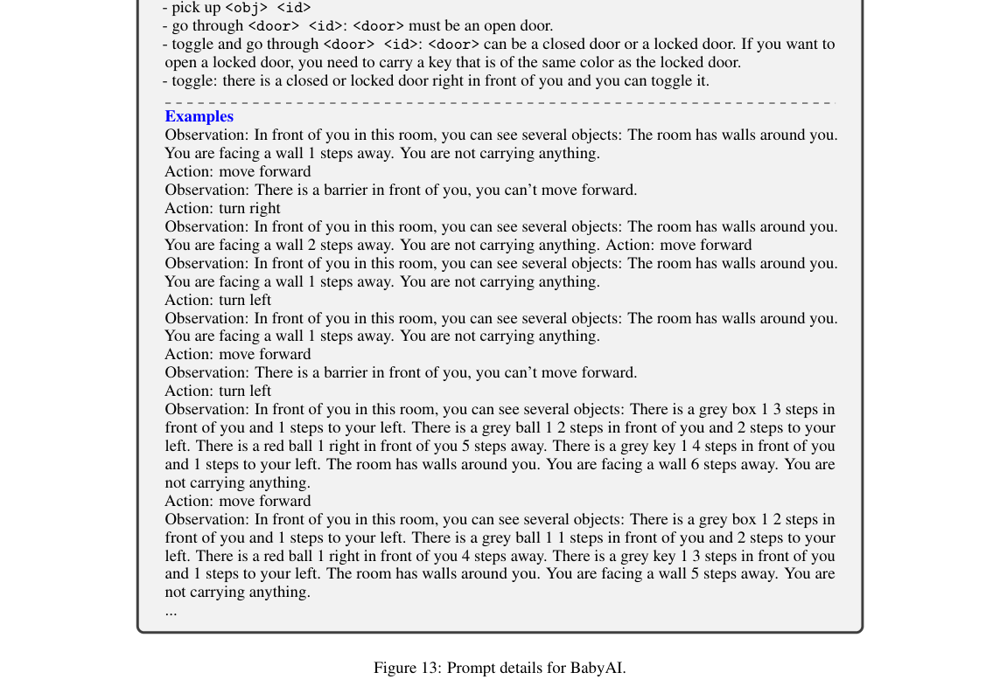

[查看完整原稿第 29 页](./source_pages/page-029.jpg)

## 图 14（原 PDF 第 30 页）

**英文原图题**：Figure 14: Prompt details for Jericho.

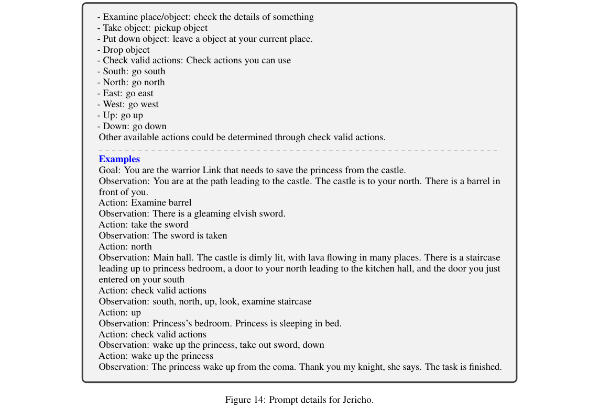

[查看完整原稿第 30 页](./source_pages/page-030.jpg)

## 图 15（原 PDF 第 31 页）

**英文原图题**：Figure 15: Prompt details for PDDL. The provided instruction/example are changed based on the type of the specific environment instance.

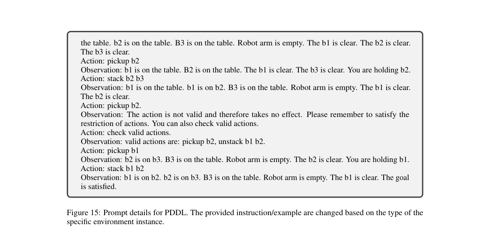

[查看完整原稿第 31 页](./source_pages/page-031.jpg)

## 图 16（原 PDF 第 32 页）

**英文原图题**：Figure 16: Prompt details for WebShop.

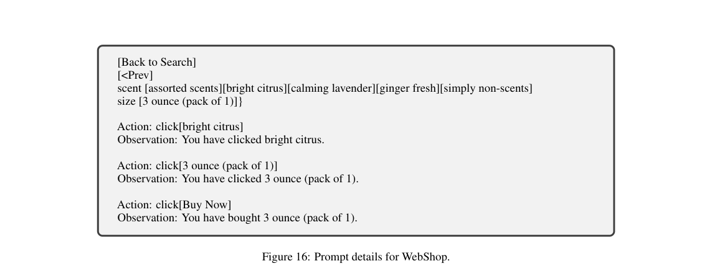

[查看完整原稿第 32 页](./source_pages/page-032.jpg)

## 图 17（原 PDF 第 33 页）

**英文原图题**：Figure 17: Prompt details for WebArena. The provided example is changed based on the type of the specific environment instance.

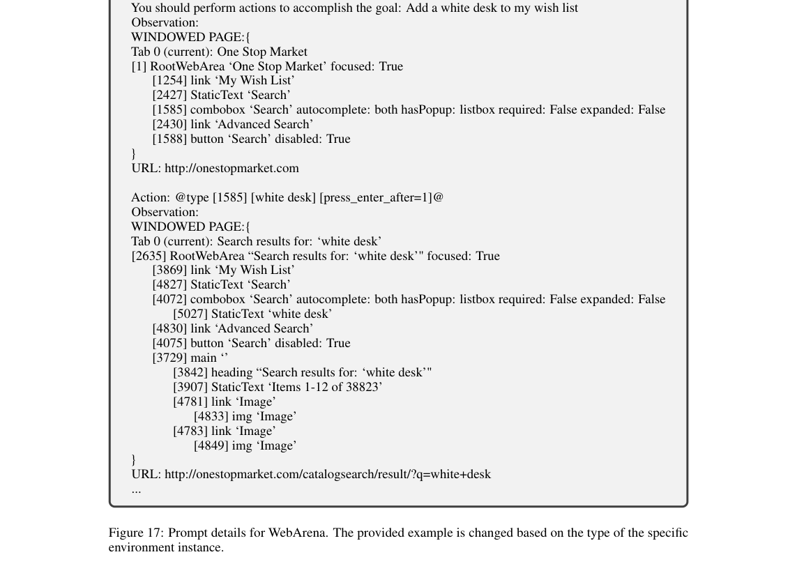

[查看完整原稿第 33 页](./source_pages/page-033.jpg)

## 图 18（原 PDF 第 35 页）

**英文原图题**：Figure 18: Prompt Details for Academia in Tool-Query Environments.

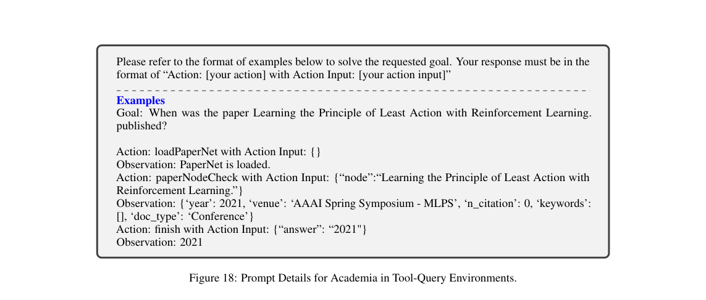

[查看完整原稿第 35 页](./source_pages/page-035.jpg)

## 图 19（原 PDF 第 37 页）

**英文原图题**：Figure 19: Prompt Details for Todo in Tool-Operation Environments.

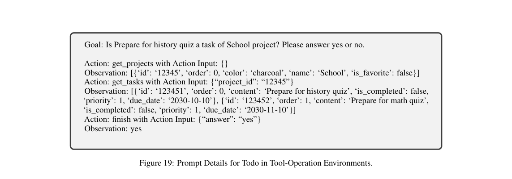

[查看完整原稿第 37 页](./source_pages/page-037.jpg)
