# AgentJudgeBench：面向智能体工具调用的多难度 LLM 评判器基准

**原题**：*AgentJudgeBench: A Multi-Difficulty Benchmark for Evaluating LLM Judges on Agentic Tool-Calling*  
**作者**：Abhigya Verma、Amit Kumar Saha、Seganrasan Subramanian、Sai Harshitha Aluru  
**机构**：ServiceNow AI  
**版本**：arXiv:2608.26623v1，2026-08-27  
**原稿页数**：31 页。

> **译稿性质**：下文包含摘要的完整中文翻译和论文正文、方法、关键实验、局限及附录的详尽中文学术译述，**并非每一页逐句完整翻译**。特别是附录中的全部数值表、评分提示词和英文参考文献，已在 `AgentJudgeBench_英文全文逐页提取.md` 中逐页保留，`source_pages/` 保存 31 页原稿图像，便于核对。所有模型名、函数、符号和原始数据不做推测性修正。

## 摘要（完整翻译）

大型语言模型（LLM）评判器已广泛用于评估智能体工具调用系统，但它们在**结构化、由依赖关系驱动的工作流**中的可靠性仍很少受到检验。本文提出 **AgentJudgeBench**，据作者所知，这是首个系统研究 LLM-as-a-judge 在工作流有向无环图（DAG）结构的智能体工具调用场景中可靠性的基准，其研究对象不同于开放式文本或偏好判断等更广义的 LLM-as-a-judge 任务。该基准包含 **3,808 个实例**，覆盖六种 DAG 拓扑结构与三个难度等级；评估涉及五个生成器（包括 3B–70B 的开放权重模型及 GPT-5.4）和六个评判器（从 20B 到前沿规模），并分别设置**提供与不提供 Ground Truth（GT）**的成对条件。评判器与程序化参考结果的一致性随任务难度增加而单调下降，且在没有 GT 时下降速度快 **1.5 倍**。对于困难任务，在不提供 GT 时，无论模型规模如何，所有六个评判器的一致性均收敛到狭窄的 **77%–82%** 区间，显示出一个主要由任务难度驱动、但对较弱生成器而言其高度也部分依赖提示词的结构性上限；仅扩大模型能力无法消除这一上限。暴露 GT 并非总是有益：GPT-5.4 的一致性下降 **1.5 个百分点**，Gemini-2.5-Pro 下降 **3.9 个百分点**，与过度锚定（over-anchoring）现象一致。缓解手段方面，思维链推理和评判器温度几乎没有影响；结构化评价细则最多可提高 **6.5 个百分点**，但这种收益不会稳定地推广到所有评判器—生成器组合。存在 GT 时，QwQ-32B 与程序化参考的匹配程度最高；人工验证研究则发现 GPT-OSS-120B 与人类判断最一致。不存在 GT 时，前沿评判器仅在共有上限内微弱领先。这些发现揭示了当前 LLM 评判器的根本性局限，并为智能体系统的可靠评估提供了实践指导。

## 1 引言与研究问题

以 LLM 作为评判器在对话、摘要、偏好评估中已十分常见。但对**智能体工具调用**的判定不应由回答是否流畅决定，而必须同时考虑：选择正确的工具、形成合法参数结构、遵循工具依赖顺序、完整覆盖用户意图。一个工具调用方案可能在这四个维度上表现不一致。

当 GT 轨迹不可用时，评判器必须仅依据用户问题与工具定义自行还原正确的执行结构。这比对照标准答案的评分复杂得多。作者因此不把评判器视作理所当然的“标准答案来源”，而将**评判器本身的可靠性**作为研究对象。

论文的六个研究问题（RQ）是：

1. 哪些指标与 DAG 拓扑最难正确评判？
2. 不同评判器之间有多一致？
3. 为什么困难任务在无 GT 时趋向相同的准确率上限？
4. 温度设置是否影响评判一致性？
5. 思维链（CoT）能否提高评判可靠性？
6. 结构化提示词和自由形式提示词有什么差异？

研究刻意区分了评判**智能体能力**与评判**评判器可靠性**这两种不同问题。

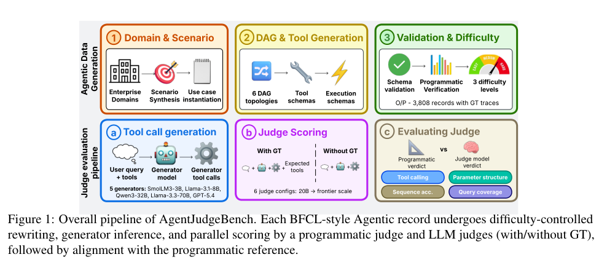

*图 1：从企业领域生成使用场景，构造六种 DAG 及工具模式；通过两级校验获得 GT；再由生成器产生工具调用结果，程序化评分器与 LLM 评判器分别评分，并比较一致性。*

## 2 相关工作

论文讨论三类工作：

- **智能体数据及工具调用基准**：BFCL、ToolBench、AgentBench、τ-bench、TaskBench、FuncBenchGen 等。若基准关注工具调用结构，往往主要评价生成器方案，而非评判方案可靠性。
- **通用 LLM-as-a-judge**：MT-Bench、JudgeBench、JudgeLM、Prometheus 2、基于多个评判器投票的方法等，强调文本质量、偏好与评判偏差，但通常不检验多步工具依赖逻辑。
- **用于工具调用的评判器**：ToolLLM、StableToolBench、MCP-AgentBench、GeoBenchX 等已经将 LLM judge 纳入评估过程，但多数只用少量样本报告汇总的“与人工判断一致率”，很少分别分析复杂度、拓扑、GT 可用性与各评分维度。

作者的方法不主张以程序化评价完全替代 LLM judge，而是利用确定性评分作为参考，系统校准评判器在不同条件下的表现。

## 3 方法

### 3.1 数据生成及难度控制

样本采用 BFCL 风格：给定企业领域与业务场景，生成带类型的工具清单、JSON 参数模式和具有前后依赖关系的理想工具调用轨迹。基准覆盖 **15 个企业领域**、**3,808 条原始记录**、**6 种 DAG 拓扑**，单条记录提供约 8–19 个可选工具。

六种拓扑：

| 英文名 | 中文理解 |
|---|---|
| Linear | 线性串行，步骤依次执行 |
| Fan-out | 扇出，一步分成多个可独立执行的分支 |
| Fan-in | 扇入，多个前置分支汇聚为共同后继步骤 |
| Diamond | 菱形，先分叉再合并的复合依赖 |
| Optional enrichment | 可选增强，存在非必要但可提供额外信息的步骤 |
| Loop-like | 类循环，包含近似迭代的依赖模式（基准数据仍进行相应结构化表示） |

每条记录转换为简单、中等、困难三个难度版本，原定 GT 轨迹不变，主要通过减少查询中显式线索与增加表述歧义来调整难度。**重要限制**：根据作者在附录的元评估，简单→中等的“确实更难”只有约 58.1% 的一致验证率，而中等→困难约 93.9%。因此把中等等级当作严格校准的中间难度是不可靠的。

作者采用结构化模式/参数类型检查与程序化语义充分性检查两层门槛，并在人类验证中抽样 120 条困难记录。这里使用合成而非真实企业执行轨迹，是为了控制依赖结构、难度并为每题配备参考轨迹；但也造成真实业务外部效度的限制。

### 3.2 两级评价系统

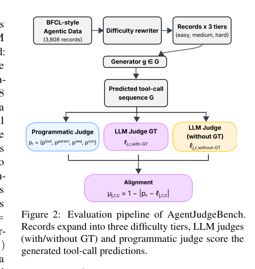

**第一层：确定性的程序化评分器（programmatic judge）**。它把生成器预测的工具调用序列与 GT 序列作结构对照，形成四维参考分数。令预测工具名称集合为 `G`、GT 工具名称集合为 `E`，注意这里的集合与有序调用序列在公式中是不同对象。

1. **工具选择（tool selection）**：惩罚使用额外工具或漏掉必须工具；核心思想是评估预测工具集合与 GT 工具集合是否一致。
2. **参数结构（parameter structure）**：准确匹配每个工具调用的参数**键集合**。完全一致给 1；包含所有要求参数、但多出了额外参数给 0.5；缺参数或工具无对应 GT 给 0。该指标不等同于检查所有参数**取值**的语义正确性。
3. **序列准确率（sequence accuracy）**：按位置比较预测与 GT 工具名称，除以参考序列长度。它可能惩罚拓扑上等价但顺序不同的方案。
4. **查询覆盖率（query coverage）**：必须工具集合中被预测集合覆盖的比例，忽略额外调用。

这些指标构成参考向量：

\[
\mathbf p_r=(p_{\rm tool},p_{\rm param},p_{\rm seq},p_{\rm cov})
\]

**第二层：LLM judge**。六个评判器读取用户查询、工具模式及生成器输出，在四维上分别输出 `0`、`0.5` 或 `1` 的判定和简短解释。**With-GT** 条件额外提供 GT 调用；**Without-GT** 仅提供用户问题及工具信息。随后将 LLM judge 判定与程序化分数作距离型一致性比较，而非将“两个 judge 的相同表述”视作正确。

程序化评分器本身不是完全可靠的地面真理。例如，参数结构评分可能惩罚模式合法且无害的额外字段；不同工具组合可能实现等价结果；合法的并行分支也可能因序列顺序不同而被误扣分。作者用人工研究检查这类差异，但并未彻底解决。

### 3.3 模型组合与规模

作者使用五个生成器，其中四个为 3B–70B 量级的开放权重模型，另一个为 GPT-5.4；六个主要评判器包括开放权重和前沿模型。每个生成器的三种难度结果分别供六个评判器在有/无 GT 条件下评判，构成 **321,648 项已完成评判**。部分附录还将 Prometheus 2 作为专门训练的额外对照，但它**不是主要六评判器统计的一员**。

## 4 实验结果与六个研究问题

### RQ1：任务难度怎样影响评价一致性？

总体而言难度越高，LLM judge 与程序化结果的一致性越低。没有 GT 时，一致性下降速度大约是有 GT 时的 1.5 倍。即使模型很强，困难的依赖结构仍要求它重建隐含的调用先后条件，并从容易混淆的工具集合中进行精确判断。

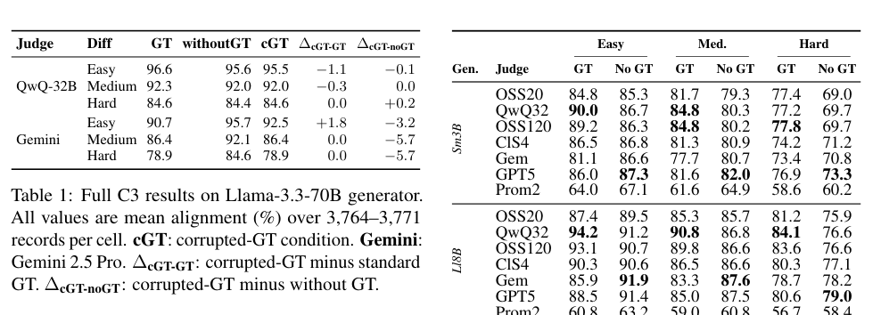
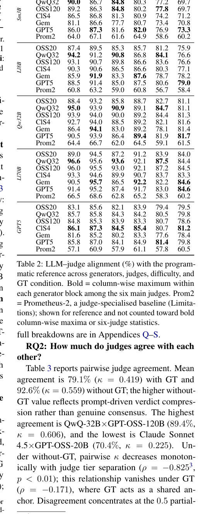
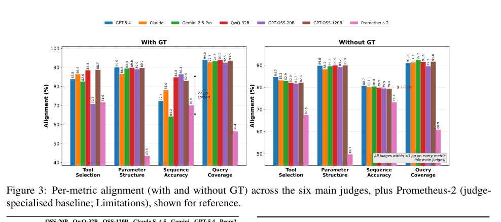

### RQ2：评判器之间的一致性高吗？

虽然不同评判器的平均准确率接近，它们给出的具体判定并不总是相同。有 GT 的情况下，跨评判器 Cohen’s κ 约为 0.42，属于中等一致程度。模型之间存在系统性的判定分歧；仅汇报总准确率容易掩盖这一点。

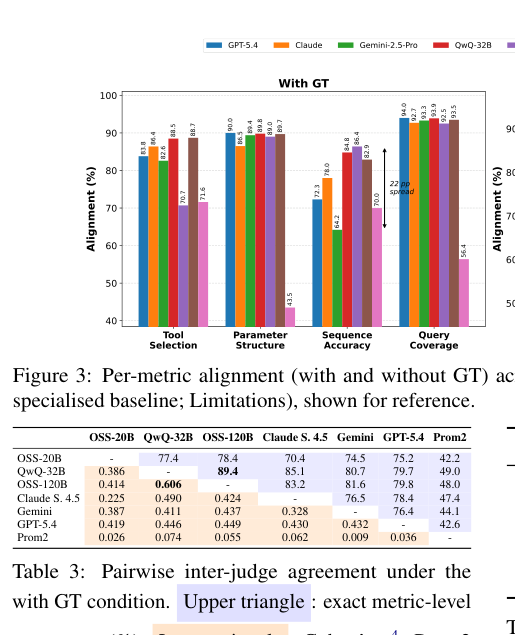
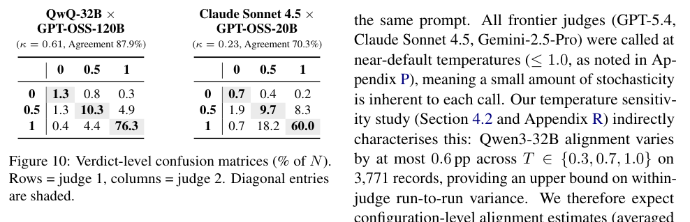

### RQ3：为什么困难任务无 GT 时聚集到 77%–82%？

六个评判器在困难问题的无 GT 条件下收敛到约 77%–82%。作者进一步对评判器默认分数策略作消融：对能力较强的生成器，调整默认偏好只能带来不超过 1 个百分点的变化，表明任务难度是主要约束；但在较弱生成器上，默认分数改动可能使结果提升约 4.1–5.6 个百分点。因此，上限的**具体高度部分受提示词影响**，不能将 77%–82% 视为超越数据集和提示词的普适常数。

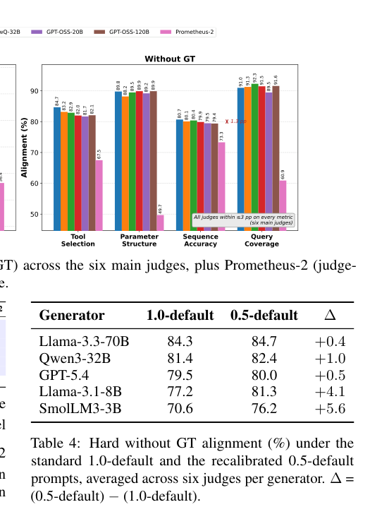

### RQ4：采样温度有明显影响吗？

在所评估的模型组合中，温度从 0.3 变化到 1.0 时，评判一致性的变化很小；初始组合的最大变化约为 0.6 个百分点，第二组模型实验中最大变化不超过 0.25 个百分点。作者据此认为，对于结构化工具判断，温度不是主要改善抓手，但这仅能推广到实际测试过的模型与参数范围。

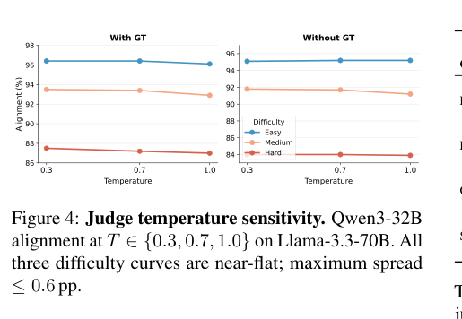
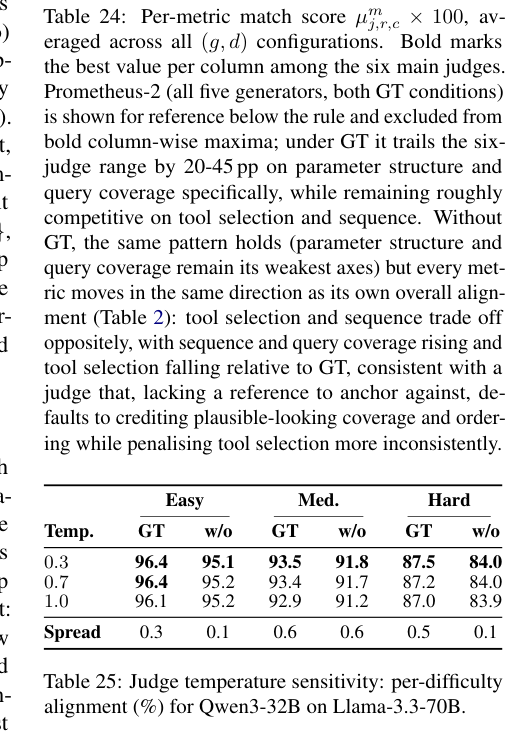
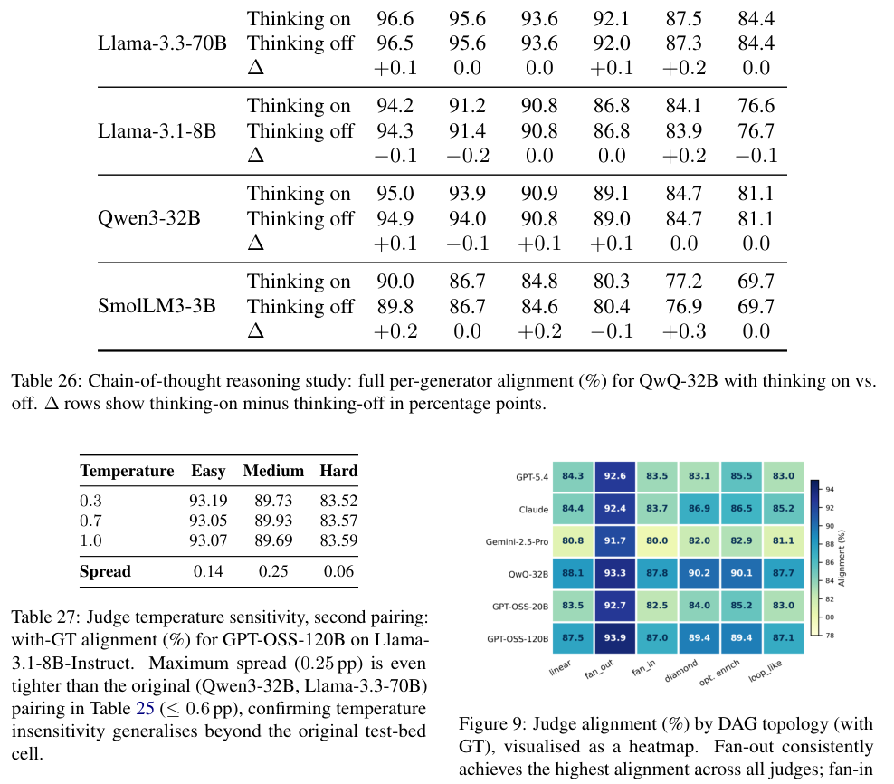

### RQ5：思维链 CoT 有效吗？

QwQ-32B 开启与关闭推理功能，在 24 组成对单元上差异非常小，有 GT 时平均仅提高约 0.11 个百分点，各单元最大差异不超过 0.3 个百分点。论文因此没有证据表明更长的推理输出能显著纠正结构化工具评分的系统性偏差。

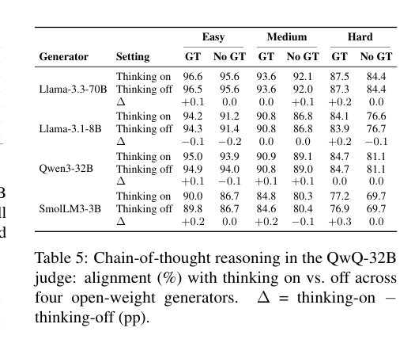
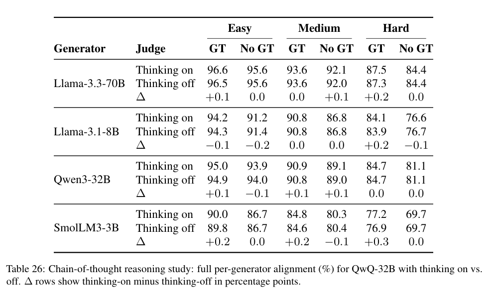

### RQ6：结构化评分细则有用吗？

在第一组评判器—生成器组合上，明确逐维度判定标准的 JSON 结构化提示词相对自由形式提示词带来 **4.8–6.5 个百分点**的一致性提升。这是论文测试的配置变量中较明显的改进之一。但第二组组合只在简单与中等任务上改善，困难任务反而略低约 0.8 个百分点，因此效果受评判器、生成器质量和难度影响。

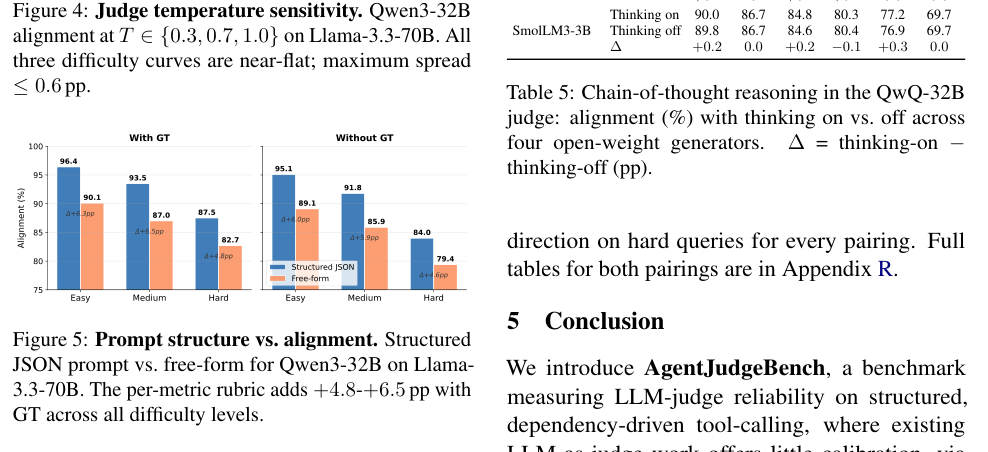
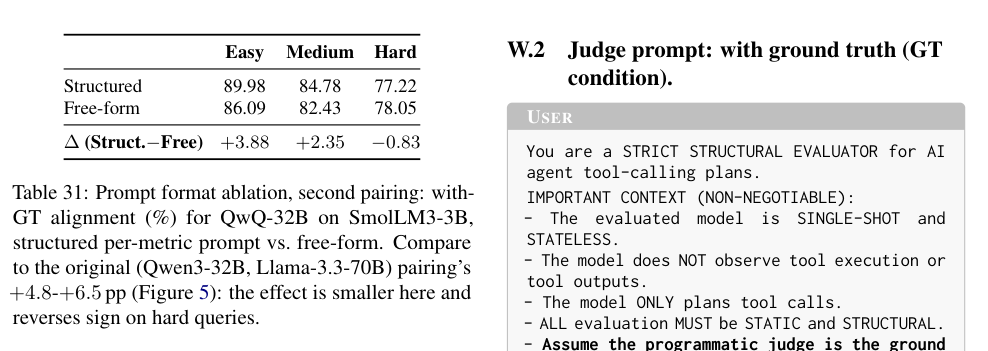

## 5 结论

论文通过六种 DAG 拓扑、三个难度等级和有/无 GT 的配对评测说明：当前 LLM judge 的可靠性随结构性难度升高而下降；提供 GT 不必然提升判定质量；换用更大的模型、增加思维链或调整温度，都不能单独消除结构化工具调用评价中的系统性缺陷。相比之下，**定义清晰的逐维度评分规则、程序化结果验证，以及必要时的人类复核**更直接且可操作。

## 附录 A：评判器使用决策指南

原文的表 6 给出不同应用场景下的推荐排序；这里仅报告文章的实验结论，不应在其他数据分布上视为普适排序。

| 评分条件 | 难度 | 作者测得的最一致评判器 | 一致性 |
|---|---|---|---:|
| 无 GT | 简单 | Gemini-2.5-Pro | 92.1% |
| 无 GT | 中等 | GPT-5.4 | 87.7% |
| 无 GT | 困难 | GPT-5.4 | 79.7% |
| 有 GT | 简单 | QwQ-32B | 94.0% |
| 有 GT | 中等 | QwQ-32B | 90.0% |
| 有 GT | 困难 | QwQ-32B | 83.4% |

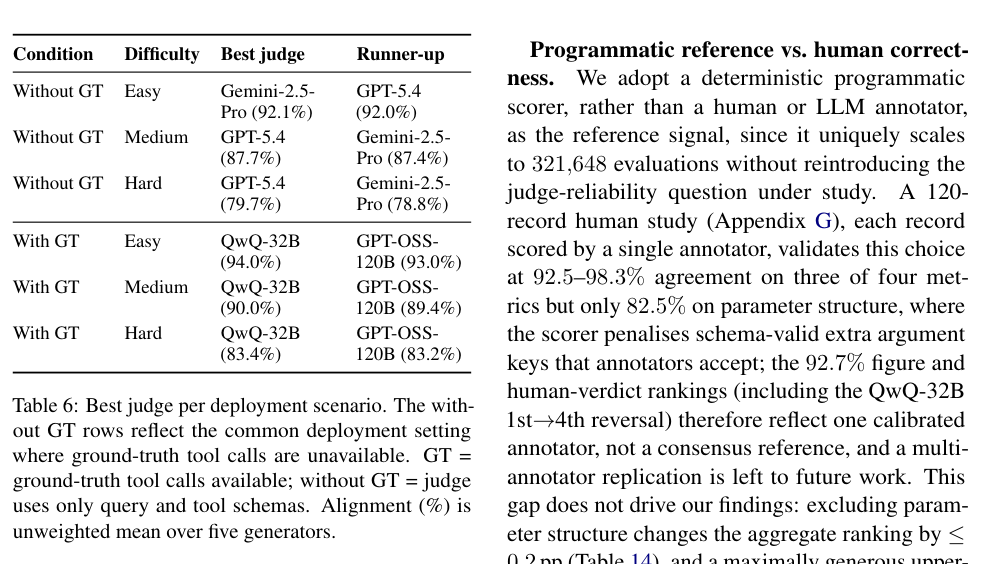

论文进一步指出：若核心目标是**与人工判断**一致，而非与程序化评分器一致，应关注 GPT-OSS-120B 的表现；若将判定从 `{0, 0.5, 1}` 压缩为二元通过/不通过，评判器排名也可能发生很大变化，且大量中间分数被重新映射会人为影响对齐率。

## 附录 B–X：重要复现与局限内容

这篇论文的附录较长，不应被误读为补充图表而完全略过。与评估可靠性相关的关键内容包括：

- **程序化参考的局限性**：单个人类标注者对 120 个样本开展验证，参数结构维度的一致性仅约 82.5%，低于另三个维度的 92.5%–98.3%；其“程序化真值”不是无误判的客观事实。
- **工具等价性与冗余问题**：不同但语义等价的工具序列、无害的多余调用可能被扣分。对 GIS 工作流评测尤其应注意“同一地理结果可以通过不同合法算子组合得到”。
- **合成数据及任务难度的有效性**：数据由结构化流程合成，能控制 DAG 和 GT，但不代表所有真实企业多轮执行场景；简单→中等的难度校准并不完全成功。
- **评分尺度影响**：三档分数与二元分数可以改变评判器排序，比较结果时必须同时声明评分尺度和中间分数映射规则。
- **提示词全文**：最后一部分附录给出生成器提示、带 GT 的评判器提示、不带 GT 的评判器提示、Prometheus 2 专用提示。将其视作可直接复现的英文技术材料，完整保留原始措辞。

### 图表一览（与原论文对应）

| 原文编号 | 中文说明 | 页码 |
|---|---|---:|
| Figure 1 | 基准构建与评价流程 | 2 |
| Figure 2 | GT/无 GT 的双条件评价 | 5 |
| Figure 3 | 各评分维度和各评判器一致性 | 8 |
| Figure 4 | 温度敏感性 | 9 |
| Figure 5 | 结构化与自由形式的提示词对比 | 9 |
| Figure 6 | 六类 DAG 拓扑分布 | 15 |
| Figure 7 | 工具数量等数据分布 | 15 |
| Figure 8 | 查询难度与平均一致性 | 17 |
| Figure 9 | 不同 DAG 拓扑的评判一致性 | 26 |
| Figure 10 | 评判器间的混淆矩阵 | 27 |

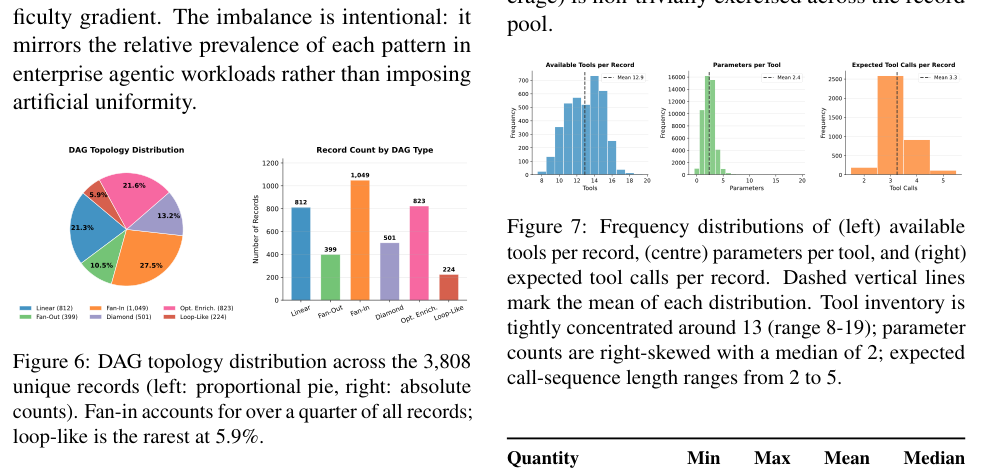
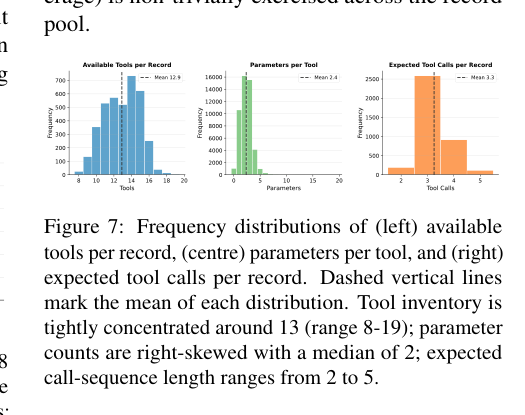
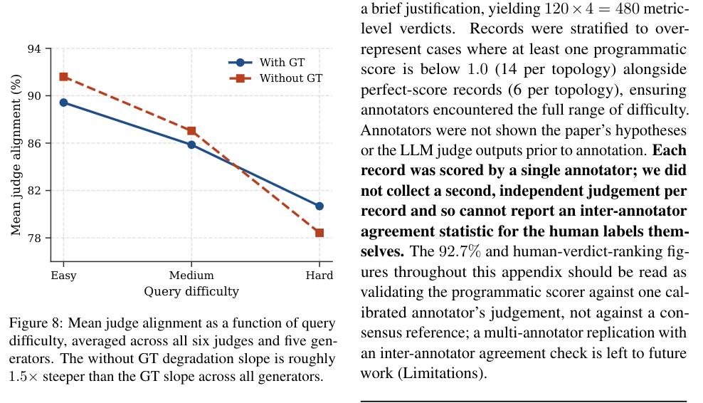
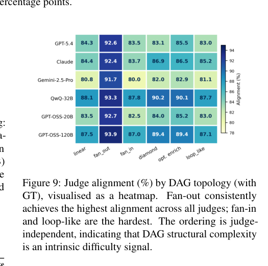

**表 1–31** 的原始数值与标题均由 `images/` 中相应截图以及英文逐页提取稿保留。在同一压缩包中，`source_pages/page-001.jpg` 至 `page-031.jpg` 亦完整保留正文、参考文献、附录算法、脚注和英文提示词，供科研引用及核对。

## 面向 GIS Agent Benchmark 研究的启示（基于本文的延伸分析，非作者原文结论）

本文的四维指标可以作为评估 GIS 智能体轨迹时的拆分参考，但**不能直接代表地理空间结果正确性**：选对工具、参数键和调用顺序，不代表 CRS、空间谓词、几何与最终数值结果正确。与 GeoContra 的地理契约、GISAgentBench 的实际输出检验结合，可能形成“结构性轨迹质量—地理语义验证—评判器可靠性”三个互补层级。此段属于科研讨论建议，不能当作原文直接提出的模型。

---

**全文证据入口**：`AgentJudgeBench_英文全文逐页提取.md` 保留原始参考文献、公式、附录全部表格和提示词；`source_pages/` 提供 31 页视觉原稿。中文精读为译述，不替代原文引用。
