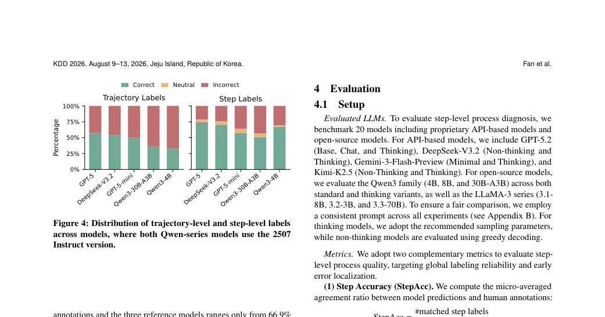

# AgentProcessBench：诊断工具使用智能体的步骤级过程质量

> **翻译状态：部分翻译（摘要全译 + 明确标注的原文节译）。非全文中文精译。**

英文标题：AgentProcessBench: Diagnosing Step-Level Process Quality in Tool-Using Agents  
发表信息：KDD 2026  
原始 PDF：12 页  
[阅读原始 PDF](./原始论文.pdf) · [英文逐页全文及配图](./英文原文_逐页全文与配图.md) · [参考文献及后续原文](./参考文献及后续原文.md) · [图表索引](./图表索引.md)

## 摘要（全文翻译，PDF 第 1 页）

尽管大语言模型（LLM）已经发展为能够使用工具的智能体，但它们在长时程交互中仍然较为脆弱。与数学推理中通常能够通过回溯纠正的错误不同，工具使用中的失败经常产生不可逆的副作用，因此准确的步骤级验证至关重要。然而，现有过程级基准主要局限于封闭世界的数学领域，未能反映工具执行的动态性和开放性。为弥补这一差距，我们提出 AgentProcessBench，这是首个专门用于评价真实工具增强轨迹中步骤级有效性的基准。该基准包含 1,000 条多样化轨迹和 8,509 项人工步骤标注，标注者间一致率为 89.1%。它采用三元标注方案来刻画探索行为，并使用错误传播规则减少标注歧义。大量实验揭示了以下重要发现：（1）较弱的策略模型因过早终止而呈现虚高的正确步骤比例；（2）区分中性行为和错误行为仍然是当前模型面临的重大挑战；（3）源自过程的信号能够为结果监督提供互补价值，显著提升测试时扩展的效果。我们希望 AgentProcessBench 能推动奖励模型的未来研究，并为通用智能体的发展铺平道路。

[核对原版第 1 页](./source_pages/page-001.jpg)

## 第 3.1 节：评价协议与三元标签（节译）（PDF 第 4 页）

给定任务描述 T 以及工具使用智能体生成的交互轨迹 X=(m₀,…,mₙ₋₁)，其中消息具有 system、user、assistant 和 tool 等不同角色，令 I 为所有 assistant 消息的索引集合。任务是输出标签序列 Y={yᵢ | i∈I}，其中 yᵢ∈{−1,0,+1} 分别表明对应步骤对总体任务推进是有害、中性或有效的。

- +1（正确且有效）：步骤在事实上正确，并明确推进任务完成。例如正确调用工具或解释工具输出，引入能够实质性减少任务不确定性的有效约束、决策或信息，或者识别前一步错误并采取适当纠正行动。
- 0（中性或探索）：步骤合理，但对任务推进影响有限或可忽略，包括遇到不可避免的外部故障（例如有效 URL 返回 404）、没有新见解的重复表述或局部计划，以及结果不明确但既无显著益处也无明显损害的行动。
- −1（错误或有害）：步骤在事实上错误或产生反作用，例如误解工具输出或捏造证据、违反策略约束或在未实质改变策略的情况下重复失败行动，以及引入使轨迹偏离任务成功的事实性错误。

[核对原版第 4 页](./source_pages/page-004.jpg)

## 第 4.1 节：步骤准确率与首次错误准确率（PDF 第 6 页）

本文采用两种互补指标评价步骤级过程质量，分别关注全局标注可靠性与早期错误定位。

**Step Accuracy（StepAcc）**：计算模型预测与人工标注的微平均一致比例。

$$
\mathrm{StepAcc}=\frac{\#\text{匹配的步骤标签}}{\#\text{全部助手步骤}}
$$

将所有轨迹中的助手步骤汇总计算，因此 StepAcc 反映总体步骤标注质量，较长轨迹贡献的步骤比例更高。

**First-Error Accuracy（FirstErrAcc）**：对每条轨迹定位首个标签为 −1 的步骤，并与人工标注的索引比较。

$$
\mathrm{FirstErrAcc}=\frac{\#\text{首次错误索引匹配的样本}}{\#\text{全部样本}}
$$

若预测和参考均不含 −1，则将该轨迹视为无错误并计为正确。与 StepAcc 不同，FirstErrAcc 较少受首次错误之后的错误传播影响，并且不受轨迹长度影响，直接衡量模型定位最早关键失败的能力。两者共同刻画全局过程正确性和长时程轨迹中的早期失败检测。

[核对原版第 6 页](./source_pages/page-006.jpg)

**原文 figure 4 · PDF 第 6 页（候选图表区域）**

## 尚未完成的翻译

其余正文、附录、完整图表说明、表内文字及参考文献标题尚未逐段翻译。本文件不是 12 页全文中文版。所有页面的英文文本层与页面截图均在英文逐页文档中保留。

[继续阅读英文原文](./英文原文_逐页全文与配图.md) · [图表索引](./图表索引.md) · [原始 PDF](./原始论文.pdf)

## 研究分类（初步判定，非原文内容）

- 主类别：B
- 阅读优先级：P0
- 归类理由：以人工步骤标注验证过程评价模型，直接提供中性探索、错误传播和首次错误定位的评测方法。
- 重点阅读：第 3.1 节三元标签及错误传播规则；第 4.1 节 StepAcc/FirstErrAcc；第 4.3 节。
- 分类尚未完成全部原文及评价代码核验；不代表复现实验成功。
