# 图表及栅格对象索引
> 自动候选，并非人工确认的完整图表清单；裁图可能含邻近正文、重复或漏检无题图，原版页始终保留。

## Figure 1 · PDF 第 2 页

Figure 1: Comparison of StepAcc across 20 LLMs on AgentProcessBench (%).

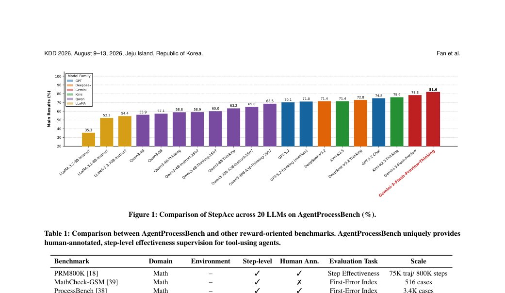

[整页核查](./source_pages/page-002.jpg)

## Table 1 · PDF 第 2 页

Table 1: Comparison between AgentProcessBench and other reward-oriented benchmarks. AgentProcessBench uniquely provides human-annotated, step-level effectiveness supervision for tool-using agents.

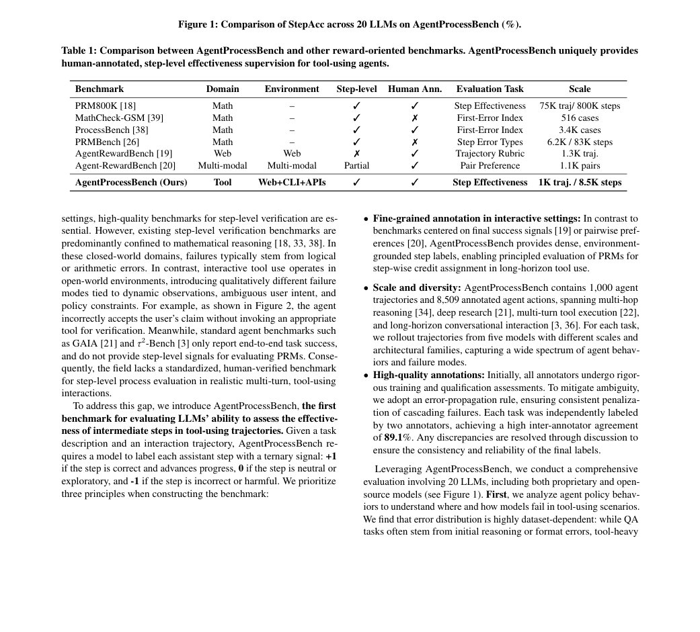

[整页核查](./source_pages/page-002.jpg)

## Figure 2 · PDF 第 3 页

Figure 2: Example of an agent trajectory, corresponding to instance 808 in the benchmark. Each instance in AgentProcessBench consists of a complete tool-using agent trajectory, containing interleaved user messages, assistant responses, and tool calls. During evaluation, the LLM is tasked with annotating each of the assistant’s steps with a label of correct (+1), neutral (0), or incorrect (-1).

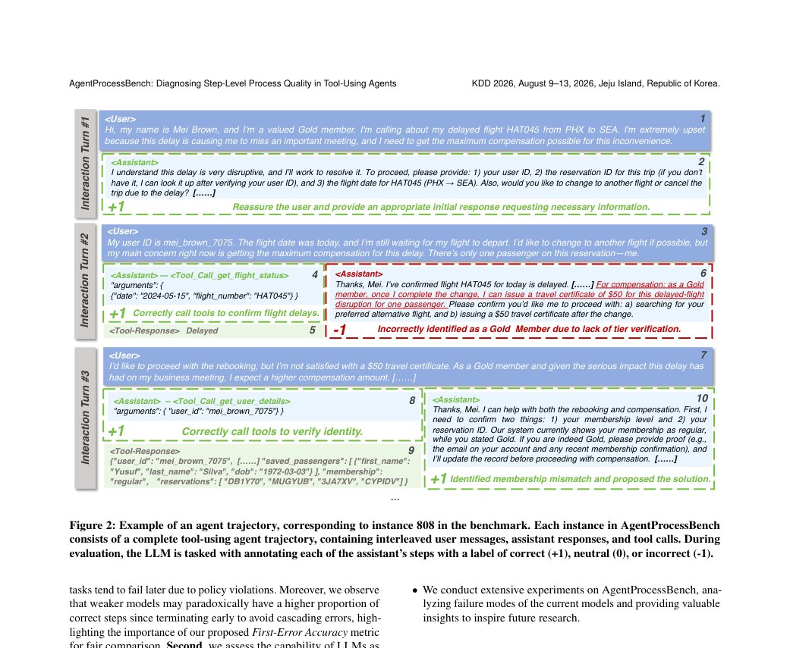

[整页核查](./source_pages/page-003.jpg)

## Figure 3 · PDF 第 5 页

Figure 3: An overview of AgentProcessBench. First, we sample trajectories from four representative agent benchmarks generated by five source models. Subsequently, human experts annotate the data via a specialized platform, achieving an inter-annotator agreement of 89.1%. Finally, we utilize the constructed benchmark to evaluate 20 distinct models across various families and parameter scales using the StepAcc and FirstErrAcc metrics.

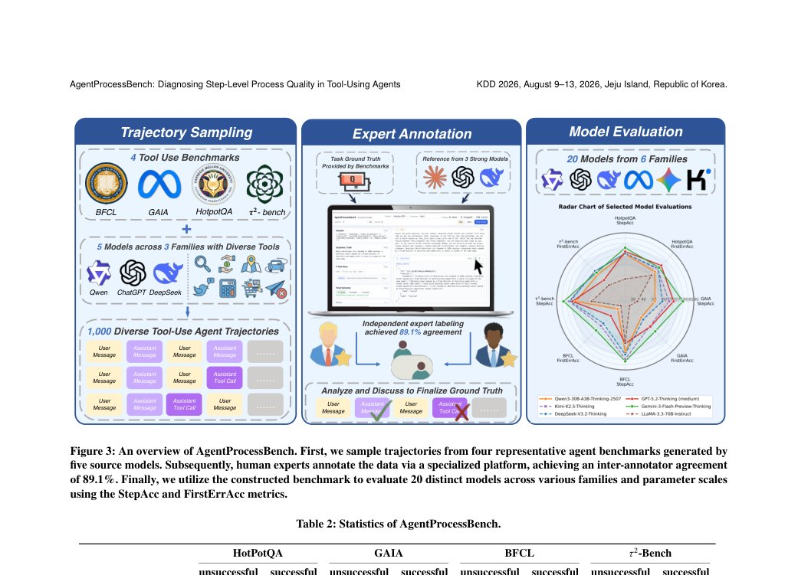

[整页核查](./source_pages/page-005.jpg)

## Table 2 · PDF 第 5 页

Table 2: Statistics of AgentProcessBench.

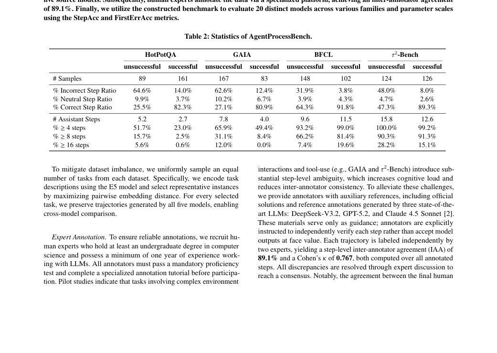

[整页核查](./source_pages/page-005.jpg)

## Figure 4 · PDF 第 6 页

Figure 4: Distribution of trajectory-level and step-level labels across models, where both Qwen-series models use the 2507 Instruct version.

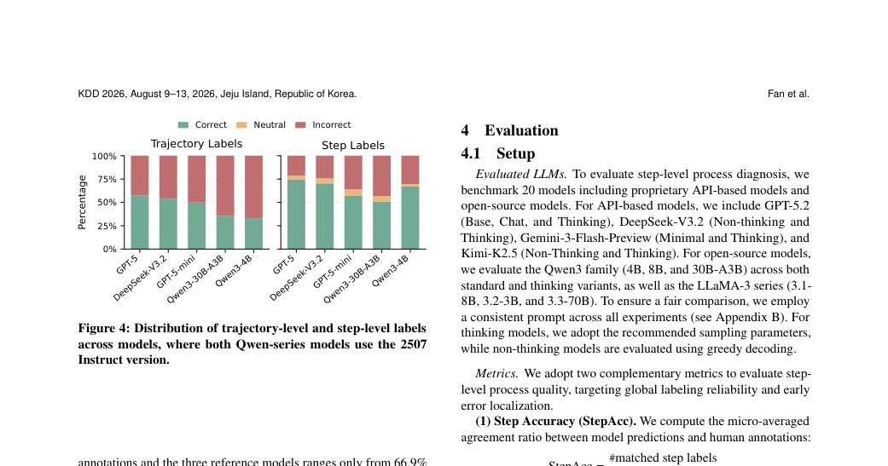

[整页核查](./source_pages/page-006.jpg)

## Table 3 · PDF 第 7 页

Table 3: Evaluation results on AgentProcessBench, reporting StepAcc and FirstErrAcc (%). Best and second-best results for each category and metric are highlighted in bold and underlined, respectively.

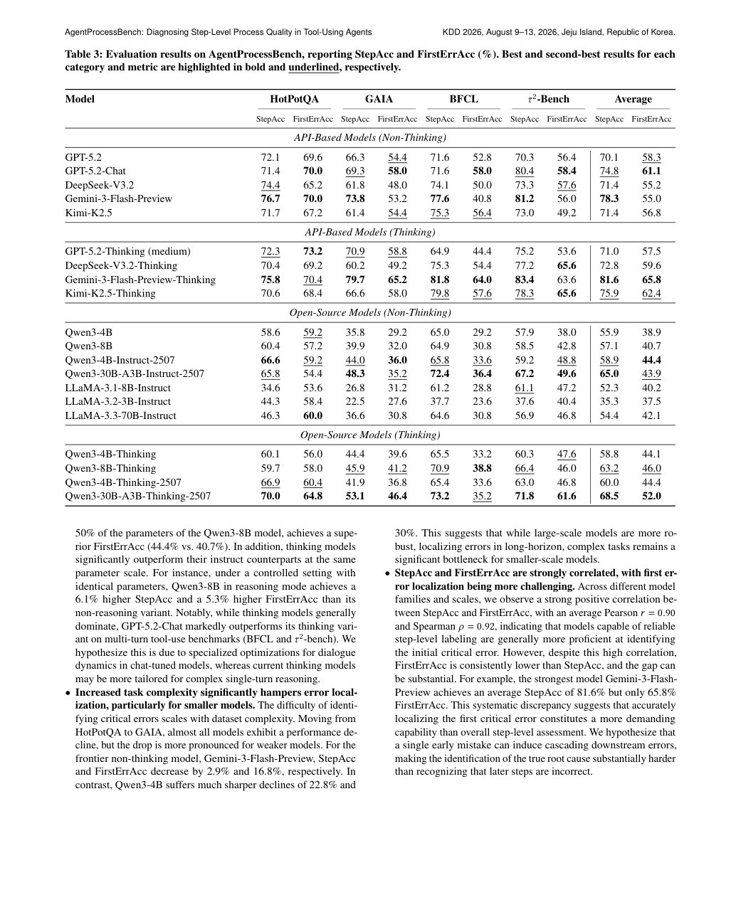

[整页核查](./source_pages/page-007.jpg)

## Figure 5 · PDF 第 8 页

Figure 5: Distribution of first error positions.

[整页核查](./source_pages/page-008.jpg)

## Figure 6 · PDF 第 8 页

Figure 6: Row-normalized confusion matrices of step evaluations for Gemini-3-Flash-Preview and Qwen3-30B-A3B-Thinking.

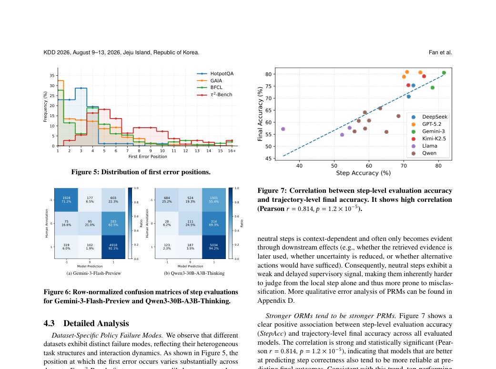

[整页核查](./source_pages/page-008.jpg)

## Figure 7 · PDF 第 8 页

Figure 7: Correlation between step-level evaluation accuracy and trajectory-level final accuracy. It shows high correlation (Pearson 𝑟= 0.814, 𝑝= 1.2 × 10−5).

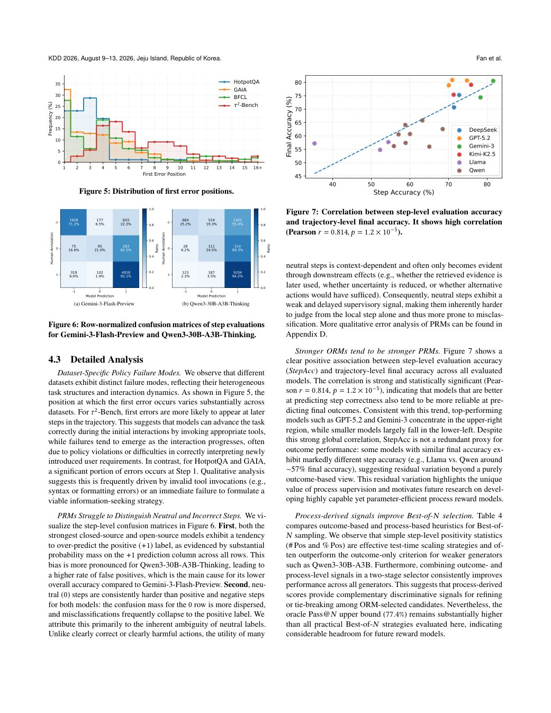

[整页核查](./source_pages/page-008.jpg)

## Table 4 · PDF 第 9 页

Table 4: Comparison of Best-of-𝑁(𝑁=8) selection strategies on GAIA. Final selects the first trajectory predicted to be successful at the outcome level. # Pos Step and % Pos Ratio select trajec- tories based on the number and proportion of positive steps, respectively. The two-stage strategy (Final→Process) combines outcome- and process-level criteria by refining outcome-based filtering with step-level signals. As references, majority-voting achieves 49.1% accuracy, while the oracle Pass@𝑁is 77.4%.

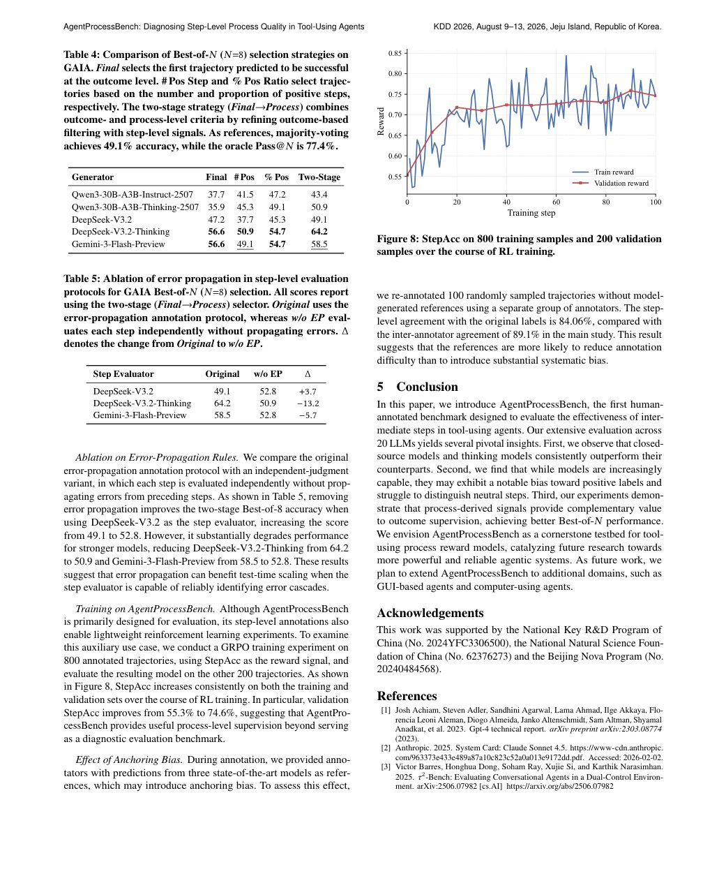

[整页核查](./source_pages/page-009.jpg)

## Table 5 · PDF 第 9 页

Table 5: Ablation of error propagation in step-level evaluation protocols for GAIA Best-of-𝑁(𝑁=8) selection. All scores report using the two-stage (Final→Process) selector. Original uses the error-propagation annotation protocol, whereas w/o EP eval- uates each step independently without propagating errors. Δ denotes the change from Original to w/o EP.

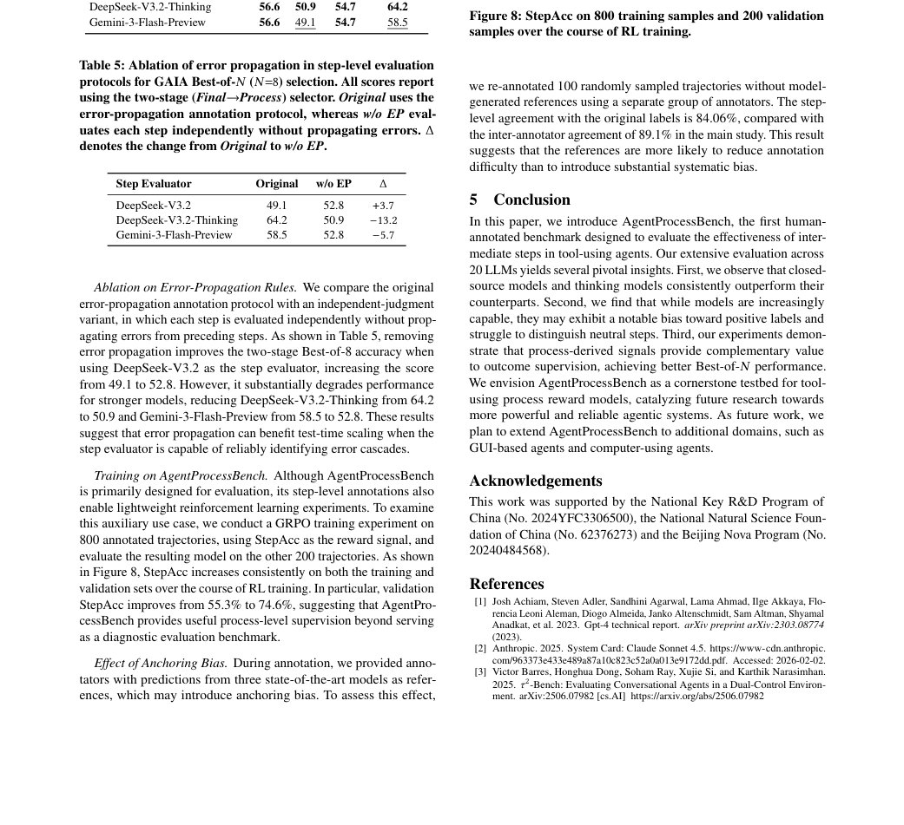

[整页核查](./source_pages/page-009.jpg)

## Figure 8 · PDF 第 9 页

Figure 8: StepAcc on 800 training samples and 200 validation samples over the course of RL training.

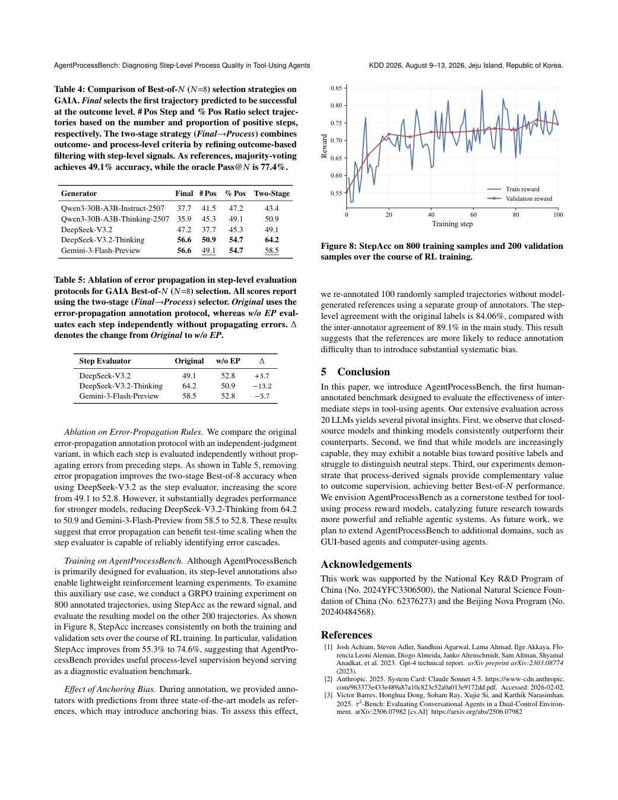

[整页核查](./source_pages/page-009.jpg)

## Figure 9 · PDF 第 12 页

Figure 9: PRM Evaluation Prompt Template

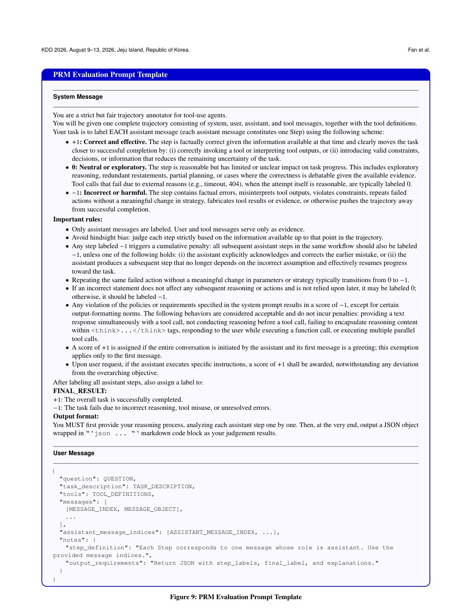

[整页核查](./source_pages/page-012.jpg)

### 栅格对象 · PDF 第 5 页

### 栅格对象 · PDF 第 5 页

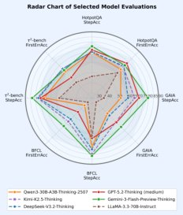