# AgentSuite：利用基于组件的基准审计流水线实现更可靠的智能体评估

**原题**：*AgentSuite: Toward More Reliable Agent Evaluation with a Component-Based Benchmark Auditing Pipeline*  
**作者**：Hyewon Suh、Binfei Ji、Seojune Lee、Rishi Khare、Basit Khan、Hyunjun Kim、Tianyi Zhang、Venkat Krishna Srinivasan、Peter Belcak、Shizhe Diao、Pavlo Molchanov、Yingyan (Celine) Lin、Zhen Dong  
**机构**：佐治亚理工学院；NVIDIA；加州大学圣巴巴拉分校  
**会议**：第 43 届国际机器学习大会（ICML 2026），PMLR 第 306 卷，首尔  
**通讯作者**：Zhen Dong（zhend@nvidia.com；zhend@ucsb.edu）  
**项目**：https://github.com/Agent-Suite/AgentSuite

> **阅读与排版说明**：忠实保留论文中的组件缩写、评估公式、代码与接口、表中数值。引用文献的书目元数据以原文为准。所有图表均为原 PDF 裁切，必要时参见 `source_pages/` 中的 20 张逐页原稿截图及同目录的完整英文提取稿。

## 摘要

大语言模型（LLM）智能体能否得到可靠评价，在很大程度上取决于基准的**有效性**（benchmark validity）。然而，现代智能体基准常含有由用户指令、环境、工具、真实值轨迹和评估协议之间的交互引起的隐蔽缺陷。这些问题将模型自身错误与基准构造缺陷混淆，削弱了基于排行榜的模型比较的可信度。

本文提出 **COBA（COmponent-based Benchmark Auditing，基于组件的基准审计）**，一种自动化诊断与过滤智能体基准有效性问题的流水线。COBA 将智能体任务拆解为四个标准化组件：**用户（User）**、**环境（Environment）**、**真实值（Ground Truth）**和**评估（Evaluation）**，并结合基于规则的检测器与分类体系指导的 LLM 判断，将组件级问题分类体系落实为可执行的审计机制。在六个广泛使用的智能体基准上，COBA 与专家判断高度一致，F1 分数达到 **0.791–0.874**。它补充了对 τ²-bench 的人工核查，发现因基准复杂性而被人工遗漏的问题，并且只需极少调整即可泛化到此前未见过的基准。研究表明，基准缺陷广泛存在，并对评价结果产生实质影响，因此组件化审计为更可靠、可解释的智能体评价提供了可扩展的基础。作者开源了整合 COBA 审计流水线和经审计基准变体的统一运行平台 **AgentSuite**。

## 1 引言

为提高大语言模型（LLM）的实际应用价值，智能体系统研究迅速扩展［Park et al., 2023］，催生了工具使用、网页导航和模拟环境等多领域智能体。随着能力不断增强，基于基准的评测成为衡量进步的核心手段［Zheng et al., 2023；Liu et al., 2024］。然而，智能体基准自身的可靠性尚未得到充分检查，因而人们开始质疑模型比较及排行榜结论的有效性。

已有基准质量研究主要关注静态或特定任务数据集，依赖人工核验、领域特定检查或有限的自动启发式规则［Northcutt et al., 2021；Truong et al., 2026；Vendrow et al., 2025］。尽管这些方法揭示了传统基准中普遍存在的问题，但用于智能体基准时面临巨大挑战。智能体基准本质上十分复杂：任务涉及用户、环境、工具、GT 规格和评估协议之间的结构化交互。因此，人工检查难以大规模扩展，而现有自动化方法也不能系统识别不同基准组件交互所产生的语义和上下文问题［Truong et al., 2026；Zhu et al., 2026］。相关工作详见附录 A。

针对这些挑战，本文提出 **COBA**：将处理确定性错误的规则检测器，与处理语义和上下文缺陷的结构化 LLM 验证相结合，系统诊断智能体基准的问题。研究还提供可选的**反驳（rebuttal）阶段**，复审初步标记的问题样本，以降低误报并辅助人工验证。

方法的基础是智能体基准的标准化组件表示。研究定义一种分层单元结构，将基准分解为四个主要组件——用户（User）、环境（Environment）、真实值（Ground Truth）和评估（Evaluation）——以及各自必要的子元素。这一结构通过分析六个跨领域的代表性智能体基准归纳得到，受到分治原则［Khot et al., 2023］和“由易到难”（least-to-most）等分阶段推理策略［Zhou et al., 2023］启发。随后，作者构建组件级问题分类体系，用于刻画跨基准反复出现的有效性缺陷。这一体系既是自动诊断的概念基础，也直接指导 COBA 的具体设计。

研究在六个广泛使用的智能体基准上评估 COBA，发现它与专家判断高度一致，F1 分数为 **0.791–0.874**。与 τ²-bench 的人工核验直接比较发现，自动化流水线能够识别因基准复杂性而被人工检查遗漏的问题，对人工核查形成补充。它还能够以极少适配工作泛化到 BFCL V4［Patil et al., 2025］和 NexusBench［Nexusflow.ai team, 2024］等未参与开发的基准。

使用 COBA 发现，基准问题分布广泛，平均约有 **27%** 的任务受到影响。进一步分析表明，缺陷类型会改变智能体的评估结果，删除有问题的任务后，ACEBench 的模型排行榜中 **60% 的模型排名发生变化**。这说明基准质量会实质性影响模型比较和结论。

本文的贡献有三项：（1）提出基于组件的智能体基准问题分类体系；（2）提出自动化审计流水线 COBA，与人类专家判断高度一致，且可泛化到不同基准；（3）开展大规模实证分析，研究基准缺陷及其对智能体评估的影响，发布包含 COBA 和问题引导修复功能的统一运行平台 AgentSuite，以支持未来更可靠的基准评测。

## 2 智能体基准问题的系统分析

### 2.1 智能体基准概述

研究分析了六个广泛使用、涉及不同场景和评价方式的 LLM 智能体基准：**BFCL V3**［Patil et al., 2025］、**ACEBench**［Chen et al., 2025］、**DrafterBench**［Li et al., 2025］、**τ-Bench**［Yao et al., 2025］、**τ²-Bench**［Barres et al., 2025］和 **CFB**［Zhong et al., 2025］。这些基准在构成智能体评价场景的四个结构组件上存在差异（图 1）：（1）**User**：预定义用户还是 LLM 模拟用户，单轮还是多轮；（2）**Environment**：无状态还是有状态，工具/API 是否可用及其语义；（3）**Evaluation**：最终状态检查、工具调用匹配还是 LLM 判断；（4）**Ground Truth**：完整参考轨迹还是关键里程碑步骤，以及政策约束等。这种分解揭示了静态问答评价不曾遇到的问题，促使研究者建立系统分类体系。

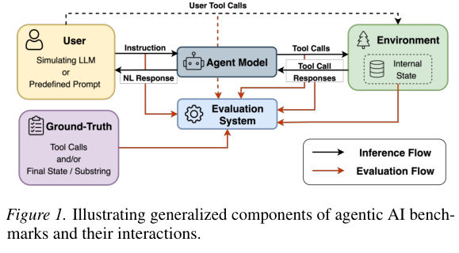

*图 1　智能体基准的通用组成部分及其相互作用。四个主要组件为用户、环境、真实值和评估系统。*

### 2.2 按组件划分的问题分类体系

研究依据问题的来源组件对反复出现的基准缺陷进行归类（表 2）。组件视角能将零散案例转化为可执行的问题类别，直接指导流水线中模块化检测器的设计（第 3 节）。

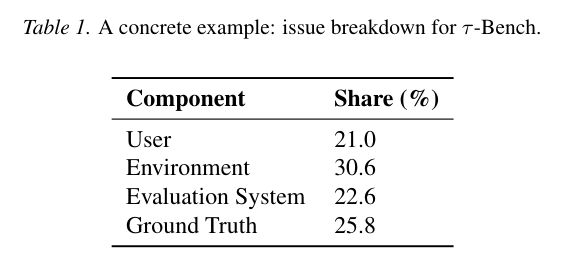

*表 1　τ-Bench 中问题的组件占比：用户 **21.0%**、环境 **30.6%**、评估系统 **22.6%**、真实值 **25.8%**。*

分类体系通过**自下而上的标注流程**形成。五名具有 LLM 和智能体研究经验的标注员检查抽样任务与轨迹。对每个基准，三名标注员不预设固定类别，独立提出反复出现的问题类型；研究者不断比较标注，合并重叠类别、拆分含糊类别、解决分歧，并扩大抽样规模，直到类别稳定。最终覆盖六个基准共 **5,086 项任务**中的 **21%–29%**。作者明确表示，这一分类体系**并不穷尽所有问题**：由于没有完成全面人工审计，未来新基准也可能引入新的失效模式。它的目标是捕捉现有基准中反复出现的模式，并具有可扩展性。

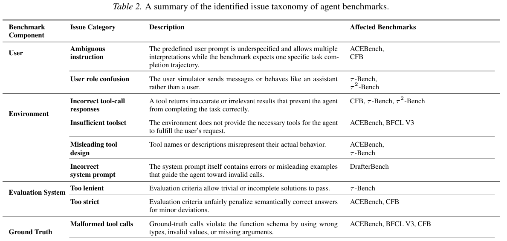

*表 2　完整问题分类体系，包括四个组件、11 类问题的定义及受影响基准。中文类别对照如下。*

| 组件 | 问题类别 | 含义 |
|---|---|---|
| 用户 | 指令含糊（Ambiguous instruction） | 预定义用户指令不够具体，可作多种理解，但基准仅接受特定的完成轨迹 |
| 用户 | 用户角色混淆（User role confusion） | 用户模拟器以助手身份发送消息或行为不符合用户角色 |
| 环境 | 工具调用返回错误（Incorrect tool-call responses） | 工具返回错误或不相关结果，阻止智能体正确完成任务 |
| 环境 | 工具集不足（Insufficient toolset） | 缺少完成用户请求必需的工具，使任务从设计上便不可解 |
| 环境 | 工具设计误导（Misleading tool design） | 工具名称或描述与实际行为不符 |
| 环境 | 系统提示词错误（Incorrect system prompt） | 系统提示词中的错误或误导性示例诱使智能体发出无效调用 |
| 评估系统 | 评价过宽（Too lenient） | 不完整甚至取巧的解决方案也可能通过 |
| 评估系统 | 评价过严（Too strict） | 语义正确的答案因细微形式差异而被错误判失败 |
| 真实值 | 工具调用格式不合法（Malformed tool calls） | GT 调用违反函数 schema，如类型、值或参数错误 |
| 真实值 | 工具调用不正确（Incorrect tool calls） | GT 选用错误函数或参数，与用户意图或上下文冲突 |
| 真实值 | 冗余／无依据工具调用（Redundant/ungrounded tool calls） | 参考轨迹包含不必要或缺乏上下文依据的步骤，造成不公平评价 |

**用户组件的问题**通常源于指令不完整。部分 ACEBench 或 CFB 任务允许多种合理解释，却强制智能体提供唯一“正确”答案。在 τ-Bench、τ²-Bench 等采用 LLM 模拟用户的任务中，用户模型可能输出“您的预订已取消”之类带有助手口吻的确认语，造成角色混淆，使对话流程失真，也更难判断智能体行为。

**环境组件的问题**产生于智能体能够执行的动作或所获得反馈不准确、具有误导性或不充分。①工具即使接到正确查询，仍返回错误或不相关结果，从而阻断任务（CFB、τ-Bench、τ²-Bench）。②必要工具缺失使任务在设计上不可完成（ACEBench、BFCL V3）。③工具名称/描述与实际行为相矛盾，误导模型选用不合适的函数（ACEBench、τ-Bench）。④系统提示词本身内置错误操作，例如 DrafterBench 的提示要求在不带括号的情况下调用 Python 方法，导致系统性非法调用。

**评估系统的问题**来自评分标准失准。过于宽松时，智能体能够利用漏洞获得通过：例如，τ-Bench 约 **38%** 的任务在数据库保持不变时也会被判成功，使“什么都不做”成为一种策略［Zhu et al., 2026］。反之，过于严格的精确匹配要求可能把语义正确的输出判为失败。

**GT 真实值的问题**尤其有害，因为参考答案本身决定什么被视为正确。作者观察到三种情况：①参考工具调用违反 schema（参数类型/枚举值错误、缺少必填参数），反而惩罚遵循 API 定义的智能体；②GT 选用了错误的函数或参数，与用户意图或政策冲突（例如取消不可取消的项目），迫使智能体模仿错误才能得分；③参考轨迹包含多余或无上下文依据的步骤，使更高效、同样正确的方案由于没有复现冗余调用而被判错。

**讨论**：上述缺陷广泛分布于四个组件，而非集中在某一处。如表 1 所示，τ-Bench 的用户、环境、评估和 GT 问题占比分别为 21.0%、30.6%、22.6% 和 25.8%。这种分布支持按组件设计检测器；第 3 节据此将问题分类落实为模块化规则与 LLM 裁判检查。

## 3 方法：从问题分类到自动化过滤

作者将组件级问题分类体系实现为 **COBA 流水线**，用于大规模检测智能体基准缺陷（图 2）。核心观察是：即使智能体基准的外在形式高度多样，其内部仍共享一套常见结构。通过将基准原生格式映射到标准化组件表示，不同基准就可以共用统一的检测流程。

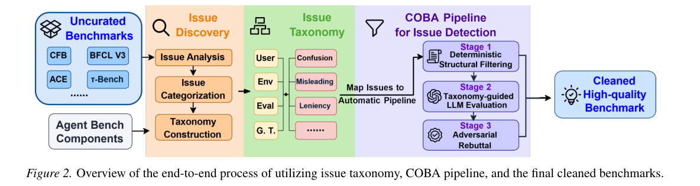

*图 2　从问题分类到 COBA 自动审计，再到问题任务过滤及最终清理后的基准的端到端流程。*

流水线包含两个主要阶段：（1）**确定性结构过滤（Deterministic Structural Filtering）**，识别明确的 schema 与角色违规；（2）**分类体系指导的 LLM 评价（Taxonomy-Guided LLM Evaluation）**，基于组件定义判断语义和上下文缺陷。研究还提供可选的**对抗式反驳（Adversarial Rebuttal）**阶段，进一步减少过度标记，并提高人工验证效率。

### 3.1 问题形式化：标准化任务表示

智能体基准在领域、交互协议和评估设计上差异很大：有些采用固定用户提示，有些采用 LLM 模拟用户；环境可能有状态或无状态；评分可以从精确的工具调用匹配延伸到语义结果检查。为在这些差异之上开展自动分析，研究定义与组件问题分类一致的标准化任务表示：

$$T=\langle U,E,G,V\rangle.\tag{1}$$

其中，$U$ 表示**用户组件**，包含用户指令以及适用时的用户模拟器规范；$E$ 表示**环境组件**，包括系统政策、初始状态，以及带有 schema 和说明的可用工具集；$G$ 表示**真实值组件**，即参考动作—观察轨迹；$V$ 表示**评估系统**，包括成功判定标准和匹配规则。

**表示的用途与基准映射**：这一标准化表示使异构智能体基准可以在统一框架下处理。明确分离用户规范、环境定义、参考轨迹和评分标准，就能把组件分类落实为操作机制，并定位问题起源。对于每个基准，只需实现轻量级映射——通过简单的数据加载步骤，将原生基准中的指令、工具 schema、GT 和评估规则抽取到 $T$ 中。这是唯一依赖具体基准的步骤。之后，基本可以共用同一检测逻辑和提示结构，必要时再加入少量与基准有关的背景（如评估规则或设计目的），确保语义解释正确。

**按组件分解**：研究并非整体判断任务是否有效，而是采用受到结构化分解原则［Zhou et al., 2023］启发的组件级验证策略。LLM 裁判虽然接收完整任务背景，但问题定义按组件组织，引导模型以局部化、系统化方式分析缺陷。这样设计的依据是实证发现：问题分布于所有组件，而非集中于单一来源。

目标是推断结构化判断函数：

$$\phi(T)\rightarrow (y,c,r),\tag{2}$$

其中，$y\in\{0,1\}$ 表示任务是否有缺陷，$c$ 为对应的分类标签，$r$ 为定位问题的自然语言理由。

### 3.2 第一阶段：确定性结构过滤

某些问题来自显式结构违规，无需语义推理就可以检测，例如函数 schema 违规和对话日志中的角色混淆。研究使用规则检测器集合 $H(T)$ 进行高效率第一轮筛查，在调用 LLM 前剔除结构无效任务。该阶段重视**精确性和计算效率**，并不试图识别更高层的语义问题。

### 3.3 第二阶段：分类体系指导的 LLM 评价

许多缺陷涉及跨组件的语义不一致，例如用户指令含糊、GT 动作在逻辑上错误、工具描述与观察到的实际行为不一致。这些缺陷需要推理 $U,E,G,V$ 之间的交互。因此，研究采用 LLM 裁判 $J$，明确以标准化任务表示和问题分类体系作为判断条件。

**裁判提示设计**：提示模板由三部分组成：（1）完整标准化任务 $T$；（2）按组件划分的问题分类；（3）说明所需判断及输出格式的指令。该设计既向模型提供充分上下文，又限制其在固定概念体系中推理，减少自由解释带来的偏差。

### 3.4 用于减少误报的对抗式反驳

LLM 评估器可能表现出与对齐相关的系统性偏差，例如为迎合用户给定框架而牺牲客观正确性的“谄媚倾向”（sycophancy）［Sharma et al., 2024］。本研究观察到，当裁判被要求寻找问题时，可能过度标记那些有效但非常规的解决方案，产生假阳性（false positives）。

为缓解这一问题，研究对被初步标记为有缺陷的任务增加可选的**对抗式反驳细化阶段**。第二个智能体 $A$ 复核这些任务，根据少量裁决原则，判断是否应推翻初步结论。原则包括：在评估规则许可时接受有效替代方案、可以从上下文推导的参数及语义等价性。最终判定为：

$$
y_{final}=\begin{cases}
0,&\text{若 }A\text{ 推翻原判定；}\\
1,&\text{其他情况。}
\end{cases}\tag{3}
$$

这一阶段旨在减少误报，并简化后续人工核查。即使不采用反驳阶段，分类引导的主裁判已经与专家标注高度一致（第 4 节）。对该可选机制的消融分析见附录 D.3。

## 4 实验与结果

### 4.1 实验设置

**评价协议**：研究通过 COBA 对基准问题的判断与人类专家判断的一致性来评估其有效性。重点检验处理非确定性语义及上下文缺陷的 LLM 判断阶段，采用互补的两种人工验证协议。

**人工标注**：使用五名研究生标注员，均具有 LLM 或智能体研究经历及相关发表经验。对标注员进行基准文档、实现流程和标注指南培训，指南覆盖可解性、含糊性、GT 正确性、评价公平性和跨组件一致性。每个基准中的抽样任务由三名标注员独立判断有效性；若存在问题，则依据分类体系和代表性示例赋予问题类别。裁决前平均两两 Cohen’s $\kappa$ 为 **0.824**，显示较强的一致性。分歧主要出现在“可以接受的含糊性”与“规范不足”等边界案例，通过讨论基准规范、设计目的及评价逻辑解决。细节见附录 B.1。

**平衡子集验证（Balanced subset validation）**：每个基准由专家标注分层抽样子集，抽样规模占该基准的 **10%**、至少 **30** 项，并使问题样本与非问题样本等量。在受控的类别平衡下估计问题检测的精确率、召回率和 F1。

**事后验证（Post-hoc validation）**：完整流水线运行后，专家对整个基准中所有被标记为问题的任务进行人工核实，以大规模度量假阳性，并构建后续分析使用的最终“清理后基准”（issue-cleaned benchmarks）。规则过滤天然用于识别确定性结构违规，因此不参与人类一致性指标计算；相关评价主要针对分类体系指导的 LLM 裁判阶段。

**实现细节**：默认裁判模型为 **Gemini-2.5-Pro-Thinking**［Google, 2025］，因其在结构化评价中推理能力较强。研究还使用 **Claude-4-Opus-Thinking**［Anthropic, 2025］与 **DeepSeek-V3.1-Thinking**［DeepSeek, 2025］考察裁判鲁棒性（附录 D.4）。不同裁判模型的一致性趋势接近，说明流水线效果不依赖单一 LLM。问题检测及对抗式反驳提示模板见附录 D.1；全部实验共比较 **30 种**闭源和开源模型，详见表 11。作者开源了集成 COBA 模块与整理后基准产物的 AgentSuite 平台。

### 4.2 主要结果：流水线验证

#### 4.2.1 与人类专家的一致性

研究首先采用平衡子集验证协议检查 COBA 与专家判断的一致性。表 3 列出代表性基准的精确率、召回率及 F1。由于 DrafterBench 中所发现的问题均可通过确定性结构过滤识别，因此不纳入 LLM 裁判的人类一致性比较。表 3 的问题率来自对标记结果进行事后人工核实，**不是未经确认的 LLM 原始标注率**。

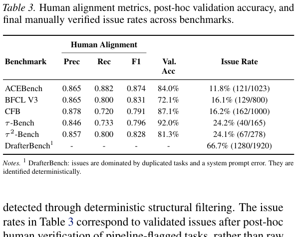

*表 3　各基准的检测指标。ACEBench：P=0.865，R=0.882，F1=0.874，验证准确率 84.0%，问题率 11.8%（121/1023）；BFCL V3：0.865/0.800/0.831，72.1%，16.1%（129/800）；CFB：0.878/0.720/0.791，87.1%，16.2%（162/1000）；τ-Bench：0.846/0.733/0.796，92.0%，24.2%（40/165）；τ²-Bench：0.857/0.800/0.828，81.3%，24.1%（67/278）；DrafterBench 的确定性问题率为 66.7%（1280/1920），主要涉及重复任务和系统提示错误。*

不同基准上，分类指导的 LLM 裁判均与专家标注高度一致，F1 为 **0.791–0.874**，说明该阶段能够有效识别专家定义的广泛问题类型。附录 D.5 进一步分析残余分歧：**假阳性**主要源于部分可观测条件下推理过于严格；**假阴性**主要来自遗漏不符合 schema 的工具调用等低层规范违规。这些错误相对集中，提示可通过有针对性的检测器改进进一步提升效果。

为研究方法在抽样子集之外的扩展性，作者还对全部基准开展事后验证（表 3）。流水线在大规模应用时仍保持较好准确性，各基准端到端验证准确率均超过 **72.1%**。图 3 汇总被标记为问题的任务经人工复核后的情况。除与专家判断一致外，COBA 也识别了大量此前未被记录的问题，例如在 CFB 中最多发现 **126 个**此前未报告、经人工确认的问题。整体上，COBA 可以将接近专家水平的缺陷检测扩展到大型基准，同时保持较高的一致性。

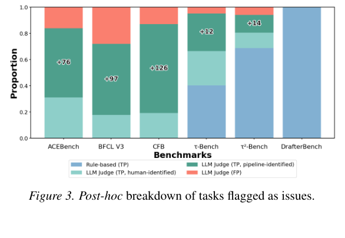

*图 3　流水线标记的问题任务在事后人工验证中的结果分布。*

#### 4.2.2 与 τ²-Bench 人工核查的比较

为了进一步检验 COBA 的实用价值，研究将其输出与同时期工作对 τ²-Bench 的人工验证结果［Cuadron et al., 2025］比较。该比较仅关注**客观正确性问题**：能够独立检验、且为确保评价有效必须修正的违规，而不包含清晰度、含糊性或呈现方面的注释。

在 τ²-Bench 的航空（Airline）和零售（Retail）领域，COBA 找回了人工核验发现的 **15 个客观问题中的 11 个**；此外还识别了处于相同问题范围内、却未在人工分析中报告的 **14 个**经验证的客观问题。超出既有人工核验范围，COBA 还发现电信（Telecom）领域广泛存在的用户角色混淆，以及航空和零售领域可通过“什么都不做”而通过评分的漏洞。这些问题源于用户模拟、环境设计与评分准则之间的相互作用，必须通过明确的组件级分析才能可靠发现。整体上，分类体系指导的自动审计不仅扩大了既有范围内客观问题的覆盖率，也能够揭示复杂多领域基准中的额外问题类型，补充人工核查。

### 4.3 对未见基准的泛化

作者将 COBA 应用于未用于分类构建或流水线开发的基准，专门检验其泛化能力：**BFCL V4**［Patil et al., 2025］和 **NexusBench**［Nexusflow.ai team, 2024］。二者在领域覆盖、任务结构及设计方面均与开发集差异较大。研究仅针对各基准实现第 3 节所述的标准化映射，提取用户、环境、GT 和评估四个组件；除此之外，完全复用相同的分类指导提示模板与检测逻辑。

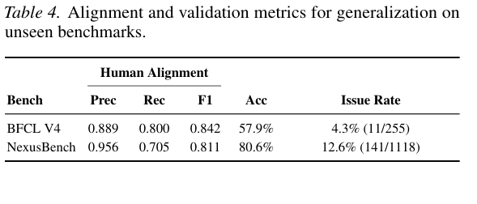

*表 4　BFCL V4：P=0.889、R=0.800、F1=0.842，准确率 57.9%，问题率 4.3%（11/255）；NexusBench：P=0.956、R=0.705、F1=0.811，准确率 80.6%，问题率 12.6%（141/1118）。*

表 4 显示两者 F1 分别为 **0.842** 和 **0.811**，仍与专家判断具有较高一致性；COBA 分别发现并核实 **11 个**和 **141 个**问题，说明分类体系适用于此前未见过的基准。结果支持将 COBA 用作新兴智能体基准的可复用审计框架。

### 4.4 消融实验：分类指导提示词的作用

研究比较完整的**组件分类指导提示词**，与缺少结构化组件定义的通用批评提示词（见附录 D.2），检验分类体系的效果。为了衡量判断质量，重点分析两种提示词出现分歧的案例：ACEBench 共 **114** 项，CFB 共 **202** 项。人工判断哪个结果更符合有效的基准问题后发现，分类指导提示词分别赢得 **72.8%** 和 **73.3%** 的分歧案例。

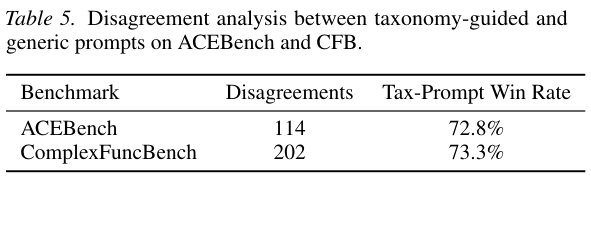

*表 5　ACEBench 分歧 114 项，分类指导提示胜率 72.8%；ComplexFuncBench 分歧 202 项，胜率 73.3%。*

相比之下，通用批评提示还将更多任务标为问题，其标记数量达到分类指导流水线的 **1.7 倍**。这说明通用提示容易过度标记潜在问题，而结构化的组件级分类引导有助于约束 LLM 判断，特别是在两种方法分歧时提升可靠性。可选反驳阶段的消融研究见附录 D.3。

### 4.5 基准诊断与设计启示

研究分析 COBA 识别的问题，旨在概括反复发生的失效模式及影响评价可靠性的设计因素，而**不是给不同基准排质量名次**。

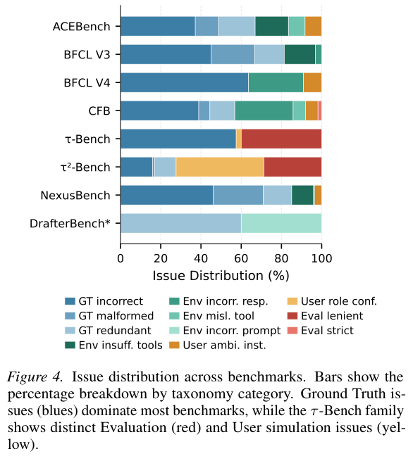

*图 4　八个基准的问题类别占比分布。Ground Truth 问题（蓝色）在多数基准中占主导；τ-Bench 系列则表现出明显的评估系统（红色）及用户模拟问题（黄色）。*

图 4 表明，所有四个组件都持续出现问题，因此需要组件感知的审计。作者重点总结了以下三个代表性基准的定性观察，更多分析和完整案例见附录 B.2。

**ACEBench** 侧重模拟真实用户行为，包括用户意图的含糊性。这样可以带来更丰富的评价场景，但很多问题来自说明不充分，或自然语言需求与离散参数选项不一致。这体现了**真实性与可评价性之间的权衡**：允许故意保留含糊性的基准，需要特别谨慎设计评分，以免惩罚合理的智能体行为。

**τ²-Bench** 包含复杂多轮交互、详细政策及 LLM 模拟用户。除任务复杂性本身引起的问题，还观察到用户模拟与环境设计相互作用造成的失败。特别是在双重控制（dual control）的电信任务中，用户模拟器有时会做出类似智能体的操作，显示出复杂场景下用户模拟的隐蔽失效模式。

**BFCL V3 / V4** 的问题主要集中在 GT 轨迹，包括错误参数、单位不一致和过时参考信息。此类错误常在多个任务间重复，说明小范围的系统性问题可以产生广泛影响。BFCL V4 还涉及实时网页搜索任务，随着外部信息变化，参考答案可能过期，突出动态基准在持续维护方面的挑战。

总体上，许多问题来自任务复杂性和真实性的增加，而非某个孤立实现错误。COBA 通过显式揭示问题，支持更明智的基准设计与使用，而不将审计结果简单转化为规定性的质量评分。

### 4.6 基准缺陷对模型评价的影响

研究重点分析 ACEBench，考察 COBA 识别的问题如何影响后续模型性能分数和排名。不同类别的问题会以不同方式影响评价，甚至产生相反方向的偏差，使绝对得分与相对排名都更难解释。

**对模型得分的影响**：根据观察到的影响，可将问题归为四类：（1）**虚高（inflation）**：评价过宽奖励非预期行为；（2）**压低（deflation）**：合理的智能体行为遭到惩罚；（3）**不可解任务（unsolvable tasks）**：人为限制模型可达到的表现上限；（4）**噪声（noise）**：增加得分波动，但不系统性抬高或压低分数。

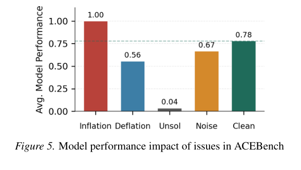

*图 5　ACEBench 中按问题类别划分的平均模型得分及清理后基准得分。容易使得分虚高的任务平均表现为 1.000；不可解任务为 0.035；压低类为 0.555；噪声类为 0.666；清理后基准为 0.780。*

以上结果表明，缺陷不会造成方向一致的偏差。它们共同增加方差，并模糊“测得得分”与“真实智能体能力”之间的关系，使总体评价指标更难解读。

**对排行榜的影响**：表 6 比较 ACEBench 删除经确认问题任务前后的前 12 名模型排名。虽然前两名不变，但若干模型的名次在两个方向上明显变化，体现不同问题类别的异质性影响。

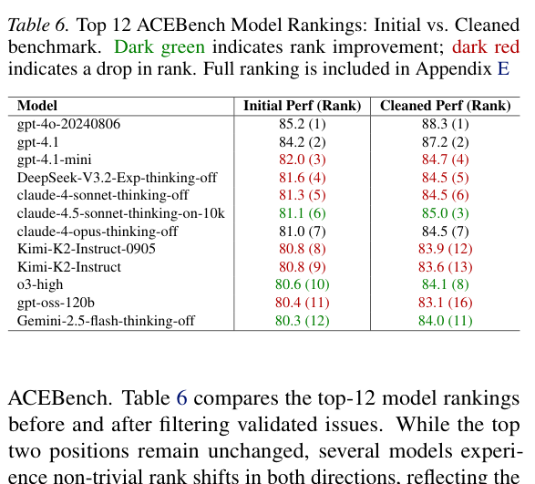

*表 6　ACEBench 前 12 名在原始与清理后基准上的表现及排名。深绿色表示名次上升，深红色表示下降。完整的 30 模型排行榜见附录 E。*

整体而言，基准问题会实质影响性能估计和比较结果。识别并剔除这些问题，有助于获得更稳定、更具可解释性的模型评价。由于计算成本限制，表 6 中每个模型只进行一次评估，作者进一步与**随机删除任务基线**比较：在 **100 次**实验中随机删除相同数量任务，得到的排名变化明显小于有针对性的问题过滤。清理后排行榜的 Kendall’s $\tau$ 为 **0.871**，随机删除时为 **0.960**（95% 置信区间 **[0.935, 0.981]**）；成对排名翻转率分别为 **5.75%** 和 **1.50%**（95% 置信区间 **[0.46, 2.65]**）。这说明排名变化反映了经验证的系统性基准缺陷，而非简单的随机删题效应。

## 5 讨论与局限性

**过滤与问题引导修复**：本文主要使用 COBA 识别、过滤有缺陷的基准任务，作为可靠智能体评价的保守方案。除了过滤，同样的组件级诊断也可以在改动明确时指导针对性修复，例如澄清不完整的指令或纠正 GT 参数。作者将其视为后续用途：结合 COBA 的推理轨迹进行人工修复，并在适用时作为整理后成果发布于 AgentSuite。修复示例见附录 C.1，任务保留率与问题引导修复分析见附录 C.2。

**局限性**：第一，分类体系只覆盖当前基准观察到的重复问题，并非穷尽；未来基准可能出现新的失效模式。第二，COBA 对语义与上下文问题依赖 LLM 裁判，因此可能继承裁判模型的特有偏差，虽然分类提示、对抗式反驳及人工验证可缓解这一风险；相关失败分析与裁判模型消融见附录 D.5、D.4。第三，清理和修复后的产物仅反映 COBA 发现并由作者人工验证或修正的问题，应被视为**需要持续维护的基准产物**，而不是对剩余任务绝对无缺陷的保证。

## 6 结论

本文研究了智能体基准的可靠性，表明现代智能体评估中隐蔽的有效性问题广泛存在，源于用户指令、环境、工具、GT 轨迹和评估协议之间的复杂交互。为克服现有方法在规模扩展和系统性方面的不足，研究提出基于组件的 **COBA 基准审计流水线**，结合结构化问题分类、规则与 LLM 混合验证，以及可选的对抗式反驳阶段。在多样化智能体基准上，COBA 与专家判断高度一致，可泛化到未见过的基准，并揭示基准缺陷会实质影响测量得分和模型排名。通过提供可扩展、组件感知的审计框架，并发布清理后的基准产物，该研究为基于 LLM 的智能体提供了更可靠、可解释、可复现的评价基础。

### 影响声明（Impact Statement）

本论文研究旨在推动机器学习领域发展。作者认为，这项工作可能产生多种社会影响，但没有哪一种需要在此特别强调。

### 致谢（Acknowledgements）

本研究部分由美国国家科学基金会（NSF）项目 **2403297、2312758、2434166、2048183 和 2016727** 资助。另有部分支持来自 **CoCoSys**，它是 DARPA 资助的半导体研究公司（SRC）JUMP 2.0 项目七个研究中心之一。

## 附录 A 相关工作

**基准有效性与问题检测**：研究表明，有效性问题普遍存在于 AI 基准中，并且会扭曲评估结果［Northcutt et al., 2021；Truong et al., 2026］。人工审计已发现广泛使用的数据集存在系统性错误，例如 MMLU 的真实值缺陷［Gema et al., 2025］；更广泛的分析发现，标签噪声及含糊性削弱了基准可靠性，因而主张精心筛选“铂金标准基准”（platinum benchmarks）［Vendrow et al., 2025］。SWE-Bench 中增加单元测试［Yu et al., 2025］、SQL 基准中使用执行匹配［Yu et al., 2018］等任务特定验证方法，依赖确定性的语义及可执行环境，因此难以扩展到狭窄领域以外。

更通用的自动方法表现参差。LLM 辅助检测在简单或已接近饱和的基准上精确率较高，但在复杂场景中会退化［Truong et al., 2026］。此外，基于 LLM 的评估器表现出从众与自我中心偏差，常偏向与模型自身先验一致的输出，而非客观正确性［Zheng et al., 2023；Wang et al., 2024］，即使改善提示词，仍可能导致召回率低和标注不稳定［Gema et al., 2025］。

**智能体基准验证**：智能体基准因多组件结构而面临额外挑战，其有效性取决于用户、工具、环境、GT 规范和评分协议之间的交互。AgentBench［Liu et al., 2024］、ToolBench［Qin et al., 2024］与 WebArena［Zhou et al., 2024］等近期基准体现了这类复杂性。虽然 ABC checklist［Zhu et al., 2026］等设计层面的指南提供了严谨构建基准的原则，实际验证仍主要依赖人工。近期研究揭示，τ-bench 中说明不充分的任务和标注错误会人为限制模型性能上限，促使研究者提出 τ²-bench 等人工修订基准［Cuadron et al., 2025］。这些方法有效，但需要大量专家劳动，难以规模化。相比之下，COBA 通过将有效性分解为组件级问题，并显式缓解 LLM 评估器的偏差，实现任务层面的自动化问题诊断。

## 附录 B 标注与分类体系详情

### B.1 人工标注协议

**标注设置**：研究聘用了五名具有 LLM 和智能体研究经验或相关论文成果的研究生标注员。每项任务先由三名标注员独立判断，再进行讨论。标注员能够访问相应基准的任务规范、环境模拟与评价代码等实现细节、模型执行轨迹等产物，以理解端到端流程并作出知情判断。上岗培训包含文档阅读和代码讲解，确保对各基准设计目的和评分逻辑形成共同认识。

**标注指南**：只有存在清晰、可观察的基准内部有效性缺陷证据时，才能将任务标为有问题。这类证据包括：用户、环境、GT、评价组件之间的不一致；环境支持缺失或错误；GT 错误或与基准规范矛盾；评分准则不匹配；或者指令不充分，无法进行定义明确的评价。不得仅因为任务困难、存在评估许可的含糊性，或允许与基准设计一致的其他有效解法，就判为有缺陷。

为了校准判定边界，标注员检查代表性边界案例。例如，ACEBench 的 GT 若在用户提示没有依据的情况下写入“2023”这一年份，就引入了无依据的信息，属于问题任务；反之，如果工具 schema 预先规定了枚举值，且“June”映射到“2022-06”符合该 schema，则应判定有效。其他校准案例包括跨组件不一致（例如用户请求在纽约市 NYC 打车，GT 却在洛杉矶 LA 搜索），以及缺乏环境支持（用户要求估计行程时间，却只提供距离估算工具），这些问题会使任务自相矛盾或无法求解。

**标注程序与裁决**：标注员先独立于问题分类进行二元有效性判断，并给出基于基准规范的理由；对有缺陷的任务，再按根因所在组件分配类别。例如，τ²-Bench 中试图取消已起飞航班的任务归类为 GT 问题，因为参考动作与环境状态及政策相冲突。讨论前平均两两 Cohen’s $\kappa=0.824$，一致性较高。分歧主要存在于含糊指令是否仍可接受之类边界问题：有一项 ACEBench 任务要求“提供一些气候数据”，但工具 schema 强制需要具体细节层级，标注员初期意见不同；最终认定它存在缺陷，因为选择特定细节层级会引入用户未提供的信息，且无法稳定映射到唯一预期轨迹。所有争议均依据任务规范及基准评分准则讨论解决。

### B.2 基准诊断与案例研究

本节扩展正文第 2、4.5 节，对各类问题提供案例。

**ACEBench**：问题来自用户查询、可用工具集和 GT 标注。部分请求不充分，例如“提供一些气候数据”却没有指定工具 schema 必需的细节级别。工具集有时不足、也可能误导：如 `vlookup formula generator` 的 `exact match` 参数在设为 `false` 时实际上进行精确匹配。此外，GT 标注常包含错误或非法输入。

**BFCL V3**：可用工具集和 GT 均存在问题。例如，用户请求估计行程时间，但只提供距离估算工具；GT 可能使用字符串代替整数作为参数，也可能存在错误或冗余工具调用，例如使用错误文件名，或在统计文件字符数前强制做不必要的排序。

**CFB**：环境、评估系统及 GT 的完整性均有问题。环境可能返回错误工具结果，如把澳大利亚的“Melbourne”解析为美国佛罗里达州的同名地点；评价系统有时过于严格，例如即使其他地方允许多维匹配，仍要求坐标字符串完全相同，导致使用四舍五入数值的调用被错误判定；GT 还存在类型违反、参数错误（如要求 NYC 却搜索 LA）和冗余步骤。

**DrafterBench**：系统提示词中的 Python 代码示例存在语法错误，要求调用方法时省略括号。

**τ-Bench**：用户模拟、工具说明和评价有效性都可能存在问题。用户模拟器会输出“我可以帮你查询预订”这类助手口吻；`search onestop flight` 函数被误描述为搜索直飞航班；过宽评价使“什么都不做”的模型也能达到 **38%** 成功率。GT 还可能违反政策，例如取消系统政策明确禁止取消的基础经济舱预订。

**τ²-Bench**：存在用户角色混淆、环境错误和不正确的 GT。与 τ-Bench 相似，用户模拟器偶尔混淆角色，GT 动作违反给定政策；工具响应也可能不可靠，例如返回与被请求 ID 不同用户的订单。

**NexusBench**：主要问题是 GT 轨迹错误，包括格式不合法或语义无效的工具调用，如与 schema 冲突的参数值。这会迫使正确智能体违反工具接口才能得到参考答案所要求的结果。

**BFCL V4**：参考轨迹包含事实性错误，或 GT 标签与给定问题、上下文矛盾。

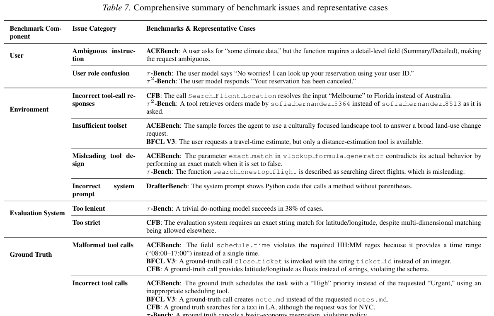

*表 7　按组件与问题类别列出跨基准的代表性案例。具体包括“some climate data”指令含糊、模拟用户输出助手话语、错误地点解析、工具集不足、误导性函数定义、系统提示语法错误、无操作也通过、坐标字符串精确匹配过严、GT 参数类型/文件名/政策错误，以及冗余调用等。*

## 附录 C 可修复案例与保留率分析

### C.1 审计流水线支持的可修复案例

虽然本文主要评价过滤缺陷任务，但 COBA 生成的结构化推理轨迹在基准维护人员希望**修复而非删除**时，也能够自然支持修复。以下给出三个能直接确定最小修正方式的实例。

**C.1.1 BFCL：GT 文件名错误（真实值问题）**。任务 ID：`multi_turn_long_context_10`。推理轨迹指出：“第 3 轮，用户要求创建名为 `notes.md` 的文件，但 GT 调用了 `touch(file_name='note.md')`，拼错文件名。第 4 轮又提到 `notes.md`，GT 却继续使用错误名称。这与两轮用户指令均相矛盾。”**最小修复**：将参考工具调用序列里的所有 `note.md` 改为 `notes.md`。

**C.1.2 ACEBench：API schema 违规（环境问题）**。任务 ID：`normal_single_turn_single_function_50`。推理轨迹指出：“用户希望为儿子建立晨间日程。GT 使用 `FamilyRoutineManager` 的 `createMorningRoutine` 工具，工具选择本身正确；但是 `startTime='07:30'`，而 API schema 仅允许 `{'06:00','07:00','08:00'}`，因此违反工具规范。”**最小修复**：将参数改成有效枚举值（如 `'07:00'`），或者修改 schema 使其允许自由时间输入。

**C.1.3 ComplexFuncBench：用户指令不充分（用户问题）**。任务 ID：`Car-Rentals-49`。推理轨迹指出：“用户要求汇总满足‘报销条件’的所有车辆预订，但从未定义报销条件。GT 任意选取三辆车进行汇总，既缺少用户要求的依据，也在逻辑上不一致。”**最小修复**：在用户提示中明确写出报销条件，例如价格阈值、里程或租车期限。

这些案例说明，组件级推理轨迹能够大幅减少缺陷诊断与修复工作量，作为主要过滤用途的补充。

### C.2 保留率与问题引导修复分析

为了检查过滤问题任务是否改变基准的能力覆盖，研究比较过滤前后的**类别级保留率（category-level retention）**。多数基准保留率仍较高，通常不低于 **0.8**；保留率较低的主要集中在系统性问题比较突出的基准，例如 τ-Bench 的用户模拟角色混淆、DrafterBench 的任务重复/系统提示错误。

研究进一步开展修复分析，依据 COBA 的分类体系和组件级推理轨迹，人工纠正任务级问题。表 8 显示，有针对性的修复后，多个基准的保留率显著提高。这说明许多被删除的任务可以通过局部修改恢复；而仍然较低的保留率往往反映更广泛的系统性缺陷，需要持续维护。整体而言，过滤主要移除集中出现的无效任务，同时保留大部分能力覆盖；问题引导的修复则可恢复许多受影响任务。这些整理后成果作为 AgentSuite 的一部分发布。

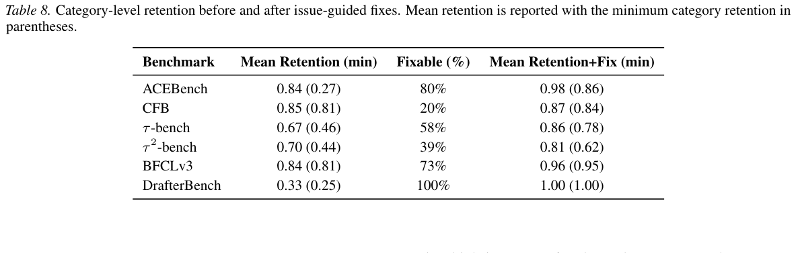

*表 8　平均保留率与最小类别保留率（括号内）、可修复问题比例、修复后保留率。ACEBench：0.84(0.27) → 0.98(0.86)，可修复 80%；CFB：0.85(0.81) → 0.87(0.84)，20%；τ-Bench：0.67(0.46) → 0.86(0.78)，58%；τ²-Bench：0.70(0.44) → 0.81(0.62)，39%；BFCL V3：0.84(0.81) → 0.96(0.95)，73%；DrafterBench：0.33(0.25) → 1.00(1.00)，100%。*

## 附录 D 提示词模板与消融实验

### D.1 分类体系指导的评价提示词模板

为确保基准构建和过滤过程透明且可复现，论文完整提供用于 CFB 问题检测的**精确原始提示词**。该提示判断单个基准样本是否存在使其不适合用于评估的根本缺陷，按照用户、环境及 GT 等组件的来源分类，并强制使用严格的结构化输出格式。这使自动汇总结果保持一致，也让过滤决策能够追溯到明确问题类别，而非主观偏好。

**CFB 分类指导评价提示词（中文版，保留占位符与 JSON 字段）**：

> 你是 ComplexFuncBench 的专家评估员，该基准旨在考察 LLM 复杂函数调用能力。你需要判断给定基准样本的用户提示、环境或真实值是否存在根本缺陷，从而使它不能被纳入有效评价。
>
> 你将收到：①**用户提示（User Prompt）**：用户任务描述与指令；②**可用函数（Available Functions）**：智能体可用函数及完整 JSON schema；③**真实值轨迹（Ground-Truth Trajectory）**：参考函数调用序列。请注意，`"role": "observation"` 消息是其前一个函数调用的执行结果。
>
> 如果样本存在以下一种或多种问题，就视为有缺陷。
>
> **用户（User）**：指令过于含糊或信息不足，无法确定唯一正确的函数调用，而基准却要求唯一答案。
>
> **环境（Environment）**：工具或 API 结果中存在缺陷，使任务不论智能体逻辑如何都无法完成。具体包括：**函数响应错误**（预计算 API 响应错误、误导或缺少必要信息）；可重点查找**错误实体解析**、**不相关结果**；**工具集不足**（即便结合多工具及推理也不能完成任务）；**函数设计有误**（名称或说明误导、与实际功能矛盾）。
>
> **真实值（Ground Truth）**：参考轨迹本身错误，迫使正确智能体在评价中失败。具体包括：**函数调用格式错误**（违反 API schema）；**函数调用逻辑错误**（函数选择或参数与用户要求/上下文冲突）；**无依据或幻觉参数**（没有上下文支持的日期、坐标等）；**相互矛盾的参数**；**拼写错误或指向错误实体的参数值**；**冗余或无依据调用**（与任务无关或无必要的函数调用）。
>
> **评价与输出格式**：仔细逐步分析样本，判断 GT 轨迹是否是用户请求的正确、合理解决方案。最终必须只输出指定 JSON 对象，不允许附加评论。`reasoning` 给出清晰的逐步推理，指出错误参数以及与指令或 schema 的冲突；如果正确，简述其合理性。`reasoning_summary` 提供更短的判断依据；`error_category` 给出类别名称，无缺陷时为 `Not Flawed`；`is_flawed` 为布尔值。

```json
{
  "reasoning": "逐步解释判断；若 GT 错误，说明具体参数及其冲突原因",
  "reasoning_summary": "简短理由；无问题时说明 Not Flawed",
  "error_category": "Flawed function response / ... / Not Flawed",
  "is_flawed": false
}
```

**输入样本模板**：

```text
## Sample to be evaluated
### User's Prompt
{instruction}
### List of available functions and their schema
{available_function_list}
### Ground-truth function call trajectory
# role=observation 的消息由其之前的函数调用产生
{gt_conv_traj}
```

为避免翻译改变可执行模板的约束或占位符，**完整英文提示词逐字版本请核对英文原文第 16–17 页**。

### D.2 通用评价提示词模板

消融实验使用的通用批评提示词与 COBA 版本拥有相同的基准组件和上下文，但**不包含基于组件的问题分类指导**。其中文版如下：

> 你是 ComplexFuncBench 的专家评估员，该基准用于评估 LLM 的复杂函数调用能力。请审阅一个基准样本，判断它是否存在使评价结果不可靠的缺陷。
>
> 你将收到用户提示、包含 JSON schema 的全部可用函数，以及参考函数调用轨迹。请注意，`"role": "observation"` 消息是紧接前一个函数调用的输出。
>
> **评价与输出格式**：仔细逐步分析所给样本是否存在缺陷。最终只输出 JSON 对象，不允许其他说明，字段为 `reasoning`（清楚、逐步说明判断依据）与 `is_flawed`（布尔值）。

```json
{
  "reasoning": "逐步解释你的判断",
  "is_flawed": false
}
```

样本模板与 D.1 相同，包含 `{instruction}`、`{available_function_list}` 和 `{gt_conv_traj}`。**通用提示词英文原件位于原稿第 17–18 页**。

### D.3 对抗式反驳阶段的消融效果

研究以 ACEBench 和 CFB 为对象，采用前文相同的人类核实标签，考察对抗式反驳作为分类指导 LLM 判断的辅助细化环节时的效果。反驳在两个基准上均提高了精确率：ACEBench 从 **0.865 提升至 0.918**，CFB 从 **0.878 提升至 0.910**，减少问题标记中的假阳性。不过，召回率也适度下降，表明精确率与覆盖率之间存在权衡。由于主裁判已与专家高度一致，作者认为反驳适合作为可选手段，以减少后续人工核查的认知负担，而不是 COBA 必不可少的组件。

反驳提示词与原始判断、基准内容一起提供，其核心中文版如下：

> 你此前判定基准 `{benchmark}` 中的样本 `{question_id}` 有缺陷，认为 GT 轨迹存在问题（`Issue=True`）。请重新检查原始判断，确定它是假阳性还是真阳性。
>
> **原则一：有效替代方案（Workaround Principle）**。当直接工具缺失时，智能体常借助现有工具间接完成目标。如果 GT 虽然低效，但能够利用现有工具**在逻辑上满足任务要求**，不要因此判为有缺陷。
>
> **原则二：语义等价（Semantic Equivalence Principle）**。当基准评分允许语义模糊匹配而非严格字符串匹配时，工具参数和响应即使不完全相同，也可能有效；不要要求所有输出字符完全一致。
>
> **原则三：可推导性（Derivability Principle）**。GT 轨迹可能并不展示所有实际操作。若某项数据可以结合任务/用户上下文，通过现有工具搜索或隐式有效步骤得到，该数据仍然有效；相反，若条件检查或参数数据无法从现有工具集及任务上下文推导，则确实构成缺陷。
>
> **回应任务**：根据上述原则审阅基准内容和你的原始推理。如果原推理对替代方案或数据推导过于严格，**推翻（Overturn）**原判定（`Issue=False`）；如果原推理成立，确有逻辑错误或使用无法得到的数据，则**维持（Maintain）**原判定（`Issue=True`）。使用与前一回复相同的 JSON schema 作答。

该反驳提示词英文原件见原稿第 18–19 页。

### D.4 不同 LLM 裁判之间的消融

为了检查 COBA 是否依赖某一个裁判模型，研究比较 **Gemini-2.5-Pro-Thinking**、**Claude-4-Opus-Thinking** 和 **DeepSeek-V3.1-Thinking**。表 9 显示，三者与人工标注的一致性总体相似，但精确率—召回率存在取舍。Gemini 的平均精确率/召回率为 **0.862/0.787**，Claude 为 **0.861/0.624**，DeepSeek 为 **0.748/0.846**。这表明分类指导评价框架并不特定于单个 LLM；实际应用可根据精确率与召回率偏好选择成本更低的替代裁判。

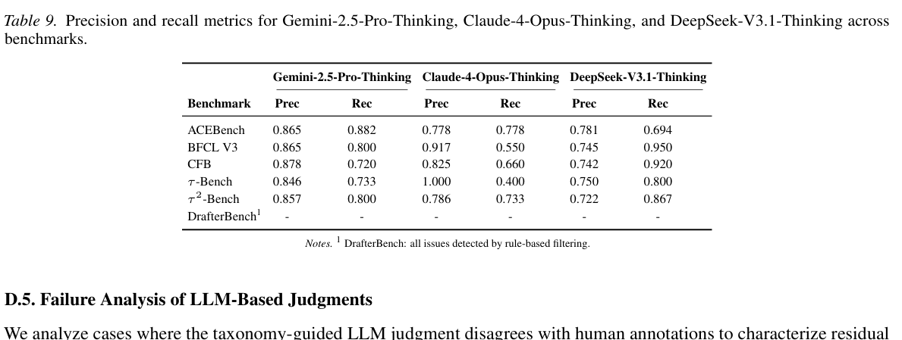

*表 9　Gemini-2.5-Pro-Thinking、Claude-4-Opus-Thinking、DeepSeek-V3.1-Thinking 在 ACEBench、BFCL V3、CFB、τ-Bench、τ²-Bench 等基准上的精确率和召回率。DrafterBench 的问题全部由规则过滤，因此不参与比较。*

### D.5 LLM 判断的失败分析

研究分析分类指导 LLM 判断与人工标注不一致的案例，以刻画残余错误（表 10）。假阳性主要源于**部分可观测条件下过严的推理**：裁判惩罚有效但非典型的解决方案，或错误假定给定轨迹已经包含全部步骤。假阴性主要由遗漏底层规范违规造成，尤其是工具调用格式错误。总体而言，错误集中于少数可重复模式，因此可以通过加强 schema 级检查、在提示词中明确考虑部分轨迹等措施定向改进。

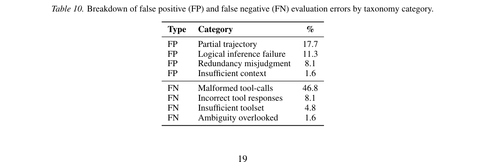

*表 10　假阳性：部分轨迹 17.7%，逻辑推断失败 11.3%，误判冗余 8.1%，上下文不足 1.6%。假阴性：调用格式不合法 46.8%，工具返回错误 8.1%，工具集不足 4.8%，遗漏含糊性 1.6%。*

## 附录 E ACEBench 完整排行榜

本附录给出 ACEBench 全部模型的排行榜（表 11）。清理问题任务后，**30 个模型中有 18 个的排名发生变化**。

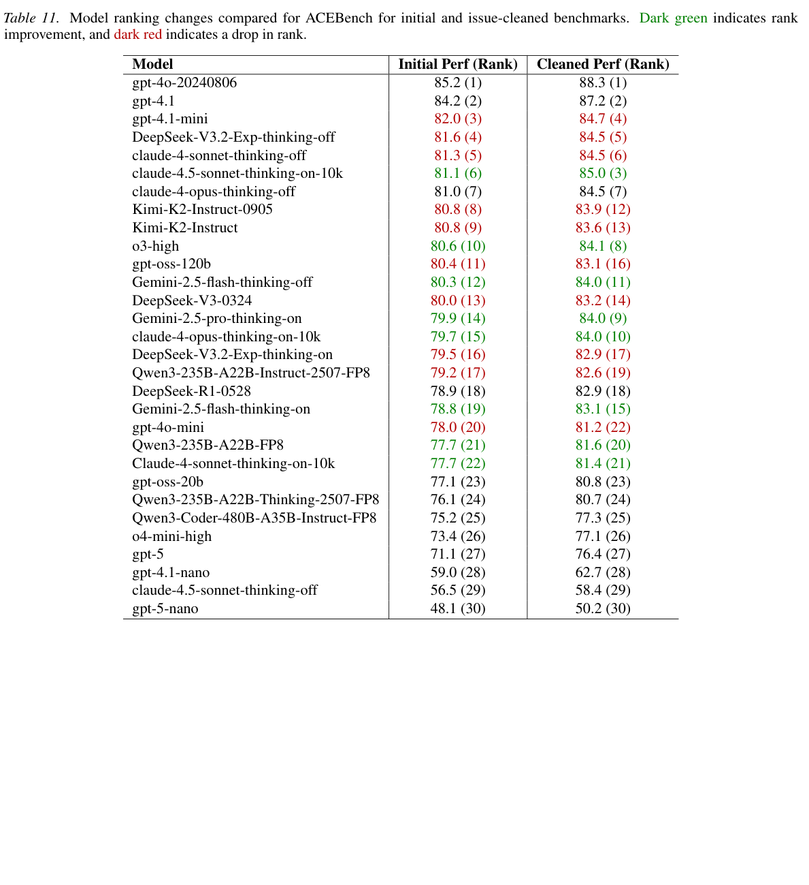

*表 11　原始基准与清理后基准上的全部 30 种模型表现（Perf）和名次（Rank）。深绿色表示上升，深红色表示下降。模型名称、得分和名次均保留原表，可依据右侧数字逐项核对。*

## 参考文献（References）

作者、原始题名、出版信息、DOI 和 URL 保留英文书目信息以便准确检索；以下按原稿顺序提供中文题名翻译。

1. Anthropic (2025)：**Claude 4 发布介绍**。
2. Barres et al. (2025)：**τ²-Bench：双重控制环境中的对话智能体评估**。
3. Chen et al. (2025)：**ACEBench：大语言模型工具使用能力的综合评价**。
4. Cuadron et al. (2025)：**SABER：小操作、大错误——保护 LLM 智能体中具有状态修改效果的步骤**。
5. DeepSeek (2025)：**DeepSeek-V3.1 发布公告**。
6. Gema et al. (2025)：**MMLU 已经足够了吗？**
7. Google (2025)：**Gemini 2.5：我们最智能的人工智能模型**。
8. Khot et al. (2023)：**分解式提示：解决复杂任务的模块化方法**。
9. Li et al. (2025)：**DrafterBench：面向土木工程任务自动化的大语言模型基准评估**。
10. Liu et al. (2024)：**AgentBench：将 LLM 作为智能体进行评价**。
11. Nexusflow.ai team (2024)：**NexusBench：函数调用与智能体评测套件**。
12. Northcutt et al. (2021)：**测试集中的普遍标签错误扰乱机器学习基准**。
13. Park et al. (2023)：**生成式智能体：人类行为的交互式模拟**。
14. Patil et al. (2025)：**伯克利函数调用排行榜（BFCL）：从工具使用到大语言模型的智能体评价**。
15. Qin et al. (2024)：**ToolLLM：帮助大语言模型掌握 16000 多个真实世界 API**。
16. Sharma et al. (2024)：**迈向理解语言模型中的迎合性偏差**。
17. Truong et al. (2026)：**AI 基准中奇妙的漏洞以及到哪里寻找它们**。
18. Vendrow et al. (2025)：**大语言模型基准真的测试了可靠性吗？**
19. Wang et al. (2024)：**大语言模型并非公平的评价者**。
20. Yao et al. (2025)：**τ-Bench：真实世界领域中的工具智能体—用户交互基准**。
21. Yu, B. et al. (2025)：**UTBoost：对 SWE-bench 编码智能体开展严格评价**。
22. Yu, T. et al. (2018)：**Spider：面向复杂跨领域语义解析与文本到 SQL 任务的大规模人工标注数据集**。
23. Zheng et al. (2023)：**利用 MT-Bench 与 Chatbot Arena 评价 LLM 裁判**。
24. Zhong et al. (2025)：**ComplexFuncBench：探索长上下文场景下多步骤、有约束的函数调用**。
25. Zhou, D. et al. (2023)：**由易到难的提示策略使大语言模型能够进行复杂推理**。
26. Zhou, S. et al. (2024)：**WebArena：用于构建自主智能体的真实网页环境**。
27. Zhu et al. (2026)：**建立构建严谨智能体基准的最佳实践**。

### 原文完整书目数据


Anthropic. Introducing Claude 4, 2025. URL https:
//www.anthropic.com/news/claude-4.
Barres, V., Dong, H., Ray, S., Si, X., and Narasimhan, K.
τ2
-Bench: Evaluating conversational agents in a dual-
control environment, 2025. URL https://arxiv.
org/abs/2506.07982.
Chen, C., Hao, X., Liu, W., Huang, X., Zeng, X., Yu,
S., Li, D., Huang, Y., Liu, X., Xinzhi, W., and Liu, W.
ACEBench: A comprehensive evaluation of LLM tool
usage. In Christodoulopoulos, C., Chakraborty, T., Rose,
C., and Peng, V. (eds.), Findings of the Association for
Computational Linguistics: EMNLP 2025, pp. 12970–
12998, Suzhou, China, November 2025. Association for
Computational Linguistics. ISBN 979-8-89176-335-7.
doi: 10.18653/v1/2025.findings-emnlp.697. URL
https://aclanthology.org/2025.findin
gs-emnlp.697/.
Cuadron, A., Yu, P., Liu, Y., and Gupta, A. SABER: Small
actions, big errors – safeguarding mutating steps in LLM
agents, 2025. URL https://arxiv.org/abs/25
12.07850.
DeepSeek. DeepSeek-V3.1 release, 2025. URL https:
//api-docs.deepseek.com/news/news2508
21.
Gema, A. P., Leang, J. O. J., Hong, G., Devoto, A., Man-
cino, A. C. M., Saxena, R., He, X., Zhao, Y., Du, X.,
Ghasemi Madani, M. R., Barale, C., McHardy, R., Harris,
J., Kaddour, J., Van Krieken, E., and Minervini, P. Are
we done with MMLU? In Chiruzzo, L., Ritter, A., and
Wang, L. (eds.), Proceedings of the 2025 Conference of
the Nations of the Americas Chapter of the Association
for Computational Linguistics: Human Language Tech-
nologies (Volume 1: Long Papers), pp. 5069–5096, Albu-
querque, New Mexico, April 2025. Association for Com-
putational Linguistics. ISBN 979-8-89176-189-6. doi:
10.18653/v1/2025.naacl-long.262. URL https://ac
lanthology.org/2025.naacl-long.262/.
Google. Gemini 2.5: Our most intelligent ai model, 2025.
URL https://blog.google/technology/g
oogle-deepmind/gemini-model-thinkin

g-updates-march-2025/#gemini-2-5-thi
nking.
Khot, T., Trivedi, H., Finlayson, M., Fu, Y., Richardson, K.,
Clark, P., and Sabharwal, A. Decomposed prompting:
A modular approach for solving complex tasks. In The
Eleventh International Conference on Learning Repre-
sentations, 2023. URL https://openreview.net
/forum?id=_nGgzQjzaRy.
Li, Y., Dong, Z., and Shao, Y. DrafterBench: Benchmark-
ing large language models for tasks automation in civil
engineering, 2025. URL https://arxiv.org/ab
s/2507.11527.
Liu, X., Yu, H., Zhang, H., Xu, Y., Lei, X., Lai, H., Gu,
Y., Ding, H., Men, K., Yang, K., Zhang, S., Deng, X.,
Zeng, A., Du, Z., Zhang, C., Shen, S., Zhang, T., Su, Y.,
Sun, H., Huang, M., Dong, Y., and Tang, J. AgentBench:
Evaluating LLMs as agents. In The Twelfth International
Conference on Learning Representations, 2024. URL
https://openreview.net/forum?id=zAdU
B0aCTQ.
Nexusflow.ai team. NexusBench: Fc and agent benchmark-
ing suite, 2024. URL https://github.com/nex
usflowai/NexusBench.
Northcutt, C. G., Athalye, A., and Mueller, J. Pervasive la-
bel errors in test sets destabilize machine learning bench-
marks. In Thirty-fifth Conference on Neural Informa-
tion Processing Systems Datasets and Benchmarks Track
(Round 1), 2021. URL https://openreview.net
/forum?id=XccDXrDNLek.
Park, J. S., O’Brien, J., Cai, C. J., Morris, M. R., Liang,
P., and Bernstein, M. S. Generative agents: Interactive
simulacra of human behavior. In Proceedings of the 36th
Annual ACM Symposium on User Interface Software and
Technology, UIST ’23, New York, NY, USA, 2023. Asso-
ciation for Computing Machinery. ISBN 9798400701320.
doi: 10.1145/3586183.3606763. URL https:
//doi.org/10.1145/3586183.3606763.
Patil, S. G., Mao, H., Yan, F., Ji, C. C.-J., Suresh, V., Stoica,
I., and Gonzalez, J. E. The berkeley function calling
leaderboard (BFCL): From tool use to agentic evalua-
tion of large language models. In Singh, A., Fazel, M.,
Hsu, D., Lacoste-Julien, S., Berkenkamp, F., Maharaj,
T., Wagstaff, K., and Zhu, J. (eds.), Proceedings of the
42nd International Conference on Machine Learning,
volume 267 of Proceedings of Machine Learning Re-
search, pp. 48371–48392. PMLR, 13–19 Jul 2025. URL
https://proceedings.mlr.press/v267/p
atil25a.html.
Qin, Y., Liang, S., Ye, Y., Zhu, K., Yan, L., Lu, Y., Lin,
Y., Cong, X., Tang, X., Qian, B., Zhao, S., Hong, L.,
Tian, R., Xie, R., Zhou, J., Gerstein, M., dahai li, Liu,
Z., and Sun, M. ToolLLM: Facilitating large language
models to master 16000+ real-world APIs. In The Twelfth
International Conference on Learning Representations,
2024. URL https://openreview.net/forum
?id=dHng2O0Jjr.
Sharma, M., Tong, M., Korbak, T., Duvenaud, D., Askell,
A., Bowman, S. R., DURMUS, E., Hatfield-Dodds, Z.,
Johnston, S. R., Kravec, S. M., Maxwell, T., McCandlish,
S., Ndousse, K., Rausch, O., Schiefer, N., Yan, D., Zhang,
M., and Perez, E. Towards understanding sycophancy in
language models. In The Twelfth International Confer-
ence on Learning Representations, 2024. URL https:
//openreview.net/forum?id=tvhaxkMKAn.
Truong, S. T., Tu, Y., Hardy, M., Reuel, A., Tang, Z., Bura-
pacheep, J., Perera, J. J., Uwakwe, C., Domingue, B. W.,
Haber, N., and Koyejo, S. Fantastic bugs and where to
find them in AI benchmarks. In The Thirty-ninth Annual
Conference on Neural Information Processing Systems
Datasets and Benchmarks Track, 2026. URL https:
//openreview.net/forum?id=SlhLRh810S.
Vendrow, J., Vendrow, E., Beery, S., and Madry, A. Do large
language model benchmarks test reliability?, 2025. URL
https://arxiv.org/abs/2502.03461.
Wang, P., Li, L., Chen, L., Cai, Z., Zhu, D., Lin, B., Cao,
Y., Kong, L., Liu, Q., Liu, T., and Sui, Z. Large language
models are not fair evaluators. In Ku, L.-W., Martins, A.,
and Srikumar, V. (eds.), Proceedings of the 62nd Annual
Meeting of the Association for Computational Linguis-
tics (Volume 1: Long Papers), pp. 9440–9450, Bangkok,
Thailand, August 2024. Association for Computational
Linguistics. doi: 10.18653/v1/2024.acl-long.511. URL
https://aclanthology.org/2024.acl-lon
g.511/.
Yao, S., Shinn, N., Razavi, P., and Narasimhan, K. R. τ-
bench: A benchmark for tool agent user interaction in real-
world domains. In The Thirteenth International Confer-
ence on Learning Representations, 2025. URL https:
//openreview.net/forum?id=roNSXZpUDN.
Yu, B., Zhu, Y., He, P., and Kang, D. UTBoost: Rigorous
evaluation of coding agents on SWE-bench. In Che, W.,
Nabende, J., Shutova, E., and Pilehvar, M. T. (eds.), Pro-
ceedings of the 63rd Annual Meeting of the Association
for Computational Linguistics (Volume 1: Long Papers),
pp. 3762–3774, Vienna, Austria, July 2025. Association
for Computational Linguistics. ISBN 979-8-89176-251-
0. doi: 10.18653/v1/2025.acl-long.189. URL https:
//aclanthology.org/2025.acl-long.189/.

Yu, T., Zhang, R., Yang, K., Yasunaga, M., Wang, D., Li,
Z., Ma, J., Li, I., Yao, Q., Roman, S., Zhang, Z., and
Radev, D. Spider: A large-scale human-labeled dataset
for complex and cross-domain semantic parsing and text-
to-SQL task. In Riloff, E., Chiang, D., Hockenmaier, J.,
and Tsujii, J. (eds.), Proceedings of the 2018 Conference
on Empirical Methods in Natural Language Processing,
pp. 3911–3921, Brussels, Belgium, October-November
2018. Association for Computational Linguistics. doi:
10.18653/v1/D18-1425. URL https://aclantho
logy.org/D18-1425/.
Zheng, L., Chiang, W.-L., Sheng, Y., Zhuang, S., Wu, Z.,
Zhuang, Y., Lin, Z., Li, Z., Li, D., Xing, E., Zhang, H.,
Gonzalez, J. E., and Stoica, I. Judging LLM-as-a-judge
with MT-bench and chatbot arena. In Thirty-seventh
Conference on Neural Information Processing Systems
Datasets and Benchmarks Track, 2023. URL https:
//openreview.net/forum?id=uccHPGDlao.
Zhong, L., Du, Z., Zhang, X., Hu, H., and Tang, J. Com-
plexFuncBench: Exploring multi-step and constrained
function calling under long-context scenario, 2025. URL
https://arxiv.org/abs/2501.10132.
Zhou, D., Schärli, N., Hou, L., Wei, J., Scales, N., Wang,
X., Schuurmans, D., Cui, C., Bousquet, O., Le, Q. V.,
and Chi, E. H. Least-to-most prompting enables complex
reasoning in large language models. In The Eleventh
International Conference on Learning Representations,
2023. URL https://openreview.net/forum
?id=WZH7099tgfM.
Zhou, S., Xu, F. F., Zhu, H., Zhou, X., Lo, R., Sridhar,
A., Cheng, X., Ou, T., Bisk, Y., Fried, D., Alon, U.,
and Neubig, G. Webarena: A realistic web environment
for building autonomous agents, 2024. URL https:
//arxiv.org/abs/2307.13854.
Zhu, Y., Jin, T., Pruksachatkun, Y., Zhang, A. K., Liu, S.,
Cui, S., Kapoor, S., Longpre, S., Meng, K., Weiss, R.,
Barez, F., Gupta, R., Dhamala, J., Merizian, J., Giu-
lianelli, M., Coppock, H., Ududec, C., Kellermann, A.,
Sekhon, J. S., Steinhardt, J., Schwettmann, S., Narayanan,
A., Zaharia, M., Stoica, I., Liang, P., and Kang, D. Estab-
lishing best practices in building rigorous agentic bench-
marks. In The Thirty-ninth Annual Conference on Neu-
ral Information Processing Systems Datasets and Bench-
marks Track, 2026. URL https://openreview.n
et/forum?id=E58HNCqoaA.
