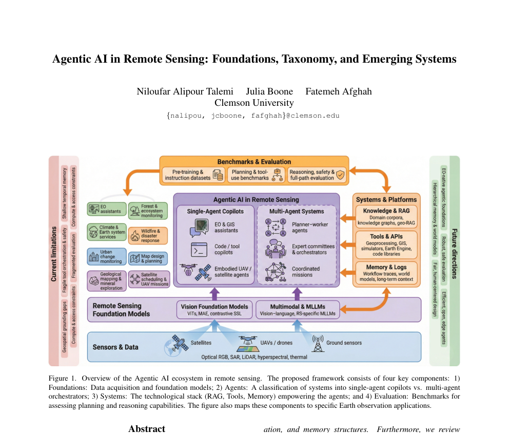
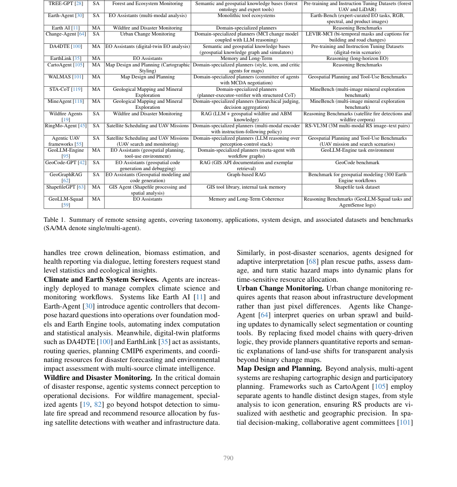
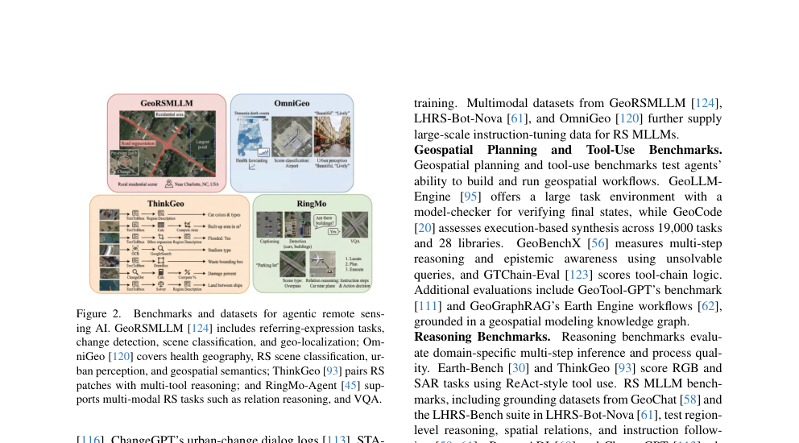

# 遥感中的智能体人工智能：基础、分类体系与新兴系统

> **翻译范围说明**：本文件包含原文摘要的完整中文翻译，以及研究内容的重点章节译述；**不等同于论文全部 14 页的逐段全文译文**。所有原文、参考文献及图表均另附，可逐页核对。

## 原文摘要｜完整中文翻译

地球观测（Earth Observation，EO）分析的范式正在从静态深度学习模型转向自主智能体人工智能（Agentic AI）。虽然近年来的视觉基础模型（Vision Foundation Models）和多模态大语言模型（Multimodal Large Language Models，MLLMs）推动了表征学习的发展，但这些模型通常缺乏复杂地理空间工作流所需要的顺序规划能力和主动工具编排能力。本文对遥感领域的智能体人工智能进行全面综述，提出一套统一的分类体系，以区分单智能体辅助系统（single-agent copilots）和多智能体系统（multi-agent systems），并分析规划机制、检索增强生成（Retrieval-Augmented Generation，RAG）以及记忆结构等架构基础。此外，本文梳理了正在出现的新型评测基准：这些基准推动评价重点从像素级准确率转向具有轨迹感知能力的推理正确性。通过批判性审视地理空间锚定（grounding）、安全性与智能体编排方面的局限，本文提出了构建稳健、自主地理空间智能系统的战略性发展路线。

## 引言与综述定位｜节译

地球观测数据来源广泛，既有卫星和无人机获取的可见光影像，也有合成孔径雷达、红外、高光谱和激光雷达数据。传统遥感深度学习模型在场景分类、变化检测、目标定位和异常检测等任务上已有成熟应用，但它们通常围绕事先确定的输入、目标和处理流程进行预测。通用视觉语言模型可以把图像与自然语言连接起来，却未必能够在空间尺度、传感器特性及连续的工具调用约束下完成自主分析。

因此，智能体系统的核心能力不仅在于“看懂影像”，还在于将自然语言问题转化为有逻辑顺序、可以调用外部工具且能够利用反馈进行调整的分析过程。论文强调，研究对象应从单一模型的识别能力，扩展至包含工具、记忆、检索、规划和执行环境的完整系统。

## 主要分类与系统组成｜重点译述

论文从体系结构角度区分**单智能体 Copilot**与**多智能体编排系统**。前者通常由一个中心智能体使用 GIS 或遥感工具完成任务；后者进一步划分规划、执行、感知、检索等角色，使各智能体可以协作处理复杂工作流。系统层面涉及外部知识检索、RAG、工具/API 接口、短期和长期记忆，以及能够支撑实际环境交互的编排机制。论文并非提出一个全新的可执行 Benchmark，而是对领域中已有系统、相关数据集和评价思路进行分类比较。

## Benchmark 与可靠性评价｜重点译述

作者指出，单纯报告分割精度、检测准确率或视觉问答分数，很难反映一个 Agent 在复杂遥感任务中的实际可靠性。评价应进一步关注工具选择、动作序列、长链规划、执行结果，以及任务是否能够在存在错误或信息不完整时继续推进。对你正在进行的研究而言，本文适合作为领域分类与“为什么需要工作流级评价”的背景文献，但不应将它误当作拥有完整 GT 轨迹和标准执行环境的原始基准论文。

## 本文图表阅读提示

- **图 1**：智能体遥感系统生态框架，依次连接数据与基础模型、Agent 架构、系统能力、Benchmark 与应用场景。
- **表 1**：遥感智能体类型与系统能力的横向比较。
- **图 2**：智能体遥感相关 Benchmark 与数据集的位置关系。

## 核心学术术语对照

| 英文术语 | 中文译法 | 注释 |
|---|---|---|
| Benchmark | 评测基准 | 与数据集、任务集合、执行环境和评分协议区分 |
| Ground Truth (GT) | 参考真值、标准答案 | 可能是答案、代码、执行结果或轨迹，需按论文实际定义 |
| Agentic AI | 智能体人工智能 | 具有规划、工具操作、反馈利用等能力的系统 |
| Tool-Augmented Agent | 工具增强智能体 | 可调用外部 API、程序或领域工具的智能体 |
| Tool Calling | 工具调用 | 包含工具选择和参数绑定，而不只是文本中提及工具 |
| Workflow | 工作流 | 有依赖关系的操作流程 |
| Trajectory | 执行轨迹 | 动作、调用参数、环境反馈和可能的中间产物 |
| Geospatial Grounding | 地理空间锚定 | 将模型输出与实际地物、坐标、尺度、属性或数据对应 |
| Vision-Language Model (VLM) | 视觉语言模型 | 同时处理视觉输入和语言的模型 |
| Multimodal Large Language Model (MLLM) | 多模态大语言模型 | 支持多模态理解和推理 |
| Remote Sensing (RS) | 遥感 | 本研究语境中的对地观测数据分析 |
| Earth Observation (EO) | 地球观测 | 涵盖卫星、航空以及相关环境观测 |
| Retrieval-Augmented Generation (RAG) | 检索增强生成 | 通过外部信息检索增强生成和推理 |
| Semantic Similarity | 语义相似性 | 与正确执行并不等价 |
| Execution-Based Evaluation | 基于执行的评价 | 需要真实或受控的运行环境及验证标准 |
| Multiple-Choice Question (MCQ) | 多项选择题 | 不等同于多工具执行任务 |
| Multispectral | 多光谱 | 传感器多波段观测 |
| Synthetic Aperture Radar (SAR) | 合成孔径雷达 | 主动微波遥感成像方式 |
| Refined Caption | 改进图注 | 利用论文上下文补充的科学图注 |

---

## 原论文全部图表（按照 PDF 页码）

> 图表图片不重新绘制，使用原始 PDF 区域截图；复杂或包含跨栏内容的图表，请点击对应原始页面进行视觉核对。以下逐图展示是为了保证译稿中的图片引用完整，而非宣称邻近英文图题均已翻译。

### Figure 1 — 原论文第 1 页

**原文图题（保留英文）：** Figure 1. Overview of the Agentic AI ecosystem in remote sensing. The proposed framework consists of four key components: 1) Foundations: Data acquisition and foundation models; 2) Agents: A classification of systems into single-agent copilots vs. multi-agent orchestrators; 3) Systems: The technological stack (RAG, Tools, Memory) empowering the agents; and 4) Evaluation: Benchmarks for assessing planning and reasoning capabilities. The figure also maps these components to specific Earth observation applications.

[查看完整原论文第 1 页](./source_pages/page-001.jpg)

### Table 1 — 原论文第 5 页

**原文图题（保留英文）：** Table 1. Summary of remote sensing agents, covering taxonomy, applications, system design, and associated datasets and benchmarks (SA/MA denote single/multi-agent).

[查看完整原论文第 5 页](./source_pages/page-005.jpg)

### Figure 2 — 原论文第 7 页

**原文图题（保留英文）：** Figure 2. Benchmarks and datasets for agentic remote sens- ing AI. GeoRSMLLM [124] includes referring-expression tasks, change detection, scene classification, and geo-localization; Om- niGeo [120] covers health geography, RS scene classification, ur- ban perception, and geospatial semantics; ThinkGeo [93] pairs RS patches with multi-tool reasoning; and RingMo-Agent [45] sup- ports multi-modal RS tasks such as relation reasoning, and VQA.

[查看完整原论文第 7 页](./source_pages/page-007.jpg)

## 逐页原文与翻译覆盖记录

| PDF 页码 | 英文原文 | 中文翻译状态 | 原版截图 |
|---|---|---|---|
| 1 | [英文原文](./英文原文_逐页全文.md) | 摘要已完整翻译；同页其他段落不保证全译 | [页面](./source_pages/page-001.jpg) |
| 2 | [英文原文](./英文原文_逐页全文.md) | 核心内容译述／本页未逐段全文翻译 | [页面](./source_pages/page-002.jpg) |
| 3 | [英文原文](./英文原文_逐页全文.md) | 核心内容译述／本页未逐段全文翻译 | [页面](./source_pages/page-003.jpg) |
| 4 | [英文原文](./英文原文_逐页全文.md) | 核心内容译述／本页未逐段全文翻译 | [页面](./source_pages/page-004.jpg) |
| 5 | [英文原文](./英文原文_逐页全文.md) | 核心内容译述／本页未逐段全文翻译 | [页面](./source_pages/page-005.jpg) |
| 6 | [英文原文](./英文原文_逐页全文.md) | 核心内容译述／本页未逐段全文翻译 | [页面](./source_pages/page-006.jpg) |
| 7 | [英文原文](./英文原文_逐页全文.md) | 核心内容译述／本页未逐段全文翻译 | [页面](./source_pages/page-007.jpg) |
| 8 | [英文原文](./英文原文_逐页全文.md) | 核心内容译述／本页未逐段全文翻译 | [页面](./source_pages/page-008.jpg) |
| 9 | [英文原文](./英文原文_逐页全文.md) | 核心内容译述／本页未逐段全文翻译 | [页面](./source_pages/page-009.jpg) |
| 10 | [英文原文](./英文原文_逐页全文.md) | 核心内容译述／本页未逐段全文翻译 | [页面](./source_pages/page-010.jpg) |
| 11 | [英文原文](./英文原文_逐页全文.md) | 核心内容译述／本页未逐段全文翻译 | [页面](./source_pages/page-011.jpg) |
| 12 | [英文原文](./英文原文_逐页全文.md) | 核心内容译述／本页未逐段全文翻译 | [页面](./source_pages/page-012.jpg) |
| 13 | [英文原文](./英文原文_逐页全文.md) | 核心内容译述／本页未逐段全文翻译 | [页面](./source_pages/page-013.jpg) |
| 14 | [英文原文](./英文原文_逐页全文.md) | 核心内容译述／本页未逐段全文翻译 | [页面](./source_pages/page-014.jpg) |

> 如需获得完全逐句对应的中文版本，必须继续翻译原文主体与附录，并逐段人工校订。
