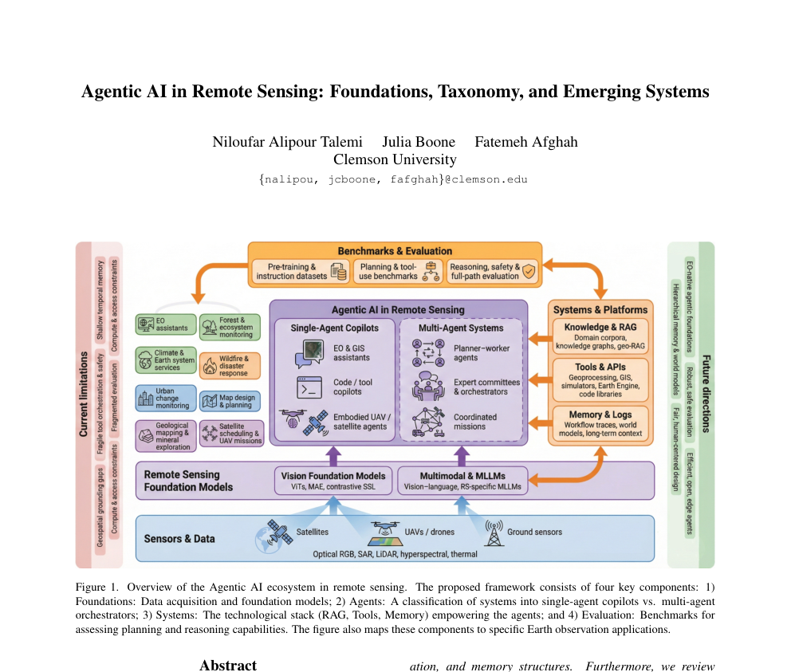
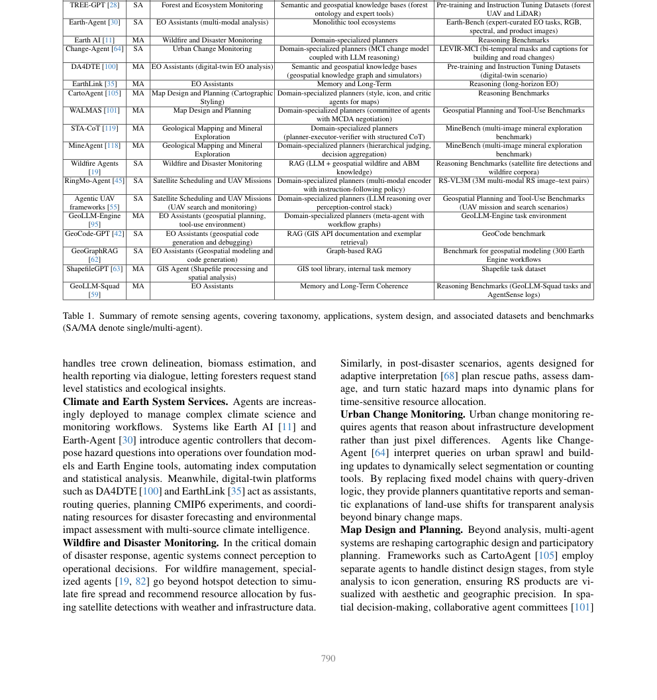
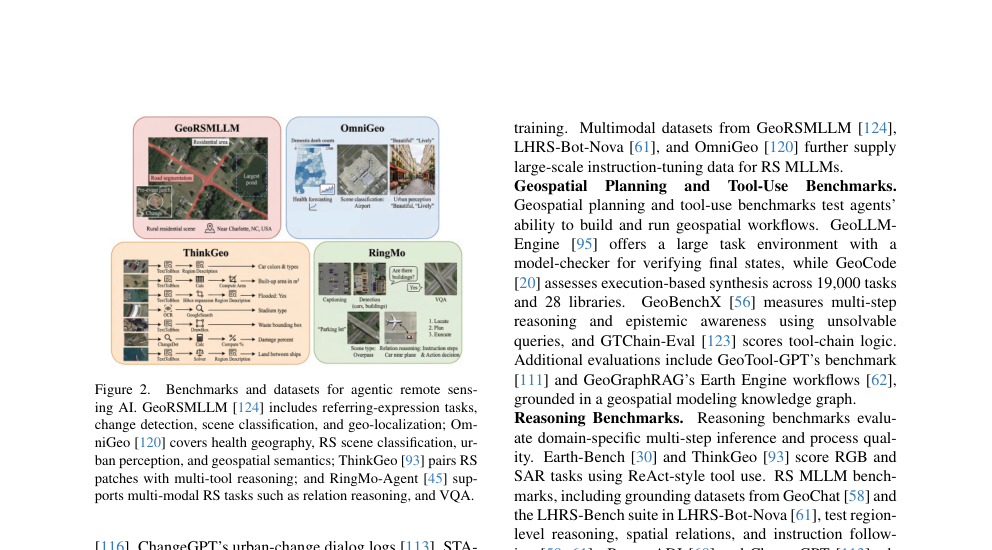

# Agentic AI in Remote Sensing: Foundations, Taxonomy, and Emerging Systems：图表索引

**已识别明确标题的图表裁图：3 处。** PDF 中另有无单独标题的图片、图例和内嵌示意，均保留在 1:1 页码对应的完整截图中。

## Figure 1（第 1 页）

Figure 1. Overview of the Agentic AI ecosystem in remote sensing. The proposed framework consists of four key components: 1) Foundations: Data acquisition and foundation models; 2) Agents: A classification of systems into single-agent copilots vs. multi-agent orchestrators; 3) Systems: The technological stack (RAG, Tools, Memory) empowering the agents; and 4) Evaluation: Benchmarks for assessing planning and reasoning capabilities. The figure also maps these components to specific Earth observat

[查看第 1 页原始版面](./source_pages/page-001.jpg)

## Table 1（第 5 页）

Table 1. Summary of remote sensing agents, covering taxonomy, applications, system design, and associated datasets and benchmarks (SA/MA denote single/multi-agent).

[查看第 5 页原始版面](./source_pages/page-005.jpg)

## Figure 2（第 7 页）

Figure 2. Benchmarks and datasets for agentic remote sens- ing AI. GeoRSMLLM [124] includes referring-expression tasks, change detection, scene classification, and geo-localization; Om- niGeo [120] covers health geography, RS scene classification, ur- ban perception, and geospatial semantics; ThinkGeo [93] pairs RS patches with multi-tool reasoning; and RingMo-Agent [45] sup- ports multi-modal RS tasks such as relation reasoning, and VQA.

[查看第 7 页原始版面](./source_pages/page-007.jpg)
