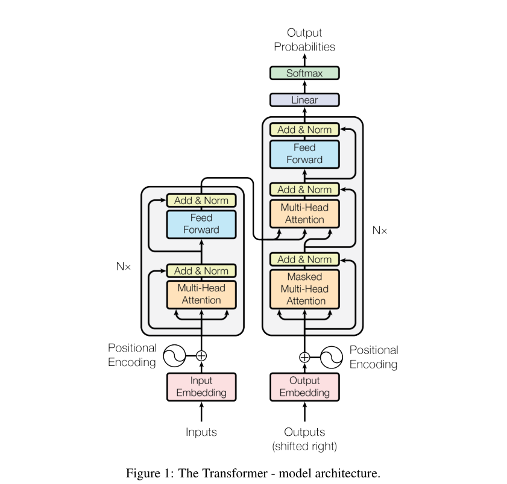
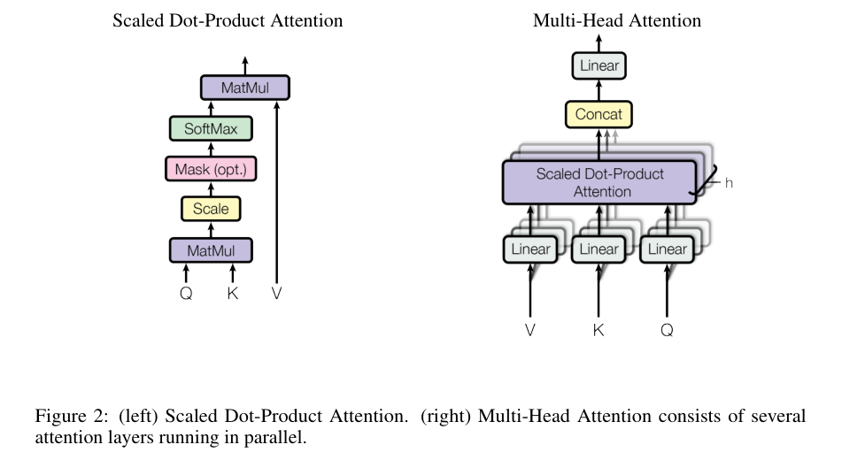
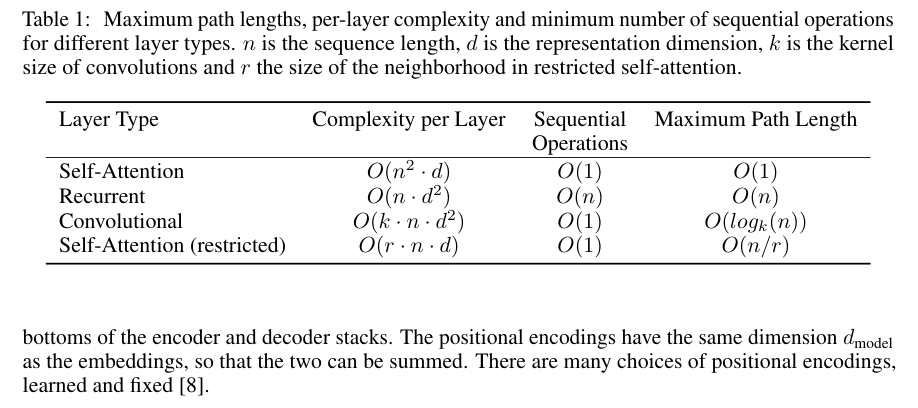
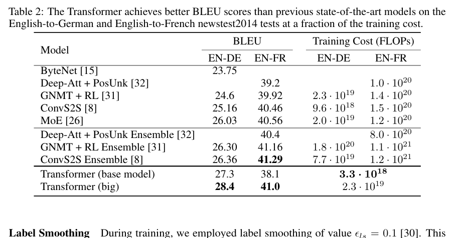
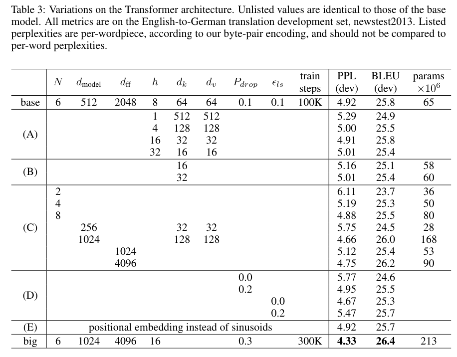
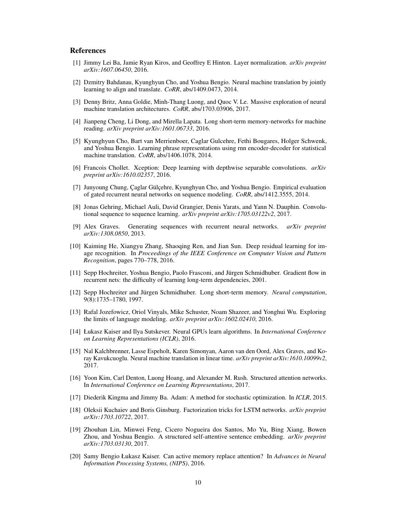
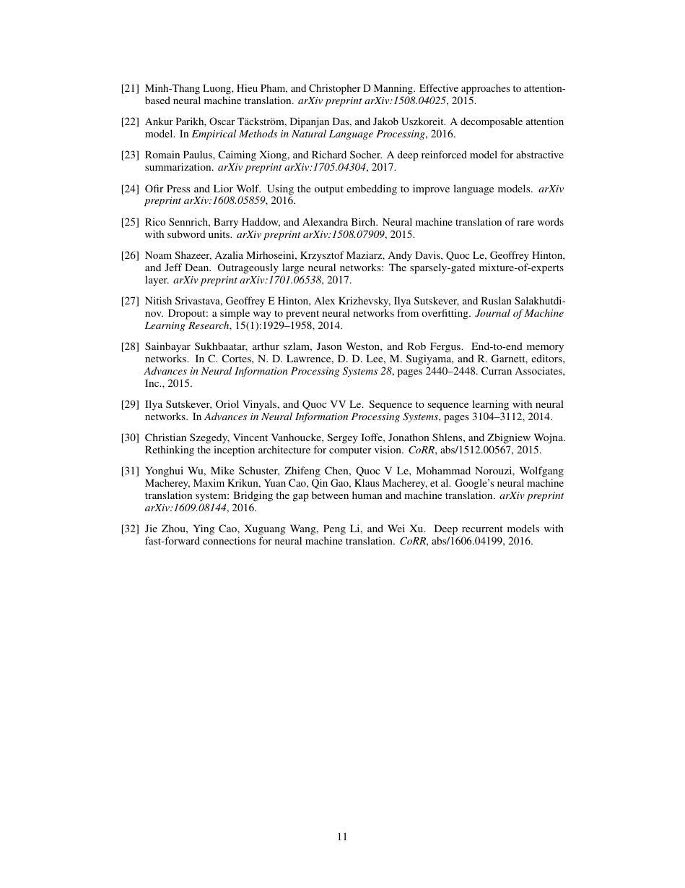

# 注意力机制就是你所需要的一切

> **原题**：Attention Is All You Need  
> **作者**：Ashish Vaswani、Noam Shazeer、Niki Parmar、Jakob Uszkoreit、Llion Jones、Aidan N. Gomez、Łukasz Kaiser、Illia Polosukhin  
> **发表**：第 31 届神经信息处理系统大会（NIPS 2017）  
> **阅读说明**：按原文的章节与段落顺序翻译；公式、参数、模型名和文献编号保持原样；图表为原 PDF 截图。文末参考文献保留英文书目信息，避免改动可检索的正式题名。

## 摘要（原稿第 1 页）

当前主流的序列转换模型建立在复杂的循环神经网络或卷积神经网络之上，并采用编码器—解码器结构。性能最好的模型通常还通过注意力机制连接编码器和解码器。我们提出了一种全新的、结构简单的网络架构——**Transformer**，它完全基于注意力机制，不再使用循环结构和卷积。我们在两项机器翻译任务上的实验表明，该模型在翻译质量上优于已有模型，同时具有更强的并行计算能力，所需训练时间显著缩短。在 WMT 2014 英译德任务上，我们的模型取得 **28.4 BLEU**，比包括集成系统在内的原最佳结果高出超过 2 BLEU。在 WMT 2014 英译法任务上，我们仅使用 8 块 GPU 训练 3.5 天，就取得了当时单模型最佳的 **41.0 BLEU**，训练成本远低于文献中表现最好的模型。

## 1 引言（原稿第 1–2 页）

循环神经网络，尤其是长短期记忆网络（LSTM）[12]和门控循环神经网络[7]，已成为语言建模和机器翻译等序列建模、序列转换问题中的先进方法[29,2,5]。研究者持续探索循环语言模型与编码器—解码器架构的性能极限[31,21,13]。

循环模型通常沿输入、输出序列的符号位置组织计算：在时刻 $t$，根据前一隐藏状态 $h_{t-1}$ 和当前位置的输入生成隐藏状态 $h_t$。这种固有的顺序性使训练样本内部难以并行计算；当序列很长、内存限制了跨样本批处理规模时，这一问题尤为突出。近期研究借助因式分解技术[18]和条件计算[26]显著提升了计算效率，后者还改善了模型表现，但顺序计算这一根本限制依然存在。

注意力机制已成为许多序列建模和序列转换任务的重要组成部分，使模型能够捕捉输入或输出序列中不同位置间的依赖关系，而不受它们之间距离的限制[2,16]。然而，除少数例外[22]，注意力机制通常仍与循环网络共同使用。

我们提出的 Transformer 架构摒弃循环计算，完全通过注意力机制建立输入和输出之间的全局依赖关系。Transformer 大幅提升了并行化能力，只需在 8 块 P100 GPU 上训练约 12 小时，就能够在翻译质量方面达到新的先进水平。

**原文作者贡献脚注**：作者们以随机顺序列出并作出同等贡献。Jakob 提出以自注意力取代 RNN，并推动这一思路的实验验证；Ashish 与 Illia 设计和实现首批 Transformer 模型，参与了工作的各个环节；Noam 提出缩放点积注意力、多头注意力与无参数的位置表示，也深度参与了几乎所有细节；Niki 在最初代码库和 tensor2tensor 中设计、实现、调优并测试了大量模型变体；Llion 探索模型变体，负责初始代码库以及高效推断和可视化；Łukasz 与 Aidan 长期推进 tensor2tensor 的设计与实现，替代早期代码库，使实验速度和质量大幅提升。Aidan 在 Google Brain 工作期间完成部分研究，Illia 在 Google Research 工作期间完成部分研究。

## 2 背景（原稿第 2 页）

减少序列计算的目标也推动了 Extended Neural GPU[20]、ByteNet[15] 和 ConvS2S[8] 的发展。这些方法均以卷积神经网络为基本模块，可同时计算输入、输出序列所有位置的隐藏表示。但在这些模型中，连接两个任意位置所需的操作数量会随位置距离增加：ConvS2S 为线性增长，ByteNet 为对数增长。因此，模型学习远距离依赖关系更为困难[11]。Transformer 将这一操作数量降为常数，不过注意力加权平均可能降低有效分辨率，我们通过第 3.2 节介绍的多头注意力来抵消这一影响。

**自注意力**（self-attention，有时也称内部注意力 intra-attention）是一种建立同一序列不同位置间联系、从而形成序列表示的注意力机制。自注意力已被成功应用于阅读理解、抽象式摘要、文本蕴含和与具体任务无关的句子表示学习等任务[4,22,23,19]。

端到端记忆网络使用循环式注意力机制，而非位置对齐的循环结构，在简单语言问答和语言建模任务中取得了良好表现[28]。

据我们所知，Transformer 是首个完全依赖自注意力来计算输入、输出表示的序列转换模型，不使用沿序列位置展开的 RNN，也不使用卷积。下文将描述这一模型，阐明采用自注意力的动机，并分析相对于其他模型[14,15,8]的优势。

## 3 模型架构（原稿第 2–6 页）

大多数具有竞争力的神经序列转换模型都采用编码器—解码器结构[5,2,29]。编码器把符号表示构成的输入序列 $(x_1,\dots,x_n)$ 映射为连续表示序列 $z=(z_1,\dots,z_n)$。给定 $z$，解码器每次生成一个符号，逐步产生输出序列 $(y_1,\dots,y_m)$。在每一步中，模型采用**自回归**方式[9]，将此前生成的符号作为后续生成的附加输入。

Transformer 遵循这一总体架构，但编码器和解码器都使用堆叠的自注意力层与逐位置全连接层。图 1 左、右两半分别展示编码器与解码器。



*图 1：Transformer 模型架构。左侧为编码器，右侧为带掩码注意力和编码器—解码器注意力的解码器。（原稿第 3 页）*

### 3.1 编码器和解码器堆栈

**编码器**：编码器由 $N=6$ 个结构相同的层堆叠而成。每层包含两个子层：第一层是多头自注意力机制，第二层是简单的、逐位置全连接前馈网络。在每个子层周围使用残差连接[10]，随后进行层归一化[1]。因此，每个子层的输出为 $\mathrm{LayerNorm}(x+\mathrm{Sublayer}(x))$，其中 $\mathrm{Sublayer}(x)$ 表示该子层实现的函数。为便于使用残差连接，模型所有子层及嵌入层的输出维度均为 $d_{model}=512$。

**解码器**：解码器同样由 $N=6$ 个相同结构的层构成。除编码器层的两个子层之外，解码器的每层还增加第三个子层：针对编码器堆栈输出进行多头注意力运算。解码器每个子层周围也采用残差连接与层归一化。此外，我们修改了解码器中的自注意力子层，使某一位置无法关注其后的序列位置。这种掩码结合输出嵌入向右偏移一位，确保第 $i$ 个位置的预测只能依赖序列中此前已知的输出。

### 3.2 注意力

注意力函数可以表述为：将一个查询（query）与一组键—值对（key–value pairs）映射为一个输出。查询、键、值和输出均为向量。输出是各值向量的加权和，而每个值对应的权重由查询和相应键之间的兼容性函数计算得到。

#### 3.2.1 缩放点积注意力

我们采用的机制称为**缩放点积注意力**（Scaled Dot-Product Attention，图 2）。输入由维度为 $d_k$ 的查询与键以及维度为 $d_v$ 的值构成。我们计算查询与所有键的点积，将每个点积除以 $\sqrt{d_k}$，再应用 softmax 函数，得到各个值向量的权重。

实践中可以同时处理一组查询，并将其组织为矩阵 $Q$；键与值分别组织为矩阵 $K$ 和 $V$。输出矩阵的计算为：

$$\operatorname{Attention}(Q,K,V)=\operatorname{softmax}\left(\frac{QK^{\mathsf T}}{\sqrt{d_k}}\right)V.\tag{1}$$



*图 2：左：缩放点积注意力；右：由多个并行注意力层组成的多头注意力。（原稿第 4 页）*

最常见的两类注意力函数是加性注意力[2]和点积（乘性）注意力。点积注意力与我们的算法相同，区别在于它没有除以 $\sqrt{d_k}$ 的缩放步骤。加性注意力则利用带单个隐藏层的前馈网络计算兼容性。尽管二者的理论复杂度相近，点积注意力可利用高度优化的矩阵乘法实现，因此实践中速度更快、内存效率更高。

当 $d_k$ 较小时，两种机制表现相近；当 $d_k$ 增大时，未缩放的点积注意力不如加性注意力[3]。我们推测，较大的 $d_k$ 会使点积的绝对值增大，把 softmax 函数推入梯度极小的区域。为缓解这一问题，我们将点积除以 $\sqrt{d_k}$。脚注中的说明是：假设 $q$、$k$ 各分量相互独立且均值为 0、方差为 1，则点积 $q\cdot k=\sum_{i=1}^{d_k}q_ik_i$ 的均值为 0，方差为 $d_k$。

#### 3.2.2 多头注意力

与其只使用一个对 $d_{model}$ 维查询、键和值进行计算的注意力函数，我们发现：分别用 $h$ 组不同、可学习的线性投影，把查询、键和值投影到 $d_k$、$d_k$ 和 $d_v$ 维，效果更好。在每一组投影后的表示上并行执行注意力运算，得到 $d_v$ 维结果。将各组结果拼接后，再次线性投影，得到最终表示，参见图 2。

多头注意力使模型能够在不同位置联合关注不同表示子空间的信息。使用单一注意力头时，注意力加权平均会限制这种能力。

$$\operatorname{MultiHead}(Q,K,V)=\operatorname{Concat}(head_1,\ldots,head_h)W^O,$$
$$head_i=\operatorname{Attention}(QW_i^Q,KW_i^K,VW_i^V).$$

其中 $W_i^Q\in\mathbb R^{d_{model}\times d_k}$、$W_i^K\in\mathbb R^{d_{model}\times d_k}$、$W_i^V\in\mathbb R^{d_{model}\times d_v}$、$W^O\in\mathbb R^{hd_v\times d_{model}}$ 均为投影参数矩阵。

本文采用 $h=8$ 个并行注意力头，每个头的 $d_k=d_v=d_{model}/h=64$。由于每个头维度较小，总计算成本与在完整维度上使用单头注意力大致相当。

#### 3.2.3 注意力在模型中的应用

Transformer 以三种方式使用多头注意力：

1. 在**编码器—解码器注意力**子层中，查询来自解码器上一层，键和值来自编码器输出。这使解码器每个位置都能关注输入序列的所有位置，类似传统序列到序列模型的编码器—解码器注意力机制[31,2,8]。
2. 编码器包含**自注意力**子层，其中所有查询、键和值均来自同一位置的数据源，即编码器的上一层输出。因此，编码器中的每个位置可以关注上一层所有位置。
3. 解码器中的自注意力使每个位置仅能关注解码器中截至该位置（含自身）的所有位置。为保持自回归性质，需要阻止信息从未来位置流向过去位置。我们在缩放点积注意力中对非法连接对应的 softmax 输入进行掩码处理（设为 $-\infty$），参见图 2。

### 3.3 逐位置前馈网络

除注意力子层以外，编码器和解码器的每一层都包含一个全连接前馈网络，并以相同方式独立应用于每个位置。该网络由两个线性变换组成，中间采用 ReLU 激活：

$$\operatorname{FFN}(x)=\max(0,xW_1+b_1)W_2+b_2.\tag{2}$$

同一层不同位置共享线性变换的参数，但不同层各自使用不同参数。该结构也可视为两层卷积核大小为 1 的卷积。输入、输出维度均为 $d_{model}=512$，内部隐藏层维度为 $d_{ff}=2048$。

### 3.4 嵌入与 Softmax

与其他序列转换模型一样，我们使用可学习的嵌入将输入和输出 token 转换为 $d_{model}$ 维向量，并通过常规的可学习线性变换与 softmax 函数，将解码器输出转化为下一个 token 的预测概率。与[24]类似，我们在两套嵌入层和 softmax 前线性变换之间共享相同的权重矩阵。在嵌入层中，这些权重还乘以 $\sqrt{d_{model}}$。

### 3.5 位置编码

由于模型完全不使用循环或卷积，要让模型利用序列顺序，就必须为其注入 token 绝对位置或相对位置的信息。为此，我们在编码器和解码器堆栈底部，把**位置编码**加到输入嵌入上。位置编码与嵌入的维度相同，均为 $d_{model}$，因此可以逐元素相加。位置编码既可以是可学习的，也可以是固定的[8]。



*表 1：不同层类型的最大路径长度、单层计算复杂度与最小串行操作数。$n$ 为序列长度，$d$ 为表示维度，$k$ 为卷积核尺寸，$r$ 为局部自注意力邻域大小。（原稿第 6 页）*

本文使用不同频率的正弦和余弦函数：

$$PE(pos,2i)=\sin\left(\frac{pos}{10000^{2i/d_{model}}}\right),$$
$$PE(pos,2i+1)=\cos\left(\frac{pos}{10000^{2i/d_{model}}}\right).$$

其中 $pos$ 表示位置，$i$ 表示维度。每个位置编码维度都对应一条正弦曲线，其波长以几何级数变化，范围从 $2\pi$ 到 $10000\cdot 2\pi$。我们选择这种函数，是因为我们推测它有利于模型根据相对位置建立注意力联系：对于任意固定偏移 $k$，$PE_{pos+k}$ 都可以表示为 $PE_{pos}$ 的线性函数。

我们也尝试了可学习位置嵌入[8]，发现两种版本的结果几乎相同（表 3 第 E 组）。最终选择正弦位置编码，是因为它可能使模型外推到训练阶段没有见过的更长序列。

## 4 为什么使用自注意力（原稿第 6–7 页）

本节比较自注意力层和常用于序列转换的循环层、卷积层。考虑将可变长度符号表示序列 $(x_1,\ldots,x_n)$ 映射到等长序列 $(z_1,\ldots,z_n)$ 的情形，其中 $x_i,z_i\in\mathbb R^d$，例如编码器或解码器中的隐藏层。我们从三个目标出发解释采用自注意力的动机。

第一个是每层的总计算复杂度；第二个是计算的可并行程度，以最少必须串行执行的操作数量来衡量；第三个是网络中学习远距离依赖所需的路径长度。学习长距离依赖一直是序列转换中的重要挑战。一个关键因素是前向与反向信号在输入、输出位置之间需要经过多长的路径。路径越短，通常越容易学习长距离依赖[11]。因此，我们还比较各种层构成的网络中，任意输入和输出位置间的最长路径。

如表 1 所示，自注意力只需要常数个串行操作就能连接所有位置，而循环层需要 $O(n)$ 个串行操作。当序列长度 $n$ 小于表示维度 $d$ 时，自注意力层的计算通常比循环层更快。这在使用 WordPiece[31]、字节对编码（BPE）[25]表示的先进机器翻译模型中很常见。对于极长序列，可以将自注意力限制在以目标位置为中心、大小为 $r$ 的邻域中，以降低计算成本，不过最大路径长度会增大到 $O(n/r)$；我们计划在未来研究这一方法。

卷积核大小 $k<n$ 的单个卷积层无法连接任意一对输入与输出位置。使用连续卷积核时，需要叠加 $O(n/k)$ 个卷积层；使用空洞卷积时需要 $O(\log_k(n))$ 个卷积层[15]，这增加了网络的最长路径。卷积层的计算成本通常是循环层的 $k$ 倍。可分离卷积[6]可显著降低复杂度，达到 $O(knd+nd^2)$。即使 $k=n$，可分离卷积的复杂度也与本文采用的“自注意力层＋逐位置前馈层”组合相当。

另外，自注意力还有望提高模型的可解释性。我们检查了模型的注意力分布，并在附录中给出和讨论实例。不同注意力头不仅明显学会了执行不同任务，而且有许多表现出与句法和语义结构相关的行为。

## 5 训练（原稿第 7–8 页）

本节介绍模型的训练配置。

### 5.1 训练数据和批处理

我们在标准 WMT 2014 英德数据集上训练，该数据集包含约 450 万个句子对。采用字节对编码（BPE）[3]对句子编码，源语言与目标语言共享约 37,000 个 token 的词汇表。对于英法翻译，我们使用规模大得多的 WMT 2014 英法数据集，其中有 3,600 万个句子对，并采用约 32,000 个 WordPiece token 的词汇表[31]。句子对根据近似序列长度分批。每个训练批次包含约 25,000 个源 token 与 25,000 个目标 token。

### 5.2 硬件与训练安排

模型在一台拥有 8 块 NVIDIA P100 GPU 的机器上训练。对全文所述超参数配置的基础模型，每个训练步骤约耗时 0.4 秒，共训练 100,000 步，约 12 小时。对表 3 最后一行所述的大模型，每步约耗时 1.0 秒，共训练 300,000 步，即 3.5 天。

### 5.3 优化器

采用 Adam 优化器[17]，设置 $\beta_1=0.9$、$\beta_2=0.98$ 和 $\epsilon=10^{-9}$。训练期间学习率按照下式变化：

$$lrate=d_{model}^{-0.5}\cdot\min(step\_num^{-0.5},\;step\_num\cdot warmup\_steps^{-1.5}).\tag{3}$$

这意味着在最初的 $warmup\_steps$ 步中，学习率线性增加，此后按照训练步数的平方根倒数递减。我们设置 $warmup\_steps=4000$。

### 5.4 正则化

训练中采用三种正则化技术。**残差 Dropout**：在每个子层输出加入其输入、并进行层归一化之前，对子层输出执行 Dropout[27]。此外，编码器和解码器中的嵌入与位置编码相加后也应用 Dropout。基础模型的概率设置为 $P_{drop}=0.1$。

**标签平滑**：训练时使用 $\epsilon_{ls}=0.1$ 的标签平滑[30]。这使模型学得更加不确定，因此困惑度会变差，但准确率和 BLEU 得分会提高。

## 6 结果（原稿第 8–9 页）

### 6.1 机器翻译



*表 2：Transformer 在英德和英法的 newstest2014 测试集上，以更低训练成本取得优于此前先进模型的 BLEU 得分。（原稿第 8 页）*

在 WMT 2014 英译德任务中，Transformer 大模型（表 2 的 Transformer (big)）比此前已报告的最好模型（包括集成模型）高出超过 2.0 BLEU，取得当时新的最佳成绩 **28.4 BLEU**。其配置见表 3 最后一行。使用 8 块 P100 GPU 训练耗时 3.5 天。甚至我们的基础模型，也以远低于已有竞争模型的训练成本，超越了先前发表的全部单模型和集成模型。

在 WMT 2014 英译法任务中，大模型的 BLEU 得分达到 **41.0**，优于此前发表的所有单模型，而训练成本不足此前最佳单模型的四分之一。用于英法翻译的 Transformer 大模型采用 $P_{drop}=0.1$ 而非 0.3。

基础模型在推断时使用最近 5 个 checkpoint 的参数平均值，这些 checkpoint 每隔 10 分钟保存一次；大模型使用最近 20 个 checkpoint 的平均值。束搜索的束宽设置为 4，长度惩罚 $\alpha=0.6$[31]。这些超参数根据开发集实验确定。推断时最大输出长度为“输入长度＋50”，但在可以提前结束时也会终止生成[31]。

表 2 汇总翻译质量和训练成本，并与文献中的其他架构比较。训练浮点运算量是根据训练时间、GPU 数量和单块 GPU 的持续单精度浮点算力估计的；所用 K80、K40、M40 与 P100 的算力估计分别为 2.8、3.7、6.0 与 9.5 TFLOPS。

### 6.2 模型变体

为了评估 Transformer 不同组成部分的重要性，我们改变基础模型的若干设置，在英德开发集 newstest2013 上测量性能变化。束搜索与上一节相同，但不进行 checkpoint 参数平均。结果见表 3。



*表 3：Transformer 架构变体；没有列出的参数与基础模型相同。指标来自英德开发集 newstest2013。困惑度基于 BPE 后的 subword 单位，不宜与逐词困惑度比较。（原稿第 9 页）*

表 3 的 (A) 组在保持总计算量不变的条件下，改变注意力头数量以及键和值的维度（见第 3.2.2 节）。单头注意力比最佳设置低 0.9 BLEU，但注意力头过多时质量也会下降。

表 3 的 (B) 组表明，减小注意力键的维度 $d_k$ 会损害模型质量，说明判断查询与键之间的兼容性并不简单，比点积更复杂的兼容性函数可能带来收益。(C) 和 (D) 组则说明，模型规模越大，性能通常越好，而 Dropout 对避免过拟合非常重要。(E) 组用可学习的位置嵌入代替正弦位置编码[8]，观察到的结果几乎与基础模型相同。

## 7 结论（原稿第 9 页）

本文提出 Transformer，这是首个完全基于注意力机制的序列转换模型；它以多头自注意力取代了编码器—解码器架构中通常使用的循环层。

对于翻译任务，Transformer 的训练速度明显快于循环或卷积架构。在 WMT 2014 英译德和英译法任务上，我们均取得了当时的新最佳结果。在前者中，最佳模型甚至优于此前报告的所有集成系统。

我们对注意力模型的未来充满期待，并计划将其应用于其他任务。接下来会把 Transformer 扩展到输入、输出不只是文本的任务，研究局部受限注意力，以高效处理图像、音频和视频等大规模输入输出。同时，减少生成过程中的顺序计算也是未来研究目标之一。

训练与评估代码：https://github.com/tensorflow/tensor2tensor。

**致谢**：感谢 Nal Kalchbrenner 和 Stephan Gouws 提供富有价值的评论、修正建议及研究启发。

## 参考文献（原稿第 10–11 页）

为保持文献可追溯性，以下引用条目保留论文原始作者名、题名和出版信息；完整的 31 项英文参考文献也可在同目录的 `英文原文_逐页提取.md` 中逐项检索。

### 参考文献英文完整原文（按原稿页码）

以下参考文献完整保留作者、论文题名、发表信息与编号的原文形式，便于准确检索。参考文献文字来源于原始 PDF 文本层；遇到双栏布局时，按左栏后右栏的顺序提取。原始排版可对照 `source_pages/`。

#### 原稿第 10 页



```text
References

 [1] Jimmy Lei Ba, Jamie Ryan Kiros, and Geoffrey E Hinton. Layer normalization. arXiv preprint
     arXiv:1607.06450, 2016.

 [2] Dzmitry Bahdanau, Kyunghyun Cho, and Yoshua Bengio. Neural machine translation by jointly
     learning to align and translate. CoRR, abs/1409.0473, 2014.

 [3] Denny Britz, Anna Goldie, Minh-Thang Luong, and Quoc V. Le. Massive exploration of neural
    machine translation architectures. CoRR, abs/1703.03906, 2017.

 [4] Jianpeng Cheng, Li Dong, and Mirella Lapata. Long short-term memory-networks for machine
     reading. arXiv preprint arXiv:1601.06733, 2016.

 [5] Kyunghyun Cho, Bart van Merrienboer, Caglar Gulcehre, Fethi Bougares, Holger Schwenk,
    and Yoshua Bengio. Learning phrase representations using rnn encoder-decoder for statistical
    machine translation. CoRR, abs/1406.1078, 2014.

 [6] Francois Chollet. Xception: Deep learning with depthwise separable convolutions. arXiv
     preprint arXiv:1610.02357, 2016.

 [7] Junyoung Chung, Çaglar Gülçehre, Kyunghyun Cho, and Yoshua Bengio. Empirical evaluation
     of gated recurrent neural networks on sequence modeling. CoRR, abs/1412.3555, 2014.

 [8] Jonas Gehring, Michael Auli, David Grangier, Denis Yarats, and Yann N. Dauphin. Convolu-
      tional sequence to sequence learning. arXiv preprint arXiv:1705.03122v2, 2017.

 [9] Alex Graves.   Generating sequences with recurrent neural networks.   arXiv preprint
     arXiv:1308.0850, 2013.

[10] Kaiming He, Xiangyu Zhang, Shaoqing Ren, and Jian Sun. Deep residual learning for im-
     age recognition. In Proceedings of the IEEE Conference on Computer Vision and Pattern
     Recognition, pages 770–778, 2016.

[11] Sepp Hochreiter, Yoshua Bengio, Paolo Frasconi, and Jürgen Schmidhuber. Gradient flow in
     recurrent nets: the difficulty of learning long-term dependencies, 2001.

[12] Sepp Hochreiter and Jürgen Schmidhuber. Long short-term memory. Neural computation,
     9(8):1735–1780, 1997.

[13] Rafal Jozefowicz, Oriol Vinyals, Mike Schuster, Noam Shazeer, and Yonghui Wu. Exploring
     the limits of language modeling. arXiv preprint arXiv:1602.02410, 2016.

[14] Łukasz Kaiser and Ilya Sutskever. Neural GPUs learn algorithms. In International Conference
    on Learning Representations (ICLR), 2016.

[15] Nal Kalchbrenner, Lasse Espeholt, Karen Simonyan, Aaron van den Oord, Alex Graves, and Ko-
     ray Kavukcuoglu. Neural machine translation in linear time. arXiv preprint arXiv:1610.10099v2,
     2017.

[16] Yoon Kim, Carl Denton, Luong Hoang, and Alexander M. Rush. Structured attention networks.
     In International Conference on Learning Representations, 2017.

[17] Diederik Kingma and Jimmy Ba. Adam: A method for stochastic optimization. In ICLR, 2015.

[18] Oleksii Kuchaiev and Boris Ginsburg. Factorization tricks for LSTM networks. arXiv preprint
     arXiv:1703.10722, 2017.

[19] Zhouhan Lin, Minwei Feng, Cicero Nogueira dos Santos, Mo Yu, Bing Xiang, Bowen
    Zhou, and Yoshua Bengio. A structured self-attentive sentence embedding. arXiv preprint
     arXiv:1703.03130, 2017.

[20] Samy Bengio Łukasz Kaiser. Can active memory replace attention? In Advances in Neural
     Information Processing Systems, (NIPS), 2016.


                                       10
```

#### 原稿第 11 页



```text
[21] Minh-Thang Luong, Hieu Pham, and Christopher D Manning. Effective approaches to attention-
     based neural machine translation. arXiv preprint arXiv:1508.04025, 2015.

[22] Ankur Parikh, Oscar Täckström, Dipanjan Das, and Jakob Uszkoreit. A decomposable attention
     model. In Empirical Methods in Natural Language Processing, 2016.

[23] Romain Paulus, Caiming Xiong, and Richard Socher. A deep reinforced model for abstractive
     summarization. arXiv preprint arXiv:1705.04304, 2017.

[24] Ofir Press and Lior Wolf. Using the output embedding to improve language models. arXiv
     preprint arXiv:1608.05859, 2016.

[25] Rico Sennrich, Barry Haddow, and Alexandra Birch. Neural machine translation of rare words
     with subword units. arXiv preprint arXiv:1508.07909, 2015.

[26] Noam Shazeer, Azalia Mirhoseini, Krzysztof Maziarz, Andy Davis, Quoc Le, Geoffrey Hinton,
    and Jeff Dean. Outrageously large neural networks: The sparsely-gated mixture-of-experts
      layer. arXiv preprint arXiv:1701.06538, 2017.

[27] Nitish Srivastava, Geoffrey E Hinton, Alex Krizhevsky, Ilya Sutskever, and Ruslan Salakhutdi-
     nov. Dropout: a simple way to prevent neural networks from overfitting. Journal of Machine
     Learning Research, 15(1):1929–1958, 2014.

[28] Sainbayar Sukhbaatar, arthur szlam, Jason Weston, and Rob Fergus. End-to-end memory
     networks. In C. Cortes, N. D. Lawrence, D. D. Lee, M. Sugiyama, and R. Garnett, editors,
    Advances in Neural Information Processing Systems 28, pages 2440–2448. Curran Associates,
      Inc., 2015.

[29] Ilya Sutskever, Oriol Vinyals, and Quoc VV Le. Sequence to sequence learning with neural
     networks. In Advances in Neural Information Processing Systems, pages 3104–3112, 2014.

[30] Christian Szegedy, Vincent Vanhoucke, Sergey Ioffe, Jonathon Shlens, and Zbigniew Wojna.
     Rethinking the inception architecture for computer vision. CoRR, abs/1512.00567, 2015.

[31] Yonghui Wu, Mike Schuster, Zhifeng Chen, Quoc V Le, Mohammad Norouzi, Wolfgang
     Macherey, Maxim Krikun, Yuan Cao, Qin Gao, Klaus Macherey, et al. Google’s neural machine
      translation system: Bridging the gap between human and machine translation. arXiv preprint
     arXiv:1609.08144, 2016.

[32] Jie Zhou, Ying Cao, Xuguang Wang, Peng Li, and Wei Xu. Deep recurrent models with
     fast-forward connections for neural machine translation. CoRR, abs/1606.04199, 2016.


                                       11
```

