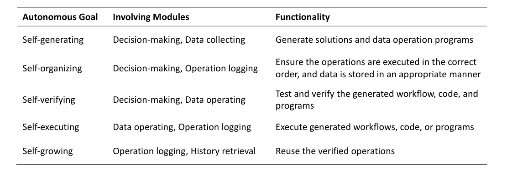
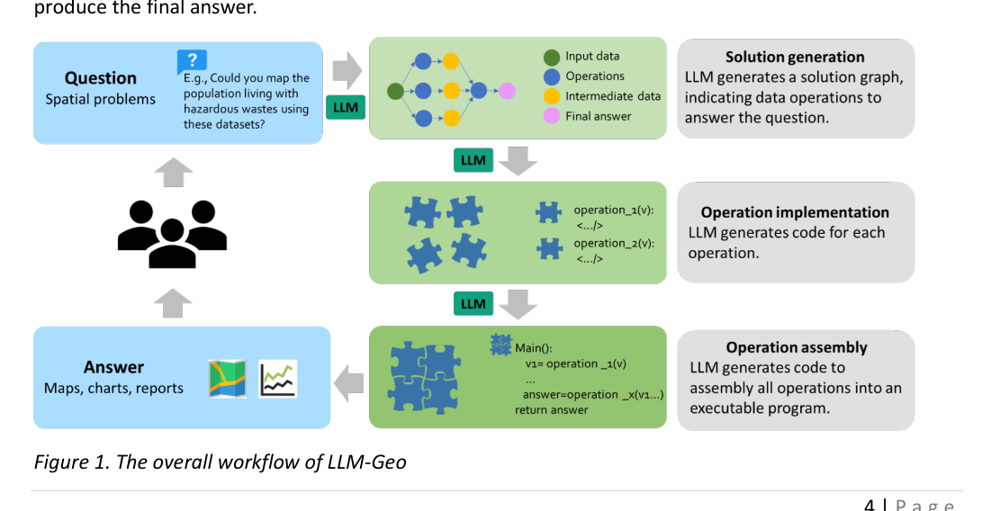
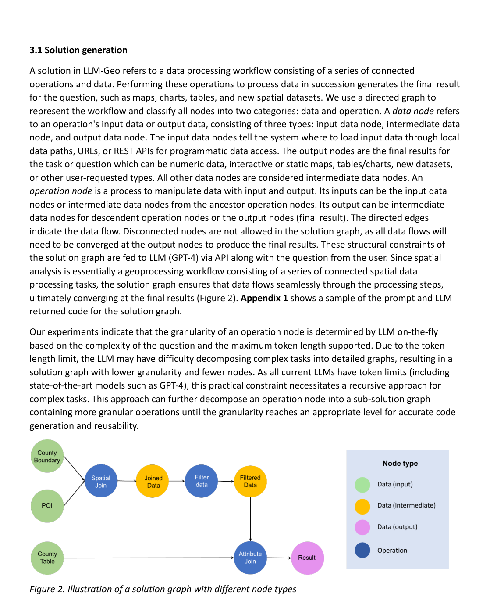
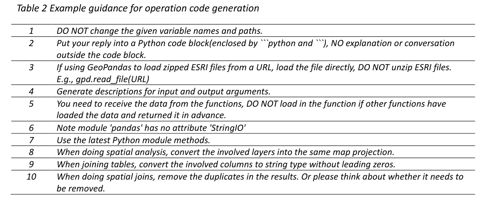
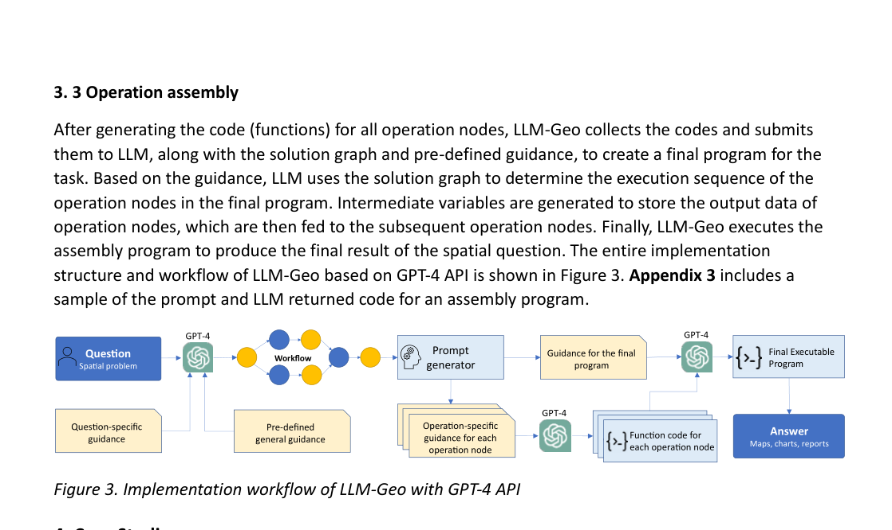
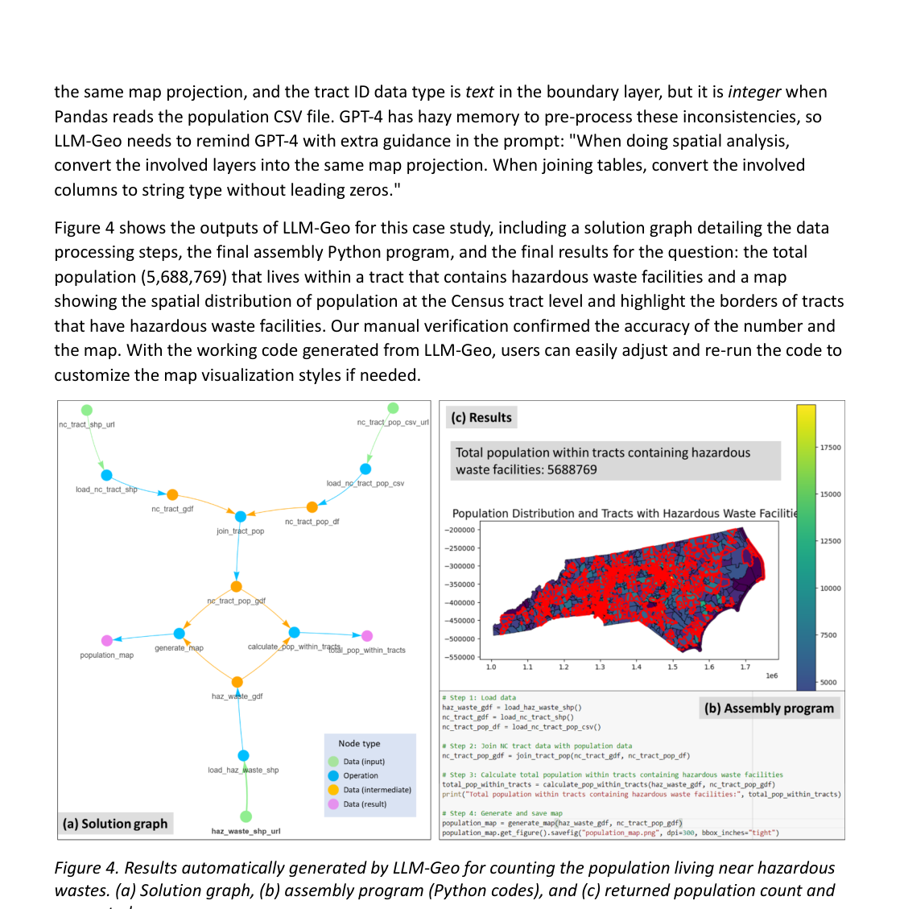
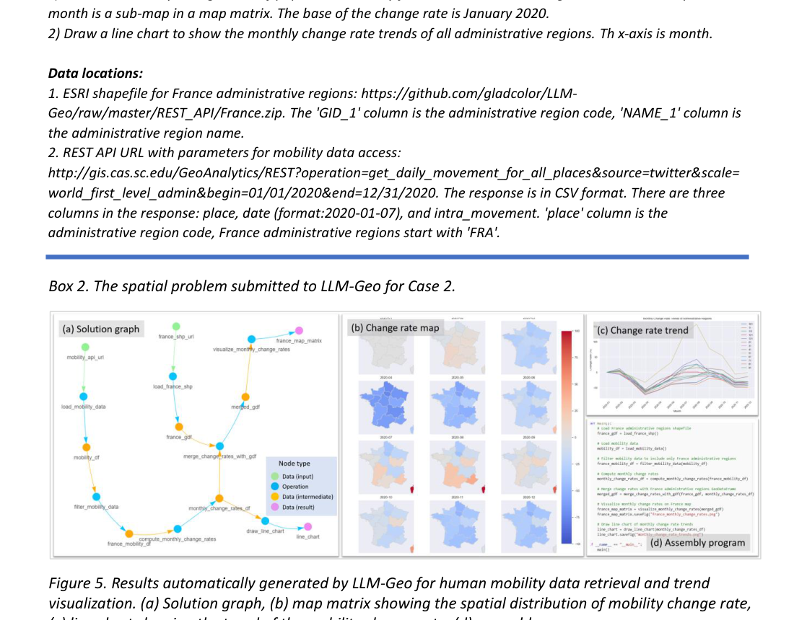
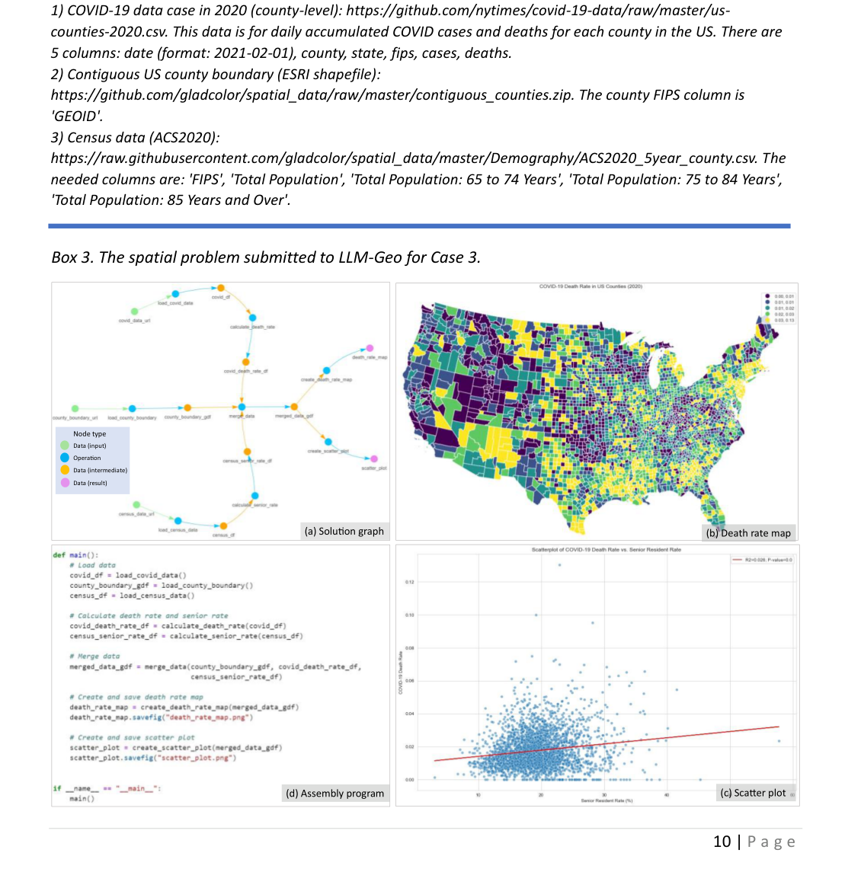
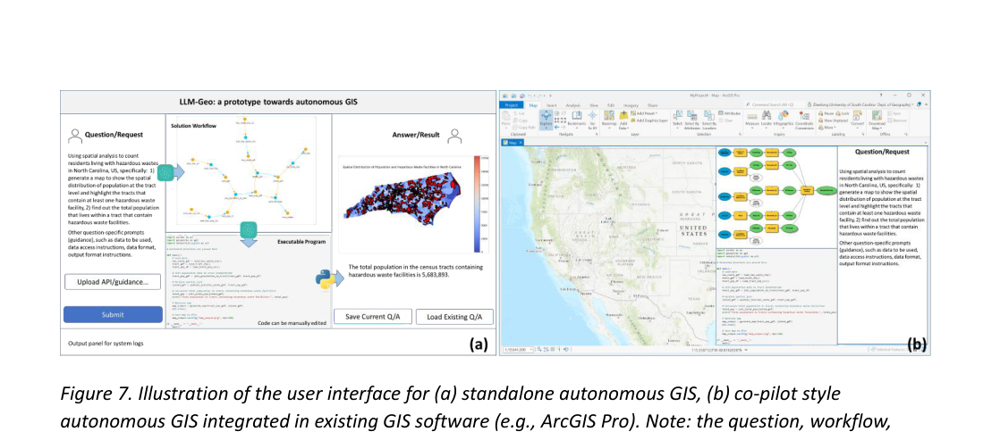

# 自主 GIS：下一代人工智能驱动的地理信息系统

**英文题名：** Autonomous GIS: the next-generation AI-powered GIS  
**作者：** Zhenlong Li、Huan Ning（美国南卡罗来纳大学地理信息与大数据研究实验室）  
**原稿信息：** 2023 年 5 月提交及更新；本文按 PDF 的 28 页顺序保留所有原始材料。  
**术语约定：** Autonomous GIS 译为“自主 GIS”；LLM-Geo 为系统专名，不翻译；solution graph 译为“解法图/求解图”；operation node 译为“操作节点”；self-growing 译为“自成长”。

## 摘要

ChatGPT 等大型语言模型（Large Language Models，LLMs）具有较强的自然语言理解能力，已被探索应用于推理、创造性写作、代码生成、翻译和信息检索等领域。本文以 LLM 作为推理核心，提出**自主 GIS（Autonomous GIS）**：一种以人工智能驱动的地理信息系统，利用 LLM 的自然语言理解、推理与编码能力，通过自动收集空间数据、空间分析和可视化来解决空间问题。作者设想自主 GIS 应达到五个自主化目标，即**自生成（self-generating）、自组织（self-organizing）、自验证（self-verifying）、自执行（self-executing）和自成长（self-growing）**。研究在 Python 环境中调用 GPT-4 API，开发了称为 **LLM-Geo** 的原型系统，并通过三个案例说明自主 GIS 的形态以及它如何在无人干预的情况下产生预期结果。三个案例中，LLM-Geo 都能返回准确的聚合数值、图表和地图，显著缩短人工操作时间。虽然仍处于初期阶段，且尚缺少日志、代码测试等重要模块，LLM-Geo 已展示出迈向下一代 AI 驱动 GIS 的可能路径。作者呼吁地理信息科学界投入更多资源研发自主 GIS，让空间分析更简单、更快速，并服务更广泛的使用者。

**关键词：** 自主智能体；GIS；人工智能；空间分析；大语言模型；ChatGPT。

## 1 引言（Introduction）

人工智能的发展催生了自主智能体（autonomous agents，也称 intelligent agents）。这类计算机系统能够在很少或没有人类参与的情况下执行任务、作出决策，在机器人、医疗、交通、金融等领域显示出应用潜力。其优点包括提高效率、减少错误，以及处理对人工来说耗时甚至难以完成的复杂任务。与根据既定命令、输入及环境条件执行预设操作的**自动化系统**（例如自动门、售货机）不同，**自主智能体**（例如扫地机器人、自动驾驶车辆）往往具有更强的环境适应性，并能依据收集的数据做出有依据的决策。实现自主智能体最具挑战的部分是建立决策核心：系统必须依据自身感知做出合适反应，但感知对象和后续行为可能并未事先编程。多数基于固定规则或算法的决策核心只能在明确、封闭的环境中运行，推理能力受到限制。

GPT-3 和 GPT-4 等生成式模型快速发展，推动了自主智能体研究。LLM 的语言理解、推理、代码生成、翻译和检索能力，使其逐渐成为数字自主智能体的决策核心。例如，已有研究利用 ChatGPT 解决机器人交互及基本逻辑、几何和数学推理问题；通过 LLM 调度预训练基础模型完成图像编辑与描述；AutoGPT、BabyAGI、AgentGPT 等产品也以语言模型驱动自主任务，NexusGPT 则提供商业咨询、软件开发等智能体服务。

近年来，GIScience 领域不断把人工智能用于空间数据处理、挖掘和其他地理应用，形成了 **GeoAI** 这一交叉研究方向。尽管 GeoAI 已有相当进展，借助通用人工智能或 LLM 自动完成 GIS 空间分析的探索仍处在早期。相关工作包括针对 GeoAI 的基础模型研究，以及面向 QGIS 的简单数据加载自动化和遥感图像分割等。Zhao（2022）还从人文地理角度区分体现式 GIS、诠释式 GIS、自主 GIS 和背景 GIS；其中“自主 GIS”可指独立行动的 Agent、场所或能够识别地物的模型。

本文采用更聚焦的定义：**自主 GIS 是一种以 LLM 为认知与编码核心，能自动进行空间数据获取、分析和可视化、从而解决空间问题的 AI 驱动 GIS。** 它虽遵循自主智能体的基本思想，却不能简单照搬面向文本任务的 Agent 架构。许多传统 Agent 执行商业报告、旅行规划、文本汇总等任务，答案未必唯一；GIS 分析则通常具有**数据密集、确定性强、可定量验证**的特点。例如，计算“某医院周围 10 千米内居住人口”通常应在相同数据、规则与空间定义下得到一致结果。因此，作者主张，自主 GIS 应以**编程和数据**为中心，通过自动编码解决具有确定性性质的 GIScience 问题。

为验证可行性，研究开发了概念验证原型 **LLM-Geo**。系统接收用户提出的空间问题，将其分解成一系列具有依赖关系的数据操作，形成**有向无环图（DAG）**表示的解法图（即地理处理工作流）。图中的每个操作都由 GPT-4 编写为函数，再由 LLM-Geo 汇总操作代码、生成装配程序并运行，最终获得计算结果。论文通过三个案例说明这种方式有望让没有 GIS 专业背景的用户也能自动执行复杂的空间分析。第 2 节阐述自主 GIS 的概念，第 3 节介绍原型，第 4 节给出案例，第 5–6 节讨论经验、局限及未来方向，第 7 节总结。

## 2 作为 AI 驱动自主系统的自主 GIS

自主系统能够在没有人为干预时做出决策与执行任务，适应环境变化、从环境学习，并根据收集的信息决策。在自主 GIS 中，LLM（或未来更强的 AGI）负责生成解决空间问题的策略与操作步骤。系统应能从在线地理数据目录检索所需数据，或通过传感器收集新数据；然后调用现有空间算法、模型或 GIS 工具，必要时创建新工具，对数据进行处理，最终输出地图、图表、报告等。LLM 可以被视为自主 GIS 的“**大脑**”，若连接环境传感器则类似“头部”；Python 等可执行程序是它的数字化“**双手**”。

作者提出自主 GIS 需要五个关键模块：**决策（LLM 核心）、数据收集、数据操作、操作日志、历史检索**，共同支撑五项目标：

- **自生成**：决策与数据收集模块协同生成解决方案及数据处理程序。
- **自组织**：决策与日志模块保障处理顺序正确、数据存储合理。
- **自验证**：决策与数据操作模块对工作流、代码和结果进行测试与验证。
- **自执行**：数据操作及日志模块负责真正运行生成的工作流和程序。
- **自成长**：通过操作日志与历史检索重用已验证的操作与工作流。

*表 1（原文第 3 页题名、第 4 页表体）：自主 GIS 五项目标、参与模块及其功能。*

GIS 属于依赖数据和规则的确定性分析系统：当初始状态与操作规则足够明确时，结果应可预测与解释，通常需要可重复且定量正确的答案。因而，自主 GIS 不能停留在自由文本生成层面，而应采用可控制、可解释的程序化架构解决空间问题。

## 3 LLM-Geo：自主 GIS 的原型

LLM-Geo 当前仅实现了两个关键模块：**决策模块**（以 GPT-4 推理并生成分步解法、操作代码）和 **数据操作模块**（在 Python 环境中进行空间数据加载、处理、可视化和保存）。因此，现阶段达成了**自生成、自组织、自执行**三项目标，其他模块仍在开发。

用户提供空间问题以及数据位置，例如在线 URL、REST 服务与 API 文档。LLM 首先生成类似地理处理工作流的解法图；接着依据每个操作节点的定义生成代码；之后汇总所有函数，生成符合工作流依赖关系的装配程序；最后运行程序得到结果。整体流程见图 1。

*图 1（原文第 4 页）：空间问题输入→求解图生成→操作节点代码实现→程序装配→答案输出。*

### 3.1 解法生成（Solution Generation）

在 LLM-Geo 中，一个解法是由相互连接的数据与操作组成的数据处理流程，依次运行后生成数值、地图、图表、表格或新的空间数据。作者用有向图表示流程，节点分为两大类：**数据节点（data nodes）**和**操作节点（operation nodes）**。数据节点包括：指示本地文件、URL 或 REST API 的输入节点；存储处理中间产物的中间节点；以及表示最终结果的输出节点。操作节点则表示对输入数据执行的具体处理，其输入可以来自源数据节点或上游操作的输出，输出则提供给下游操作或最终结果节点。

图中的有向边表示数据流，所有数据链最终必须汇入输出节点；不应存在与最终结果无关的孤立组件。LLM-Geo 把这种解法图结构约束与用户问题共同送入 GPT-4，使数据能在各步骤间顺畅流动。

*图 2（原文第 5 页）：绿色为输入数据节点、黄色为中间数据节点、粉紫色为输出节点、蓝色为操作节点。*

作者发现，操作节点的**粒度**受问题复杂度和模型最大 Token 长度影响：复杂问题难以一次被拆解得足够精细，得到的图可能节点偏少、单节点操作偏大。由于现有 LLM 都有上下文窗口限制，对于复杂任务可能需要递归拆解，把某个操作节点继续展开为子解法图，直到细化程度适合准确编码和复用。

### 3.2 操作实现（Operation Implementation）

生成的解法图是具体任务的数据处理计划。程序实现阶段，模型根据节点定义分别编写可执行 Python 函数。LLM-Geo 设计了相邻节点间的接口规则：函数名称、输入变量和返回变量等都在解法图中预先定义，以减少自动生成代码的不确定性。

实验表明，GPT-4 要稳定生成可运行的 GIS 代码，需要充分上下文与额外指导。例如，上游操作可能创建了新字段或新文件，下游生成代码必须准确使用该名称；因此，LLM-Geo 在编写当前节点时提供上游已生成代码、下游节点需求和当前节点定义。模型对一些 GIS 操作前提的记忆并不牢固，例如属性表连接需要连接键具有一致数据类型，叠置分析要求参与图层处在兼容坐标系中。GPT-4 虽会使用 GeoPandas，却可能忽略该库不会在任意操作时自动进行按需重投影。因此，需要把 GIS 专业约束写成提示规则。

*表 2（原文第 6 页）：规则包括保留变量名和路径、仅输出 Python 代码块、直接读取 ZIP 矢量数据、声明函数参数、复用上游数据、统一投影与连接键、审慎处理空间连接重复记录等。*

### 3.3 操作装配（Operation Assembly）

获得所有操作节点的函数代码后，LLM-Geo 把函数、解法图以及预定义指导一同提交给 LLM，要求生成可执行的最终装配程序。模型依据有向图确定调用顺序，创建中间变量保存节点输出，再传递给后继函数。最终程序运行产生空间问题的答案。图 3 展示了 GPT-4 驱动 LLM-Geo 的整体实现方式；附录第 3 项给出完整的装配提示和相应代码实例。

*图 3（原文第 7 页）：用户问题、通用指导、操作专项指导、GPT-4 操作生成及最终程序装配。*

## 4 案例研究（Case Studies）

### 4.1 案例一：统计危险废物设施附近的居住人口

第一个空间问题是统计**居住在包含危险废物设施的人口普查区（Census Tract）中的总人口**，并绘制其空间分布。研究区为美国北卡罗来纳州。用户输入的问题包含两个目标：（1）找出包含危险废物设施的人口普查区内的总人口；（2）绘制人口普查区尺度的人口分布图，突出标示包含危险废物设施的普查区边界。同时提供危险废物设施 Shapefile、普查区边界 Shapefile 和人口 CSV 的数据位置，并明确使用的 `Tract`、`GEOID`、`TotalPopulation` 等字段名。

这一案例有意包含现实 GIS 中常见的数据不一致：设施与普查区矢量图层使用的地图投影不同；边界文件中的人口普查区 ID 为文本，而 Pandas 读取的人口 CSV 中该 ID 为整数。GPT-4 在预处理这些不一致方面可能遗漏关键步骤，因此提示中特别强调：进行空间分析时先把参与图层转换到**相同投影**；进行表连接时把相关连接键转换成**不带前导零的字符串**。

LLM-Geo 返回了解法图、最终 Python 装配程序、计算结果和地图。论文报告，**包含危险废物设施的普查区居住人口为 5,688,769 人**；结果图显示各普查区人口，并高亮包含危险废物设施的区域边界。作者对数值与地图进行了人工核验，确认准确。用户随后还可以修改生成的可执行代码，调整地图配色或其他制图参数，再次运行，而无须从头手工构造空间分析流程。

*图 4（原文第 8 页）：（a）解法图；（b）Python 装配程序；（c）人口统计值及空间分布地图。*

### 4.2 案例二：人类流动数据的获取与趋势可视化

第二个任务分析法国 **2020 年新冠疫情期间的跨区域人口流动变化**。系统先通过 ODT Explorer REST API 获取流动数据（Li 等，2021），再以 2020 年 1 月为基准，计算各行政区月度流动变化率并可视化。用户输入两项需求：把各月变化率绘制为法国行政区地图，按月份排成地图矩阵；另绘制折线图，显示所有行政区随月份变化的流动率趋势，横轴为月份。

输入数据包括法国行政区的 ESRI Shapefile（`GID_1` 为地区编码，`NAME_1` 为名称）以及通过 REST API 获取的 CSV 流动记录；后者包含 `place`、`date` 和 `intra_movement` 字段，法国的地区编码以 `FRA` 开头。系统自动生成解法图、各月份区域变化率地图矩阵、时间趋势折线图以及装配程序。论文称所有结果均经人工确认正确。

*图 5（原文第 9 页）：（a）解法图；（b）流动变化率空间分布的月度地图矩阵；（c）变化趋势折线图；（d）装配程序。*

### 4.3 案例三：美国县级 COVID-19 病死率分析与可视化

第三个问题关注美国本土连续各县的 COVID-19 病死率（**死亡人数与确诊病例数之比**）空间分布，以及其与 **65 岁及以上人口占比**的关联。病例数据来自《纽约时报》汇集的各级卫生机构报告，截至 **2020 年 12 月 31 日**；人口数据来自美国人口普查局 **2020 年 ACS 五年估计**。任务要求绘制县尺度病死率专题地图，以及包含拟合趋势线、R² 和 p 值的老年人口比例与病死率相关散点图。

为提高结果的可重复性，用户明确了可视化规范：地图使用 `scheme='quantiles'` 分级，投影为 `Conus Albers`，尺寸为 **15×10 英寸**；散点透明度为 **50%**，回归线为红色，图尺寸同为 **15×10 英寸**。输入数据包含 2020 年美国县级 COVID 病例 CSV（`date`、`county`、`state`、`fips`、`cases`、`deaths`）、连续美国县界数据（`GEOID` 为 FIPS）、以及 ACS 县级人口 CSV（`FIPS`、`Total Population` 和三个 65 岁以上年龄组）。

LLM-Geo 生成解法图、县级病死率地图、老年人口比例和病死率的散点回归图，以及可执行程序。作者指出，如果没有明确说明可视化参数，针对同一问题模型会产生不同制图设置；因此提示中加入输出规范能提高结果一致性。完整代码见附录 4，用户只需修改代码中的 `2020-12-31` 日期并重运行，便可分析其他时期的县级病死率及其与老年人口比例的关系。

*图 6（原文第 10 页图体、第 11 页图题）：（a）解法图；（b）县级病死率地图；（c）老年人口比例相关散点图；（d）装配程序。*

## 5 讨论与经验（Discussion and Lessons Learned）

### 5.1 自主 GIS 的实现形态

自主 GIS 的目标不是改变空间分析的基本原理，而是**模拟和自动化人类分析人员在 GIS 中执行的操作**。一种形态是本地或云端的**独立应用**：用户输入空间问题，系统自动给出答案，同时显示生成的解法图和代码，便于监控、调试与定制。通过积累和复用已经生成的代码及工作流，自主 GIS 可以逐渐增强能力；服务大量用户的云端部署尤其适合这种自成长机制。

另一种形态是传统 GIS 软件中的**副驾驶（co-pilot）**。例如，在 ArcGIS 或 QGIS 地图视图旁增加自主 GIS 面板，包含聊天框、自动生成的解法图和操作代码；计算结果仍显示在原生地图视图里。用户可以在解法图上修改节点、操作参数，或点击节点编辑底层代码。这类似 ArcGIS 的 ModelBuilder 或 QGIS 的模型设计器（Model Designer）。由于现有 GIS 平台已经拥有大量成熟且经过测试的工具及文档，基于这些平台实现自主 GIS，可能是当前更实用有效的方式。

进一步地，自主 GIS 可以作为插件集成进依赖地理信息的应用，例如公共卫生监测仪表盘。用户以自然语言提出需求，系统自动生成个性化地图、图表、报告或新数据集，显著降低数据分析的使用门槛。

*图 7（原文第 12 页）：（a）独立自主 GIS 应用；（b）集成于 ArcGIS Pro 等软件中的副驾驶式自主 GIS。图中的问题、工作流、代码与结果仅用于界面演示，并非真实实验。*

### 5.2 自主 GIS 与一般 AI 助手的区别

Cursor、GitHub Copilot X 以及 Microsoft 365 Copilot 等 AI 助手，大多根据文本输入生成段落、代码等文本结果，目的是提高写作或开发效率。自主 GIS 的不同之处在于**输入类型、最终产物及其产生方式**：GIS 处理对象是具有空间含义的数据，输出则往往是地图、图表和其他可以支撑定量决策的分析成果。

在传统 GIS 中，分析者根据研究目标及专业知识设计空间处理工作流：可以写成脚本，也可以通过模型构建器图形连接数据与算子，或在软件中手动执行连续操作。这类工作流以数据为中心、具有确定性，并且应能由他人复现。LLM-Geo 与之遵循相似逻辑：先构造数据驱动的地理处理流程，再将其编码、运行并输出结果。特别需要区分的是，**LLM 本身并不直接操纵空间数据**；它负责生成、组织和指挥实际执行数据处理的程序。

### 5.3 分而治之（Divide-and-Conquer）

为何不直接要求 GPT-4 根据问题一次性生成全部程序，而必须先创建解法图？作者的实验表明，经过额外指导，GPT-4 确实能够为相对简单的空间分析生成正确代码。但复杂任务——例如利用手机流动数据 API 和网页爬虫评估全国自闭症干预服务的可达性，或寻找某海域最合适的捕鱼位置——涉及大量数据与复杂程序，不可能总依赖一次生成完整方案；这与一口气创作一本长篇小说相似，对人和模型都极具挑战。

人类处理复杂任务通常使用**分而治之**策略。LLM-Geo 先把空间问题拆成较易处理的子问题（操作节点），分别生成函数，再将函数装配成可执行整体。AutoGPT、AgentGPT 等数字智能体也采用类似做法。作者希望未来检验该策略对更复杂 GIS 任务的效果。另一个优点是可以把**已验证的操作节点**作为可复用组件保存，为自成长积累资源；当错误出现时，分节点的结构也便于定位问题和必要的人工干预。

### 5.4 GIS 与 LLM 需要充分的信息

GIS 分析具有确定性，但其正确性依赖**充分的初始数据与约束信息**。实际任务需要考虑数据可用性、管辖区边界、地图尺寸以及投影、字段名、数据类型等元数据。不了解字段名就无法正确进行属性连接；不知道图层坐标参考系统也难以安全进行叠置分析。自主 GIS 如同人类分析者，必须识别并获得这些信息才能有效执行任务。因此，作者认为，充足的信息对于自主 GIS 的正确推理、规划与执行至关重要。可能的补充方式包括数据抽样、网络检索、自我反思与人工提供。

### 5.5 唤回大语言模型模糊的 GIS 记忆

LLM 往往理解任务的大体步骤，却容易忘记具体 GIS 约束。例如，叠置分析必须统一参与图层的投影，属性连接字段应具有相同的数据类型及前导零处理方式。这种“模糊记忆”可能源于 GIS 专业训练样本不足。若把这些容易遗漏的前提条件作为**显式提示或检查清单**，便能增强模型的编码可靠性。

不同模型、训练集和用户的专业经验会影响所需清单的长度和粒度：有经验的人类 GIS 分析者会在操作前核查连接键及投影，新手则可能直到报错才意识到问题；自主 GIS 也可以采用类似的分层检查表，按模型能力与任务类型自动提供适量指导。

## 6 局限性与未来工作（Limitations and Future Work）

LLM-Geo 说明自主 GIS 在概念上可行，但仍处于早期，尚不能独立调试生成代码，也缺少栅格数据处理能力等关键功能。作者认为，LLM 推理能力的出现为 GIScience 开启了新机会，但要形成真正实用的自主 GIS，还有许多技术问题需要解决。

### 6.1 需要提升 LLM-Geo 的适应性

团队曾制作多个案例测试 LLM-Geo，在本文报告了三个典型成功案例；使用 GPT-4 的整体成功率约 **80%**。观察发现，解法图一般较正确，大部分失败发生在**操作代码实现**阶段：即使采用分而治之，程序中单条错误语句也足以使全部流程崩溃。GPT-4 经常选用 GeoPandas 进行空间处理，但一次性生成正确代码并不稳定；使用 Plotly 等其他库时错误还会增多。

当前系统尚无代码审查、测试、调试与验证机制，因而还不满足**自验证**目标。初步改进办法是把执行失败与报错信息重新输入 LLM，请其修正代码。此外，模型经常基于 GeoPandas 等库从零编写复杂操作（如最近距离计算），而这些功能可能已由 ArcGIS 或 QGIS 工具箱可靠实现。临时生成的复杂函数容易出错。作者因此认为，应优先复用**经过充分测试的 GIS 工具箱**，结合代码调试和验证模块，提升适应性与鲁棒性。还需要设计自动机制，使模型能感知数据的投影、字段类型和属性等细节，在代码与数据之间进行可靠交互。

### 6.2 需要记忆系统

自主系统必须保存上下文、长期信息、数据与历史结果，以便将来检索和复用。当前 LLM-Geo 仅简单记录提示和 LLM 回答，尚不足以支撑完整自主系统。GIS 的记忆应包含**数据来源、预定义分析指导、历史任务生成且经验证的代码**等，并随使用不断扩充，以实现**自成长**。

多数 LLM Agent（例如 AutoGPT）使用 Pinecone 等向量数据库保存和检索对话，但自主 GIS 的需求更复杂：不仅要存储文字，还需保存可递归分解的**解法图／地理处理工作流**，并形成层级结构；已验证的完整解决方案和操作节点代码，也应该进入长期记忆。因此，必须同时设计记忆系统和操作日志模块。

### 6.3 由 GIS 社区维护分类的专业指导

作者已经通过补充 GIS 规则来弥补 GPT-4 的模糊记忆。这类规则类似 GDAL/OGR 等开源软件的使用文档，可以汇集 GIS 分析人员经验，作为 LLM 自动编程的专业手册。但目前规则仅来自少量案例，覆盖面远远不足：例如本文的三个案例没有涉及 GIS 中十分常见的**栅格分析**。

作者邀请 GIS 社区共同维护这类指导文档，按照**矢量分析、栅格分析、网络分析、地理可视化**等任务类型分类。由于全部规则可能非常庞大，记忆系统应为当前任务检索必要的部分，而不是一次性加载所有文档。研究者还可以探索通过系统反复试错总结 GIS 规则，或使用强化学习等方法改进模型自动产生、执行与总结空间分析任务的能力。

### 6.4 试错：更稳健的问题求解方法

现有 LLM-Geo 基本假设只要给 LLM 提供全部必要信息，就能得到正确程序与结果；对于数据源、算法和研究假设复杂的空间分析，这一假设过于理想化。实际分析人员往往采用**试错（trial-and-error）**策略：尝试不同路径，根据反馈剪除解法图中无法成功的分支。即使经验丰富的程序员也会在开发时犯错、调试。Yao 等（2023）在“思维树（Tree of Thoughts）”中通过评估和剪枝候选推理分支，在 24 点、创意写作和迷你填字游戏上得到明显改善；但这些任务较简单，该结论能否推广至 GIS 等复杂领域尚待验证。

### 6.5 在线空间数据发现与筛选

本文三个案例都为系统预先提供了文件路径、URL 或 API 及数据说明。然而，真正自主的 GIS 应能够根据任务**自行寻找、选择和获取**数据。目前互联网上已经积累了大量空间数据和标准服务，例如 OGC 的 WMS、WFS、WCS、WPS，常见 REST 数据 API，美国人口普查局及 OpenStreetMap 的数据接口，以及 Google Earth Engine 数据目录、NOAA/NASA 数据目录、EarthCube 和欧洲环境署（EEA）数据目录。

真正困难的环节不只是能否检索到数据，而是判断哪些图层满足空间与时间分辨率、覆盖范围、精度和质量要求。因此，需要研发实用策略，让模型能自动**发现、过滤与选用**最适合当前空间问题的数据。

### 6.6 回答“为什么”问题

基于 GPT-4 的 LLM-Geo 初步展示了**如何（how）执行**空间分析以及自动处理常规 GIS 任务的能力。更难的一步是回答**为什么（why）**。例如“根据手机流动数据，为什么本月顾客数量下降 20%？”或“为什么这些候鸟在过去十年改变迁徙路线？”这类问题超越简单数据操作，涉及理论背景、科学假设、资料选择和实验设计。要回答它们，自主 GIS 必须能结合问题、已有数据和背景知识提出有依据的假设，并设计验证假设的研究过程。

### 6.7 构建大型空间模型（Large Spatial Model，LSM）

LLM 通过海量文本训练发展出语言、知识与推理能力，但由于文本语料中的空间样本有限，其空间理解仍有不足。GIScience 领域拥有大量尚未纳入大模型训练的数据，包括历史遥感影像、全球矢量数据、基础设施与地块记录，以及各种其他地理大数据。作者提出值得设想的 **大型空间模型 LSM**：像 LLM 学习海量文本那样，利用可获得的空间数据训练基础模型。理想的 LSM 将更充分地理解地球表面，描述不同位置，理解生态系统和地球圈层动态。这不仅能增强未来通用人工智能的空间意识，也可能推动 GIScience 变革，让自主 GIS 从回答“怎么做”迈向回答“为什么”。作者呼吁研究更加真实反映地球表面与人类社会的大型空间模型。

## 7 结论（Conclusion）

本文将自主 GIS 描述为下一代 AI 驱动地理信息系统，目标是让用户通过自然语言提出任务，让系统以极少或没有人工干预的方式解决空间问题。作者提出自主 GIS 应具备五项目标：自生成、自组织、自验证、自执行和自成长，并基于 GPT-4 API 和 Python 开发原型 **LLM-Geo**。三个案例中，系统自动生成符合预期的统计数值、图表与地图，显著减少人工操作时间。尽管当前实现仍不成熟，研究已验证自主 GIS 的基本概念和可行性。呼应 Zhu 等（2021）“下一代 GIS 必须易用”的观点，作者希望 GIScience 社区持续推进自主 GIS 的研究与开发，使空间分析更便捷、高效并服务更广泛的人群。

## 数据、致谢与参考文献

**数据可得性（Data Availability）：** LLM-Geo 源代码与案例数据位于 <https://github.com/gladcolor/LLM-Geo>。

**致谢（Acknowledgements）：** 作者感谢 Gregory J. Carbone 教授协助修改论文早期草稿。

**参考文献（References）：** 原稿第 17–18 页包含从 Brown 等（2020）到 Zhu 等（2021）的完整书目。中文稿保留作者—年份引用；为防止名称与 URL 失真，完整原文书目在本包 `英文原文_阅读顺序.md` 的第 17–18 页段落以及原始 PDF 中，并将在末尾的“原文参考文献”小节附原样转录。

## 附录：LLM-Geo 的实际提示与生成代码（原稿第 19–28 页）

论文附录包含四个复现性很强的部分：

### 附录 1：解法图生成（Solution Graph Generation；第 19–21 页）

作者给 GPT-4 设定“熟悉 Python 的专业地理信息科学家与开发者”角色，只让模型构建一个包含**数据节点**与**步骤/操作节点**的 NetworkX 图，而不直接编写整个处理程序。提示中给出北卡罗来纳州危险废物设施及人口统计的问题和数据位置，并规定：数据与操作要构成连通图；除输入数据加载操作外，下游操作应消费上游输出；节点包含 `node_type`、`data_path` 等属性；节点与边必须完整写入 NetworkX；只返回代码，不输出对话解释；最终将图以 GraphML 保存。

### 附录 2：单个操作代码生成（Operation Code Generation；第 21–23 页）

作者展示了一个将人口 CSV 连接到普查区边界数据的节点生成示例。提示规定函数签名和返回变量名，例如 `join_tract_pop(...)`、`nc_tract_pop_gdf`，提醒模型不能随意修改变量名、不得重复加载上游已提供的数据，并必须处理数据类型与投影约束。随后展示 GPT-4 生成的具体 Python 函数。

### 附录 3：装配程序生成（Assembly Code Generation；第 23–25 页）

装配阶段把全部函数、操作依赖关系和任务说明提供给模型，请其按解法图顺序调用函数、传递中间变量、保存结果地图，生成可直接运行的完整 Python 程序。原文给出的变量名、函数签名、路径与代码调用顺序是实验复现的关键，因此在英文原始文本和原稿截图中全部保留。

### 附录 4：案例三完整可执行程序（第 25–28 页）

展示美国县级新冠病死率分析的**完整自动生成 Python 程序**，包含数据加载、连接、计算、制图、回归与输出等步骤。代码使用外部 CSV、Shapefile 与 Python 库，宜保持字面原样以方便核对和重新运行；此处提供中文用途说明，**程序源码本身仍以英文原样保存**在附件 `附录原始代码与提示.md` 中。执行此类历史示例时应检查原始 URL 和软件版本是否仍然可用。

> **翻译与复现说明：** 正文段落按原始章节译成中文；附录的提示与示例代码保持英文语法，中文说明已经覆盖其功能、输入和约束。附录的十页代码/提示并未逐字汉化，这一限制在 QA 报告中单独标出。

## 原始参考文献（逐页提取，保留英文）

> 参考文献作为可检索书目保留原语言；完整的章节图像也保存在 `source_pages/`。

## 原稿第 17 页
References

Brown, Tom B. et al. 2020. “Language Models Are F
ew-Shot Learners.” http://arxiv.org/abs/2005.14 165 
(May 4, 2023). 
Brustoloni, Jose C. 1991. Autonomous Agents: Characterization and Requirements. Citeseer. 
Cursor. 2023. “Cursor | Build Fast.” https://www.cursor.so/ (May 5
 5, 2023). 
GitHub. 2023. “Introducing GitHub Copilot X.” GitHub. https://github.com/features/preview/copilot-x

(May 5, 2023). 
Jordahl, Kelsey et  et al. 2020. “Geopandas/Geopandas: V0.8.1.” Zenodo.

https://ui.adsabs.harvard.edu/abs/2020zndo...3946761J (May 19, 2023). 
Li, Zhenlong et al. 2021. “ODT FLOW: Extracting, Analy
zing, and Sharing Multi-Source Multi-Scale Human 
Mobility.” .” PLOS ONE 16(8): e0255259. 
https://journals.plos.org/plosone/article?id=10.1371/journal.pone.0255259 (May 5, 2023). 
Liang, Yaobo et al. 2023. “TaskMatrix.AI: Completing Tasks by Connecting F
oundation Models with 
Millions of APIs.” http://arxiv.org/abs/2303.16434 (April 25, 2023)
. 
Maeda, John. 2023. “Schillace Laws of Semantic AI. I.” https://learn.microsoft.com/en-us/semantic-

kernel/howto/schillacelaws (May 6, 2023). 
Mai, Gengchen et al. 2023. “On the Opportunities and Challenges of F
oundation Models for Geospatial 
Artificial Intelligence.” http://arxiv.org/abs/2304.06798 (April 20, 2023). 
Microsoft. 2023. “Introducing Microsoft 365 Copilot – Your Copilot for Work.” The Official Microsoft Blog.

https://blogs.microsoft.com/blog/2023/03/16/introducing-microsoft-365-copilot-your-copilot-
for-work/ (May 5, 2023). 
Nakajima, Yohei. 2023. “BabyAGI
GI.” https://github.com/yoheinakajima/babyagi (May 4, 2023). 
New York Times. 2023. “Coronavirus (Covid-19) Data in the United States (Archived).”
.” 
https://github.com/nytimes/covid-19-data (May 18, 2023). 
“NexusGPT.” 2023. https://nexus.snikpic.io (May 2, 2023). 
OpenAI.I. 2023. “GPT-4 Technical Report.” http://arxiv.org/abs/2303.08774 (May 4, 2023). 
OpenStreetMap. 2023. “Databases and Data Access APIs - OpepenStreetMap Wiki.”

https://wiki.openstreetmap.org/wiki/Databases_and_data_access_APIs (May 5, 2023). 
Orlo. 2023. “AI Caption Generator Powered by C ChatGPT.” Orlo. https://orlo.tech/features/generate/ (May

4, 2023). 
Pinecone. 2023. “Vector Dat atabase for Vector Search.” Pinecone. https://www.pinecone.io/ (May 19,

2023). 
Plotly. 2023. “Plotly : Low-Code Data App Development.” https://plotly.com/ (May 24, 2023)
. 
Reworkd. 2023. “AgentGPT: Autonomous AI in Your Browser.” https://agentgpt.reworkd.ai/ (May 4, 2023)
. 
Richards, Toran Bruce. 2023. “A uto-GPT: An Autonomous GPT-4 Expxperiment.”

https://github.com/Torantulino/Auto-GPT (April 13, 2023). 
Russell, S. J., and Peter Norvig. 2022. “Artificial Intelligence: A Modern Approach, 4th, Global Ed.
d.” 
Scheider, Simon, Enkhbold Nyam
amsuren, Han Kruiger, and Haiqi Xu. 2021. “Geo-Analytical Question-
Answering with GIS.” International Journal of Digital Earth 14(1): 1–14. 
https://doi.org/10.1080/17538947.2020.1738568 (May 16, 2023).

17 | P a g e

## 原稿第 18 页
Shen, Yongliang et al. 2023. “HuggingGPT: Solving AI Tasks with ChatGPT and Its Friends in HuggingFac
ace.” 
http://arxiv.org/abs/2303.17580 (April 2, 2023). 
Sifakis, Joseph. 2019. “Autonomous Sy
stems – An Arcrchitectural Characterization.” In Models, Languages, 
and Tools for Concurrent and Distributed Programming: Essays Dedicated to Rocco De Nicola on 
the Occasion of His 65th Birthday, Lecture Notes in Computer Science, eds. Michele Boreale, 
Flavio Corradini, Michele Loreti, and Rosario Pugliese. Cham: Springer International Publishing, 
388–410. https://doi.org/10.1007/978-3-030-21485-2_21 (May 3, 2023). 
Stone, Peter et al. 2022. “Artificial Intelligence and Life in 2030: The One Hundred Year Study on A rtificial

Intelligence.” http://arxiv.org/abs/2211.06318 (May 4, 2023)
. 
US Census Bureau. 2022. “American Community Survey
 2016-2020 5-Year Dat ata Release.” Census.gov. 
https://www.census.gov/newsroom/press-kits/2021/acs-5-year.html (May 25, 2023). 
US Cenus Bureau. 2023. “Available API
PIs.” Census.gov. https://www.census.gov/data/developers/data-
sets.html (May 5, 2023). 
Vemprala, Sai, Rogerio Bonatti, Arthur Bucker, and Ashish Kapoor. 2023. “ChatGPT for Robotics: D esign

Principles and Model Abi bilities.” 
VoPham, Trang, Jaime E. Hart, Francine Laden, and Yao-Yi Chiang. 2018. “E merging Trends in Geospatial

Artificial Intelligence (GeoAI): Potential Applications for Environmental Epidemiology.”.” 
Environmental Health 17(1): 1–6. 
Wooldridge, Michael, and Nicholas R. Jennings. 1995. “Intelligent Agents: Theory a
 and Practice.” The 
Knowledge Engineering Review 10(2): 115–52. 
https://www.cambridge.org/core/journals/knowledge-engineering-
review/article/abs/intelligent-agents-theory-and-
practice/CF2A6AAEEA1DBD486EF019F6217F1597 (May 4, 2023). 
Wu, Chenfei et al. 2023. “Visual ChatGPT: Talking, Drawing and Editing with Visual Fou
oundation Models.” 
arXiv.org. https://arxiv.org/abs/2303.04671v1 (April 8, 2023). 
Wu, Qiu iusheng. 2023. “Segment-Geospatial.” https://github.com/opengeos/segment-geospatial (May 19,

2023). 
Yao, Shunyu et al. 2023. “Tree of Thoughts: Del
eliberate Problem Solving with Large Language Models.” 
http://arxiv.org/abs/2305.10601 (May 24, 2023). 
Zhao, Bo. 2022. “Humanistic GIS: Toward a Research Age genda.” Annals of the American Association of

Geographers 112(6): 1576–92. https://doi.org/10.1080/24694452.2021.2004875 (May 14, 2023). 
Zhu, A-Xing, Fang-He Zhao, Peng Liang, and Cheng-Zhi Qin in. 2021. “Next Generation of GIS: Must Be Easy.”
.” 
Annals of GIS 27(1): 71–86. https://doi.org/10.1080/19475683.2020.1766563 (May 24, 2023).

18 | P a g e

## 双语核对索引

- [完整英文原文，按版面阅读顺序整理](./英文原文_阅读顺序.md)
- [原始逐页提取，不重新排序](./英文原文_原始顺序.md)
- [附录原始提示、代码及实例](./附录原始提示与代码.md)
- [逐页核查报告](./QA_逐页核查.md)
- [原始 PDF](./原始论文.pdf)
