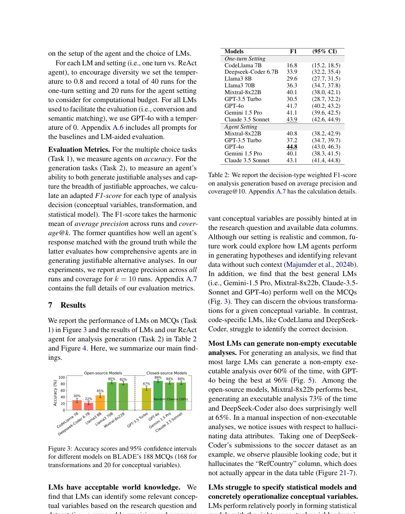
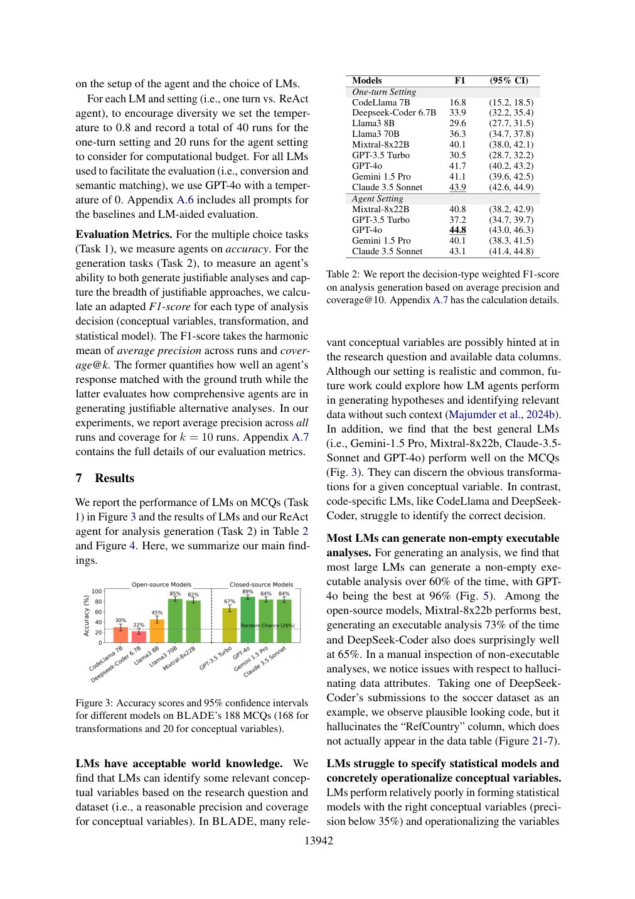

# BLADE：面向数据驱动科学的语言模型智能体基准

> **翻译状态：部分翻译（摘要全译 + 明确标注的原文节译）。非全文中文精译。**

英文标题：BLADE: Benchmarking Language Model Agents for Data-Driven Science  
发表信息：Findings of EMNLP 2024  
原始 PDF：36 页  
[阅读原始 PDF](./原始论文.pdf) · [英文逐页全文及配图](./英文原文_逐页全文与配图.md) · [参考文献及后续原文](./参考文献及后续原文.md) · [图表索引](./图表索引.md)

## 摘要（全文翻译，PDF 第 1 页）

数据驱动的科学发现需要反复整合科学领域知识、统计学专业知识和对数据语义的理解，以作出细致的分析决策，例如考虑哪些变量、数据转换和统计模型。具备规划、记忆和代码执行能力的语言模型（LM）智能体，有潜力支持数据驱动科学。然而，由于存在多种有效方法、部分正确的步骤，以及表达同一决策的不同方式，评价智能体在这类开放式任务中的表现具有挑战性。为解决这些挑战，我们提出 BLADE，这是一个自动评价智能体针对开放式研究问题所采用的多维分析方法的基准。BLADE 由来自已有科学文献的 12 个数据集及研究问题组成，其真实值来自专业数据科学家和研究人员的独立分析。为自动评价智能体回答，我们开发了相应的计算方法，将不同分析表示与这些真实值匹配。虽然语言模型具备相当丰富的世界知识，但评价表明，它们通常仅限于基本分析。不过，能够与底层数据交互的智能体在分析决策方面具有更高、但仍非最优的多样性。我们的工作使面向数据驱动科学的智能体评价成为可能，并帮助研究人员更深入地了解智能体的分析方法。

[核对原版第 1 页](./source_pages/page-001.jpg)

## 第 6 节：评价指标（PDF 第 7 页）

对于选择题任务（任务 1），我们以准确率衡量智能体。对于生成任务（任务 2），为衡量智能体生成合理分析并覆盖合理方法广度的能力，我们对每种分析决策（概念变量、转换和统计模型）计算改进的 F1 分数。F1 分数取多次运行的平均精确率与 coverage@k（覆盖率）的调和平均值。前者量化智能体的回答与真实值匹配的程度，后者评价智能体生成合理替代分析的全面程度。在实验中，我们报告所有运行的平均精确率，以及 k=10 次运行的覆盖率。完整指标细节见附录 A.7。

[核对原版第 7 页](./source_pages/page-007.jpg)

**原文 figure 3 · PDF 第 7 页（候选图表区域）**

**原文 table 2 · PDF 第 7 页（候选图表区域）**

## 尚未完成的翻译

其余正文、附录、完整图表说明、表内文字及参考文献标题尚未逐段翻译。本文件不是 36 页全文中文版。所有页面的英文文本层与页面截图均在英文逐页文档中保留。

[继续阅读英文原文](./英文原文_逐页全文与配图.md) · [图表索引](./图表索引.md) · [原始 PDF](./原始论文.pdf)

## 研究分类（初步判定，非原文内容）

- 主类别：E
- 阅读优先级：P1
- 归类理由：非地学专项科学分析基准；多解、数据转换等价和覆盖率评分可迁移。
- 重点阅读：第 2–5 节专家决策空间、灵活匹配；第 6 节指标及附录 A.7。
- 分类尚未完成全部原文及评价代码核验；不代表复现实验成功。
