# BLADE — 英文原文及配图（逐页）
> 按 PDF 页序组织，来自 PDF 文本层；公式、跨栏顺序和图内字符以原版页为准。图表为自动检测的候选截图（含上下文）。

## PDF 第 1 页

[原版页面](./source_pages/page-001.jpg)

```text
                         BLADE: Benchmarking Language Model Agents
                                for Data-Driven Science
          Ken Gu1 Ruoxi Shang1 Ruien Jiang2 * Keying Kuang2 * Richard-John Lin3 *
      Donghe Lyu4 * Yue Mao5 * Youran Pan3 * Teng Wu6 * Jiaqian Yu7 * Yikun Zhang1 *
        Tianmai M. Zhang1 * Lanyi Zhu1 * Mike A. Merrill1 Jeffrey Heer1 Tim Althoff1
      1
        University of Washington 2 UC Berkeley 3 New York University 4 Stanford University
           5
             University of British Columbia 6 Microsoft 7 George Washington University
                         https://github.com/behavioral-data/BLADE

                         Abstract                             of data values and semantics, statistical and do-
                                                              main expertise, and critical thinking to validate
     Data-driven scientific discovery requires the
     iterative integration of scientific domain knowl-        hypotheses and draw meaningful and justifiable
     edge, statistical expertise, and an understand-          conclusions (Jun et al., 2021; Breznau et al., 2022;
     ing of data semantics to make nuanced ana-               Baker, 2016; Collaboration, 2015).
     lytical decisions, e.g., about which variables,             Language model (LM)-based agents (Sumers
     transformations, and statistical models to con-          et al., 2023; Wu et al., 2023; Wang et al., 2023),
     sider. LM-based agents equipped with plan-               pre-trained on web-scale data and equipped with
     ning, memory, and code execution capabili-               memory and tool usage capabilities (Schick et al.,
     ties have the potential to support data-driven
                                                              2023), have the potential to conduct and support
     science. However, evaluating agents on such
     open-ended tasks is challenging due to mul-              data-driven science. They can reason about and
     tiple valid approaches, partially correct steps,         interact with heterogeneous data representing sub-
     and different ways to express the same deci-             jects, objects, and processes of study in the “exter-
     sions. To address these challenges, we present           nal” world (Majumder et al., 2024b). However, to
     BLADE, a benchmark to automatically eval-                facilitate their progress, we need a reliable method
     uate agents’ multifaceted approaches to open-            to evaluate and measure their performance.
     ended research questions. BLADE consists
                                                                 Recent benchmarks have enabled progress. How-
     of 12 datasets and research questions drawn
     from existing scientific literature, with ground         ever, they focus on either (1) data analysis execu-
     truth collected from independent analyses by             tion with straightforward tasks containing a single,
     expert data scientists and researchers. To auto-         final, easily evaluated answer (e.g., Calculate the
     matically evaluate agent responses, we devel-            mean and standard deviation of the "Mar.2019" col-
     oped corresponding computational methods to              umn (Hu et al., 2024a; Yin et al., 2022; Liu et al.,
     match different representations of analyses to           2024a)) or (2) tasks for machine learning (ML)
     this ground truth. Though language models pos-           (e.g., improve the accuracy of an ML model (Hong
     sess considerable world knowledge, our evalu-
                                                              et al., 2024a; Huang et al., 2023b; Guo et al.,
     ation shows that they are often limited to basic
     analyses. However, agents capable of interact-           2024b)). For scientific analyses, these tasks re-
     ing with the underlying data demonstrate im-             quire limited integration of external knowledge,
     proved, but still non-optimal, diversity in their        limited understanding of data semantics, and lim-
     analytical decision making. Our work enables             ited grounding in external scientific knowledge. In
     the evaluation of agents for data-driven science         addition, these benchmarks evaluate only on single
     and provides researchers deeper insights into            metrics, such as ML model accuracy or completion
     agents’ analysis approaches.
                                                              rate. However, in the process of data-driven sci-
1    Introduction                                             entific discovery, the many intermediary decisions
                                                              in a multi-step analysis are themselves critical to
Scientific data continues to accumulate rapidly,              identify, meaningfully assess, and differentiate in
driven by advancements in scientific instrumen-               order to improve agent performance.
tation and the digitization of information. However,             Evaluating agent performance on open-ended
practicing data-driven science (i.e., answering re-           data-driven analyses, especially automatically,
search questions from data) remains difficult, re-            poses specific challenges. First, the natural flex-
quiring rigorous methodologies, an understanding              ibility in making analysis decisions (Gelman and
    * These authors contributed equally to this work.         Loken, 2014, 2019; Simmons et al., 2011) makes
                                                         13936
                Findings of the Association for Computational Linguistics: EMNLP 2024, pages 13936–13971
                          November 12-16, 2024 ©2024 Association for Computational Linguistics
```


## PDF 第 2 页

[原版页面](./source_pages/page-002.jpg)

```text
 1                                                                                   2                                           3
     Research Question/Hypothesis

                              Data Table              Cro   wd-Sourced Expert                     Ground Truth Decision Space
                                                                                         Annotations
     Are soccer players with a dark skin tone
     more likely than those with a light skin                                                             Multi-round                Conceptual Variables      Data Transforms

     tone to receive red cards from referees?

                                                                                                           LM-aided                      DV: Red Cards
                                                                                                                                            Received
                                                                                                                                                                df['rater_mean']       = 


 4                                                                                                                                                               (df['r1']   +   df['r2'])/       2

     LM Agent                            Data Understanding                                                                            IV: Player Skin Tone
                                                                                                                                                                Verb: derive 


                                                                                                                                                ...
                                                                                                                                                                Input cols: ['r1', 'r2']

                            Domain Knowledge                Stats Knowledge                                                              Control: Player        Output col: 'rater_ mean'


                                                                                     6                                                     Physicality


 5                                                                                       Automatic Evaluation
                                                                                         Automatic Evaluation
                                                                                                                                         Control: Player

     Generated Analysis                                                                                                                     Position            df.groupb  y('club',

                                                                                               Convert Generated                                                             as_index=False)
                                                                                            Convert generated analyses
                                                                                                   Analysis
      DV: Red Cards using the 'redCards' column ...
                                                                                                                                                               Verb: groupby 

                                                                                                                                      Statistical     Models   Input cols: ['club']

      def   transform(df:       pd.DataFrame)    ->   pd.DataFrame:
                           LM-based Matching
                                                                                                 LM-based matching                                             Output col: none

            df['skin_tone']       =   df[['rater1',

                                                                                                                                            Spearman
                                                                                           S                           p
                                                                                                               Conce tual


                                                                                                                                                                              ...
                                            'rater2']   ].mean(axis=1)
                      tatistical
                                                                                          statistical models   conceptual vars             Correlation
            df.dropna(subset=['skin_tone'],             inplace=True)
                       Models             Variables


                                                                                                                                      Logistic Regression
            return   df
                                                                                                                                                                df_grp.agg(games_sum         =

                                                                                          Value and grmph-based matching                                                    ('games','mean'))


                                                                                                                                                ...
      def   model(df:       pd.DataFrame): 
                                              Value and Grap         h-based
            formula     =   'redCards   ~   skin_tone   +   position   +   games'
                   M
                                                                                                   atc in
                                                                                                  transforms
                                                                                                               h g                      Negative Binomial      Verb: post_groupby 

                                                                                                                                        Regression with a
                                                                                                                                                               Input cols: ['games']

                                                                                                                                            Log Link
            model   =   smf.logit(formula,      data=df).fit() 

                                                                                               Data Transformations                                            Output col: 'rater_ mean'

            return   model


Figure 1: Overview of BLADE. We gathered research questions and datasets from existing research papers,
crowd-sourced analysis studies and statistic textbooks as well as analyses from expert annotators (boxes 1-2-3,
and Sec. 3). Given a research question and dataset, LM agents generate a full analysis containing the relevant
conceptual variables, a data transform function, and a statistical modeling function (boxes 1-4-5, and Sec. 4.2).
BLADE automatically evaluates this against the ground truth (box 6 and Sec. 5).


it hard to establish a single ground truth that en-                                                            ysis for each research question (i.e., multiple ana-
compasses all justifiable choices. Second, the het-                                                            lysts independently performing a single analysis).
erogeneity of decisions (e.g., regarding hyperpa-                                                              To ensure our benchmark captured a broad variety
rameters of a statistical model, variables choices,                                                            of defensible analysis approaches, we asked ana-
high-level approaches, etc.) complicates efforts                                                               lysts to validate alternative decisions from their
to decide on the representation and abstraction of                                                             peers and LM-generated decisions seeded by an-
meaningful decisions. Finally, given multiple valid                                                            alysts’ own decisions. For this process, we also
decisions and approaches, determining the criteria                                                             collected negative examples of "unjustifiable" deci-
and method to assess the correctness and sound-                                                                sions to use when testing agents’ ability to discern
ness of the agent’s analysis is difficult to quantify.                                                         justifiable ones. We then combined all unique deci-
   In this work, we introduce BLADE, a bench-                                                                  sions to form the ground truth (Fig. 1.3).
mark for the principled evaluation of LM agents                                                                   Next, based on studies outlining decision steps
used for data-driven scientific analyses. Given a                                                              in the data analysis process (Gu et al., 2023a; Liu
research question (e.g., “Are soccer players with a                                                            et al., 2019, 2020a; Jun et al., 2021), we formu-
dark skin tone more likely than those with a light                                                             lated tasks. These tasks tested the discernment and
skin tone to receive red cards from referees?” (Sil-                                                           formulation of analytical decisions that reflect mul-
berzahn et al., 2018; Auspurg and Brüderl, 2021))                                                              tiple levels of abstraction, ranging from executable
and a dataset, BLADE evaluates agents’ ability to                                                              code implementing data transformations to higher-
integrate external scientific and statistical knowl-                                                           level planning of conceptual variables requiring
edge with an understanding of the data to conduct                                                              external scientific knowledge (Sec. 4).
rigorously justifiable data analyses.                                                                             Finally, given our data and task, we developed
   To build BLADE, we collected a set of actual                                                                representations and matching criteria for different
research questions and datasets (Fig. 1.1) from re-                                                            types of analysis decisions. We also developed
search papers, crowd-sourced analysis studies, and                                                             corresponding computational methods to enable
statistics textbooks (Sec. 3). Then, inspired by prior                                                         automatic evaluation of agent responses (Sec. 5).
crowd-sourced analysis studies (Silberzahn et al.,                                                                Overall, BLADE contains 188 multiple choice
2018; Schweinsberg et al., 2021), we recruited ex-                                                             and 536 ground truth analysis decisions encompass-
pert data analysts and collected high-quality data                                                             ing multiple justifiable analysis approaches across
analyses (Fig. 1.2) through a crowd-sourced anal-                                                              12 real-world datasets and research questions. To
                                                                                                    13937
```

**Figure 1（原文图题/表题候选）** — Figure 1: Overview of BLADE. We gathered research questions and datasets from existing research papers, crowd-sourced analysis studies and statistic textbooks as well as analyses from expert annotators (boxes 1-2-3, and Sec. 3). Given a research question and dataset, LM agents generate a full analysis containing the relevant conceptual variables, a data transform function, and a statistical modeling function (boxes 1-4-5, and Sec. 4.2). BLADE automatically evaluates this against the ground truth (box 6 and Sec. 5).

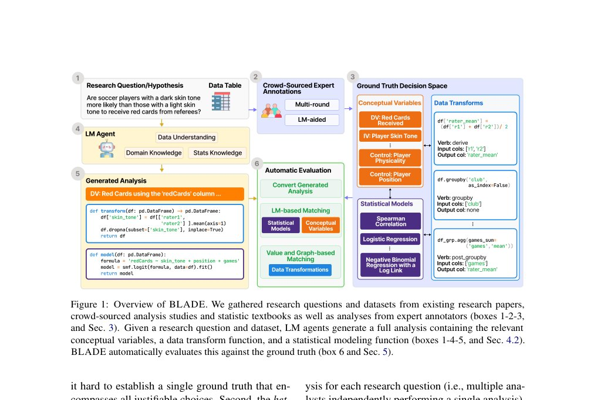


## PDF 第 3 页

[原版页面](./source_pages/page-003.jpg)

```text
    Requirements                         Data Interpreter        MLAgentBench               QRData                DS-Agent             DABench           Ours
                                        (Hong et al., 2024b)   (Huang et al., 2023a)    (Liu et al., 2024b)   (Guo et al., 2024b)   (Hu et al., 2024b)
    Agent abilities tested
    (1) comprehend data semantics               −                      −                       ✔                     −                     −              ✔
    (2) integrate domain knowledge              −                      −                       ✗                     −                     −              ✔
    (3) conduct multi-step reasoning            ✔                      ✔                       −                     ✔                     −              ✔
    (4) discern justifiable decisions           ✗                      ✗                       ✗                     ✗                     ✗              ✔
    Evaluation characteristics
    (5) automatic                               ✔                      ✔                       ✔                     ✔                     ✔              ✔
    (6) decision-based                          ✗                      ✗                       ✗                     ✗                     ✗              ✔
    (7) flexible to decision input              ✗                      ✗                       ✗                     ✗                     ✗              ✔

Table 1: Comparing BLADE against existing data analysis evaluation datasets and benchmarks for conduct-
ing scientific analyses based on the requirements specified in Section 2. − indicates partial satisfaction (e.g., data
understanding is only on ML model building). See Table 4 for examples from BLADE and recent benchmarks.


illustrate its utility and assess benchmark perfor-                           agent decision-making during analysis and often do
mance, we evaluate different LMs and a standard                               not capture the full scope of their approaches. Our
ReAct agent (Yao et al., 2023) that interacts with a                          benchmark addresses these limitations by focusing
sandbox notebook environment (Sec. 6).                                        on the following key requirements (Table 1).
   In our results (Sec. 7), we find most LMs are                                 We maintain that the ideal benchmark would
decent at discerning decisions and generating non-                            evaluate an agent’s abilities to (1) comprehend
empty executable analyses. However, these analy-                              data semantics, understanding the semantic rela-
sis are basic and lack diversity. In particular, LM’s                         tionships between variables and what the data rep-
coverage of the ground truth for forming statistical                          resents relative to the external world, (2) integrate
models with conceptual variables is below 13%,                                domain knowledge, i.e., findings from related liter-
and for operationalizing variables, it is below 27%                           ature and an understanding of a “world model”, (3)
(Fig. 4). The baseline ReAct agent shows a consis-                            conduct multi-step reasoning and planning at differ-
tent improvement in coverage, though with plenty                              ent levels of abstraction, i.e., high level planning vs.
of room for improvement.                                                      lower level code execution, given domain knowl-
   Our main contributions are: (1) a rigorously                               edge, an understanding of the data, and execution
expert-annotated benchmark and the first of its                               outputs, and (4) differentiate justifiable decisions
kind to evaluate agents’ analytical decisions on                              with firm theoretical or statistical support (Simon-
open-ended scientific research questions; (2) an                              sohn et al., 2020) from unjustifiable ones.
evaluation framework to automatically assess agent                               Additionally, the benchmark evaluation should
responses on fine-grained aspects of the analysis;                            be (5) automatic, requiring no human intervention,
and (3) results on various LMs and a ReAct agent                              (6) decision-based, with the ground truth reflecting
indicating their current strengths and limitations.                           the intermediary decisions, and (7) flexible to deci-
   Our work takes the first step in evaluating agents                         sion input, being aware of multiple ways to specify
for open-ended data-driven scientific discovery, ad-                          the same decision. Requirements 1 through 4 in-
vancing our understanding of their capabilities to                            form our data collection process (Sec. 3) and task
collect data, generate hypotheses, conduct analy-                             formulation (Sec. 4). Requirements 5 through 7 in-
ses, and interpret results to form valid, justifiable                         form our evaluation procedure (Sec. 5). Ultimately,
scientific conclusions. To support further research                           we assess whether agents can plan, develop, and
and development, we open source our benchmark                                 execute a justifiable analysis to answer a real-world
and evaluation framework1 .                                                   research question.

2        Benchmark Requirements                                               3        Benchmark Data Collection
Our benchmark evaluates agents on answering                                   We now describe our data collection process for
open-ended, data-driven scientific questions, ad-                             research questions (RQs), data, and ground-truth
vancing current efforts that execute analysis code                            analyses.
based on precise single-answer instructions. Exist-
                                                                              RQs and Data. We selected scientific-grade
ing benchmarks are limited in their ability to assess
                                                                              datasets and RQs directly from scientific publica-
     1
         https://github.com/behavioral-data/BLADE                             tions, particularly those studied in meta-analysis
                                                                      13938
```

**Table 1（原文图题/表题候选）** — Table 1: Comparing BLADE against existing data analysis evaluation datasets and benchmarks for conduct- ing scientific analyses based on the requirements specified in Section 2. −indicates partial satisfaction (e.g., data understanding is only on ML model building). See Table 4 for examples from BLADE and recent benchmarks.

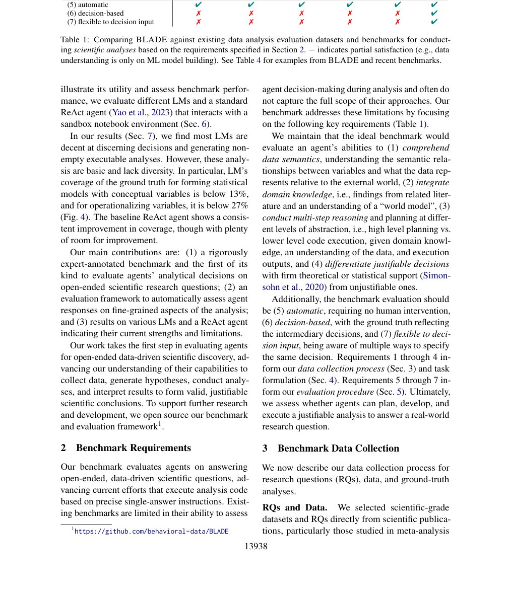


## PDF 第 4 页

[原版页面](./source_pages/page-004.jpg)

```text
papers (Silberzahn et al., 2018; Simonsohn et al.,      4     Benchmark Tasks
2020; Young and Holsteen, 2017) and reproduced
                                                        We want the benchmark tasks to represent deci-
in statistics textbooks (Mcelreath, 2020; Kleiber
                                                        sions that are vital to the analysis and to evaluate
and Zeileis, 2008). We chose these sources because
                                                        the key skills needed to conduct data-driven science
they provide a multitude of complex analyses, and
                                                        (i.e., requirements 1-4 in Section 2). We draw from
relevant properties that make analyses non-trivial
                                                        prior studying the scientific analysis process (Gu
and revealing of statistical knowledge. Table 3
                                                        et al., 2023b; Liu et al., 2019, 2020a) and focus
summarizes these RQs, datasets, source papers,
                                                        on agents’ ability to discern (Sec. 4.1) and make
and meta-analysis papers. During this process, we
                                                        (Sec. 4.2) planning decisions, i.e., those requiring
ensured that the datasets were clearly documented
                                                        a process of reasoning about and then synthesizing
and sufficiently complex to require non-trivial anal-
                                                        the data, scientific domain, and statistical knowl-
yses, i.e., expert annotators would be required to
                                                        edge. Specifically we test the following decisions:
distinguish defensible from indefensible decisions.
                                                        (1) Formulating Conceptual Variables. Agents
Annotation Process. To gather ground truth analy-       should recognize independent variables (IVs) , de-
ses and ensure the highest quality annotations, we      pendent variables (DVs), and control variables
followed a procedure similar to those used in pre-      based on domain knowledge and multi-step reason-
vious crowd-sourced analysis studies (Silberzahn        ing (requirements 2 and 3), e.g., “Prior literature
et al., 2018; Schweinsberg et al., 2021). We re-        suggests player physicality influences the referee’s
cruited 11 trained analysis experts and engaged         perception. We can consider physicality a control.”
them in a multi-stage process to ensure quality. Our    (2) Executing Data Transformations. Agents
experts had a self-reported average of 6 years of       should select relevant columns and apply trans-
experience, with 6 pursuing or holding a Ph.D. in a     formations to operationalize conceptual variables,
scientific field. Since one of our key contributions    e.g., using BMI as a proxy for player physicality
is the corpus of ground truth analyses, we invited      via “weight” and “height” columns.
our expert annotators to be co-authors of this paper.
See Appendix A.1 for details on recruitment.            (3) Implementing Statistical Models. Agents should
                                                        choose the appropriate statistical model based on
   We gave each expert an RQ, dataset, and dataset
                                                        conceptual variables and transformed data to ad-
description, including details of each column. For
                                                        dress the research question, requiring in-depth
each dataset, experts independently conducted their
                                                        knowledge of statistical methods and the under-
analyses, recording all decisions they made. This
                                                        lying hypothesis (Jun et al., 2019, 2021).
naturally resulted in multiple analytical approaches.
To broaden the scope of possible strategies, we used    4.1    Task 1: Discern Justifiable Decisions
an LM (GPT-4) to generate additional decisions          To evaluate how well agents can discern justifiable
(prompts shown in Fig. 9).                              decisions (requirement 4), BLADE includes the
   To ensure high data quality, experts validated       following Multiple Choice Questions. (MCQ1)
and annotated each other’s and LM-generated de-         Given the research question and the dataset, which
cisions as justified or unjustified. Agreement rates    conceptual variable is the most/least justifiable for
among expert annotators were relatively high: 75%       the analysis? (MCQ2) Given the research ques-
for transformations and 80% for conceptual vari-        tion, dataset, and conceptual variable of interest,
ables. In contrast, agreement on LM-generated de-       which transformation is the most/least justifiable to
cisions was much lower, at 27% for transformations      operationalize the variable?
and 13% for conceptual variables, highlighting low         Each multiple choice question includes one cor-
agent performance on decision generation. Many          rect and one or more incorrect answers. Justifiable
of these lower-agreement decisions were excluded        and unjustifiable decisions were gathered during
from the final ground truth dataset.                    expert reviews of each other’s and LM-generated
   Finally, we brought the team of experts together     decisions. A decision was deemed justifiable if all
to discuss their decisions, resolve ambiguities, and    experts agreed and unjustifiable if the majority con-
establish consensus. Our ground truth thus reflects     sidered it unjustifiable. In addition, for MCQ2, ad-
alternative approaches validated by multiple ex-        ditional negative samples were gathered from trans-
perts. See Appendix A.2 for details of our annota-      formations that were used to derive conceptual vari-
tion process.                                           able that differed from the one in the question (i.e.,
                                                   13939
```


## PDF 第 5 页

[原版页面](./source_pages/page-005.jpg)

```text
Figure 2: To allow flexible and fine-grained matching, we represent transforms in code (left) as a column data flow
graph G (right). The nodes in blue are column indicator nodes P , and the nodes in orange are transform nodes T .
Details of the data flow graph formalization are in Appendix A.3
                                                            .

easier negative examples). In total, BLADE con-                 now discuss the representation and matching pro-
tains 188 multiple choice questions.                            cedure for each artifact in an agent’s submission.

4.2 Task 2: Generate an End-to-end Analysis                     Matching Conceptual Variables. Because con-
For this significantly more complex task, agents                ceptual variables capture high-level constructs, two
need to generate a complete end-to-end analysis                 similarly specified constructs (i.e, player physi-
given a research question and a dataset. Specif-                cality and how physically imposing the player is)
ically, to test agent performance on key analysis               should have the same meaning as long as they have
decisions, agents are to submit the following arti-             the same variable type (i.e., IV, DV, or Control). To
facts (e.g., in Fig. 1.5 and 7), each mapping to one            match these specifications, we employed an LM
type of decision.                                               (GPT-4o) to determine the semantic equivalence
                                                                between two conceptual variables. We followed
    1. A list of conceptual variables, each with a              a procedure similar to (Liang et al., 2023) which
       natural language description (e.g, player phys-          was validated on semantically matching academic
       icality), the variable type (i.e., an independent,       reviews (prompt in Fig. 11). Appendix A.4.2 con-
       dependent, or control variable), and the name            tains further details.
       of the column in the final transformed data
       table used in the statistical model.                     Matching Data Transformations. Since there are
                                                                many ways to express data analyses in code, even
    2. An executable transformation function, which             ways that could be perfectly equivalent, we require
       is given a data table as input and returns a data        a representation that maps equivalent transforma-
       table after performing the transformations to            tions to a single representation (i.e., requirement
       operationalize the conceptual variables.                 7 – flexible to decision input). Taking the code in
    3. A statistical model function, which takes as             Figure 2 as an example, the ordering of the trans-
       input the transformed data table and returns             forms 1 - 2 - 3 or 2 - 1 - 3 are functionally
       the specified statistical model.                         equivalent with respect to the final product of the
                                                                computation (i.e., as long as 1 and 2 come be-
5     Flexible Automatic Evaluation
                                                                fore 3 ). In addition, transformations that result in
To quantitatively measure the quality of agent-                 the exact same output column values (with a small
generated analyses (i.e., the agent-generated arti-             margin of error for floating point) should be consid-
facts) in a way that is automatic, decision-based,              ered equivalent transformations. Likewise, getting
and flexible to decision input (requirements 5-7 in             a certain column’s values correct should mean that
Sec. 2), we need concrete representations of analy-             all relevant prior steps were correct and that deci-
sis decisions and associated matching criteria. We              sions for each relevant prior transformation were
                                                       13940
```

**Figure 2（原文图题/表题候选）** — Figure 2: To allow flexible and fine-grained matching, we represent transforms in code (left) as a column data flow graph G (right). The nodes in blue are column indicator nodes P, and the nodes in orange are transform nodes T. Details of the data flow graph formalization are in Appendix A.3

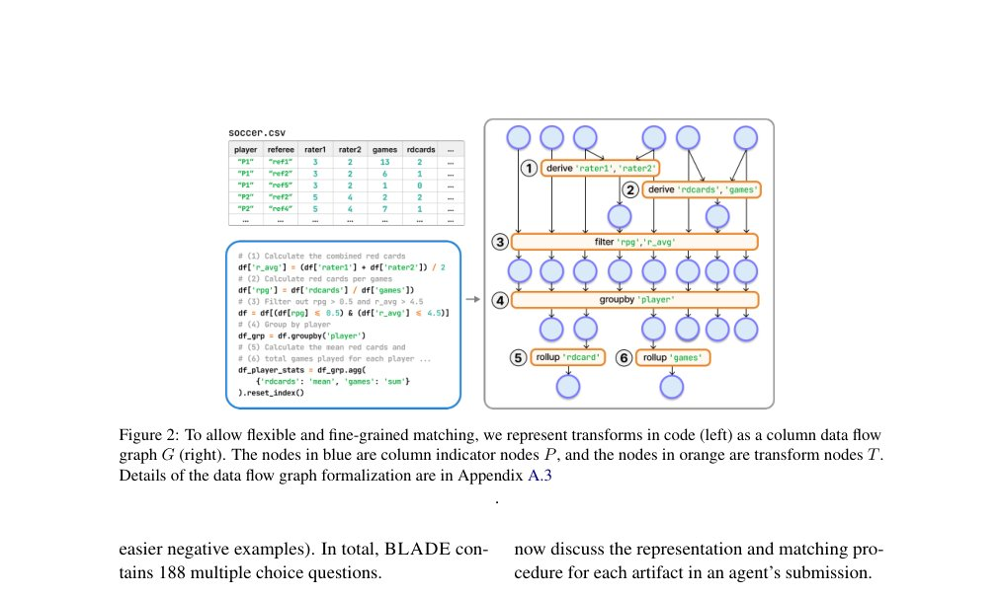

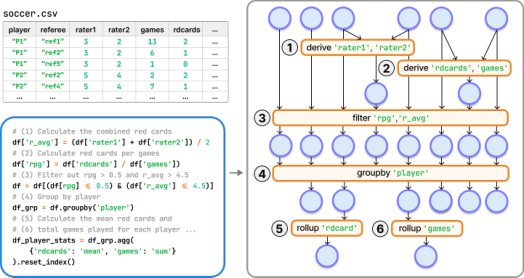


## PDF 第 6 页

[原版页面](./source_pages/page-006.jpg)

```text
correct. For example, if a submission missed 6              to select the right model and conceptual variables.
but still correctly calculated the “rdcards” after the      In principle, this representation could be extended
groupby, then the agent still correctly performed           to include code, hyperparameters, and more. We
steps 1 - 5 , deserving significant partial credit.         first used an LM (GPT-4o) prompt (Fig. 14) to con-
In complex tasks such as scientific data analysis,          vert the modeling function into a natural language
such partial credit enables meaningful differentia-         specification of the model and the columns in the
tion of model performance and progress.                     transformed data table that it used. Next, using an-
   To capture the aforementioned nuances, we                other LM (GPT-4o) prompt (Fig. 15), we compared
developed a representation for data transforma-             this output with the ground truth natural language
tions using a data flow graph (Kavi et al., 1986)           specifications of the model and associated concep-
(Fig. 2 right). These graphs are useful because any         tual variables based on semantic equivalence. See
series of transformations in the order of a topologi-       Appendix A.4.3 for additional details.
cal sort (Manber, 1989) on the graph leads to the           Evaluation of LM Evaluation Modules. To val-
same result. In addition, our graph captures data           idate our LM-based evaluation modules, two au-
flow at the column-level (i.e., all cell values in a sin-   thors independently reviewed a sample of 615 LM-
gle column) to enable subsequent matching at the            generated outputs across multiple datasets. After
granularity of columns. In doing so, we allow for           an initial round of review and resolution of any
matching on transforms that require and affect only         disagreements, the modules achieved the following
a subset of columns in a data table (e.g., in Fig. 2,       correctness rates: 93% for matching conceptual
getting 1 correct is independent of getting 2               variables, 97% for translating transform code into
correct). Appendix A.3 describes our data flow              transform units, 97% for converting modeling code
graph formalism in greater detail.                          into a natural language specification, and 92% for
   In addition, the transforms (i.e., orange nodes          matching statistical models. These results were
in Fig. 2) in the data flow graph represent a dis-          deemed sufficient for our evaluation purposes.
crete data transformation decision that was made in
wrangling the data (requirement 6 – decision-based          6   Experiments
evaluation). Specifically, each transform is defined
                                                            To establish a baseline and evaluate the perfor-
by a fixed set of transform verbs (Table 6) that
                                                            mance of LM-based agents on BLADE, we se-
are based on existing data wrangling libraries (i.e.,
                                                            lected the following models: GPT-3.5 Turbo,
Arquero2 and Vega (Satyanarayan et al., 2016)),
                                                            GPT-4o (OpenAI, 2024), Gemini 1.5 Pro (Pichai,
expandable, and validated to cover every analysis
                                                            2024), and Claude 3.5 Sonnet (Anthropic, 2024)
decision in our benchmark. To match transforms in
                                                            to represent closed-source general-purpose LMs;
BLADE, we applied an LM (GPT-4o) to convert
                                                            Llama3 8B, Llama3 70B (Meta, 2024), and Mixtral-
the transformation function in an agent’s submis-
                                                            8x22B (Mistral, 2024) for open-source LMs; and
sion to the individual transform units (prompt in
                                                            CodeLlama Instruct 7B (Rozière et al., 2023) and
Fig. 12 and 13). We then constructed the agent’s
                                                            DeepSeek-Coder Instruct 6.7B (Guo et al., 2024a)
transformation data flow graph and matched it with
                                                            for coding-specific LMs.
the ground truth. We match based on both the
column values that are the output of any discrete           Experiment Settings. For the multiple choice
transformation and a fuzzier graph isomorphism              questions (Sec. 4.1, Task 1) we evaluate each LM
matching that determines whether approximately              with a temperature of 0. To generate an end-to-
the same steps were applied. Appendix A.4.1 de-             end analysis (Sec. 4.2, Task 2), we evaluate LMs
scribes the matching procedures in detail.                  in one turn with a one-shot example (prompt in
                                                            Fig. 16). In addition, we develop an agent (also
Matching Statistical Models. The implementa-
                                                            with an example demonstration), based on the Re-
tion of statistical models and relevant parameters
                                                            Act framework (Yao et al., 2023), that interacts with
could be evaluated in multiple ways (i.e., code,
                                                            a computational notebook environment containing
natural language, or mathematical formulas (Jun
                                                            the data, reflects on observations from executing
et al., 2021; McElreath, 2018)). To prioritize the
                                                            the code, and generates next-step actions. We eval-
underexplored planning aspects of statistical mod-
                                                            uate the ReAct agent on Mixtral-8x22b, GPT-3.5
eling (Gu et al., 2023b), we focus on being able
                                                            Turbo, GPT-4o, Gemini 1.5 Pro, and Claude 3.5
   2
       https://idl.uw.edu/arquero/                          Sonnet. Appendix A.5 contains additional details
                                                       13941
```


## PDF 第 7 页

[原版页面](./source_pages/page-007.jpg)

```text
on the setup of the agent and the choice of LMs.                Models                 F1      (95% CI)
                                                                One-turn Setting
   For each LM and setting (i.e., one turn vs. ReAct            CodeLlama 7B          16.8     (15.2, 18.5)
agent), to encourage diversity we set the temper-               Deepseek-Coder 6.7B   33.9     (32.2, 35.4)
ature to 0.8 and record a total of 40 runs for the              Llama3 8B             29.6     (27.7, 31.5)
                                                                Llama3 70B            36.3     (34.7, 37.8)
one-turn setting and 20 runs for the agent setting              Mixtral-8x22B         40.1     (38.0, 42.1)
to consider for computational budget. For all LMs               GPT-3.5 Turbo         30.5     (28.7, 32.2)
                                                                GPT-4o                41.7     (40.2, 43.2)
used to facilitate the evaluation (i.e., conversion and         Gemini 1.5 Pro        41.1     (39.6, 42.5)
semantic matching), we use GPT-4o with a temper-                Claude 3.5 Sonnet     43.9     (42.6, 44.9)
ature of 0. Appendix A.6 includes all prompts for               Agent Setting
                                                                Mixtral-8x22B         40.8     (38.2, 42.9)
the baselines and LM-aided evaluation.                          GPT-3.5 Turbo         37.2     (34.7, 39.7)
                                                                GPT-4o                44.8     (43.0, 46.3)
Evaluation Metrics. For the multiple choice tasks               Gemini 1.5 Pro        40.1     (38.3, 41.5)
(Task 1), we measure agents on accuracy. For the                Claude 3.5 Sonnet     43.1     (41.4, 44.8)
generation tasks (Task 2), to measure an agent’s
ability to both generate justifiable analyses and cap-    Table 2: We report the decision-type weighted F1-score
                                                          on analysis generation based on average precision and
ture the breadth of justifiable approaches, we calcu-
                                                          coverage@10. Appendix A.7 has the calculation details.
late an adapted F1-score for each type of analysis
decision (conceptual variables, transformation, and
statistical model). The F1-score takes the harmonic
                                                          vant conceptual variables are possibly hinted at in
mean of average precision across runs and cover-
                                                          the research question and available data columns.
age@k. The former quantifies how well an agent’s
                                                          Although our setting is realistic and common, fu-
response matched with the ground truth while the
                                                          ture work could explore how LM agents perform
latter evaluates how comprehensive agents are in
                                                          in generating hypotheses and identifying relevant
generating justifiable alternative analyses. In our
                                                          data without such context (Majumder et al., 2024b).
experiments, we report average precision across all
                                                          In addition, we find that the best general LMs
runs and coverage for k = 10 runs. Appendix A.7
                                                          (i.e., Gemini-1.5 Pro, Mixtral-8x22b, Claude-3.5-
contains the full details of our evaluation metrics.
                                                          Sonnet and GPT-4o) perform well on the MCQs
                                                          (Fig. 3). They can discern the obvious transforma-
7   Results
                                                          tions for a given conceptual variable. In contrast,
We report the performance of LMs on MCQs (Task            code-specific LMs, like CodeLlama and DeepSeek-
1) in Figure 3 and the results of LMs and our ReAct       Coder, struggle to identify the correct decision.
agent for analysis generation (Task 2) in Table 2
                                                          Most LMs can generate non-empty executable
and Figure 4. Here, we summarize our main find-
                                                          analyses. For generating an analysis, we find that
ings.
                                                          most large LMs can generate a non-empty exe-
                                                          cutable analysis over 60% of the time, with GPT-
                                                          4o being the best at 96% (Fig. 5). Among the
                                                          open-source models, Mixtral-8x22b performs best,
                                                          generating an executable analysis 73% of the time
                                                          and DeepSeek-Coder also does surprisingly well
                                                          at 65%. In a manual inspection of non-executable
                                                          analyses, we notice issues with respect to halluci-
                                                          nating data attributes. Taking one of DeepSeek-
Figure 3: Accuracy scores and 95% confidence intervals    Coder’s submissions to the soccer dataset as an
for different models on BLADE’s 188 MCQs (168 for         example, we observe plausible looking code, but it
transformations and 20 for conceptual variables).         hallucinates the “RefCountry” column, which does
                                                          not actually appear in the data table (Figure 21-7).
LMs have acceptable world knowledge. We                   LMs struggle to specify statistical models and
find that LMs can identify some relevant concep-          concretely operationalize conceptual variables.
tual variables based on the research question and         LMs perform relatively poorly in forming statistical
dataset (i.e., a reasonable precision and coverage        models with the right conceptual variables (preci-
for conceptual variables). In BLADE, many rele-           sion below 35%) and operationalizing the variables
                                                     13942
```

**Figure 3（原文图题/表题候选）** — Figure 3: Accuracy scores and 95% confidence intervals for different models on BLADE’s 188 MCQs (168 for transformations and 20 for conceptual variables).

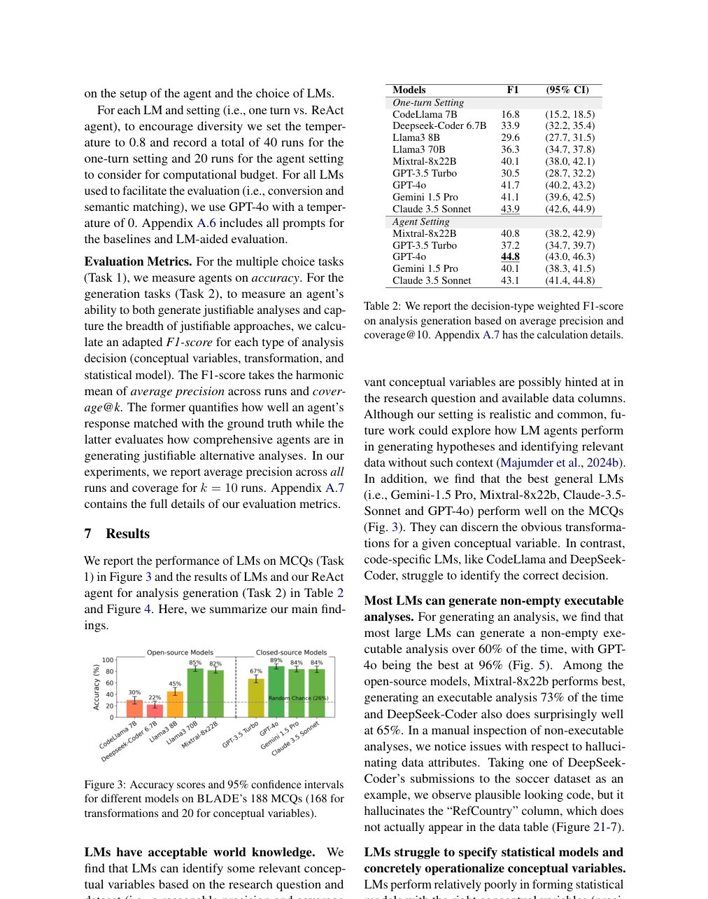

**Table 2（原文图题/表题候选）** — Table 2: We report the decision-type weighted F1-score on analysis generation based on average precision and coverage@10. Appendix A.7 has the calculation details.

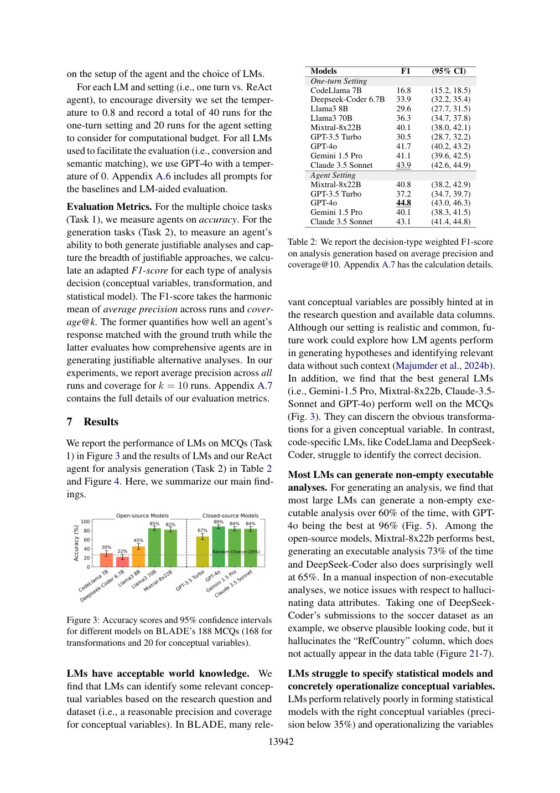

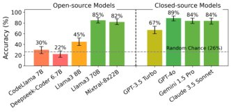


## PDF 第 8 页

[原版页面](./source_pages/page-008.jpg)

```text
Figure 4: Average precision (top row) and coverage@10 (bottom row) percentages averaged across datasets in
BLADE. All runs were included in the results. Run errors default to a hit rate of 0 and are counted in the coverage
calculation (i.e., treated as a run that generated nothing). Error bars represent bootstrapped 95% confidence intervals.


Figure 5: Characterization of run results for analysis generation for each LM and ReAct agent variants. "No
execution errors" indicates executable transform code, "Empty transform" means no transformations were provided,
"Execution errors" means the code resulted in errors, and "No generation" indicates the result could not be parsed.


(precision below 60%). In addition, LMs perform               runs. See Appendix A.8 for examples.
even worse in terms of coverage for forming sta-
tistical models with conceptual variables (cover-             Agents can improve the diversity of analyses.
age@10 below 13% across) and operationalizing                 Comparing the one-turn and agent settings, LMs
the variables (coverage@10 below 27%). This in-               consistently had higher coverage when allowed to
dicates there is room for improvement not only in             iteratively explore data. Moreover, ReAct agents
generating valid analyses, but also generating more           perform best overall on coverage for data trans-
complex and diverse analyses that might require               formations and statistical modeling, which require
additional reasoning beyond the basic steps.                  a more detailed understanding of data semantics
                                                              (Fig. 4 bottom). Future work can explore how aug-
LMs are limited to forming basic analyses. Fig-               menting agents with external knowledge (e.g., from
ure 5 also shows that many LM’s submissions con-              academic papers) can further improve performance.
tain empty transform code, especially for GPT-3.5
Turbo and Gemini 1.5 Pro. We also observe low                 Stronger performance on code generation does
coverage of the ground truth examples (Fig. 4 bot-            not translate directly to BLADE. When compar-
tom), especially with respect to data transforma-             ing our results in analysis generation with those
tions and specific model specifications. Through              from the HumanEval coding benchmark (Fig. 6),
qualitatively reviewing a random sample of LM-                we found that most metrics showed a positive cor-
generated analyses, we find that LMs often perform            relation, indicating that higher HumanEval perfor-
basic analysis that can yield decent precision (i.e.,         mance is broadly correlated with higher BLADE
matching basic decisions) but poor coverage across            performance. However, coverage measures (Fig. 6
                                                        13943
```

**Figure 4（原文图题/表题候选）** — Figure 4: Average precision (top row) and coverage@10 (bottom row) percentages averaged across datasets in BLADE. All runs were included in the results. Run errors default to a hit rate of 0 and are counted in the coverage calculation (i.e., treated as a run that generated nothing). Error bars represent bootstrapped 95% confidence intervals.

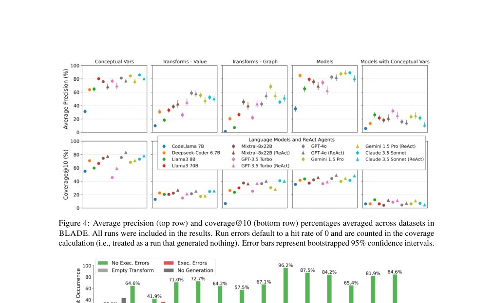

**Figure 5（原文图题/表题候选）** — Figure 5: Characterization of run results for analysis generation for each LM and ReAct agent variants. "No execution errors" indicates executable transform code, "Empty transform" means no transformations were provided, "Execution errors" means the code resulted in errors, and "No generation" indicates the result could not be parsed.

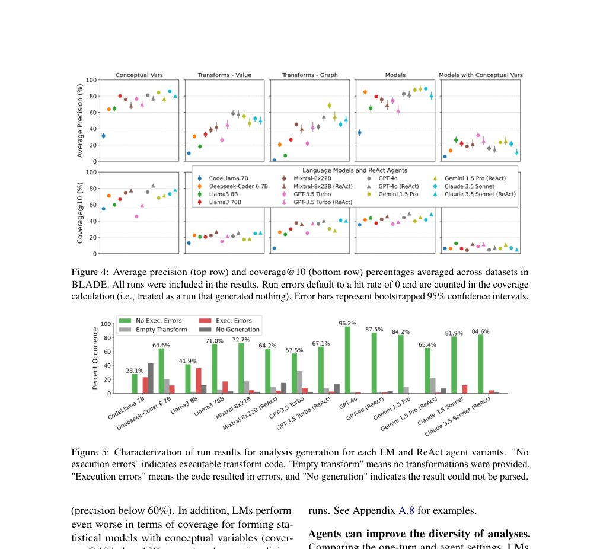

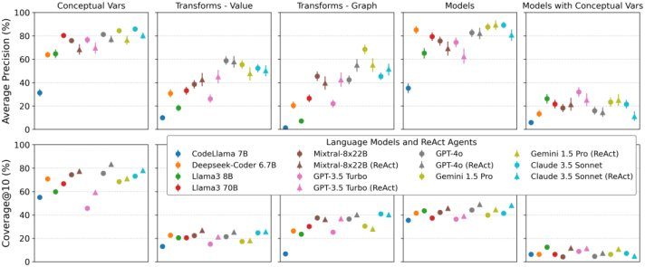

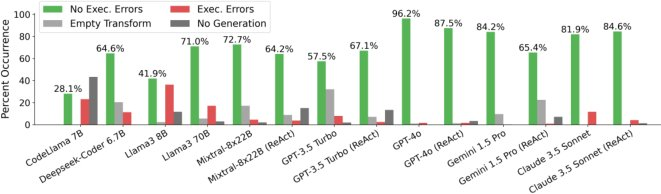


## PDF 第 9 页

[原版页面](./source_pages/page-009.jpg)

```text
Figure 6: BLADE Performance vs. HumanEval Performance. We compare BLADE evaluation metrics against
reported Pass@1 on HumanEval (Chen et al., 2021) for all LMs in our experiments.


bottom) had a weaker correlation compared to pre-       ing intermediate decisions (examples in Table 4).
cision (Fig. 6 top). This suggests that while current   Some works assess agents’ causal (Jin et al., 2023)
training methods, such as Reinforcement Learning        and quantitative reasoning (Liu et al., 2024a), but
from Human Feedback (RLHF) and instruction tun-         often lack data or involve closed-ended solutions,
ing, optimize for one solution, they may struggle to    missing the flexibility inherent in open-ended sci-
generate diverse solutions, a phenomenon observed       entific analyses. DiscoveryBench (Majumder et al.,
in other contexts (Li et al., 2024c).                   2024a) evaluates agents on generating data-driven
   We also highlight that Gemini 1.5 Pro con-           hypotheses but does not explicitly measure deci-
sistently performed better on precision than its        sions in the analyses. In contrast, BLADE focuses
HumanEval performance would suggest, while              on evaluating multiple valid analysis approaches to
Mixtral-8x22B excelled in both precision and cov-       open-ended, data-driven research questions.
erage for conceptual variables and data transfor-       Agents for Science. Advancements in LMs have
mations. In contrast, CodeLlama consistently per-       ignited research interest in applying agents to au-
formed worse on BLADE than HumanEval. Given             tomate scientific discovery (Liang et al., 2023;
that Gemini 1.5 Pro and Mixtral-8x22B are general-      Romera-Paredes et al., 2023; Shojaee et al., 2024;
purpose Mixture-of-Experts models, our findings         Kramer et al., 2023; Bran et al., 2023; Boiko et al.,
highlight BLADE as a challenging benchmark that         2023; Majumder et al., 2024b). Our work seeks to
assesses more than just code generation. Our re-        provide a thorough automated evaluation of agents
sults identify specific areas for improvement, such     for scientific analyses across domains.
as enhancing the complexity and diversity of anal-
yses or generating justifiable statistical models.      9   Conclusion
8   Related Work                                        We introduce BLADE, a benchmark designed to
                                                        advance the development of LM agents for data-
Our work broadly relates to agent benchmarks for        driven scientific tasks. We collected a dataset of re-
data science and LM agents in science.                  search questions and data tables, along with ground
Benchmarks for Data Science. Many bench-                truth analyses from expert annotators. To support
marks (Li et al., 2024b; Yin et al., 2022; Hu et al.,   an automatic, decision-based, and input-flexible
2024a) assess agents’ data science code execution       evaluation, we devised representations of core anal-
but are limited in measuring complex reasoning          ysis decisions and developed corresponding match-
and external knowledge integration needed for sci-      ing algorithms. Although current generations of
entific analyses. Other works focus on improving        LMs can generate some analyses matching the
specific metrics in machine learning tasks (Huang       ground truth sometimes, we find that these anal-
et al., 2023b; Hong et al., 2024a) without evaluat-     yses are limited in complexity and lack diversity.
                                                   13944
```

**Figure 6（原文图题/表题候选）** — Figure 6: BLADE Performance vs. HumanEval Performance. We compare BLADE evaluation metrics against reported Pass@1 on HumanEval (Chen et al., 2021) for all LMs in our experiments.

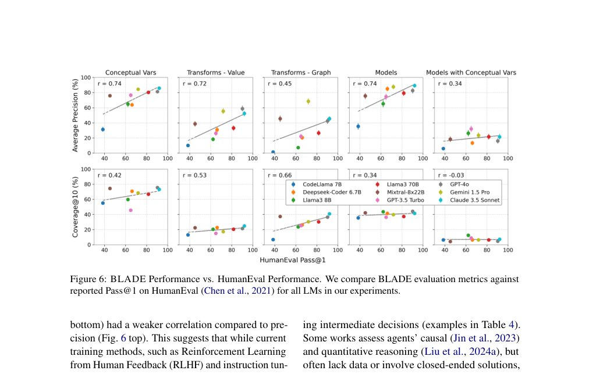

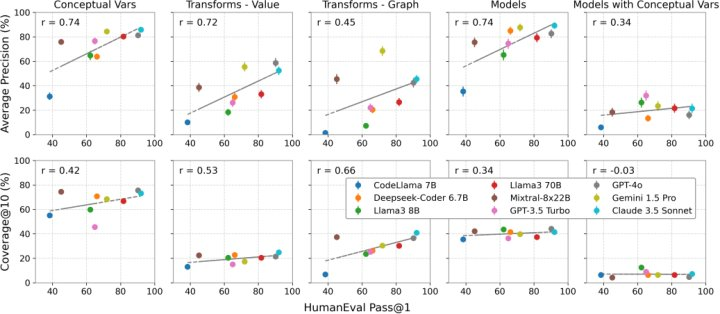


## PDF 第 10 页

[原版页面](./source_pages/page-010.jpg)

```text
10   Limitations                                         References
Our work is not without limitations. First,              2021. Arquero: Query processing and transformation
BLADE does not evaluate an agent’s ability to              of array-backed data tables. https://github.com/
                                                           uwdata/arquero.
interpret the results of data analyses as part of the
end-to-end data analysis process. Understanding          Anthropic. 2024. Claude 3.5 sonnet. Accessed: July 13,
and interpreting model results is vital but can be         2024.
difficult to capture cleanly since it may require ana-
                                                         Katrin Auspurg and Josef Brüderl. 2021. Has the credi-
lysts’ subjective interpretation of the problem with       bility of the social sciences been credibly destroyed?
respect to model results. We leave this important          reanalyzing the “many analysts, one data set” project.
dimension for future work.                                 Socius, 7:23780231211024421.
   In addition, though our work elucidates the de-
cisions an agent may make, we do not explicitly          Monya Baker. 2016. 1,500 scientists lift the lid on
                                                          reproducibility. Nature, 533:452–454.
evaluate the exploratory parts of an analysis. Fur-
ther, we assume that the dataset is contained in         Laura A Bakkensen and William Larson. 2014. Pop-
a single, potentially extremely large table. This          ulation matters when modeling hurricane fatalities.
may not be common of all research datasets, but            Proceedings of the National Academy of Sciences,
                                                           111(50):E5331–E5332.
we believe this factor does not significantly reduce
the scope of BLADE since joining tables to en-           Christophe Boesch, Daša Bombjaková, Amelia Meier,
able downstream analyses is a task that LMs al-            and Roger Mundry. 2019. Learning curves and teach-
ready commonly perform (Liu et al., 2023; Li et al.,       ing when acquiring nut-cracking in humans and chim-
                                                           panzees. Scientific Reports, 9(1):1515.
2024a; Pourreza and Rafiei, 2023).
   Finally, some components of our evaluation rely       Daniil A. Boiko, Robert MacKnight, Ben Kline, and
on LMs (e.g., conversion of code to discrete trans-        Gabe Gomes. 2023. Autonomous chemical research
forms, semantically matching model, and concep-            with large language models. Nature, 624:570 – 578.
tual variable), which are known to hallucinate.
                                                         Andrés M Bran, Sam Cox, Oliver Schilter, Carlo Baldas-
Therefore, we made multiple efforts to validate            sari, Andrew D. White, and Philippe Schwaller. 2023.
each component and do not think that hallucination         Augmenting large language models with chemistry
significantly impacts our ability to effectively and       tools. Nature Machine Intelligence, 6:525 – 535.
automatically evaluate agents. We also open source
                                                         Nate Breznau, Eike Mark Rinke, Alexander Wut-
these evaluation modules so that researchers can           tke, Muna Adem, Jule Adriaans, Amalia Álvarez-
build upon them to improve our evaluation.                 Benjumea, Henrik Kenneth Andersen, Daniel Auer,
                                                           Flávio Azevedo, Oke Bahnsen, David Balzer, Ger-
Acknowledgments                                            rit Bauer, Paul Cornelius Bauer, Markus Baumann,
                                                           Sharon Baute, et al. 2022. Observing many re-
We are grateful for the expert annotators who              searchers using the same data and hypothesis reveals
worked with us over multiple rounds to gather the          a hidden universe of uncertainty. Proceedings of the
highest quality data. We also thank the UW Be-             National Academy of Sciences of the United States of
                                                           America, 119.
havioral Data Science Group members for their
suggestions and feedback. Additionally, we thank         Mark Chen, Jerry Tworek, Heewoo Jun, Qiming Yuan,
Tiffany Zheng for her support and brainstorming           Henrique Ponde, Jared Kaplan, Harrison Edwards,
on the figures, Josh Gardner and Andrew McNutt            Yura Burda, Nicholas Joseph, Greg Brockman, Alex
                                                          Ray, Raul Puri, Gretchen Krueger, Michael Petrov,
for their early feedback on the overall project,
                                                          Heidy Khlaaf, et al. 2021. Evaluating large language
and Farhan Samir for his input towards evaluation.        models trained on code. ArXiv, abs/2107.03374.
This research was supported in part by NSF grant
IIS-1901386, NSF CAREER IIS-2142794, Bill &              Open Science Collaboration. 2015. Estimating the
Melinda Gates Foundation (INV-004841), and the             reproducibility of psychological science. Science,
                                                           349(6251):aac4716.
Office of Naval Research (#N00014-21-1-2154).
                                                         Margaret C Crofoot, Ian C Gilby, Martin C Wikelski,
                                                          and Roland W Kays. 2008. Interaction location
                                                          outweighs the competitive advantage of numerical
                                                          superiority in cebus capucinus intergroup contests.
                                                          Proceedings of the National Academy of Sciences,
                                                          105(2):577–581.
                                                    13945
```


## PDF 第 11 页

[原版页面](./source_pages/page-011.jpg)

```text
Victor Dibia. 2023. Lida: A tool for automatic gener-       Xueyu Hu, Ziyu Zhao, Shuang Wei, Ziwei Chai, Guoyin
  ation of grammar-agnostic visualizations and info-          Wang, Xuwu Wang, Jing Su, Jingjing Xu, Ming
  graphics using large language models. arXiv preprint        Zhu, Yao Cheng, Jianbo Yuan, Kun Kuang, Yang
  arXiv:2303.02927.                                           Yang, Hongxia Yang, and Fei Wu. 2024a. Infiagent-
                                                              dabench: Evaluating agents on data analysis tasks.
Ray C Fair. 1978. A theory of extramarital affairs. Jour-     ArXiv, abs/2401.05507.
  nal of political economy, 86(1):45–61.
                                                            Xueyu Hu, Ziyu Zhao, Shuang Wei, Ziwei Chai, Guoyin
Andrew Gelman and E. Loken. 2014. The statistical             Wang, Xuwu Wang, Jing Su, Jingjing Xu, Ming Zhu,
  crisis in science. American Scientist, 102:460.             Yao Cheng, et al. 2024b. Infiagent-dabench: Evalu-
Andrew Gelman and E. Loken. 2019. The garden of               ating agents on data analysis tasks. arXiv preprint
  forking paths : Why multiple comparisons can be a           arXiv:2401.05507.
  problem , even when there is no “ fishing expedition
 ” or “ p-hacking ” and the research hypothesis was         Qian Huang, Jian Vora, Percy Liang, and Jure Leskovec.
  posited ahead of time.                                      2023a. Benchmarking large language models as ai
                                                              research agents. arXiv preprint arXiv:2310.03302.
Cassandra C Gilmore. 2013. A comparison of ante-
  mortem tooth loss in human hunter-gatherers and           Qian Huang, Jian Vora, Percy Liang, and Jure Leskovec.
  non-human catarrhines: Implications for the identi-         2023b. Mlagentbench: Evaluating language agents
  fication of behavioral evolution in the human fossil        on machine learning experimentation.
  record. American journal of physical anthropology,
  151(2):252–264.                                           Zhijing Jin, Yuen Chen, Felix Leeb, Luigi Gre-
                                                              sele, Ojasv Kamal, Zhiheng Lyu, Kevin Blin, Fer-
Ken Gu, Madeleine Grunde-McLaughlin, Andrew M.                nando Gonzalez Adauto, Max Kleiman-Weiner,
  McNutt, Jeffrey Heer, and Tim Althoff. 2023a. How           Mrinmaya Sachan, and Bernhard Scholkopf. 2023.
  do data analysts respond to ai assistance? a wizard-        Cladder: Assessing causal reasoning in language
  of-oz study. In International Conference on Human           models.
  Factors in Computing Systems.
                                                            Eunice Jun, M. Keith Birchfield, Nicole de Moura, Jef-
Ken Gu, Ruoxi Shang, Tim Althoff, Chenglong Wang,
                                                              frey Heer, and René Just. 2021. Hypothesis formal-
  and Steven Mark Drucker. 2023b. How do analysts
                                                              ization: Empirical findings, software limitations, and
  understand and verify ai-assisted data analyses? In
                                                              design implications. ACM Trans. Comput. Hum. In-
  International Conference on Human Factors in Com-
                                                              teract., 29:6:1–6:28.
  puting Systems.

Daya Guo, Qihao Zhu, Dejian Yang, Zhenda Xie, Kai           Eunice Jun, Maureen Daum, Jared Roesch, Sarah E.
  Dong, Wentao Zhang, Guanting Chen, Xiao Bi,                 Chasins, E. Berger, René Just, and Katharina Rei-
  Yu Wu, Y. K. Li, Fuli Luo, Yingfei Xiong, and Wen-          necke. 2019. Tea: A high-level language and runtime
  feng Liang. 2024a. Deepseek-coder: When the large           system for automating statistical analysis. Proceed-
  language model meets programming - the rise of code         ings of the 32nd Annual ACM Symposium on User
  intelligence. ArXiv, abs/2401.14196.                        Interface Software and Technology.

Siyuan Guo, Cheng Deng, Ying Wen, Hechang Chen,             Kiju Jung, Sharon Shavitt, Madhu Viswanathan, and
  Yi Chang, and Jun Wang. 2024b. Ds-agent: Au-                Joseph M Hilbe. 2014. Female hurricanes are dead-
  tomated data science by empowering large lan-               lier than male hurricanes. Proceedings of the Na-
  guage models with case-based reasoning. ArXiv,              tional Academy of Sciences, 111(24):8782–8787.
  abs/2402.17453.
                                                            Krishna M. Kavi, Bill P. Buckles, Senior Member, and
Daniel S Hamermesh and Amy Parker. 2005. Beauty in            U. Narayan Bhat. 1986. A formal definition of data
  the classroom: Instructors’ pulchritude and putative        flow graph models. IEEE Transactions on Comput-
  pedagogical productivity. Economics of Education            ers, C-35:940–948.
  Review, 24(4):369–376.

Sirui Hong, Yizhang Lin, Bangbang Liu, Binhao Wu,           Christian Kleiber and Achim Zeileis. 2008. Applied
   Danyang Li, Jiaqi Chen, Jiayi Zhang, Jinlin Wang,          econometrics with R. Springer Science & Business
   Lingyao Zhang, Mingchen Zhuge, Taicheng Guo,               Media.
   Tuo Zhou, Wei Tao, Wenyi Wang, Xiangru Tang,
   et al. 2024a. Data interpreter: An llm agent for data    Lyle W Konigsberg and Susan R Frankenberg. 2013.
   science. ArXiv, abs/2402.18679.                            Bayes in biological anthropology. American Journal
                                                              of Physical Anthropology, 152:153–184.
Sirui Hong, Yizhang Lin, Bangbang Liu, Binhao Wu,
   Danyang Li, Jiaqi Chen, Jiayi Zhang, Jinlin Wang,        Stefan Kramer, Mattia Cerrato, Sašo Džeroski, and
   Lingyao Zhang, Mingchen Zhuge, et al. 2024b. Data           Ross D. King. 2023. Automated scientific discovery:
   interpreter: An llm agent for data science. arXiv           From equation discovery to autonomous discovery
   preprint arXiv:2402.18679.                                  systems. ArXiv, abs/2305.02251.
                                                       13946
```


## PDF 第 12 页

[原版页面](./source_pages/page-012.jpg)

```text
Haoyang Li, Jing Zhang, Hanbing Liu, Ju Fan, Xi-             Bodhisattwa Prasad Majumder, Harshit Surana, Dhruv
  aokang Zhang, Jun Zhu, Renjie Wei, Hongyan Pan,              Agarwal, Bhavana Dalvi, Abhijeetsingh Meena,
  Cuiping Li, and Hong Chen. 2024a. Codes: Towards             Aryan Prakhar, Tirth Vora, Tushar Khot, Ashish Sab-
  building open-source language models for text-to-sql.        harwal, and Peter Clark. 2024a. Discoverybench:
  ArXiv, abs/2402.16347.                                       Towards data-driven discovery with large language
                                                               models.
Jinyang Li, Nan Huo, Yan Gao, Jiayi Shi, Yingxiu Zhao,
   Ge Qu, Yurong Wu, Chenhao Ma, Jian-Guang Lou,             Bodhisattwa Prasad Majumder, Harshit Surana, Dhruv
   and Reynold Cheng. 2024b. Tapilot-crossing: Bench-          Agarwal, Sanchaita Hazra, Ashish Sabharwal, and
   marking and evolving llms towards interactive data          Peter Clark. 2024b. Data-driven discovery with large
   analysis agents. ArXiv, abs/2403.05307.                     generative models. ArXiv, abs/2402.13610.
Margaret Li, Weijia Shi, Artidoro Pagnoni, Peter West,
 and Ari Holtzman. 2024c. Predicting vs. acting: A           Steve Maley. 2014. Statistics show no evidence of
 trade-off between world modeling & agent modeling.             gender bias in the public’s hurricane preparedness.
 ArXiv, abs/2407.02446.                                        Proceedings of the National Academy of Sciences,
                                                               111(37):E3834–E3834.
Qisheng Li, Meredith Ringel Morris, Adam Fourney,
  Kevin Larson, and Katharina Reinecke. 2019. The            Daniel Malter. 2014. Female hurricanes are not deadlier
  impact of web browser reader views on reading speed          than male hurricanes. Proceedings of the National
  and user experience. In Proceedings of the 2019 CHI          Academy of Sciences, 111(34):E3496–E3496.
  conference on human factors in computing systems,
  pages 1–12.                                                Udi Manber. 1989. Introduction to Algorithms: A Cre-
                                                               ative Approach. Addison-Wesley Longman Publish-
Weixin Liang, Yuhui Zhang, Hancheng Cao, Binglu                ing Co., Inc., USA.
 Wang, Daisy Ding, Xinyu Yang, Kailas Vodrahalli,
 Siyu He, Daniel Smith, Yian Yin, Daniel A. Mc-
                                                             Richard McElreath. 2018. Statistical rethinking: A
 Farland, and James Zou. 2023. Can large lan-
                                                               Bayesian course with examples in R and Stan. Chap-
 guage models provide useful feedback on research
                                                               man and Hall/CRC.
 papers? a large-scale empirical analysis. ArXiv,
 abs/2310.01783.
                                                             Richard Mcelreath. 2020. Statistical rethinking.
Aiwei Liu, Xuming Hu, Lijie Wen, and Philip S. Yu.
  2023. A comprehensive evaluation of chatgpt’s zero-        Meta. 2024. Introducing meta llama 3: The most capa-
  shot text-to-sql capability. ArXiv, abs/2303.13547.         ble openly available llm to date. Accessed: July 13,
                                                              2024.
Jiali Liu, Nadia Boukhelifa, and James R. Eagan. 2020a.
   Understanding the role of alternatives in data analysis   Mistral. 2024. Cheaper, better, faster, stronger. Ac-
   practices. IEEE Transactions on Visualization and           cessed: July 13, 2024.
   Computer Graphics, 26:66–76.
Xiao Liu, Zirui Wu, Xueqing Wu, Pan Lu, Kai-Wei              Alicia H Munnell, Geoffrey MB Tootell, Lynn E
  Chang, and Yansong Feng. 2024a. Are llms capable             Browne, and James McEneaney. 1996. Mortgage
  of data-based statistical and causal reasoning? bench-       lending in boston: Interpreting hmda data. The Amer-
  marking advanced quantitative reasoning with data.           ican Economic Review, pages 25–53.
  ArXiv, abs/2402.17644.
                                                             OpenAI. 2024. Hello, GPT-4.0! https://openai.
Xiao Liu, Zirui Wu, Xueqing Wu, Pan Lu, Kai-Wei                com/index/hello-gpt-4o/. Accessed: June 13,
  Chang, and Yansong Feng. 2024b. Are llms capable             2024.
  of data-based statistical and causal reasoning? bench-
  marking advanced quantitative reasoning with data.         Sundar Pichai. 2024. Next-generation ai model: Google
  arXiv preprint arXiv:2402.17644.                             gemini. Accessed: June 13, 2024.
Yang Liu, Tim Althoff, and Jeffrey Heer. 2019. Paths         Mohammad Reza Pourreza and Davood Rafiei. 2023.
  explored, paths omitted, paths obscured: Decision           Din-sql: Decomposed in-context learning of text-to-
  points & selective reporting in end-to-end data anal-       sql with self-correction. ArXiv, abs/2304.11015.
  ysis. Proceedings of the 2020 CHI Conference on
  Human Factors in Computing Systems.
                                                             Bernardino     Romera-Paredes,     Mohammadamin
Yang Liu, Alex Kale, Tim Althoff, and Jeffrey Heer.            Barekatain, Alexander Novikov, Matej Balog,
  2020b. Boba: Authoring and visualizing multiverse            M Pawan Kumar, Emilien Dupont, Francisco J. R.
  analyses. IEEE Transactions on Visualization and             Ruiz, Jordan S. Ellenberg, Pengming Wang, Omar
  Computer Graphics, 27(2):1753–1763.                          Fawzi, Pushmeet Kohli, Alhussein Fawzi, Josh
                                                               Grochow, Andrea Lodi, Jean-Baptiste Mouret, et al.
J Scott Long and Jeremy Freese. 2006. Regression               2023. Mathematical discoveries from program
   models for categorical dependent variables using            search with large language models. Nature, 625:468
  Stata, volume 7. Stata press.                                – 475.
                                                        13947
```


## PDF 第 13 页

[原版页面](./source_pages/page-013.jpg)

```text
Baptiste Rozière, Jonas Gehring, Fabian Gloeckle, Sten     Lei Wang, Chengbang Ma, Xueyang Feng, Zeyu Zhang,
  Sootla, Itai Gat, Xiaoqing Tan, Yossi Adi, Jingyu          Hao ran Yang, Jingsen Zhang, Zhi-Yang Chen, Ji-
  Liu, Tal Remez, Jérémy Rapin, Artyom Kozhevnikov,          akai Tang, Xu Chen, Yankai Lin, Wayne Xin Zhao,
  I. Evtimov, Joanna Bitton, Manish P Bhatt, Cris-           Zhewei Wei, and Ji rong Wen. 2023. A survey
  tian Cantón Ferrer, et al. 2023. Code llama: Open          on large language model based autonomous agents.
  foundation models for code. ArXiv, abs/2308.12950.         ArXiv, abs/2308.11432.
Arvind Satyanarayan, Dominik Moritz, Kanit Wong-           Qingyun Wu, Gagan Bansal, Jieyu Zhang, Yiran Wu,
  suphasawat, and Jeffrey Heer. 2016. Vega-lite: A           Shaokun Zhang, Erkang Zhu, Beibin Li, Li Jiang,
  grammar of interactive graphics. IEEE transactions         Xiaoyun Zhang, and Chi Wang. 2023. Autogen: En-
  on visualization and computer graphics, 23(1):341–         abling next-gen llm applications via multi-agent con-
  350.                                                       versation framework. ArXiv, abs/2308.08155.
Timo Schick, Jane Dwivedi-Yu, Roberto Dessì, Roberta       Shunyu Yao, Jeffrey Zhao, Dian Yu, Nan Du, Izhak
  Raileanu, Maria Lomeli, Luke Zettlemoyer, Nicola           Shafran, Karthik Narasimhan, and Yuan Cao. 2023.
  Cancedda, and Thomas Scialom. 2023. Toolformer:            ReAct: Synergizing reasoning and acting in language
  Language models can teach themselves to use tools.         models. In International Conference on Learning
  ArXiv, abs/2302.04761.                                     Representations (ICLR).
Martin Schweinsberg, Michael Feldman, Nicola Staub,        Pengcheng Yin, Wen-Ding Li, Kefan Xiao, A. Eashaan
 Olmo van den Akker, Robbie C. M. Aert, Mar-                 Rao, Yeming Wen, Kensen Shi, Joshua Howland,
 cel A.L.M. van Assen, Yang Liu, Tim Althoff, Jef-           Paige Bailey, Michele Catasta, Henryk Michalewski,
 frey Heer, Alex Kale, Zainab Mohamed, Hashem                Oleksandr Polozov, and Charles Sutton. 2022. Nat-
 Amireh, Vaishali Venkatesh Prasad, Abraham Bern-            ural language to code generation in interactive data
 stein, Emily Spears Robinson, et al. 2021. Same data,       science notebooks. ArXiv, abs/2212.09248.
 different conclusions: Radical dispersion in empirical
 results when independent analysts operationalize and      Cristobal Young and Katherine Holsteen. 2017. Model
 test the same hypothesis. Organizational Behavior           uncertainty and robustness: A computational frame-
 and Human Decision Processes.                               work for multimodel analysis. Sociological Methods
                                                             & Research, 46(1):3–40.
Parshin Shojaee, Kazem Meidani, Shashank Gupta,
  Amir Barati Farimani, and Chandan K. Reddy.
  2024. Llm-sr: Scientific equation discovery via
  programming with large language models. ArXiv,
  abs/2404.18400.
Raphael Silberzahn, Eric Luis Uhlmann, Daniel P. Mar-
  tin, Pasquale Anselmi, Frederik Aust, Eli Awtrey,
  Štěpán Bahník, Fangxing Bai, Colin Bannard,
  Evelina Bonnier, Rickard Carlsson, Felix Cheung,
  G. Christensen, Russ Clay, Maureen A. Craig, et al.
  2018. Many analysts, one data set: Making transpar-
  ent how variations in analytic choices affect results.
  Advances in Methods and Practices in Psychological
  Science, 1:337 – 356.
Joseph P. Simmons, Leif D. Nelson, and Uri Simonsohn.
   2011. False-positive psychology. Psychological Sci-
   ence, 22:1359 – 1366.
Uri Simonsohn, Joseph P Simmons, and Leif D Nelson.
  2020. Specification curve analysis. Nature Human
  Behaviour, 4(11):1208–1214.
James H Stock and Mark W Watson. 2020. Introduction
  to econometrics. Pearson.
Theodore R. Sumers, Shunyu Yao, Karthik Narasimhan,
  and Thomas L. Griffiths. 2023. Cognitive architec-
  tures for language agents. ArXiv, abs/2309.02427.
Edwin JC Van Leeuwen, Emma Cohen, Emma Collier-
  Baker, Christian J Rapold, Marie Schäfer, Sebastian
  Schütte, and Daniel BM Haun. 2018. The develop-
  ment of human social learning across seven societies.
  Nature Communications, 9(1):2076.
                                                      13948
```


## PDF 第 14 页

[原版页面](./source_pages/page-014.jpg)

```text
A    Appendix                                                 To streamline the annotation process and reduce
                                                          some of the cognitive load in specification, we de-
A.1 Data Collection Recruitment
                                                          veloped a customized annotation interface that sup-
Data analysts were recruited through open calls           ports structured inputs and sanity checks.
on social media platforms and personal connec-                We started with a training and familiarization
tions. Of the analysts interested, a subset was           procedure for the analysts. The process involved
selected based on their CVs reflecting education,         on-boarding and training to establish a clear mutual
training, and practices in statistical foundations and    understanding of the expected level of analysis and
data analysis. The selected analysts provided suffi-      the format of decision inputs to be recorded in the
ciently detailed analysis reports in a screening task     ground truth. We provided analysts with video and
and proceeded to the formal annotation phase. A           text tutorials, accompanied by a toy example imple-
total of 11 analysts participated in the final annota-    mented within the system. Multiple ad hoc meet-
tion (see Table 5 for annotator information).             ings and Q&A sessions were also held to further
   The participating analysts self-reported an aver-      clarify the process and address any issues. Analysts
age of 6 years of experience in data analysis (range:     were introduced to example crowd-sourced analy-
4-8 years), with 4 analysts performing data analysis      ses (Schweinsberg et al., 2021; Silberzahn et al.,
on a daily basis and 7 engaging in it a few times         2018) to align their mental models with justifiable
a week. The team included 6 people holding or             alternative decisions and the model quality level.
pursuing Ph.D. degree in Statistics or a related field        Collaborative efforts were encouraged in curat-
(Ph. D. in Biostatistics, Ph.D. in Biomedical and         ing and shaping the datasets, research questions,
Health Informatics, Ph.D. in Measurement, Eval-           and meta-information. In the review and revision
uation, & Research Methodology), the rest held            phase, we shared input from other annotators and
at least 1 Master’s degree in a related field. The        presented LM-generated examples (n ≈ 40 per
analysts’ occupations varied, 7 were graduate stu-        annotator, per dataset) for analysts to label as cor-
dents, 3 held data scientist positions in the finance     rect or incorrect. This process helped identify gaps,
and technology industries, and 1 was a quantitative       promote diversity, and encourage the incorporation
researcher in finance.                                    of additional justifiable decisions. Analysts labeled
   By assembling a team of analysts with diverse          the generated examples as justifiable or not jus-
backgrounds and a broad range of expertise in sta-        tifiable, drawing inspiration from their peers and
tistical analysis methods, we ensure that the ground      LM-generated outputs. The diversity in familiarity
truth dataset is constructed using a comprehensive        with various analysis methods among the analysts
set of methods. At least half (n=5) of the analysts       complemented each other, resulting in a more ro-
self-reported being familiar “to a high extent" or        bust set of annotations.
“to a very high extent" with common classes of                At the end of the annotation, we collected 118
analysis methods including descriptive statistics,        conceptual variable decisions, 246 discrete trans-
inferential statistics, hypothesis testing, estimation,   form decisions, and 172 modeling decisions (i.e.,
correlation, and regression.                              choice of statistical model and model formula).

A.2 Data Collection Procedure                             A.3   Analysis Decision Representations
While the analysts were free to conduct the analysis      In this section, we formally describe the represen-
in their preferred computational environment, we          tation of different analysis decisions as described
took several additional steps to ensure the quality       in Section 5. These representations capture all al-
of our ground truth.                                      ternative approaches in our ground truth and are
   To ensure consistency of annotations, we built         matched with an agent’s generated analysis arti-
a pipeline with structured training and annotation        facts (Sec. 4.2).
procedure aimed at ensuring well-prepared ana-            Data Transformations. Formally, a transform data
lysts, consistent and reliable analysis decision spec-    flow graph is a bipartite graph with two types of
ifications, and a diverse range of justifiable models     nodes: transform nodes and column pointer nodes.
and analysis approaches. These decisions cover
conceptual variable formulation, executing data                            G = (T ∪ P, E)                  (1)
transformations to operationalize the variables, and      where T = {t1 , t2 , . . .} is the set of transforms.
implementing statistical models (Sec. 4).                 P = {p1 , p2 , . . .} is the set of column pointers,
                                                     13949
```


## PDF 第 15 页

[原版页面](./source_pages/page-015.jpg)

```text
and the set of edges is denoted by:                       Finally, to keep track of all transformations
                                                        across all justifiable alternatives, we define T
            E ⊆ (T × P ) ∪ (P × T )              (2)    and S to be the set of all transformations and
                                                        columns values, respectively, across all data flow
   Each transform t represents one unit of transfor-    graphs. Any agent benchmark submission will be
mation and is defined by a fixed set of transform       matched against these ground-truth representations
verbs V (Table 6). This set of transform verbs          (described in Appendix A.4.1).
is based on existing data wrangling libraries (arq,
                                                                          n                 n
2021; Satyanarayan et al., 2016), were validated                          [                 [
to cover every analysis decision in our benchmark,                  T =         Ti    S=         Si        (6)
                                                                          i=1              i=1
and represent a discrete data transformation deci-
sion that was made in wrangling the data.               Conceptual Variables. A conceptual variable
   Given our graph, we ultimately want to match         c ∈ C is a triplet (cdesc , ctype , Ccols ) where cdesc
based on the column values as a result of any se-       is a natural language description of the concep-
ries of transformations. Thus, each column pointer      tual variable, ctype ∈ {IV, DV, Control} is the vari-
holds the column values and facilitates the flow of     able type, and Ccols ⊆ S is the set of column
column values from transform to transform. We           vectors that operationalize c. Here, C denotes the
denote the column vector value at a column pointer      set of conceptual variables across all alternative
node p as vp and S as the set of all column values      approaches.
associated with G.
                                                        Statistical Models. A statistical model m ∈ M is
                                                        a tuple (mdesc , Mcols ) where mdesc is the natural
                S = {vp | p ∈ P }                (3)
                                                        language description of the statistical model and
   The set of input column pointers to a transform      Mcols ⊆ Ccols is a set of column vectors associated
t and the output column pointers from a transform       with the model which are also associated with a
t are defined by I(t) and O(t):                         conceptual variable. In addition, Mcols should be
                                                        associated with only one series of transformations
          I(t) = {p ∈ P | (p, t) ∈ E},           (4)    or one data flow graph, that is:

          O(t) = {p ∈ P | (t, p) ∈ E}.           (5)          ∃Si ∈ {S1 , S2 , . . . , Sn } | Mcols ⊆ Si   (7)

   The exact transform performed dictates I(t) and      From Mcols , we can also derive the associated con-
O(t). Specifically, O(t) reflects only the columns      ceptual variables Cm ⊆ C in a model.
that are changed by t and I(t) are the columns that
are necessary to compute the output O(t) .                       Cm = {ci | Ccols,i ∩ Mcols ̸= ∅}          (8)
   Our transform data flow graph satisfies the fol-
                                                        In addition, for each statistical model m, there is
lowing properties:
                                                        one associated variable that is a DV, at least one
                                                        associated variable that is an IV and 0 or more
     | I(t)| > 0
                                                        Control variables. M denotes the set of statistical
     |O(t)| ≥ 1                                         models across all alternative approaches.
      |I(p)| = 1 except for original columns
                                                        A.4   Decision Matching Procedure
   So far, a single data flow graph G, represents a     With an understanding of the representations of
unique series of transformations. To account for        different analysis decisions, we now describe a
all alternative transformation choices (e.g., an al-    procedure to match an agent-generated analysis to
ternative in which the filter step 3 in Fig. 2 is       the ground truth.
skipped), we define G = {G1 , G2 , . . . , Gn } to be      Given the agent submission artifacts (Fig. 7), we
the set representing all unique series of transfor-     first apply LMs to handle the conversion of gener-
mations for an analysis. Note that any two graphs       ated artifacts into our ground truth representation
Gi = (Ti , Ei ) and Gj = (Tj , Ej ) may contain the     format. Specifically, we use GPT-4 to perform
same transformation (e.g., two graphs can contain       two tasks: convert the transform function into indi-
the same derive rater average transform 1 ) and         vidual transform units, and translate the modeling
so Ti ∩ Tj ̸= ∅.                                        function into a statistical model specification (e.g.,
                                                   13950
```


## PDF 第 16 页

[原版页面](./source_pages/page-016.jpg)

```text
Generated Analysis

                                                                                                                                                 DATA      TRANSFORM         CODE


                                                                                                                                                 def   transform(df:         pd.DataFrame)         ->   pd.DataFrame:


                                                                                                                                                       #   Compute     the   average     skin     tone    rating

        {
                                                                                                                                             df['SkinTone']        =    (df['rater1']         +   df['rater2'])     /   2


             "cvars":       {


                    "ivs":        [
                                                                                                                   #   Drop   the   rows   with     missing     values     in   the   necessary      columns

                           {"description":              "Skin   tone     of   the   soccer   player",      "columns":     ["SkinTone"]}
               df   =   df.dropna(subset=['SkinTone',                'redCards',      'games',         'meanIAT',   'meanExp'])


                    ],


                    "dv":       {
                                                                                                                     return     df
                           "description":          "Number       of     red   cards   received      by   the   soccer   player",


                           "columns":          ["redCards"]


                    },


                    "controls":          [
                                                                                                      STATISTICAL            MODELING        CODE

                           {


                                     "description":        "Number       of   games   played   by    the   player-referee     dyad",
            def   model(df:       pd.DataFrame)         ->   Any:


                                     "is_moderator":        false,
                                                                                    #   Define     independent       variables,        control    variables,         and   the   dependent   variable


                                     "moderator_on":        "",
                                                                                       X   =   df[['SkinTone',         'games',     'meanIAT',       'meanExp']]


                                     "columns":    ["games"]
                                                                                          y   =   df['redCards']



                           },


                           ...
                                                                                                                        #   Add   a   constant     to   the   model   (intercept)


                    ]
                                                                                                                                 X   =   sm.add_constant(X)



             },



                                                                                                                                                       #   Define     and   fit   the   model


             "transform_code":                TRANSFORM    CODE    ,
                                                                                  model     =   sm.OLS(y,     X).fit()



             "model_code":             MODEL    CODE


        }                                                                                                                                              #   Return     the   summary     of   the   model


                                                                                                                                                       return     model.summary()


                                                           Figure 7: Example of the full analysis submission to BLADE.


                         def transform(df: pd.DataFrame) -> pd.DataFrame:

                                                                                                                                           ture different levels of performance (i.e., getting
                             df['skin_tone'] = df[['rater1', 
                                                                             the exact column vector vs. rough same steps) in
                                                   'rater2'] ].mean(axis=1)

                             df.dropna(subset=['skin_tone'], inplace=True)
                                                                how well a given analysis matches with the deci-
                             return df
                                                                                                                                           sions in the ground truth: value matching and graph
                    derive, input: 'rater1', 'rater2', output: 'skin_tone'                                                                 matching.
                                       filter, input: 'skin_tone', output: none
                                                                                                                                              In both matching schemes, we determine
                                                                                                                                           whether a match occurs (i.e., based on matching
                                                                                                                                           column values or the graph structure based on the
                                                                                                                                           transform specification) and match all upstream
                                                                                                                                           transformations based on the data flow graph G.
                                              derive 'rater1', 'rater2'
                                                                                                                                              Here, in order to evaluate the quality of a se-
                                                                                                                                           ries of transform T ′ in G′ , we attempt to identify
                                                         filter 'skin_tone'                                                                ground truth transforms t ∈ T associated with G
                                                                                                                                           that matches with t′ ∈ T ′ , that is, M atch(t) = 1
                                                                                                                                           and M atch(t′ ) = 1.
                                                                                                                                             To match all transforms T in all specified alter-
Figure 8: Given a transform function from a graph (top),                                                                                   natives with T ′ , as the transforms are situated in the
we first use an LM (GPT-4o) to convert the transform                                                                                       graphs, we perform all pairwise matching between
into individual transform units with verb and column                                                                                       G ∈ G and G′ .
specifications (middle). Using this information, we then
derive the column data flow graph G (bottom).                                                                                              Value Matching. In value matching, we want to
                                                                                                                                           match two series of transformations if they result
                                                                                                                                           in the same column value.
linear regression) along with the columns used in
the model (Fig. 8).                                                                                                                            Given S and S ′ denoting the sets of column vec-
   Next, we describe the procedure to match a given                                                                                        tors associated with G and G′ , if vp ∈ S = vp′ ∈
analysis to the ground truth. Specifically, given                                                                                          S ′ (i.e., all cell values are equal when comparing
the ground truth G, T , C, and M , we describe                                                                                             two column vectors at column pointer nodes p and
matching a single analysis containing G′ , T ′ , C ′ ,                                                                                     p′ ), then this means that the series of transforma-
and M ′ .                                                                                                                                  tions that resulted in vp and vp′ are equivalent.
                                                                                                                                           Therefore, all parents transforms of p in G and p′
A.4.1        Matching Transforms                                                                                                           in G′ should be matched.
Data transformations are inherently open-ended                                                                                                Let I(p)+ denote the set of transforms in the
with multiple valid approaches and free-form re-                                                                                           transitive closure of p and its ancestors: I(p) =
sponses. Our goal is to capture how well agents                                                                                            {t ∈ T | T ∈ I(p) or T ∈ I(I(I(p))) . . .}. If
perform in the underlying data analysis decisions.                                                                                         vp = vp′ , then I(p) ⊆ T is matched and I(p′ ) ⊆
Therefore, we define multiple approaches to cap-                                                                                           T ′ are matched.
                                                                                                                                    13951
```

**Figure 7（原文图题/表题候选）** — Figure 7: Example of the full analysis submission to BLADE.

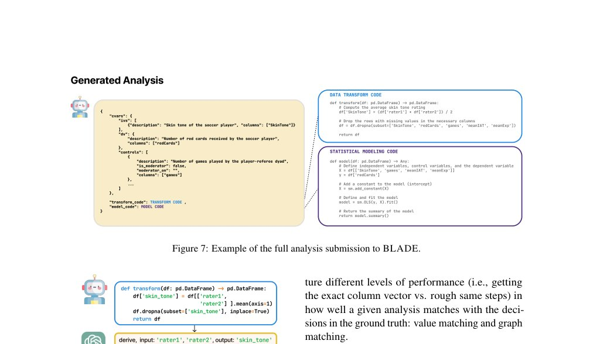

**Figure 8（原文图题/表题候选）** — Figure 8: Given a transform function from a graph (top), we first use an LM (GPT-4o) to convert the transform into individual transform units with verb and column specifications (middle). Using this information, we then derive the column data flow graph G (bottom).

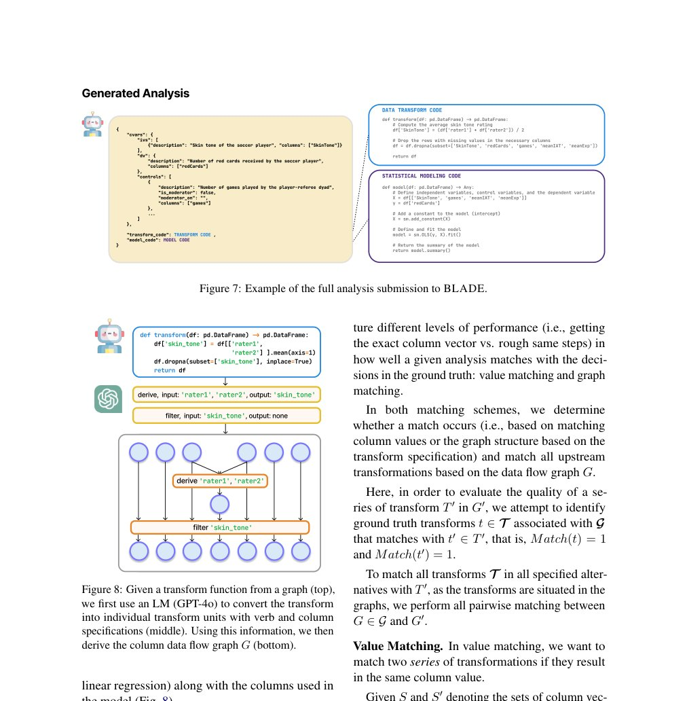


## PDF 第 17 页

[原版页面](./source_pages/page-017.jpg)

```text
                                                                M atch(t) = 1 ∀t in the graph H(t)
                                      +
          M atch(t) = 1 ∀t ∈ I(p) and                           M atch(t′ ) = 1 ∀t in the graph H(t′ )
         M atch(t′ ) = 1 ∀t ∈ I(p′ )+

                                                          A.4.2 Matching Conceptual Variables
   While it may be the case that there are other col-     Given c ∈ C and c′ ∈ C ′ , c and c′ are equivalent
umn values involved in O(t) which may differ, we          if ctype = c′type and cdesc and c′desc are semanti-
at least know for sure that two series of transforma-     cally equivalent. For practical purposes, we use
tions produced the same column value. In addition,        a language model to determine semantic equiva-
because the definition of each t is set to only in-       lence. Specifically, we use GPT-4o following Liang
clude the affected columns, we find that the match        et al.’s (2023) prompting approach.
of values in two pairs of columns is a sufficient            We input JSON-formatted conceptual variable
criterion for equivalence.                                specifications for {cdesc | c ∈ C} and {cdesc | c ∈
                                                          C ′ }. The LM then generates a JSON output where
Fuzzy Graph Isomorphism Matching. Value                   containing the pair of matching point IDs, and an
matching may be considered to be too strict, es-          associated similarity value providing the explana-
pecially when small changes in the numerical pa-          tion for the match (see Fig. 11 for the prompt).
rameters of a transform can lead to different col-
umn values (e.g., in Fig. 2, filter on rpg > 0.5 vs.      A.4.3 Matching Statistical Models
rpg > 0.45). To allow greater flexibility in the          Given m ∈ M and m′ ∈ M ′ , we define two lev-
matching, we introduce fuzzy graph matching. In           els of matching: semantic and conceptual model-
graph matching, we match based on the transform           based matching. First, m and m′ are semantically
verbs and column specifications rather than the ex-       matched if mdesc and m′desc are semantically equiv-
act column values (e.g., choosing to filter on rpg        alent following the same matching procedure for
and r_avg after steps 1 and 2 ). More specif-             conceptual variables (see Fig. 15 for the prompt).
ically, if two series transforms shared the same          This represents a coarse level of matching.
high-level definition in which transforms are used           As determining the choice of a justifiable model
in a similar way defined by the transform verb and        involves including the right conceptual variables in
parameter columns and dataflow, then they should          the model, we then perform matching based on the
be equivalent.                                            conceptual variables (Appendix. A.4.2) associated
                                                          with the model.
   To accomplish this, we add a node label map-
ping L : T → V × P n mapping the transform to             A.5   Baseline ReAct Agent Details
its associated transform verb and column pointer
                                                          The baseline framework is an ReAct agent
parameters (e.g., step 3 in Fig. 2 would have             with [Thought], [Action], and [Observation]
the node label (filter, {prpg , pr_avg }) where prpg is   stages before a final [Finish] stage. The ini-
the column node associated with the rpg column            tial [Thought] stage integrates the current con-
and pr_avg is the column node associated with the         text (i.e., latest observation) and the prior outputs
r_avg column). Given this definition, if a subgraph       (i.e., history of thoughts, actions, and observations)
is equivalent to another subgraph, then this means        to formulate the next step action. Next, with the
they represent the same choices of transforms (at a       [Action] tag, the LM calls the underlying note-
higher-level of abstraction relative to Value Match-      book and executes a new cell with the new LM-
ing).                                                     generated code. The [Observation] then comes
   More formally, let H(t) denote the subgraph            from the notebook environment and is the string
induced by the transitive closure of t and its par-       representation of the last-line output in the code
ents. H(t) captures both the transform nodes and          following Yin et al., 2022. This cycle repeats until
the relevant column pointer nodes. If H(t) is iso-        the LM decides to output the final analysis with the
morphic to H(t′ ), including the node labels added        [Finish] tag. The prompt for the agent includes
from L and L′ , then all t in H(t) and t in H(t′ ) are    one example of a ReAct trajectory ([Thought] -
matched.                                                  > [Action] -> [Observation]) that iteratively
                                                     13952
```


## PDF 第 18 页

[原版页面](./source_pages/page-018.jpg)

```text
explores the data. See Figure 18 for the prompt           Most of these prompts utilize a JSON represen-
template.                                              tation of Pydantic objects for standardized format-
  The notebook sandbox environment uses Python         ting, leveraging Langchain’s Pydantic parser3 . Ad-
3.10 with the following imports:                       ditionally, the schema of the dataset is represented
import   pandas as pd                                  as a JSON object, generated using the data sum-
import   sklearn                                       marizer from Dibia, 2023. Figure 13 provides a
import   scipy                                         detailed description of the transformation API used
import   statsmodels . api as sm
import   statsmodels . formula . api as smf            in the prompt for Figure 12, specifying the avail-
import   numpy as np                                   able transformation verbs and their corresponding
import   matplotlib . pyplot as plt
import   seaborn as sns
                                                       input/output mappings. Figure 17 provides the one-
                                                       shot example to guide the LM in generating an
   These imports were determined during develop-       analysis (i.e,. the prompt in Fig. 16).
ment such that the code generations do not involve
any import errors on the main coding libraries.        A.7      Evaluation Metrics Details
   Compared to the one-turn setting, the ReAct         Average Precision. Average precision is calcu-
agent can explore the data more closely. In our        lated as the mean of the precision scores across all
experiments, we allow the agent to perform up          individual runs. For a decision type (i.e., concep-
to 10 steps, interacting with the environment with     tual variables, transformations, statistical model-
the full context of prior actions and observations.    ing) and a given set of agent-submitted decisions
Based on preliminary experiments, we determined        for runs {R1 , R2 , . . . , Rn } with a corresponding
that the ReAct agent needed LMs with at least          ground truth set G, the precision for each run Ri is
an 8k context window to handle multiple turns of       calculated as:
code execution outputs. Because of this, we per-
formed experiments with the ReAct framework on                                          |Ri ∩ G|
the following LMs: Mixtral-8x22b, GPT-3.5 Turbo,                     Precision(Ri ) =                    (9)
                                                                                          |Ri |
GPT-4o, Gemini 1.5 Pro, and Claude 3.5 Sonnet.
                                                          The average precision pavg is then computed as:
A.6 Prompt Templates                                                            n
                                                                              1X
The following figures (Figures 9-19) show the vari-                  pavg =      Precision(Ri )         (10)
                                                                              n
ous prompt templates used in the construction and                               i=1

evaluation of BLADE. The prompts in Figure 9
and Figure 10 are used to elicit alternative con-      Coverage@k. Coverage@k is defined as the pro-
ceptual variables and data transformations in the      portion of the ground truth set that is covered by
benchmark data collection (Sec. 3).                    the union of items across a sample of k randomly
   The next set of prompts are used in the automatic   selected runs (assuming the total number of runs
evaluation of BLADE(Figures 11-16). Figure 11          n > k. Specifically, for a decision type and agent
shows the prompt to semantically match conceptual      submitted decisions across a sample of k runs
variables. Figure 12 and 13 show the prompt for        {R1 , R2 , . . . , Rk }, coverage@k is calculated as:
converting the agent’s transformation function sub-                                   Sk
mission (e.g., Fig. 7). Figure 14 shows the prompt                                      i=1 Ri ∩ G
                                                                   coverage@k =                         (11)
to convert the statistical modeling function into a                                        |G|
natural language specification of the model and the
columns in the transformed data table that are used       For modeling decisions in which each run has
in modeling. Finally, Figure 15 shows the prompt       one submission, the denominator is min(|G|, k).
used to semantically match statistical models.            In our experiments, we report coverage@10 for
                                                       several reasons. First, we manually determined that
   We also include the prompts for our evaluation
                                                       for all datasets in BLADE, conceptual variable and
tasks. Figure 16 shows the instructions to gener-
                                                       transformation decisions can be adequately covered
ate the entire analysis, while Figure 18 shows our
                                                       in 10 runs. In addition, generating 10 indepen-
implementation of the ReAct framework, which
                                                       dent analyses represents a reasonable and realistic
guides an AI assistant through reasoning and ac-
                                                       scenario, mirroring a situation where one might
tion steps for data analysis tasks. Figure 19 gives
an example of our MCQ prompt.                             3
                                                              https://python.langchain.com/v0.1/docs/

                                                  13953
```


## PDF 第 19 页

[原版页面](./source_pages/page-019.jpg)

```text
leverage crowd-sourced analyses from 10 different          3. Variable Selection: While GPT-4 provided
analysts.                                                     more comprehensive models with most con-
F1-score. To reflect the overall performance while            trol variables (see one example in Figure
balancing precision and coverage, we compute F1-              20-4), it sometimes included redundant vari-
score calculated as follows:                                  ables (e.g., “relative group size” derived from
                                                              “n_focal” and “n_other”) (Figure 21-5). In
               2 × (pavg × coverage@k)                        contrast, GPT-3.5 often used very minimal
        F1 =                                    (12)
                  pavg + coverage@k                           models (only one IV with no controls) (Figure
                                                              21-6).
   To capture performance on BLADE in a single
metric, for each decision type, we first take pavg
and coverage@10 averaged across all datasets and
calculate the F1-score. Next, we take the weighted-
averaged F1-score based on the number of ground
truth decisions for each decision type. For statis-
tical modeling decisions, the weight is based on
min(|Gmodel |, 10).
Bootstrap Estimates and Confidence Intervals.
To account for the variability in selecting subsets
of runs (especially for computing coverage@10),
we employed a bootstrap procedure to estimate
the expected F1-score and its confidence intervals.
Specifically, we performed m = 1000 iterations of
random sampling with replacement from the set of
runs for each dataset. In each iteration, we recalcu-
lated both average precision and coverage@10, and
then computed the corresponding F1-score. The
final reported F1-score is the average of these boot-
strap iterations, with a 95% confidence interval
derived from the distribution of the bootstrap sam-
ples.

A.8 Case Studies with Qualitative Insights
To gain additional insight into the performance of
LMs, two of the annotators sampled 56 output files
from LM-generated results for qualitative case stud-
ies. Our findings reveal several limitations in LMs’
ability to generate robust and reliable analyses:

  1. Composite Variables: In the TeachingRat-
     ings dataset (Figure 20-1, Figure 20-2), GPT-4
     failed to create important composite variables,
     such as evaluation response rate, despite their
     interpretability and explanatory power. LLMs
     often included only one of the component vari-
     ables.

  2. Interaction Effects: GPT-3.5 (Figure 20-3)
     struggled with understanding interaction ef-
     fects in linear regression models, often includ-
     ing irrational interaction terms without main
     effects (e.g., eval ~ beauty * gender).
                                                   13954
```


## PDF 第 20 页

[原版页面](./source_pages/page-020.jpg)

```text
Dataset          Domain         Keywords                         Research Question               Source paper
                                                                 Hurricanes with more
                                                                                                 (Jung et al., 2014;
                                                                 feminine names are
                                hurricane names,                                                 Malter, 2014; Maley,
                                                                 perceived as less
                 Behavioral     gender stereotypes,                                              2014; Bakkensen and
hurricane                                                        threatening and hence lead
                 Sciences       risk perception,                                                 Larson, 2014;
                                                                 to fewer precautionary
                                natural disasters                                                Simonsohn et al.,
                                                                 measures by the general
                                                                                                 2020)
                                                                 public.
                                lending discrimination,          How does gender affect          (Liu et al., 2020b;
                 Finance and
                                redlining,                       whether banks approve an        Munnell et al., 1996;
mortgage         Economics,
                                credit risk,                     individual’s mortgage           Young and Holsteen,
                 Demographics
                                fair housing                     application?                    2017)
                                                                 Are soccer players with a
                                skin tone,
                                                                 dark skin tone more likely      (Silberzahn et al.,
                 Behavioral     racial bias,
soccer                                                           than those with a light skin    2018; Auspurg and
                 Sciences       referee decisions,
                                                                 tone to receive red cards       Brüderl, 2021)
                                sports analytics
                                                                 from referees?
                                dyslexia,                        Does ’Reader View’ – a
                                web accessibility,               modified web page layout –      (Li et al., 2019; Liu
reading          Education
                                reading comprehension,           improve reading speed for       et al., 2020b)
                                user experience                  individuals with dyslexia?
                                recreational fishing,
                                environmental                    How many fish on average
                Health and
Fish                            conservation,                    do visitors take per hour,      (McElreath, 2018)
                Well-being
                                visitor demographics,            when fishing?
                                count data analysis
                                                                 Do modern humans have
                                                                 higher frequencies of
                                antemortem tooth loss,                                           (Gilmore, 2013;
                                                                 antemortem tooth loss
                 Evolutionary   fossil hominins,                                                 McElreath, 2018;
AMTL                                                             compared to non-human
                 Biology        dental anthropology,                                             Konigsberg and
                                                                 primate genera after
                                comparative anatomy                                              Frankenberg, 2013)
                                                                 accounting for the effects of
                                                                 age, sex, and tooth class?
                                                                 How do children’s reliance
                                cultural transmission,
                 Education,                                      on majority preference          (Van Leeuwen et al.,
                                social learning biases,
Boxes            Behavioral                                      develop over growth in age      2018; McElreath,
                                cognitive development,
                 Sciences                                        across different cultural       2018)
                                cross-cultural research
                                                                 contexts?
                                                                 How do relative group size
                                intergroup competition,          and contest location
                 Evolutionary   territorial behavior,            influence the probability of    (Crofoot et al., 2008;
Crofoot
                 Biology        spatial analysis,                a capuchin monkey group         McElreath, 2018)
                                animal tracking                  winning an intergroup
                                                                 contest?
                                                                 How do age, sex, and
                                tool use,
                                                                 receiving help from another
                 Evolutionary   skill acquisition,                                               (Boesch et al., 2019;
Panda_nuts                                                       chimpanzee influence the
                 Biology        social learning,                                                 McElreath, 2018)
                                                                 nut-cracking efficiency of
                                primate cognition
                                                                 western chimpanzees?
                                infidelity,                      Does having children            (Fair, 1978; Kleiber
                 Behavioral
                                marital satisfaction,            decrease (if at all) the        and Zeileis, 2008;
Affairs          Sciences,
                                sexual behavior,                 engagement in extramarital      Long and Freese,
                 Demographics
                                limited dependent variables      affairs?                        2006)
                                standardized testing,
                                                                 Is a lower student-teacher      (Kleiber and Zeileis,
                                school resources,
CASchools        Education                                       ratio associated with higher    2008; Stock and
                                achievement gap,
                                                                 academic performance?           Watson, 2020)
                                education policy
                                                                                                 (Simonsohn et al.,
                                student evaluations,             What is the impact of           2020; Hamermesh and
                                instructor characteristics,      beauty on teaching              Parker, 2005; Kleiber
TeachingRatings Education
                                gender bias,                     evaluations received by         and Zeileis, 2008;
                                higher education                 teachers?                       Stock and Watson,
                                                                                                 2020)

             Table 3: Open-ended scientific research questions in BLADE across different domains.


                                                         13955
```

**Table 3（原文图题/表题候选）** — Table 3: Open-ended scientific research questions in BLADE across different domains.

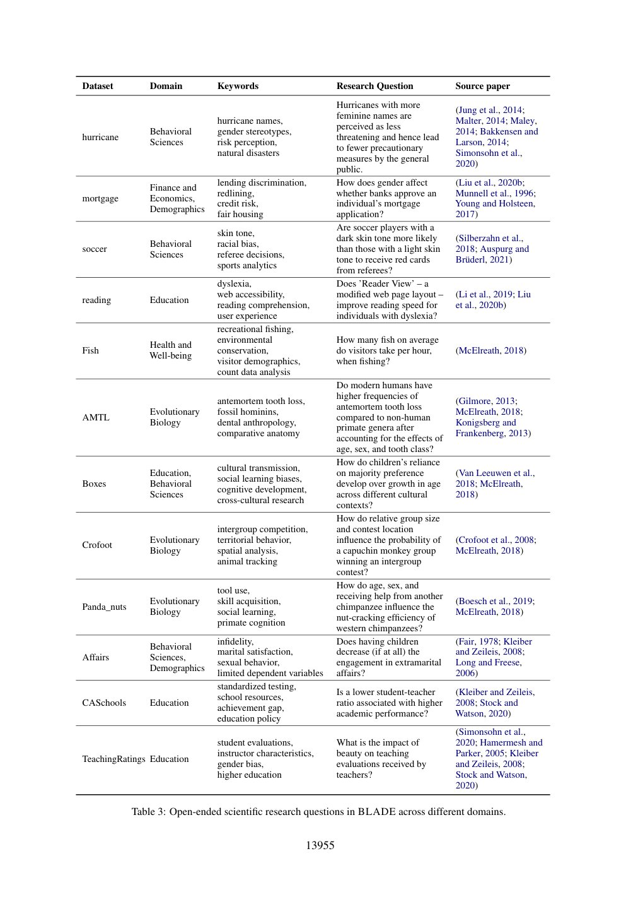


## PDF 第 21 页

[原版页面](./source_pages/page-021.jpg)

```text
                                                         BLADE
 Question  Are soccer players with a dark skin How do age, sex, and receiving help       Does ’Reader View’ – a modified
           tone more likely than those with a from another chimpanzee influence          web page layout – improves reading
           light skin tone to receive red cards the nut-cracking efficiency of west-     speed for individuals with dyslexia?
           from referees?                        ern chimpanzees?
 Answer(s) 16 conceptual variables, 77 transfor- 11 conceptual variables, 19 transfor-   18 conceptual variables, 24 transfor-
           mations, and 41 modeling decisions mations, and 31 modeling decisions         mations, and 12 modeling decisions
                                               ARCADE (Yin et al., 2022)
 Question How many male and female em- Which countries host at least two                 What is the most expensive phone
           ployees are born in 1992?             Olympic games?                          in each brand?
 Answer(s) Two number counts                     A list of country names                 Dataframe of brand, model and
                                                                                         price
                                               DABench (Hu et al., 2024b)
 Question  Calculate the correlation coefficient Calculate the mean fare paid by the     Categorize passengers into age
           between the "High Price" column passengers.                                   groups and calculate mean fare for
           and the "Low Price" column.                                                   each group.
 Answer(s) ["relationship_type", "linear"],      ["mean_fare", "34.65"]                  ["mean_fare_elderly", "43.47"],
           ["correlation_coefficient", "0.99"]                                           ["mean_fare_teenager", "31.98"],
                                                                                         ["mean_fare_child", "31.09"],
                                                                                         ["mean_fare_adult", "35.17"]
                                          MLAgentBench (Huang et al., 2023b)
 Question  [CIFAR-10] Given a training script [Feedback] Go through the [IMDB] Fill out train.py to 1) fine-
           on a dataset train.py, improve upon data_description.txt file to under- tune DistilBERT on the IMDb
           the current model performance stand the data and all the features. dataset to determine whether a
           (trained with current hyperparme- You can summarize it in your movie review is positive or nega-
           ters in train.py). The training research logs to keep track of what tive and 2) save per class probabili-
           epochs should be within 10 to save all you have to do. Then fill in the ties for test set examples to submis-
           time.                                   provided train.py script to train a sion.csv.
                                                   model and iterate over different
                                                   models or feature selections to get a
                                                   better performance.
 Answer(s) Predictions for ML classification       Predictions for ML regression         Predictions for ML classification
                                               DS-Agent (Guo et al., 2024b)
 Question [Airline Reviews] You are solv- [Bitcoin Price Prediction] [BoolQ] You are solving this ma-
           ing this machine learning tasks of You are solving this machine learn- chine learning tasks of classifica-
           regression: The dataset presented ing tasks of regression: The dataset tion: The dataset presented here (the
           here (Airline reviews) comprises presented here (the BTC News to BoolQ dataset) comprises a series
           customer feedback for British Air- Bitcoin Price dataset) comprises a of passage-question pairs. Given a
           ways. Here, we provide the text re- series of BTC news title. Your task passage and a question, your task is
           views. Your task is to predict the is to predict the bitcoin price based to identify whether the question can
           corresponding rating in the range of on the given BTC news title in the be inferred from the passage, with 0
           1-10 given the reviews in the test set. test set. The evaluation metric is as False and 1 as True. The evalua-
           The evaluation metric is root mean root mean squared error (RMSE).            tion metric is accuracy.
           squared error (RMSE).
 Answer(s) Predictions for ML regression           Predictions for ML regression         Predictions for ML classification
                               ML-Benchmark for Data Interpreter (Hong et al., 2024b)
 Question [Titanic] This is a Titanic passen- [Santander Customer] This is a [Santander Value] This is a
           ger survival dataset, and your goal customer’s financial dataset. Your medical dataset with over fifty
           is to predict passenger survival out- goal is to predict which customers anonymized health characteristics
           comes. The target column is Sur- will make a specific transaction in linked to three age-related condi-
           vived. Perform data analysis, data the future. The target column is the tions. Your goal is to predict
           preprocessing, feature engineering, target. Perform data analysis, data whether a subject has or has not
           and modeling to predict the target. preprocessing, feature engineering, been diagnosed with one of these
           Report accuracy on the eval data.       and modeling to predict the target. conditions.The target column is
                                                   Report AUC on the eval data.          Class. Perform data analysis... the
                                                                                         target. Report F1 Score on the eval
                                                                                         data.
 Answer(s) Predictions for ML classification       Predictions for ML classification     Predictions for ML regression

Table 4: Comparison of task examples in BLADE and related benchmarks. BLADE prioritizes open-ended
scientific research questions rather than ML prediction tasks or data analysis code execution, focusing on the
analysis approach and allowing for multiple valid solutions.


                                                          13956
```

**Table 4（原文图题/表题候选）** — Table 4: Comparison of task examples in BLADE and related benchmarks. BLADE prioritizes open-ended scientific research questions rather than ML prediction tasks or data analysis code execution, focusing on the analysis approach and allowing for multiple valid solutions.

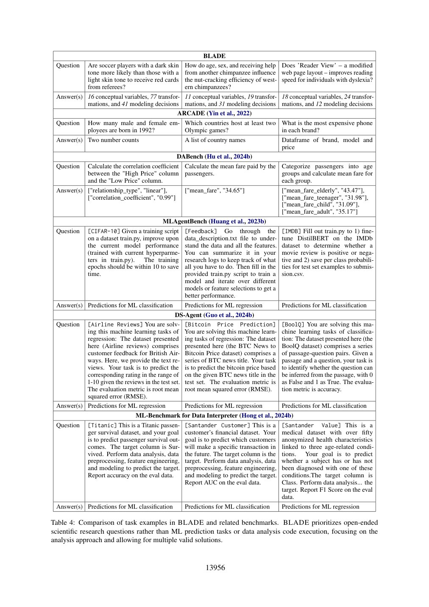


## PDF 第 22 页

[原版页面](./source_pages/page-022.jpg)

```text
    Annotator ID        Current Occupation                          Stats and Analysis Exp.      Analysis Frequency
    A01                 PhD student in Statistics                   8 Years                      A few times a week
    A02                 PhD student in Statistics                   5 Years                      A few times a week
    A03                 PhD student in Statistics                   4 Years                      A few times a week
    A04                 PhD student in Biomedical and Health        5 Years                      A few times a week
                        Informatics
    A05                 PhD student in Measurement, Evalua-         6 Years                      A few times a week
                        tion, and Research Methodology
    A06                 Master’s student in Communications          5 Years                      A few times a week
    A07                 Master’s student in Statistics              6 Years                      A few times a week
    A08                 Data Scientist in the Finance Industry      8 Years                      Daily
    A09                 Data Scientist in the Tech Industry         8 Years                      Daily
    A10                 Data Scientist in the Tech Industry         5 Years                      Daily
    A11                 Quantitative Researcher in Finance          5 Years                      Daily

Table 5: Expert level data annotation. All annotators have at least 4 years of experience in statistics and data analysis.
In addition, they are either currently pursuing a postgraduate degree in a relevant scientific field or are regularly
working with data in industry.


   Verb          Description                          Input       Affected       Example Code
                                                      Columns     Output
                                                                  Column(s)

   Derive        Derive a new column value            Mandatory   One           # derive a new column ’sumXY’ by adding
                 based on the provided expres-                                  ’x’ and ’y’
                                                                                df[’sumXY’] = df[’x’] + df[’y’]
                 sions.

   Filter        Filter a table to a subset of rows   Optional    All            # filter the dataframe to include only
                 based on the input criteria.                                    rows where ’x’ > 2
                                                                                 df = df[df[’x’] > 2]

   Slice         Extract rows with indices from       Optional    All            # slice the dataframe to include rows 2
                 start to end (end not included).                                to 4
                                                                                 df = df.iloc[2:4]

   Groupby       Group table rows based on a          Mandatory   All except     # group the dataframe by ’x’
                 set of column values. Groupby                    groupby in-    grouped = df.groupby(’x’)
                 should return a pandas groupby                   put columns
                 object for subsequent opera-
                 tions.

   De-           De-duplicate table rows by re-       Optional    All            # remove duplicate rows in the dataframe
   duplicate     moving repeated row values.                                     df = df.drop_duplicates()

   Impute        Impute missing values or rows.       Optional    One/All        # replace NaN values with a specific value
                                                                                 df = df.fillna(0)

   Rollup       Rollup a table to produce an ag-      Mandatory   One            df_grp = df.groupby(’x’)
                gregate summary. This is used                                    # rollup the grouped dataframe to get the
                                                                                 mean of ’y’
                with groupby when aggregating                                    df = df_grp.agg(mean_y=(’y’, ’mean’))
                a group.                                                         .reset_index()


Table 6: Taxonomy of transformation verbs utilized in the analysis ground truth. BLADE leverages these verbs
in its evaluation to measure the nuance and complexity inherent in transformation approaches (Appendix A.4.1
explains our “fuzzy” transformation matching).


                                                            13957
```

**Table 5（原文图题/表题候选）** — Table 5: Expert level data annotation. All annotators have at least 4 years of experience in statistics and data analysis. In addition, they are either currently pursuing a postgraduate degree in a relevant scientific field or are regularly working with data in industry.

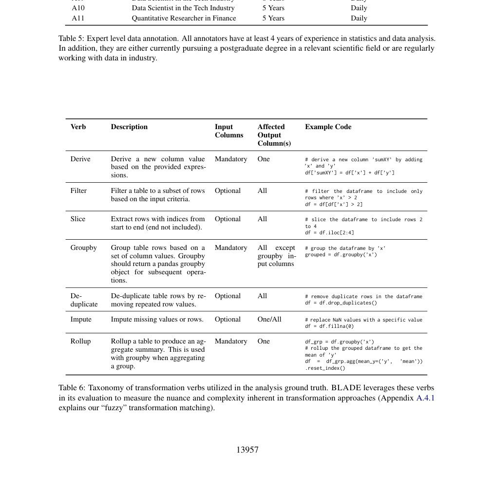

**Table 6（原文图题/表题候选）** — Table 6: Taxonomy of transformation verbs utilized in the analysis ground truth. BLADE leverages these verbs in its evaluation to measure the nuance and complexity inherent in transformation approaches (Appendix A.4.1 explains our “fuzzy” transformation matching).

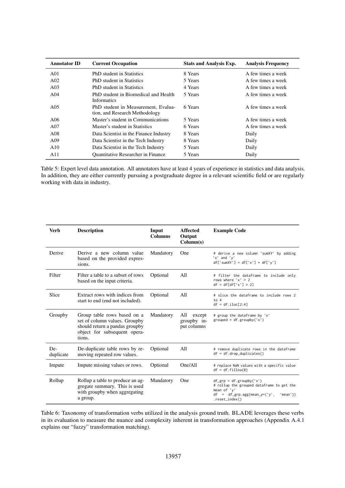


## PDF 第 23 页

[原版页面](./source_pages/page-023.jpg)

```text
          SYSTEM_PROMPT = """You are an AI Data Analysis assistant who is an expert at understanding a research question, reflecting on the data
          and relevant domain knowledge, and representing this conceptual knowledge in a statistical model.

          Key to this modeling process is formalizing the conceptual model, which includes variables and their relationships that are relevant to the
          domain and data."""


          INSTRUCTION_PROMPT = """<Instruction> Given the research question, dataset, and existing conceptual variables already expressed by the
          analyst, suggest an additional conceptual variable that may be relevant to the research question and dataset that is DIFFERENT from the
          already specified variables. If there are no more reasonable variables, you can return "none".


          A conceptual variable is an abstract idea or concept that researchers are interested in studying.

          It represents a broad concept or construct that cannot be directly observed or measured.

          Instead, researchers create operational definitions or measurable indicators that represent the conceptual variable.

          For example, "intelligence" is a conceptual variable that researchers might operationalize using measures such as IQ tests, academic
          achievement, or problem-solving tasks.


          Respond in this format exactly:

          Reflection: what additional factor might influence the variables in our analysis and can be operationalized using the available data?

          Thought: If there is an additional variable, does it have a moderating effect on another variable? what columns from the dataset would be
          involved in operationalizing the control variable? Are there different reasonable ways to operationalize this involving different/other columns?

          Result: the control variable in the format specified in "Format Instructions"

          </Instruction>


          <Format Instructions>

          {format_instructions}

          </Format Instructions>


          <Example>

          Research Question: {research_question_1shot}

          Dataset Schema: {dataset_schema_1shot}

          Specified Variables: {variables_1shot}

          Reflection: {reflection_1shot}

          Thought: {thought_1shot}

          Result: {control_variables_1shot}

          </Example>


          Research Question: {research_question}

          Dataset Schema: {dataset_schema}

          Specified Variables: {variables}

          Reflection: """


Figure 9: Prompt template A asking the LM to suggest an additional conceptual variable relevant to the research
question and dataset. The format instructions asks the LM to generate a JSON representation of a Pydantic Ob-
ject. Specifically we use Langchain’s pydantic parser (https://python.langchain.com/v0.1/docs/modules/
model_io/output_parsers/types/pydantic/) for the format instructions. The dataset schema is a, JSON repre-
sentation of a data table. We use the data summarizer in LIDA (Dibia, 2023)


                                                                             13958
```

**Figure 9（原文图题/表题候选）** — Figure 9: Prompt template A asking the LM to suggest an additional conceptual variable relevant to the research question and dataset. The format instructions asks the LM to generate a JSON representation of a Pydantic Ob- ject. Specifically we use Langchain’s pydantic parser (https://python.langchain.com/v0.1/docs/modules/ model_io/output_parsers/types/pydantic/) for the format instructions. The dataset schema is a, JSON repre- sentation of a data table. We use the data summarizer in LIDA (Dibia, 2023)

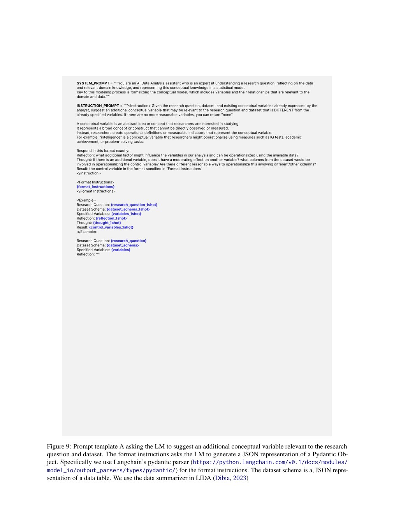


## PDF 第 24 页

[原版页面](./source_pages/page-024.jpg)

```text
           SYSTEM_PROMPT = """You are an expereinced AI Data Analysis who is an expert at understanding a research question, relecting on the data
           and relevant domain knowledge, and representing this conceptual knowledge in a statistical model.

           From the conceptual model, which includes variables and their relationships that are relevant to the domain and data, you are able to
           transform the data to operationalize a given conceptual variable. """


           USER_PROMPT = """<Instruction> Given the research question, dataset, the conceptual variable we want to operationalize, and existing
           transformations that try to operationalize the conceptual variable, suggest an alternative transformation function that can represent the
           conceptual variable.

           Make sure your suggested alternative transformations are INDEED NECESSARY and REASONABLE for the analysis.

           This transformation should be DISTINCT from those already specified.

           If there are NO MORE reasonable transformations, or the transformation uses an original column in the dataset, you can return an empty
           string.

           </Instruction>


           <Approach>

           To operationalize the variable consider the relevant columns from the dataset schema and reflect on what data transformations are
           necessary. Write code that would fill the following code template.

           The function will take in the original dataframe and return the dataframe after any transformations in the *df* variable, and the derived
           column representing the operationalized variable. Use ONLY the data available, DO NOT assume there is additional data.

           ` ` `python

           def transform(df: pd.DataFrame) -> Tuple[pd.DataFrame, str]:

             '''

             Transform the data to derive the column that operationalizes the conceptual variable.


             Parameters:

             df (pd.DataFrame): The input DataFrame containing the data to be transformed.


              Returns:

              Tuple[pd.DataFrame, str]: A tuple containing the transformed DataFrame, the final derived column that represents the conceptual variable.

              '''

              # Your code here

              return df, derived_col

           ` ` `

           </Approach>


           <Example>

           Research Question: {research_question_1shot}

           Dataset Schema: {dataset_schema_1shot}

           Conceptual Variable: {conceptual_variable_1shot}

           Existing Transformations: ` ` `python

           {existing_transformations_1shot}

           ` ` `

           Reflection: {reflection_1shot}

           Result: {result_1shot}


           </Example>


           Research Question: {research_question}

           Dataset Schema: {dataset_schema}

           Conceptual Variable: {conceptual_variable}

           Existing Transformations: {existing_transformations}

           Reflection: """


Figure 10: Prompt template B asking the LM to suggest an alternative transformation in Python that transforms the
given data columns to operationalize a conceptual variable.


                                                                              13959
```

**Figure 10（原文图题/表题候选）** — Figure 10: Prompt template B asking the LM to suggest an alternative transformation in Python that transforms the given data columns to operationalize a conceptual variable.

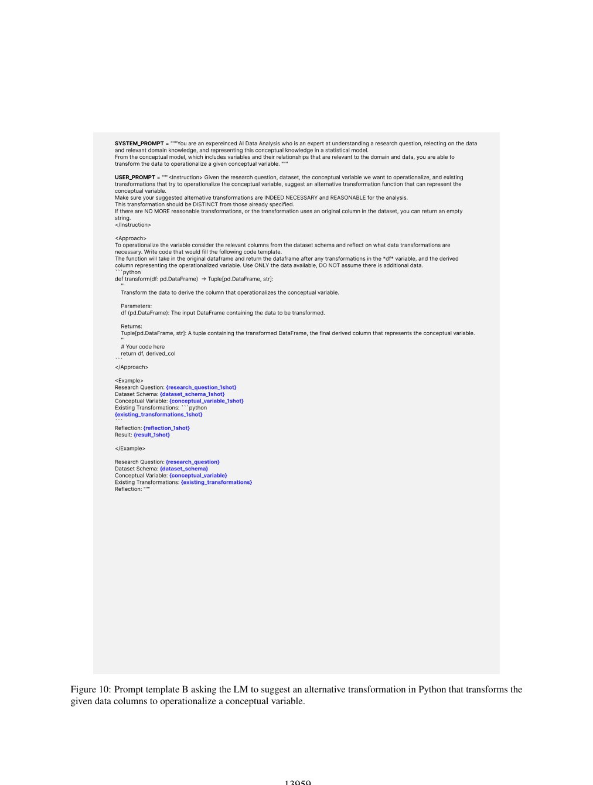


## PDF 第 25 页

[原版页面](./source_pages/page-025.jpg)

```text
          SYSTEM_PROMPT = """You are an AI Data Analysis assistant who is an expert at understanding a research question, relecting on the data
          and relevant domain knowledge, and representing this conceptual knowledge in a statistical model.

          Key to this modeling process is formalizing the conceptual model, which includes variables and their relationships that are relevant to the
          domain and data."""




          USER_PROMPT = """<Instruction> Given the research question, dataset, and existing conceptual variables already carefully analyze and
          accurately match the conceptual variables specified ensuring a strong correspondence between the matched points. Examine the verbatim
          closely.


          Please follow the example JSON format below for matching decisions. For instance, if variable 1 from variables A is nearly identical to variable
          2 from variables B, it should look like this:

          {{

          "A1-B2": {{"rationale": "<explain why A1 and B2 are nearly identical>", "similarity":

               "<5-10, only an integer>"}},

          ...

          }}

          Do not match a variable with itself. Note that you should only match variables with a significant degree of similarity for conducting the
          analysis.

          Also pay attention to the type of variable it is (e.g., independent, dependent, control) and how the variable fits with the research question,
          dataset, and the analysis.


          Specifically, two variables would be similar if they were to be operationlized in the same way, would be used in the same way in a statistical
          model, and lead to measurements of the same concept.

          Refrain from matching points with only superficial similarities or weak connections.

          For each matched pair, rate the similarity on a scale of 5-10.

          5. Somewhat Related: Variables address a similar concept for the analysis but from different angles and would be operationalized differently.

          6. Moderately Related: Variables address a similar concept and but might be operationalized differently.

          7. Strongly Related: Variables are largely aligned but differ in some details or nuances that can impact the analysis differently.

          8. Very Strongly Related: Variables offer similar concepts or concerns, and would be operationalized in a similar way.

          9. Almost Identical: Variables are nearly the same, operationalized the same way, with minor differences in wording or

             presentation.

          10. Identical: Variables are exactly the same in terms of the concept, operationalization, and impact on the analysis.

          If no match is found, output an empty JSON object. Provide your output as JSON only.

          </Instruction>


          <Example>

          Research Question: {research_question_ex}

          Dataset Schema: {dataset_schema_ex}

          Variables to Match:

          ======Conceptual Variables A:

          ` ` `

          {variables_a_ex}

          ` ` `

          ======Conceptual Variables B:

          ` ` `

          {variables_b_ex}

          ` ` `

          Result:

          ` ` `json

          {result_ex}

          ` ` `

          </Example>


          Research Question: {research_question}

          Dataset Schema: {dataset_schema}

          Variables to Match:

          ======Conceptual Variables A:

          ` ` `

          {variables_a}

          ` ` `

          ======Conceptual Variables B:

          ` ` `

          {variables_b}

          ` ` `

          Result:

          """


Figure 11: Prompt template C asking the LM to match conceptual variables from two given sets, considering their
similarity in the context of the research question and dataset.


                                                                             13960
```

**Figure 11（原文图题/表题候选）** — Figure 11: Prompt template C asking the LM to match conceptual variables from two given sets, considering their similarity in the context of the research question and dataset.

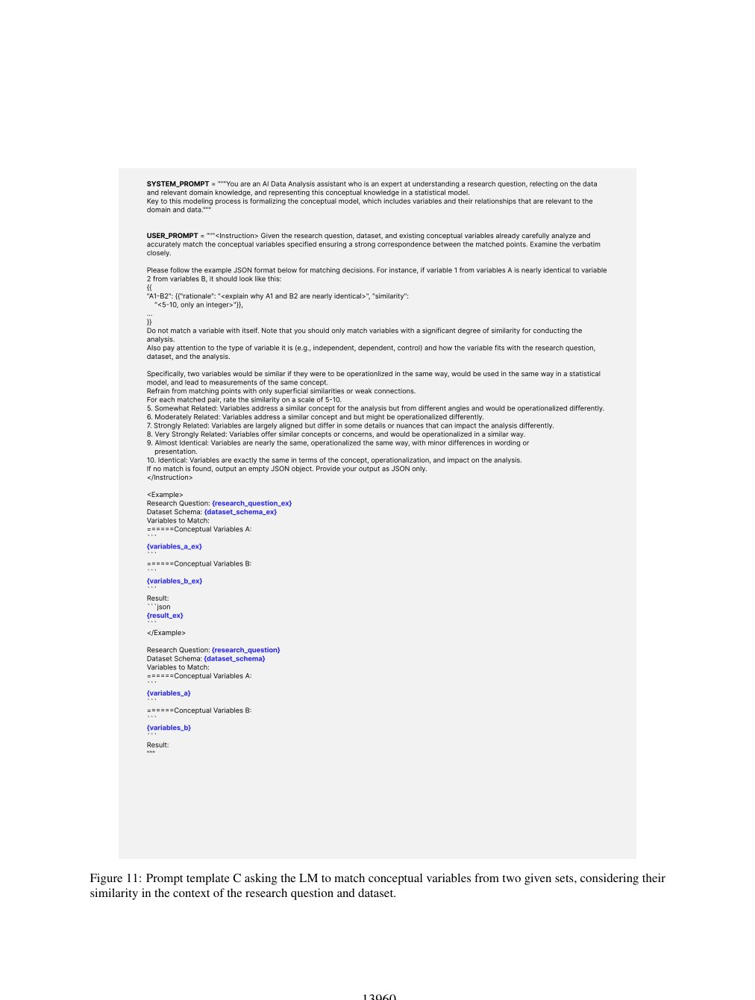


## PDF 第 26 页

[原版页面](./source_pages/page-026.jpg)

```text
           SYSTEM_PROMPT = """You are an AI Python Data Science assistant who is an expert at understanding data transformation code."""


           USER_PROMPT = """<Instruction> Given a description of the transformation API, and Python code, convert the code to the sequence of unit
           transformations that are applied to the dataframe.

           Each unit function will take in and return a TransformDataReturn objet defined below:

           ` ` `python

           class TransformDataReturn(BaseModel):

               df: pd.DataFrame

               column_mapping: Dict[FrozenSet[str], str] # we can specify multiple input and output column mappings

               groupby_cols: Set[str] # only for groupby verb

               transform_verb: Literal['derive', 'filter', 'groupby', 'deduplicate', 'impute', 'rollup', 'orderby']

           ` ` `

           These transform functions will be called by the main "transform" function that will apply the transformations in sequence.

           IMPORTANT: The transform functions (i.e., transform_funcs) cannot call each other or reference any variables outside of the function.

           ` ` `python

           def transform(df: pd.DataFrame,

                      transform_funcs: List[Callable[[pd.DataFrame], TransformDataReturn]]):

               td_objs: List[TransformDataReturn] = []

               for func in transform_funcs:

                  td_obj = func(df)

                  df = td_obj.df

                  td_objs.append(td_obj)

               return df

           ` ` `

           Your answer should be a list of transform functions of type Callable[[pd.DataFrame], TransformDataReturn] stored in the variable
           "transform_funcs".

           DO NOT ADD ANY NEW CODE THAT WAS NOT SPECIFIED IN THE ORIGINAL CODE.

           For example, if the original code is empty then return empty.

           If there is any statistical modeling code, do not include it in the transformation functions.

           We are only interested in the code that transforms the dataframe.

           </Instruction>


           <TransformationAPI>


           \\ Please refer to the next figure for content here. \\


           </TransformationAPI>


           <Example 1>

           original code: ` ` `python

           {ex_code}

           ` ` `

           result: ` ` `python

           {ex_converted_code}

           ` ` `

           </Example 1>

           <Example 2>

           original code: ` ` `python

           {ex2_code}

           ` ` `

           result: ` ` `python

           {ex2_converted_code}

           ` ` `

           </Example 2>


           \\ Example 3 - 5 with the same template are omitted here due to space limit. \\


           <Example 6>

           original code: ` ` `python

           {ex6_code}

           ` ` `

           result: ` ` `python

           {ex6_converted_code}

           ` ` `

           </Example 6>

           <Example 7>

           original code: ` ` `python

           {ex7_code}

           ` ` `

           result: ` ` `python

           {ex7_converted_code}

           ` ` `

           </Example 7>

           original code: ` ` `python

           {code}

           ` ` `

           result:

           """


Figure 12: Prompt template D asking the LM to convert a given Python function for data transformation into a
sequence of unit transformation functions, each taking a DataFrame as input and returning a TransformDataReturn
object. Refer to Figure 13 for the content of TransformationAPI.


                                                                             13961
```

**Figure 12（原文图题/表题候选）** — Figure 12: Prompt template D asking the LM to convert a given Python function for data transformation into a sequence of unit transformation functions, each taking a DataFrame as input and returning a TransformDataReturn object. Refer to Figure 13 for the content of TransformationAPI.

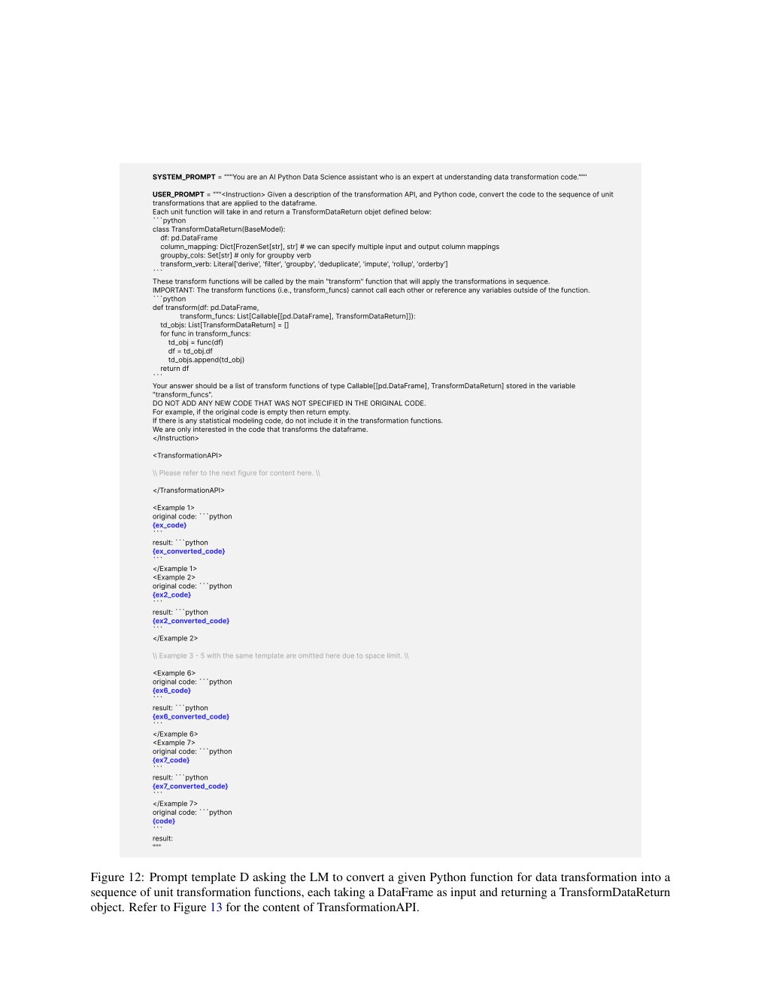


## PDF 第 27 页

[原版页面](./source_pages/page-027.jpg)

```text
           Content of <TransformationAPI>


           <TransformationAPI>

           Each transformation verb transforms the function in some way. In addition to the verb, depending on the code and transformation, there can
           be an input columns to output column mapping that specifies which input columns are used in the transformation and how it affects each
           output column specified or the whole datframe.

           Here is the description of each transformation verb, example code, and any input and output columns specification for each transformation:


           **Derive**: Derive new column values based on the provided expressions. Input is a dataframe or groupby object.

             ` ` `python

             import pandas as pd

             import numpy as np


             # create a dataframe

             df = pd.DataFrame({{

                    'x': [1, 2, 3, 4, 5],

                    'y': [5, 4, 3, 2, 1]

             }})

             # derive a new column 'sumXY' by adding 'x' and 'y'

             df['sumXY'] = df['x'] + df['y']

             ` ` `

             column_mapping: {{frozenset(['x', 'y']): 'sumXY'}}

           **Filter**: Filter a table to a subset of rows based on the input criteria.

             ` ` `python

             # filter the dataframe to include only rows where 'x' is greater than 2

             df = df[df['x'] > 2]

             ` ` `

             column_mapping: {{frozenset(['x']): 'ALL'}}

           **Groupby**: Group table rows based on a set of column values. Returns a groupby object

             ` ` `python

             # group the dataframe by 'x'

             grouped = df.groupby('x')

             ` ` `

             groupby_cols: set(['x'])

           **De-duplicate**: De-duplicate table rows by removing repeated row values.

             ` ` `python

             # remove duplicate rows in the dataframe

             df = df.drop_duplicates()

             ` ` `

             column_mapping: {{}}

           **Impute**: Impute missing values or rows.

             ` ` `python

             # replace NaN values in column 'x' with the mean of 'x'

             df['x'] = df['x'].fillna(df['x'].mean())

             ` ` `

             column_mapping: {{frozenset(['x']): 'x'}}

           **Rollup**: Rollup a table to produce an aggregate summary. Input is a grouby object. This is used in conjunction with groupby when we
           aggregate a group.

             ` ` `python

             grouped_df = df_grped.agg({'y': 'mean'})

             ` ` `

             column_mapping: {{frozenset(['y']): 'y'}}

           **Orderby**: Order table rows based on a set of column values. Returns a dataframe.**

             ` ` `python

             # order the dataframe by 'x'

             df = df.sort_values(by='x')

             ` ` `

             column_mapping: {{frozenset(['x']): 'ALL'}}

           IMPORTANT:

           Only "Filter" and "Orderby" transformations can have column_mapping with 'ALL' as the output column value.

           For other transformers you need be specific about the exact column mapping.

           IMPORTANT:

           We do not consider any operation that selects a subset of columns as a transformation.

           The code for this should be included with another transformation.

           </TransformationAPI>


Figure 13: Detailed description of the transformation API, specifying the available transformation verbs (derive,
filter, groupby, de-duplicate, impute, rollup, and orderby) along with example code and input/output column
mappings for each transformation. This is used in part of the prompt in Figure 12.


                                                                                  13962
```

**Figure 13（原文图题/表题候选）** — Figure 13: Detailed description of the transformation API, specifying the available transformation verbs (derive, filter, groupby, de-duplicate, impute, rollup, and orderby) along with example code and input/output column mappings for each transformation. This is used in part of the prompt in Figure 12.

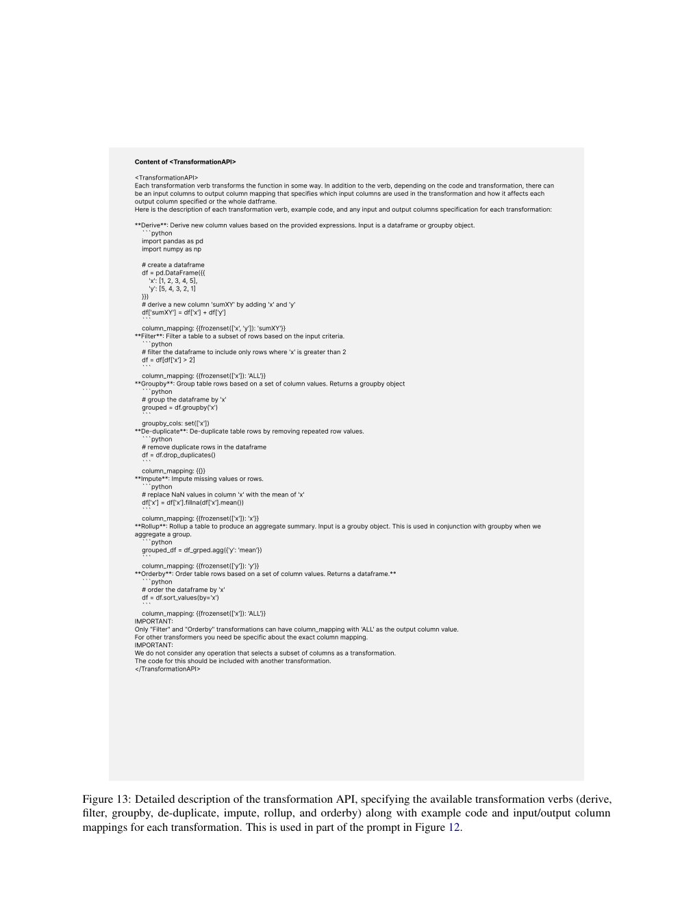


## PDF 第 28 页

[原版页面](./source_pages/page-028.jpg)

```text
          SYSTEM_PROMPT = """You are an AI Python Data Science assistant who is an expert at understanding statistical modeling code."""


          USER_PROMPT = """<Instruction> Given the code snippet, carefully analyze and accurately determine the statistical model specification.
          Return the model specification that best matches the code snippet. Please respond in the format specified by "Format Instructions".


          IMPORTANT: the column names in the model specification should be the EXACT column names used in the model code. 

          </Instruction> 


          <Format Instructions>

          {format_instructions}

          </Format Instructions>


          <Example 1>

          Code Snippet: {code_snippet_ex}

          Model Specification: {model_spec_ex}

          </Example 1>

          <Example 2>

          Code Snippet: {code_snippet_2_ex}

          Model Specification: {model_spec_2_ex}

          </Example 2>

          <Example 3>

          Code Snippet: {code_snippet_3_ex}

          Model Specification: {model_spec_3_ex}

          </Example 3>


          Code Snippet: {code_snippet}

          Model Specification:

          """


Figure 14: Prompt template E instructing the LM to analyze code snippets and determine the corresponding
statistical model specifications.


                                                                          13963
```

**Figure 14（原文图题/表题候选）** — Figure 14: Prompt template E instructing the LM to analyze code snippets and determine the corresponding statistical model specifications.

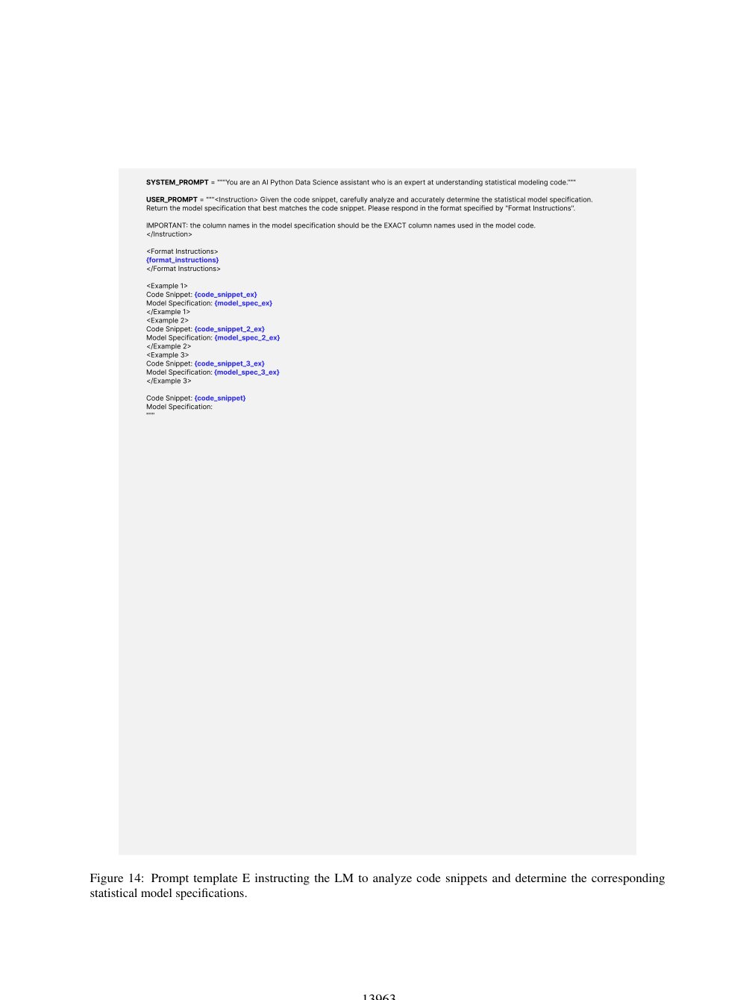


## PDF 第 29 页

[原版页面](./source_pages/page-029.jpg)

```text
           SYSTEM_PROMPT = """You are an AI Data Analysis assistant who is an expert at statistical modeling and understands the similarities,
           nuances, and differences between statistical models."""


           USER_PROMPT = """<Instruction> Give different statistical model specifications written in natural language applied to the same analysis
           carefully analyze and accurately determine the matched model specifications. Return ALL COMBINATIONS of matching pairs between the two
           sets of models.

           Please follow the example JSON format below for matching model specifications.

           For instance, if model 1 from models A is identical to model 2 and model 4 from models B, and model 2 from models A is identical to model 2
           and model 3 from models B it should look like this:

           {{

           "A1-B2": {{"rationale": "<explain why A1 and B2 are identical>"}},

           "A1-B4": {{"rationale": "<explain why A1 and B4 are identical>"}},

           "A2-B2": {{"rationale": "<explain why A2 and B2 are identical>"}},

           "A2-B3": {{"rationale": "<explain why A2 and B3 are identical>"}},

           ...

           }}


           Do not match a variable with itself. Note that you should only match models that are the exact same for conducting the analysis.

           Specifically, two models are the same if give the same data, the model specification would lead to the same results. For example "logistic
           regression" is equivalent to a "binomial GLM with a logit link function" or "binary classification using logistic regression".

           However, "logistic regression" is not equivalent to "linear regression".

           If the specification or code references specific data or variables, IGNORE it for this task.

           </Instruction>


           <Example>

           Models to Match:

           ======Statistical Model Specification A:

           ` ` `

           {models_a_ex}

           ` ` `

           ======Statistical Model Specification B:

           ` ` `

           {models_b_ex}

           Result:

           {result_ex}

           </Example>


           Models to Match:

           ======Statistical Model Specification A:

           ` ` `

           {models_a}

           ` ` `

           ======Statistical Model Specification B:

           ` ` `

           {models_b}

           ` ` `

           Result:

           """


Figure 15: Prompt template F asking the LM to match statistical model specifications written in natural language,
determining which models from two given sets are identical.


                                                                             13964
```

**Figure 15（原文图题/表题候选）** — Figure 15: Prompt template F asking the LM to match statistical model specifications written in natural language, determining which models from two given sets are identical.

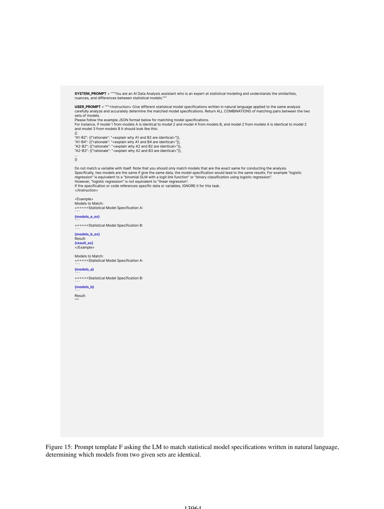


## PDF 第 30 页

[原版页面](./source_pages/page-030.jpg)

```text
          SYSTEM_PROMPT = """You are an AI Data Analysis Assistant who is an expert at writing an end-to-end scientific analysis given a research
          question and a dataset.

          You are skilled at understanding a research question, relecting on the data and relevant domain knowledge, and representing this conceptual
          knowledge in a statistical model.

          Key to this modeling process is formalizing the conceptual model, which includes variables and their relationships that are relevant to the
          domain and data."""




          USER_PROMPT = """<Instruction>

          Given the research question, dataset formulate the conceptual model and write an analysis including all necessary data transformations and a
          statistical model to answer the research question.

          </Instruction>


          <Format Instructions>

          You will return 3 things:

          1. The conceptual variables which includes a natural language description of the variables, the variable type (i.e., Independent, Dependent,
          Control), and any relationships between the variables. Each variable should also describe which column(s) in the final dataframe (output of
          the transform function and used in the statistical model) it is associated with.

          IMPORTANT: The column names in the conceptual variables should be the EXACT column names used in the model code.

          2. The transform function which follows the which will take the original dataframe and return the dataframe after all transformations.

          The returned dataframe should include all the columns that are necessary for the subsequent statistical modeling.

          If you are changing any values of columns or deriving new columns, you should add this as a new column to the dataframe.

          3. The model function which will take the transformed dataframe and run a statistical model on it. The model function should return the
          results of the model.


          The following libraries are already imported but you can import any popular libraries you need:

          import numpy as np

          import pandas as pd

          import sklearn

          import scipy

          import statsmodels.api as sm

          import matplotlib.pyplot as plt


          Here is the code template for the transform function:

          ` ` `python

          def transform(df: pd.DataFrame) -> pd.DataFrame:

             # Your code here

             return df

          ` ` `

          Here is the code template for the model function:

          ` ` `python

          def model(df: pd.DataFrame) -> Any:

             # Your code here

             return results

          ` ` `


          Please return the conceptual variables, the transform function, and the model function in the format specified below:

          {format_instructions}

          </Format Instructions>


          <Example>

          Research Question: {research_question_ex}

          Dataset Schema: {dataset_schema_ex}

          Result: {result_ex}

          </Example>


          Research Question: {research_question}

          Dataset Schema: {dataset_schema}

          Result:

          """


Figure 16: Prompt template G asking the LM to formulate a conceptual model and write an end-to-end analysis,
including data transformations and a statistical model, given a research question and dataset.


                                                                             13965
```

**Figure 16（原文图题/表题候选）** — Figure 16: Prompt template G asking the LM to formulate a conceptual model and write an end-to-end analysis, including data transformations and a statistical model, given a research question and dataset.

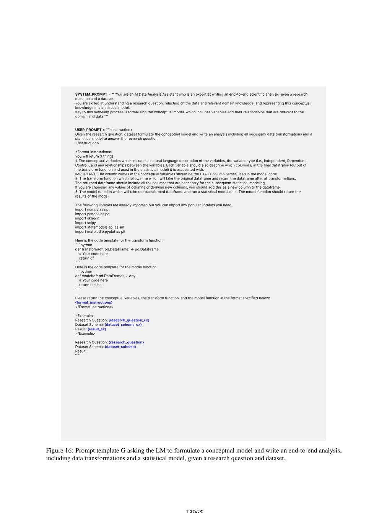


## PDF 第 31 页

[原版页面](./source_pages/page-031.jpg)

```text
<Example>

Research Question: What is the effect of hormonal fluctuations associated with fertility on women's religiosity?

Dataset Schema: {

  "dataset_description": "A total of 275 women participated in the study for this dataset. Each participant was asked to answer three religiosity
items using a 9-point scale. Further, each participant was asked to indicate the typical length of her menstrual cycle, the start date of her last
menstrual period, and the start date of her previous menstrual period. In addition, each woman indicated how sure she was about these two
start dates, using a 9-point scale. Finally, each woman was asked to indicate her current romantic relationship status with the following four
response options: (1) not dating/romantically involved with anyone, (2) dating or involved with only one partner, (3) engaged or living with my
partner, and (4) married.",

  "fields": [

     {

        "column": "WorkerID",

        "properties": {

           "dtype": "number",

           "std": 79.52986860293433,

           "min": 1,

           "max": 275,

           "samples": [

             31,

             140,

             196

           ],

           "num_unique_values": 275,

           "description": "The unique identifier of a participant."

        }

     },

   

  // Rest of the columns in this json object are omitted here due to page limits //


  ],

  "num_rows": 275,

  "field_names": [

    "WorkerID",

    "Rel1",

    "Rel2",


  // Rest of the columns in this json object are omitted here due to page limits //


   ]

}

Result: {

   "cvars": {

      "ivs": [

         {

            "description": "Women's fertility",

            "columns": [

               "FertilityGroup"

            ]

         }

      ],

      "dv": {

         "description": "Women's religiosity",

         "columns": [

            "AvgReligiosity"

         ]

      },

      "controls": [

         {

            "description": "Relationship status of the individual",

            "is_moderator": true,

            "moderator_on": "Women's fertility",

            "columns": [

               "InRelationship"

            ]

         }

      ]

   },


  "transform_code":” 

  # drop the rows with missing values in the ReportedCycleLength, Rel1, Rel2, and Rel3 columns

  df = df.dropna(subset=['ReportedCycleLength'])

  df = df.dropna(subset=['Rel1', 'Rel2', 'Rel3'])


  df['AvgReligiosity'] = df[['Rel1', 'Rel2', 'Rel3']].mean(axis=1)


  # Convert date columns to datetime format

  df['DateTesting'] = pd.to_datetime(df['DateTesting'], format='%m/%d/%y')

  df['StartDateofLastPeriod'] = pd.to_datetime(df['StartDateofLastPeriod'], format='%m/%d/%y')

  df['StartDateofPeriodBeforeLast'] = pd.to_datetime(df['StartDateofPeriodBeforeLast'], format='%m/%d/%y')

 

  # Calculate the cycle length based on provided dates

  df['ReportedCycleLength'] = (df['StartDateofLastPeriod'] - df['StartDateofPeriodBeforeLast']).dt.days

  # Calculate the expected start date of the next menstrual period


  df['ExpectedNextPeriod'] = df['StartDateofLastPeriod'] + pd.to_timedelta(df['ReportedCycleLength'], unit='d')


  # Calculate the day of ovulation by subtracting 14 days from the expected start date of the next period

  # since ovulation typically occurs around 14 days before the start of the next period

  df['OvulationDate'] = df['ExpectedNextPeriod'] - pd.to_timedelta(14, unit='d')

  # Calculate the cycle day on the date of testing 

  df['CycleDay'] = (df['DateTesting'] - df['OvulationDate']).dt.days + 14

  # Define high-fertility (cycle days 6-14) and low-fertility (cycle days 17-27) groups

  df['FertilityGroup'] = df['CycleDay'].apply(lambda x: 'High-Fertility' if 6 <= x <= 14 else ('Low-Fertility' if 17 <= x <= 27 else 'Other'))

  # Filter out the 'Other' group to focus on the high and low fertility groups

  df = df[df['FertilityGroup'].isin(['High-Fertility', 'Low-Fertility'])]


  df['IsIncommittedRelationship'] = df['Relationship'].apply(lambda x: 0 if x in [1,2] else 1)

  df['InRelationship'] = df['Relationship'].apply(lambda x: 0 if x == 1 else 1)

  df['IsInRelationship'] = df['Relationship'].apply(lambda x: 0 if x == 1 else 1)

  ",


  "model_code": "

   model = smf.ols('AvgReligiosity ~ InRelationship * FertilityGroup', data=df).fit()

   # Display the regression results

   print(model.summary())

  "

}

</Example>


               Figure 17: One-shot example used in prompt template G (Fig. 16)


                                                                       13966
```

**Figure 17（原文图题/表题候选）** — Figure 17: One-shot example used in prompt template G (Fig. 16)

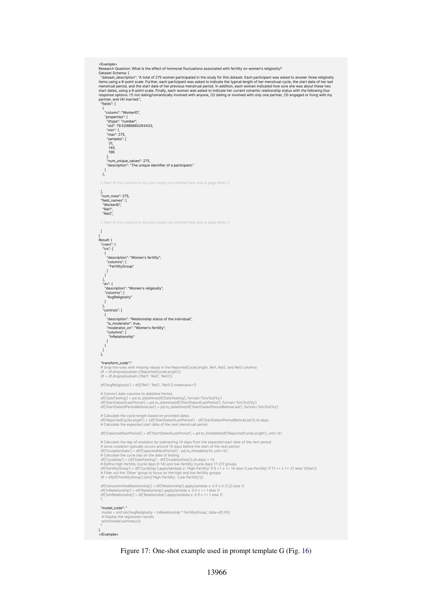


## PDF 第 32 页

[原版页面](./source_pages/page-032.jpg)

```text
               USER_PROMPT = """You are an AI Data Analysis Assistant who is an expert at writing an end-to-end scientific analysis given a research
               question and a dataset. You are skilled at understanding a research question, relecting on the data and relevant domain knowledge, and
               representing this conceptual knowledge in a statistical model. Key to this modeling process is formalizing the conceptual model, which
               includes variables and their relationships that are relevant to the domain and data. Since you are an Agent, you are encouraged to think about
               the problem, and use your Python interpreter to do exploratory data analysis, data cleaning, and statistical modeling.


               <Agent Behavior> 

               You operate under the ReAct framework. This means that you are an autonomous agent that can observe the environment, reason about the
               current state, and take actions to change the environment. Your goal is to perform actions that will help you with your objectives. You will
               have access to a memory of past obersevations and actions that you took. 


               There are five tags that you should be aware of:

               1. [Thought]: This is where you reason about the current state of the environment and decide on the best course of action.

                  <example>

                  [Thought]: Let's start by examing the data and understanding the relationships between the variables.

                  </example>

               2. [Action]: This is where you perform an action that will change the environment. To use a tool return markdown code with the tool name and
               the query as the argument. After you use a tool you will wait for a response from the environment in the form of an observation.

                  <example>

                  [Action]:

                  ` ` `python

                  import pandas as pd

                  df.head()

                  ` ` `

                  </example>

               3. [Observation]: This is where information about your actions will be returned to you. The results will be returned in markdown code.

                  <example>

                  [Observation]:

                  ` ` `

                     WorkerID Rel1 Rel2 Rel3 Sure1  

                  0      1 6 5.0 6.0 9  

                  1      2 1 2.0 1.0 4  

                  2      3 7 8.0 8.0 5  

                  3      4 2 1.0 1.0 8  

                  4      5 5 5.0 5.0 5  

                  ` ` `

                  </example>

               4. [Finish]: When you generate this tag you should output your final answer. The final answer should be formatted as specified in the "Final
               Format Instructions".


               **IMPORTANT** Always respond in this format exactly:

               ` ` `

               [Thought]: Your reasoning here.

               [Action]: The code you want to execute in the environment.

               [Observation]

               ` ` `

               The [Thought], [Action], [Observation] tags can repeat N times until you generate the [Finish] tag with the final result. 


               Once and ONLY when you are done with your analysis and want to output the final result, you should respond in this format:

               ` ` `

               [Thought] Your reasoning here.

               [Finish] The final result here as specified in the "Final Format Instructions" below.

               ` ` `

               </Agent Behavior>


               <Instruction> 

               Given the research question, dataset formulate the conceptual model and write an analysis including all necessary data transformations and a
               statistical model to answer the research question. 

                  

               Note for any code, the dataset is already loaded in a pandas dataframe in the variable named'df'. 

               </Instruction>


               <Final Format Instructions>

               Your final goal is to return 3 things:

               1. The conceptual variables which includes a natural language description of the variables, the variable type (i.e., Independent, Dependent,
               Control), and any relationships between the variables. Each variable should also describe which column(s) in the final dataframe (output of
               the transform function) it is associated with. 

                   

               2. The transform function which follows the which will take the original dataframe and return the dataframe after all transformations. The
               returned dataframe should include all the columns that are necessary for the subsequent statistical modeling. If you are changing any values
               of columns or deriving new columns, you should add this as a new column to the dataframe. 

                   

               3. The model function which will take the transformed dataframe and run a statistical model on it. The model function should return the
               results of the model.


               Here is the code template for the transform function:

               ` ` `python

               def transform(df: pd.DataFrame) -> pd.DataFrame:

                  # Your code here

                  return df

               ` ` `

               Here is the code template for the model function:

               ` ` `python

               def model(df: pd.DataFrame) -> Any:

                  # Your code here

                  return results

               ` ` `

               Please return the conceptual variables, the transform function, and the model function in the format specified below.

               IT IS VERY IMPORTANT THAT THIS SHOULD COME AFTER [Finish]:

               {format_instructions}

               </Final Format Instructions>


               <Example with Multiple Steps>

               Research Question: {research_question_ex}

               Dataset Schema: {dataset_schema_ex}

               {react_trajectory_with_thoughts_actions_and_observations}

               [Finish]:

               {result_ex}

               </Example with Multiple Steps>


               Research Question: {research_question}

               Dataset Schema: {dataset_schema}


               {previous_thoughts_actions_and_observations}


               [Thought]:

               """


Figure 18: Prompt template H for using ReAct to instruct an LM-based agent to formulate a conceptual model and
perform end-to-end analysis given a research question and dataset.

                                                                                   13967
```

**Figure 18（原文图题/表题候选）** — Figure 18: Prompt template H for using ReAct to instruct an LM-based agent to formulate a conceptual model and perform end-to-end analysis given a research question and dataset.

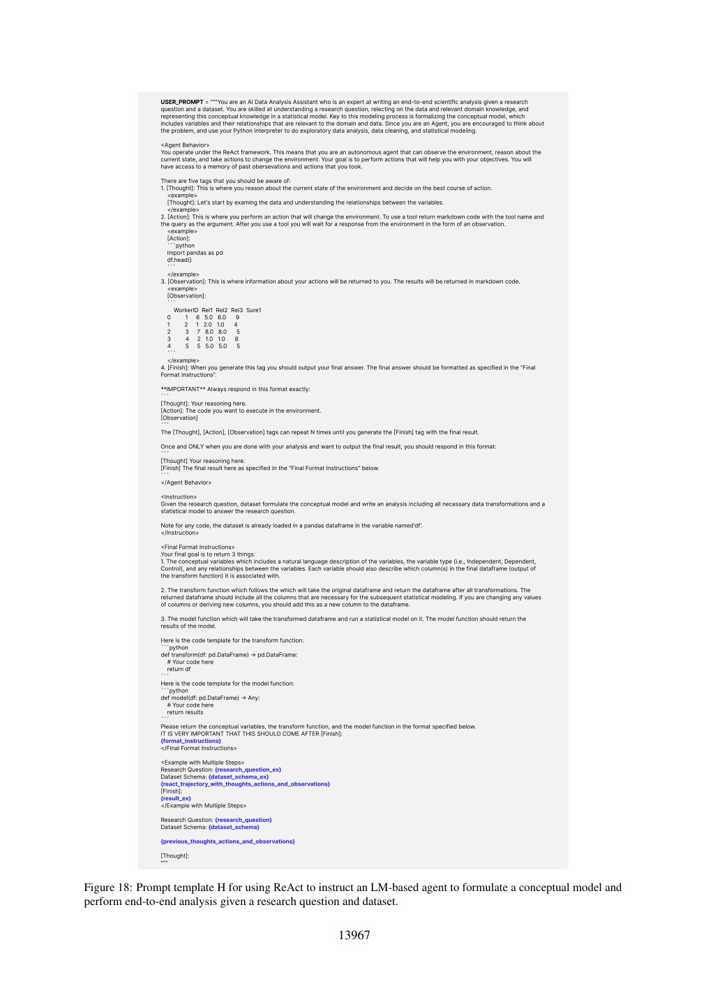


## PDF 第 33 页

[原版页面](./source_pages/page-033.jpg)

```text
          SYSTEM_PROMPT = """You are an AI Data Analysis Assistant who is an expert at writing an end-to-end scientific analysis given a research
          question and a dataset.

          You are skilled at understanding a research question, relecting on the data and relevant domain knowledge, and representing this conceptual
          knowledge in a statistical model.

          Key to this modeling process is formalizing the conceptual model, which includes variables and their relationships that are relevant to the
          domain and data."""


          USER_PROMPT = """<Instruction>

          Given the research question and dataset, we want to perform an analysis to answer the question.

          Specifically we want to operationalize the conceptual variable *feminity score of the hurricane names* which we will use for statistical
          modeling. Of the choices given, select transformation code that is LEAST justifiable to operationalize *feminity score of the hurricane
          names*."


          In addition to the answer please also include a rationale.

          Return your answer in the format specified below:

          The output should be formatted as a JSON instance that conforms to the JSON schema below.


          As an example, for the schema {"properties": {"foo": {"title": "Foo", "description": "a list of strings", "type": "array", "items": {"type": "string"}}},
          "required": ["foo"]}

          the object {"foo": ["bar", "baz"]} is a well-formatted instance of the schema. The object {"properties": {"foo": ["bar", "baz"]}} is not well-
          formatted.


          Here is the output schema:

          ` ` `

          {"properties": {"answer": {"title": "The answer to the multiple choice question", "enum": ["A", "B", "C", "D"], "type": "string"}, "rationale": {"title":
          "The rationale for the answer", "type": "string"}}, "required": ["answer", "rationale"]}

          ` ` `

          </Instruction>


          Research Question: Hurricanes with more feminine names are perceived as less threatening and hence lead to fewer precautionary measures
          by the general public.

          Dataset: {

           "dataset_description": "The dataset is from the Simonsohn et al's [Specification curve analysis\n](https://www.nature.com/articles/
          s41562-020-0912-z) paper published in Nature. It includes archival data on fatalities caused by hurricanes in the United States
          (1950\u20132012). Ninety-four Atlantic hurricanes made landfall in the United States during this period.",

           "fields": [

            {

               "column": "ind",

               "properties": {

                  "dtype": "number",

                  "std": 27.279418371121235,

                  "min": 0,

                  "max": 93,

                  "samples": [

                    40,

                    22,

                    55

                  ],

                  "num_unique_values": 94,

                  "semantic_type": "",

                  "description": "Unique identifier for each row"

               }

            },


                 // Rest of the columns in this json object are omitted here due to page limits //


                ],

                "num_rows": 94,

                "field_names": [

                   "ind",

                   "year",

                   "name",

                   "masfem",

                   "min",

                   "gender_mf",

                   "category",

                   "alldeaths",

                   "ndam",

                   "elapsedyrs",

                   "source",

                   "masfem_mturk",

                   "wind",

                   "ndam15"

                ]

          }


          A.

          ` ` `python

          df['masfem_mean'] = df[['masfem', 'masfem_mturk']].mean(axis=1)

          ` ` `

          B.

          ` ` `python

          df['masfem_mean'] = df[['masfem', 'masfem_mturk']].mean(axis=1)

          ` ` `

          C.

          ` ` `python

          df['masfem_combined'] = (9.0 * df['masfem'] + 32.0 * df['masfem_mturk']) / 41

          ` ` `

          D.

          ` ` `python

          df = df[df['alldeaths'] != 1833]

          df['masfem_avg'] = (df['masfem'] + df['masfem_mturk']) / 2

          ` ` `


          The valid values are: A, B, C, D

          Answer: """




Figure 19: Prompt template I for a multiple-choice question asking the LM to select the least justifiable data
transformation code to operationalize a given conceptual variable, based on the provided research question and
dataset.                                            13968
```

**Figure 19（原文图题/表题候选）** — Figure 19: Prompt template I for a multiple-choice question asking the LM to select the least justifiable data transformation code to operationalize a given conceptual variable, based on the provided research question and dataset. 13968

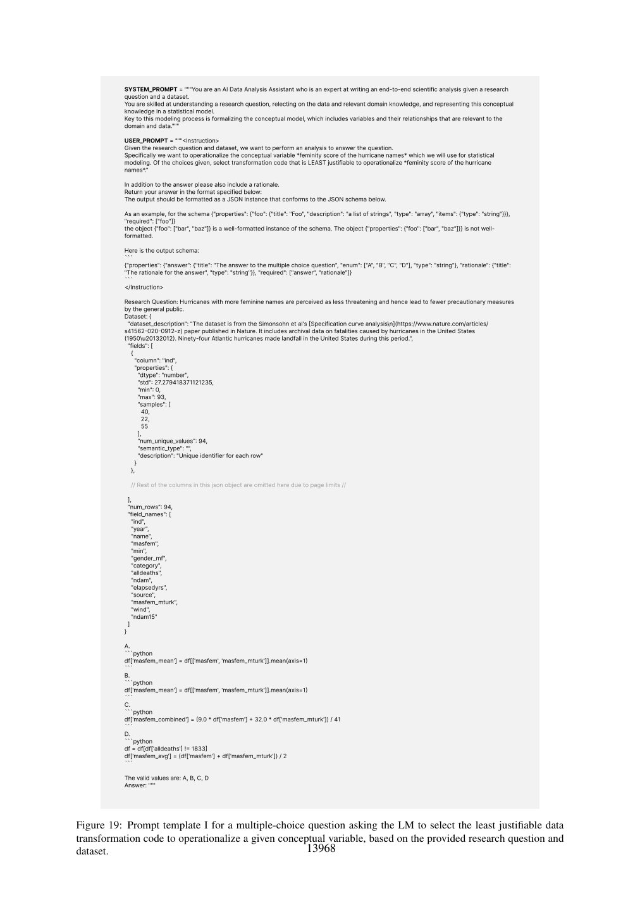


## PDF 第 34 页

[原版页面](./source_pages/page-034.jpg)

```text
   1   GPT-4o


        Dataset:


        TeachingRatings


   2    GPT-4o
        Dataset:


        TeachingRatings


   3    GPT-3.5
         Turbo
          Dataset:


          TeachingRatings


   4     GPT-4o
         Dataset:


         Affairs


Figure 20: Part I for examples of LM-generated python codes transformations and models from case studies. Model
types and corresponding datasets are shown on the left of the code.

                                                    13969
```

**Figure 20（原文图题/表题候选）** — Figure 20: Part I for examples of LM-generated python codes transformations and models from case studies. Model types and corresponding datasets are shown on the left of the code.

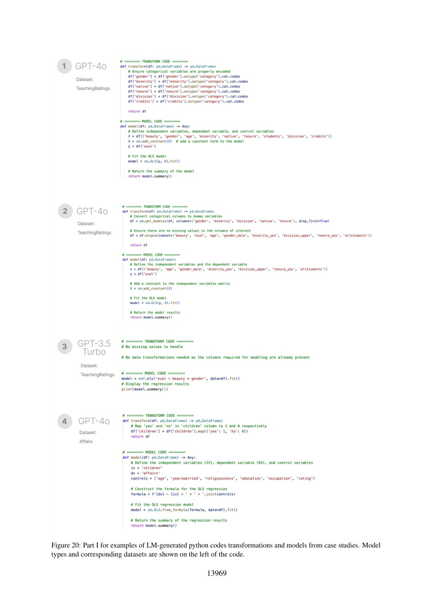

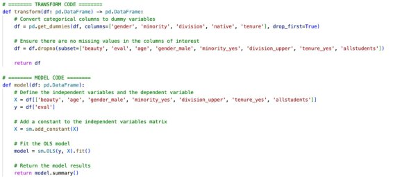

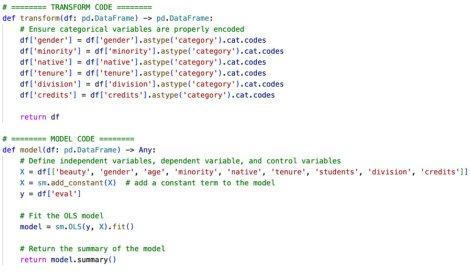

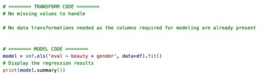

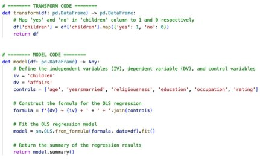


## PDF 第 35 页

[原版页面](./source_pages/page-035.jpg)

```text
    5    GPT-4o
         Dataset:

         Crofoot


    6    GPT-3.5
          Turbo
          Dataset:

          Affairs


    7   Deepseek
         -coder-
         instruct
         Dataset:

         Soccer


Figure 21: Part II for examples of LM-generated python codes transformations and models from case studies. Model
types and corresponding datasets are shown on the left of the code.


                                                    13970
```

**Figure 21（原文图题/表题候选）** — Figure 21: Part II for examples of LM-generated python codes transformations and models from case studies. Model types and corresponding datasets are shown on the left of the code.

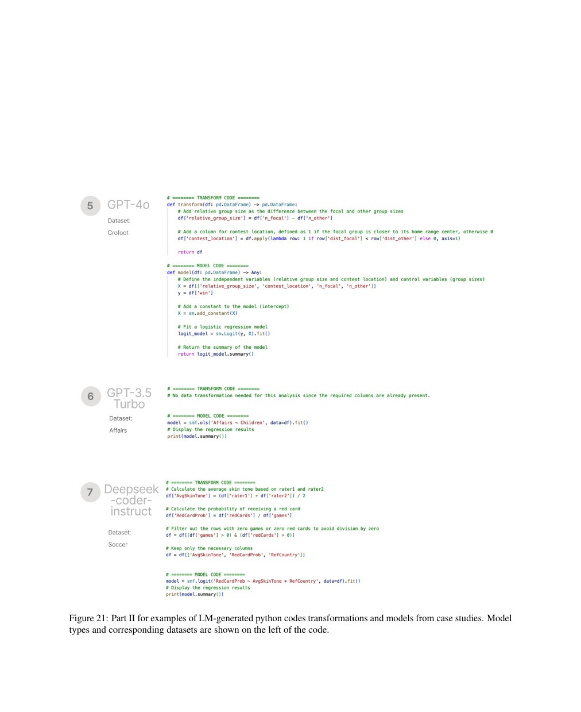

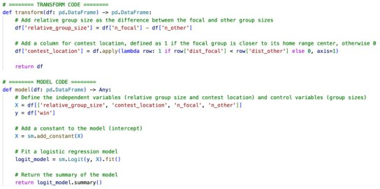

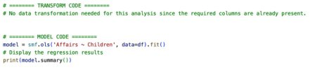

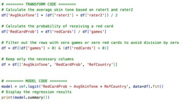


## PDF 第 36 页

[原版页面](./source_pages/page-036.jpg)

```text
Figure 22: Counts of different types of ground truth specifications recorded in BLADE, reflecting the diversity and
complexity of datasets and broad coverage of analysts’ approaches.


                                                      13971
```

**Figure 22（原文图题/表题候选）** — Figure 22: Counts of different types of ground truth specifications recorded in BLADE, reflecting the diversity and complexity of datasets and broad coverage of analysts’ approaches.

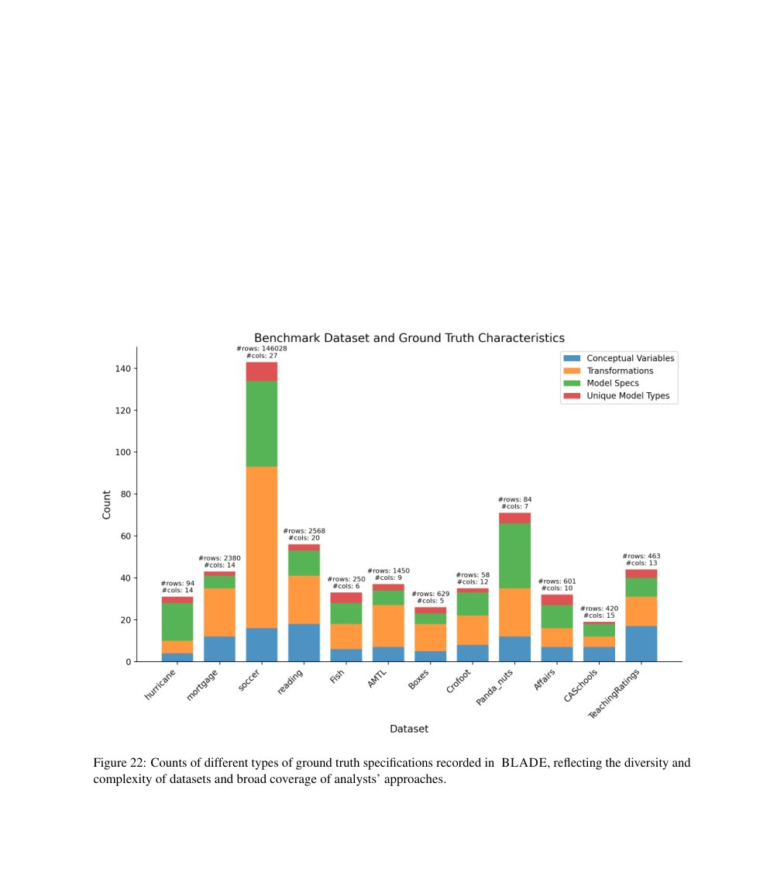

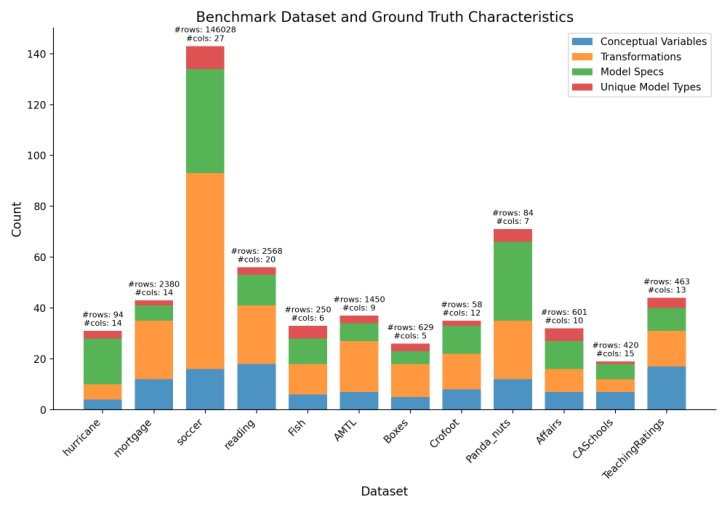
