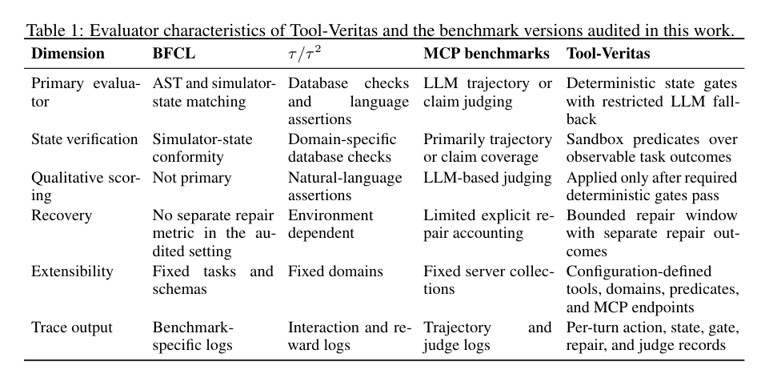
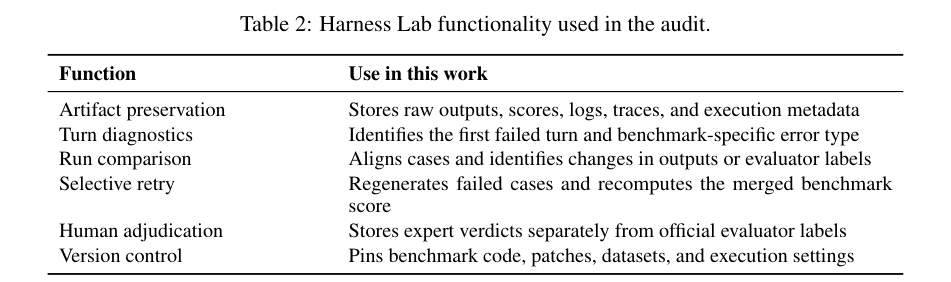
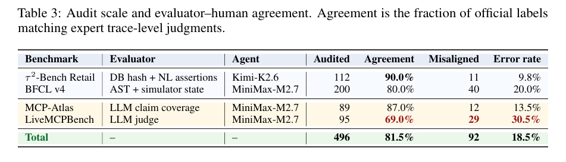
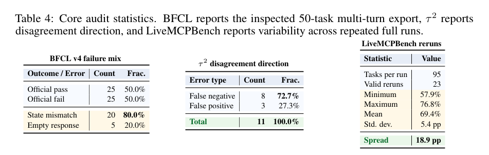
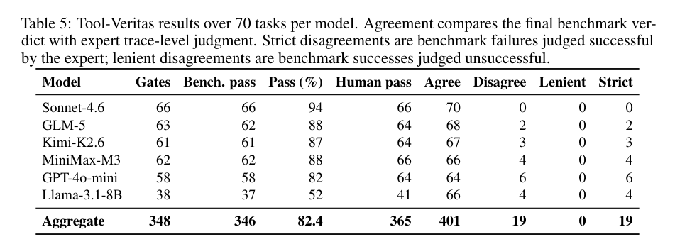
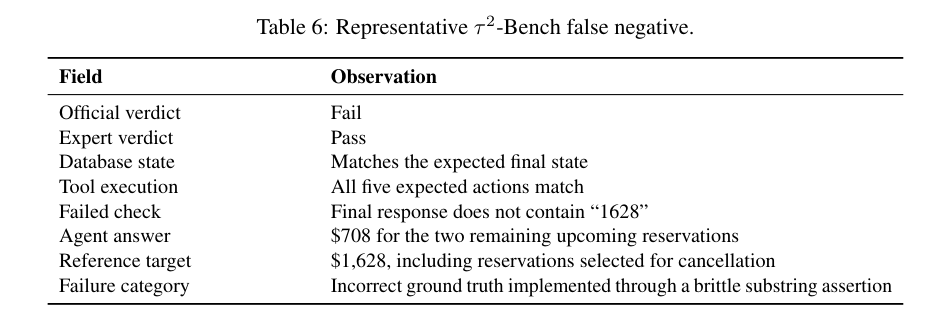
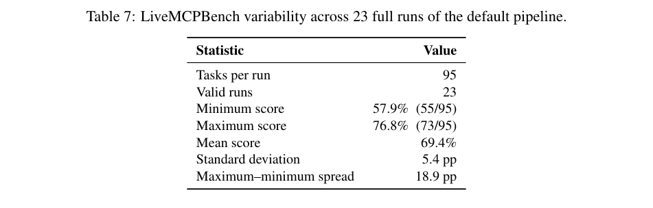

# 对基准进行基准测试：工具调用评估的有效性审计

**英文题名**：Benchmarking the Benchmarks: A Validity Audit of Tool-Calling Evaluation  
**作者**：Jay Vaghasiya、Vishvesh Bhat、Muhammad Ahmed Mohsin、Asad Aali  
**机构**：CoreThink AI；斯坦福大学（Stanford University）  
**原稿**：arXiv:2607.02577v1，2026 年 6 月 30 日，预印本  
**中文处理说明**：按照原稿章节顺序译述正文与附录；保留原表、模型名、工具名及公式；英文原文另见 `英文原文_逐页.md`。表中数值未重新估计。

## 摘要

工具调用基准测试日益用于对语言模型智能体进行排名，但人们往往将这些基准产生的分数视为真实标准（ground truth），却没有验证评价器本身。本文对四类重要工具调用基准——BFCL v4、τ²-Bench、LiveMCPBench 和 MCP-Atlas——进行了系统性的有效性与可复现性审计。在由专家复核的 496 个基准任务中，发现 92 个自动评价结果与人工判断不一致的案例，即 18.5% 的不一致率。这些失败并非孤立的标注错误：确定性基准存在脆弱的状态匹配、对单一路径的锁定、错误的标准答案、基于子字符串的沟通检测失败、奖励依据与任务目标不一致等问题；使用大语言模型裁判的基准则存在评分细则漂移、凭空认定任务完成、只看答案的评分方式，以及较大的重复运行方差。在 LiveMCPBench 中，针对同一配置重复评价 23 次所得分数从 57.9% 到 76.8% 不等，相差 18.9 个百分点，足以改变排行榜结论。结果说明，当前工具调用分数可能反映的是评价器的伪差，而非智能体的真实能力。为此，论文提出统一的评价失败分类体系，发布轨迹级审计产物及经修正的评价组件，并倡导分别测量工具调用、任务完成和结果核验三个维度。研究认为，工具使用智能体的发展需要其基准评价器本身具备可复现性、可审计性，并与人工任务成功判断一致。论文进一步提出 Tool-Veritas，一种以确定性状态校验配合可选定性裁判的可配置基准，以及 Harness Lab，一个用于基准执行、轨迹检查、重复运行比较和评价器调试的开源系统。

## 1 引言

工具调用已成为现代语言模型智能体的核心能力，使其能够与外部 API、数据库、操作系统、Web 服务和企业工具交互。因此，以基准测试为依据的评估，成为衡量进展、比较模型并指导部署的主要手段。BFCL、τ-bench、τ²-Bench、LiveMCPBench 和 MCP-Atlas 等基准被广泛作为函数调用、有状态交互和大规模工具使用评估的标准参照。其背后隐含了一个前提：基准分数能可靠衡量工具调用能力。

然而，有效性并不只取决于任务覆盖面和规模。可靠的评价必须能正确区分成功与失败的执行、忠实表达用户意图，并在重复运行中产生可复现的分数。既有工作已经揭示 API 不稳定、自动评价器设计、裁判偏差和偏好聚合伪差等因素的影响。本文进一步发现，多种主流工具调用基准在更基本的层面就存在缺陷，而且这些缺陷常常与智能体实际使用工具的能力无关。

对于确定性评价，问题主要包括：状态比较对细微差异过度敏感、严格精确匹配、错误的标准答案标注、只认可某条预设轨迹，以及奖励公式无法真实反映任务完成。对于 LLM 裁判，常见问题则是随机生成的评分细则、裁判意见的波动、编造的完成判断，以及实现与论文说明不一致导致的评分不稳定。

这些问题会产生直接的实际后果。有些智能体已经正确完成任务，却因为评价器的伪差而被标为失败（假阴性）；另一些运行并未完成任务，却得到通过判定（假阳性）。在相同受测模型下重新运行 LiveMCPBench 默认流程，结果可能出现接近 20 个百分点的波动。这意味着目前部分排行榜实际上测量了评价器特性，而不只是智能体能力。

论文的五项贡献为：（1）在四类基准上对 496 次执行开展轨迹级审计，发现 92 个与专家判断不一致的结果；（2）总结跨确定性评价和 LLM 评价的统一失败分类；（3）提出拆分工具调用、任务完成和结果验证的评价框架；（4）开发 Tool-Veritas，用确定性状态门控核验客观事实，仅对定性指标采用受约束的 LLM 裁判；（5）开发 Harness Lab，用于保存原始资料、提供实例级及轮次级诊断、比较重复运行、选择性重试和记录人工裁决。

## 2 相关研究

**工具使用与函数调用基准。** 早期 ToolBench、ToolAlpaca、API-Bank、Gorilla、ToolLLM 和 BFCL 等工作重点评估模型能否选择合适 API、填写参数和生成有效函数调用。它们推进了工具调用评估的标准化，但往往将成功简化为函数调用的语法匹配、抽象语法树（AST）等价，或者范围很窄的执行检查。因此，这些分数不足以说明智能体是否在真实多轮环境中满足了用户意图。

**交互式与有状态智能体评估。** τ-bench、τ²-bench、ToolSandbox、WebArena、WorkArena 和 OSWorld 将评估从孤立函数调用扩展到有状态交互、模拟用户和持久化环境。这类场景更能体现长期工具使用、政策遵循和环境状态更新，但评分往往绑定于最终数据库哈希、预先编排的行动轨迹或脆弱的自然语言检查：当模型达成合法的替代结果时可能被误判失败，而当数据库没有变化却满足了不完善的成功条件时又可能被误判通过。MAVEN 及 MAVEN-Bench 进一步强调以验证为中心的推理框架和过程感知评估的重要性。

**MCP 与 LLM-as-a-Judge 评价。** LiveMCPBench、MCP-Bench、MCP-Universe、MCPMark 与 MCP-Atlas 在更复杂的 MCP 工具生态中评估智能体。为了扩展规模，它们经常借鉴 MT-Bench、AlpacaEval 和 Chatbot Arena 中的 LLM 裁判方案。然而，这些裁判可能只评估最终文字回答而没有验证实际工具行为；评分细则和裁判输出都可能随运行变化，甚至将并未完成的任务认定为成功。

**基准执行与调试基础设施。** 现有基准的开源产物通常提供各自的运行脚本与汇总评分，却很少提供跨基准的轨迹检查、重复运行对比、局部重试和可持久化的人工裁决能力。Harness Lab 在保留各基准原始评价器与原始资料的同时，为其提供统一的执行和调试层。

## 3 方法

### 3.1 预备定义

将工具调用基准形式化为三元组：

\[
B=(\mathcal T,\mathcal E,\mathcal G),
\]

其中 \(\mathcal T\) 是基准任务，\(\mathcal E\) 是评价执行框架（evaluation harness），\(\mathcal G\) 是特定于基准的成功判据。每项任务 \(t\) 包含用户查询 \(q\)、初始环境状态 \(s_0\)、可用工具集 \(A\) 和预期结果 \(o^*\)。智能体 \(\pi\) 执行任务时形成轨迹：

\[
\tau=\{(s_0,a_1),(s_1,a_2),\ldots,(s_T,a_T)\},
\]

它包括工具调用、环境状态转移与自然语言响应。评价器给出二值判断 \(y=\mathcal E(\tau)\)。基准的基本假设是自动判断等于真实任务结果。如果 \(H(\tau)\) 表示专家对轨迹所作的任务成功判断，则一致性要求为：

\[
\mathcal E(\tau)=H(\tau). \tag{1}
\]

研究目标正是系统识别和解释这一等式不成立的情形。

### 3.2 基准审计框架

论文检查 BFCL、τ²-Bench、LiveMCPBench 与 MCP-Atlas 四种不同的评价范式。对每个实例收集完整执行轨迹、工具调用日志、评价器输出、环境状态及最终判定，并将第 \(i\) 个实例表示为 \(x_i=(\tau_i,y_i,m_i)\)：其中 \(\tau_i\) 为执行轨迹，\(y_i\) 为官方标签，\(m_i\) 为包括评价日志、期望状态和裁判输出在内的基准元数据。

审计分三阶段：（i）复现原基准的评价；（ii）人工裁决任务结果；（iii）对不一致案例进行根因分析。这样的设计使自动标签能够与经人工核实的任务结果直接对照。

### 3.3 人工裁决

针对被标记的案例，标注者检查完整交互轨迹、工具序列、状态变化和最终对用户呈现的结果，并根据是否达成用户目标赋予 \(h_i\in\{\mathrm{PASS},\mathrm{FAIL}\}\)。当自动标签与人工判断不同，定义分歧指标：

\[
\delta_i=\mathbf 1[y_i\neq h_i].\tag{2}
\]

进一步区分假阴性（自动失败、人工成功）和假阳性（自动通过、人工失败），以系统衡量两类评价器失误。

### 3.4 失败机制分类

研究从人工确认的分歧中提炼出跨基准分类。确定性评分的问题包括严格精确匹配、状态过度约束、轨迹锁定、标注错误和奖励失配；LLM 裁判的问题包括评分规则漂移、裁判方差、虚构的完成判断，以及实现与规范不一致。每个分歧可同时分配一个或多个标签。该分类体系不依赖某个特定基准，可用于横向比较评价失败机制。

### 3.5 可复现性分析

如果评价器存在随机性，单次分数不足以评价可信度。设同配置下 \(K\) 次独立评价分数集合为 \(S=\{s_1,\ldots,s_K\}\)，统计其均值 \(\mu\)、标准差 \(\sigma\) 与极差 \(\Delta\)。其中：

\[
\Delta=\max(S)-\min(S).\tag{3}
\]

\(\Delta\) 刻画仅由评价流程随机性即可引起的最大排行榜分数变化。较大的数值意味着可复现性差、排名可能不稳定。需注意原文稍后指出，完整重复运行也包括智能体轨迹采样的变化，因而极差不是孤立的裁判噪声。

### 3.6 修正后的分解式评估框架

现有基准通常将多种能力压缩为单一通过/失败标签。作者主张将结果分解为三个独立分量：

\[
\mathbf c=(C_{\mathrm{tool}},C_{\mathrm{task}},C_{\mathrm{outcome}}).\tag{4}
\]

三者依次衡量**工具调用正确性**、**任务完成正确性**和**结果验证**。分解评分有助于定位错误来源、提升解释性，并减少对特定评价规则伪差的敏感性。

### 3.7 基准修正

根据已识别的失效实例，作者构建修正后的基准标注、评价逻辑和运行框架，去除错误的标准答案，降低脆弱状态比较的影响，将评价步骤与基准规范对齐，并纳入考虑可复现性的报告方式。修正后的组件用于后续重新评价。

### 3.8 Tool-Veritas：确定性验证优先的工具调用评价

确定性评价器虽易复现，却可能因严格语法、路径或状态匹配而拒绝语义上合法的完成结果；LLM 评价器能容纳合理的表达差异，却可能带来评分规则漂移、缺乏证据的成功判断与分数不稳定。Tool-Veritas 的设计原则是先使用确定性核验，只有当标准无法转化为可靠的状态谓词时才进行受约束的 LLM 评价。

Tool-Veritas 任务表示为 \(t=(q,s_0,A,G,J)\)，其中 \(q\) 是用户请求，\(s_0\) 是沙箱初始状态，\(A\) 是可用工具集合，\(G\) 是确定性状态谓词集合，\(J\) 是可选的定性评分细则。

*表 1：Tool-Veritas 与受审计基准版本的评价器特征比较。主要维度包括主评价器、状态验证、定性评分、恢复机制、扩展性与轨迹输出。*

在第 \(t\) 轮交互后，系统对沙箱状态 \(s_t\) 应用全部必需的确定性门控规则。其完成条件为：

\[
C_{\mathrm{state}}(t)=\prod_{j=1}^{m_t}\mathbf 1[g_{t,j}(s_t)=1],
\]

其中 \(g_{t,j}\) 为第 \(j\) 条必要的状态谓词，\(m_t\) 为该轮评价的谓词数量。任何一条必要规则未通过，事实性任务完成评价就不能得分。LLM 裁判只负责通信质量、政策遵循、面向用户的确认是否充分等无法稳定转化为状态谓词的条件，且**不能推翻失败的确定性条件**。这防止了“文字回答流畅但环境没有完成必要修改”的情况被误判成功。

系统还提供有限次数的修复窗口：当工具调用失败时，智能体可以阅读错误并在该轮结束前提交修正操作；首次尝试成功与修复后成功分别记录，以便既保留原始错误，又评价恢复能力。

工具、领域、状态谓词和 MCP 端点均可通过配置定义。每次运行产生轮次级 JSONL 轨迹，记录模型动作、工具返回、状态变化、门控结果、修复状态和可选裁判输出。论文介绍的基准涵盖文件系统、数据库、版本控制、银行、出行、日历、智能家居与医疗等 16 个领域。第 4.5 节显示，在所评价的模型—任务组合上，该方案与专家判断的总体一致率达到 95.5%。

### 3.9 Harness Lab

Harness Lab 是此次基准审计使用的运行和调试基础设施。它可调用兼容 OpenAI API 的模型端点执行基准，保存原始产物、解析实例结果，并提供特定于基准的诊断视图。目前支持 7 个基准家族的 21 种套件变体：BFCL v3/v4、τ²-Bench、Toolathlon、MCP-Atlas、SWE-Bench Lite、LiveCodeBench v6 和 LiveMCPBench。各基准保留原始 runner 与 evaluator。

系统会保存原始运行输出、官方评分文件、模型推理日志、案例概览、轮次诊断及执行元数据。原始文件存放于对象存储，解析后的结构化结果写入关系数据库，便于按实例查询。

*表 2：Harness Lab 功能。包括原始资料保全、轮次级诊断、运行比较、选择性重试、人工裁决及版本控制。*

BFCL 诊断可定位首个失败轮次、错误类别和状态字段不一致；τ²-Bench 诊断可以展示数据库检查、动作断言、沟通断言和奖励组成；MCP-Atlas 与 LiveMCPBench 的视图显示预期/实际调用轨迹及裁判输出。配对运行比较根据实例 ID 对齐，区分两次均通过、均失败、单次改善以及缺失样例，并可找到多轮任务发生分歧的首个轮次。选择性重试只重新生成临时失败的案例，合并未受影响的结果后重新执行官方评价器。人工判断与不可靠案例标记同官方标签分开保存。

## 4 实验

本研究试图回答工具调用基准究竟测量了智能体能力，还是评价器行为。论文首先围绕三个问题展开分析：RQ1 官方标签与人工判断是否一致；RQ2 确定性评价器为什么出现分歧；RQ3 基于 LLM 裁判的基准在重复运行时是否能复现。随后进一步考察 RQ4：确定性验证优先的评价是否更符合人工判断。

### 4.1 实验设置

**基准与智能体。** 作者审计四类基准：BFCL v4、τ²-Bench Retail、LiveMCPBench 和 MCP-Atlas。BFCL v4 使用 AST 与模拟器状态检查函数调用；τ²-Bench 结合数据库状态、动作与自然语言沟通断言；LiveMCPBench 与 MCP-Atlas 则使用 LLM 对轨迹、最终回答或参考声明进行评分。τ²-Bench Retail 使用 `moonshotai/kimi-k2.6`，其余三种基准使用 `minimax/minimax-m2.7`。

**审计协议。** 对每个任务保存完整用户提示、模型轨迹、工具调用及返回值、最终回答、官方判定、诊断日志以及可获得的环境状态。记自动标签为 \(y_i\in\{0,1\}\)，专家的轨迹级成功判断为 \(h_i\in\{0,1\}\)，则：

\[
m_i=\mathbf 1[y_i\ne h_i],\tag{5}
\]

\[
\operatorname{Err}(B)=\frac{1}{N_B}\sum_{i=1}^{N_B}m_i.\tag{6}
\]

当 \(y_i=0,h_i=1\) 时为假阴性；当 \(y_i=1,h_i=0\) 时为假阳性。

**专家裁决。** 三位独立专家检查完整执行轨迹、用户目标、工具输出、状态变化和最终回答；分歧通过讨论裁决。总计花费 89 个标注者工时，平均每项任务约 10.8 分钟。

**运行环境及资料收集。** 所有实验由 Harness Lab 执行并保存供应商原始输出、官方分数、推理轨迹、评价器日志和环境状态。版本化记录基准修补、数据集、端点配置及执行元数据。基准 runner 部署于 Google Cloud `us-central1`，受测模型通过兼容 OpenAI 的 HTTP 端点访问；因此论文报告的是基准侧算力而非模型推理服务器硬件。

*表 3：审计规模和评价器与人工的一致率。一致率表示官方标签与专家轨迹级判断相同的比例。*

| 基准 | 审计任务数 | 自动—人工一致率 | 不一致数量 | 不一致率 |
|---|---:|---:|---:|---:|
| τ²-Bench Retail | 112 | 90.0% | 11 | 9.8% |
| BFCL v4 | 200 | 80.0% | 40 | 20.0% |
| MCP-Atlas | 89 | 87.0% | 12 | 13.5% |
| LiveMCPBench | 95 | 69.0% | 29 | 30.5% |
| **合计** | **496** | **81.5%** | **92** | **18.5%** |

### 4.2 RQ1：官方标签是否符合人工判断？

表 3 显示，在 496 个受审计任务中，92 个官方结果与专家判断不一致，总不一致率为 18.5%；各基准从 τ²-Bench Retail 的 9.8% 到 LiveMCPBench 的 30.5% 不等。BFCL v4 为 20.0%，MCP-Atlas 为 13.5%。

无论确定性评价还是 LLM 评价都存在问题。前者受脆弱状态比较、错误标注、精确匹配假设及不完整的奖励条件影响；后者受评分规则不稳定、无证据的成功认定、只根据答案判断以及裁判方差影响。因此，**简单地以 LLM 裁判替换确定性检查，并不能自动获得可靠的工具调用评价。**

### 4.3 RQ2：确定性评价器在哪里失败？

**BFCL v4。** 在受审计的 200 个任务中，有 40 个自动与人工判断分歧。在其中检查的 50 项多轮基础导出任务中，官方评分给出 25 个通过与 25 个失败；失败项中 20 个标记为 `instance_state_mismatch`，另 5 个为 `empty_turn_model_response`，因此状态不匹配占该导出中失败的 80%。

轨迹检查表明，`instance_state_mismatch` 同时混入真实任务失败与评价器伪差。前者包括确实遗漏必要操作；后者包括与用户目标无关的状态字段差异、标点符号级差别、明明只需比较部分字段却检查整个对象，以及在后续纠错之前过早终止评价。此时基准实际上测量了“是否精确符合模拟器状态”，而不是“是否完成用户目标”。

**τ²-Bench Retail。** 在 112 项任务中出现 11 个分歧，包括 8 个假阴性与 3 个假阳性。假阴性通常源于智能体已完成操作，但未通过脆弱的数据库哈希检查或沟通断言；假阳性则可能由数据库恰好不变、或评分细则没有明确要求行动而产生。

代表性假阴性是任务 7：最终数据库状态及预期的五项工具动作都匹配，但最终回答没有包含字符串 `1628`，因此被判失败。用户实际上询问取消两项预订后剩余航班的总费用，智能体排除将被取消的航班，回答 708 美元；评价器却期待包含待取消航班的 1,628 美元。基准把错误的语义目标写成了子字符串检查条件。

另一例是任务 10：用户要求退还两个订单，智能体没有调用退货工具，而是转交给人工客服。由于数据库保持不变、评分细则未显式要求退货动作，基准仍判定通过。这说明仅检查最终状态可能在“正确的预期状态本身不变”时奖励无所作为。

*表 4：核心审计统计。BFCL 采用受检查的 50 项多轮导出；τ² 报告假阴性和假阳性的比例；LiveMCPBench 报告重复运行变动。*

### 4.4 RQ3：使用 LLM 裁判的基准能否复现？

作者对同一 95 项任务配置的 LiveMCPBench 完整重复运行 23 次。设第 \(k\) 次的综合得分为 \(s_k\)，则统计：

\[
\mu=\frac1K\sum_{k=1}^{K}s_k,\qquad
\sigma=\sqrt{\frac{1}{K-1}\sum_{k=1}^{K}(s_k-\mu)^2},\qquad
\Delta=\max_k s_k-\min_k s_k.
\]

23 次分数介于 **57.9%～76.8%**，均值 **69.4%**，标准差 **5.4 个百分点**，最大差距 **18.9 个百分点**。最高与最低运行的成功任务数量相差 18 项（总共 95 项）。这一波动幅度已超过不少排行榜的名次差距，意味着不能仅用单次评分进行精细排名。

观察到的波动由两种来源共同造成：一是完整重复运行中智能体产生的轨迹可能不同；二是评价器本身具有随机性，它会为任务重新生成关键评分点，并让 LLM 裁判根据新生成的细则作出判断。因此，即使是同一个任务，重复评价时所依据的标准也可能改变。作者强调，这里报告的是**端到端评价流程的总体不稳定性**，不是孤立、固定轨迹下的裁判噪声。

这也解释了为何需要将基准的评价设计与运行基础设施分离：Tool-Veritas 负责对可观察的任务结果应用确定性验证，并将 LLM 裁判限定于定性内容；Harness Lab 则保存检查决定所需的证据、对照重复运行并记录人工修正，使评分不再只是一个不透明的最终结果。

### 4.5 RQ4：确定性验证优先能否提升人工一致率？

研究在 70 个任务、6 个模型上测试 Tool-Veritas，并将基准判定与专家轨迹级判断对照。各模型的一致率为 **91%～100%**，总体为 **95.5%（401/420）**。此结果高于此前四类被审计基准的人工一致率（但基准和模型配置不同，不能将其视为严格控制变量的横向排名）。

所有 19 个 Tool-Veritas 分歧均为假阴性，即基准比专家更严格；没有出现基准通过、专家判失败的假阳性。结果支持这样一种评价器设计：以确定性状态门控保证事实性完成，再用受到限制的 LLM 对非客观质量作补充，能明显减少缺乏执行依据的通过判定。

*表 5：70 项任务 × 6 模型上的门控通过、基准成功、人工成功与两者一致情况。原表保留全部准确数值。*

| 模型 | 门控通过 | 基准通过 | 基准通过率(%) | 人工通过 | 一致数 | 分歧数 | 宽松错误 | 严格错误 |
|---|---:|---:|---:|---:|---:|---:|---:|---:|
| Sonnet-4.6 | 66 | 66 | 94 | 66 | 70 | 0 | 0 | 0 |
| GLM-5 | 63 | 62 | 88 | 64 | 68 | 2 | 0 | 2 |
| Kimi-K2.6 | 61 | 61 | 87 | 64 | 67 | 3 | 0 | 3 |
| MiniMax-M3 | 62 | 62 | 88 | 66 | 66 | 4 | 0 | 4 |
| GPT-4o-mini | 58 | 58 | 82 | 64 | 64 | 6 | 0 | 6 |
| Llama-3.1-8B | 38 | 37 | 52 | 41 | 66 | 4 | 0 | 4 |
| **合计** | **348** | **346** | **82.4** | **365** | **401** | **19** | **0** | **19** |

## 5 结论

工具调用基准越来越常被当作智能体能力的替代衡量，但本文证明，现有评价器的可靠性往往不足以承担这一职责。在 BFCL v4、τ²-Bench、LiveMCPBench 与 MCP-Atlas 的 496 个专家核查任务中，共出现 92 个评价器与人工判断分歧，占 18.5%。问题跨越不同基准及评价范式：确定性评价受状态匹配僵化、轨迹限制、错误标准答案与奖励公式影响；LLM 评价受到规则漂移、凭空宣布完成任务和重复运行波动影响。在 LiveMCPBench 上，同配置重复 23 次得到的分数差距为 18.9 个百分点，足以影响模型排名。

除了指出问题，论文还提出两项增强可审计性的基础设施：Tool-Veritas 将确定性结果验证与可选定性评分分离，并区分首次完成和有限修复后的完成；Harness Lab 提供版本化运行、原始资料保存、实例与轮次诊断、重复运行比较、选择性重试和人工裁决记录。两者落实了本研究的核心建议：**基准评价器本身应当可检查、可复现，并接受基于用户实际任务成功情况的人工校准。**

### 可获得性（Availability）

作者表示将发布轨迹级审计资料、经修正的基准组件、Tool-Veritas 配置和 Harness Lab 源代码。Harness Lab 计划以 MIT 许可发布，仓库链接和带版本信息的产物标识将在最终版本加入。原稿没有提供这些产物的完整可访问发布地址，不能据此断言它们已经公开。

## 参考文献（References）

原稿参考文献见 `英文原文_逐页.md` 第 9–10 页。为保证作者姓名、出版信息、链接以及 arXiv 编号准确，文献条目以英文原文保留，不将论文标题的意译替换为可检索的正式出版题名。

## 附录 A　评价器失败定性案例

本附录列出第 4 节中所述分歧与不稳定性的代表性案例，展示两种不同缺陷：τ²-Bench 的确定性沟通判据设错，以及 LiveMCPBench 随机生成评分规则与 LLM 判断所引发的波动。

*表 6：τ²-Bench 假阴性案例。自动判定为 Fail，专家判定为 Pass，数据库与五项工具调用都正确，唯一失败的是不包含字符串 `1628` 的沟通断言。*

### A.1 τ²-Bench：沟通目标错误

表 6 展示了 τ²-Bench Retail 中的一个假阴性案例。官方评价器判定失败，专家认为成功。数据库哈希符合预期的最终状态，五项必要工具操作全部正确；唯一失败的是最终自然语言回答没有包含 `1628`。

用户要求取消预订 `XEHM4B` 和 `59XX6W`，并询问其他即将到来的航班总价。其余两个预订分别为 `7WPL39`（402 美元）与 `3EMQJ6`（306 美元）。因此智能体回答：

\[
\$402+\$306=\$708.
\]

官方参考值 1,628 美元却包含了用户明确要求取消的预订。智能体在执行前识别两个仍然保留的预订，回答其合计 708 美元；在完成升级与取消操作后，又在最终响应中重复这一正确总额。这说明即便数据库状态和工具序列完全符合参考，错误配置的语言断言仍可能导致错误的基准裁决。

### A.2 LiveMCPBench：随机评分细则与裁判不稳定

对相同的 95 项任务采用默认评价流程完整运行 23 次，综合分数分布在 57.9% 至 76.8%，均值 69.4%，标准差 5.4 个百分点，差距 18.9 个百分点。当排行榜分数差距只有几个百分点时，此变化完全可能改变研究结论。

默认的 OpenBench 评分器每个任务进行两次随机 LLM 调用。第一次，`identify_key_points(task)` 根据任务文字重新生成评价标准；第二次，`grader_model.generate(...)` 根据该轮生成的标准评价轨迹与最终回答，给出成功/失败判断。人工撰写的步骤级标注仅在关键点生成失败时作为备选；在正常运行时并不控制评分细则。

由此产生两种评价方差：其一，不同重复运行重新生成的关键点在严格程度与细节上可能不同，导致相同行为被不同标准判定；其二，最终 LLM 判定本身存在随机性，接近边界的案例可能在通过与失败之间翻转。

*表 7：每次 95 项任务；23 次有效运行；最低 57.9%（55/95），最高 76.8%（73/95），均值 69.4%，标准差 5.4 个百分点，极差 18.9 个百分点。*

原文指出，默认裁判模型是 `gpt-4.1-mini`，并非该基准论文推荐的更强裁判配置，这可能进一步加剧不稳定性。由于这些数据来自整个基准流程的重复运行，分数极差混合了智能体轨迹、评分规则生成和裁判输出三种变动。因此它刻画的是**完整评价流水线的不稳定性**；要单独测量裁判噪声，还需要固定轨迹并分别在固定与重生成的评分规则下反复重新打分。

---

## 附：参考文献原文（索引）

所有参考文献条目完整收录于 [参考文献_英文原文.md](./参考文献_英文原文.md)，同时可在英文逐页提取稿第 9–10 页核对。
