# BetterBench：评估人工智能基准、揭示问题并建立最佳实践

**原文标题**：BetterBench: Assessing AI Benchmarks, Uncovering Issues, and Establishing Best Practices  
**作者**：Anka Reuel、Amelia Hardy、Chandler Smith、Max Lamparth、Malcolm Hardy、Mykel J. Kochenderfer  
**来源**：NeurIPS 2024 Datasets and Benchmarks 赛道投稿版本（请以所附 PDF 的版本标识为准）  
**原稿页数**：51 页；本译稿以提供的原版 PDF 为依据。

> **翻译与核查标记**：本文对摘要及正文第 1—9 节、关键数值与评估方法作了中文译述；附录 K 的 46 项标准逐项译出名称并给出含义，附录 J 的使用方法也已整理。51 页全部英文原文和全部原图均在压缩包内保留。**长篇附录中的逐项评分依据、所有引用文献条目以及个别示例并未逐句译完**，因此这是详细中文学术译述与原文核对套件，不能代替严格的全文逐句翻译。完整英文请见 `英文原文_逐页.md`。原图未经重绘，图内英文保持原样。

## 摘要（中文翻译）

人工智能模型越来越多地被部署在高风险环境中，因此有必要充分评估其能力与风险。基准测试（benchmark）已成为衡量这些属性的常用方法，用于比较模型表现、跟踪技术进展，以及识别基础模型和非基础模型的弱点。基准测试还可能影响下游任务中的模型选择，并为政策行动提供依据。然而，不同基准的质量并不相同，其质量取决于设计方式和可用性。本文提出一套覆盖人工智能基准整个生命周期、包含 **46 项最佳实践**的评估框架，并依据该框架对 **24 个 AI 基准**进行评价。研究发现，不同基准之间存在较大的质量差异，部分广泛使用的基准存在显著问题。研究还发现，大多数基准未报告结果的统计显著性，也未提供便于复现结果的机制。为了帮助基准开发者落实最佳实践，作者基于该框架制定了最低质量保证检查清单，并建设持续更新的基准评估资料库，以支持基准之间的比较，网址为 `betterbench.stanford.edu`。

## 1. 引言（中文译述）

人工智能系统快速发展，并不断进入实际决策流程。尤其是基础模型的应用扩大，使系统可能带来的收益与风险同时增加。因此，模型能力和潜在危害的准确评估已成为重要问题。现有评估既包括开发者内部进行的专有测试，也包括基于公开基准的外部测评。基准已成为比较算法、衡量性能、追踪进步和发现薄弱环节的常规工具；模型开发者在发布系统时会报告基准分数，监管机构也会使用评估结果支持第三方审查。

作者沿用相关研究对“基准”的定义：它是由一个或多个数据集及一套评价指标组成、代表某类任务或能力，并被研究共同体用于共享比较的框架。关键问题是：**基准分数是否真的测量了声称要测量的能力，以及基准自身能否被理解、使用、检查和复现？** 作者将高质量基准定义为：具有可解释性，清楚说明预期用途与适用范围，并且具备可用性。论文指出，常见做法是直接把不同基准的数字并列展示，却未对这些基准本身的可靠性和适用性作系统审查。

本文主要贡献包括：①依据文献综述和专家访谈建立含 46 项准则的基准质量评估框架；②将框架应用于 16 个基础模型基准与 8 个非基础模型基准；③归纳当前基准开发与使用中的普遍问题；④提供面向开发者的最低质量保障清单；⑤建设能够持续更新的在线基准质量资料库。

### 图 1：基准生命周期

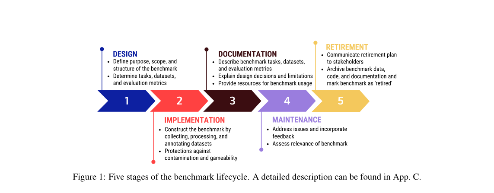

作者将基准生命周期划分为 **设计（Design）—实现（Implementation）—文档化（Documentation）—维护（Maintenance）—退役（Retirement）** 五个阶段。设计阶段确定目标、范围、任务与指标；实现阶段构建数据与评估机制并防范污染和投机；文档阶段解释任务、数据、指标及使用方法；维护阶段处理缺陷、反馈及相关性变化；退役阶段向利益相关者说明停止维护的计划并归档材料。论文实际评分主要覆盖前四个阶段，因为对仍在使用的基准无法有效评分其退役情况。

## 2. 相关研究（中文译述）

### 2.1 人工智能基准实践及挑战

作者将现有争议归纳为两个问题：**基准究竟测量什么，以及其测量结果被如何使用。** 相关研究指出，很多基准的覆盖范围狭窄、已经趋于饱和，或与用户真实任务之间存在“社会—技术差距”（socio-technical gap）。将单个基准分数过度泛化为模型的整体能力，可能造成误导。此外，数据卡（Data Cards）、数据整理规范和 FAIR 原则提高了数据透明度，但基准还包含软件基础设施和评价方法，因此单纯的数据管理规范不足以判断整个基准的质量。

### 2.2 从其他领域借鉴的最佳实践

论文吸收硬件、环境质量、生物信息学和教育测量中的经验。优质基准应反映下游用途，使用与实际场景相符的测试数据；要检验评价的效度与结果不确定性；应清楚解释分数的含义、适用范围和不能作出的推断；测试数据、程序及说明应方便获得，促进结果复现。特别值得注意的是，**标准答案或黄金数据（gold standard）的建立，应与被测模型的输出保持必要独立性**，否则评价可能存在循环验证问题。

## 3. 方法：如何评估一个基准（中文译述）

框架依据文献研究和针对五类利益相关者的访谈建立：政策制定者、模型开发者、基准开发者、模型用户和 AI 研究人员。作者对二十余位代表开展非结构化访谈，以识别不同角色对基准评估的实际需要，建立五阶段生命周期，并将需求转译为可操作的评估准则。

具体包括六个步骤。第一，调查基准生态和利益相关者，识别用途。第二，将生命周期目标转化为准则，并区分开发者可直接控制且具有共识的项目、依赖具体背景或难以独立验证的项目、以及超出开发者控制或尚待研究的问题；实际评分集中于第一类。第三，由三位作者对同一基准独立试评分，并根据分歧修订说明，再邀请不同利益相关者反馈。第四，选取 **16 个基础模型基准和 8 个非基础模型基准**；使用官方论文、官网及开发者发布的 GitHub 资料，由至少两位作者独立评价，最终协商形成一致得分。第五，为每一准则赋予离散分数。第六，将结果整理到持续更新的平台并开放反馈渠道。

### 评分规则

| 得分 | 原文含义 | 中文说明 |
|---:|---|---|
| 15 | Fully meeting | 完全满足该准则 |
| 10 | Partially meeting | 部分满足该准则 |
| 5 | Mentioning without fulfilling | 仅提及该要求，但没有实际落实 |
| 0 | Neither referencing nor satisfying | 既未提及也未满足 |

作者分别计算设计、实现、文档、维护四阶段的平均得分，并将实现、文档和维护的加权平均称为 **可用性分数（Usability Score）**。各阶段均分达到 10 分及以上，视为在平均意义上至少部分满足相应准则。这一阈值是本研究制定的操作性规则，并非公认的普适标准。相关细节见原文附录 G。

## 4. 46 项基准质量评价标准（按附录 K 编排的中文对照）

下面逐项翻译附录 K 的准则名称，并用简短中文说明其判断对象。**本节覆盖 46 个准则的名称和基本含义；各准则完整的 0/5/10/15 评分描述见英文附录 K（原论文第 34—51 页）**。正文图 2—5 提供了这些准则的可视化概览。

### 4.1 设计（Benchmark Design，14 项）

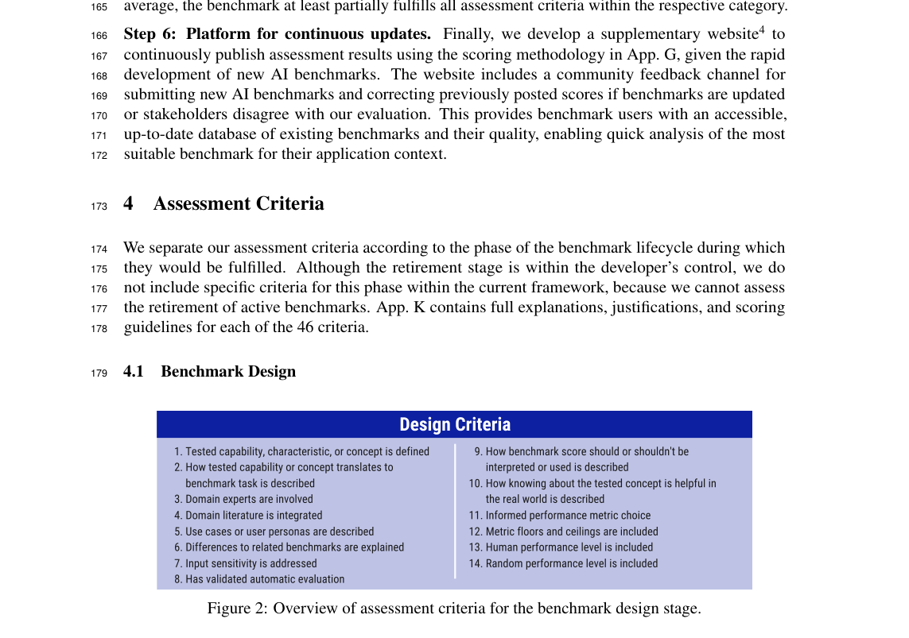

| 编号 | 评价标准（中文） | 对应关注点 |
|---:|---|---|
| D1 | 定义被测试的能力、属性或概念 | 说明基准究竟要测量什么 |
| D2 | 描述被测能力如何转化为具体基准任务 | 解释概念与测试题之间的映射及效度 |
| D3 | 说明理解该能力对于真实世界有何帮助 | 建立基准分数与实际用途的关联 |
| D4 | 描述基准的应用场景及用户角色 | 明确使用者、需求与适用边界 |
| D5 | 邀请领域专家参与 | 引入领域知识与外部专业判断 |
| D6 | 纳入相关领域的学术文献 | 使基准设计有理论和研究依据 |
| D7 | 说明基准分数应该或不应该如何解释、使用 | 防止超出证据范围的推断 |
| D8 | 有依据地选择性能评价指标 | 指标应与测量对象匹配 |
| D9 | 给出指标的上下限（floor/ceiling） | 帮助理解分数范围及饱和现象 |
| D10 | 提供人类表现水平 | 使机器分数有可解释的参照 |
| D11 | 提供随机表现水平 | 给出最低或机会水平的基线 |
| D12 | 处理输入敏感性问题 | 检查提示改写或输入扰动造成的差异 |
| D13 | 提供经过验证的自动评价机制 | 校验自动评分与所测能力的关系 |
| D14 | 解释与现有相关基准的差别 | 体现新基准的必要性与定位 |

### 4.2 实现（Benchmark Implementation，10 项）

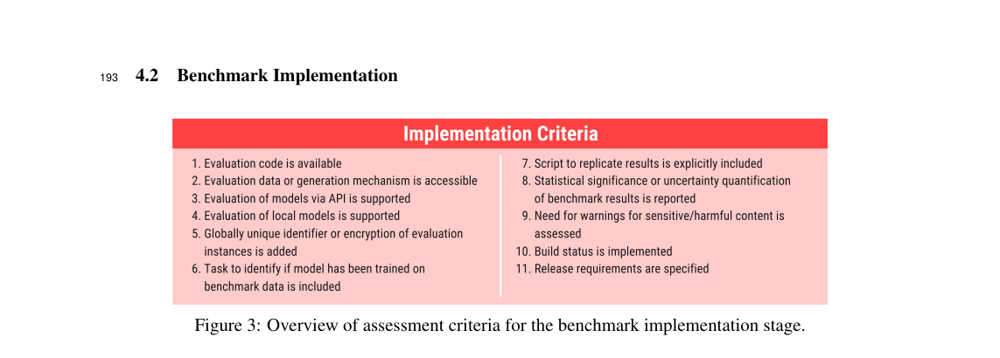

| 编号 | 评价标准（中文） | 对应关注点 |
|---:|---|---|
| I1 | 公开评价代码 | 是否可审查实际评分逻辑 |
| I2 | 明确提供复现初始结果的脚本 | 用户是否能重复原论文实验 |
| I3 | 可获得评价数据、提示词或动态测试环境 | 被测实例及环境是否可访问 |
| I4 | 支持通过 API 评价模型 | 是否方便评价远程闭源模型 |
| I5 | 支持本地模型评估 | 是否兼容可本地运行的模型 |
| I6 | 为测试实例添加全局唯一标识或加密保护 | 降低数据污染和题目泄露风险 |
| I7 | 包含识别模型是否在测试数据上训练过的任务 | 为训练—测试污染提供可检查信号 |
| I8 | 评估是否需要敏感或有害内容警告 | 保护基准开发者和使用者 |
| I9 | 明确发布或使用要求 | 约束如何共享和报告分数 |
| I10 | 提供构建状态（Build Status）或等价机制 | 反映评测软件是否仍可正常工作 |

**位置说明**：正文图 3 另将“统计显著性或不确定性量化”列入实现概览；附录 K 的详细清单将其置于文档阶段，因此此处按照附录 K 的逐项标准列示，避免重复计算。

### 4.3 文档（Benchmark Documentation，19 项）

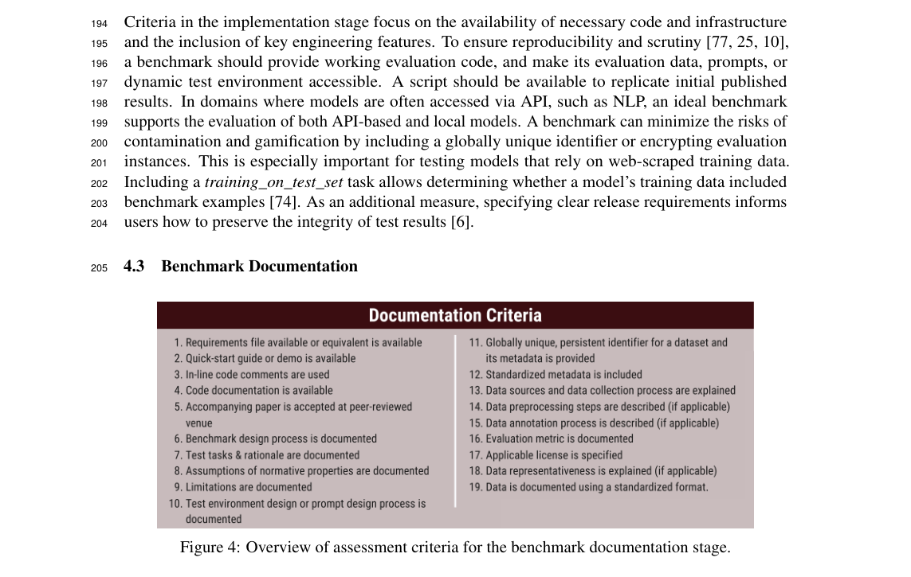

| 编号 | 评价标准（中文） | 对应关注点 |
|---:|---|---|
| C1 | 提供依赖文件（Requirements） | 记录安装环境和软件依赖 |
| C2 | 提供快速入门指南或演示代码 | 降低使用和复现门槛 |
| C3 | 在代码中加入有信息量的行内注释 | 解释关键实现细节 |
| C4 | 提供代码文档 | 介绍接口、参数及代码组织 |
| C5 | 说明测试任务类别及其设计理由 | 解释为何选取这些任务 |
| C6 | 说明基准所依据的规范性假设 | 披露价值判断和预设条件 |
| C7 | 记录基准局限性 | 说明不能推断的内容与风险 |
| C8 | 记录基准构建过程 | 使数据与评分流程可追溯 |
| C9 | 为数据集及其元数据提供持久唯一标识 | 方便引用、版本追踪与互操作 |
| C10 | 采用标准化元数据 | 如 Croissant 等元数据规范 |
| C11 | 说明数据来源及获取方式 | 检查采样和数据溯源 |
| C12 | 说明数据预处理步骤 | 追溯筛选、变换和清洗过程 |
| C13 | 说明数据标注程序（如适用） | 包括标注流程和质量控制 |
| C14 | 说明数据代表性（如适用） | 评估分布、偏差和覆盖范围 |
| C15 | 提供标准化文档 | 便于不同基准对比与检索 |
| C16 | 记录评价指标定义 | 包括计算方法及使用条件 |
| C17 | 至少对一个模型报告统计显著性 | 区分随机波动与可信差异 |
| C18 | 在同行评审场合发表或获接收 | 体现一定程度的外部审查 |
| C19 | 明确适用许可证 | 说明代码和数据的合法使用方式 |

### 4.4 维护（Benchmark Maintenance，3 项）

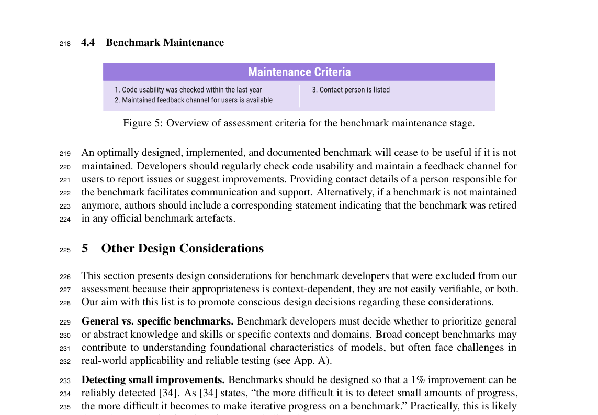

| 编号 | 评价标准（中文） | 对应关注点 |
|---:|---|---|
| M1 | 最近一年内检查过代码可用性 | 验证基准仍可运行 |
| M2 | 提供并维护用户反馈渠道 | 方便报告问题及改进建议 |
| M3 | 提供基准负责人的联系方式 | 明确维护责任与支持渠道 |

## 5. 其他设计考虑因素（中文译述）

本节讨论未被纳入强制评分的因素，因为其适宜性高度依赖应用背景，或外部观察者难以验证。这些考虑并不意味着不重要，而是需要基准开发者主动说明选择及其权衡。

**通用与专用基准**：覆盖广泛能力可以帮助理解模型的基础特征，却可能牺牲真实应用的适切性；面向专业领域的基准则可能更贴近操作性任务。**小幅进步的检测能力**：基准应尽可能能够可靠识别诸如 1% 的性能改进，这与样本规模和任务多样性有关。**多模态评价**：同一能力在视觉、语言等不同输入形式下的映射需要谨慎处理。**版本控制**：小修正可通过实例版本号记录，重大改版应发布新的基准版本。**动态与静态**：动态基准能够缓解饱和与污染，但往往削弱跨时间结果的可比性。**可投机性（Gameability）**：理想基准应抵抗仅针对题目或指标优化而未提升真实能力的行为。**研究者立场声明**：在适当情况下说明开发团队的背景和潜在偏差可增加透明度，不过论文未将其强制纳入评分，以免要求披露敏感个人信息。

## 6. 实证结果（中文译述，保留原数值）

作者根据框架评价 24 个基准，发现实现阶段是最薄弱环节，随后是维护阶段。原文表 1 的四阶段均分如下：

| 基准类型 | 设计 | 实现 | 文档 | 维护 |
|---|---:|---:|---:|---:|
| 基础模型（FM） | 10.6 | 5.5 | 10.3 | 9.1 |
| 非基础模型（Non-FM） | 11.1 | 7.4 | 9.9 | 10.8 |
| 全部 24 个基准 | 10.7 | 6.1 | 10.1 | 9.7 |

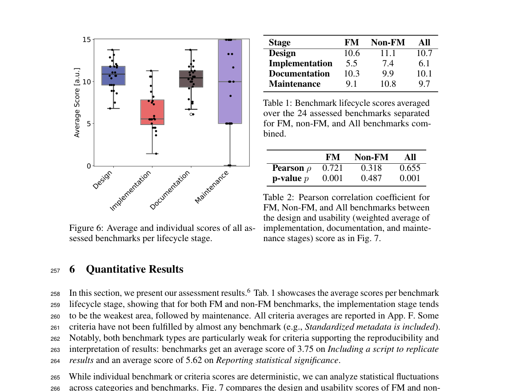

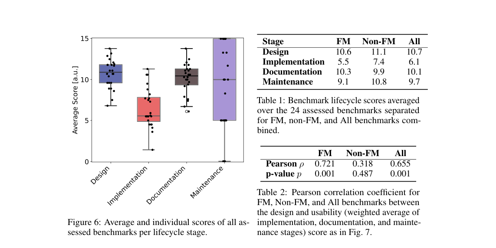

多个与可复现性和结果可解释性直接相关的准则表现不佳：**“提供重现实验结果的脚本”平均仅 3.75 分**，**“报告统计显著性”平均仅 5.62 分**。所有基准的设计平均分为 **10.7**，加权可用性平均分为 **8.7**。FM 与非 FM 两组的设计与可用性均分差异，在 95% 置信水平上未达到统计显著。

原文表 2 给出了设计分数与可用性分数的 Pearson 相关关系：基础模型基准 **ρ=0.721，p=0.001**；非基础模型基准 **ρ=0.318，p=0.487**；合并后的全部基准 **ρ=0.655，p=0.001**。作者据此认为，对于基础模型基准和全部基准总体，设计质量更差往往伴随可用性较低；但这不是因果关系结论。

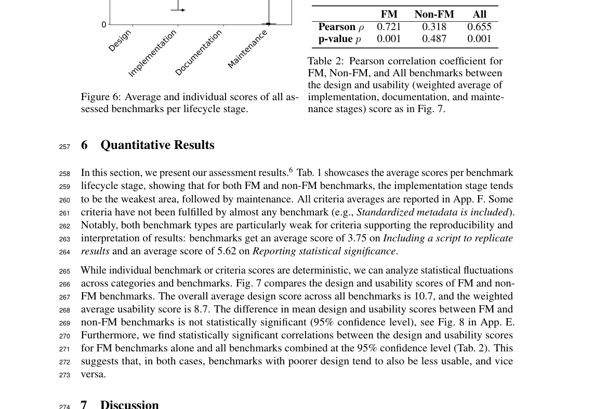

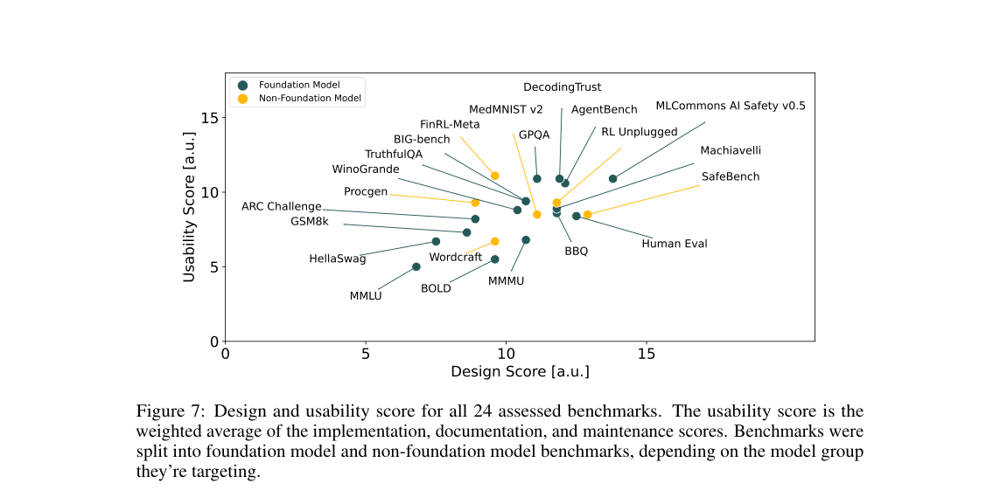

## 7. 讨论（中文译述）

**第一，不能把所有基准分数视为同等可靠。** 不同基准质量差异很大，例如在本论文的评估规则下，广泛使用的 MMLU 的加权平均得分为 **5.5**，而 GPQA 为 **11.0**。作者指出，模型发布材料若同时报告二者而不说明基准的质量与局限性，会使读者对模型能力产生片面理解；监管机构采用这些分数时风险更大。

**第二，大量评估难以区分真实信号与随机噪声。** 仅报告单次模型成绩，难以判断模型之间的差距是否只是采样温度、随机种子或运行条件导致。理想评估应对同一模型重复运行并报告均值、方差或置信区间，再解释模型间差异。论文发现，**24 个基准中有 14 个**没有对同一模型进行多次评价或报告统计显著性/不确定性。

**第三，实现与文档问题削弱复现能力。** **24 个基准中有 17 个**未提供易于运行的脚本来重现初始论文结果，另有 **4 个**只能重现部分结果。这不仅妨碍独立审查，也阻碍后续研究将基准用于新模型。

## 8. 局限性与适用边界（中文译述）

BetterBench 评价的是基准的设计与使用质量，而不是直接证明某一个基准的全部标准答案正确，也不意味着评分最高的基准适用于所有任务。不同领域的合理设计取舍难以用一套通用清单完全概括；部分准则存在主观判断，即使有多位评价者、评分指南与协商流程，也无法将专家解释分歧彻底消除。基准会随维护、数据变化和新模型出现而变化，因此评分是针对特定材料和评估时间作出的判断，不能视为永久有效。

对于需要评价地理空间智能体基准的研究，特别应区分：**（1）基准开发过程与材料的规范程度；（2）参考答案及判分器的实际正确性；（3）基准与目标真实空间任务的对应关系。** 这是根据本文方法所作的研究应用说明，而非作者提出的额外公式或结论。

## 9. 附录导读与逐页核查

原文附录 A 讨论基准测试的开放问题，附录 B 介绍利益相关者及其评价用途，附录 C 描述生命周期，附录 D 提供 24 个被评估基准，附录 E–H 涵盖统计分析、各准则得分、得分计算与方法流程，附录 I 为发布要求，附录 J 给出最低质量保证清单及该清单的使用示例，附录 K 则逐条提供 46 个准则的定义、理由与 0/5/10/15 分值锚点。**附录中的长篇逐项理由未完全逐句译出；请与 `英文原文_逐页.md` 及原 PDF 第 16—51 页核对。**

### 附录中的原始数据与补充图

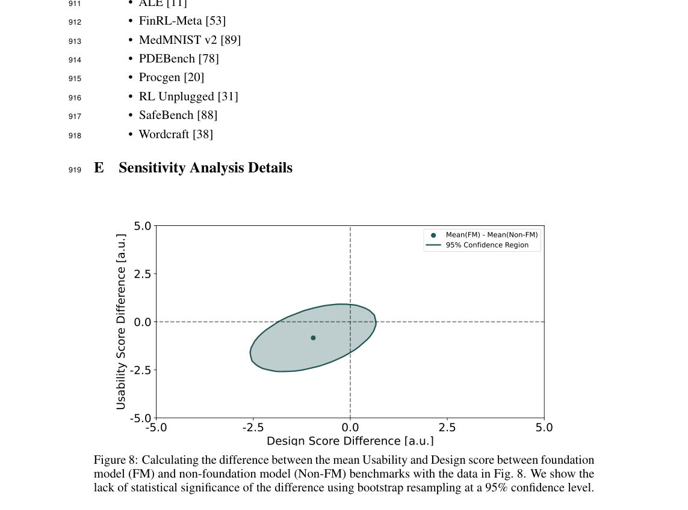

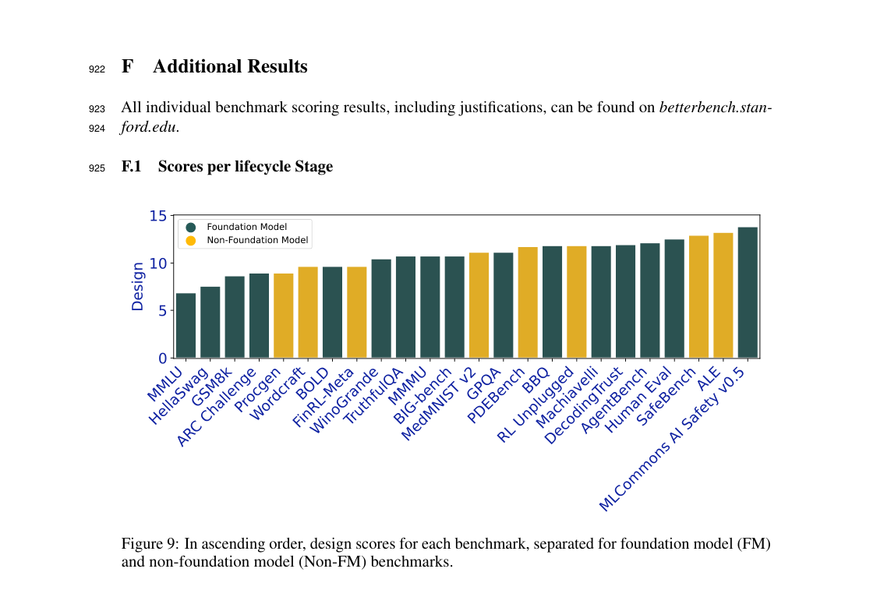

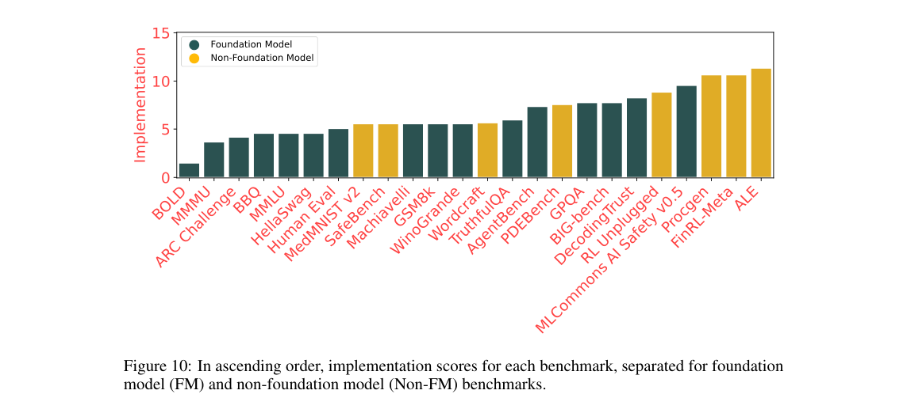

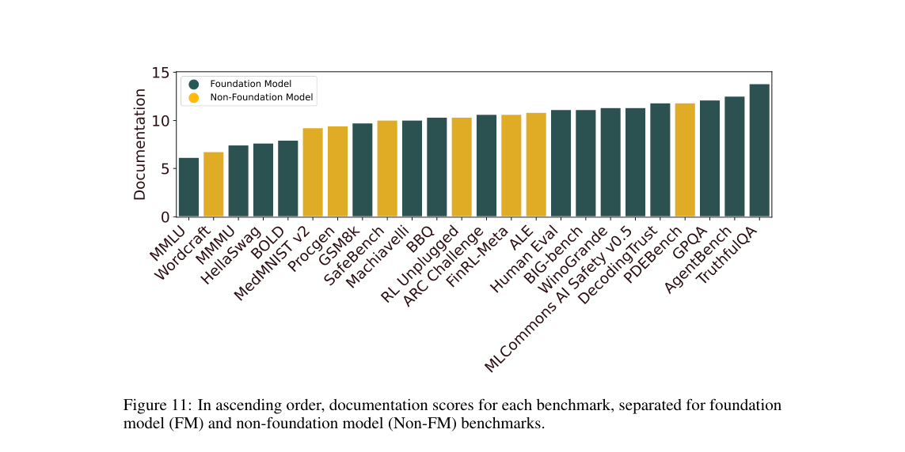

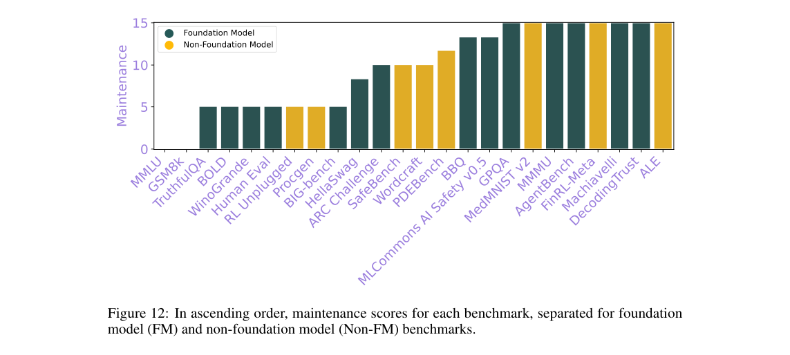

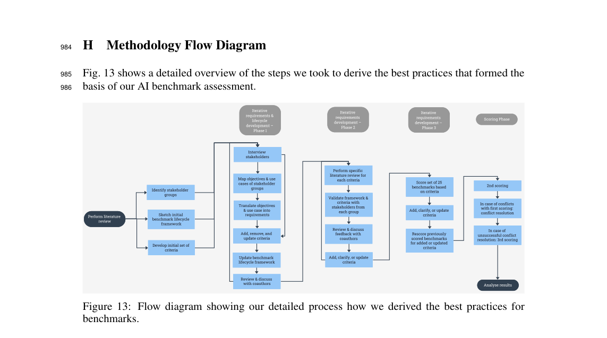

## 专业术语表

| 英文 | 中文建议译法 |
|---|---|
| Benchmark | 基准测试、评估基准 |
| Benchmark quality | 基准质量 |
| Validity | 效度；测量是否反映目标能力 |
| Usability | 可用性 |
| Reproducibility / Replicability | 可复现性 / 可重复验证性（按上下文区分） |
| Input sensitivity | 输入敏感性 |
| Data contamination | 数据污染（训练—测试泄漏） |
| Gameability | 可投机性、可刷榜性 |
| Metric floor / ceiling | 指标下限 / 上限 |
| Ground truth / gold standard | 真实值、参考标准、黄金标准 |
| Inter-model / intra-model variance | 模型间 / 模型内方差 |
| Statistical significance | 统计显著性 |
| Lifecycle | 生命周期 |
| Normative assumptions | 规范性假设 |

## 参考文献说明

作者引用的全部英文参考文献、原图内英文和附录原文均保留于 `英文原文_逐页.md`、`逐页原文与配图.md` 和 `原始论文.pdf`。为避免错改作者、年份、卷期和 DOI，参考文献书目信息未逐条汉化；请优先按原始英文检索。

---

**核查提醒**：本文中的中文表述以当前 PDF 为准；图文与参考文献可追溯到 `图表索引_原图.md` 和 `QA_逐页核查.md`。当正文叙述与附录的准则归类或编号略有差异时，本译稿明确指出，不做静默修订。
