# 图表索引（原图截图）

> 按 PDF 原始页码索引，图表编号与原文一致。每张图提供裁切图和源页全图。若裁切不完整，以源页图为准。

## 图 1（原 PDF 第 2 页）

**英文原图题**：Figure 1: Five stages of the benchmark lifecycle. A detailed description can be found in App. C.

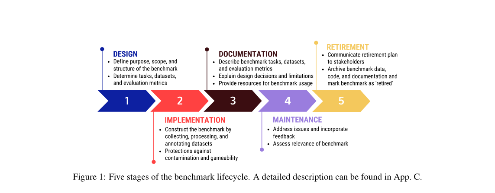

[查看完整原稿第 2 页](./source_pages/page-002.jpg)

## 图 2（原 PDF 第 5 页）

**英文原图题**：Figure 2: Overview of assessment criteria for the benchmark design stage.

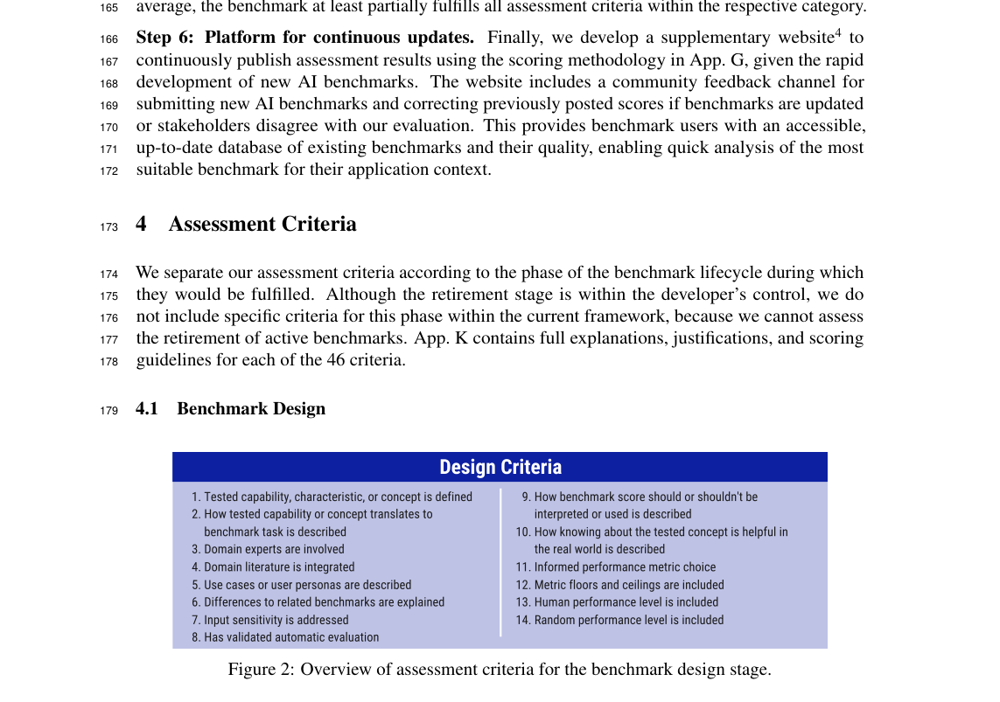

[查看完整原稿第 5 页](./source_pages/page-005.jpg)

## 图 3（原 PDF 第 6 页）

**英文原图题**：Figure 3: Overview of assessment criteria for the benchmark implementation stage.

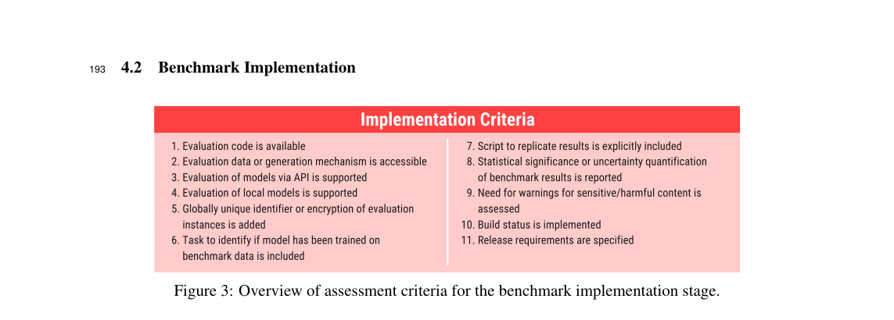

[查看完整原稿第 6 页](./source_pages/page-006.jpg)

## 图 4（原 PDF 第 6 页）

**英文原图题**：Figure 4: Overview of assessment criteria for the benchmark documentation stage.

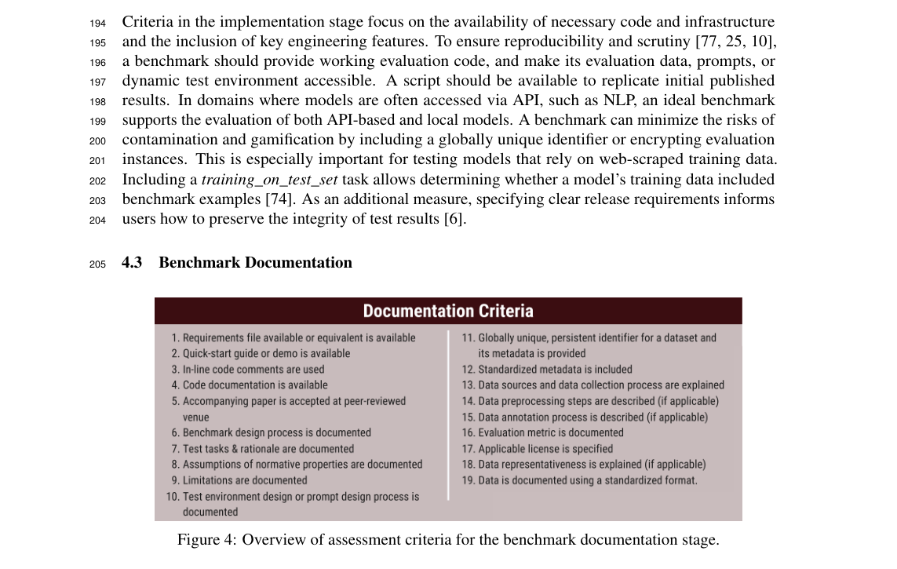

[查看完整原稿第 6 页](./source_pages/page-006.jpg)

## 图 5（原 PDF 第 7 页）

**英文原图题**：Figure 5: Overview of assessment criteria for the benchmark maintenance stage.

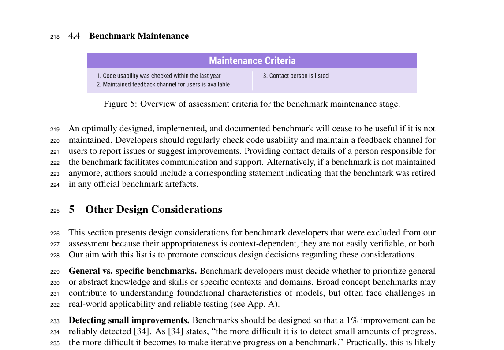

[查看完整原稿第 7 页](./source_pages/page-007.jpg)

## 表 1（原 PDF 第 8 页）

**英文原图题**：Table 1: Benchmark lifecycle scores averaged over the 24 assessed benchmarks separated for FM, non-FM, and All benchmarks com- bined.

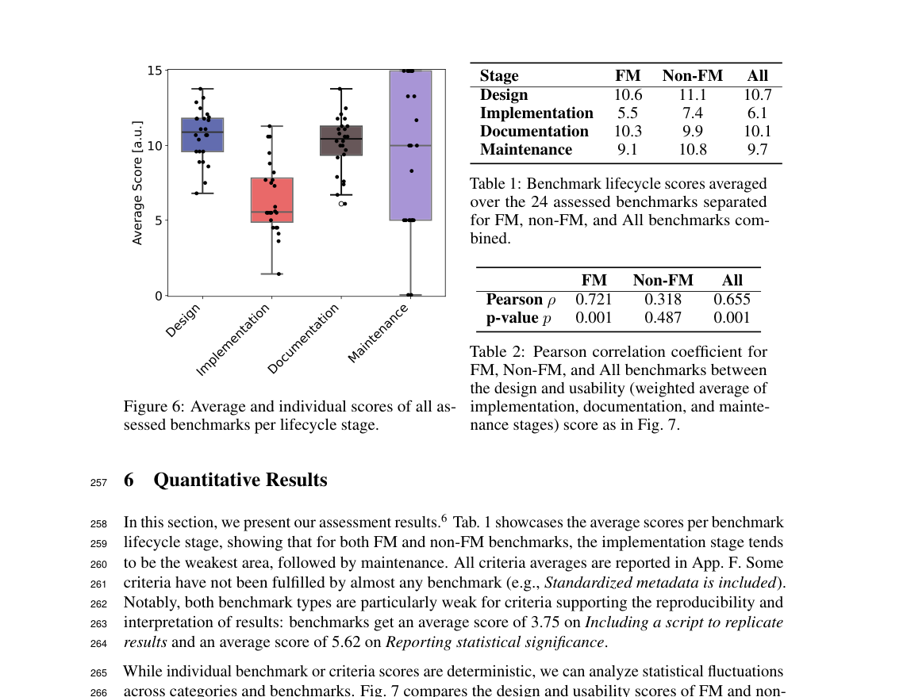

[查看完整原稿第 8 页](./source_pages/page-008.jpg)

## 表 2（原 PDF 第 8 页）

**英文原图题**：Table 2: Pearson correlation coefficient for FM, Non-FM, and All benchmarks between the design and usability (weighted average of implementation, documentation, and mainte- nance stages) score as in Fig. 7.

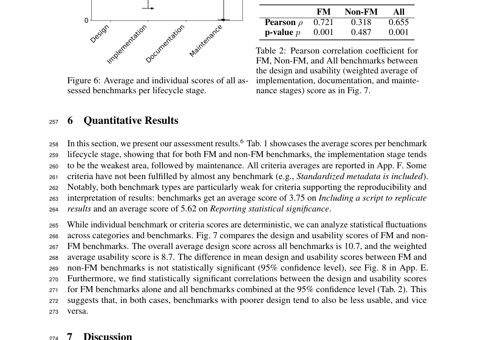

[查看完整原稿第 8 页](./source_pages/page-008.jpg)

## 图 6（原 PDF 第 8 页）

**英文原图题**：Figure 6: Average and individual scores of all as- sessed benchmarks per lifecycle stage.

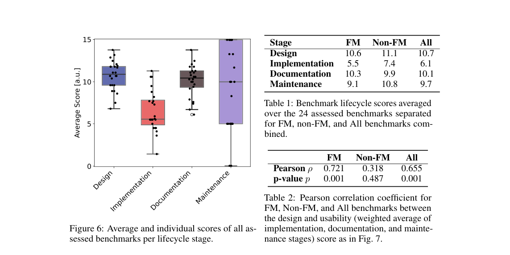

[查看完整原稿第 8 页](./source_pages/page-008.jpg)

## 图 7（原 PDF 第 9 页）

**英文原图题**：Figure 7: Design and usability score for all 24 assessed benchmarks. The usability score is the weighted average of the implementation, documentation, and maintenance scores. Benchmarks were split into foundation model and non-foundation model benchmarks, depending on the model group they’re targeting.

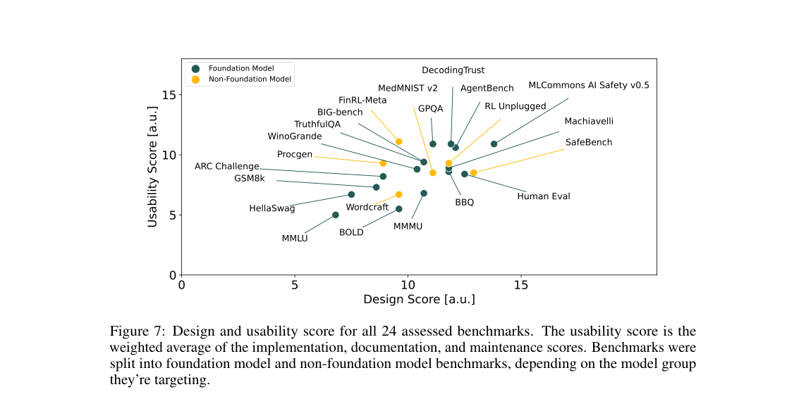

[查看完整原稿第 9 页](./source_pages/page-009.jpg)

## 图 8（原 PDF 第 23 页）

**英文原图题**：Figure 8: Calculating the difference between the mean Usability and Design score between foundation model (FM) and non-foundation model (Non-FM) benchmarks with the data in Fig. 8. We show the lack of statistical significance of the difference using bootstrap resampling at a 95% confidence level.

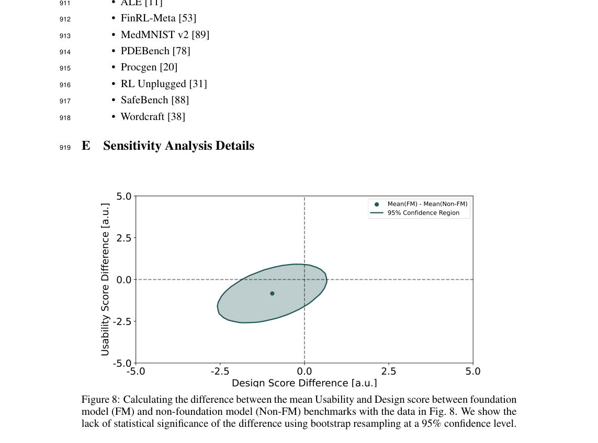

[查看完整原稿第 23 页](./source_pages/page-023.jpg)

## 图 9（原 PDF 第 24 页）

**英文原图题**：Figure 9: In ascending order, design scores for each benchmark, separated for foundation model (FM) and non-foundation model (Non-FM) benchmarks.

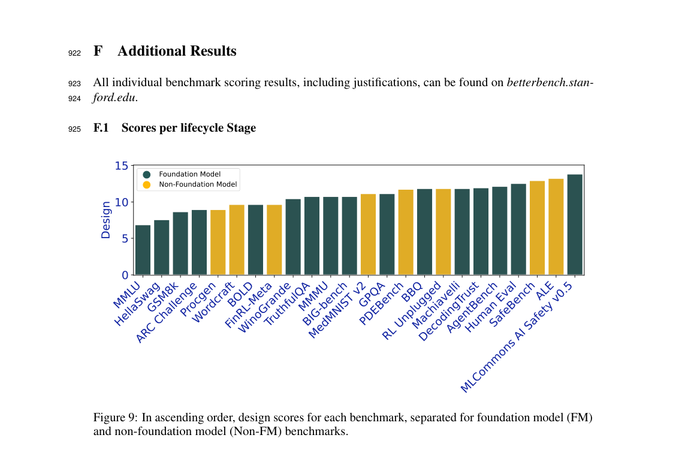

[查看完整原稿第 24 页](./source_pages/page-024.jpg)

## 图 10（原 PDF 第 24 页）

**英文原图题**：Figure 10: In ascending order, implementation scores for each benchmark, separated for foundation model (FM) and non-foundation model (Non-FM) benchmarks.

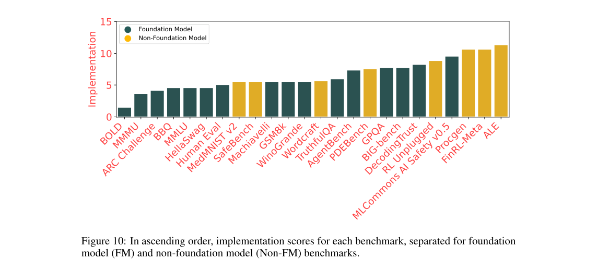

[查看完整原稿第 24 页](./source_pages/page-024.jpg)

## 图 11（原 PDF 第 25 页）

**英文原图题**：Figure 11: In ascending order, documentation scores for each benchmark, separated for foundation model (FM) and non-foundation model (Non-FM) benchmarks.

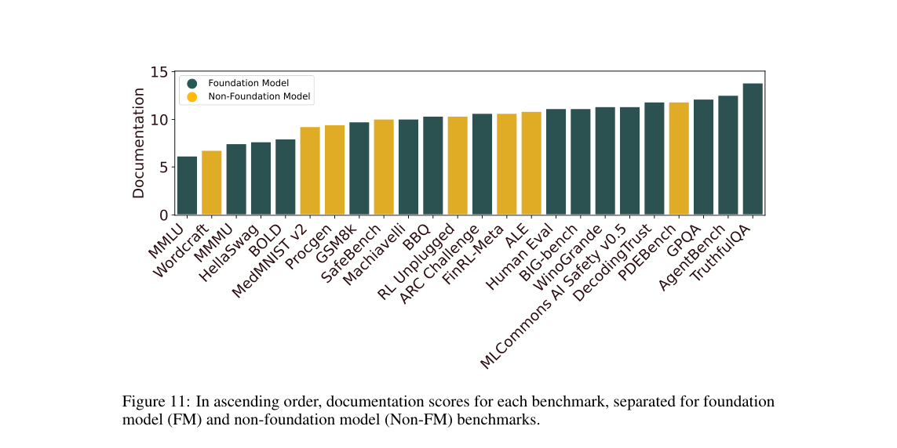

[查看完整原稿第 25 页](./source_pages/page-025.jpg)

## 图 12（原 PDF 第 25 页）

**英文原图题**：Figure 12: In ascending order, maintenance scores for each benchmark, separated for foundation model (FM) and non-foundation model (Non-FM) benchmarks.

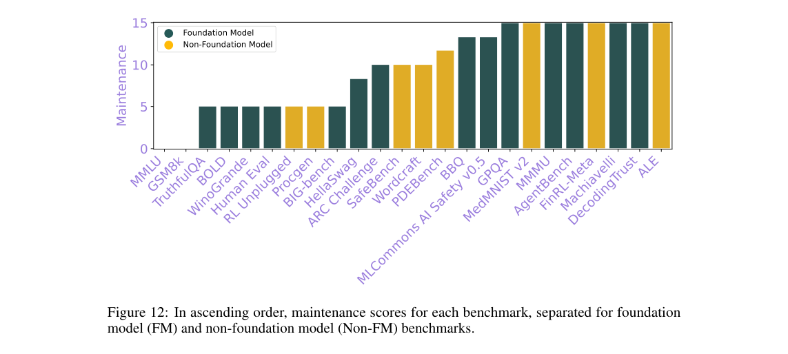

[查看完整原稿第 25 页](./source_pages/page-025.jpg)

## 图 13（原 PDF 第 27 页）

**英文原图题**：Figure 13: Flow diagram showing our detailed process how we derived the best practices for benchmarks.

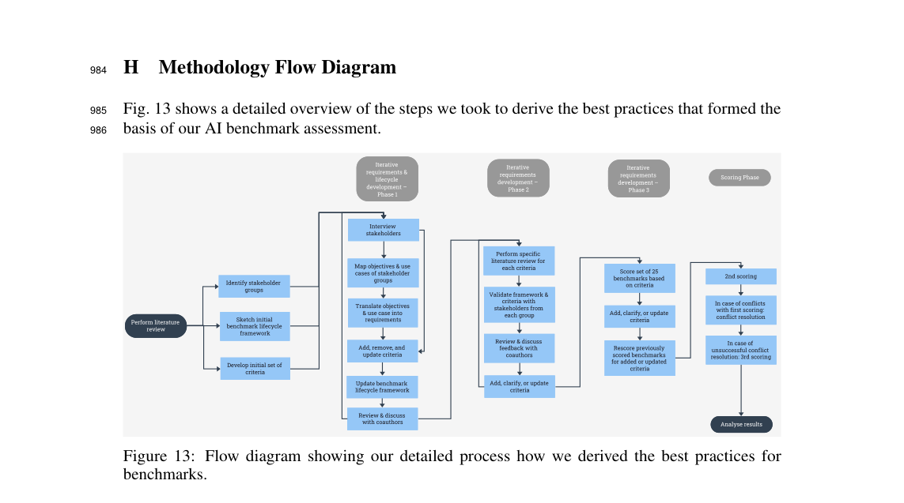

[查看完整原稿第 27 页](./source_pages/page-027.jpg)
