# ClimateAgent：面向复杂气候数据科学工作流的多智能体编排

**原文：** ClimateAgent: Multi-Agent Orchestration for Complex Climate Data Science Workflows  
**作者：** Chenyue Li、Hyeonjae Kim、Wen Deng、Mengxi Jin、Wen Huang、Mengqian Lu、Binhang Yuan  
**期刊：** Transactions on Machine Learning Research（2026 年 4 月）  
**本文 PDF：** 53 页，正文后包含大量附录、Agent 提示词、运行案例与消融结果。

> **译稿范围说明：** 这是依据原文撰写的中文核心章节学术翻译与详细译述，非 53 页的逐句完整译文。全部英文正文、算法、代码/提示词、参考文献和附录，均保留在 `英文原文_逐页.md` 与 `逐页原文与图表对照.md`，并提供逐页原版截图。附录中的代码与配置文件应以原文为准。

## 摘要（完整翻译）

气候科学需要自动化工作流，将综合性研究问题转化为基于数据的科学论述，而这些工作流必须处理规模巨大、来源和格式各异的数据集。然而，通用大语言模型智能体与静态脚本流水线缺乏气候领域专门知识及灵活性，在实践中的表现并不理想。本文提出 **ClimateAgent**，一个能够编排端到端气候数据分析工作流的自主多智能体框架。ClimateAgent 使用 Orchestrate-Agent 和 Plan-Agent 协调任务，将用户问题分解为可执行子任务；通过专门的 Data-Agent 动态检查数据接口（API），生成稳健的下载脚本；再由 Coding-Agent 生成 Python 分析代码、可视化与最终报告，并通过内置自纠错循环处理执行失败。

为系统评估该框架，作者提出 **Climate-Agent-Bench-85**，由 **85 道真实气候工作流任务**构成，覆盖大气河流、干旱、极端降水、热浪、海表温度和热带气旋六个主题。在该基准上，ClimateAgent 的任务完成率达到 **100%**，报告质量得分 **8.32**，优于 GitHub Copilot（**6.27**）和 GPT-5 基线（**3.26**）。结果表明，结合动态 API 感知能力与自纠错执行的多智能体编排可明显提升气候科学端到端自动化的可靠性。代码地址为 `https://github.com/Relaxed-System-Lab/ClimateAgent`。

## 1. 引言：气候科学自动化面临的困难

气候研究经常需要将自然语言问题转化为长流程：发现合适的数据源，在 CDS / ECMWF 等服务中确定变量与时空范围，下载再分析或预测数据，计算气象指标，进行统计检验与绘图，最后撰写科学解释。数据本身具有多维度、大体量、时空尺度复杂和单位格式不一致等问题。即使单个脚本能够完成某一步，固定流水线也很难适应 API 元数据变化、缺失数据、统计方案更改以及下游分析反馈。

作者将这类任务定义为**面向特定科学领域的规划与数据处理代码生成问题**。其重点不只是让模型输出一段 Python，而是为数据下载、跨阶段状态管理、程序执行和结果校验设计可恢复的协调机制。研究围绕三个核心能力展开：协同任务规划（Coordinated Task Planning）、上下文协调（Contextual Coordination）与自适应自纠错（Adaptive Self-Correction）。

## 2. 相关工作

论文对比了通用工具使用智能体、软件工程类自动化框架、气候工作流引擎以及科学领域自治研究。AutoGPT、LangChain、CrewAI 等工具提供通用 Agent 组织机制，Kepler、Apache Airflow、Cylc、ESMValTool 等平台支持工作流编排；而 CDS API、ECMWF API、xarray 和 CDO 是气候数据操作的关键技术接口。这些方法或者依赖大量人工配置，或者对特定 API、数据格式、任务转换和运行错误不够稳健。ClimateAgent 的差异在于让面向气候数据的专业 Agent 在统一状态管理下执行多步任务，并利用实时元数据而非模型的静态记忆推断 API 参数。

## 3. ClimateAgent 设计

### 3.1 系统总体结构与形式化目标

系统接收用户定义的高层气候研究任务 T，生成有依赖顺序的子任务计划，依次获取数据、编写代码、执行运算、完成图表和报告。框架中，Orchestrate-Agent 负责实验目录、持久化状态和任务调度；Plan-Agent 负责分解问题和组织工具；Data-Agent 专门适配各类数据接口；Coding-Agent 分别执行分析与可视化/报告任务。每次子任务完成后，新的工件、执行记录和决定都会写入上下文状态 C，使后续 Agent 可以引用上一步的真实结果。

**图 1（PDF 第 5 页，原文图表截图）**

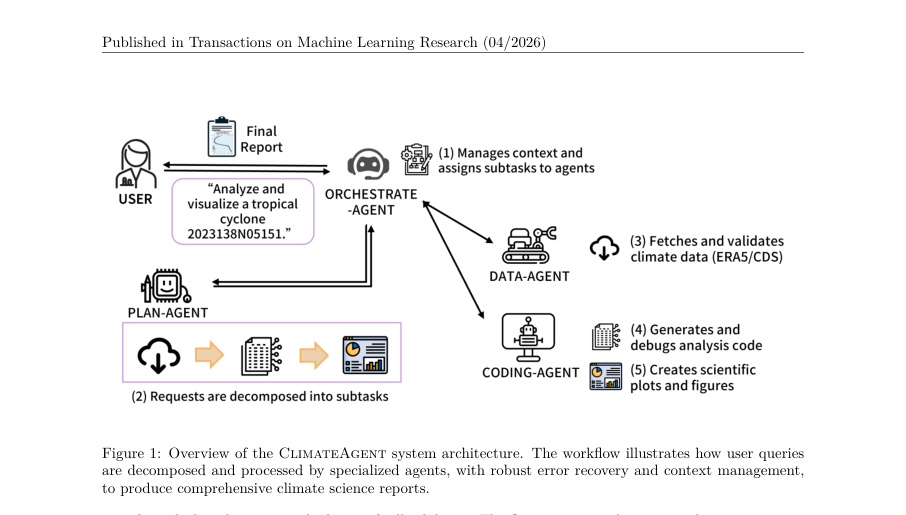

<small>原文图题：Figure 1: Overview of the ClimateAgent system architecture. The workflow illustrates how user queries are decomposed and processed by specialized agents, with robust error recovery and context management, to produce comprehensive climate science reports.</small>

### 3.2 协同任务规划

Orchestrate-Agent 为每次研究建立带时间标记的实验目录并协调 Agent 调用。Plan-Agent 依据气候领域知识识别工作流结构，例如**气候态 → 距平 → 极端事件识别 → 报告**，或根据再分析数据、预测数据、初始化时间、预报时效和统计窗口安排前后依赖。数据获取 Agent 面向 CDS、ECMWF S2S 等来源，使用有效元数据约束变量、层次、日期和产品参数；Coding-Agent 生成数据处理程序，并根据执行结果修复错误。

### 3.3 持久化上下文协调

系统将上下文视为一个可持久化、可复用的运行状态，而非仅靠 Agent 对话记忆。上下文包含计划、脚本文件、输入输出路径、已完成操作、错误历史与产物登记。原文的递推思想可表示为 `C_i = Execute(C_(i−1), s_i, A_k)`：第 i 个子任务在之前所有决策及中间产物的基础上执行。这种状态记录既是 Agent 间的通信协议，也是断点恢复与科研可追溯性的证据。

### 3.4 自适应自纠错的三个层次

作者识别的错误不仅有传统的 Python 运行异常，还包括 API 参数无效、数组索引和坐标转换错误，以及虽可运行但科学含义错误的情况。ClimateAgent 使用互补的三种恢复方案：

1. **多候选脚本生成**：数据下载 Agent 生成 `m=8` 个请求脚本候选，依次执行，直到找到成功的配置，以应对数据接口参数不稳定。
2. **基于运行反馈的迭代修复**：编程 Agent 在失败后读取诊断信息、更新代码并重试；作者给出最大重试次数 `Rmax=3`，每个候选又可进行多次调试迭代。
3. **基于 LLM 的语义验证**：当代码能够运行、但时间基准、统计检验或数据含义可能不正确时，增加科学语义层面的审核，减少“无异常但错误”的结果。

文中算法 1 将这三个策略整合为明确的编排过程：初始化任务目录与状态 → Plan-Agent 生成子任务 → 为每个子任务选 Agent → 生成下载候选或分析脚本 → 调用验证与执行 → 成功则注册产物、失败则记录错误并修复 → 最后获取科学报告。该算法的原始伪代码见第 8 页。

### 3.5 框架运行边界

该框架强调自动执行和自纠错，但这不等于所有输出已经得到完全独立的科学验证。运行成功、报告存在、科学结论正确是三个不同的层次；对 Benchmark 研究而言，需要分别考察执行过程的可复现性、数据来源有效性、统计方法正确性和报告结论一致性。

## 4. Climate-Agent-Bench-85

### 4.1 任务设计

基准由真实气候研究问题构建，每道题以自然语言说明研究目标，并规定必要数据集、工具、输出文件及格式。作者按照科学复杂度而非简单的提示长度区分任务：**简单题**通常涉及单一数据源；**中等题**要求多个数据源或跨步骤依赖；**困难题**还涉及外部工具、动态参数和更复杂的错误恢复。设计目标与 ClimateAgent 的三项核心能力一一对应：规划、状态维护与自适应修复。

### 4.2 六个专题领域

- **大气河流（Atmospheric Rivers，AR）**：计算整层水汽输送（IVT），使用多高度层的风场与湿度，并对空间区域和轨迹进行识别；原文给出 15 个任务。
- **干旱（Drought，DR）**：基于 SPI、土壤水分距平和较长气候基准期进行统计标准化，需处理季节循环、缺测和分级可视化；原文给出 15 个任务。
- **极端降水（Extreme Precipitation，EP）**：分析极端降水事件的时间、空间和强度特征。
- **热浪（Heat Waves，HW）**：识别极端高温、持续时间与区域差异。
- **海表温度（Sea Surface Temperature，SST）**：开展海温气候态、距平与区域变化分析。
- **热带气旋（Tropical Cyclones，TC）**：处理风暴轨迹、气象场与外部事件跟踪工具。

基准任务依托 ERA5、S2S 预测、OISST、IBTrACS 等资料与实际气候研究方法。每题配置参考解决方案，包括经过验证的 Python 程序和带图表的人工可读报告。不同任务具有明确输出契约，便于追查文件是否真实生成、是否可读以及是否符合要求。

### 4.3 评价协议

作者将**最终科学报告（Report Score）**作为核心评价对象，采用 1—10 分量表，从四个维度给出质量判断：**可读性（Readability）**，关注结构、清晰度、术语与表达；**科学严谨性（Scientific Rigor）**，关注方法、统计检验、不确定性和解释有效性；**完整性（Completeness）**，关注是否满足问题所需的分析与报告要素；**视觉质量（Visual Quality）**，关注图件的相关性、清晰度、绘图方式和数据表达。这里的报告质量并不等同于地理空间对象的数值容差判定，可能带有评价者主观性，因此论文在附录中单独检验专家与 LLM-as-Judge 的一致性。

## 5. 主要实验

### 5.1 基线与主要结果

论文使用 GPT-5 和 GitHub Copilot 作为主要基线，并在六个专题领域上进行对比。ClimateAgent 在论文指定流程和评价方案下达到 **100% 的报告生成完成率**，报告平均得分 **8.32**；Copilot 为 **6.27**，GPT-5 为 **3.26**。这表明工作流编排、科学数据接口的动态适配和错误修复可共同提升端到端任务完成表现，但实验分数的适用范围仍受本论文的任务集和 Report Score 定义限制。

**表 1（PDF 第 12 页，原文图表截图）**

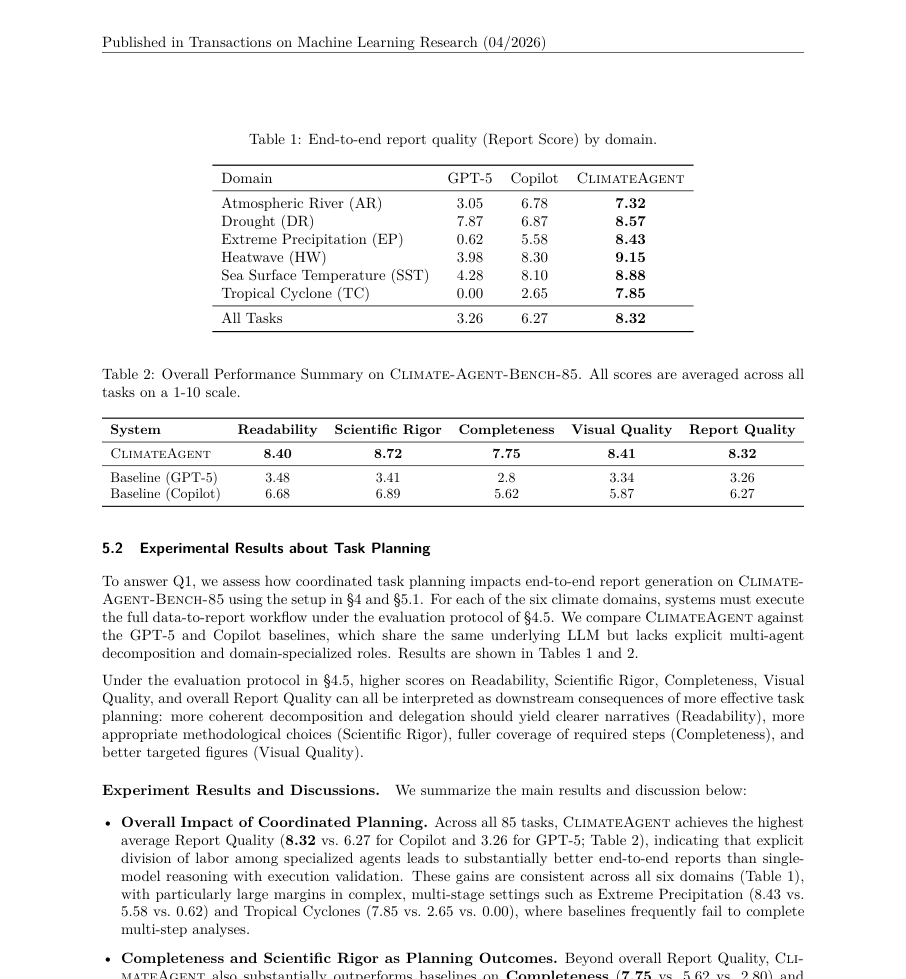

<small>原文图题：Table 1: End-to-end report quality (Report Score) by domain.</small>

**表 2（PDF 第 12 页，原文图表截图）**

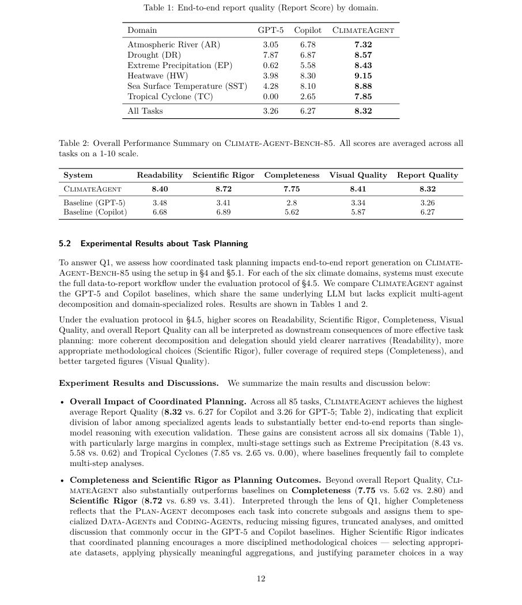

<small>原文图题：Table 2: Overall Performance Summary on Climate-Agent-Bench-85. All scores are averaged across all tasks on a 1-10 scale.</small>

**图 2（PDF 第 14 页，原文图表截图）**

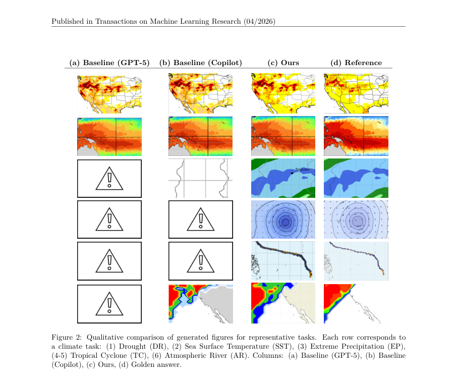

<small>原文图题：Figure 2: Qualitative comparison of generated figures for representative tasks. Each row corresponds to a climate task: (1) Drought (DR), (2) Sea Surface Temperature (SST), (3) Extreme Precipitation (EP), (4-5) Tropical Cyclone (TC), (6) Atmospheric River (AR). Columns: (a) Baseline (GPT-5), (b) Baseline (Copilot), (c) Ours, (d) Golden answer.</small>

### 5.2 上下文管理与结果呈现

原文通过跨步骤中间文件、气候变量及绘图任务说明状态协调的价值。未建立持久上下文的基线可能重复下载数据、使用错误变量或失去前一阶段的计算产物；而 ClimateAgent 会在后续子任务中读取已注册文件、有效数据范围与先前选择。图 2 将多个基线的结果图件与 ClimateAgent 和参考图进行并排对比，显示不仅文本报告，**图的科学意义和可视证据**也应被核查。

### 5.3 错误案例与消融

原文给出数组布尔索引维度错误、ERA5 请求日期格式问题、括号不匹配导致语法错误、经度坐标对齐及非数值类型等典型失败案例，证明仅有代码生成能力不足以覆盖科学计算中常见的执行和语义缺陷。自纠错系统通过运行回显、重试与参数重构提高任务完成的可能性。实际应用仍应将重试次数、失败原因、API 请求和生成产物记录为审计数据，而不能只保留“最后一次运行成功”。

**表 3（PDF 第 15 页，原文图表截图）**

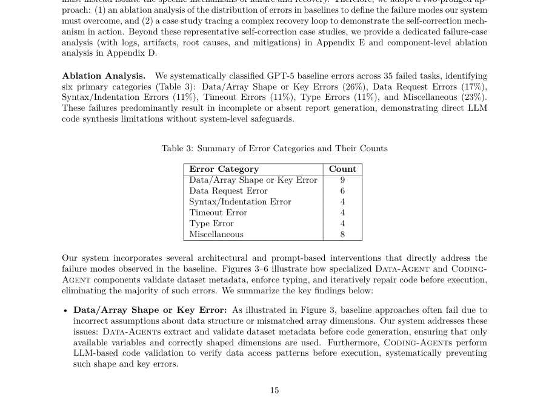

<small>原文图题：Table 3: Summary of Error Categories and Their Counts</small>

**图 3（PDF 第 16 页，原文图表截图）**

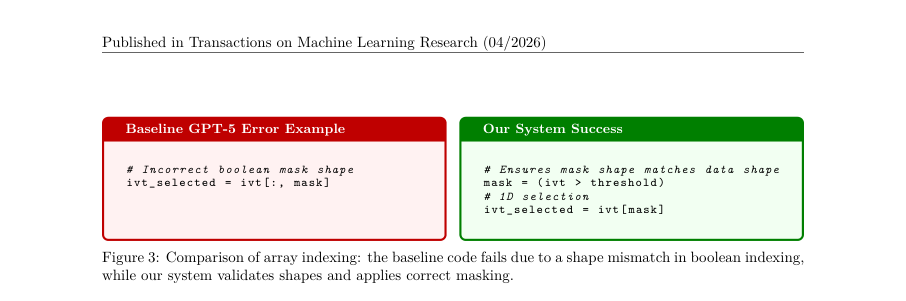

<small>原文图题：Figure 3: Comparison of array indexing: the baseline code fails due to a shape mismatch in boolean indexing, while our system validates shapes and applies correct masking.</small>

**图 4（PDF 第 16 页，原文图表截图）**

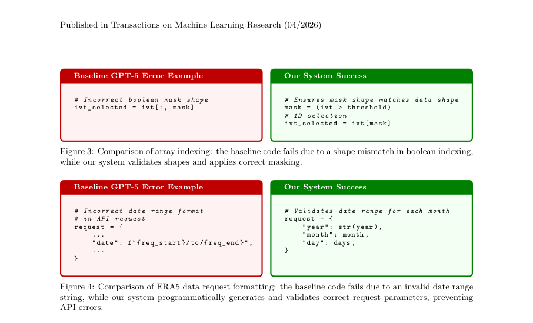

<small>原文图题：Figure 4: Comparison of ERA5 data request formatting: the baseline code fails due to an invalid date range string, while our system programmatically generates and validates correct request parameters, preventing API errors.</small>

**图 5（PDF 第 16 页，原文图表截图）**

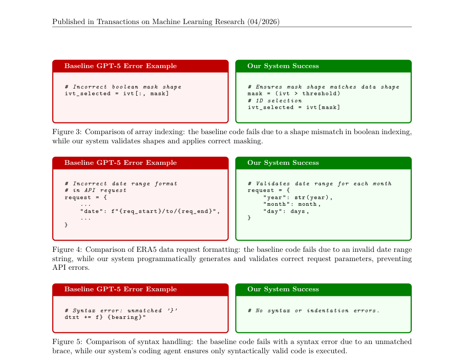

<small>原文图题：Figure 5: Comparison of syntax handling: the baseline code fails with a syntax error due to an unmatched brace, while our system’s coding agent ensures only syntactically valid code is executed.</small>

**图 6（PDF 第 16 页，原文图表截图）**

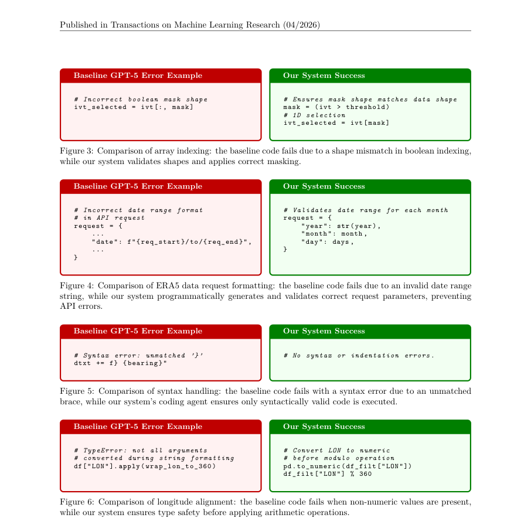

<small>原文图题：Figure 6: Comparison of longitude alignment: the baseline code fails when non-numeric values are present, while our system ensures type safety before applying arithmetic operations.</small>

## 6. 结论

ClimateAgent 通过分工明确的多智能体架构、可持久化运行上下文、动态 API 元数据获取以及多层错误修复，将用户的气候科学研究问题转化为端到端可执行流程。作者在 Climate-Agent-Bench-85 上展示了相对通用基线的性能优势，并提出复杂科学 Agent 的可靠性来自**规划、外部数据访问、程序执行、验证和报告**的整体协调，而非单次语言模型输出。

## 7. 附录结构与高价值内容定位

本次上传 PDF 第 22—53 页包含扩展材料，特别值得核查以下内容：

- **附录 A（约第 22—33 页）**：Plan-Agent、Data-Agent、Coding-Agent 的职责、系统提示词、实时 API 元数据抽取、脚本生成，以及真实报告示例。英文提示词和完整代码保持原样，方便复现实验。
- **后续技术附录（约第 34—45 页）**：状态保存、调用日志、任务级尝试次数、动态请求参数与任务失败处理等执行细节。
- **故障案例附录（第 46—48 页附近）**：ECMWF 服务/网络故障、xarray / GRIB 后端不兼容、文件路径与工作目录不一致等问题，以及作者提出的幂等重试、预检与路径契约建议。
- **人工专家与 LLM 评审对照（第 48—50 页附近）**：专家对图中遗漏与不符合物理规律的空间形态更加敏感，而 LLM 评审可能受流畅叙述影响，高估图文一致性。作者建议对视觉关键任务加入针对性人工审查。
- **扩展比较（第 51—53 页附近）**：与 DeepAgent 的受控比较中，DeepAgent 在六类代表性任务中有三类未能生成可评分报告；这凸显了将通用 Agent 迁移到科学长工作流时的工具契约问题。

**图 1（PDF 第 32 页，原文图表截图）**

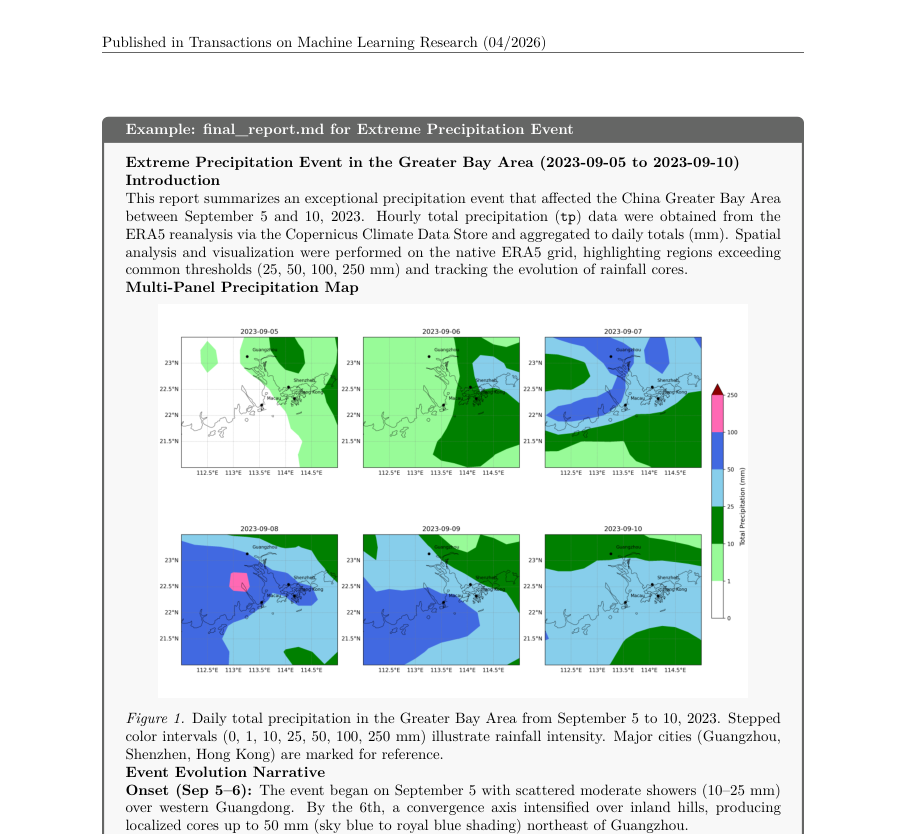

<small>原文图题：Figure 1. Daily total precipitation in the Greater Bay Area from September 5 to 10, 2023. Stepped color intervals (0, 1, 10, 25, 50, 100, 250 mm) illustrate rainfall intensity. Major cities (Guangzhou, Shenzhen, Hong Kong) are marked for reference. Event Evolution Narrative Onset (Sep 5–6): The event began on September 5 with scattered moderate showers (10–25 mm) over western Guangdong.</small>

**表 4（PDF 第 39 页，原文图表截图）**

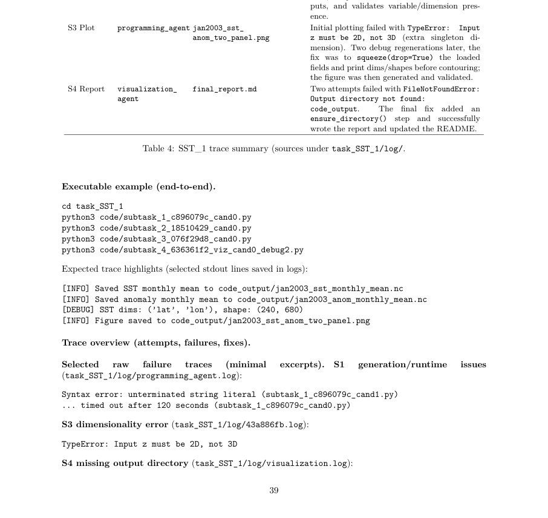

<small>原文图题：Table 4: SST_1 trace summary (sources under task_SST_1/log/.</small>

**图 7（PDF 第 40 页，原文图表截图）**

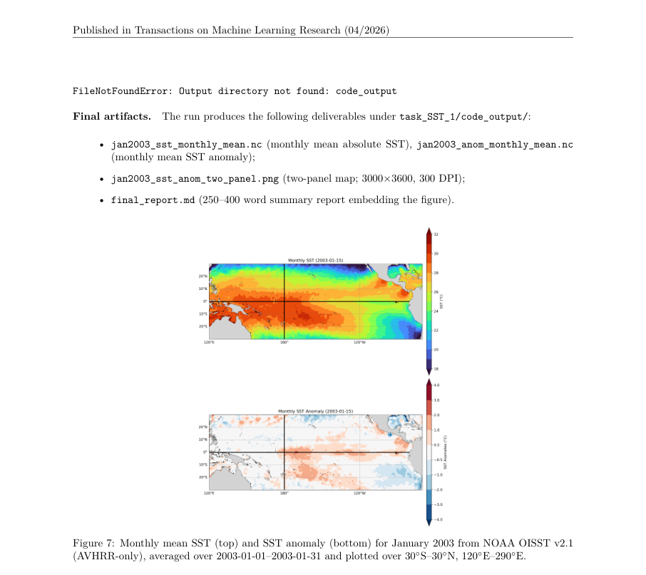

<small>原文图题：Figure 7: Monthly mean SST (top) and SST anomaly (bottom) for January 2003 from NOAA OISST v2.1 (AVHRR-only), averaged over 2003-01-01–2003-01-31 and plotted over 30◦S–30◦N, 120◦E–290◦E.</small>

**表 5（PDF 第 42 页，原文图表截图）**

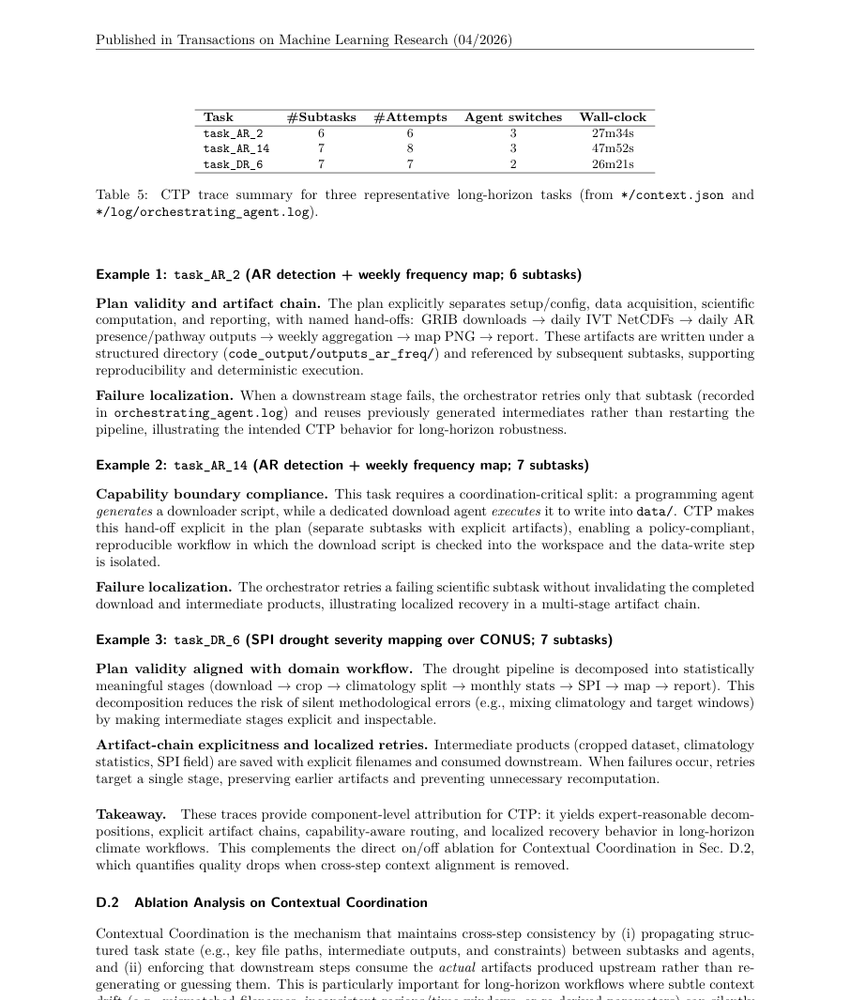

<small>原文图题：Table 5: CTP trace summary for three representative long-horizon tasks (from */context.json and */log/orchestrating_agent.log).</small>

**表 7（PDF 第 44 页，原文图表截图）**

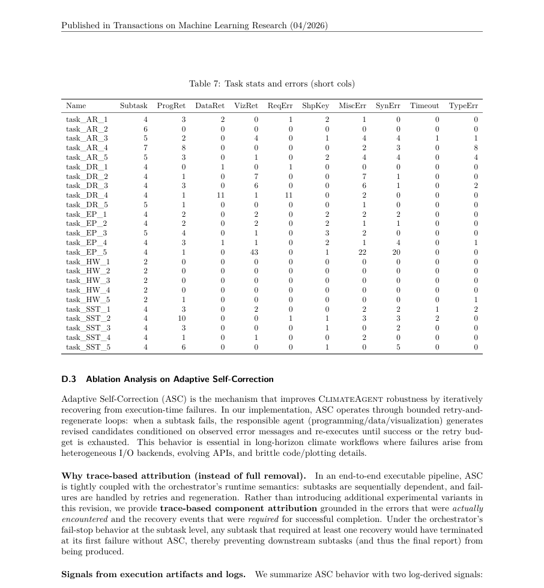

<small>原文图题：Table 7: Task stats and errors (short cols)</small>

**表 8（PDF 第 48 页，原文图表截图）**

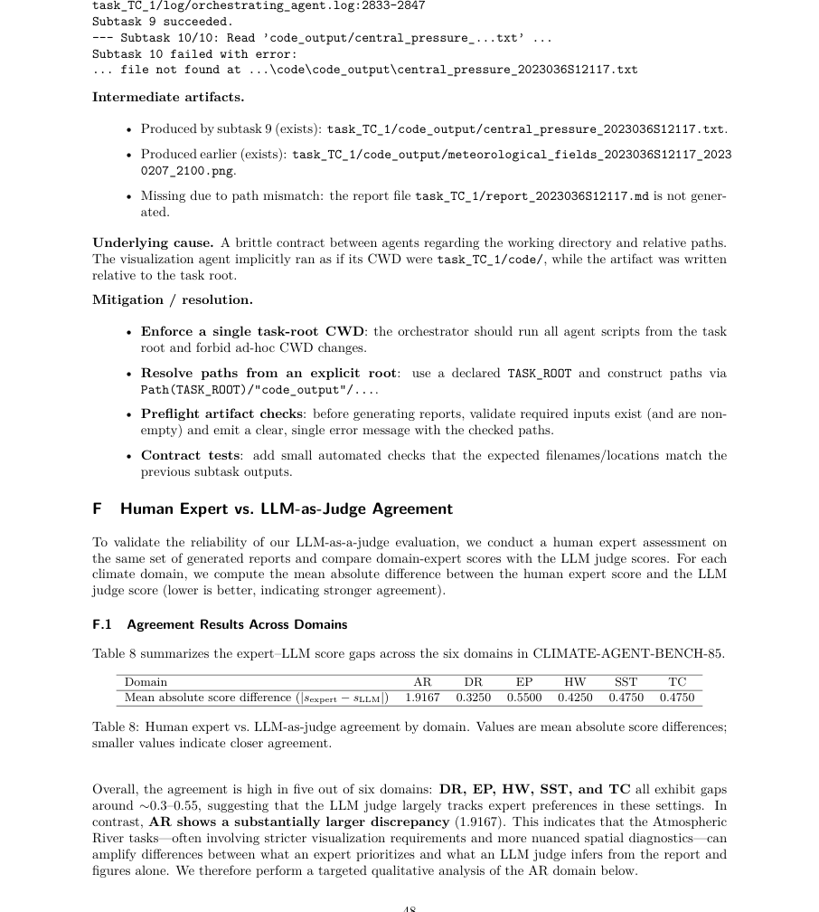

<small>原文图题：Table 8: Human expert vs. LLM-as-judge agreement by domain. Values are mean absolute score differences; smaller values indicate closer agreement.</small>

**图 8（PDF 第 49 页，原文图表截图）**

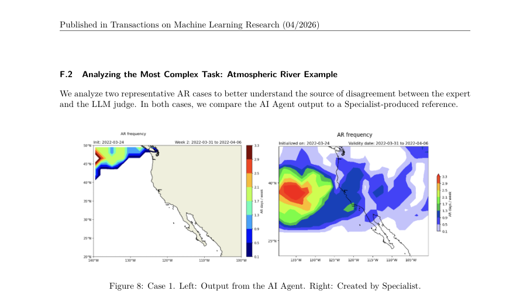

<small>原文图题：Figure 8: Case 1. Left: Output from the AI Agent. Right: Created by Specialist.</small>

**图 9（PDF 第 49 页，原文图表截图）**

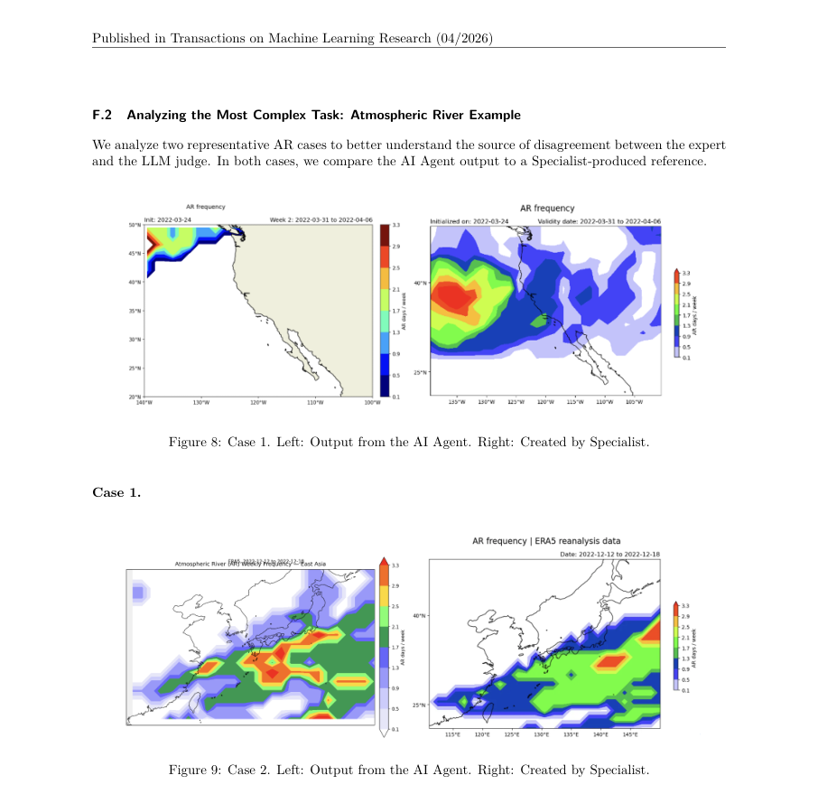

<small>原文图题：Figure 9: Case 2. Left: Output from the AI Agent. Right: Created by Specialist.</small>

**表 9（PDF 第 51 页，原文图表截图）**

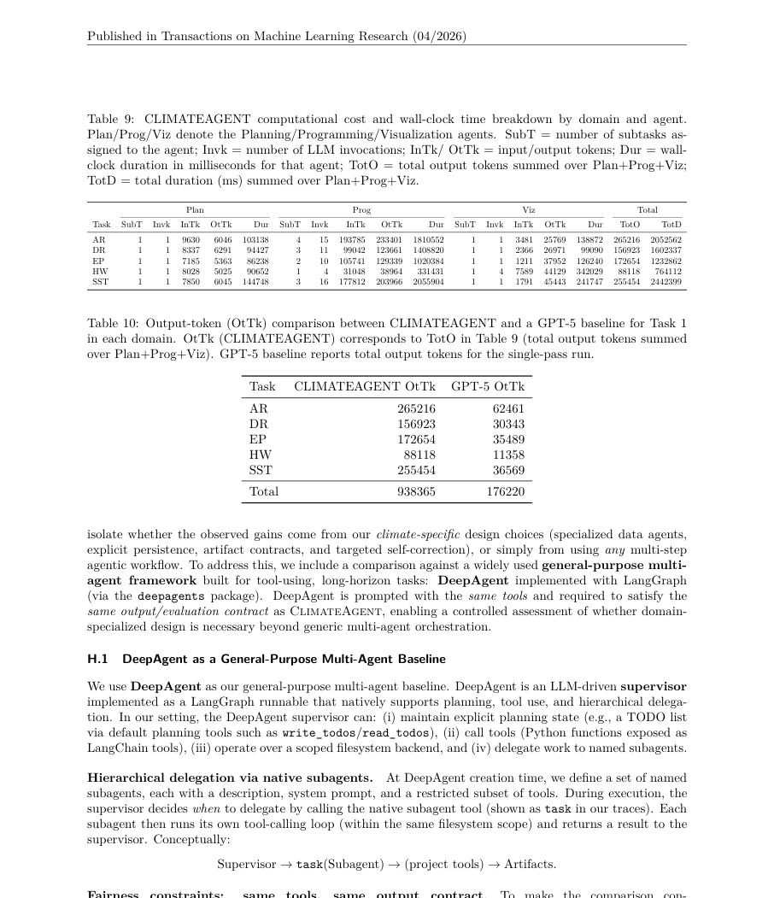

<small>原文图题：Table 9: CLIMATEAGENT computational cost and wall-clock time breakdown by domain and agent. Plan/Prog/Viz denote the Planning/Programming/Visualization agents. SubT = number of subtasks as- signed to the agent; Invk = number of LLM invocations; InTk/ OtTk = input/output tokens; Dur = wall- clock duration in milliseconds for that agent; TotO = total output tokens summed over Plan+Prog+Viz; TotD = total duration (ms) summed over Plan+Prog+Viz.</small>

**表 10（PDF 第 51 页，原文图表截图）**

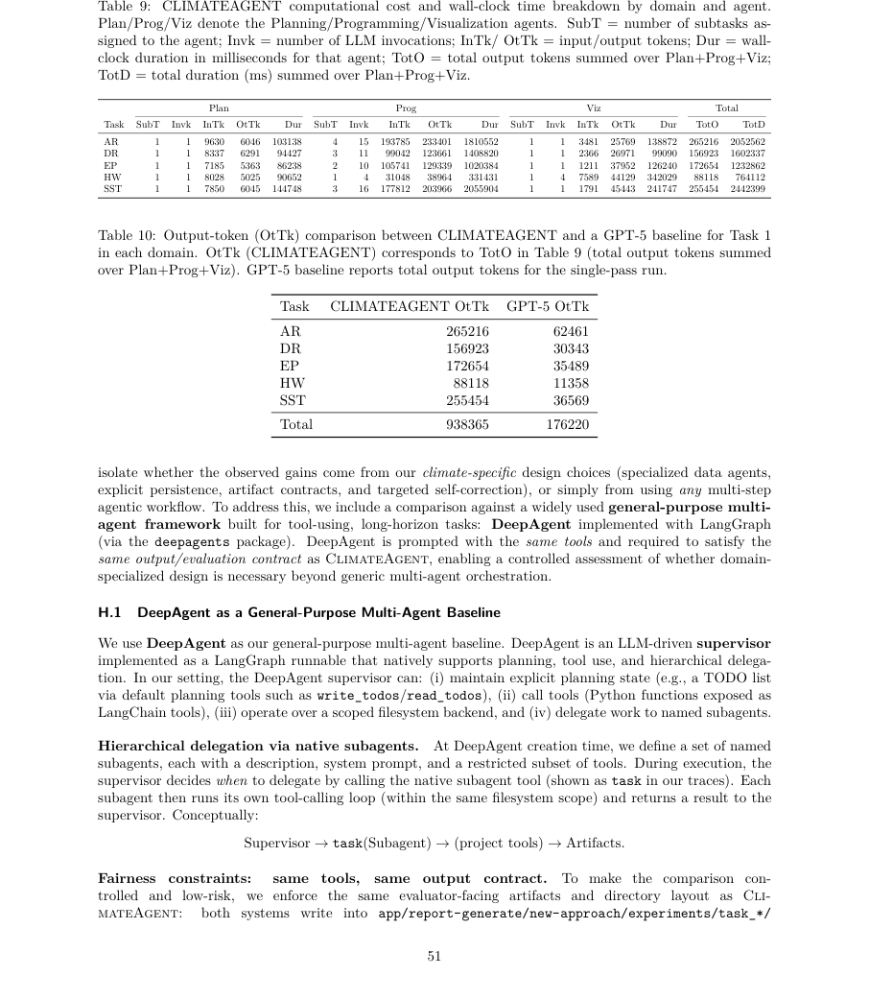

<small>原文图题：Table 10: Output-token (OtTk) comparison between CLIMATEAGENT and a GPT-5 baseline for Task 1 in each domain. OtTk (CLIMATEAGENT) corresponds to TotO in Table 9 (total output tokens summed over Plan+Prog+Viz). GPT-5 baseline reports total output tokens for the single-pass run.</small>

**表 11（PDF 第 53 页，原文图表截图）**

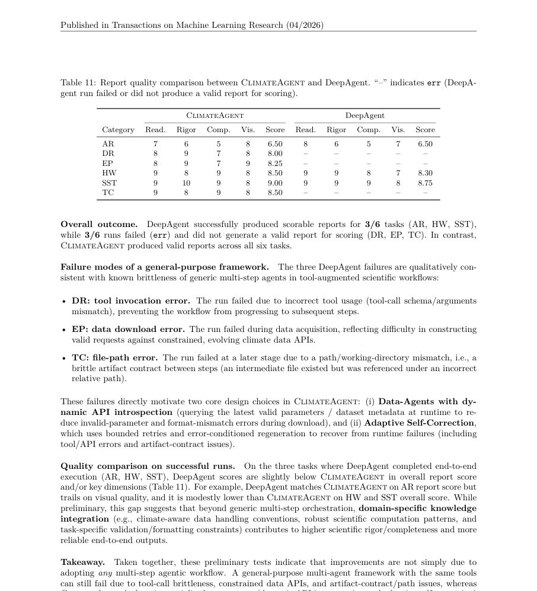

<small>原文图题：Table 11: Report quality comparison between ClimateAgent and DeepAgent. “–” indicates err (DeepA- gent run failed or did not produce a valid report for scoring).</small>

## 对地学 Benchmark 可靠性研究的启示

本论文的指标重点是**科学报告品质**，与 GeoAgentBench、GeoAnalystBench 等强调工具轨迹、参数和工作流结构的基准形成互补。值得借鉴的是：其一，显式规定输入与输出文件契约；其二，保留可恢复的上下文和运行证据；其三，将运行时错误与科学语义错误拆开；其四，针对 LLM-as-Judge 使用专家评审核验可靠性。需要特别警惕的是“报告存在”和“科学正确”之间的差异，尤其当评价依据包含主观文本与视觉评分时。

## 参考文献处理说明

全文英文参考文献已保存在 `英文原文_逐页.md` 中，原文作者、标题、DOI/网址及年份不做机器改写，以维持可核验的学术著录信息。中文稿没有逐条翻译所有书目题名。
