# 灾害应急行动中大语言模型智能体的异构地理空间推理评测

**英文标题：** Can LLM Agents Respond to Disasters? Benchmarking Heterogeneous Geospatial Reasoning in Emergency Operations  
**作者：** Junjue Wang、Weihao Xuan 等  
**研究对象：** Disaster Operational Response Agent Benchmark（DORA）  
**论文版本：** NeurIPS 2026（Evaluations and Datasets Track, Oral）；本次上传的 PDF 共 13 页。

> **译稿范围说明**：本文档是依据原文形成的**中文重要章节翻译与系统性学术译述**，并非对全部页码逐句逐字的完整译文。原始英文全文（含完整参考文献）、全部 PDF 页面、原图与表格均完整保存在同一资料包。具体可查阅 `英文原文_逐页.md`、`英文全文_连续文本.txt`、`逐页原文与图表对照.md`。图表截图按实际 PDF 页码定位。

## 摘要（中文翻译）

真正的灾害应急行动远不止灾损评估：应急人员还必须整合多传感器信号，对道路网络、人口和关键设施开展推理，规划疏散方案，并形成具有可操作性的报告。然而，以往研究大多将遥感感知单独评估，或仅考察一般性的工具使用能力，尚未充分探索灾害应急行动的端到端工作流。为弥补这一空白，本文提出**灾害行动响应智能体基准 DORA**，这是一个面向端到端灾害响应的智能体评测基准。DORA 包括基于 **45 起真实灾害事件、覆盖 10 类灾害的 515 道专家编制任务**，配有经过专家验证、可重放的标准轨迹，共计 **3,500 个工具调用步骤**。

DORA 的任务涵盖应急响应工作流的五个维度：灾害感知、空间关系分析、灾害行动规划、时间演化推理，以及多模态报告综合。智能体通过包含 **108 种工具**的模型上下文协议（MCP）工具库，对异构地理空间数据进行组合操作。数据包括单时相、双时相和多时相的光学、合成孔径雷达（SAR）与多光谱影像，地面采样距离（GSD）覆盖 **0.015—10 米**，并辅以高程数据及社会地理空间矢量图层。

作者评估了 13 个前沿大语言模型，发现三项持续存在的挑战。第一，灾害领域的语义锚定产生独有的失败模式，包括灾损语义理解错误、传感器模态不匹配及灾害处理流程组合错误。第二，智能体同时受制于**工具选择**和**参数锚定**；即便提供正确工具调用顺序作为提示，最终准确率也仅提高 **1.08—4.40 个百分点**，采用其他 Agent 脚手架所得最大增益也只有 **3.24 个百分点**。第三，流程越长，组合推理越脆弱；在长流程上，智能体与标准轨迹的准确率差距从约 **7% 扩大到 56%**。DORA 为建立可用于实际应急行动的可靠灾害响应智能体提供了严格的评测环境。

## 1. 引言：为什么灾害任务不能只评估遥感识别

自然和人为灾害要求分析人员同时完成灾损感知、空间关联推理、资源估算、灾害过程跟踪与报告综合。由于任务涉及不同分辨率、模态和时间戳的遥感资料，以及道路、人口、兴趣点（POI）等社会空间数据，单纯对一张图像进行视觉解读无法覆盖真实行动需求。LLM Agent 虽然已经能够进行多步工具调用，但灾害业务中的长流程、异构数据融合和专业语义约束往往同时出现，现有通用智能体基准和静态遥感基准无法充分衡量这一点。

DORA 因而将评价对象从**单个工具调用是否正确**转向**智能体能否将业务知识组织为可执行的工具流水线**：选对工具、安排合法顺序、引用正确的中间结果，并以面向决策的形式给出答案。论文图 1 列举了设施受损识别、滑坡区域与水库缓冲区相交、车辆清障工时估算、受损路网最短路径以及洪水动态报告等典型任务。

**图 1（PDF 第 2 页，原文图表截图）**

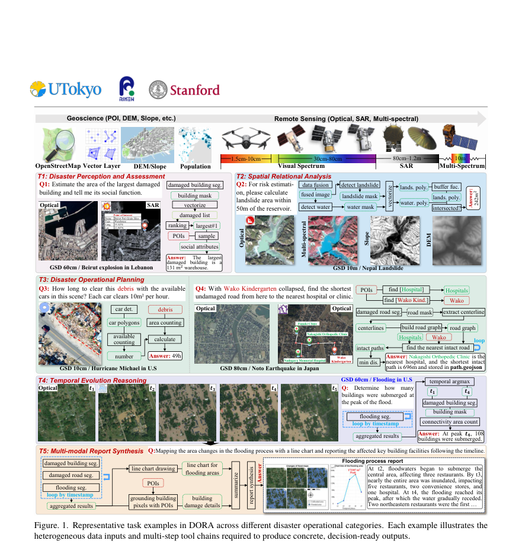

<small>原文图题：Figure. 1. Representative task examples in DORA across different disaster operational categories. Each example illustrates the heterogeneous data inputs and multi-step tool chains required to produce concrete, decision-ready outputs.</small>

**表 1（PDF 第 3 页，原文图表截图）**

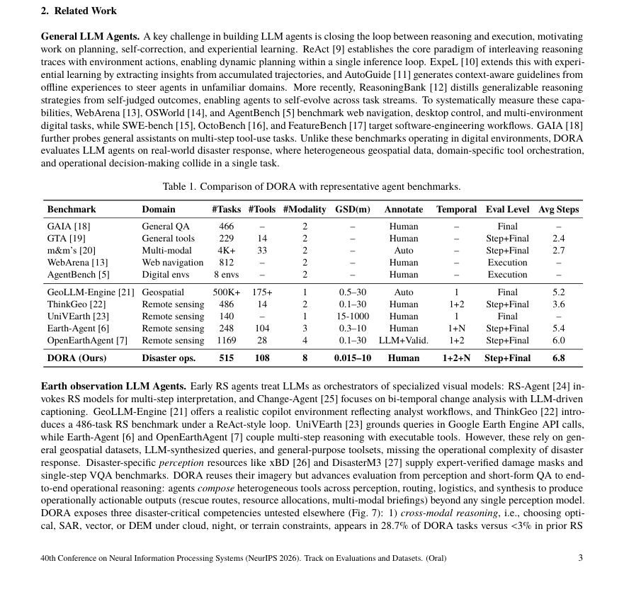

<small>原文图题：Table 1. Comparison of DORA with representative agent benchmarks.</small>

## 2. 相关工作与基准定位

作者回顾了三条研究脉络：通用大语言模型智能体（ReAct、ExpeL、ReasoningBank 等）；智能体工具使用与任务执行评测（WebArena、OSWorld、AgentBench、SWE-bench、GAIA 等）；遥感与地理空间领域基准（GeoLLM-Engine、ThinkGeo、Earth-Agent、OpenEarthAgent 等）。本文与这些工作的关键差异不在于单纯增大任务量，而在于引入**真实灾害场景、跨模态空间数据、可执行专家轨迹和行动决策输出**，且对工具路径与最终结果进行双层评测。

原文表 1 比较了领域、任务数量、工具数量、模态、分辨率、标注方式、时相和评价粒度。该表提供了将 DORA 纳入地学 Agent Benchmark 综述时可复用的对比维度。

## 3. DORA 数据集

### 3.1 数据来源与模态

DORA 整合多个公开数据源：xBD 提供高分辨率灾前与灾后光学图像；DisasterM3、BRIGHT 提供光学与 SAR 配对数据；NAIP 与 Maxar Open Data 提供多个时间阶段的洪水发展与灾后重建影像；Landslide4Sense 和 GVLM-CD 引入多光谱、DEM 与坡度；RescueNet、CRASAR-U-DRoIDS 为航空影像和高分辨率灾害感知提供补充。城市热岛分析还使用东京的数字孪生点云、相关气象观测与 SOLWEIG。OpenStreetMap 和 WorldPop 提供道路、设施、POI、人口栅格等配准的社会空间资料。

作者不仅将这些来源拼接到一起，还保留数据模态、空间分辨率、坐标参考系统、波段等元信息，要求智能体根据任务选择合适的数据与工具。混淆光学/SAR、把栅格当矢量或使用错误的 GSD 都会造成后续计算失败。

**图 2（PDF 第 4 页，原文图表截图）**

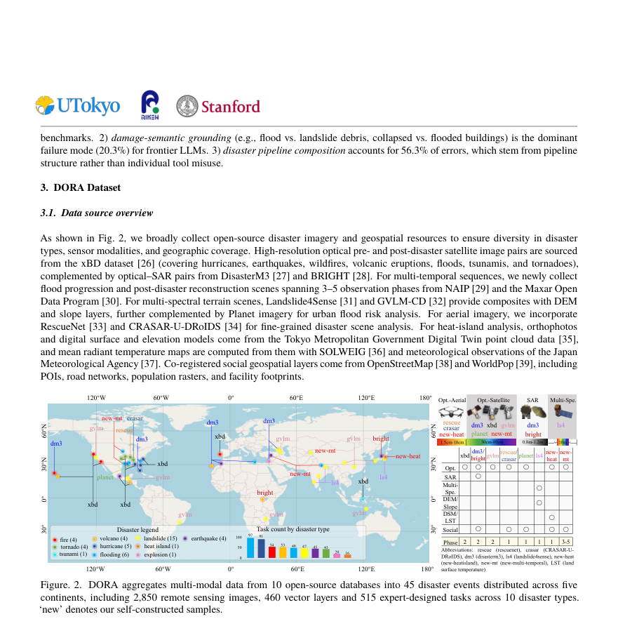

<small>原文图题：Figure. 2. DORA aggregates multi-modal data from 10 open-source databases into 45 disaster events distributed across five continents, including 2,850 remote sensing images, 460 vector layers and 515 expert-designed tasks across 10 disaster types. ‘new’ denotes our self-constructed samples.</small>

### 3.2 任务定义及五大任务维度

每个任务表示为四元组 **(Q, D, T*, A*)**：Q 为自然语言问题；D 为异构数据清单；T* 为专家标准工具调用轨迹；A* 为标准答案。任务不是孤立问答，而是一系列有前置依赖的操作。

五类任务分别是：（T1）**灾害感知与评估**，如灾损建筑或道路的识别与面积计算；（T2）**空间关系分析**，如缓冲区、相交、邻近设施、交集面积计算；（T3）**应急行动规划**，如基于可通行路段寻找最近医院、估算清障资源和疏散路线；（T4）**灾害时间演化推理**，如利用多时相洪水影像估计峰值、变化趋势和影响范围；（T5）**多模态报告综合**，综合影像、统计、设施资料与时序结果，形成带图表的可执行业务报告。

原文图 3 展示 JSON 任务元信息，图 4 统计五类任务分布，图 5 比较轨迹长度与工具使用复杂度。它们体现了同一个设计思想：将自然语言目标、输入数据、逐步可执行证据和正确输出明确绑定。

**图 4（PDF 第 5 页，原文图表截图）**

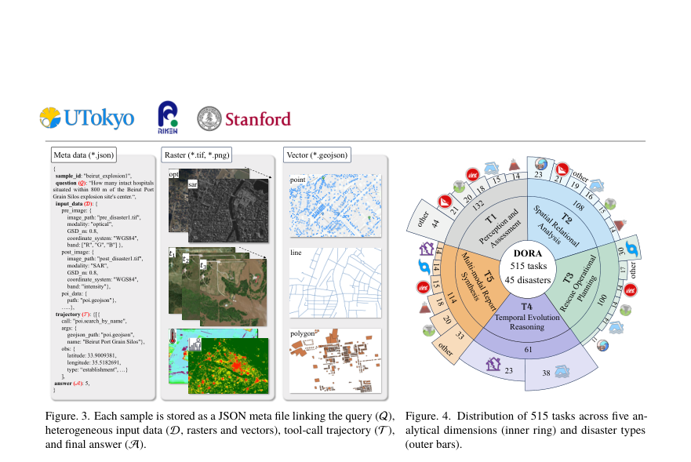

<small>原文图题：Figure. 4. Distribution of 515 tasks across five an- alytical dimensions (inner ring) and disaster types (outer bars).</small>

**图 3（PDF 第 5 页，原文图表截图）**

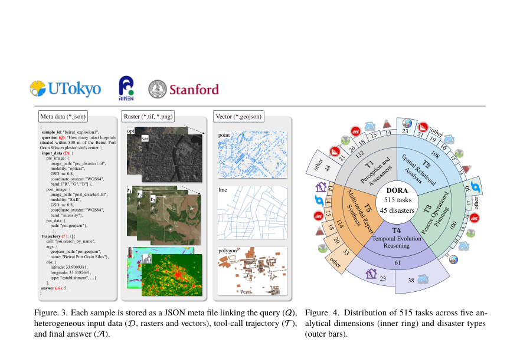

<small>原文图题：Figure. 3. Each sample is stored as a JSON meta file linking the query (Q), heterogeneous input data (D, rasters and vectors), tool-call trajectory (T), and final answer (A).</small>

**图 5（PDF 第 5 页，原文图表截图）**

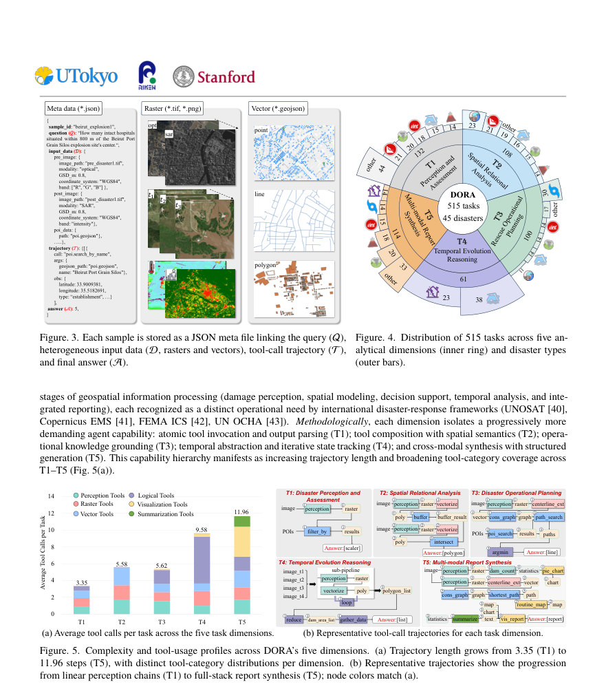

<small>原文图题：Figure. 5. Complexity and tool-usage profiles across DORA’s five dimensions. (a) Trajectory length grows from 3.35 (T1) to 11.96 steps (T5), with distinct tool-category distributions per dimension. (b) Representative trajectories show the progression from linear perception chains (T1) to full-stack report synthesis (T5); node colors match (a).</small>

### 3.3 108 个 MCP 工具

DORA 的工具分为六大模块：**感知（Perception）**、**栅格（Raster）**、**矢量（Vector）**、**逻辑（Logic）**、**可视化（Visualization）**和**摘要（Summarization）**。感知模块负责建筑、道路、洪水、滑坡、熔岩、车辆等对象识别；栅格工具承担掩膜阈值、类别组合等操作；矢量工具支持缓冲区、相交和空间关系运算；逻辑工具负责数值、列表及控制流程；可视化工具绘制地图与统计结果；摘要工具形成面向应急决策的报告。

这意味着一个结果可以在多个中间产物之间传递，而不只是模型一次性写出答案。工具的返回值、调用参数、文件路径和先后顺序都可能影响最终正确性。

### 3.4 标准轨迹构建与校验

专家首先从真实应急需求出发编写问题，并设计语义上正确的工具操作序列；然后通过确定性重放引擎实际执行，补齐中间观测及数值输出；最后检查工具类型、参数完整性、执行合法性与数值合理性。标准轨迹因此不仅是一段“看起来合理”的思维链，而是**经过执行和专家审查的 Ground Truth**。

这一步对你的 Benchmark 可靠性研究非常重要：GT 的正确性不仅取决于任务标注员的判断，还取决于工具版本、输入数据、运算条件、参考产物与重放一致性。

**表 2（PDF 第 6 页，原文图表截图）**

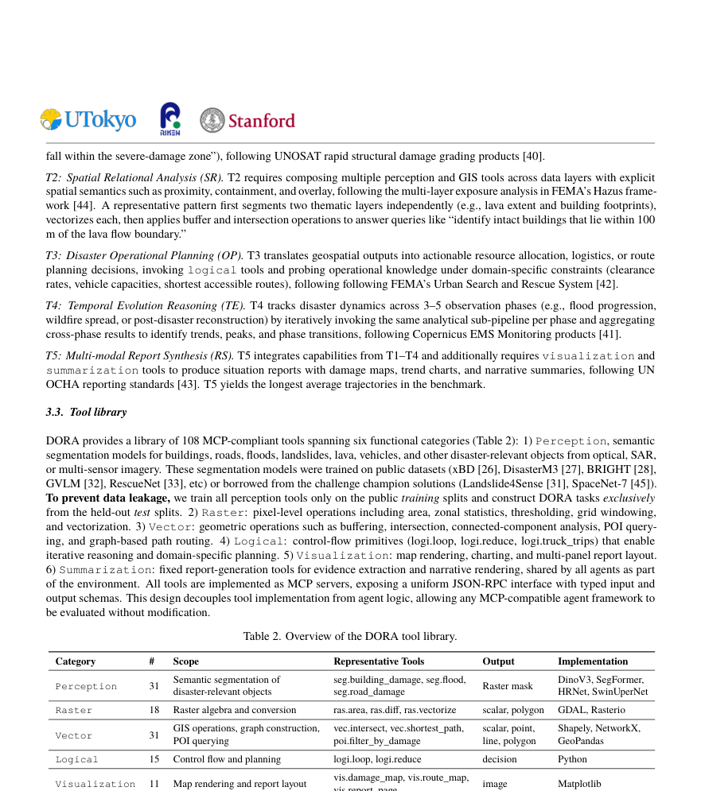

<small>原文图题：Table 2. Overview of the DORA tool library.</small>

**图 6（PDF 第 7 页，原文图表截图）**

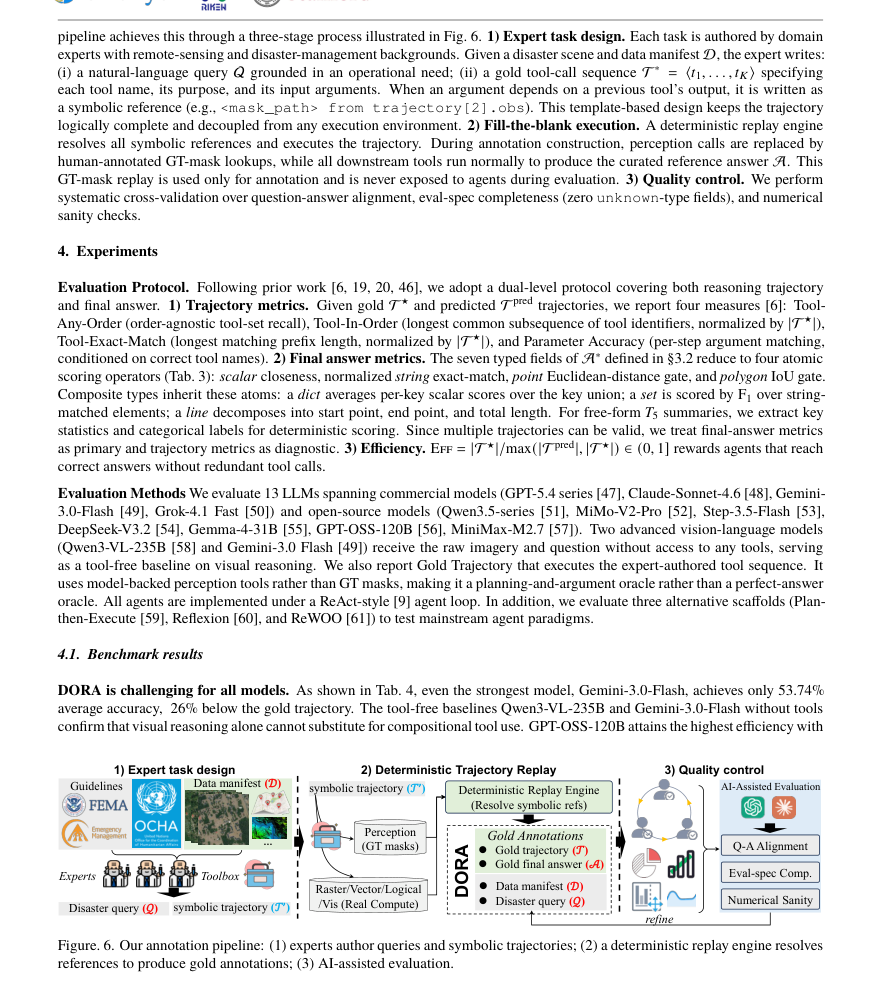

<small>原文图题：Figure. 6. Our annotation pipeline: (1) experts author queries and symbolic trajectories; (2) a deterministic replay engine resolves references to produce gold annotations; (3) AI-assisted evaluation.</small>

## 4. 评价协议与主要实验

### 4.1 双层评价：工具轨迹与最终答案

论文采用**轨迹层（Trajectory）+ 最终答案层（Final Answer）**的双层协议。轨迹层包括四项指标：

- **Tool-Any-Order**：不考虑顺序的标准工具集合覆盖率，评价是否识别了应当调用的工具。
- **Tool-In-Order**：按工具 ID 计算最长公共子序列，并按照标准轨迹长度归一化，反映工具顺序上的一致性。
- **Tool-Exact-Match**：从轨迹开头连续精确匹配的标准工具序列长度占比，强调完整的前缀过程正确性。
- **Parameter Accuracy（ParAcc）**：工具调用参数是否正确，关注路径、类别、数值、模态及上游输出引用等细节。

最终答案层按数据类型组合不同的原子评分算子：数值结果使用相对容差（原文表 3 为 **20%**）；字符串经标准化后作匹配；点坐标按图像空间距离判断（**20 px**）；多边形结果基于 IoU 阈值。不同字段依照其类型聚合为具体任务的答案正确性。这种类型化评分比纯文本相似度更贴近 GIS 输出形式，但对坐标系、任务容差以及 GT 误差仍然敏感。

### 4.2 模型结果及误差来源

在 13 个受测模型中，原文报告最强的 Gemini-3.0-Flash 平均最终答案准确率约为 **53.74%**，相比 Gold Trajectory 的 **80.48%** 仍有明显差距。更关键的是，Tool-Any-Order 往往显著高于 Tool-Exact-Match，表明“会选工具”不等于“能正确组织调用路径”。模型经常遗漏必要空间工具，或引用错误的上游掩膜，导致终点答案错误。

领域错误被分成三类：**灾损语义锚定错误**（如损坏与淹没、不同灾害产物的概念混淆）；**传感器模态不匹配**（如以栅格执行矢量关系运算，或混用不同传感器/分辨率）；**灾害处理流程组合错误**（例如将错误的中间掩膜作为后续步骤输入）。论文报告第三类约占所分析错误的 **56.3%**，突出工作流依赖关系的重要性。

### 4.3 Oracle 提示与脚手架消融

作者区分自动规划（AP）与指令跟随（IF）：IF 额外给出 Gold 的工具顺序提示，但模型仍需自行推断和填写调用参数。实验中，IF 确实显著改善轨迹匹配，却仅将最终答案准确率提高 **1.08—4.40 个百分点**。这一结果指向**工具选择正确性**与**参数绑定正确性**是两种独立的瓶颈。

对 Gemma-4-31B 测试的 Plan-then-Execute、Reflexion 与 ReWOO 三种脚手架中，前者最大提升 **3.24 个百分点**；反思策略收益较小且增加延迟；减少中间观测反馈的方案效果更差。图 9 显示：标准轨迹为 2—3 步时，顶尖模型与 Gold 的差距约 7%；当轨迹达到至少 11 步时，差距扩大到 **56%**。说明上游参数和序列错误会在长链中累积放大。

**表 3（PDF 第 8 页，原文图表截图）**

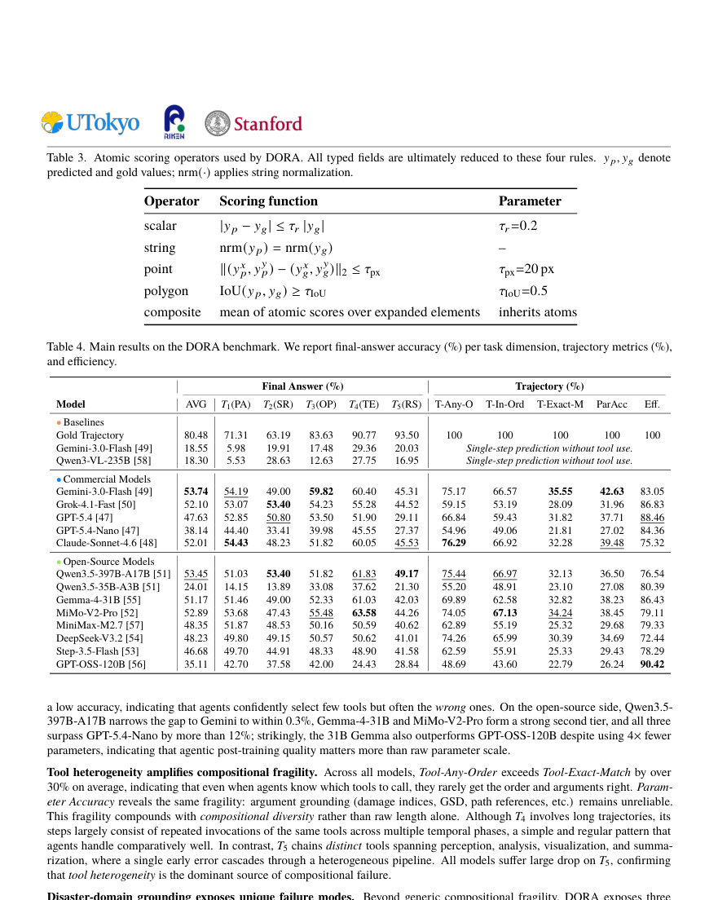

<small>原文图题：Table 3. Atomic scoring operators used by DORA. All typed fields are ultimately reduced to these four rules. 𝑦𝑝, 𝑦𝑔denote predicted and gold values; nrm(·) applies string normalization.</small>

**表 4（PDF 第 8 页，原文图表截图）**

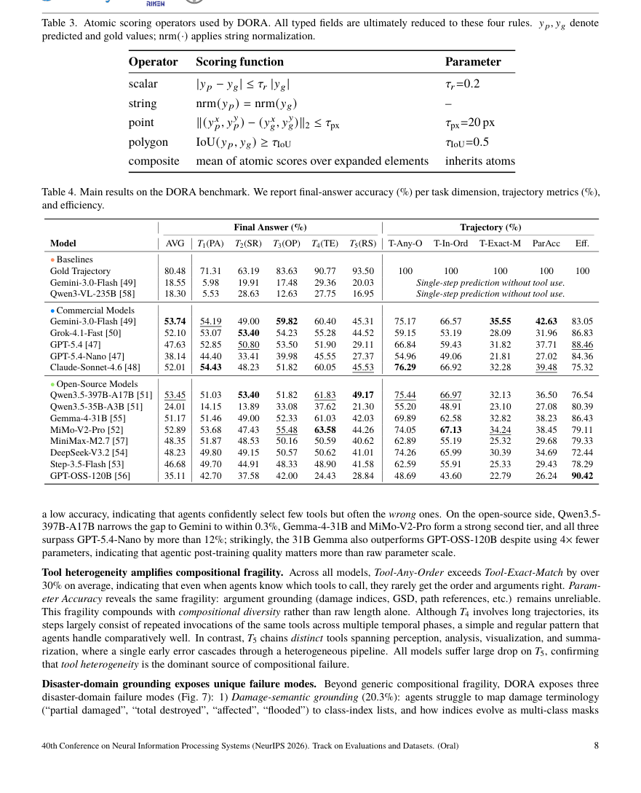

<small>原文图题：Table 4. Main results on the DORA benchmark. We report final-answer accuracy (%) per task dimension, trajectory metrics (%), and efficiency.</small>

**表 5（PDF 第 9 页，原文图表截图）**

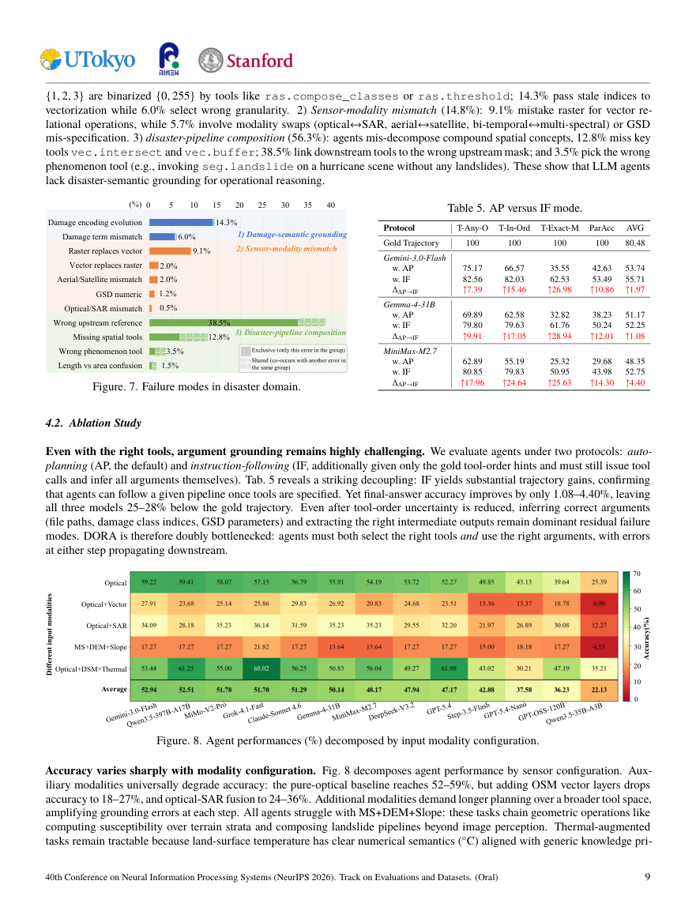

<small>原文图题：Table 5. AP versus IF mode.</small>

**图 7（PDF 第 9 页，原文图表截图）**

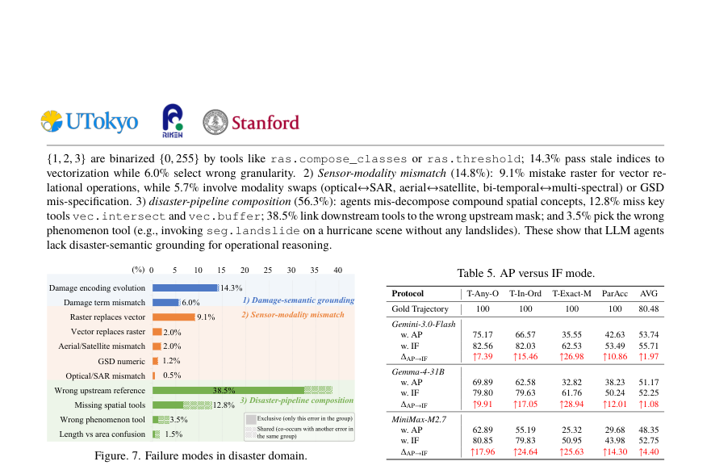

<small>原文图题：Figure. 7. Failure modes in disaster domain.</small>

**图 8（PDF 第 9 页，原文图表截图）**

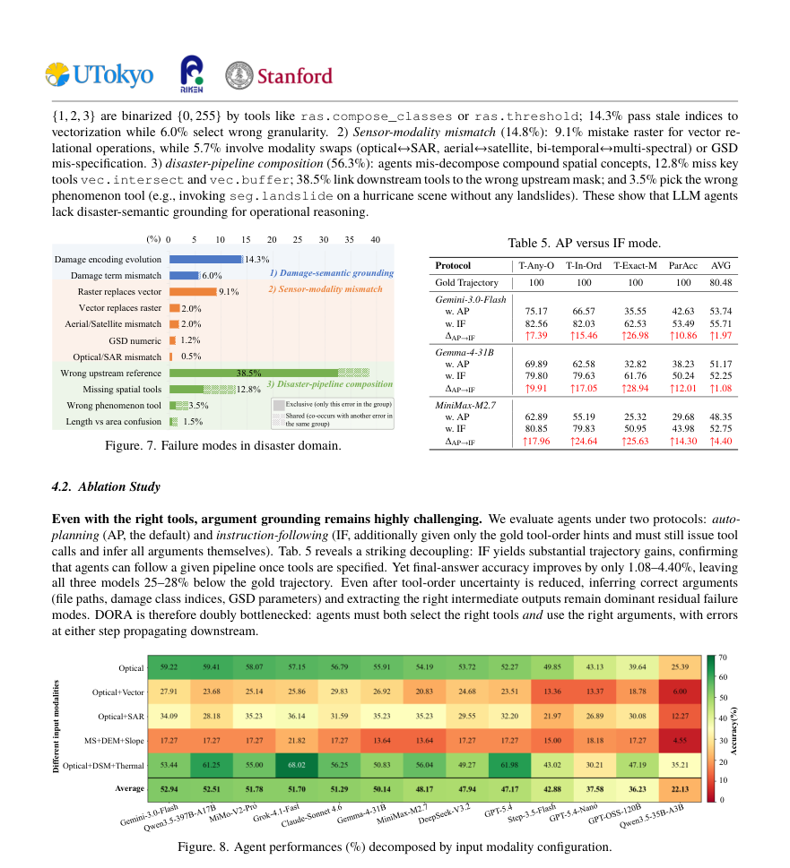

<small>原文图题：Figure. 8. Agent performances (%) decomposed by input modality configuration.</small>

**表 6（PDF 第 10 页，原文图表截图）**

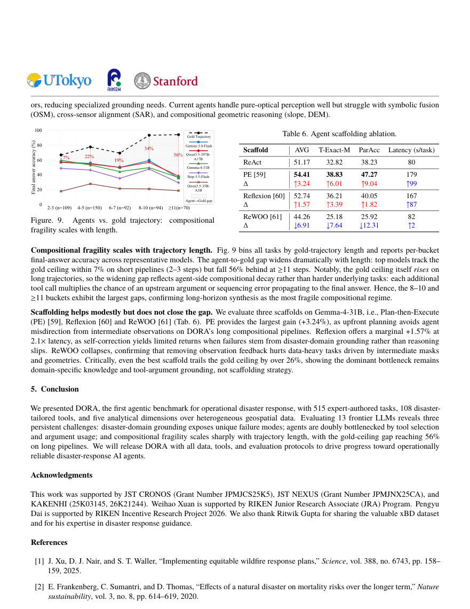

<small>原文图题：Table 6. Agent scaffolding ablation.</small>

**图 9（PDF 第 10 页，原文图表截图）**

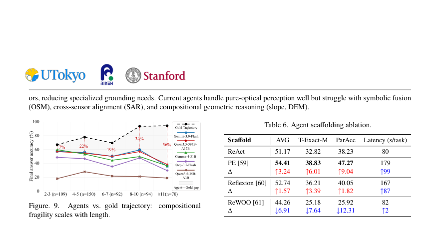

<small>原文图题：Figure. 9. Agents vs. gold trajectory: compositional fragility scales with length.</small>

## 5. 结论与适用范围

DORA 将真实灾害响应转换为可重放的专家工具轨迹及类型化答案评测，使不同模型能够在统一数据与工具条件下比较。其重要发现是，**正确的工具序列并不能保证正确的空间答案，独立的参数锚定与中间数据有效性验证仍不可缺少**。作为 GIS Agent 基准，这篇论文同时提供了 GT 构建、双层打分、Oracle 消融、长链误差传播和领域错误分类的研究范例。

## 参考文献与附录核对

原论文第 10—13 页包含完整参考文献、致谢与相关说明。为保留作者、题名、会议信息、链接与引用编号的精确性，原始参考文献已在 `英文原文_逐页.md` 中按页无删减保留；本中文阅读稿不逐条翻译参考文献标题。需要逐项复核时请以原版 PDF 为准。

## 精读核对清单

本文的关键评测概念依次为：专家任务设计 → 数据/工具供给 → GT 轨迹执行与校验 → 工具集合和序列的比较 → 参数准确性 → 类型化最终答案 → 跨模态、长链与脚手架消融。研究者不应把工具轨迹高匹配率直接解读为最终结果正确，也不应将论文所报告的单一模型分数当成跨不同 benchmark 可直接比较的标准化指标。
