# 图表及栅格对象索引
> 自动候选，并非人工确认的完整图表清单；裁图可能含邻近正文、重复或漏检无题图，原版页始终保留。

## Figure 1 · PDF 第 2 页

Figure 1: Each DISCOVERYBENCH task consists of a goal and dataset(s) (left). Solving the task requires both statistical analysis and scientific semantic reasoning. The realistic requirement of domain-specific tools in some tasks adds more complexity. An ideal discovery system should implement discovery programs in Python.

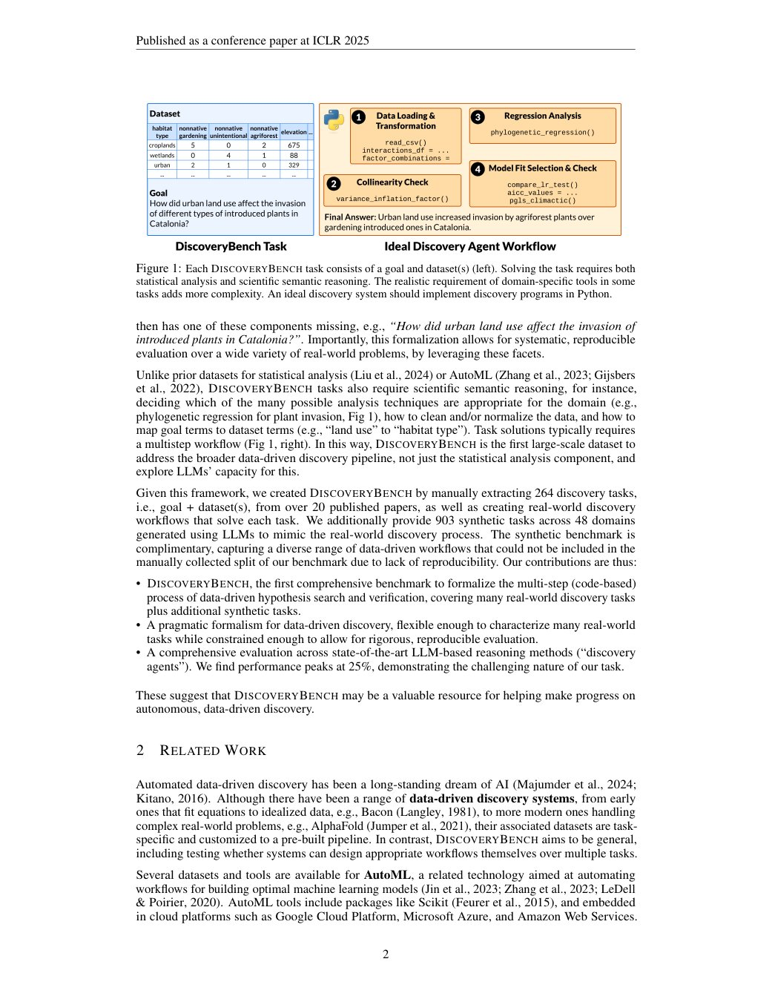

[整页核查](./source_pages/page-002.jpg)

## Table 1 · PDF 第 3 页

Table 1: Comparison with other data-analysis benchmarks

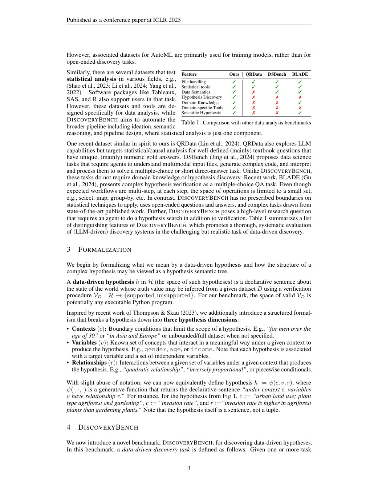

[整页核查](./source_pages/page-003.jpg)

## Figure 2 · PDF 第 4 页

Figure 2: Workflow categories in DB-REAL with representative examples.

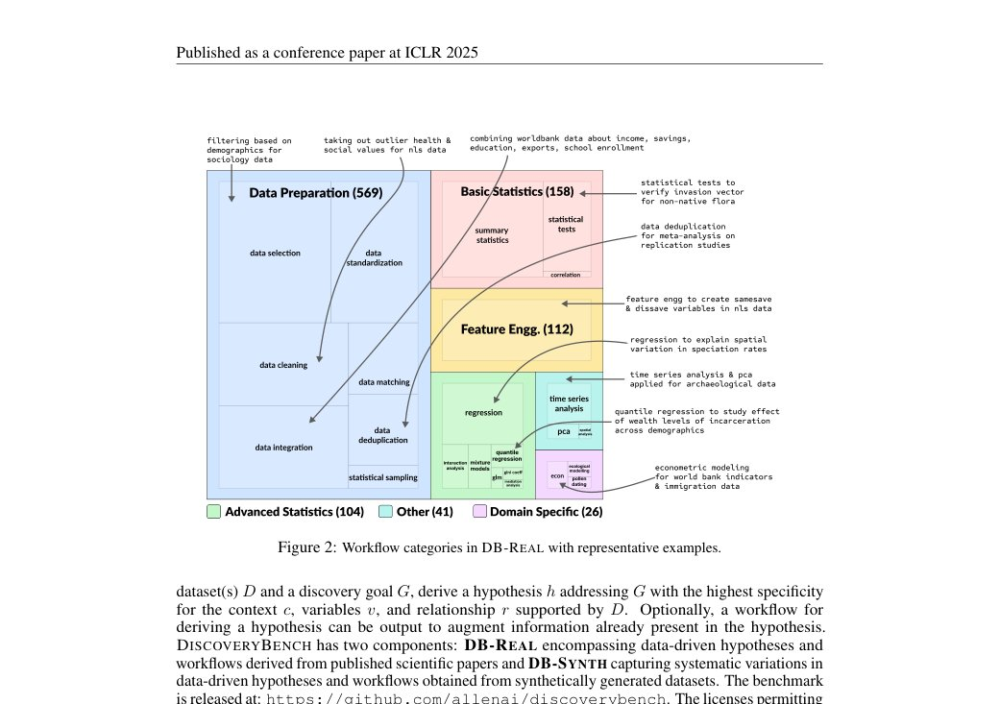

[整页核查](./source_pages/page-004.jpg)

## Table 2 · PDF 第 5 页

Table 2: Statistics for DB-REAL

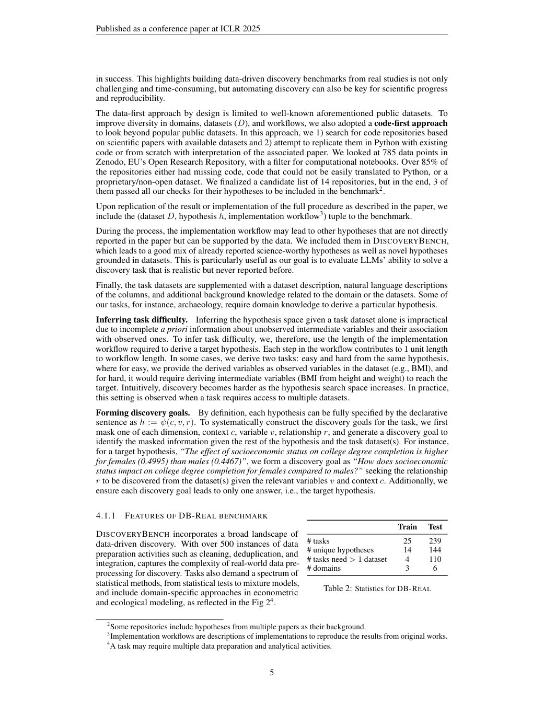

[整页核查](./source_pages/page-005.jpg)

## Figure 3 · PDF 第 6 页

Figure 3: Hypothesis Semantic Tree

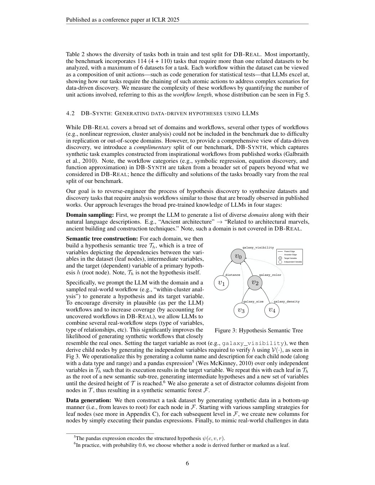

[整页核查](./source_pages/page-006.jpg)

## Figure 4 · PDF 第 8 页

Figure 4: (Left) Hypothesis Matching Scores (HMS) across agent-LLM pairs in DB-REAL and DB-SYNTH. (Right) Scatter plots for mean ctxalign vs mean varF1 and mean varF1 vs mean relacc. The plots show that agent-LLM combinations that are capable of identifying the correct context have a higher likelihood of obtaining the right set of interacting variables. Similarly, identifying correct variables leads to better identification of relationships between them.

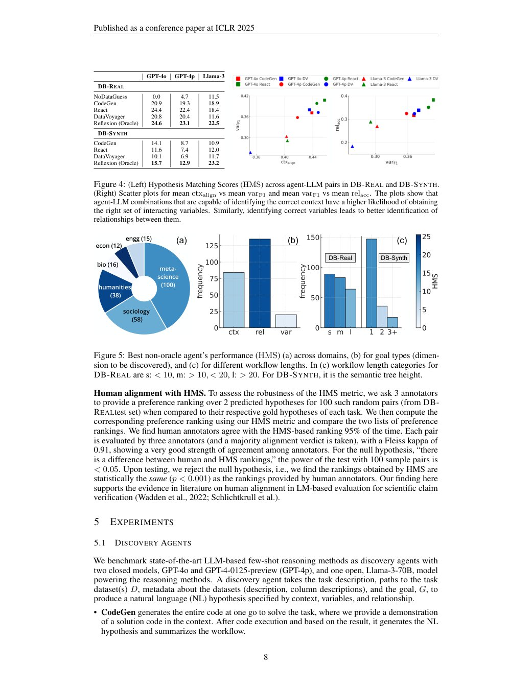

[整页核查](./source_pages/page-008.jpg)

## Figure 5 · PDF 第 8 页

Figure 5: Best non-oracle agent’s performance (HMS) (a) across domains, (b) for goal types (dimen- sion to be discovered), and (c) for different workflow lengths. In (c) workflow length categories for DB-REAL are s: < 10, m: > 10, < 20, l: > 20. For DB-SYNTH, it is the semantic tree height.

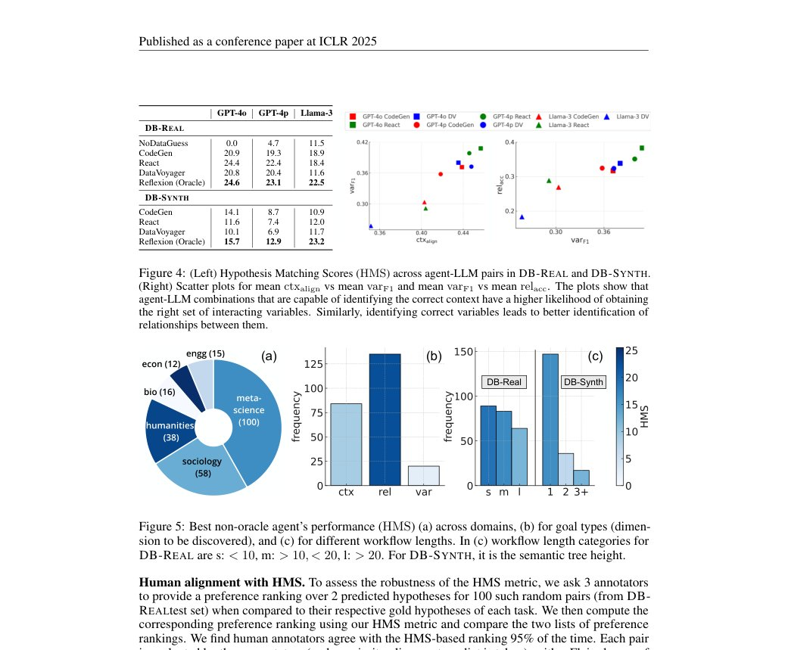

[整页核查](./source_pages/page-008.jpg)

## Figure 6 · PDF 第 9 页

Figure 6: Breakdown of performance (HMS) of the best non-oracle agent in several workflow categories in their decreasing order of appearance in the benchmark.

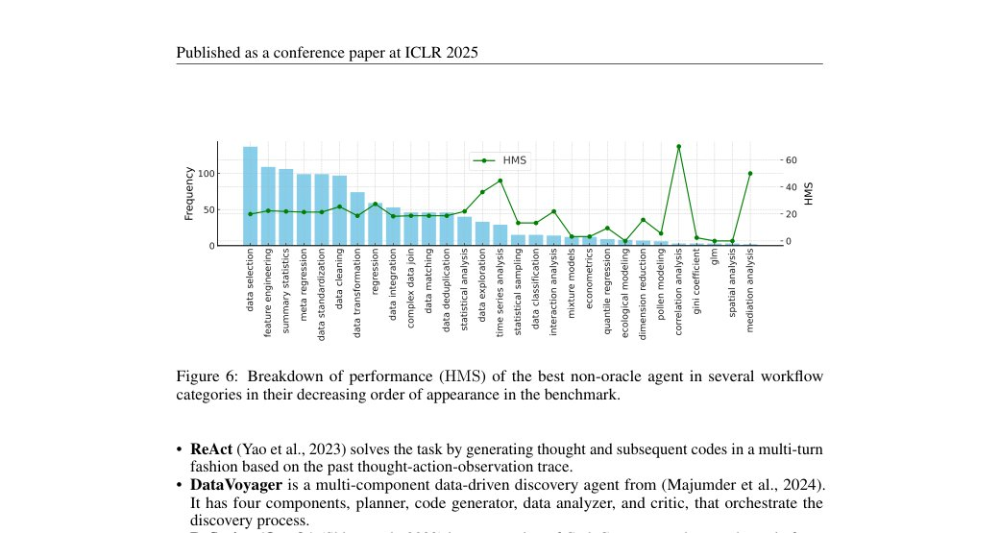

[整页核查](./source_pages/page-009.jpg)

## Figure 7 · PDF 第 10 页

Figure 7: Representative examples of tasks where we qualitatively evaluate non-oracle best agent’s trajectories along with their performance indicated by HMS.

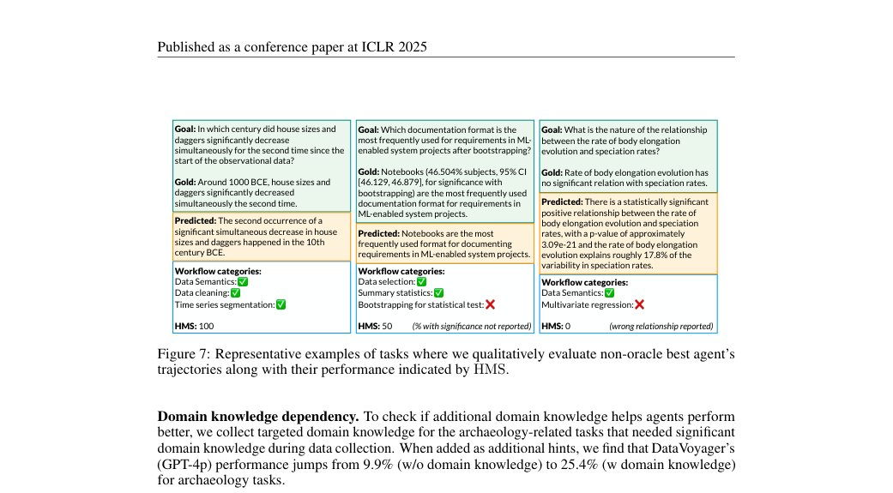

[整页核查](./source_pages/page-010.jpg)

## Table 3 · PDF 第 16 页

Table 3: Licenses for original data sources. The Creative Commons Attribution license allows the re-distribution and re-use of a licensed work on the condition that the creator is appropriately credited.

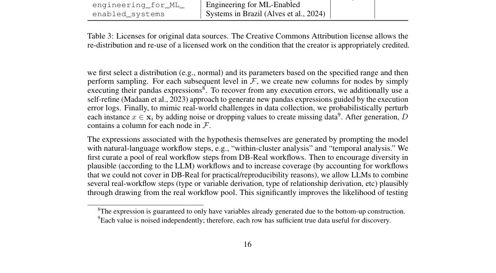

[整页核查](./source_pages/page-016.jpg)

### 栅格对象 · PDF 第 8 页

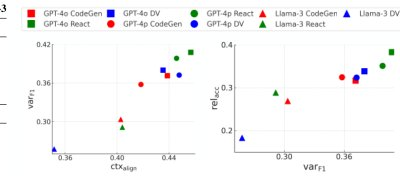

### 栅格对象 · PDF 第 8 页

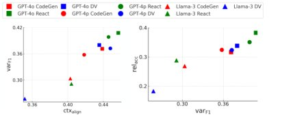

### 栅格对象 · PDF 第 8 页

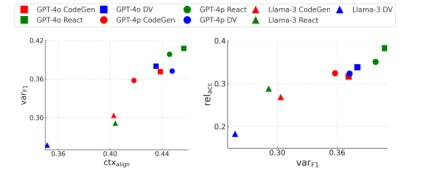

### 栅格对象 · PDF 第 8 页

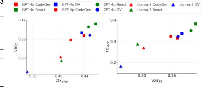

### 栅格对象 · PDF 第 8 页

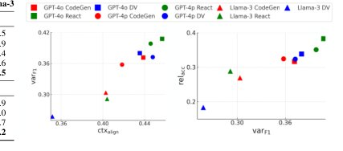

### 栅格对象 · PDF 第 8 页

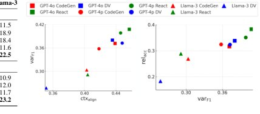

### 栅格对象 · PDF 第 8 页

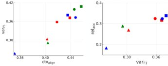