# 图表及栅格对象索引
> 自动候选，并非人工确认的完整图表清单；裁图可能含邻近正文、重复或漏检无题图，原版页始终保留。

## Figure 1 · PDF 第 2 页

Figure 1: The double measurement confound and the joint repair. Left (production): a fixed scaffold (L0) owns the execution- critical decisions and a shape-based scorer grades format and metadata, so a no-LLM script ties the frontier. Center: why the two artifacts must be removed jointly (Section 3.3). Right (our protocol): a de-scaffolded agent (L2, Section 4.2) scored as ground-truth F1 (Section 4.3) against seeded ground truth, resolving Figure 2. Schematic; every quoted number appears in the text.

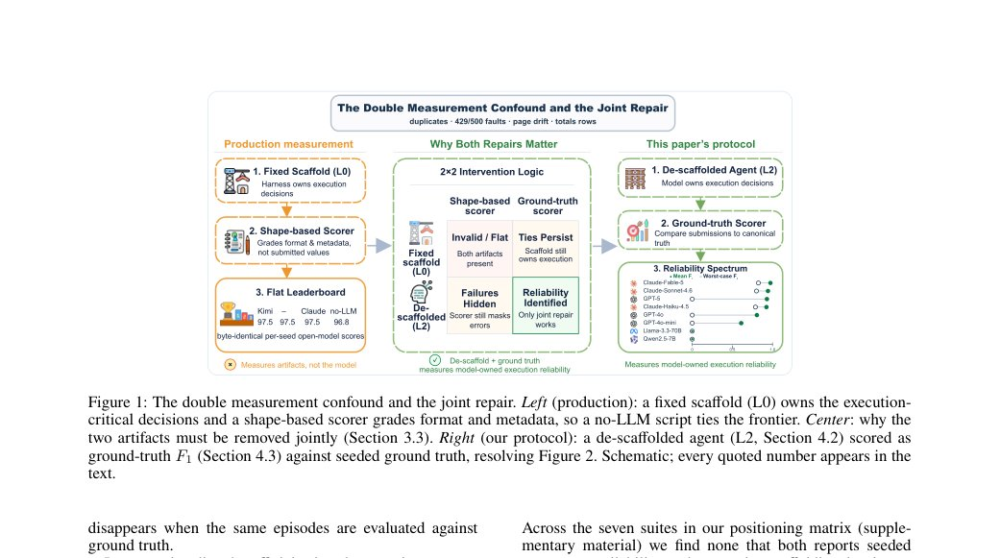

[整页核查](./source_pages/page-002.jpg)

## Figure 2 · PDF 第 6 页

Figure 2: E1: the de-scaffolded (L2) reliability spectrum. Left block: per-task ground-truth F1 (mean over 10 seeds) on the five execution tasks (T3 dedup, T4 429, T5 500, T6 drift, T8 mixed). Right block: all n=50 runs per model — box = interquartile range, whiskers = min–max, • = mean (also the numeric column), tick = CVaR at α=0.2; rows sorted by mean. The lower whisker end is the worst-case, and it reorders the ranking the mean implies: GPT-5 and GPT-4o post high means (0.930, 0.805) yet whiskers reaching 0.00, while the far smaller Claude-Haiku-4.5 never drops below 0.787. Per-task dispersion, the reliability gap, and the excluded T7 diagnostic are in the supplementary material.

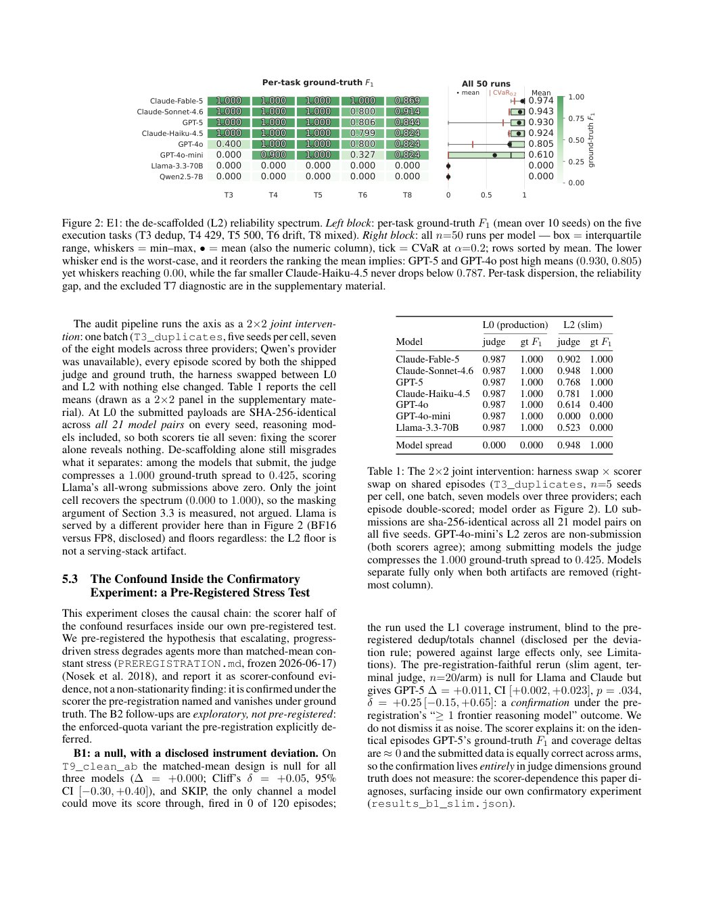

[整页核查](./source_pages/page-006.jpg)

## Table 1 · PDF 第 6 页

Table 1: The 2×2 joint intervention: harness swap × scorer swap on shared episodes (T3_duplicates, n=5 seeds per cell, one batch, seven models over three providers; each episode double-scored; model order as Figure 2). L0 sub- missions are sha-256-identical across all 21 model pairs on all five seeds. GPT-4o-mini’s L2 zeros are non-submission (both scorers agree); among submitting models the judge compresses the 1.000 ground-truth spread to 0.425. Models separate fully only when both artifacts are removed (right- most column).

[整页核查](./source_pages/page-006.jpg)

## Table A1 · PDF 第 10 页

Table A1: Escalating vs. matched-mean constant stress. ∆ = paired mean coverage difference (constant −escalating; positive = escalation penalty), with seeded paired-bootstrap 95% CI and sign-flip permutation p. Cliff’s δ = within-pair dominance [#(∆i>0) −#(∆i<0)]/n with seeded boot- strap 95% CI: only Llama’s B2 penalty is a dominance ef- fect; Claude’s nominally significant one is magnitude-driven (δ = 0.00, equal wins and losses). pHolm = Holm-adjusted p over the full six-test exploratory family (B2 + B2-slack; B1 is pre-registered and outside the family): only Llama’s and GPT-5’s B2 penalties survive correction. Deaths = escalating-arm quota exhaustions; Skips = SKIP actions, escalating / constant arm. B1’s rows are identical for all three models.

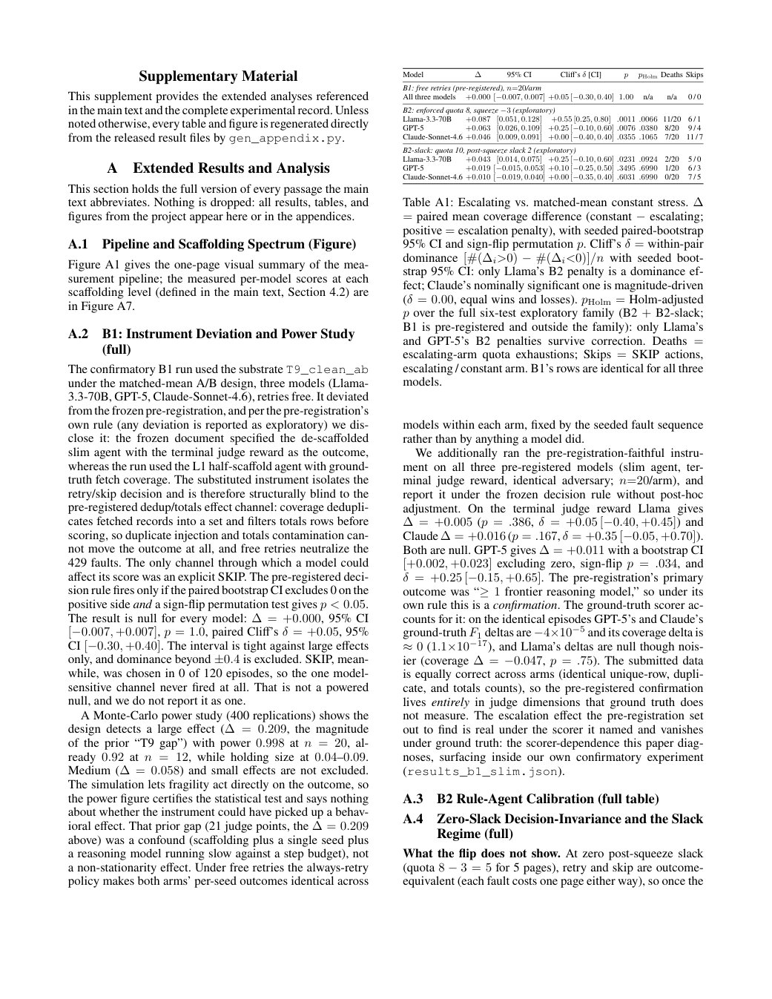

[整页核查](./source_pages/page-010.jpg)

## Figure A1 · PDF 第 11 页

Figure A1: The ComtradeBench pipeline in three stages. (1) Seeded task generation (blue): a seed drives the procedural generator, which emits the canonical ground-truth record set G and serves a fault-injected page stream (duplicates, 429/500, page drift, totals rows); (2) execution (green): the agent, at scaffolding level L0–L2, produces a submission S, with the non-stationarity engine (Schedule, AdversaryPolicy, EnvironmentAdapter) at the agent–environment boundary; (3) scoring (red): S is scored as ground-truth F1 against G. The measured per-model scores at each scaffolding level are in Figure A7.

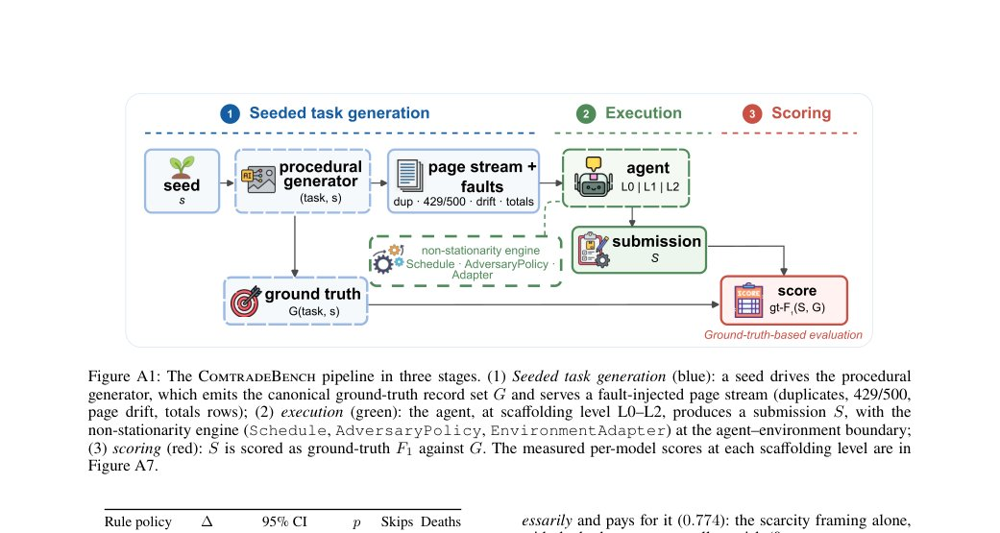

[整页核查](./source_pages/page-011.jpg)

## Table A2 · PDF 第 11 页

Table A2: No-LLM rule-agent calibration on the identical B2 protocol (n=20 paired seeds; skips and quota deaths are totals over both arms’ 40 episodes). At zero slack the fixed always-retry policy reproduces the flip (∆= +0.096, exceeding every model in Table A1), and the determinis- tic quota-aware rule is bit-identical to GPT-5’s summary; at slack 2 no rule policy is significant.

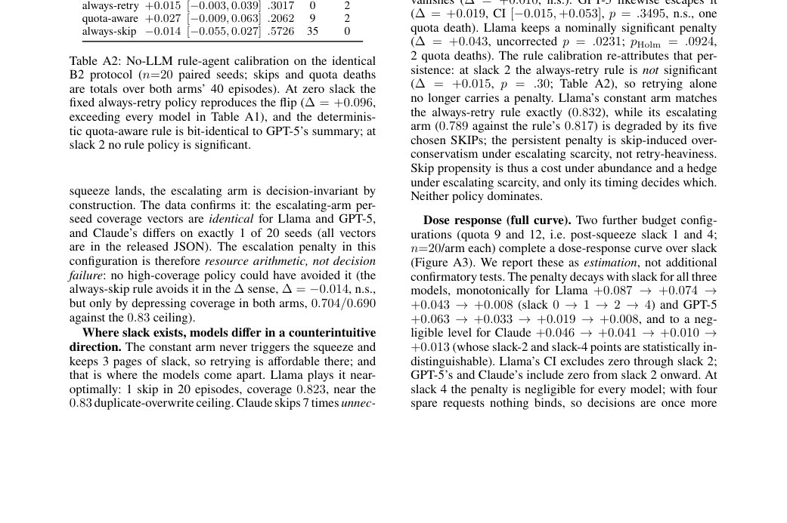

[整页核查](./source_pages/page-011.jpg)

## Figure A2 · PDF 第 12 页

Figure A2: The escalation penalty ∆(positive = escalating trajectory hurts beyond matched-mean constant stress) with 95% bootstrap CIs, n=20 paired seeds per arm. Under free retries (B1, pre-registered) the penalty is zero for all three models. Adding one mechanism (an enforced request quota that every fetch consumes, squeezed mid-episode only in the escalating arm) makes the penalty positive on all three uncor- rected (B2); after Holm correction it survives for Llama and GPT-5 only, and a fixed no-LLM always-retry policy achieves ∆= +0.096, above every model. With post-squeeze slack, the penalty persists only for Llama and vanishes for the skip- hedging Claude and GPT-5. Filled markers: CI excludes 0; hollow: n.s. All escalation experiments (B1, B2, the slack and dose ablations, and the degradation curves) use exactly the three models named in the frozen pre-registration; Claude- Fable-5 postdates the freeze and is absent from the B-series by design, not omission.

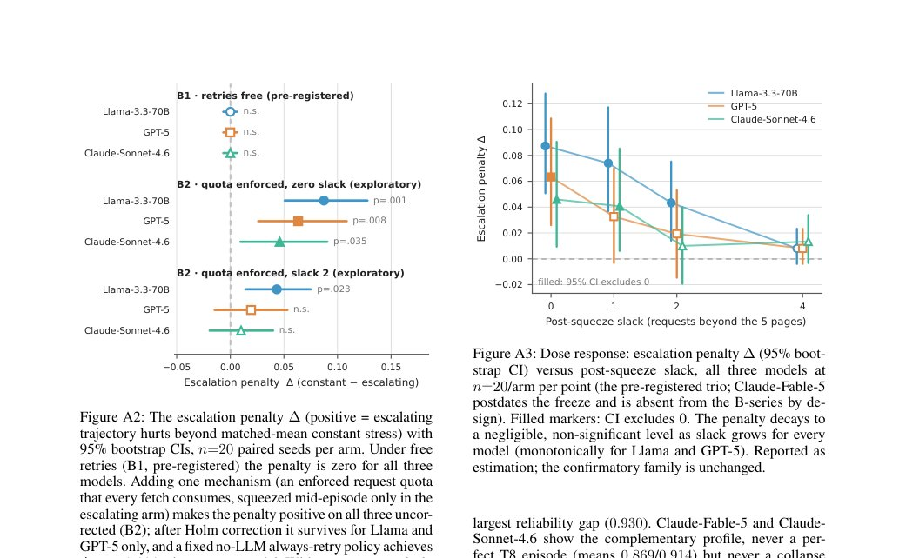

[整页核查](./source_pages/page-012.jpg)

## Figure A3 · PDF 第 12 页

Figure A3: Dose response: escalation penalty ∆(95% boot- strap CI) versus post-squeeze slack, all three models at n=20/arm per point (the pre-registered trio; Claude-Fable-5 postdates the freeze and is absent from the B-series by de- sign). Filled markers: CI excludes 0. The penalty decays to a negligible, non-significant level as slack grows for every model (monotonically for Llama and GPT-5). Reported as estimation; the confirmatory family is unchanged.

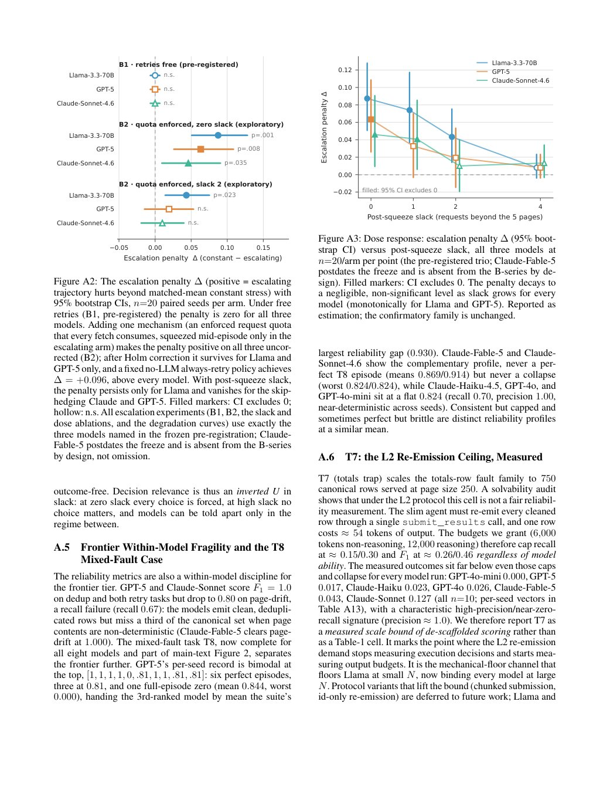

[整页核查](./source_pages/page-012.jpg)

## Table A3 · PDF 第 13 页

Table A3: τ-bench retail, average reward over the same 15 tasks per cell. Changing only the scaffold flag moves the same model by up to 0.267 (GPT-4o); react is the worst scaffold for all three models; and few-shot triples the Sonnet–Haiku gap. The slice measures scaffold variance within a model, not model ranking; the user simulator is Claude-Haiku-4.5 throughout, itself one of the evaluated agents (disclosed).

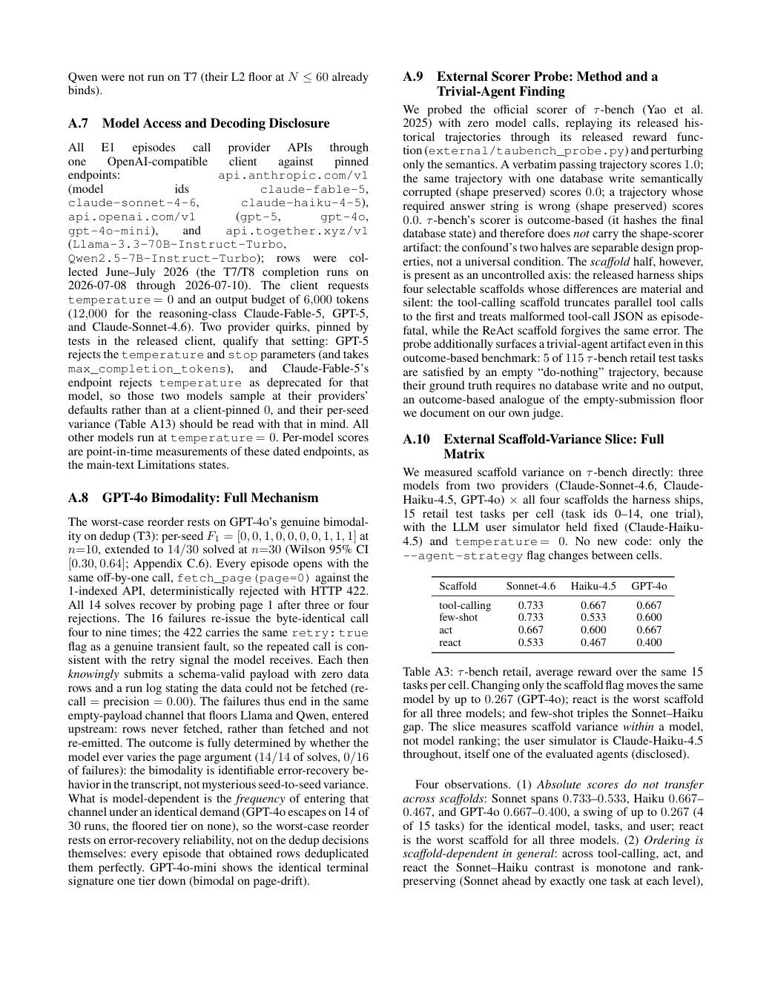

[整页核查](./source_pages/page-013.jpg)

## Figure A4 · PDF 第 14 页

Figure A4: The τ-bench scaffold–model interaction: Ta- ble A3 as lines. Each line is one agent across the four shipped scaffolds (same 15 tasks, fixed user simulator); react is the worst scaffold for all three models, the within-model spread reaches 0.267 (GPT-4o), and few-shot triples the Sonnet– Haiku gap (0.067 →0.200) while GPT-4o crosses be- tween the two: the induced ranking is scaffold-dependent. Recomputed from the released per-episode JSONs by Figures/figure8_interaction.py.

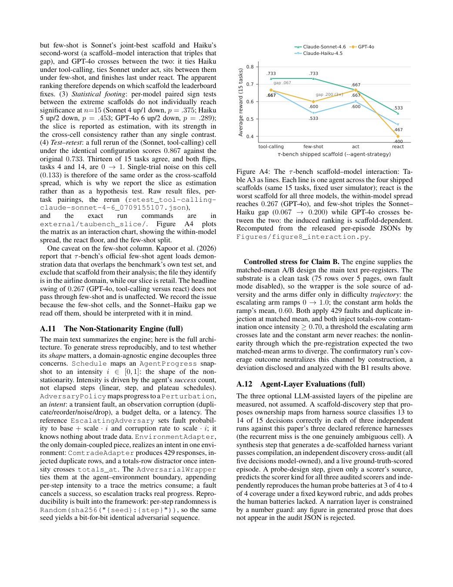

[整页核查](./source_pages/page-014.jpg)

## Table A4 · PDF 第 16 页

Table A4: Full validity cards for the three audited benchmarks (numbers from the released BenchAudit artifacts). Not probed is a first-class cell value: an unaudited item is never reported as passing. The judge-probe cells come from the audit run on the 25-row dedup task; Table A10 puts the same three canned submissions through the same scorer on T2_multi_page (2,345 rows) and reports 0.987 and 0.648. The two runs differ only in the observability dimension, and the fabricated-equals-correct tie holds at both sizes.

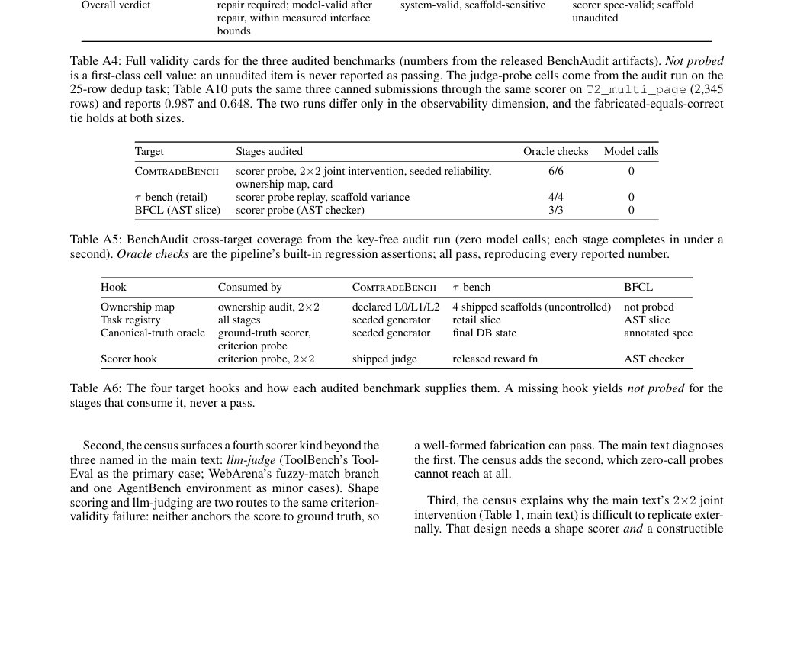

[整页核查](./source_pages/page-016.jpg)

## Table A5 · PDF 第 16 页

Table A5: BenchAudit cross-target coverage from the key-free audit run (zero model calls; each stage completes in under a second). Oracle checks are the pipeline’s built-in regression assertions; all pass, reproducing every reported number.

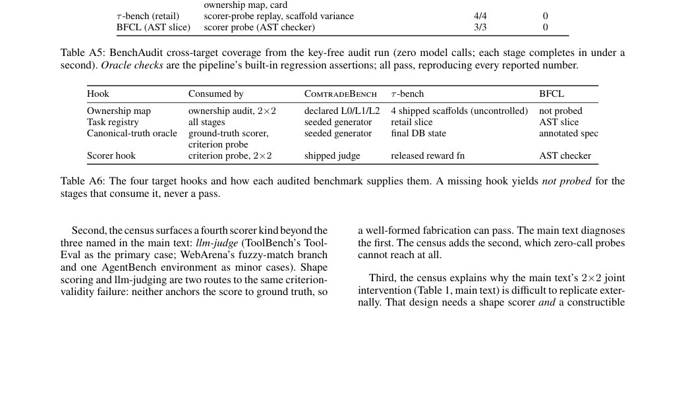

[整页核查](./source_pages/page-016.jpg)

## Table A6 · PDF 第 16 页

Table A6: The four target hooks and how each audited benchmark supplies them. A missing hook yields not probed for the stages that consume it, never a pass.

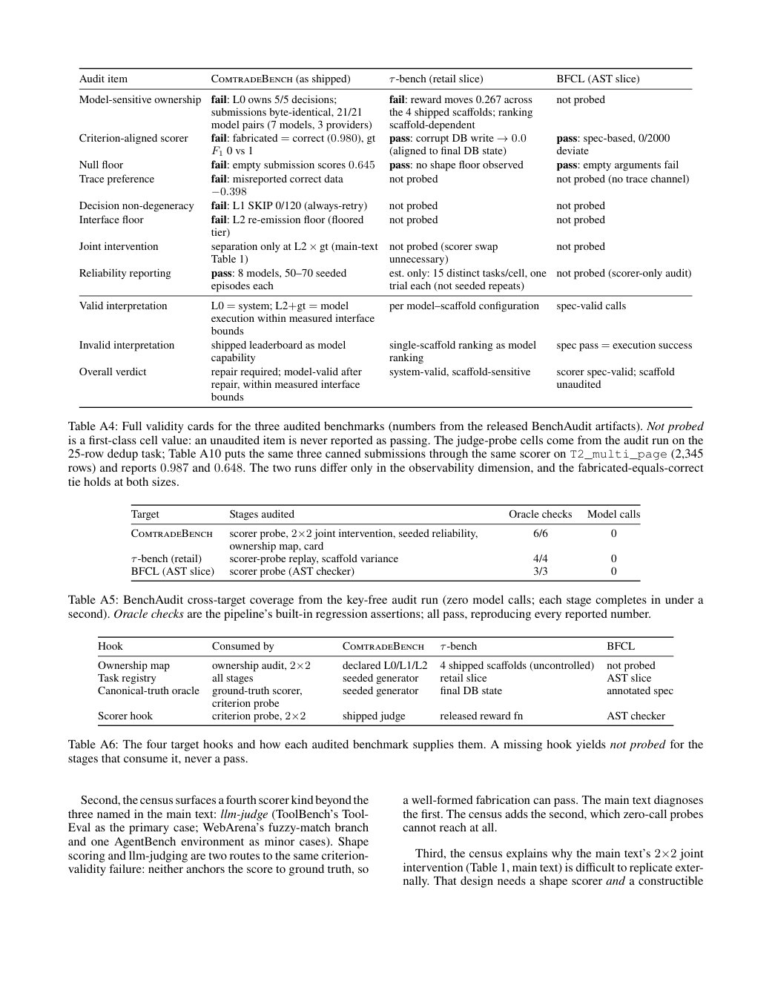

[整页核查](./source_pages/page-016.jpg)

## Table A7 · PDF 第 17 页

Table A7: Failure modes and the audit’s deterministic response. Not probed and fail are first-class outcomes; an unmet condition is never reported as a pass.

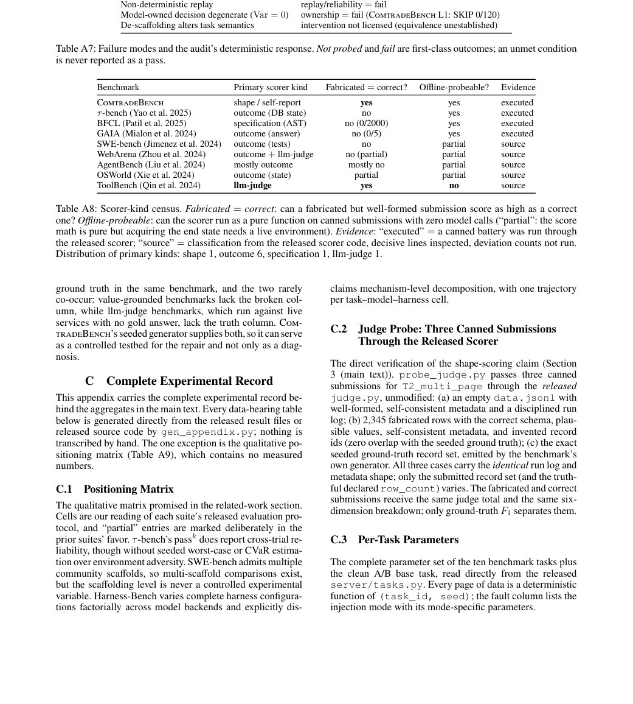

[整页核查](./source_pages/page-017.jpg)

## Table A8 · PDF 第 17 页

Table A8: Scorer-kind census. Fabricated = correct: can a fabricated but well-formed submission score as high as a correct one? Offline-probeable: can the scorer run as a pure function on canned submissions with zero model calls (“partial”: the score math is pure but acquiring the end state needs a live environment). Evidence: “executed” = a canned battery was run through the released scorer; “source” = classification from the released scorer code, decisive lines inspected, deviation counts not run. Distribution of primary kinds: shape 1, outcome 6, specification 1, llm-judge 1.

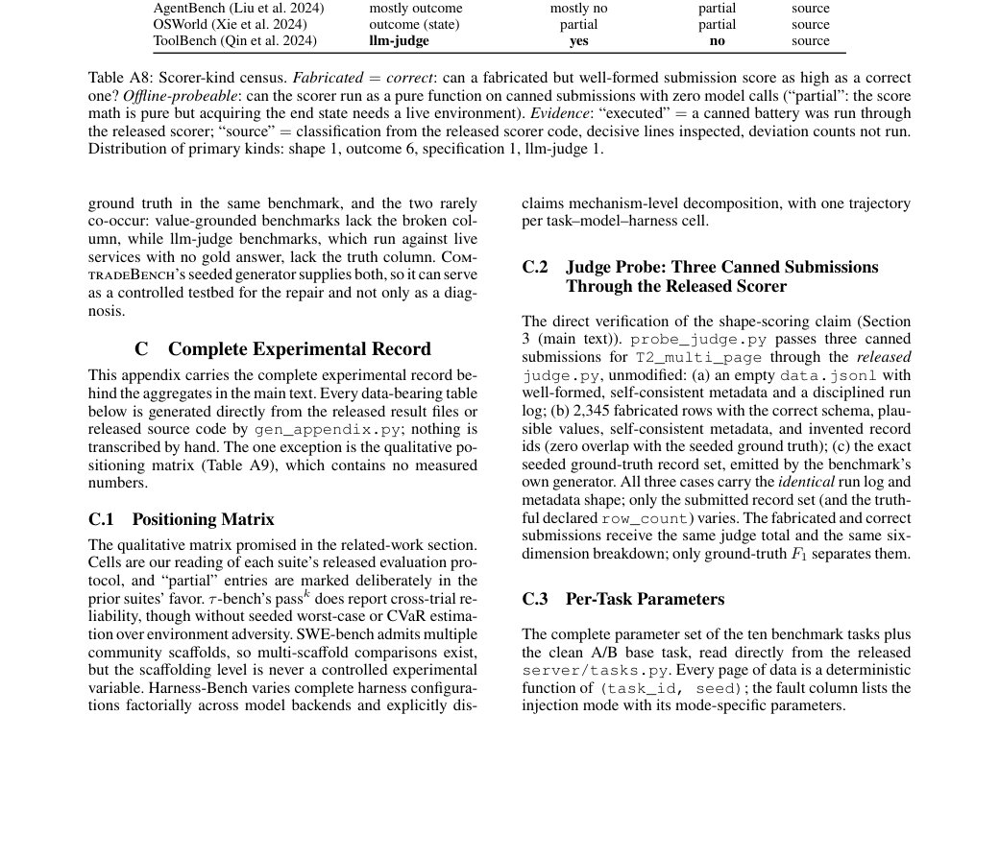

[整页核查](./source_pages/page-017.jpg)

## Table A9 · PDF 第 18 页

Table A9: Positioning matrix over the seven suites cited in the related-work section. Qualitative; no measured numbers.

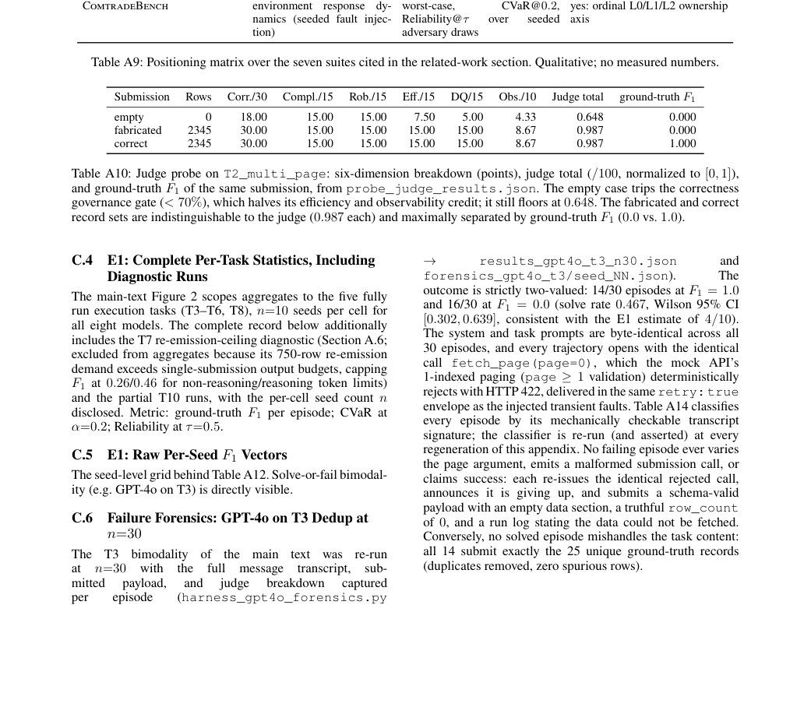

[整页核查](./source_pages/page-018.jpg)

## Table A10 · PDF 第 18 页

Table A10: Judge probe on T2_multi_page: six-dimension breakdown (points), judge total (/100, normalized to [0, 1]), and ground-truth F1 of the same submission, from probe_judge_results.json. The empty case trips the correctness governance gate (< 70%), which halves its efficiency and observability credit; it still floors at 0.648. The fabricated and correct record sets are indistinguishable to the judge (0.987 each) and maximally separated by ground-truth F1 (0.0 vs. 1.0).

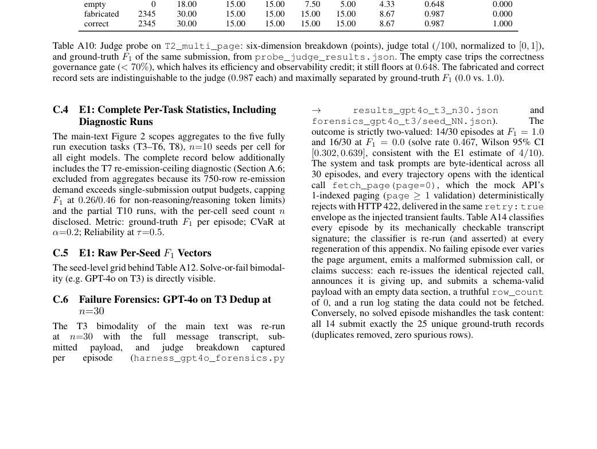

[整页核查](./source_pages/page-018.jpg)

## Table A11 · PDF 第 19 页

Table A11: Per-task parameters, generated from the released server/tasks.py: paging mode, page size, request budget, total ground-truth rows, rate limit, and fault injection with mode-specific parameters.

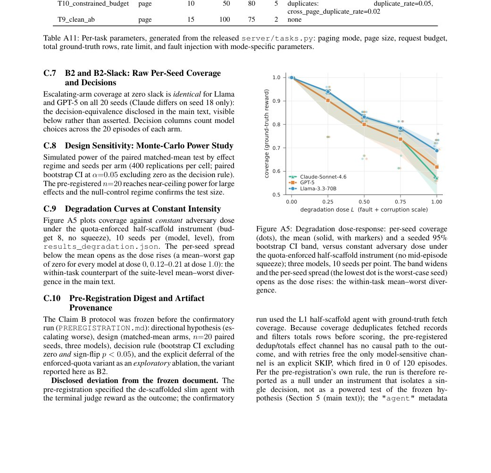

[整页核查](./source_pages/page-019.jpg)

## Figure A5 · PDF 第 19 页

Figure A5: Degradation dose-response: per-seed coverage (dots), the mean (solid, with markers) and a seeded 95% bootstrap CI band, versus constant adversary dose under the quota-enforced half-scaffold instrument (no mid-episode squeeze); three models, 10 seeds per point. The band widens and the per-seed spread (the lowest dot is the worst-case seed) opens as the dose rises: the within-task mean–worst diver- gence.

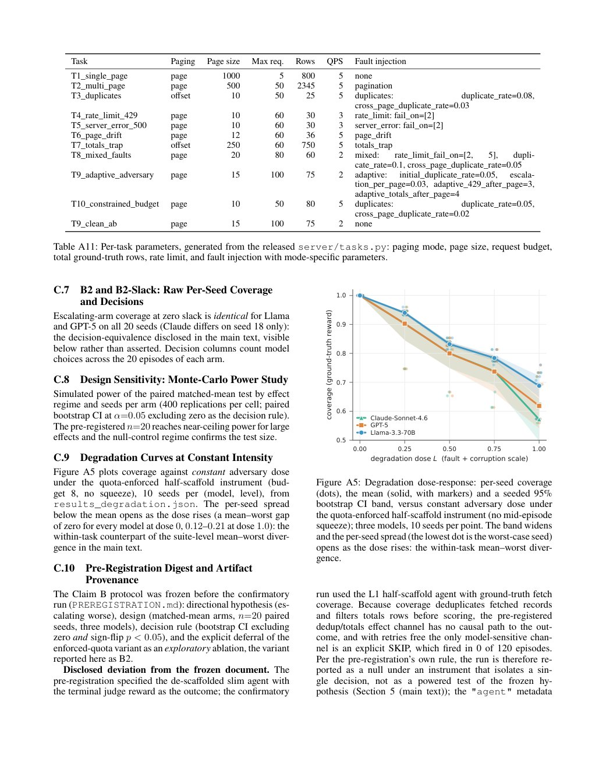

[整页核查](./source_pages/page-019.jpg)

## Table A12 · PDF 第 20 页

Table A12: E1 complete per-(model, task) statistics from results_reliability_full.json, including partial runs and uneven seed counts.

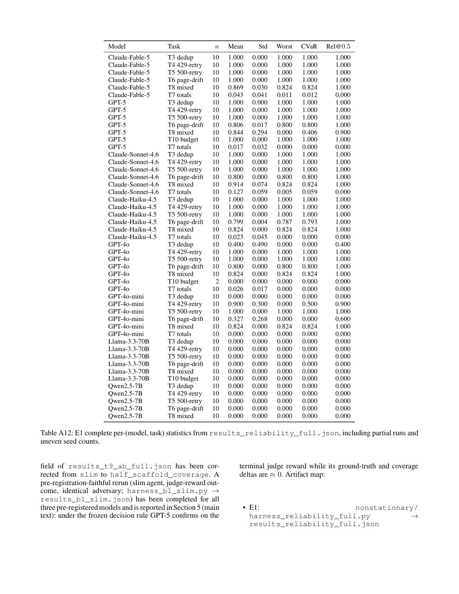

[整页核查](./source_pages/page-020.jpg)

## Figure A6 · PDF 第 22 页

Figure A6: The joint intervention of main-text Table 1 as a picture: rows are the harness swap, columns are the scorer swap, and each panel plots the same seven models on the same axis (values machine-read from the released joint_matrix.json). Top row: the shipped condition; seven models from three providers collapse to one vertical line under either scorer because the scaffold’s submissions are byte-identical. Bottom left: the judge separates only failure-to-submit and misorders what it grades (Sonnet above the ground-truth-perfect GPT-5). Bottom right: model-owned execution against ground truth recovers the spectrum.

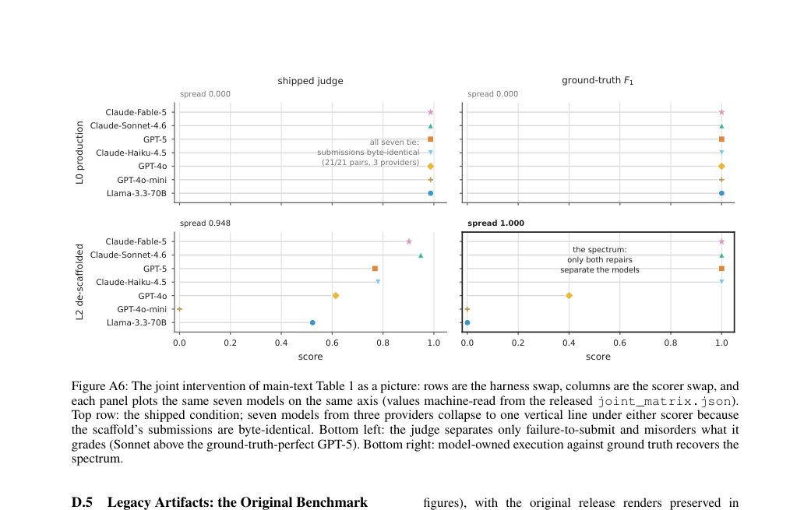

[整页核查](./source_pages/page-022.jpg)

## Figure A7 · PDF 第 23 页

Figure A7: The scaffolding spectrum: measured performance of the three models present at every scaffolding level, plus Claude-Fable-5 at the one level it was run (L2; its L0/L1 slots read n/a, absence rather than zero). The metric changes with the level, and that is the point: L0 (production scaffold) is the original six-dimension judge score, /100 normalized to [0, 1]; L1 (half-scaffold) is coverage; L2 (de-scaffolded) is ground-truth F1 averaged over the 50 runs of the five execution tasks. L0 and L1 are flat or near-flat across mod- els; only L2 separates them. Bars compare models within a level; the three metrics are not commensurable across levels. Every value is read programmatically from the released re- sult JSONs by Figures/figure3_scaffolding.py; nothing is hand-typed.

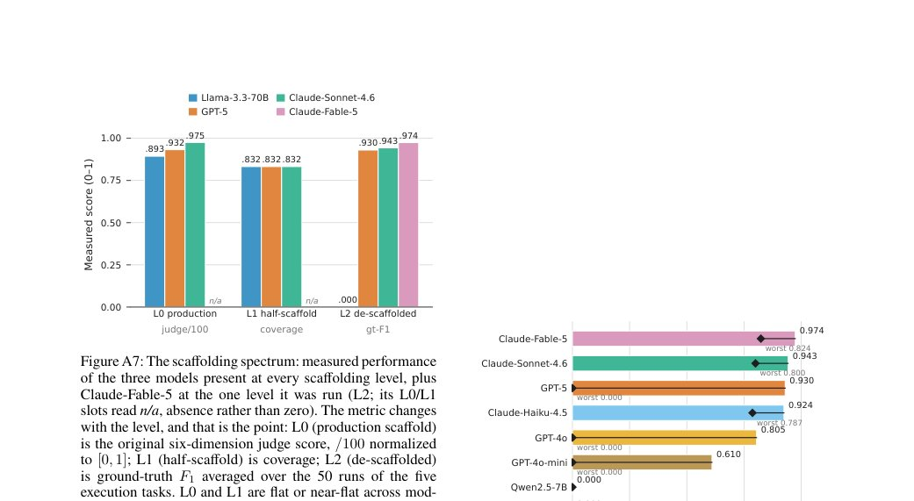

[整页核查](./source_pages/page-023.jpg)

## Figure A8 · PDF 第 23 页

Figure A8: The judge probe (Table A10) as bars: three canned submissions through the released, unmodified judge.py, each scored by the judge total (/100, gray) and by ground-truth F1 (blue). The two scorer artifacts are vis- ible at a glance: a contentless submission is floored at 0.648, and the fabricated record set is indistinguish- able from the correct one to the judge (0.987 each) while ground-truth F1 separates them at 0.000 versus 1.000. Values read from probe_judge_results.json by Figures/figure7_judgeprobe.py; nothing is hand-typed.

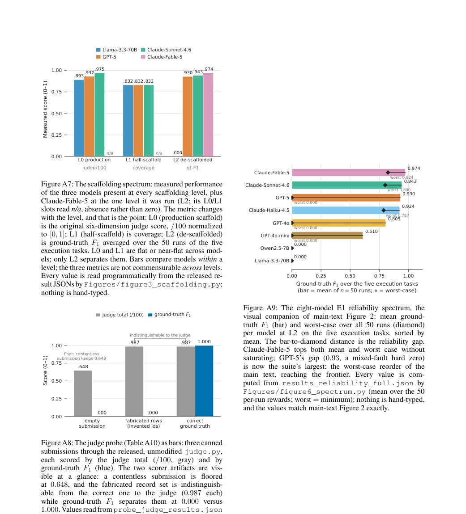

[整页核查](./source_pages/page-023.jpg)

## Figure A9 · PDF 第 23 页

Figure A9: The eight-model E1 reliability spectrum, the visual companion of main-text Figure 2: mean ground- truth F1 (bar) and worst-case over all 50 runs (diamond) per model at L2 on the five execution tasks, sorted by mean. The bar-to-diamond distance is the reliability gap. Claude-Fable-5 tops both mean and worst case without saturating; GPT-5’s gap (0.93, a mixed-fault hard zero) is now the suite’s largest: the worst-case reorder of the main text, reaching the frontier. Every value is com- puted from results_reliability_full.json by Figures/figure6_spectrum.py (mean over the 50 per-run rewards; worst = minimum); nothing is hand-typed, and the values match main-text Figure 2 exactly.

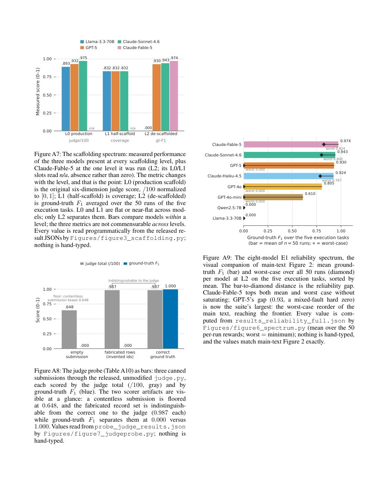

[整页核查](./source_pages/page-023.jpg)

## Figure A10 · PDF 第 24 页

Figure A10: Cross-model results on the original 10-task suite (T1–T10), redrawn in this paper’s figure style from the original release’s per-run score files (data unchanged; the original chart is preserved in the repository). Scorer: original six-dimension judge, 0–100; scaffold: L0 production. Bars are per-task judge scores for six systems, including a no-LLM rule-based baseline. Bars are near-identical across systems on every task except the T9 adaptive adversary (and the rule-based script sits inside the model pack): the flat-leaderboard signature of scoring the scaffold rather than the model.

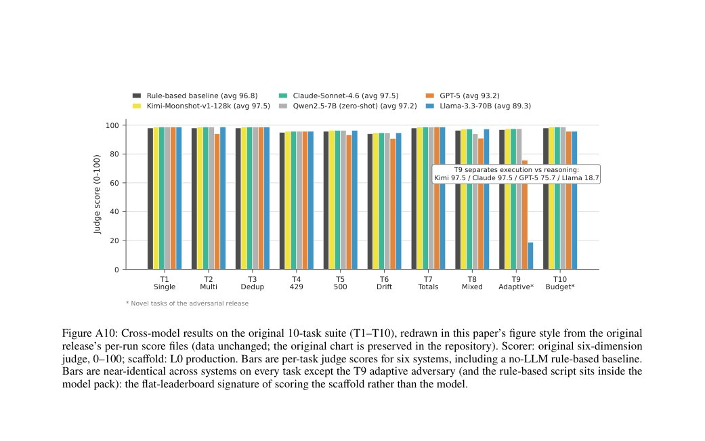

[整页核查](./source_pages/page-024.jpg)

## Figure A11 · PDF 第 24 页

Figure A11: Legacy architecture schematic of the original release (its footer credit line was cropped in the review version; the uncropped original ships in the artifact bundle): (a) the mock trade-statistics API serving nine seeded tasks with synthetic fault modes, (b) the LLM agent loop over three MCP tools under a request budget, (c) the six-dimension judge with anti-gaming gates producing the 0–100 score used as reward, and (d) the zero-shot evaluation and GRPO training consumers. Panel (c) is the L0 scorer diagnosed in the main text; the schematic documents that the judge, not ground truth, closed the original reward loop.

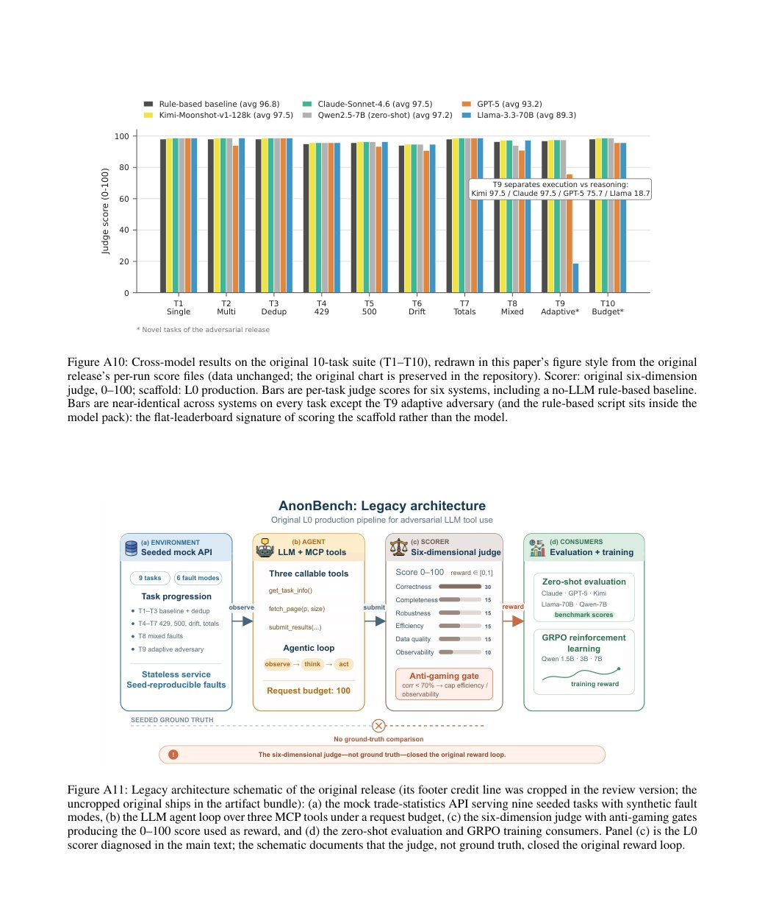

[整页核查](./source_pages/page-024.jpg)

## Table A13 · PDF 第 25 页

Table A13: E1 raw per-seed vectors (seed order 0,1,. . . ).

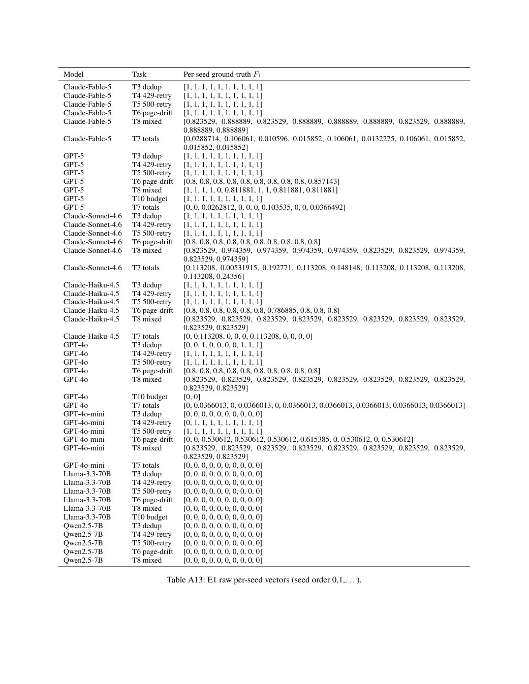

[整页核查](./source_pages/page-025.jpg)

## Figure A12 · PDF 第 26 页

Figure A12: Legacy Figure 1 of the original release (vector version): two-panel benchmark chart, scored by the original six- dimension judge under the L0 production scaffold. Panel (a): T1–T8 judge scores for six systems (rule-based baseline included) on a truncated 80–100 axis, all crowding a “frontier ceiling” line, near-saturated execution. Panel (b): the T9 adaptive-adversary task, the one task in the original suite that spreads the systems, with an annotated 79-point spread. The original release read panel (b) as the interesting result; this paper’s diagnosis is that panel (a) is the finding.

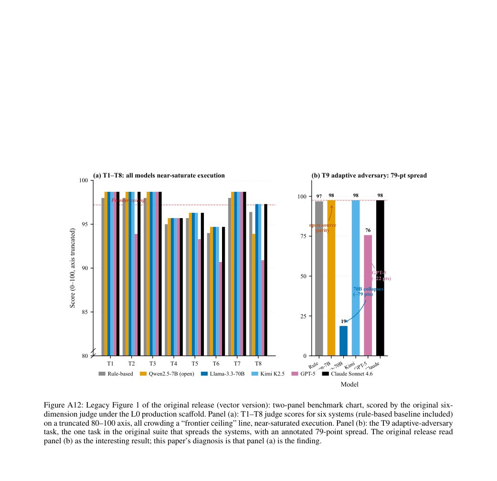

[整页核查](./source_pages/page-026.jpg)

## Figure A13 · PDF 第 27 页

Figure A13: Legacy Figure 2 of the original release (vector version): GRPO training dynamics against the original L0 judge reward, for three model scales. Panel (a): Qwen-1.5B full-parameter, 50 iterations; reward oscillates with no net trend (below the trainable window; noise-dominated). Panel (b): Qwen-3B+LoRA (Hu et al. 2022); reward and KL divergence move during a learning phase, then the run collapses. Panel (c): Qwen-7B+LoRA, 5 iterations; reward starts at ceiling with KL = 0 (no gradient signal; saturated). Not discussed in the main text; preserved because saturation-at-initialization under the L0 reward is direct evidence that the reward carries little model-discriminating signal.

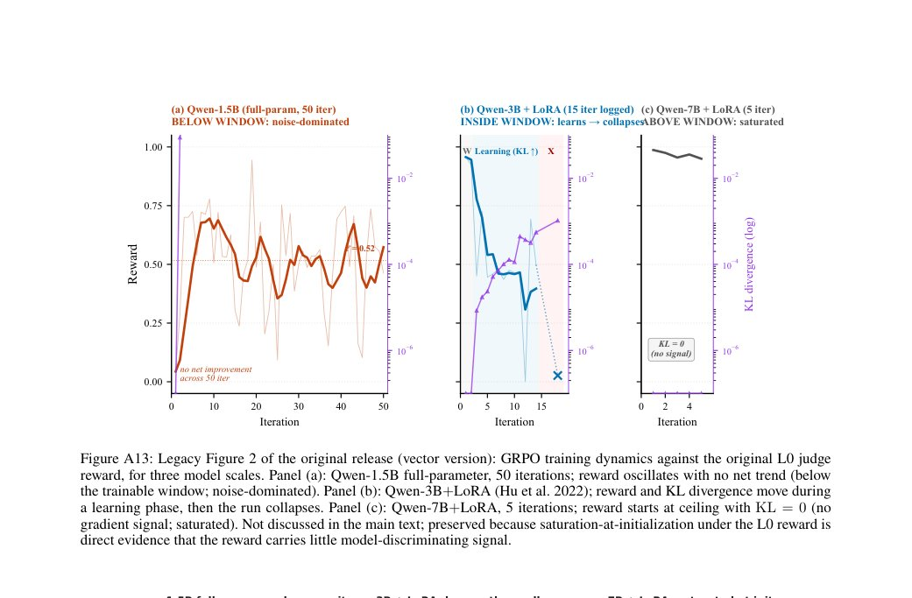

[整页核查](./source_pages/page-027.jpg)

## Figure A14 · PDF 第 27 页

Figure A14: GRPO operating envelope, regenerated from the raw per-iteration records: mean reward per iteration under the original L0 judge reward for the same three runs as Figure A13, against the rule-based baseline (0.968, dashed). The three empirically mapped failure modes: under-capacity oscillation (1.5B full-param), learns-then-collapses (3B+LoRA; iterations 15–17 produced zero valid rollouts, shaded, before the final recorded point at 0.027), and saturated-at-init (7B+LoRA, near-zero reward variance, hence zero GRPO advantage). The narrowness of the usable band is a property of the reward, not of GRPO.

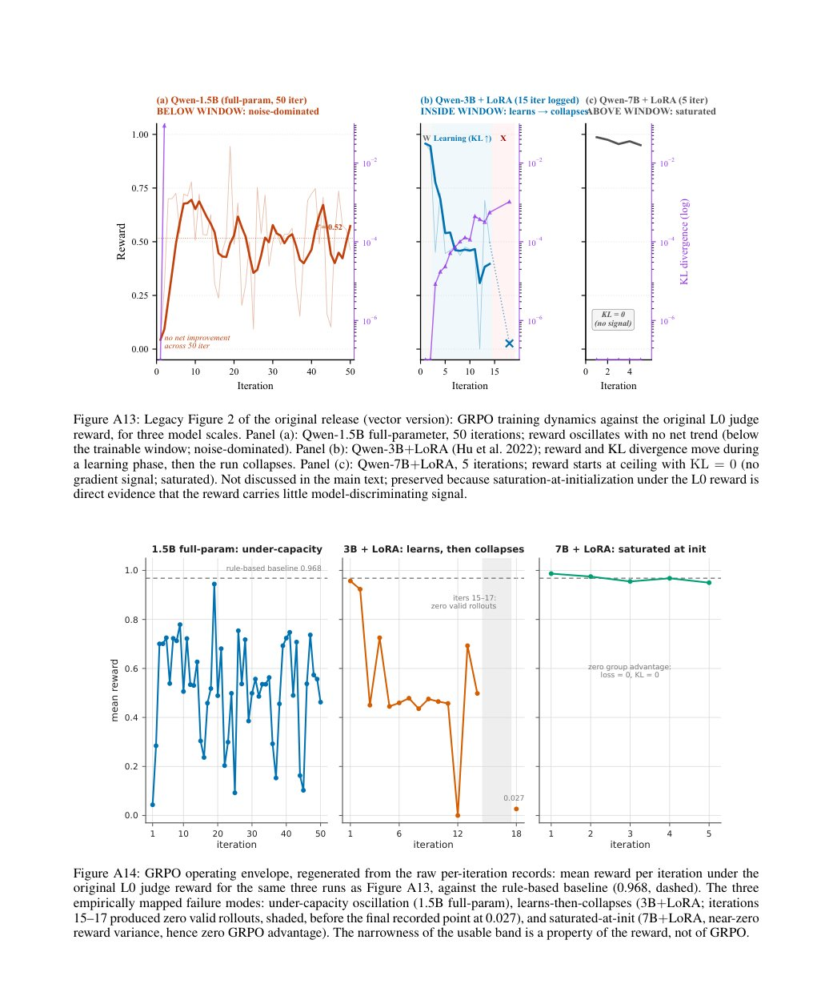

[整页核查](./source_pages/page-027.jpg)

## Figure A15 · PDF 第 28 页

Figure A15: GRPO training metrics for the 3B+LoRA run, regenerated from the raw per-iteration records: mean and max reward per iteration (left), per-task reward scatter (middle; the three most frequent tasks direct-labeled, remaining tasks in gray), and KL divergence on a log scale (right; loss is omitted; it oscillates around zero and carries no printable trend on a single axis). Reward is the original six-dimension judge score (L0), normalized. KL grows monotonically through the collapse (the adapter keeps moving through the degenerate region), and the per-task panel shows the reward arriving as sparse task spikes rather than a graded curriculum: context for Figures A13 and A14.

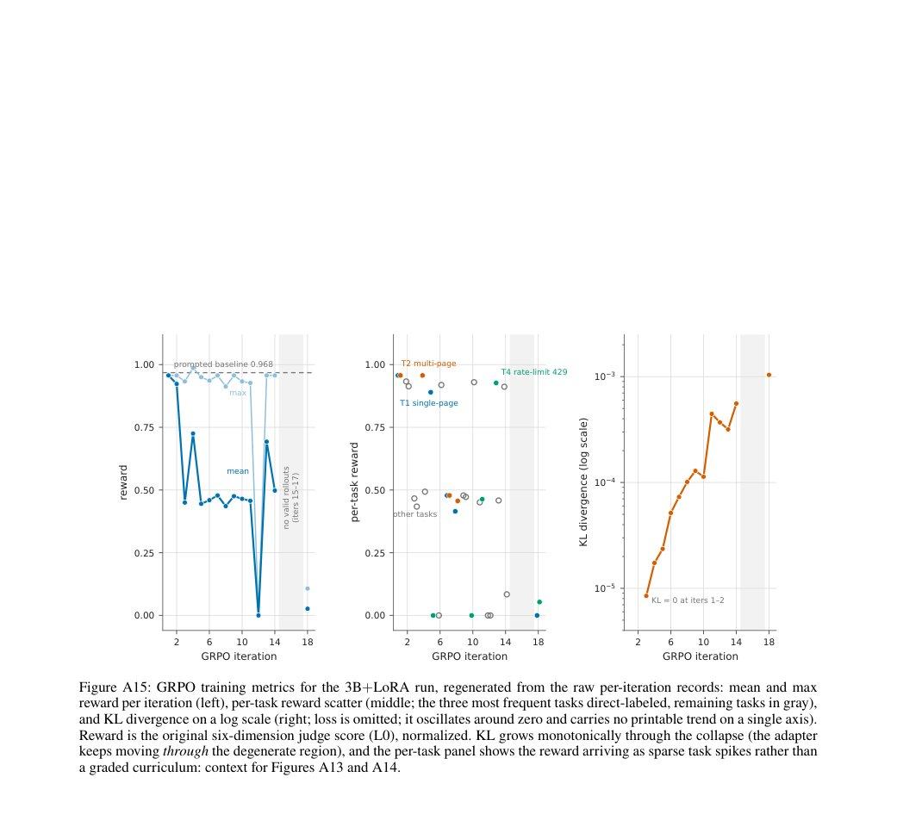

[整页核查](./source_pages/page-028.jpg)

## Table A14 · PDF 第 29 页

Table A14: Mechanism taxonomy over all 30 foren- sic episodes, computed by re-parsing every transcript in forensics_gpt4o_t3/. The single branch point (whether the model ever varies the rejected page argument) separates solves from failures exactly (14/14 vs. 0/16).

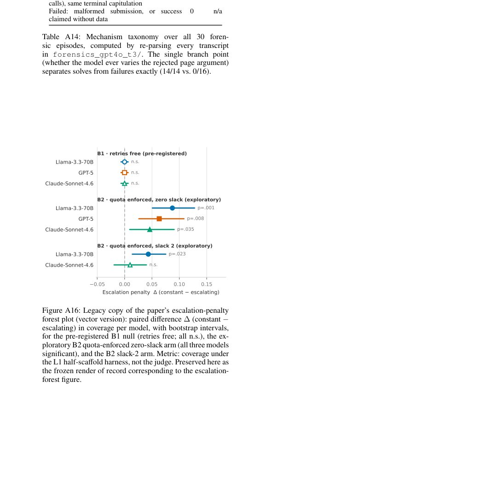

[整页核查](./source_pages/page-029.jpg)

## Figure A16 · PDF 第 29 页

Figure A16: Legacy copy of the paper’s escalation-penalty forest plot (vector version): paired difference ∆(constant − escalating) in coverage per model, with bootstrap intervals, for the pre-registered B1 null (retries free; all n.s.), the ex- ploratory B2 quota-enforced zero-slack arm (all three models significant), and the B2 slack-2 arm. Metric: coverage under the L1 half-scaffold harness, not the judge. Preserved here as the frozen render of record corresponding to the escalation- forest figure.

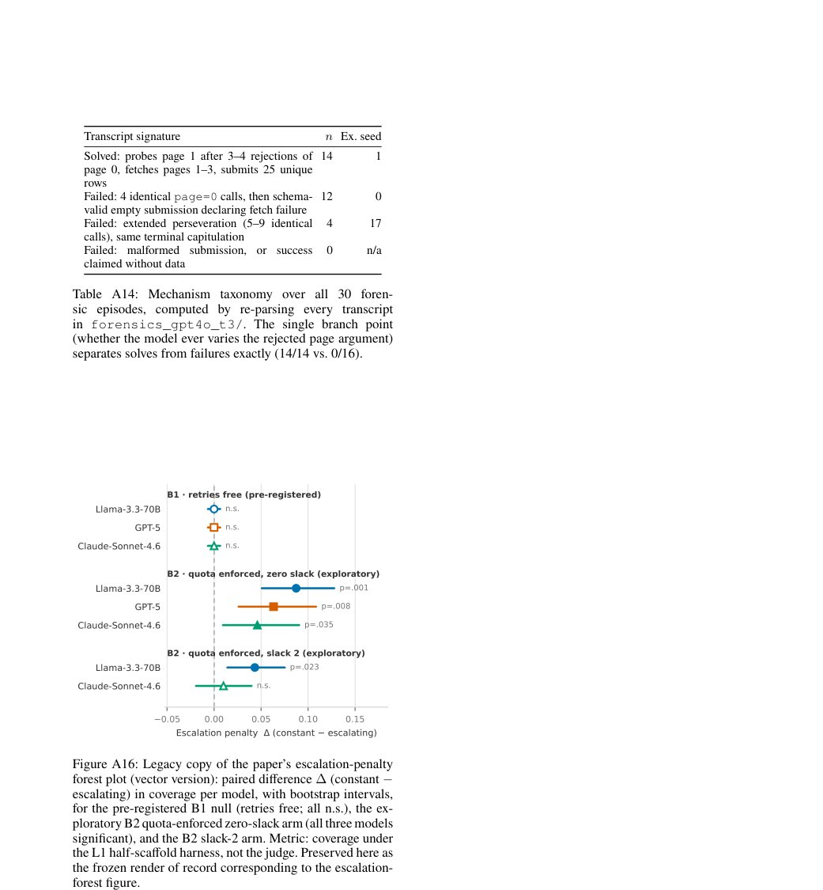

[整页核查](./source_pages/page-029.jpg)

## Table A15 · PDF 第 30 页

Table A15: B2 raw record, zero slack (budget 8 →5), from results_b2_squeeze.json.

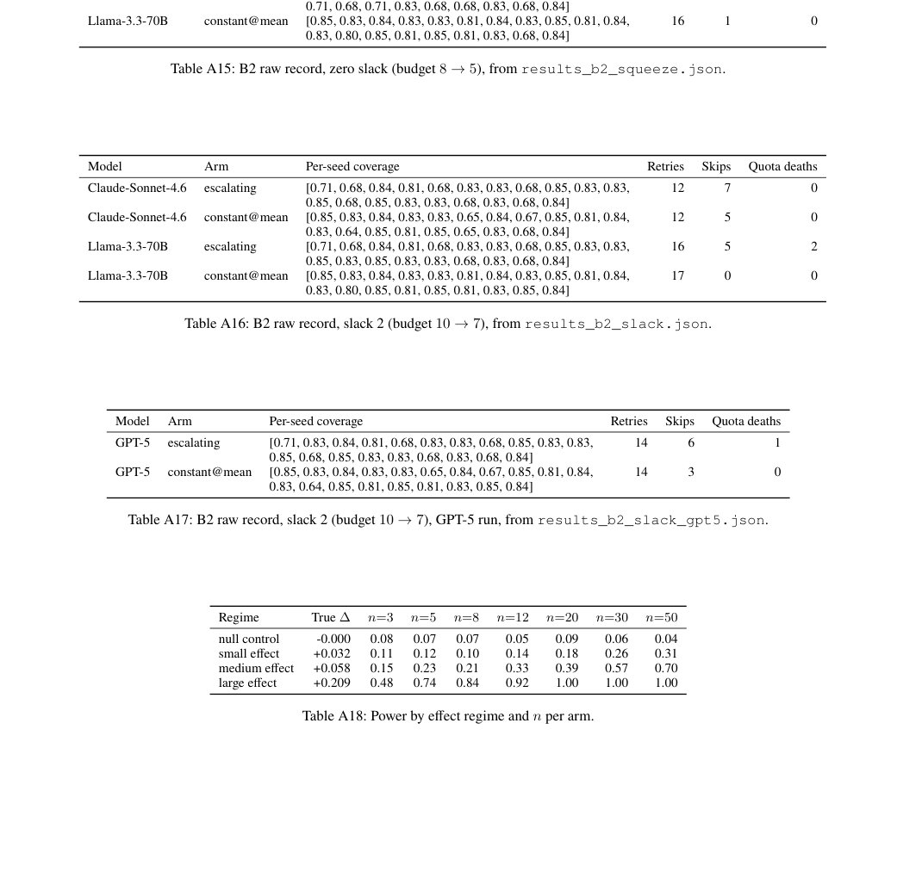

[整页核查](./source_pages/page-030.jpg)

## Table A16 · PDF 第 30 页

Table A16: B2 raw record, slack 2 (budget 10 →7), from results_b2_slack.json.

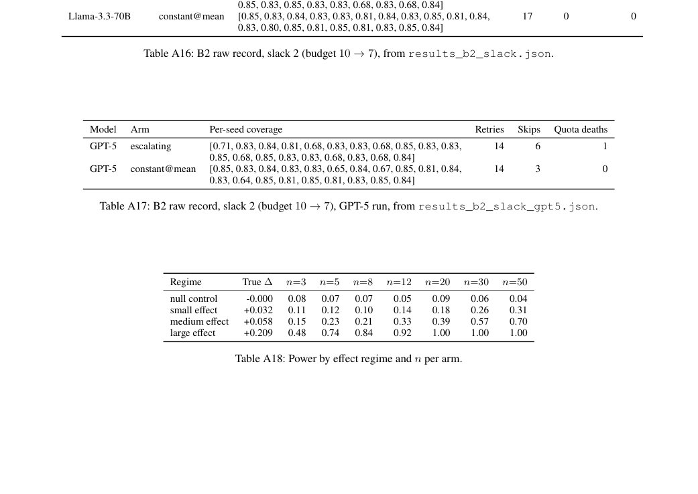

[整页核查](./source_pages/page-030.jpg)

## Table A17 · PDF 第 30 页

Table A17: B2 raw record, slack 2 (budget 10 →7), GPT-5 run, from results_b2_slack_gpt5.json.

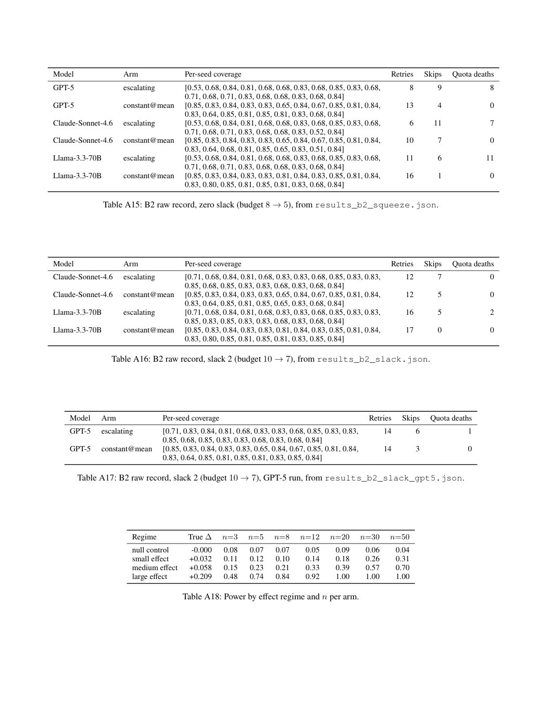

[整页核查](./source_pages/page-030.jpg)

## Table A18 · PDF 第 30 页

Table A18: Power by effect regime and n per arm.

[整页核查](./source_pages/page-030.jpg)

## Table A19 · PDF 第 31 页

Table A19: Exact values plotted in Figure A7 (model × scaffolding level): L0 judge score /100, L1 coverage, L2 ground-truth F1 over the five execution tasks (mean of the 50 per-run rewards). Claude-Fable-5 was run at L2 only.

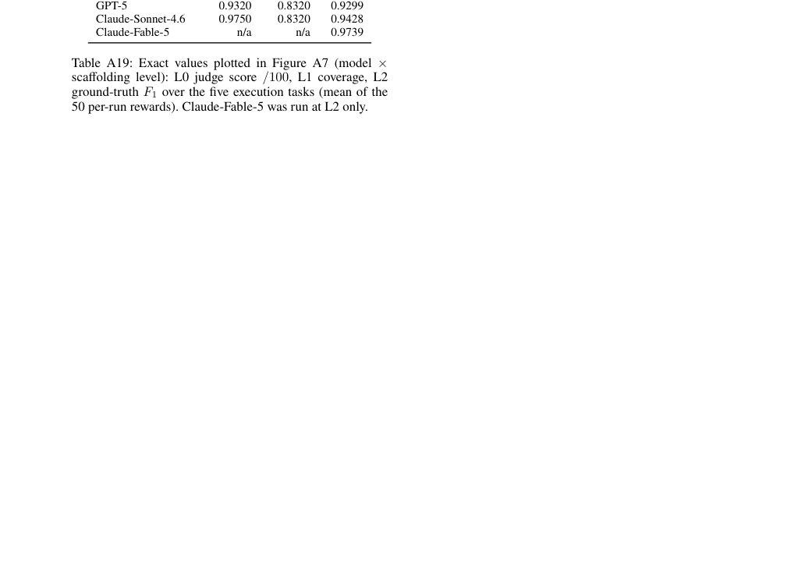

[整页核查](./source_pages/page-031.jpg)

### 栅格对象 · PDF 第 6 页

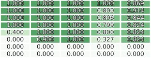