# Earth-Agent-Pro：面向真实世界全链路地球观测的智能体

**原文标题**：Earth-Agent-Pro: Towards Real-World Full-Chain Earth Observation with Agents  
**作者**：Zhutao Lv、Chenhao Dang、Yi Feng、Yanpei Gong、Xiaolei Wang、Junyan Ye、Conghui He、Weijia Li  
**原文版本**：arXiv:2609.12533v1，2026 年 9 月 11 日  
**原始 PDF**：18 页。

> **翻译范围**：摘要、研究背景、评估任务定义、数据构建、工作流框架、训练方法、主要实验结果、讨论和结论已作详细中文译述；全部公式符号、关键数据表以及图 1—8 原图保留。参考文献的书目内容仍以英文原文为准，部分密集技术段落不是严格逐句直译。完整原稿请见 `英文原文_逐页.md`、`逐页原文与配图.md` 与 `原始论文.pdf`。**不可把本文件认定为 18 页完全逐句译本。**

## 摘要（中文翻译）

真实世界的地球观测（Earth Observation，EO）分析要求智能体能够将高层次科学问题转化为可执行的工作流，从而完成观测数据获取、数据准备、领域计算，并基于运行时证据形成结论。然而，现有地球观测智能体及基准通常只覆盖这一流程的部分环节：智能体往往从已经提供的观测数据开始工作，而基准通常提供准备好的输入或候选答案，导致开放世界环境下的全链路地球观测执行能力仍缺乏充分测试。

本文提出 **Earth-Agent-Pro**，一种具备执行适应能力的 Plan-and-Execute（规划—执行）框架，通过专家编写的技能来约束工作流规划和运行时工具使用。该框架在以工作流为中心的结构化记忆中记录规划步骤、已接受的证据及其依赖关系；当运行时证据使某一步失效时，仅修复受影响的工作流后缀，而不丢弃已经验证的前序工作。针对不同角色，作者通过独立的 Planner 和 Executor 适配器调整底层大语言模型：规划器使用序列级监督微调（SFT）学习工作流组合，执行器使用具有局部可验证奖励的节点级 Group Relative Policy Optimization（GRPO）学习工具参数与运行时信息的对齐。

为了评估开放世界全链路地球观测执行能力，作者进一步推出 **Earth-Bench-Pro**：将 248 个专家设计的核心任务置于三个相互匹配的评价情境，共构成 **744 道问题**。其中，248 道开放世界执行题覆盖 RGB 影像、光谱观测和遥感产品，给出高层次请求和运行时数据需求，要求智能体生成可执行轨迹，并依据执行证据给出开放式答案。在共享 GPT-5 骨干模型的条件下，Earth-Agent-Pro 的 **LLM-as-Judge 正确率达到 66.13%**，比 ReAct 高出 **20.95 个百分点**，Tools-In-Order 指标高出 **24.44 个百分点**。同时微调 Planner 与 Executor，使 Qwen3.5-9B 的 LLM-as-Judge 正确率由 **38.31% 提升到 50.00%**，提高 **11.69 个百分点**。只评价规划和在参考工作流下执行的实验进一步说明，两种适配器分别改进工作流组合和工具参数对齐。研究表明，Earth-Bench-Pro 与 Earth-Agent-Pro 可以推动从用户请求到有证据支持的科学答案这一完整过程的评价与训练。作者在这一版本中表示代码和数据集将于之后发布。

## I. 引言（中文译述）

地球观测通过卫星和航空观测将测量数据转化为农业监测、灾害评估、城市分析和环境变化研究所需的量化证据。从一个自然语言科学问题出发，研究人员首先要识别研究现象、区域和时间，随后选定数据源、产品、波段和采样参数，获取并预处理观测数据，再运行专业计算流程，最终解释结果。这要求研究人员同时熟悉传感器、数据产品、地理信息处理和领域科学，门槛很高。

近年来，视觉语言模型能够解释已有遥感影像，工具增强型智能体能够选择工具、运行代码和组合多步骤工作流。但不少现有评价默认输入数据已经由专家准备，或将最后的答案简化为多项选择。**正确选择选项不能充分反映真实世界地学分析中的数据检索、单位换算、参数设置、依赖管理和最终数值生成是否正确。** 因此，需要固定相同科学目标，同时逐渐减少人类提供的脚手架，衡量智能体自主完成任务的能力。

作者此前提出的 Earth-Agent 和 Earth-Bench 已经覆盖 RGB、光谱数据与遥感产品，并评价最终答案和工具轨迹；但 Earth-Bench 从准备好的本地文件及选择题开始，未将运行时数据发现和开放式答案生成纳入评价边界。本文保留原基准的 **248 个科学目标**，让智能体需要在执行过程中自己发现文件、检索或下载数据，生成必要的中间结果，并由这些结果构建可信答案。

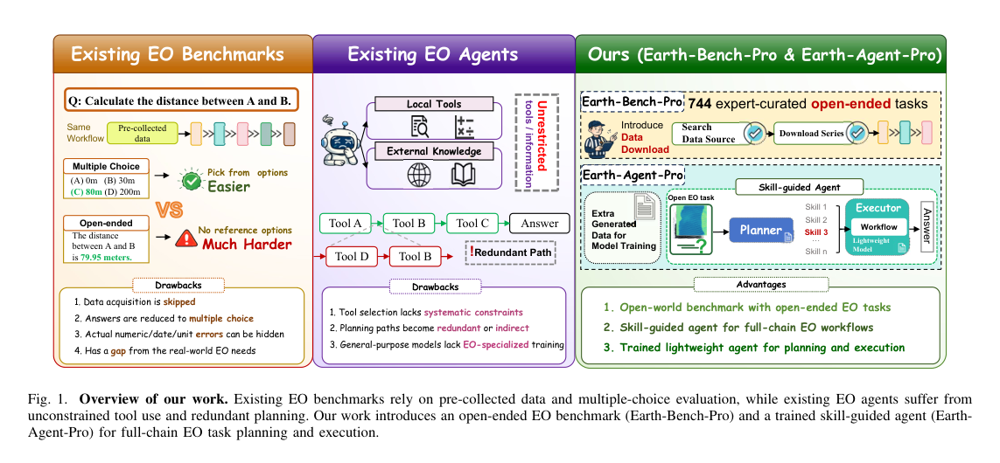

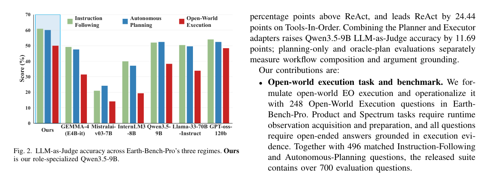

论文的主要贡献是：提出包含三种匹配情境的 Earth-Bench-Pro；提出带有专家技能约束、工作流证据记忆与局部后缀修复的 Earth-Agent-Pro；使用面向不同角色的训练，分别强化规划和执行的能力。

## II. 相关工作（中文译述）

**地球观测基准**方面，以视觉问答为主的 RSVQA、VRSBench 等通常使用固定输入。面向细粒度像素定位、超高分辨率遥感、城市与灾害场景的近期基准拓宽了题型，但通常更重视最终输出而不是工具轨迹或中间证据。GeoBenchX、ThinkGeo、GeoPlan-Bench、GeoAgentBench 和 Earth-Bench 等已经开始引入 GIS 多步骤工具调用、工作流规划或执行核查。作者认为仍需将**数据源选择、实际获取、处理中间证据和最终自然语言答案**放在同一个评估过程中。

**地球观测方法**方面，多模态模型增强了遥感影像识别、描述、定位和传感器理解能力，但大多只使用已有影像，不直接完成开放数据检索与长流程分析。通用 Agent 研究从 ReAct 的推理—行动交织、Voyager 的可复用技能到 AFlow 的工作流优化建立了基础。遥感智能体进一步整合了专用模型、MCP 工具以及 GEE 代码生成。作者指出，已有系统对工具空间的约束不足，规划与执行常由统一策略处理，难以独立提升“工作流结构是否合理”和“运行时参数是否可靠”两种能力。

## III. Earth-Bench-Pro：基准构建

### A. 三种相互匹配的任务情境

基准共有 **744 道题**，来源于 **248 个科学任务核心**，各任务核心对应下列三种难度条件：

| 情境 | 英文名 | 对智能体提供的支持 | 智能体需要完成的工作 |
|---|---|---|---|
| 指令遵循 | Earth-Bench-IF / Instruction Following | 已准备的数据，以及按顺序列出的参考工具 | 按指定工具序列完成计算 |
| 自主规划 | Earth-Bench-AP / Autonomous Planning | 已准备的数据，但不提供工具顺序 | 自主形成并执行工作流 |
| 开放世界执行 | Earth-Bench-OW / Open-World Execution | 高层科学问题和运行时数据需求，不给现成数据路径或选项 | 发现/获取数据、处理、规划、执行并生成开放式答案 |

这三种设置并非三个无关数据集，而是**固定相同科学问题、逐步去掉专家支持的配对比较**。因此，它们可用于分析性能下降究竟发生在工具序列规划、数据获取还是开放式证据推理阶段。原文指出，Earth-Bench-OW 通常是最难的情境。

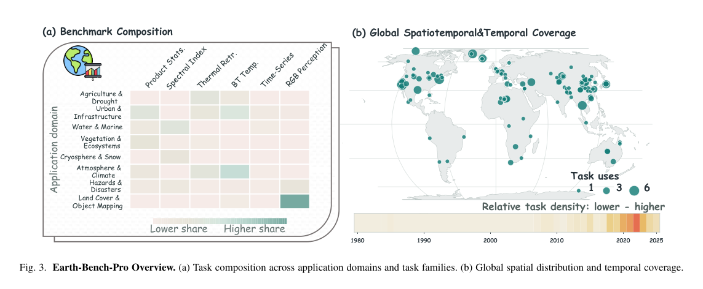

基准覆盖八类应用领域：农业与干旱、城市与基础设施、水体与海洋、植被与生态系统、冰冻圈与积雪、大气与气候、灾害与风险，以及土地覆盖与目标制图；分析类型包括产品统计、光谱指数、热参数反演、亮温分析、时间序列与 RGB 感知。任务跨越六个有人居住的大陆，所需观测时期覆盖 1980—2025 年。

原文表 I 将 Earth-Bench-Pro 与相关基准从多源 EO 数据、开放式问答、可执行轨迹、真实数据获取、预处理、定量答案和中间观测七方面进行比较。**表中报告本基准 744 个任务、5,295 个步骤、平均 7.1 次工具调用及 112 个工具**。文中另对 248 条开放世界验证轨迹报告了实际调用次数与工具数，两种统计口径不可直接混同。

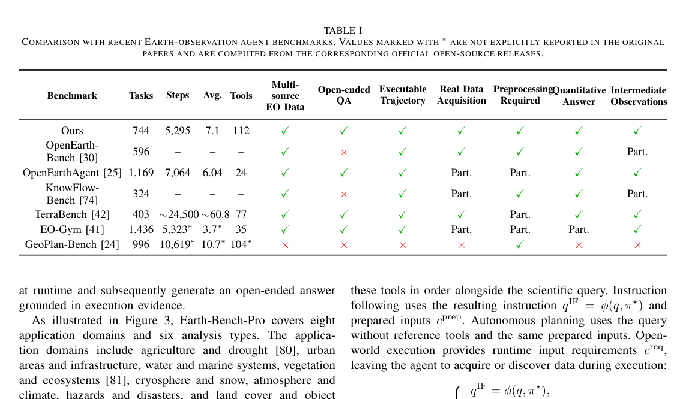

### B. 形式化定义

一个基准实例记为：

\[
z=(q,c,\tau^*,y^*)
\]

其中，\(q\) 为科学问题，\(c\) 为输入上下文或运行时数据需求，\(\tau^*\) 为参考工具执行轨迹，\(y^*\) 为参考答案。参考轨迹记录工具、参数和运行观察：

\[
\tau^*=\bigl((t_i^*,\theta_i^*,o_i^*)\bigr)_{i=1}^{N_z},\qquad
 o_i^*=E(t_i^*,\theta_i^*)
\]

三种情境的关键区别在于是否给出工具序列和是否提供准备好的数据。指令遵循使用 \(q_{IF}=\phi(q,\pi^*)\) 与 \(c_{prep}\)，自主规划只给 \(q,c_{prep}\)，开放世界则给 \(q,c_{req}\)。开放世界中，工具选择 \(t_i\)、参数 \(\theta_i\) 依赖问题、数据要求和当前已接受轨迹，执行得到 \(o_i=E(t_i,\theta_i)\)，最终答案 \(\hat y\) 从完整证据轨迹生成。这里保留原论文公式的变量含义，具体排版与式（1）—（3）可对照原 PDF 第 4 页。

### C. 数据构建与验证

作者组织了 **8 人标注团队**，包括 2 名计算机科学专家、3 名遥感专家和 3 名地球科学专家，共同检查工具可执行性、遥感产品要求、科学解释和答案正确性。团队将原有 248 个科学任务重构为开放世界工作流，并在统一执行环境中重新运行参考方案，修正问题、工具、参数、中间依赖与答案之间的不一致。

其中，**188 个 Product 与 Spectrum 任务**需要将固定的本地输入替换为在线获取和必要预处理，团队编写了 **323 条任务级获取规范**，涵盖数据源、产品、波段、空间范围、观测时期、分辨率、采样间隔及缩放因子。剩余 **60 个 RGB 任务**仍保留用户提供的图像，但具体文件也需要在运行时发现。

对每个任务，专家删除选择题选项，改写成包含科学目标、研究区域、观测时间及条件的自足式开放问题，并重新运行流程、记录每步的工具调用和环境返回值，由运行结果重新计算答案。质量控制重点检查三种关系：**问题—数据需求是否匹配、工具调用之间的数据依赖是否正确、最终答案是否有实际执行证据支撑。** 作者保留并检查中间栅格、文件、数值、检测结果、掩膜和统计量，校验单位、精度、时间指向与趋势描述。248 条验证后的开放世界轨迹包含 **1,765 次工具调用**，平均每题 **7.1 次**，共使用 **84 种不同工具**。

## IV. Earth-Agent-Pro：具有执行适应能力的规划—执行框架

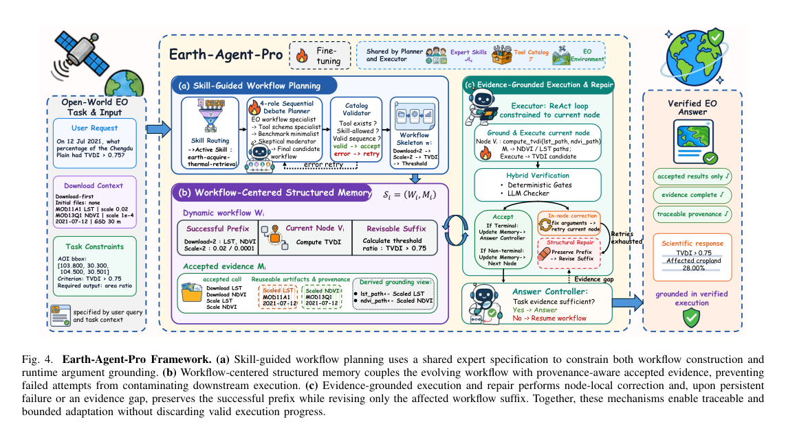

### A. 框架概览

系统将任务解决划分为规划器（Planner）、执行器（Executor）、证据记忆和答案控制几个相互依赖的部分。Planner 基于用户请求和专家技能产生有序工作流；Executor 在每一个节点上选择并调用真实工具；验证模块判断输出是否足以被接受；结构化记忆保存工作流节点、证据和依赖关系。发生失败时，系统优先修正当前节点；若不再能够满足要求，则保留有效前缀、修改受影响的后续计划。

### B. 专家技能指导的工作流规划（Skill-Guided Planning）

每个专家技能对应一类 EO 分析模式，规定相关数据、允许的工具及推荐流程，使智能体不必在整个工具目录中盲目搜索。例如计算 TVDI 时，需要先获取 LST、NDVI，正确应用产品缩放系数，再计算干旱指标并统计超过阈值的面积比例。论文示例围绕成都平原特定日期的温度植被干旱指数展开。技能用于约束**可用工具、数据前提、执行顺序以及任务终止条件**，而不是简单地将答案硬编码进提示词。

论文通过多角色顺序讨论组成候选工作流：领域流程专家、工具模式专家、最简流程角色与质疑性审核角色分别提出和检查方案。最终方案必须通过工具存在性、技能允许性及步骤顺序等约束，再进入执行阶段。与通用自由式规划相比，该方法减少不存在工具的调用和无关或冗余步骤。

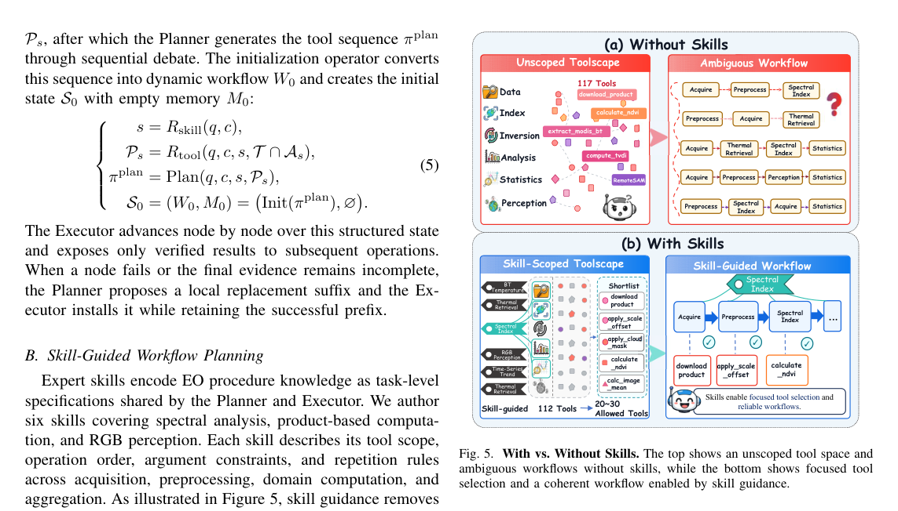

### C. 以工作流为中心的结构化记忆

系统在节点 \(i\) 维持当前工作流 \(W_i\) 和已接受证据 \(M_i\)，可以记为 \(S_i=(W_i,M_i)\)。记忆不仅存储文本历史，还记录文件路径、工具返回值、数据来源以及各节点的依赖。这样，当某一步失败时，后续步骤不会误用尚未验证的文件或结果；相反，已验证的上游文件和中间产物可以继续复用。与把整段对话当成唯一状态的做法相比，这种表示更适于需要长期依赖关系的科学计算工作流。

### D. 基于证据的执行与工作流修复

Executor 在当前节点范围内执行 ReAct 式调用；系统通过确定性检查（如工具名和参数结构约束、文件存在性检查等）及 LLM 检查器混合验证运行结果。若当前参数有问题，首先在节点内部修正并重新调用；若连续失败或暴露出后续证据缺口，则重新规划受影响的**后缀（suffix）**，而非重启整个工作流。答案控制器最终只基于经过接受的证据给出科学结果，不将失败调用或臆造路径当作有效证据。

## V. 角色专用训练方法

### A. 总体训练设计

作者将“工作流组合”与“节点级参数对齐”分开训练，以避免单一策略同时承担长期规划和工具参数恢复而发生混淆。**Planner 采用序列级 SFT**，学习将高层次任务转换为有依赖结构的工具工作流；**Executor 采用节点级 GRPO**，利用局部可验证奖励提高工具参数在执行状态下的正确性。

### B. 保留依赖关系的训练数据生成

作者从 **248 条种子工作流**出发，通过在保持依赖关系合法的前提下替换任务变量、数据源或条件，构建 **2,480 条合成轨迹**，并结合公开 OpenEarthAgent 训练材料形成均衡数据混合。这里的重要要求是替换不能仅改变表面文字：上游输出路径、下游引用、时间或单位关系必须仍能正确连接。

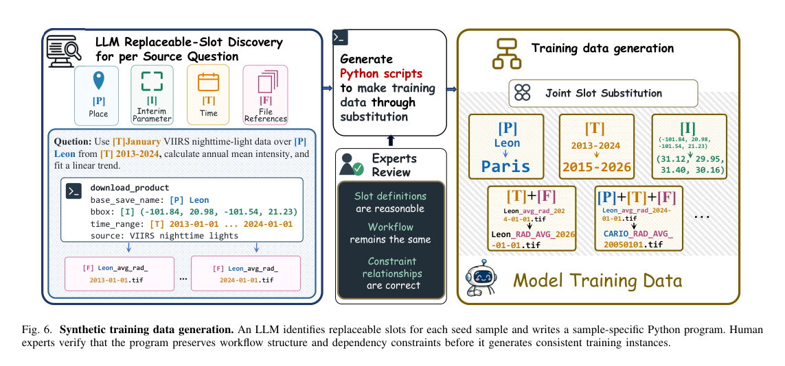

### C. Planner 的 SFT

规划器学习在技能规则下组合有序步骤，并维持输入、输出和节点依赖。序列级目标面向完整工作流，而非单个工具名预测，因此侧重避免不合理的步骤顺序、遗漏预处理和无效的任务分解。

### D. Executor 的 GRPO

执行器训练使用在局部节点上可检查的奖励信号，将输入参数、工具模式与当前真实证据对齐。例如，某一步需要 LST 与 NDVI 文件时，参数应来源于已接受的上游节点，而不能生成看似合理却不存在的文件路径。该训练目标与规划器的结构优化相互补充。

## VI. 实验设置、指标与结果

### A. 评价指标

论文同时衡量最终答案和执行轨迹。全部指标均保留其原缩写：

| 指标 | 中文说明 | 衡量对象 |
|---|---|---|
| LLM-as-Judge | 大模型裁判评分/正确率 | 最终答案是否科学合理并与证据一致 |
| ROUGE-L | 最长公共子序列词面重合指标 | 答案与参考文本的词面一致性 |
| EM | Embedding-based Semantic Matching，嵌入语义匹配 | 答案语义相似度（注意这里不是 Exact Match） |
| Efficiency | 执行长度相对参考轨迹的效率比 | 理想值接近 1 |
| TAO | Tools-Any-Order，不考虑顺序的工具覆盖 | 是否选对工具集合 |
| TIO | Tools-In-Order，按顺序的工具匹配 | 是否符合参考工具顺序 |
| TEM | Tool-Exact-Match，工具序列严格匹配 | 工具轨迹的精确一致性 |
| Param. | Parameter Accuracy，参数准确率 | 工具调用参数是否符合参考要求 |

论文比较闭源骨干（包括 GPT-5 等）和多种开源权重模型，并在同等条件下进行跨基准测试、框架对比、领域技能消融、训练适配器组合和单独规划/执行评价。

### B. 主要结果（表 II）

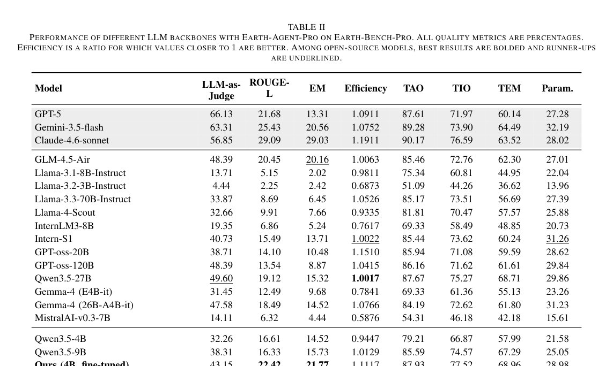

原文在同一 Earth-Agent-Pro 框架下测试多个骨干。**GPT-5 的 LLM-as-Judge 为 66.13%**，但并非所有轨迹指标都最高：微调的 Qwen3.5-9B 在 TAO、TIO、TEM 和参数准确率上表现更强，说明“最终答案正确”与“工具轨迹更符合参考流程”并不是同一能力。论文报告将 Qwen3.5-9B 两个适配器共同微调后，LLM-as-Judge 从 **38.31% 提升至 50.00%**；参数准确率也有提升。

### C. 与其他模型和框架比较（表 III—VI）

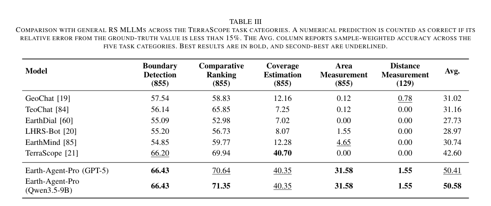

TerraScope 的五类题型包括边界检测、比较排序、覆盖率估算、面积测量和距离测量；在涉及数值的测试中，论文规定预测值相对于真实值的误差小于 **15%** 才算正确，不能以选择题猜测替代真实数值输出。

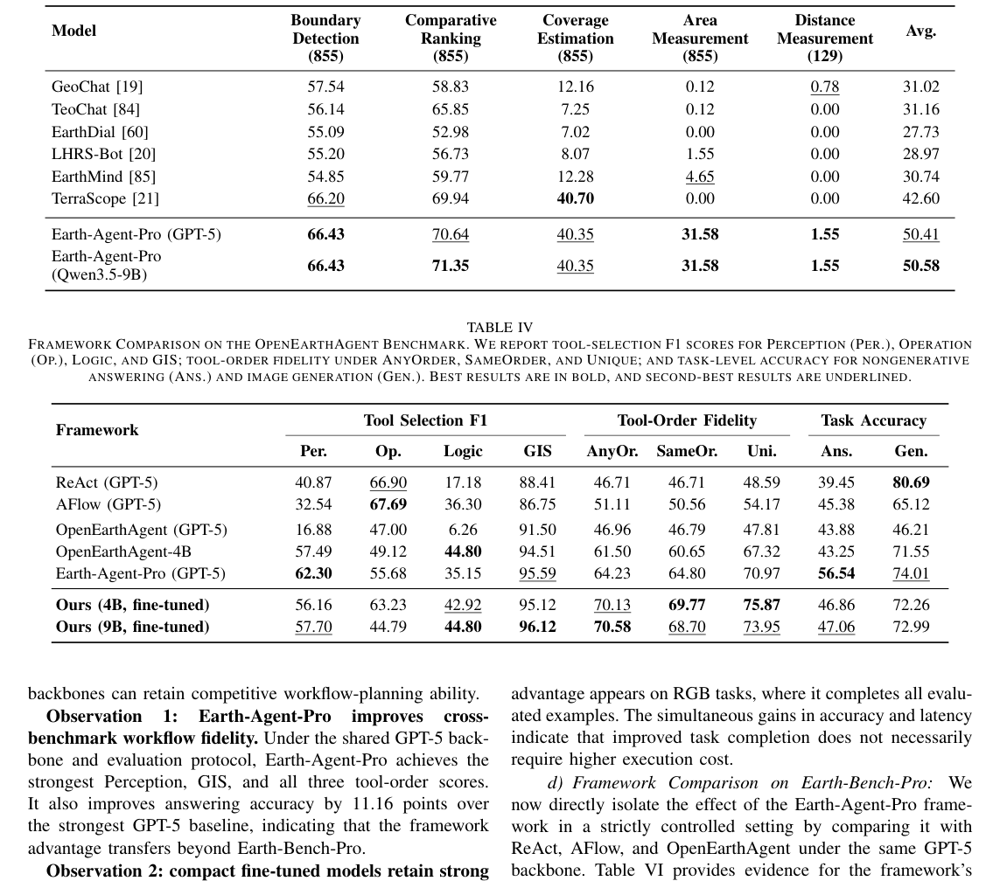

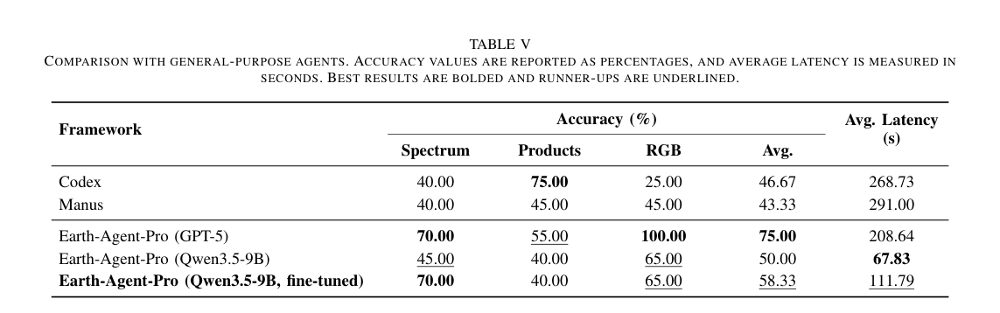

表 V 以 Spectrum、Products、RGB 三类任务以及平均延迟比较通用智能体与 Earth-Agent-Pro。Earth-Agent-Pro（GPT-5）在所选测试上的平均准确率为 **75.00%**、平均延迟约 **208.64 秒**；微调的 Qwen3.5-9B 平均准确率为 **58.33%**、平均延迟约 **111.79 秒**。但是，在 **Products** 子类中，**Codex 为 75.00%，Earth-Agent-Pro（GPT-5）为 55.00%**，说明不能笼统宣称本方法在所有数据模态上都领先。

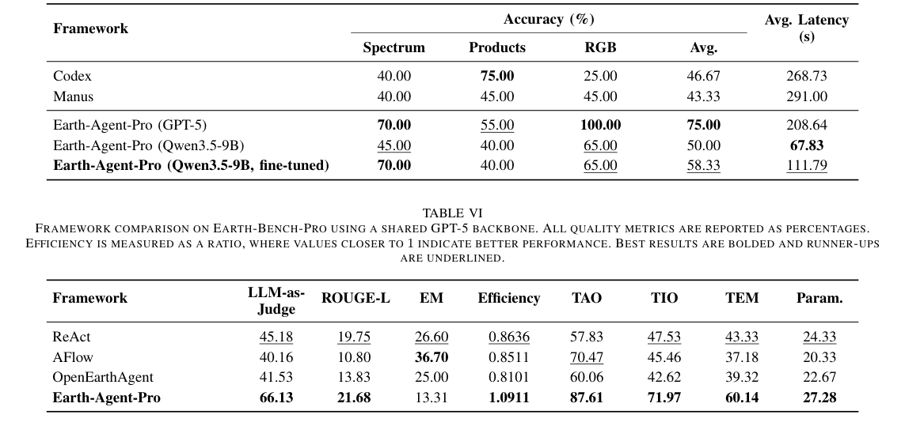

在共享 GPT-5 骨干、工具与技能的条件下，Earth-Agent-Pro 比 ReAct 的 LLM-as-Judge 高 **20.95 个百分点**，TIO 高 **24.44 个百分点**。这是区分“框架机制效果”与“仅换更强模型效果”的关键受控比较。论文进一步报告，TAO、TEM 和参数准确率均有改进。

### D. 消融与组件验证（表 VII—X）

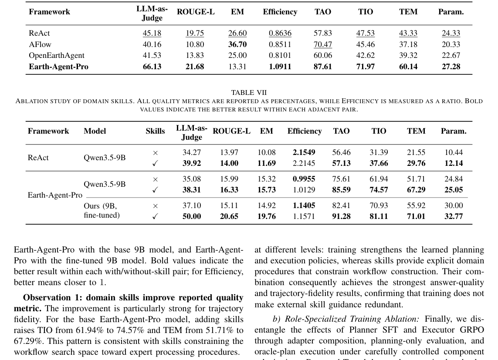

无论是否额外训练模型，引入专家技能通常改善工具选择和运行错误情况。对微调 Qwen3.5-9B 的 Earth-Agent-Pro，技能使 LLM-as-Judge 增加 **12.90 个百分点**、ROUGE-L 增加 **5.54**、EM 增加 **4.84**，并分别提高 TAO、TIO、TEM 和参数准确率。由此可以将“专家技能先验”与“角色特化训练”的贡献分开看待。

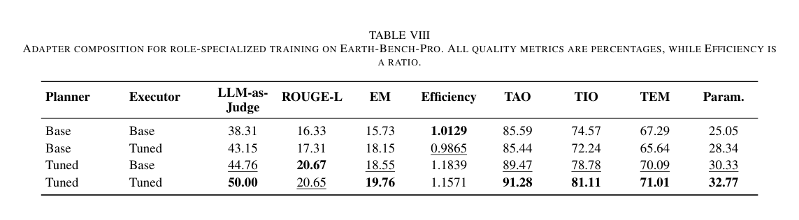

将 Planner 和 Executor 分别保持在 Base 或 Tuned 状态，形成四组对照。Base/Base 的 Judge 为 **38.31%**，Tuned/Tuned 为 **50.00%**；单独优化某一个角色也有改善，但二者结合表现更好。这是论文验证模块互补性的核心实验。

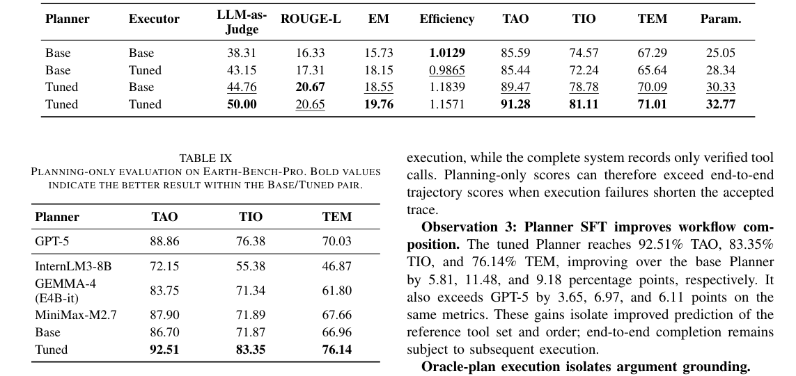

规划器单独评估使工具序列不受执行器误差干扰。结果显示，经过训练的规划器在 TAO、TIO 和 TEM 上提高，支持其改进工作流组合的解释。

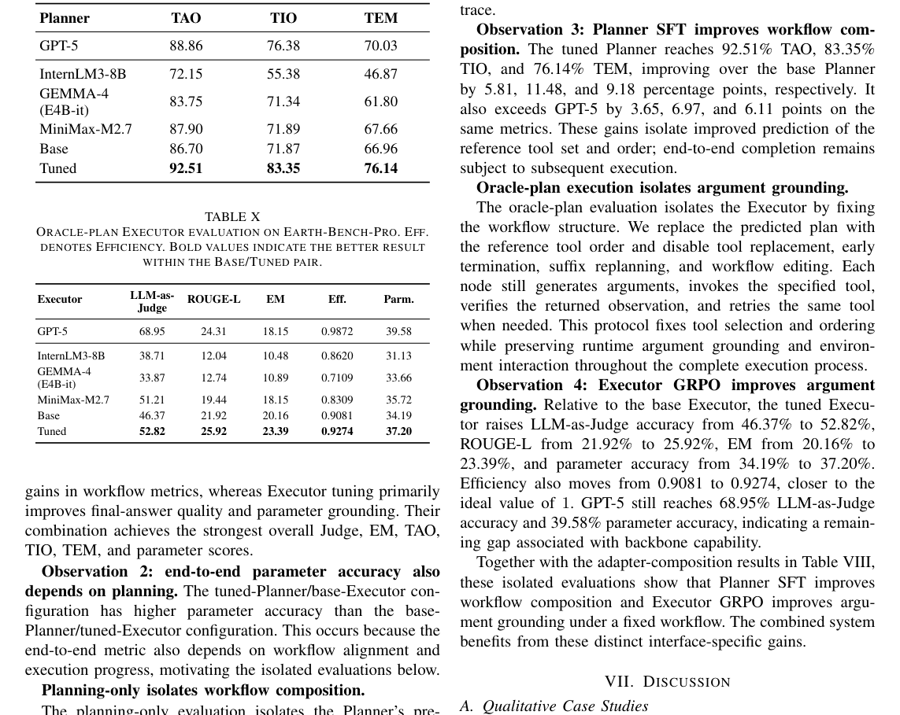

固定正确工作流之后，执行器无需决定任务分解，只负责工具及参数执行。论文报告微调执行器的 Judge 由 **46.37% 提至 52.82%**，参数准确率由 **34.19% 提至 37.20%**；这更直接地测量了参数对齐能力，而不是把所有成功归因于规划器。

## VII. 讨论及错误分析

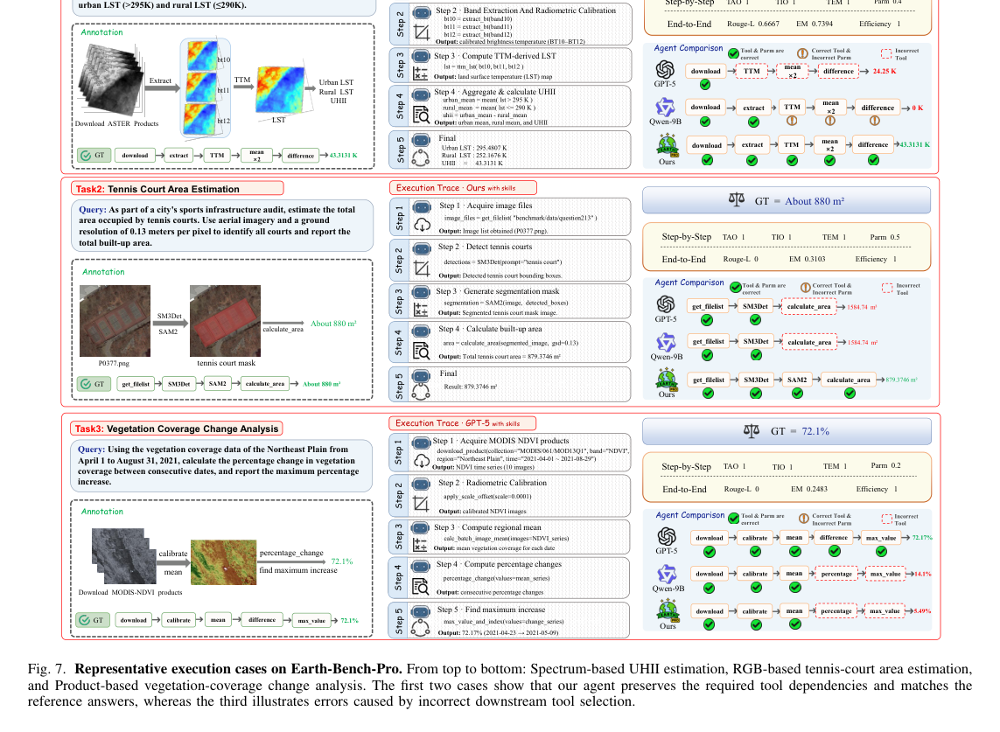

案例展示了温度相关参数估计、网球场面积测量等工作流中，工具或参数错误如何导致最终答案偏差。只用输出结果打分，无法看出中间阶段是否选择了错误数据、遗漏了缩放系数、重复下载文件或使用不存在的中间路径。因此论文强调：**执行过程的中间证据不仅用于调试，还应是评价对象。**

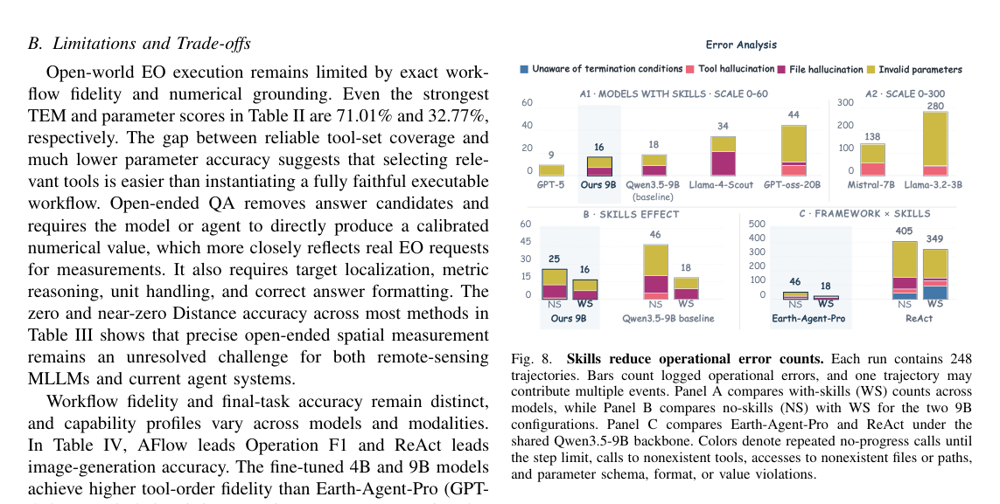

作者将错误分为没有满足终止条件、工具幻觉（调用不存在的工具）、文件幻觉（访问不存在的文件或路径）、参数不合法等类型。图 8 按是否使用技能、不同模型以及与 ReAct 的框架对比统计操作错误。技能使微调模型总错误数量减少约 **36.0%**，对基础模型减少约 **60.9%**。固定 Qwen3.5-9B 时，Earth-Agent-Pro 相比 ReAct 在无技能与有技能条件下均显著减少错误。

研究也指出权衡：技能指导和验证流程可能引入额外的运行时间与轨迹开销；较小的模型虽在工具顺序上表现优秀，最终答案综合推断仍受骨干能力限制；开放世界下参数来自动态文件和外部服务，运行状态不可控，错误修复并不保证每次都成功。因此，工具覆盖率高并不意味着严格流程匹配、参数准确性和最终科学结论一定正确。

## VIII. 结论（中文译述）

本文研究从自然语言科学问题到真实数据获取、预处理、领域计算与开放式答案的全链路地球观测执行。Earth-Bench-Pro 用 248 个固定科学目标构建 744 个配对问题，使指令遵循、自主规划和开放世界执行之间能够进行有控制的比较。Earth-Agent-Pro 通过专家技能约束、工作流结构化记忆及后缀局部修复联结规划与实际执行，同时将 Planner 的序列级 SFT 与 Executor 的节点级 GRPO 分开训练。在共享 GPT-5 骨干的对照实验中，该方法的 LLM-as-Judge 达到 **66.13%**；适配器组合与分离实验也支持两种训练目标分别提高规划结构和参数对齐的结论。

未来研究应更好地处理动态执行中的参数真实性、减少长工作流的多余开销，并提升小型模型整合执行证据形成可信科学答案的能力。

## 关键术语对照

| 英文 | 中文 |
|---|---|
| Open-World EO Execution | 开放世界地球观测执行 |
| Full-Chain | 全链路 |
| Task Core | 核心科学任务 |
| Matched Evaluation Regimes | 相互匹配的评价情境 |
| Prepared Inputs / Runtime Inputs | 预先准备的输入 / 运行时输入 |
| Plan-and-Execute | 规划—执行框架 |
| Expert-Authored Skill | 专家编写的技能 |
| Workflow-Centered Structured Memory | 以工作流为中心的结构化记忆 |
| Accepted Evidence | 已验证并接受的执行证据 |
| Evidence Provenance | 证据来源与传承关系 |
| Workflow Suffix Repair | 工作流后缀修复 |
| Planner / Executor | 规划器 / 执行器 |
| SFT / GRPO | 监督微调 / 组相对策略优化 |
| LLM-as-Judge | 大模型评判 |
| Tools-Any-Order / Tools-In-Order | 无序工具匹配 / 有序工具匹配 |
| Tool-Exact-Match | 严格工具序列匹配 |
| Parameter Grounding | 参数依据实际证据的对齐/落地 |

## 参考文献与完整性说明

文后参考文献保留原英文作者、标题、出处和链接，详见原 PDF 第 16—18 页和 `英文原文_逐页.md`。文章正文中的定量结果均按原文保留；**图表内的英文标签、完整工具接口、部分段落与参考文献没有逐句改写成中文**。本项目同时提供全部 18 页原稿截图及图表裁切图，供核对图题、公式和数据。
