# 图表索引（原图截图）

> 按 PDF 原始页码索引，图表编号与原文一致。每张图提供裁切图和源页全图。若裁切不完整，以源页图为准。

## 图 1（原 PDF 第 2 页）

**英文原图题**：Fig. 1. Overview of our work. Existing EO benchmarks rely on pre-collected data and multiple-choice evaluation, while existing EO agents suffer from unconstrained tool use and redundant planning. Our work introduces an open-ended EO benchmark (Earth-Bench-Pro) and a trained skill-guided agent (Earth- Agent-Pro) for full-chain EO task planning and execution.

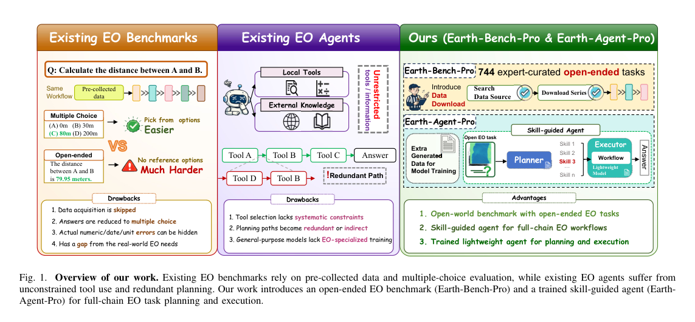

[查看完整原稿第 2 页](./source_pages/page-002.jpg)

## 图 2（原 PDF 第 2 页）

**英文原图题**：Fig. 2. LLM-as-Judge accuracy across Earth-Bench-Pro’s three regimes. Ours is our role-specialized Qwen3.5-9B.

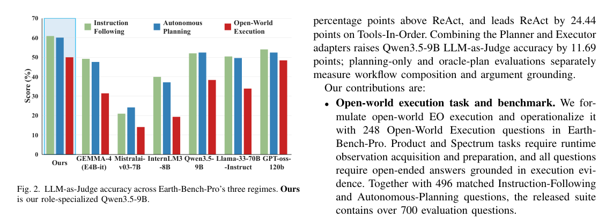

[查看完整原稿第 2 页](./source_pages/page-002.jpg)

## 图 3（原 PDF 第 3 页）

**英文原图题**：Fig. 3. Earth-Bench-Pro Overview. (a) Task composition across application domains and task families. (b) Global spatial distribution and temporal coverage.

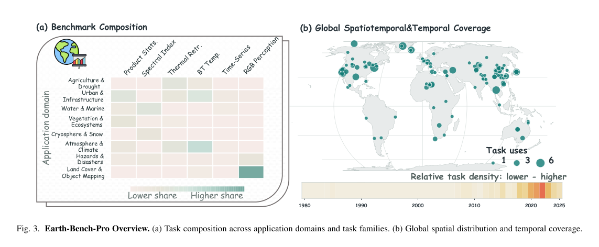

[查看完整原稿第 3 页](./source_pages/page-003.jpg)

## 表 I（原 PDF 第 4 页）

**英文原图题**：TABLE I COMPARISON WITH RECENT EARTH-OBSERVATION AGENT BENCHMARKS. VALUES MARKED WITH ∗ARE NOT EXPLICITLY REPORTED IN THE ORIGINAL PAPERS AND ARE COMPUTED FROM THE CORRESPONDING OFFICIAL OPEN-SOURCE RELEASES.

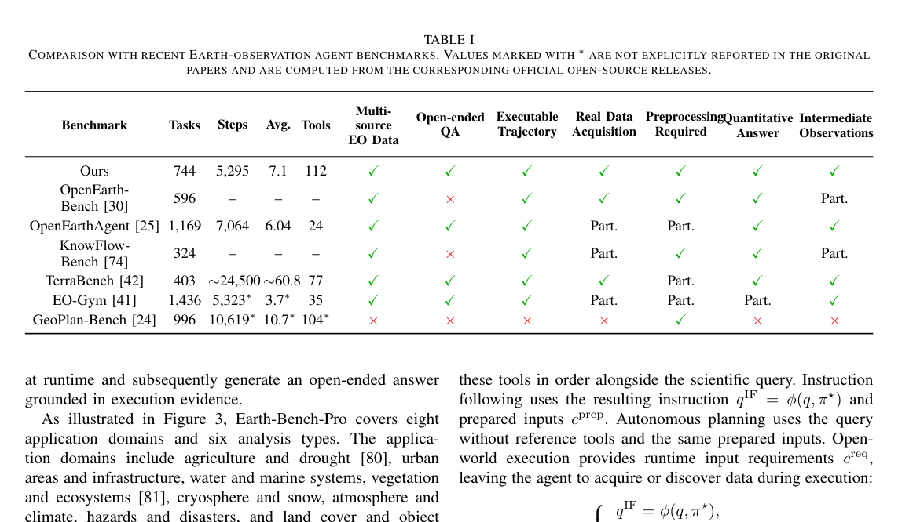

[查看完整原稿第 4 页](./source_pages/page-004.jpg)

## 图 4（原 PDF 第 5 页）

**英文原图题**：Fig. 4. Earth-Agent-Pro Framework. (a) Skill-guided workflow planning uses a shared expert specification to constrain both workflow construction and runtime argument grounding. (b) Workflow-centered structured memory couples the evolving workflow with provenance-aware accepted evidence, preventing failed attempts from contaminating downstream execution. (c) Evidence-grounded execution and repair performs node-local correction and, upon persistent failure or an evidence gap, preserves the successful prefix while revising only the affected workflow suffix. Together, these mechanisms enable traceable and bounded adaptation without discarding valid execution progress.

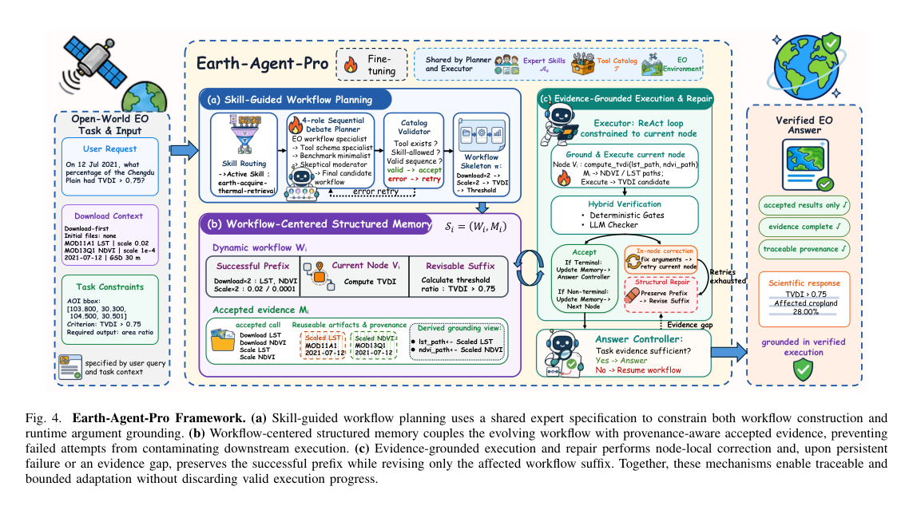

[查看完整原稿第 5 页](./source_pages/page-005.jpg)

## 图 5（原 PDF 第 6 页）

**英文原图题**：Fig. 5. With vs. Without Skills. The top shows an unscoped tool space and ambiguous workflows without skills, while the bottom shows focused tool selection and a coherent workflow enabled by skill guidance.

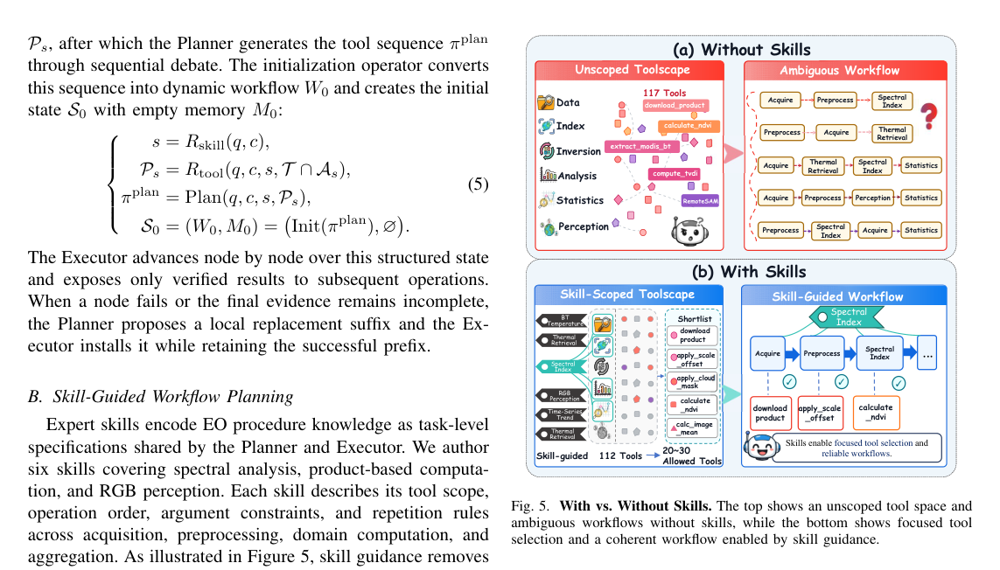

[查看完整原稿第 6 页](./source_pages/page-006.jpg)

## 图 6（原 PDF 第 8 页）

**英文原图题**：Fig. 6. Synthetic training data generation. An LLM identifies replaceable slots for each seed sample and writes a sample-specific Python program. Human experts verify that the program preserves workflow structure and dependency constraints before it generates consistent training instances.

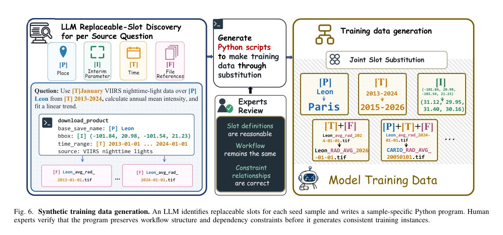

[查看完整原稿第 8 页](./source_pages/page-008.jpg)

## 表 II（原 PDF 第 10 页）

**英文原图题**：TABLE II PERFORMANCE OF DIFFERENT LLM BACKBONES WITH EARTH-AGENT-PRO ON EARTH-BENCH-PRO. ALL QUALITY METRICS ARE PERCENTAGES. EFFICIENCY IS A RATIO FOR WHICH VALUES CLOSER TO 1 ARE BETTER. AMONG OPEN-SOURCE MODELS, BEST RESULTS ARE BOLDED AND RUNNER-UPS ARE UNDERLINED.

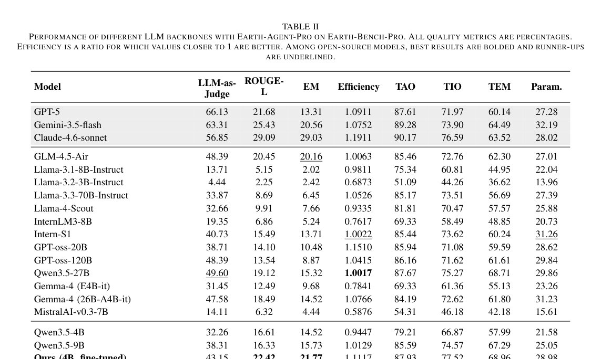

[查看完整原稿第 10 页](./source_pages/page-010.jpg)

## 表 III（原 PDF 第 11 页）

**英文原图题**：TABLE III COMPARISON WITH GENERAL RS MLLMS ACROSS THE TERRASCOPE TASK CATEGORIES. A NUMERICAL PREDICTION IS COUNTED AS CORRECT IF ITS RELATIVE ERROR FROM THE GROUND-TRUTH VALUE IS LESS THAN 15%. THE AVG. COLUMN REPORTS SAMPLE-WEIGHTED ACCURACY ACROSS THE FIVE TASK CATEGORIES. BEST RESULTS ARE IN BOLD, AND SECOND-BEST ARE UNDERLINED.

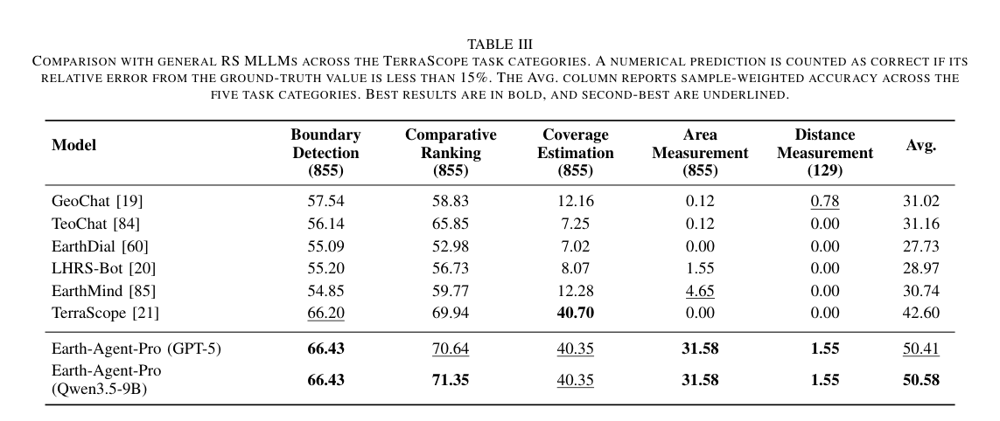

[查看完整原稿第 11 页](./source_pages/page-011.jpg)

## 表 IV（原 PDF 第 11 页）

**英文原图题**：TABLE IV FRAMEWORK COMPARISON ON THE OPENEARTHAGENT BENCHMARK. WE REPORT TOOL-SELECTION F1 SCORES FOR PERCEPTION (PER.), OPERATION (OP.), LOGIC, AND GIS; TOOL-ORDER FIDELITY UNDER ANYORDER, SAMEORDER, AND UNIQUE; AND TASK-LEVEL ACCURACY FOR NONGENERATIVE ANSWERING (ANS.) AND IMAGE GENERATION (GEN.). BEST RESULTS ARE IN BOLD, AND SECOND-BEST RESULTS ARE UNDERLINED.

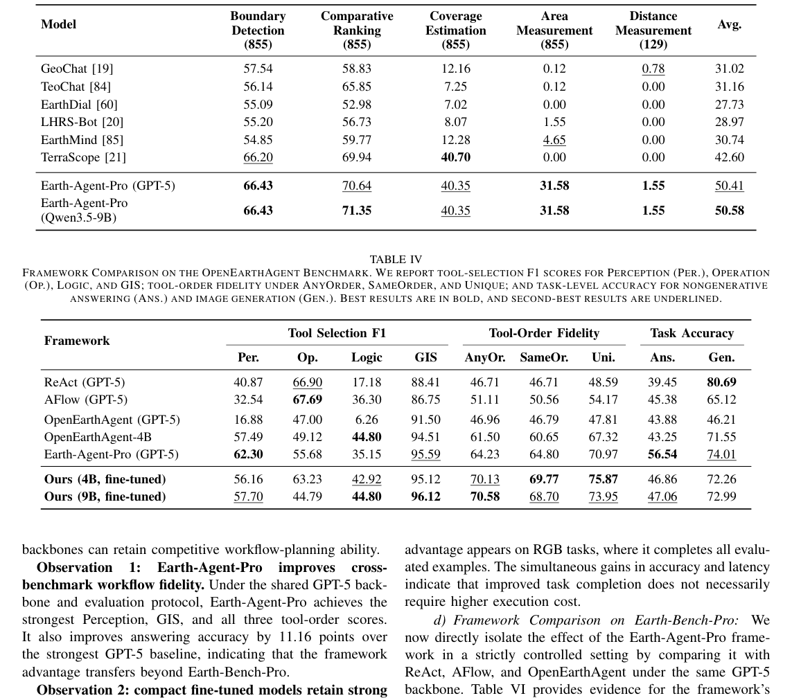

[查看完整原稿第 11 页](./source_pages/page-011.jpg)

## 表 V（原 PDF 第 12 页）

**英文原图题**：TABLE V COMPARISON WITH GENERAL-PURPOSE AGENTS. ACCURACY VALUES ARE REPORTED AS PERCENTAGES, AND AVERAGE LATENCY IS MEASURED IN SECONDS. BEST RESULTS ARE BOLDED AND RUNNER-UPS ARE UNDERLINED.

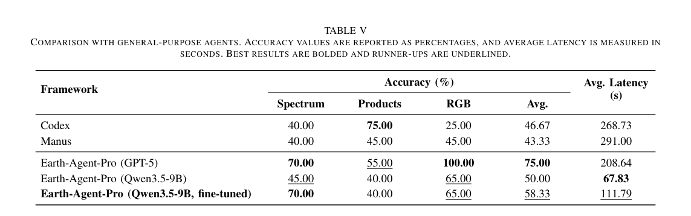

[查看完整原稿第 12 页](./source_pages/page-012.jpg)

## 表 VI（原 PDF 第 12 页）

**英文原图题**：TABLE VI FRAMEWORK COMPARISON ON EARTH-BENCH-PRO USING A SHARED GPT-5 BACKBONE. ALL QUALITY METRICS ARE REPORTED AS PERCENTAGES. EFFICIENCY IS MEASURED AS A RATIO, WHERE VALUES CLOSER TO 1 INDICATE BETTER PERFORMANCE. BEST RESULTS ARE BOLDED AND RUNNER-UPS ARE UNDERLINED.

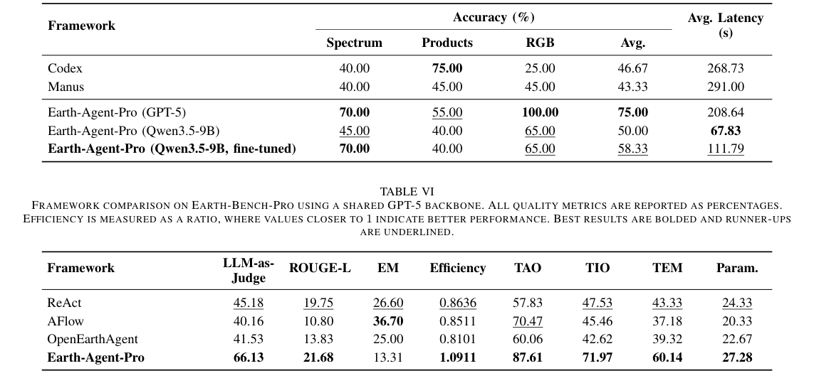

[查看完整原稿第 12 页](./source_pages/page-012.jpg)

## 表 VII（原 PDF 第 12 页）

**英文原图题**：TABLE VII ABLATION STUDY OF DOMAIN SKILLS. ALL QUALITY METRICS ARE REPORTED AS PERCENTAGES, WHILE EFFICIENCY IS MEASURED AS A RATIO. BOLD VALUES INDICATE THE BETTER RESULT WITHIN EACH ADJACENT PAIR.

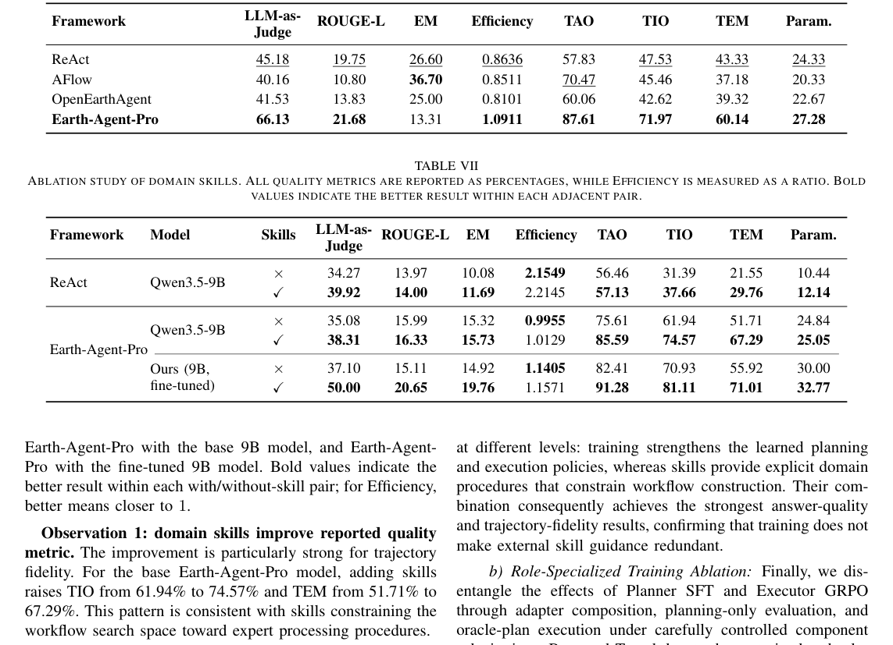

[查看完整原稿第 12 页](./source_pages/page-012.jpg)

## 表 VIII（原 PDF 第 13 页）

**英文原图题**：TABLE VIII ADAPTER COMPOSITION FOR ROLE-SPECIALIZED TRAINING ON EARTH-BENCH-PRO. ALL QUALITY METRICS ARE PERCENTAGES, WHILE EFFICIENCY IS A RATIO.

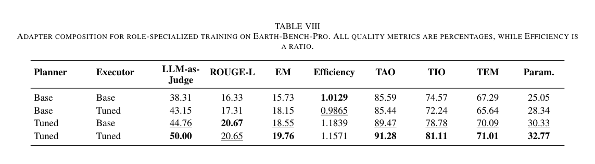

[查看完整原稿第 13 页](./source_pages/page-013.jpg)

## 表 IX（原 PDF 第 13 页）

**英文原图题**：TABLE IX PLANNING-ONLY EVALUATION ON EARTH-BENCH-PRO. BOLD VALUES INDICATE THE BETTER RESULT WITHIN THE BASE/TUNED PAIR.

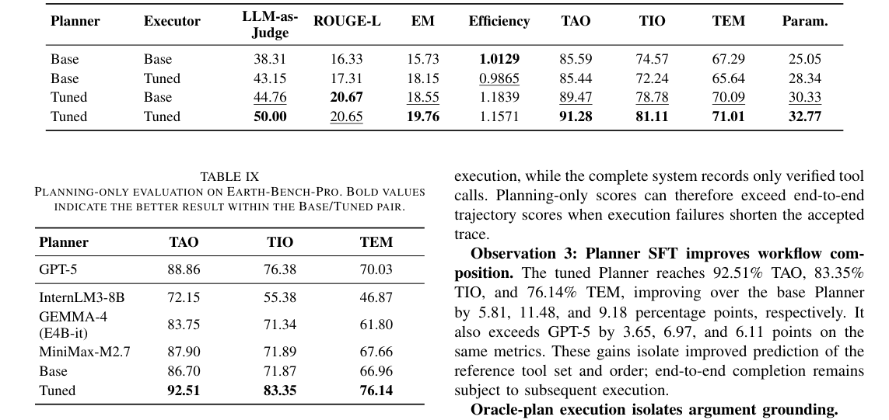

[查看完整原稿第 13 页](./source_pages/page-013.jpg)

## 表 X（原 PDF 第 13 页）

**英文原图题**：TABLE X ORACLE-PLAN EXECUTOR EVALUATION ON EARTH-BENCH-PRO. EFF. DENOTES EFFICIENCY. BOLD VALUES INDICATE THE BETTER RESULT WITHIN THE BASE/TUNED PAIR.

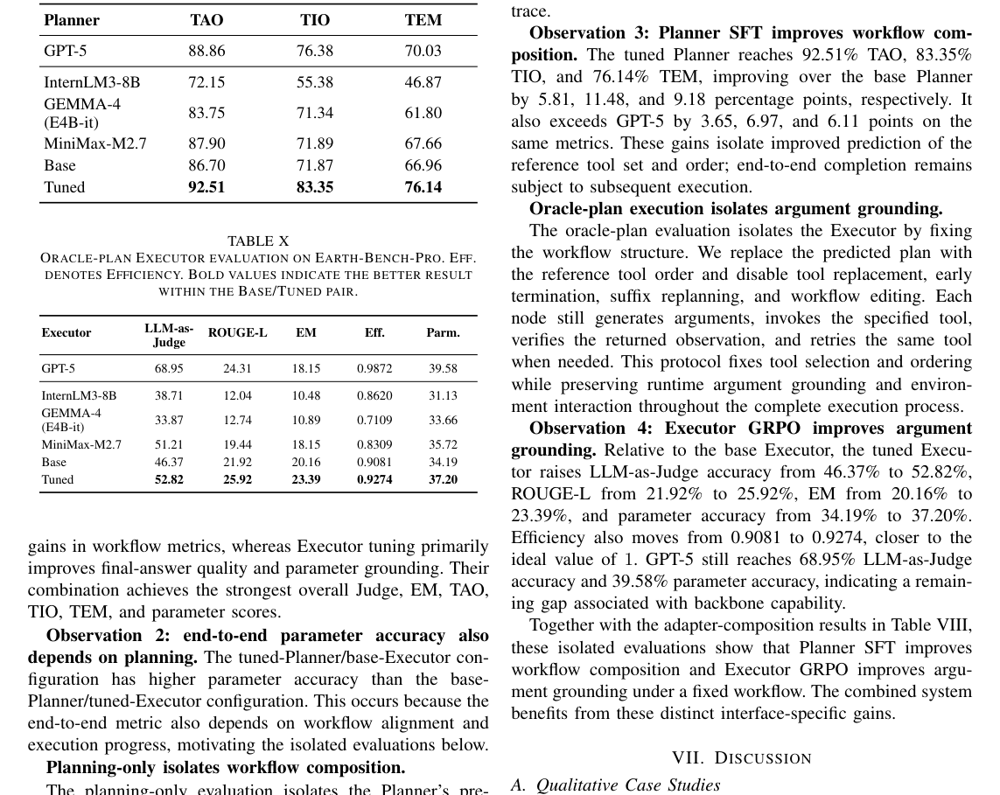

[查看完整原稿第 13 页](./source_pages/page-013.jpg)

## 图 7（原 PDF 第 14 页）

**英文原图题**：Fig. 7. Representative execution cases on Earth-Bench-Pro. From top to bottom: Spectrum-based UHII estimation, RGB-based tennis-court area estimation, and Product-based vegetation-coverage change analysis. The first two cases show that our agent preserves the required tool dependencies and matches the reference answers, whereas the third illustrates errors caused by incorrect downstream tool selection.

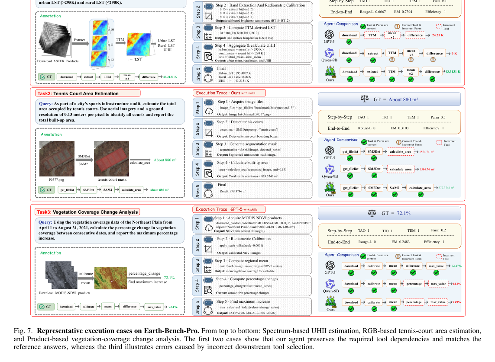

[查看完整原稿第 14 页](./source_pages/page-014.jpg)

## 图 8（原 PDF 第 15 页）

**英文原图题**：Fig. 8. Skills reduce operational error counts. Each run contains 248 trajectories. Bars count logged operational errors, and one trajectory may contribute multiple events. Panel A compares with-skills (WS) counts across models, while Panel B compares no-skills (NS) with WS for the two 9B configurations. Panel C compares Earth-Agent-Pro and ReAct under the shared Qwen3.5-9B backbone. Colors denote repeated no-progress calls until the step limit, calls to nonexistent tools, accesses to nonexistent files or paths, and parameter schema, format, or value violations.

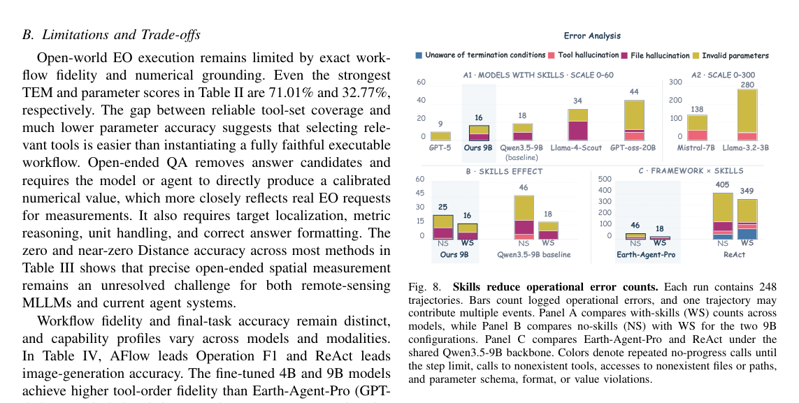

[查看完整原稿第 15 页](./source_pages/page-015.jpg)
