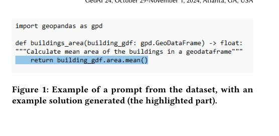
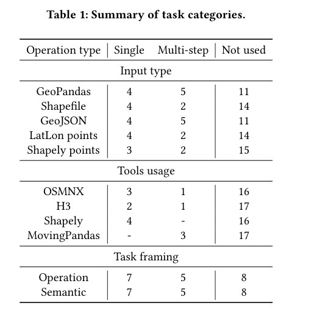
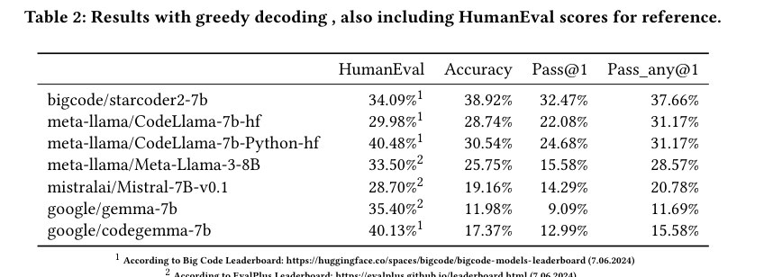
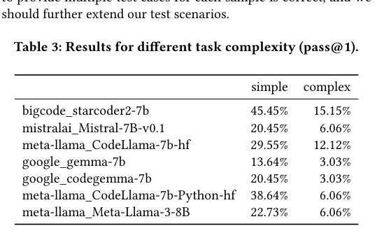
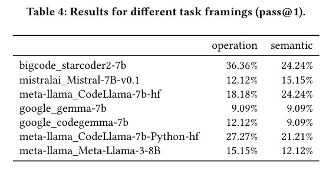
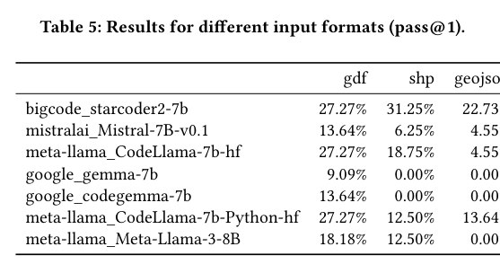
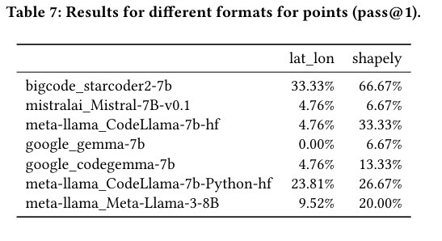
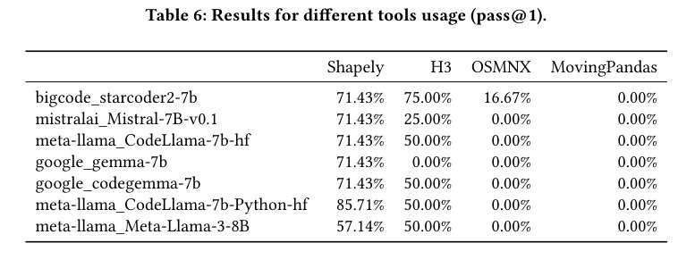

# 地理空间代码生成大模型的评估

**原题：** Evaluation of Code LLMs on Geospatial Code Generation  
**作者：** Piotr Gramacki、Bruno Martins、Piotr Szymański  
**发表：** GeoAI’24（第七届 ACM SIGSPATIAL 地理知识发现人工智能国际研讨会），2024 年 10 月 29 日—11 月 1 日，美国亚特兰大。  
**DOI：** 10.1145/3687123.3698286  
**复现仓库：** https://github.com/kraina-ai/geospatial-code-llms-dataset

> 本稿依照原文的章节顺序翻译论文主体（摘要及第 1–5 节）；模型标识符、Python 语法和文献著录保持英文。全部 9 页英文文本在 `英文全文_逐页提取.md`，原论文及每页截图亦附于压缩包。图表保持原文截图，提供中文解读。

## 摘要

人们很早就开始研究软件开发辅助工具，近年来的研究开始利用大语言模型（Large Language Models，LLMs）生成代码。这些模型能够为数据科学和机器学习应用生成 Python 代码。LLM 可以提高软件工程师日常工作的生产效率，也能为经验不足的开发者充当“导师”，成为可行的学习辅助工具。利用 LLM 生成高质量代码同样有益于地理空间数据科学。然而，地理空间领域面临与通用代码生成不同的挑战，而代码生成 LLM 通常并未接受地理空间任务的专门评估。

本文介绍如何通过选择一组地理空间任务，为代码生成模型构建评估基准。研究人员根据任务复杂度和所需工具对地理空间任务进行分类，进而设计数据集，以考察模型在**空间推理、空间数据处理和地理空间工具使用**方面的能力。数据集由人工精心编制的具体编程问题组成，以保证质量。每道题均配有一组测试情形，以自动检查生成代码的正确性。作者还利用这一数据集测试了多种现有代码生成大模型在地理空间领域的表现，并将数据集和可复现的评估代码公开在 GitHub 仓库中，希望它能成为今后评估新模型的基准，并推动能够高准确率解决地理空间编码任务的专用模型与智能编程助手的发展。

**ACM CCS 概念：** 计算方法—自然语言处理；信息系统—地理信息系统；以人为中心的计算—自然语言接口。  
**关键词：** 地理空间数据科学、代码生成、大语言模型。

## 1 引言

如今，大语言模型已能够有效应用于代码生成，尤其适用于较常见的编程语言及领域，例如面向数据科学和机器学习的 Python 编程。这类能力能够辅助专家编写代码，提高工作效率；同时，模型能够根据自然语言问题描述返回代码示例，为初学者提供学习支持。这些优势也可以扩展到地理空间数据科学。在这一领域，常常需要针对特定的空间分析和数据可视化任务编写重复性代码。

乍看之下，将代码大模型应用于地理空间数据科学似乎较为直接，但其中存在多种挑战。首先，自然语言任务描述的理解可能需要**空间推理和真实世界知识**。其次，地理空间分析频繁依赖专用软件库，例如将地名与坐标相互转换的地理编码库、几何运算库、栅格分析工具和地图可视化软件。与通用数据科学或机器学习代码相比，公开代码仓库中相关地理空间库的训练示例可能少得多。此前的 DS-1000 等基准已经覆盖常见数据科学库，却未针对这些独特问题进行充分评估。

为此，作者提出三个研究问题：

- **RQ1：** 代码生成 LLM 能否解决不同类型的地理空间任务？
- **RQ2：** 代码生成 LLM 在解决地理空间任务时能否利用空间推理和世界知识？
- **RQ3：** 从广泛的地理空间任务分类来看，哪些问题类型对现有代码生成 LLM 更具挑战？

研究首先建立地理空间数据科学任务的分类体系，考虑单步与多步任务的复杂程度、空间数据表示形式及可用工具；再按照分类人工策划编码问题和测试情形。所设计的基准能够自动验证生成代码的正确性。作者将可扩展的地理空间代码生成基准视为重要贡献之一，并通过代表性代码大模型的比较实验揭示当前模型的能力与局限。

本文其余部分依次回顾代码模型及地理空间任务研究（第 2 节），介绍基准及数据集构建（第 3 节），报告不同代码大模型的实验结果（第 4 节），最后讨论结论和未来方向（第 5 节）。

## 2 相关工作

### 2.1 面向代码生成的大语言模型

LLM 已成功应用于代码生成。早期方法由 Zan 等人综述，后续出现多种代码专用模型，其中一些模型只有约 30 亿参数，部分通用大模型也具有较强的代码生成能力。

评估代码生成能力需要专门的数据集。HumanEval 的提出源于这样一种需求：用于评估的人工编制样本应尽可能没有出现在模型预训练数据中。随后，研究者针对通用编程问题及特定领域、特定库建立了其他基准。这些工作通常强调**人工验证样本**的重要性，并通过测试用例检验代码的功能正确性。

### 2.2 面向地理空间任务的大语言模型

既有综述已经梳理 LLM 和生成式人工智能（GAI）在地理空间领域中的应用，包括栅格、矢量及时空数据处理，其中以文本模型应用最普遍。

已有工作采用多种途径解决空间任务。例如，GeoGPT 通过推荐工具扩展大模型的空间查询和分析能力；Li 与 Ning 提出 Autonomous GIS，让大模型将空间问题拆解为子任务、分别生成代码，从而使非程序员也有机会完成复杂地理空间分析。

另一个研究方向是评估模型的地理空间意识和知识。Bhandari 等人表明，适当的提示能从 LLM 中提取地理空间知识；Roberts 等人考察 GPT-4 在人口、国界等事实知识与路线规划、导航等推理任务中的表现；Manvi 等人利用 OpenStreetMap 丰富提示以探查地理知识；Mooney 等人让 GPT 模型参加真实 GIS 考试，结果 GPT-3 与 GPT-4 分别得到美式成绩 D 和 B。

多篇展望论文强调地理空间领域专用模型的重要性。Scheider 和 Mai 等人指出，复杂空间问题往往不能通过直接检索知识回答，而需要一定程度的分析创造性。例如，医生可能需要探查病人健康状况的潜在环境因素。另一项研究强调地理空间数据与任务的**多模态性质**：单模态模型虽能解决部分问题，但实际任务经常需要综合不同模态的输入。

总体而言，LLM 已展示出在 GIS 应用中的潜力。自主 GIS 可利用自然语言理解和代码或工具来解决问题，但空间任务仍有特殊难点。因此，评估现代 LLM 的地理空间代码生成能力，是开发真正有用的地理空间智能助手的重要步骤。

## 3 提出的评估基准

本文从任务复杂度、解决问题所需的工具和知识等因素设计地理空间代码生成基准，随后说明提示格式、测试用例编制、数据集统计以及各类别示例。作者选择 **Python** 而不是 R 作为基准语言，主要因为 Python 在现有代码语料中更普遍，模型相对更擅长处理它。

### 3.1 地理空间问题的分类

作者建立了四个分类维度。

**任务复杂度（Task complexity）：** 区分*单步操作（single-step operation）*与*多步分析（multi-step analysis）*。单步任务只需要正确选择一种空间操作；多步任务要求多个操作依次配合。

**输入类型（Input type）：** 考察地理空间数据的表示方式。一个点可以用两个数值或专用几何对象表示，集合数据则可以使用不同文件和数据类型。本文涵盖 GeoPandas/GeoDataFrame、GeoJSON、Shapefile 和 Shapely 几何对象；作者指出，未来还可扩展至多边形等其他形式。

**工具使用（Tools usage）：** 测试模型能否使用专业资源完成空间查询与分析，具体包括用于地理编码的 OSMnx、用于空间索引的 H3、用于几何操作的 Shapely，以及用于轨迹数据处理的 MovingPandas。

**任务表述（Task framing）：** 区分*操作式（operation）*与*语义式（semantic）*。操作式明确说明需要执行何种几何操作，例如“统计与多边形相交的点”；语义式则以实际需求描述同一任务，例如“统计各行政区内的公交站点”。两种描述期望生成相同代码。对同一计算任务设计不同表述，可以检验模型究竟理解了底层空间操作，还是仅在显式操作指令下能够照做。

这些分类虽然并非包罗万象，但覆盖了地理空间数据处理中多类基础工作：GeoJSON 和 Shapefile 的加载及结果解释；Shapely 的几何构造和运算；扩展 Pandas 的高级空间数据框操作 GeoPandas；基于 OpenStreetMap 和 Nominatim 的地理编码；Uber 开发的 H3 确定性六边形空间索引；以及与 GeoPandas 兼容、用于轨迹分析的 MovingPandas。作者特别提出，地理编码质量可能因国家的发展程度而存在偏差，因此有必要测试模型调用专业地理编码工具的能力。

### 3.2 代码提示格式

全部样本采用统一提示格式，对不同被测模型也不作修改。提示由人工撰写，以尽量避免这些任务曾出现在模型的训练数据中。提示包含具有类型标注的函数签名（function signature）以及以 docstring 描述的任务要求；部分示例还包含类型注释所需的库导入。此设计与已有代码生成基准保持一致。

*图 1 中文图题：数据集提示的示例，附带生成的示例解答（图中突出显示部分）。*

### 3.3 样本的创建过程

一个任务可以同时处于多个分类维度之中。作者确保每个维度的各种类别都有多个样本。构建过程先确定一个基础任务是单步还是多步，再通过改变输入参数形式或任务表述来扩充样本。

例如，“计算多边形平均面积”可以有三种不同数据输入格式；将任务提示从操作式改成语义式后，便得到 **3 × 2 = 6** 个样本，而人工实际只需编写两种提示，再按规则扩充。条件允许时还可替换使用的工具。通过这种方式，同一个手工编制任务可以派生出更多样本，既增加数据规模，又让模型在特定工具或数据类型上的性能能够被单独评估。论文的清单 1 给出 `check_point`、`check_location` 的八种变体，分别组合 `lat/lon` 与 Shapely 点、GeoDataFrame 与 Shapefile、操作式与语义式描述。原始函数名、类型签名和英文 docstring 可在第 4 页英文原文中直接复制。

### 3.4 用于自动评估的测试用例

研究利用自动测试确定代码是否正确。也可以将生成代码与参考解答比较，并计算 BLEU 或 ROUGE；但考虑到功能等价的程序可以具有完全不同的写法，作者不采用文本匹配式指标。

基于测试的评估还有几个优点：数据实例更易构建；能够针对同一问题设计多个用例和边界情形；并且如 Chen 等人所指出的，功能正确性检查更贴近实际开发者判断代码是否正确的方式。

每个样本包含 **1–4 个测试用例**，包括边界情形，但本版基准只提供合法输入，并不检验非法输入的处理。测试主要覆盖函数逻辑的主执行分支。这一选择来自作者开发 AI 编程助手的经验：让模型先写出主要操作，通常更容易得到有用代码；非法输入处理可以后续迭代补上，但这种代码补全问题不在当前基准的范围内。

### 3.5 数据集概况

数据集包含 **20 个不同的地理空间基础任务**，经前述多个维度扩增后得到 **77 个样本**。在复杂度维度中，有 13 项单步任务和 7 项多步任务。按数据类型、工具和提示方式统计的分布见表 1。同一样本可能使用多个工具，因而可能同时归入多个类别。

*表 1 中文表题：按输入类型、工具使用情况及任务表述划分的样本统计。*

例如，清单 2 给出利用 Shapely 与 GeoJSON 判断一点所在国家的单步问题；清单 3 给出使用 GeoPandas 计算建筑面积与地块面积比值均值的多步问题。原始 Python 函数签名与注释均在 `英文全文_逐页提取.md` 的 PDF 第 5 页。

## 4 现有代码大模型在地理空间任务上的评估

本节在新构建的地理空间编程数据集上评估通用代码生成模型，先介绍模型选择、指标、解码设置和计算环境，再分析各分类维度下的实验结果。

### 4.1 实验设置

**模型。** 作者同时考虑代码专用模型和通用语言模型，均可通过 Hugging Face 获得，使用 `transformers` 加载，并通过 `bitsandbytes` 实现 4-bit 量化。七个模型为：StarCoder2-7B、CodeLlama-7B、CodeLlama-7B-Python、Llama-3-8B、Mistral-7B、Gemma-7B 和 CodeGemma-7B。作者认为，7B/8B 模型能够在个人计算机上高效运行，因而也适合进一步微调成专用地理空间编程助手。

**评估指标。** 采用三种互补指标：

1. `Accuracy`：所有样本上通过的测试用例数量占总测试用例数量的比例。
2. `Pass@1`：在每个样本生成一次代码时，完全通过该样本所有测试用例的比例。
3. `Pass_any@1`：在每个样本生成一次代码时，至少通过其中一个测试用例的比例。

同时，作者报告模型在通用代码生成基准 HumanEval 上的 `pass@1`，以比较地理空间与一般编程能力。

**超参数。** 由于主要测试 `pass@1`，采用贪心解码（greedy decoding），每次仅生成一个结果；`max_length=200`，并确认所有模型都能在这一长度限制下生成完整函数。

**评估流程。** 首先清理生成结果，使其仅包含一个函数，具体通过查找第二次出现的 `def ` 来截断。为避免因缺少导入而误判，研究检查模型输出中涉及的库，在虚拟环境中安装其最新版本，并在运行测试前统一导入。虽然这相当于简化任务，但符合提示采用函数 docstring 后续生成代码的形式：常规 Python 编码一般不会在函数体中放置导入，因此作者希望衡量的是**空间任务的求解能力，而不是在不常见位置写正确 import 的能力**。

**计算资源。** 初期使用显存 8 GB 的 NVIDIA GTX 1080，所有模型均以 4-bit 量化形式在该显卡上运行。为加快最终实验，再使用单张 NVIDIA A100 80 GB 显卡并行生成代码，同时保持实验配置不变以支持复现。

### 4.2 实验结果

**总体结果。** 七个模型的准确率及 HumanEval 对照见表 2。最佳地理空间成绩来自 **StarCoder2-7B**：`Accuracy = 38.92%`、`Pass@1 = 32.47%`、`Pass_any@1 = 37.66%`，尽管它在通用 HumanEval 中并非最好的模型。相比之下，Gemma 和 CodeGemma 在 HumanEval 中表现较好，但在地理空间编码上明显不佳。检查生成程序时，作者发现这两类模型经常出现幻觉，并在函数中途生成重复代码片段。

**测试用例与边界情形。** `pass_any@1` 高于严格的 `pass@1`，表明一些错误程序仍可能通过部分测试。这支持为每个样本设置多个测试用例的做法，且作者认为还应该扩充测试情形。

**任务复杂度。** 所有模型在多步复杂任务上的 `pass@1` 均明显低于单步任务；总体表现较弱的模型在复杂任务上的退化更明显。例如 StarCoder2-7B 在简单任务上为 **45.45%**，在复杂任务上仅 **15.15%**。这一结果验证了研究在实验前关于多步空间任务更难的假设。

**任务表述。** 将提示写成操作式或语义式时，差异不如复杂度显著。大部分模型在明确指定空间操作的提示下表现更好，但有两种模型对语义式提示的表现更好，Gemma 两类提示之间没有差异。作者据此认为，部分代码模型对数据和问题中的地理空间含义理解较弱：即使明确列出操作时能做对，语义式描述下也未必能够自主选择正确的操作。

**输入格式。** 同一任务使用 GeoDataFrame、Shapefile、GeoJSON 时，模型表现也会变化。模型普遍更擅长处理 GeoDataFrame；许多模型在其他格式上的处理没有通过 GeoPandas 正确加载数据。作者认为，针对特定数据格式补充训练示例和微调是一条可行的改进途径。

**几何表示。** 对点数据，研究分别使用原始纬度/经度数值和 Shapely `Point` 对象。结果显示，大多数模型在使用 Shapely 对象时的表现更好。由于经纬度转换成几何对象本来相对简单，因此这一差距也提示了微调改进的机会。

**工具知识。** 作者从专业空间工具中选择 Shapely、H3、OSMnx、MovingPandas 进行测试。模型对 Shapely 和 H3 尚有一定能力，但在 OSMnx 和 MovingPandas 上几乎完全失败；有些模型甚至只生成 `raise NotImplementedError()` 这类占位代码，暗示它们不了解相应库或无法继续实现功能。虽然测试仅涉及四种库，已暴露出现有模型在专业工具知识上的基础缺陷。作者认为，无法使用常见空间工具的编程助手实用价值有限，应进一步面向地理空间数据和任务训练专用代码模型。

## 5 结论与未来工作

本文提出了一个面向地理空间代码生成的 LLM 评估数据集。作者借鉴既有代码生成基准的任务表述及评估方式，以多个维度审视空间编码问题，并人工设计了可按照这些维度区分的样本。基于该数据集对现有代码模型的测试发现，性能在各个维度均存在变化，说明任务复杂度、输入格式、工具知识和表述方式可以用于诊断地理空间代码生成能力。

**局限性。** 这项工作只是构建综合性地理空间代码生成基准的第一步。虽然结果验证了研究方向的价值，但目前的数据集需要覆盖更多真实的地理空间任务与工具。受计算条件限制，实验只考察 7B/8B 规模的模型，因此不能直接将结果推广至所有更大模型。

**未来工作。** 首先，扩充任务与工具的覆盖范围，并为各样本增加边界测试用例；有可能借鉴现有研究，使用更大模型辅助生成或检查测试样本。其次，纳入更多模型并建立可持续更新的排行榜，方便社区追踪空间代码大模型的能力与薄弱环节。最后，利用本研究的诊断结果，训练一个专门针对地理空间领域的代码 LLM。

## 参考文献与源文对照

全文参考文献按作者原有编号 **[1]—[30]** 保留，准确条目见 [`英文全文_逐页提取.md`](./英文全文_逐页提取.md) 的第 8–9 页（含论文题名、作者、年份、出版信息和 DOI）。为保持可检索性，这些专有书目信息不逐字改写。原 PDF 和页图可用于核查。

## 专业术语对照

| 英文 | 中文 |
|---|---|
| geospatial code generation | 地理空间代码生成 |
| spatial reasoning | 空间推理 |
| functional correctness | 功能正确性 |
| test case / corner case | 测试用例 / 边界情形 |
| task complexity | 任务复杂度 |
| single-step / multi-step | 单步 / 多步 |
| task framing | 任务表述方式 |
| operation / semantic framing | 操作式 / 语义式表述 |
| greedy decoding | 贪心解码 |
| code infilling | 代码填空或补全 |
| geocoding | 地理编码 |
| spatial index | 空间索引 |
| pass@1 | 单次生成完整通过率 |
| pass_any@1 | 单次生成至少通过一例的比率 |

