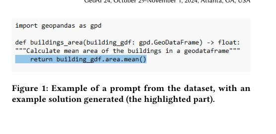
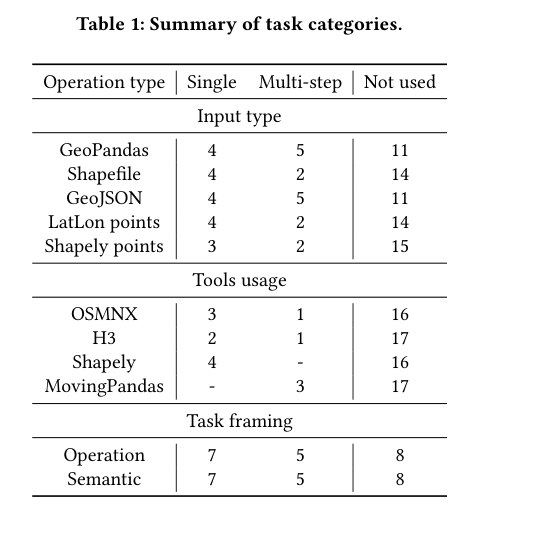
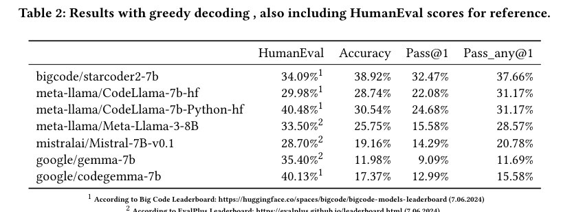
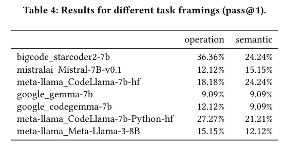
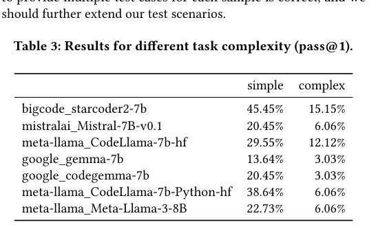
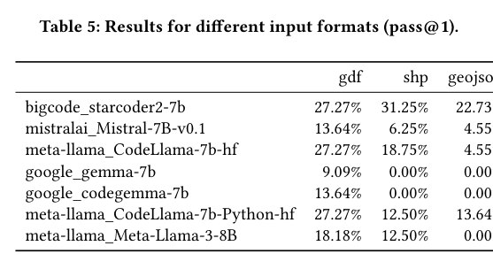
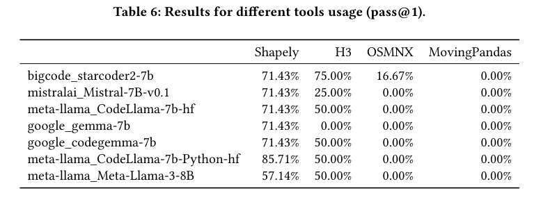
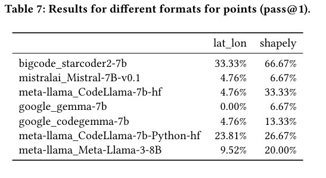

# 图表索引（PDF 原稿截图）

- 原稿：`Gramacki 等 - 2024 - Evaluation of Code LLMs on Geospatial Code Generation.pdf`
- 页数：9 页
- 以下页码均为 PDF 实际页序（从 1 开始），不是页脚印刷页码。

## 图 1 — PDF 第 3 页

> 原文标注：Figure 1: Example of a prompt from the dataset, with an

## 表 1 — PDF 第 4 页

> 原文标注：Table 1: Summary of task categories.

## 表 2 — PDF 第 6 页

> 原文标注：Table 2: Results with greedy decoding , also including HumanEval scores for reference.

## 表 4 — PDF 第 6 页

> 原文标注：Table 4: Results for different task framings (pass@1).

## 表 3 — PDF 第 6 页

> 原文标注：Table 3: Results for different task complexity (pass@1).

## 表 5 — PDF 第 6 页

> 原文标注：Table 5: Results for different input formats (pass@1).

## 表 6 — PDF 第 7 页

> 原文标注：Table 6: Results for different tools usage (pass@1).

## 表 7 — PDF 第 7 页

> 原文标注：Table 7: Results for different formats for points (pass@1).
