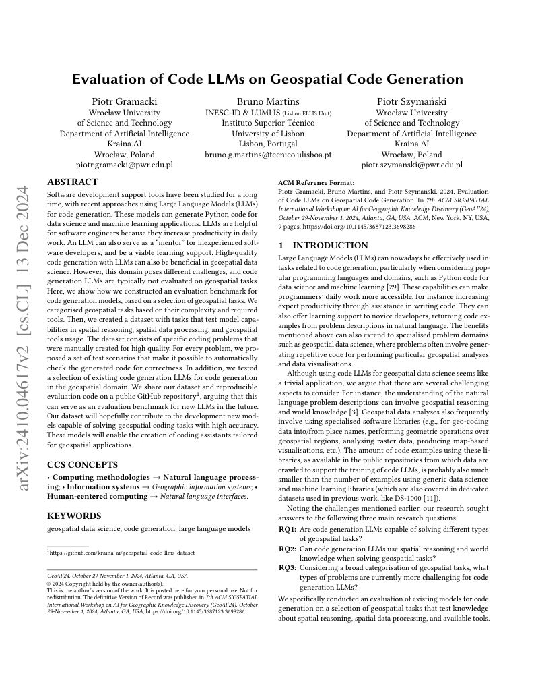
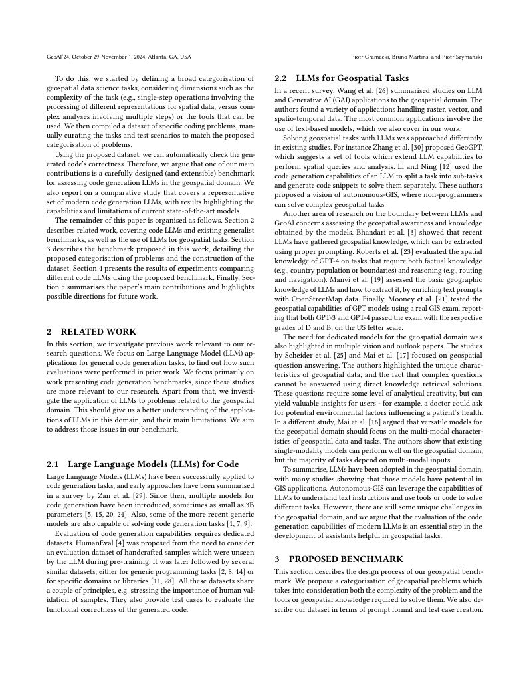
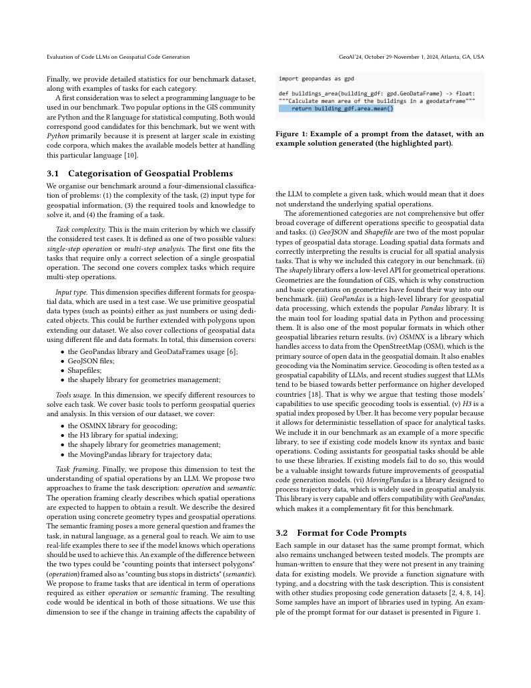
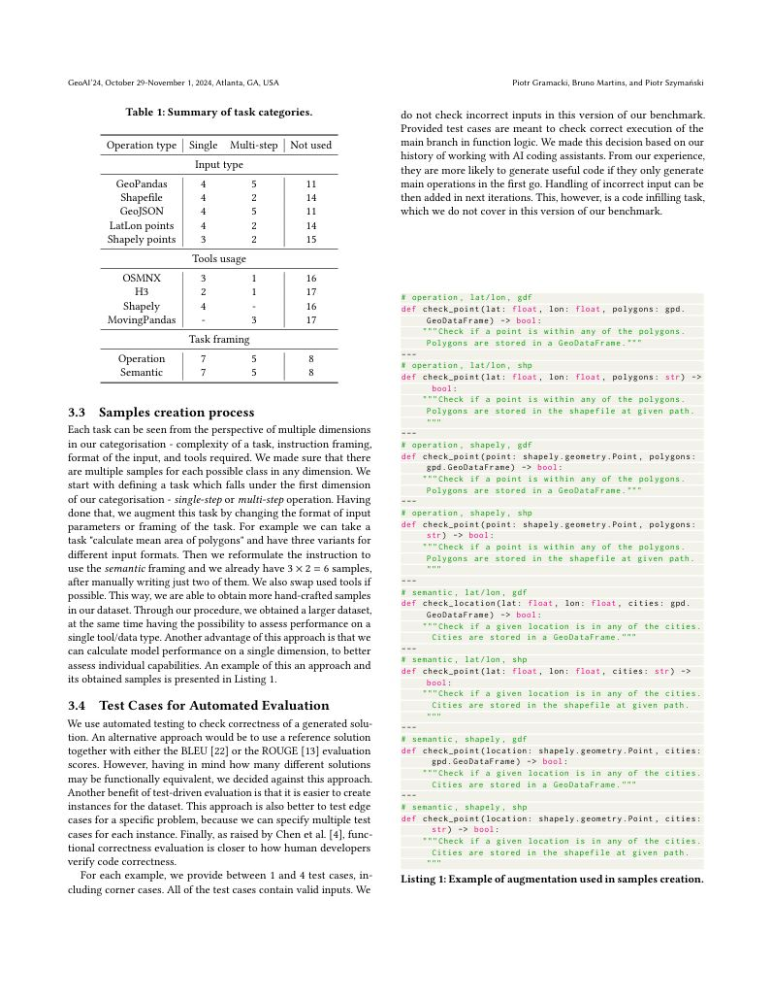
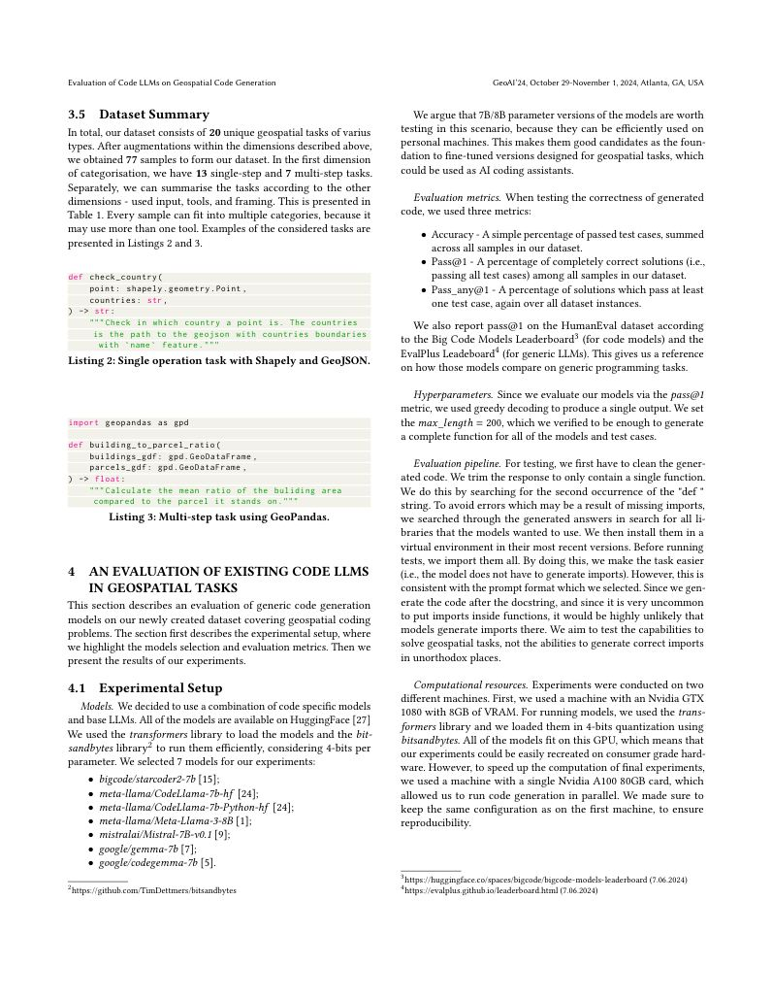
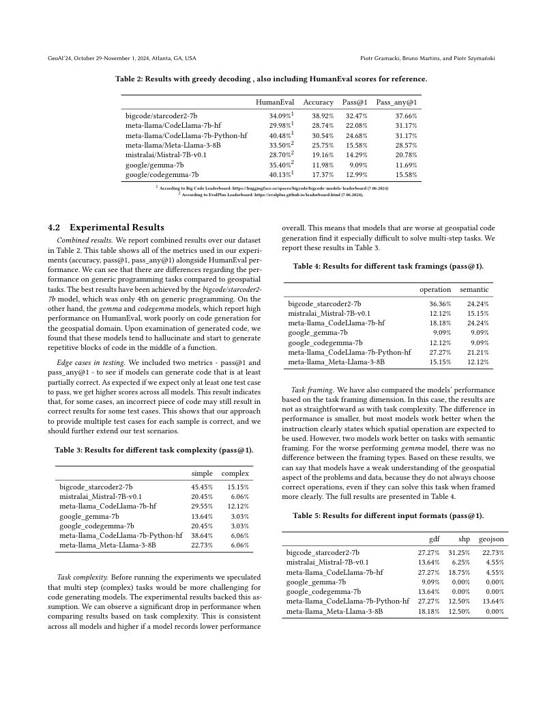
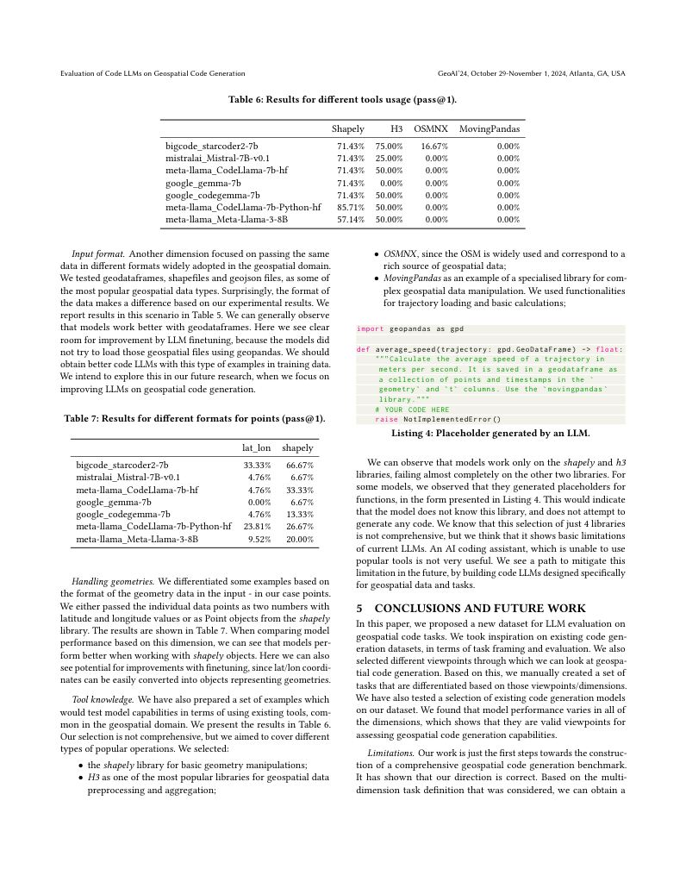
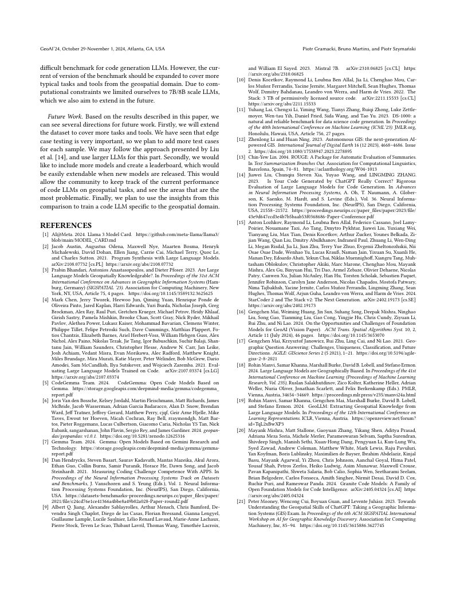
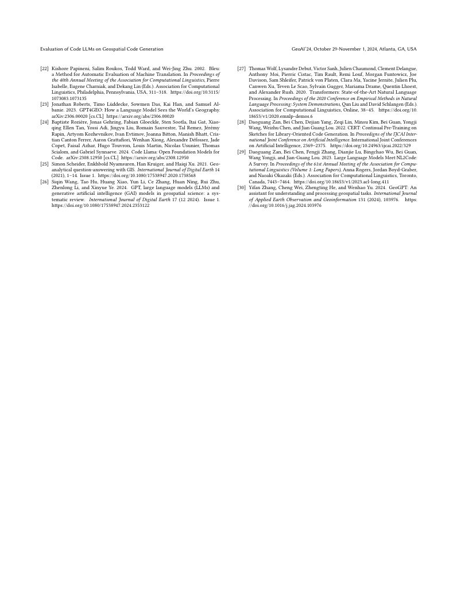

# 英文原文：逐页提取（不翻译、不删减）

## PDF 第 1 页

~~~~text
Evaluation of Code LLMs on Geospatial Code Generation
Piotr Gramacki
Wrocław University
of Science and Technology
Department of Artificial Intelligence
Kraina.AI
Wrocław, Poland
piotr.gramacki@pwr.edu.pl
Bruno Martins
INESC-ID & LUMLIS (Lisbon ELLIS Unit)
Instituto Superior Técnico
University of Lisbon
Lisbon, Portugal
bruno.g.martins@tecnico.ulisboa.pt
Piotr Szymański
Wrocław University
of Science and Technology
Department of Artificial Intelligence
Kraina.AI
Wrocław, Poland
piotr.szymanski@pwr.edu.pl
ABSTRACT
Software development support tools have been studied for a long
time, with recent approaches using Large Language Models (LLMs)
for code generation. These models can generate Python code for
data science and machine learning applications. LLMs are helpful
for software engineers because they increase productivity in daily
work. An LLM can also serve as a “mentor” for inexperienced soft-
ware developers, and be a viable learning support. High-quality
code generation with LLMs can also be beneficial in geospatial data
science. However, this domain poses different challenges, and code
generation LLMs are typically not evaluated on geospatial tasks.
Here, we show how we constructed an evaluation benchmark for
code generation models, based on a selection of geospatial tasks. We
categorised geospatial tasks based on their complexity and required
tools. Then, we created a dataset with tasks that test model capa-
bilities in spatial reasoning, spatial data processing, and geospatial
tools usage. The dataset consists of specific coding problems that
were manually created for high quality. For every problem, we pro-
posed a set of test scenarios that make it possible to automatically
check the generated code for correctness. In addition, we tested
a selection of existing code generation LLMs for code generation
in the geospatial domain. We share our dataset and reproducible
evaluation code on a public GitHub repository1, arguing that this
can serve as an evaluation benchmark for new LLMs in the future.
Our dataset will hopefully contribute to the development new mod-
els capable of solving geospatial coding tasks with high accuracy.
These models will enable the creation of coding assistants tailored
for geospatial applications.
CCS CONCEPTS
• Computing methodologies →Natural language process-
ing; • Information systems →Geographic information systems; •
Human-centered computing →Natural language interfaces.
KEYWORDS
geospatial data science, code generation, large language models
1https://github.com/kraina-ai/geospatial-code-llms-dataset
GeoAI’24, October 29-November 1, 2024, Atlanta, GA, USA
© 2024 Copyright held by the owner/author(s).
This is the author’s version of the work. It is posted here for your personal use. Not for
redistribution. The definitive Version of Record was published in 7th ACM SIGSPATIAL
International Workshop on AI for Geographic Knowledge Discovery (GeoAI’24), October
29-November 1, 2024, Atlanta, GA, USA, https://doi.org/10.1145/3687123.3698286.
ACM Reference Format:
Piotr Gramacki, Bruno Martins, and Piotr Szymański. 2024. Evaluation
of Code LLMs on Geospatial Code Generation. In 7th ACM SIGSPATIAL
International Workshop on AI for Geographic Knowledge Discovery (GeoAI’24),
October 29-November 1, 2024, Atlanta, GA, USA. ACM, New York, NY, USA,
9 pages. https://doi.org/10.1145/3687123.3698286
1
INTRODUCTION
Large Language Models (LLMs) can nowadays be effectively used in
tasks related to code generation, particularly when considering pop-
ular programming languages and domains, such as Python code for
data science and machine learning [29]. These capabilities can make
programmers’ daily work more accessible, for instance increasing
expert productivity through assistance in writing code. They can
also offer learning support to novice developers, returning code ex-
amples from problem descriptions in natural language. The benefits
mentioned above can also extend to specialised problem domains
such as geospatial data science, where problems often involve gener-
ating repetitive code for performing particular geospatial analyses
and data visualisations.
Although using code LLMs for geospatial data science seems like
a trivial application, we argue that there are several challenging
aspects to consider. For instance, the understanding of the natural
language problem descriptions can involve geospatial reasoning
and world knowledge [3]. Geospatial data analyses also frequently
involve using specialised software libraries (e.g., for geo-coding
data into/from place names, performing geometric operations over
geospatial regions, analysing raster data, producing map-based
visualisations, etc.). The amount of code examples using these li-
braries, as available in the public repositories from which data are
crawled to support the training of code LLMs, is probably also much
smaller than the number of examples using generic data science
and machine learning libraries (which are also covered in dedicated
datasets used in previous work, like DS-1000 [11]).
Noting the challenges mentioned earlier, our research sought
answers to the following three main research questions:
RQ1: Are code generation LLMs capable of solving different types
of geospatial tasks?
RQ2: Can code generation LLMs use spatial reasoning and world
knowledge when solving geospatial tasks?
RQ3: Considering a broad categorisation of geospatial tasks, what
types of problems are currently more challenging for code
generation LLMs?
We specifically conducted an evaluation of existing models for code
generation on a selection of geospatial tasks that test knowledge
about spatial reasoning, spatial data processing, and available tools.
arXiv:2410.04617v2  [cs.CL]  13 Dec 2024
~~~~

## PDF 第 2 页

~~~~text
GeoAI’24, October 29-November 1, 2024, Atlanta, GA, USA
Piotr Gramacki, Bruno Martins, and Piotr Szymański
To do this, we started by defining a broad categorisation of
geospatial data science tasks, considering dimensions such as the
complexity of the task (e.g., single-step operations involving the
processing of different representations for spatial data, versus com-
plex analyses involving multiple steps) or the tools that can be
used. We then compiled a dataset of specific coding problems, man-
ually curating the tasks and test scenarios to match the proposed
categorisation of problems.
Using the proposed dataset, we can automatically check the gen-
erated code’s correctness. Therefore, we argue that one of our main
contributions is a carefully designed (and extensible) benchmark
for assessing code generation LLMs in the geospatial domain. We
also report on a comparative study that covers a representative
set of modern code generation LLMs, with results highlighting the
capabilities and limitations of current state-of-the-art models.
The remainder of this paper is organised as follows. Section 2
describes related work, covering code LLMs and existing generalist
benchmarks, as well as the use of LLMs for geospatial tasks. Section
3 describes the benchmark proposed in this work, detailing the
proposed categorisation of problems and the construction of the
dataset. Section 4 presents the results of experiments comparing
different code LLMs using the proposed benchmark. Finally, Sec-
tion 5 summarises the paper’s main contributions and highlights
possible directions for future work.
2
RELATED WORK
In this section, we investigate previous work relevant to our re-
search questions. We focus on Large Language Model (LLM) ap-
plications for general code generation tasks, to find out how such
evaluations were performed in prior work. We focus primarily on
work presenting code generation benchmarks, since these studies
are more relevant to our research. Apart from that, we investi-
gate the application of LLMs to problems related to the geospatial
domain. This should give us a better understanding of the applica-
tions of LLMs in this domain, and their main limitations. We aim
to address those issues in our benchmark.
2.1
Large Language Models (LLMs) for Code
Large Language Models (LLMs) have been successfully applied to
code generation tasks, and early approaches have been summarised
in a survey by Zan et al. [29]. Since then, multiple models for
code generation have been introduced, sometimes as small as 3B
parameters [5, 15, 20, 24]. Also, some of the more recent generic
models are also capable of solving code generation tasks [1, 7, 9].
Evaluation of code generation capabilities requires dedicated
datasets. HumanEval [4] was proposed from the need to consider
an evaluation dataset of handcrafted samples which were unseen
by the LLM during pre-training. It was later followed by several
similar datasets, either for generic programming tasks [2, 8, 14] or
for specific domains or libraries [11, 28]. All these datasets share
a couple of principles, e.g. stressing the importance of human val-
idation of samples. They also provide test cases to evaluate the
functional correctness of the generated code.
2.2
LLMs for Geospatial Tasks
In a recent survey, Wang et al. [26] summarised studies on LLM
and Generative AI (GAI) applications to the geospatial domain. The
authors found a variety of applications handling raster, vector, and
spatio-temporal data. The most common applications involve the
use of text-based models, which we also cover in our work.
Solving geospatial tasks with LLMs was approached differently
in existing studies. For instance Zhang et al. [30] proposed GeoGPT,
which suggests a set of tools which extend LLM capabilities to
perform spatial queries and analysis. Li and Ning [12] used the
code generation capabilities of an LLM to split a task into sub-tasks
and generate code snippets to solve them separately. These authors
proposed a vision of autonomous-GIS, where non-programmers
can solve complex geospatial tasks.
Another area of research on the boundary between LLMs and
GeoAI concerns assessing the geospatial awareness and knowledge
obtained by the models. Bhandari et al. [3] showed that recent
LLMs have gathered geospatial knowledge, which can be extracted
using proper prompting. Roberts et al. [23] evaluated the spatial
knowledge of GPT-4 on tasks that require both factual knowledge
(e.g., country population or boundaries) and reasoning (e.g., routing
and navigation). Manvi et al. [19] assessed the basic geographic
knowledge of LLMs and how to extract it, by enriching text prompts
with OpenStreetMap data. Finally, Mooney et al. [21] tested the
geospatial capabilities of GPT models using a real GIS exam, report-
ing that both GPT-3 and GPT-4 passed the exam with the respective
grades of D and B, on the US letter scale.
The need for dedicated models for the geospatial domain was
also highlighted in multiple vision and outlook papers. The studies
by Scheider et al. [25] and Mai et al. [17] focused on geospatial
question answering. The authors highlighted the unique charac-
teristics of geospatial data, and the fact that complex questions
cannot be answered using direct knowledge retrieval solutions.
These questions require some level of analytical creativity, but can
yield valuable insights for users - for example, a doctor could ask
for potential environmental factors influencing a patient’s health.
In a different study, Mai et al. [16] argued that versatile models for
the geospatial domain should focus on the multi-modal character-
istics of geospatial data and tasks. The authors show that existing
single-modality models can perform well on the geospatial domain,
but the majority of tasks depend on multi-modal inputs.
To summarise, LLMs have been adopted in the geospatial domain,
with many studies showing that those models have potential in
GIS applications. Autonomous-GIS can leverage the capabilities of
LLMs to understand text instructions and use tools or code to solve
different tasks. However, there are still some unique challenges in
the geospatial domain, and we argue that the evaluation of the code
generation capabilities of modern LLMs is an essential step in the
development of assistants helpful in geospatial tasks.
3
PROPOSED BENCHMARK
This section describes the design process of our geospatial bench-
mark. We propose a categorisation of geospatial problems which
takes into consideration both the complexity of the problem and the
tools or geospatial knowledge required to solve them. We also de-
scribe our dataset in terms of prompt format and test case creation.
~~~~

## PDF 第 3 页

~~~~text
Evaluation of Code LLMs on Geospatial Code Generation
GeoAI’24, October 29-November 1, 2024, Atlanta, GA, USA
Finally, we provide detailed statistics for our benchmark dataset,
along with examples of tasks for each category.
A first consideration was to select a programming language to be
used in our benchmark. Two popular options in the GIS community
are Python and the R language for statistical computing. Both would
correspond good candidates for this benchmark, but we went with
Python primarily because it is present at larger scale in existing
code corpora, which makes the available models better at handling
this particular language [10].
3.1
Categorisation of Geospatial Problems
We organise our benchmark around a four-dimensional classifica-
tion of problems: (1) the complexity of the task, (2) input type for
geospatial information, (3) the required tools and knowledge to
solve it, and (4) the framing of a task.
Task complexity. This is the main criterion by which we classify
the considered test cases. It is defined as one of two possible values:
single-step operation or multi-step analysis. The first one fits the
tasks that require only a correct selection of a single geospatial
operation. The second one covers complex tasks which require
multi-step operations.
Input type. This dimension specifies different formats for geospa-
tial data, which are used in a test case. We use primitive geospatial
data types (such as points) either as just numbers or using dedi-
cated objects. This could be further extended with polygons upon
extending our dataset. We also cover collections of geospatial data
using different file and data formats. In total, this dimension covers:
• the GeoPandas library and GeoDataFrames usage [6];
• GeoJSON files;
• Shapefiles;
• the shapely library for geometries management;
Tools usage. In this dimension, we specify different resources to
solve each task. We cover basic tools to perform geospatial queries
and analysis. In this version of our dataset, we cover:
• the OSMNX library for geocoding;
• the H3 library for spatial indexing;
• the shapely library for geometries management;
• the MovingPandas library for trajectory data;
Task framing. Finally, we propose this dimension to test the
understanding of spatial operations by an LLM. We propose two
approaches to frame the task description: operation and semantic.
The operation framing clearly describes which spatial operations
are expected to happen to obtain a result. We describe the desired
operation using concrete geometry types and geospatial operations.
The semantic framing poses a more general question and frames the
task, in natural language, as a general goal to reach. We aim to use
real-life examples there to see if the model knows which operations
should be used to achieve this. An example of the difference between
the two types could be "counting points that intersect polygons"
(operation) framed also as "counting bus stops in districts" (semantic).
We propose to frame tasks that are identical in term of operations
required as either operation or semantic framing. The resulting
code would be identical in both of those situations. We use this
dimension to see if the change in training affects the capability of
Figure 1: Example of a prompt from the dataset, with an
example solution generated (the highlighted part).
the LLM to complete a given task, which would mean that it does
not understand the underlying spatial operations.
The aforementioned categories are not comprehensive but offer
broad coverage of different operations specific to geospatial data
and tasks. (i) GeoJSON and Shapefile are two of the most popular
types of geospatial data storage. Loading spatial data formats and
correctly interpreting the results is crucial for all spatial analysis
tasks. That is why we included this category in our benchmark. (ii)
The shapely library offers a low-level API for geometrical operations.
Geometries are the foundation of GIS, which is why construction
and basic operations on geometries have found their way into our
benchmark. (iii) GeoPandas is a high-level library for geospatial
data processing, which extends the popular Pandas library. It is
the main tool for loading spatial data in Python and processing
them. It is also one of the most popular formats in which other
geospatial libraries return results. (iv) OSMNX is a library which
handles access to data from the OpenStreetMap (OSM), which is the
primary source of open data in the geospatial domain. It also enables
geocoding via the Nominatim service. Geocoding is often tested as a
geospatial capability of LLMs, and recent studies suggest that LLMs
tend to be biased towards better performance on higher developed
countries [18]. That is why we argue that testing those models’
capabilities to use specific geocoding tools is essential. (v) H3 is a
spatial index proposed by Uber. It has become very popular because
it allows for deterministic tessellation of space for analytical tasks.
We include it in our benchmark as an example of a more specific
library, to see if existing code models know its syntax and basic
operations. Coding assistants for geospatial tasks should be able
to use these libraries. If existing models fail to do so, this would
be a valuable insight towards future improvements of geospatial
code generation models. (vi) MovingPandas is a library designed to
process trajectory data, which is widely used in geospatial analysis.
This library is very capable and offers compatibility with GeoPandas,
which makes it a complementary fit for this benchmark.
3.2
Format for Code Prompts
Each sample in our dataset has the same prompt format, which
also remains unchanged between tested models. The prompts are
human-written to ensure that they were not present in any training
data for existing models. We provide a function signature with
typing, and a docstring with the task description. This is consistent
with other studies proposing code generation datasets [2, 4, 8, 14].
Some samples have an import of libraries used in typing. An exam-
ple of the prompt format for our dataset is presented in Figure 1.
~~~~

## PDF 第 4 页

~~~~text
GeoAI’24, October 29-November 1, 2024, Atlanta, GA, USA
Piotr Gramacki, Bruno Martins, and Piotr Szymański
Table 1: Summary of task categories.
Operation type
Single
Multi-step
Not used
Input type
GeoPandas
4
5
11
Shapefile
4
2
14
GeoJSON
4
5
11
LatLon points
4
2
14
Shapely points
3
2
15
Tools usage
OSMNX
3
1
16
H3
2
1
17
Shapely
4
-
16
MovingPandas
-
3
17
Task framing
Operation
7
5
8
Semantic
7
5
8
3.3
Samples creation process
Each task can be seen from the perspective of multiple dimensions
in our categorisation - complexity of a task, instruction framing,
format of the input, and tools required. We made sure that there
are multiple samples for each possible class in any dimension. We
start with defining a task which falls under the first dimension
of our categorisation - single-step or multi-step operation. Having
done that, we augment this task by changing the format of input
parameters or framing of the task. For example we can take a
task "calculate mean area of polygons" and have three variants for
different input formats. Then we reformulate the instruction to
use the semantic framing and we already have 3 × 2 = 6 samples,
after manually writing just two of them. We also swap used tools if
possible. This way, we are able to obtain more hand-crafted samples
in our dataset. Through our procedure, we obtained a larger dataset,
at the same time having the possibility to assess performance on a
single tool/data type. Another advantage of this approach is that we
can calculate model performance on a single dimension, to better
assess individual capabilities. An example of this an approach and
its obtained samples is presented in Listing 1.
3.4
Test Cases for Automated Evaluation
We use automated testing to check correctness of a generated solu-
tion. An alternative approach would be to use a reference solution
together with either the BLEU [22] or the ROUGE [13] evaluation
scores. However, having in mind how many different solutions
may be functionally equivalent, we decided against this approach.
Another benefit of test-driven evaluation is that it is easier to create
instances for the dataset. This approach is also better to test edge
cases for a specific problem, because we can specify multiple test
cases for each instance. Finally, as raised by Chen et al. [4], func-
tional correctness evaluation is closer to how human developers
verify code correctness.
For each example, we provide between 1 and 4 test cases, in-
cluding corner cases. All of the test cases contain valid inputs. We
do not check incorrect inputs in this version of our benchmark.
Provided test cases are meant to check correct execution of the
main branch in function logic. We made this decision based on our
history of working with AI coding assistants. From our experience,
they are more likely to generate useful code if they only generate
main operations in the first go. Handling of incorrect input can be
then added in next iterations. This, however, is a code infilling task,
which we do not cover in this version of our benchmark.
# operation , lat/lon , gdf
def check_point(lat: float , lon: float , polygons: gpd.
GeoDataFrame) -> bool:
""" Check if a point is within any of the polygons.
Polygons are stored in a GeoDataFrame."""
---
# operation , lat/lon , shp
def check_point(lat: float , lon: float , polygons: str) ->
bool:
""" Check if a point is within any of the polygons.
Polygons are stored in the shapefile at given path.
"""
---
# operation , shapely , gdf
def check_point(point: shapely.geometry.Point , polygons:
gpd.GeoDataFrame) -> bool:
""" Check if a point is within any of the polygons.
Polygons are stored in a GeoDataFrame."""
---
# operation , shapely , shp
def check_point(point: shapely.geometry.Point , polygons:
str) -> bool:
""" Check if a point is within any of the polygons.
Polygons are stored in the shapefile at given path.
"""
---
# semantic , lat/lon , gdf
def check_location(lat: float , lon: float , cities: gpd.
GeoDataFrame) -> bool:
""" Check if a given location is in any of the cities.
Cities are stored in a GeoDataFrame."""
---
# semantic , lat/lon , shp
def check_point(lat: float , lon: float , cities: str) ->
bool:
""" Check if a given location is in any of the cities.
Cities are stored in the shapefile at given path.
"""
---
# semantic , shapely , gdf
def check_point(location: shapely.geometry.Point , cities:
gpd.GeoDataFrame) -> bool:
""" Check if a given location is in any of the cities.
Cities are stored in a GeoDataFrame."""
---
# semantic , shapely , shp
def check_point(location: shapely.geometry.Point , cities:
str) -> bool:
""" Check if a given location is in any of the cities.
Cities are stored in the shapefile at given path.
"""
Listing 1: Example of augmentation used in samples creation.
~~~~

## PDF 第 5 页

~~~~text
Evaluation of Code LLMs on Geospatial Code Generation
GeoAI’24, October 29-November 1, 2024, Atlanta, GA, USA
3.5
Dataset Summary
In total, our dataset consists of 20 unique geospatial tasks of varius
types. After augmentations within the dimensions described above,
we obtained 77 samples to form our dataset. In the first dimension
of categorisation, we have 13 single-step and 7 multi-step tasks.
Separately, we can summarise the tasks according to the other
dimensions - used input, tools, and framing. This is presented in
Table 1. Every sample can fit into multiple categories, because it
may use more than one tool. Examples of the considered tasks are
presented in Listings 2 and 3.
def check_country(
point: shapely.geometry.Point ,
countries: str ,
) -> str:
""" Check in which country a point is. The countries
is the path to the geojson with countries boundaries
with `name ` feature."""
Listing 2: Single operation task with Shapely and GeoJSON.
import geopandas as gpd
def building_to_parcel_ratio(
buildings_gdf: gpd.GeoDataFrame ,
parcels_gdf: gpd.GeoDataFrame ,
) -> float:
""" Calculate the mean ratio of the buliding area
compared to the parcel it stands on."""
Listing 3: Multi-step task using GeoPandas.
4
AN EVALUATION OF EXISTING CODE LLMS
IN GEOSPATIAL TASKS
This section describes an evaluation of generic code generation
models on our newly created dataset covering geospatial coding
problems. The section first describes the experimental setup, where
we highlight the models selection and evaluation metrics. Then we
present the results of our experiments.
4.1
Experimental Setup
Models. We decided to use a combination of code specific models
and base LLMs. All of the models are available on HuggingFace [27]
We used the transformers library to load the models and the bit-
sandbytes library2 to run them efficiently, considering 4-bits per
parameter. We selected 7 models for our experiments:
• bigcode/starcoder2-7b [15];
• meta-llama/CodeLlama-7b-hf [24];
• meta-llama/CodeLlama-7b-Python-hf [24];
• meta-llama/Meta-Llama-3-8B [1];
• mistralai/Mistral-7B-v0.1 [9];
• google/gemma-7b [7];
• google/codegemma-7b [5].
2https://github.com/TimDettmers/bitsandbytes
We argue that 7B/8B parameter versions of the models are worth
testing in this scenario, because they can be efficiently used on
personal machines. This makes them good candidates as the foun-
dation to fine-tuned versions designed for geospatial tasks, which
could be used as AI coding assistants.
Evaluation metrics. When testing the correctness of generated
code, we used three metrics:
• Accuracy - A simple percentage of passed test cases, summed
across all samples in our dataset.
• Pass@1 - A percentage of completely correct solutions (i.e.,
passing all test cases) among all samples in our dataset.
• Pass_any@1 - A percentage of solutions which pass at least
one test case, again over all dataset instances.
We also report pass@1 on the HumanEval dataset according
to the Big Code Models Leaderboard3 (for code models) and the
EvalPlus Leadeboard4 (for generic LLMs). This gives us a reference
on how those models compare on generic programming tasks.
Hyperparameters. Since we evaluate our models via the pass@1
metric, we used greedy decoding to produce a single output. We set
the 𝑚𝑎𝑥_𝑙𝑒𝑛𝑔𝑡ℎ= 200, which we verified to be enough to generate
a complete function for all of the models and test cases.
Evaluation pipeline. For testing, we first have to clean the gener-
ated code. We trim the response to only contain a single function.
We do this by searching for the second occurrence of the "def "
string. To avoid errors which may be a result of missing imports,
we searched through the generated answers in search for all li-
braries that the models wanted to use. We then install them in a
virtual environment in their most recent versions. Before running
tests, we import them all. By doing this, we make the task easier
(i.e., the model does not have to generate imports). However, this is
consistent with the prompt format which we selected. Since we gen-
erate the code after the docstring, and since it is very uncommon
to put imports inside functions, it would be highly unlikely that
models generate imports there. We aim to test the capabilities to
solve geospatial tasks, not the abilities to generate correct imports
in unorthodox places.
Computational resources. Experiments were conducted on two
different machines. First, we used a machine with an Nvidia GTX
1080 with 8GB of VRAM. For running models, we used the trans-
formers library and we loaded them in 4-bits quantization using
bitsandbytes. All of the models fit on this GPU, which means that
our experiments could be easily recreated on consumer grade hard-
ware. However, to speed up the computation of final experiments,
we used a machine with a single Nvidia A100 80GB card, which
allowed us to run code generation in parallel. We made sure to
keep the same configuration as on the first machine, to ensure
reproducibility.
3https://huggingface.co/spaces/bigcode/bigcode-models-leaderboard (7.06.2024)
4https://evalplus.github.io/leaderboard.html (7.06.2024)
~~~~

## PDF 第 6 页

~~~~text
GeoAI’24, October 29-November 1, 2024, Atlanta, GA, USA
Piotr Gramacki, Bruno Martins, and Piotr Szymański
Table 2: Results with greedy decoding , also including HumanEval scores for reference.
HumanEval
Accuracy
Pass@1
Pass_any@1
bigcode/starcoder2-7b
34.09%1
38.92%
32.47%
37.66%
meta-llama/CodeLlama-7b-hf
29.98%1
28.74%
22.08%
31.17%
meta-llama/CodeLlama-7b-Python-hf
40.48%1
30.54%
24.68%
31.17%
meta-llama/Meta-Llama-3-8B
33.50%2
25.75%
15.58%
28.57%
mistralai/Mistral-7B-v0.1
28.70%2
19.16%
14.29%
20.78%
google/gemma-7b
35.40%2
11.98%
9.09%
11.69%
google/codegemma-7b
40.13%1
17.37%
12.99%
15.58%
1 According to Big Code Leaderboard: https://huggingface.co/spaces/bigcode/bigcode-models-leaderboard (7.06.2024)
2 According to EvalPlus Leaderboard: https://evalplus.github.io/leaderboard.html (7.06.2024),
4.2
Experimental Results
Combined results. We report combined results over our dataset
in Table 2. This table shows all of the metrics used in our experi-
ments (accuracy, pass@1, pass_any@1) alongside HumanEval per-
formance. We can see that there are differences regarding the per-
formance on generic programming tasks compared to geospatial
tasks. The best results have been achieved by the bigcode/starcoder2-
7b model, which was only 4th on generic programming. On the
other hand, the gemma and codegemma models, which report high
performance on HumanEval, work poorly on code generation for
the geospatial domain. Upon examination of generated code, we
found that these models tend to hallucinate and start to generate
repetitive blocks of code in the middle of a function.
Edge cases in testing. We included two metrics - pass@1 and
pass_any@1 - to see if models can generate code that is at least
partially correct. As expected if we expect only at least one test case
to pass, we get higher scores across all models. This result indicates
that, for some cases, an incorrect piece of code may still result in
correct results for some test cases. This shows that our approach
to provide multiple test cases for each sample is correct, and we
should further extend our test scenarios.
Table 3: Results for different task complexity (pass@1).
simple
complex
bigcode_starcoder2-7b
45.45%
15.15%
mistralai_Mistral-7B-v0.1
20.45%
6.06%
meta-llama_CodeLlama-7b-hf
29.55%
12.12%
google_gemma-7b
13.64%
3.03%
google_codegemma-7b
20.45%
3.03%
meta-llama_CodeLlama-7b-Python-hf
38.64%
6.06%
meta-llama_Meta-Llama-3-8B
22.73%
6.06%
Task complexity. Before running the experiments we speculated
that multi step (complex) tasks would be more challenging for
code generating models. The experimental results backed this as-
sumption. We can observe a significant drop in performance when
comparing results based on task complexity. This is consistent
across all models and higher if a model records lower performance
overall. This means that models that are worse at geospatial code
generation find it especially difficult to solve multi-step tasks. We
report these results in Table 3.
Table 4: Results for different task framings (pass@1).
operation
semantic
bigcode_starcoder2-7b
36.36%
24.24%
mistralai_Mistral-7B-v0.1
12.12%
15.15%
meta-llama_CodeLlama-7b-hf
18.18%
24.24%
google_gemma-7b
9.09%
9.09%
google_codegemma-7b
12.12%
9.09%
meta-llama_CodeLlama-7b-Python-hf
27.27%
21.21%
meta-llama_Meta-Llama-3-8B
15.15%
12.12%
Task framing. We have also compared the models’ performance
based on the task framing dimension. In this case, the results are
not as straightforward as with task complexity. The difference in
performance is smaller, but most models work better when the
instruction clearly states which spatial operation are expected to
be used. However, two models work better on tasks with semantic
framing. For the worse performing gemma model, there was no
difference between the framing types. Based on these results, we
can say that models have a weak understanding of the geospatial
aspect of the problems and data, because they do not always choose
correct operations, even if they can solve this task when framed
more clearly. The full results are presented in Table 4.
Table 5: Results for different input formats (pass@1).
gdf
shp
geojson
bigcode_starcoder2-7b
27.27%
31.25%
22.73%
mistralai_Mistral-7B-v0.1
13.64%
6.25%
4.55%
meta-llama_CodeLlama-7b-hf
27.27%
18.75%
4.55%
google_gemma-7b
9.09%
0.00%
0.00%
google_codegemma-7b
13.64%
0.00%
0.00%
meta-llama_CodeLlama-7b-Python-hf
27.27%
12.50%
13.64%
meta-llama_Meta-Llama-3-8B
18.18%
12.50%
0.00%
~~~~

## PDF 第 7 页

~~~~text
Evaluation of Code LLMs on Geospatial Code Generation
GeoAI’24, October 29-November 1, 2024, Atlanta, GA, USA
Table 6: Results for different tools usage (pass@1).
Shapely
H3
OSMNX
MovingPandas
bigcode_starcoder2-7b
71.43%
75.00%
16.67%
0.00%
mistralai_Mistral-7B-v0.1
71.43%
25.00%
0.00%
0.00%
meta-llama_CodeLlama-7b-hf
71.43%
50.00%
0.00%
0.00%
google_gemma-7b
71.43%
0.00%
0.00%
0.00%
google_codegemma-7b
71.43%
50.00%
0.00%
0.00%
meta-llama_CodeLlama-7b-Python-hf
85.71%
50.00%
0.00%
0.00%
meta-llama_Meta-Llama-3-8B
57.14%
50.00%
0.00%
0.00%
Input format. Another dimension focused on passing the same
data in different formats widely adopted in the geospatial domain.
We tested geodataframes, shapefiles and geojson files, as some of
the most popular geospatial data types. Surprisingly, the format of
the data makes a difference based on our experimental results. We
report results in this scenario in Table 5. We can generally observe
that models work better with geodataframes. Here we see clear
room for improvement by LLM finetuning, because the models did
not try to load those geospatial files using geopandas. We should
obtain better code LLMs with this type of examples in training data.
We intend to explore this in our future research, when we focus on
improving LLMs on geospatial code generation.
Table 7: Results for different formats for points (pass@1).
lat_lon
shapely
bigcode_starcoder2-7b
33.33%
66.67%
mistralai_Mistral-7B-v0.1
4.76%
6.67%
meta-llama_CodeLlama-7b-hf
4.76%
33.33%
google_gemma-7b
0.00%
6.67%
google_codegemma-7b
4.76%
13.33%
meta-llama_CodeLlama-7b-Python-hf
23.81%
26.67%
meta-llama_Meta-Llama-3-8B
9.52%
20.00%
Handling geometries. We differentiated some examples based on
the format of the geometry data in the input - in our case points.
We either passed the individual data points as two numbers with
latitude and longitude values or as Point objects from the shapely
library. The results are shown in Table 7. When comparing model
performance based on this dimension, we can see that models per-
form better when working with shapely objects. Here we can also
see potential for improvements with finetuning, since lat/lon coordi-
nates can be easily converted into objects representing geometries.
Tool knowledge. We have also prepared a set of examples which
would test model capabilities in terms of using existing tools, com-
mon in the geospatial domain. We present the results in Table 6.
Our selection is not comprehensive, but we aimed to cover different
types of popular operations. We selected:
• the shapely library for basic geometry manipulations;
• H3 as one of the most popular libraries for geospatial data
preprocessing and aggregation;
• OSMNX, since the OSM is widely used and correspond to a
rich source of geospatial data;
• MovingPandas as an example of a specialised library for com-
plex geospatial data manipulation. We used functionalities
for trajectory loading and basic calculations;
import geopandas as gpd
def average_speed(trajectory: gpd.GeoDataFrame) -> float:
""" Calculate the average speed of a trajectory in
meters per second. It is saved in a geodataframe as
a collection of points and timestamps in the `
geometry ` and `t` columns. Use the `movingpandas `
library."""
# YOUR CODE HERE
raise NotImplementedError ()
Listing 4: Placeholder generated by an LLM.
We can observe that models work only on the shapely and h3
libraries, failing almost completely on the other two libraries. For
some models, we observed that they generated placeholders for
functions, in the form presented in Listing 4. This would indicate
that the model does not know this library, and does not attempt to
generate any code. We know that this selection of just 4 libraries
is not comprehensive, but we think that it shows basic limitations
of current LLMs. An AI coding assistant, which is unable to use
popular tools is not very useful. We see a path to mitigate this
limitation in the future, by building code LLMs designed specifically
for geospatial data and tasks.
5
CONCLUSIONS AND FUTURE WORK
In this paper, we proposed a new dataset for LLM evaluation on
geospatial code tasks. We took inspiration on existing code gen-
eration datasets, in terms of task framing and evaluation. We also
selected different viewpoints through which we can look at geospa-
tial code generation. Based on this, we manually created a set of
tasks that are differentiated based on those viewpoints/dimensions.
We have also tested a selection of existing code generation models
on our dataset. We found that model performance varies in all of
the dimensions, which shows that they are valid viewpoints for
assessing geospatial code generation capabilities.
Limitations. Our work is just the first steps towards the construc-
tion of a comprehensive geospatial code generation benchmark.
It has shown that our direction is correct. Based on the multi-
dimension task definition that was considered, we can obtain a
~~~~

## PDF 第 8 页

~~~~text
GeoAI’24, October 29-November 1, 2024, Atlanta, GA, USA
Piotr Gramacki, Bruno Martins, and Piotr Szymański
difficult benchmark for code generation LLMs. However, the cur-
rent of version of the benchmark should be expanded to cover more
typical tasks and tools from the geospatial domain. Due to com-
putational constraints we limited ourselves to 7B/8B scale LLMs,
which we also aim to extend in the future.
Future Work. Based on the results described in this paper, we
can see several directions for future work. Firstly, we will extend
the dataset to cover more tasks and tools. We have seen that edge
case testing is very important, so we plan to add more test cases
for each sample. We may follow the approach presented by Liu
et al. [14], and use larger LLMs for this part. Secondly, we would
like to include more models and create a leaderboard, which would
be easily extendable when new models are released. This would
allow the community to keep track of the current performance
of code LLMs on geospatial tasks, and see the areas that are the
most problematic. Finally, we plan to use the insights from this
comparison to train a code LLM specific to the geospatial domain.
REFERENCES
[1] AI@Meta. 2024. Llama 3 Model Card. https://github.com/meta-llama/llama3/
blob/main/MODEL_CARD.md
[2] Jacob Austin, Augustus Odena, Maxwell Nye, Maarten Bosma, Henryk
Michalewski, David Dohan, Ellen Jiang, Carrie Cai, Michael Terry, Quoc Le,
and Charles Sutton. 2021. Program Synthesis with Large Language Models.
arXiv:2108.07732 [cs.PL] https://arxiv.org/abs/2108.07732
[3] Prabin Bhandari, Antonios Anastasopoulos, and Dieter Pfoser. 2023. Are Large
Language Models Geospatially Knowledgeable?. In Proceedings of the 31st ACM
International Conference on Advances in Geographic Information Systems (Ham-
burg, Germany) (SIGSPATIAL ’23). Association for Computing Machinery, New
York, NY, USA, Article 75, 4 pages. https://doi.org/10.1145/3589132.3625625
[4] Mark Chen, Jerry Tworek, Heewoo Jun, Qiming Yuan, Henrique Ponde de
Oliveira Pinto, Jared Kaplan, Harri Edwards, Yuri Burda, Nicholas Joseph, Greg
Brockman, Alex Ray, Raul Puri, Gretchen Krueger, Michael Petrov, Heidy Khlaaf,
Girish Sastry, Pamela Mishkin, Brooke Chan, Scott Gray, Nick Ryder, Mikhail
Pavlov, Alethea Power, Lukasz Kaiser, Mohammad Bavarian, Clemens Winter,
Philippe Tillet, Felipe Petroski Such, Dave Cummings, Matthias Plappert, Fo-
tios Chantzis, Elizabeth Barnes, Ariel Herbert-Voss, William Hebgen Guss, Alex
Nichol, Alex Paino, Nikolas Tezak, Jie Tang, Igor Babuschkin, Suchir Balaji, Shan-
tanu Jain, William Saunders, Christopher Hesse, Andrew N. Carr, Jan Leike,
Josh Achiam, Vedant Misra, Evan Morikawa, Alec Radford, Matthew Knight,
Miles Brundage, Mira Murati, Katie Mayer, Peter Welinder, Bob McGrew, Dario
Amodei, Sam McCandlish, Ilya Sutskever, and Wojciech Zaremba. 2021. Eval-
uating Large Language Models Trained on Code.
arXiv:2107.03374 [cs.LG]
https://arxiv.org/abs/2107.03374
[5] CodeGemma Team. 2024.
CodeGemma: Open Code Models Based on
Gemma. https://storage.googleapis.com/deepmind-media/gemma/codegemma_
report.pdf
[6] Joris Van den Bossche, Kelsey Jordahl, Martin Fleischmann, Matt Richards, James
McBride, Jacob Wasserman, Adrian Garcia Badaracco, Alan D. Snow, Brendan
Ward, Jeff Tratner, Jeffrey Gerard, Matthew Perry, cjqf, Geir Arne Hjelle, Mike
Taves, Ewout ter Hoeven, Micah Cochran, Ray Bell, rraymondgh, Matt Bar-
tos, Pieter Roggemans, Lucas Culbertson, Giacomo Caria, Nicholas YS Tan, Nick
Eubank, sangarshanan, John Flavin, Sergio Rey, and James Gardiner. 2024. geopan-
das/geopandas: v1.0.1. https://doi.org/10.5281/zenodo.12625316
[7] Gemma Team. 2024. Gemma: Open Models Based on Gemini Research and
Technology. https://storage.googleapis.com/deepmind-media/gemma/gemma-
report.pdf
[8] Dan Hendrycks, Steven Basart, Saurav Kadavath, Mantas Mazeika, Akul Arora,
Ethan Guo, Collin Burns, Samir Puranik, Horace He, Dawn Song, and Jacob
Steinhardt. 2021. Measuring Coding Challenge Competence With APPS. In
Proceedings of the Neural Information Processing Systems Track on Datasets
and Benchmarks, J. Vanschoren and S. Yeung (Eds.), Vol. 1. Neural Informa-
tion Processing Systems Foundation, Inc. (NeurIPS), San Diego, California,
USA. https://datasets-benchmarks-proceedings.neurips.cc/paper_files/paper/
2021/file/c24cd76e1ce41366a4bbe8a49b02a028-Paper-round2.pdf
[9] Albert Q. Jiang, Alexandre Sablayrolles, Arthur Mensch, Chris Bamford, De-
vendra Singh Chaplot, Diego de las Casas, Florian Bressand, Gianna Lengyel,
Guillaume Lample, Lucile Saulnier, Lélio Renard Lavaud, Marie-Anne Lachaux,
Pierre Stock, Teven Le Scao, Thibaut Lavril, Thomas Wang, Timothée Lacroix,
and William El Sayed. 2023.
Mistral 7B.
arXiv:2310.06825 [cs.CL] https:
//arxiv.org/abs/2310.06825
[10] Denis Kocetkov, Raymond Li, Loubna Ben Allal, Jia Li, Chenghao Mou, Car-
los Muñoz Ferrandis, Yacine Jernite, Margaret Mitchell, Sean Hughes, Thomas
Wolf, Dzmitry Bahdanau, Leandro von Werra, and Harm de Vries. 2022. The
Stack: 3 TB of permissively licensed source code.
arXiv:2211.15533 [cs.CL]
https://arxiv.org/abs/2211.15533
[11] Yuhang Lai, Chengxi Li, Yiming Wang, Tianyi Zhang, Ruiqi Zhong, Luke Zettle-
moyer, Wen-tau Yih, Daniel Fried, Sida Wang, and Tao Yu. 2023. DS-1000: a
natural and reliable benchmark for data science code generation. In Proceedings
of the 40th International Conference on Machine Learning (ICML’23). JMLR.org,
Honolulu, Hawaii, USA, Article 756, 27 pages.
[12] Zhenlong Li and Huan Ning. 2023. Autonomous GIS: the next-generation AI-
powered GIS. International Journal of Digital Earth 16 (12 2023), 4668–4686. Issue
2. https://doi.org/10.1080/17538947.2023.2278895
[13] Chin-Yew Lin. 2004. ROUGE: A Package for Automatic Evaluation of Summaries.
In Text Summarization Branches Out. Association for Computational Linguistics,
Barcelona, Spain, 74–81. https://aclanthology.org/W04-1013
[14] Jiawei Liu, Chunqiu Steven Xia, Yuyao Wang, and LINGMING ZHANG.
2023.
Is Your Code Generated by ChatGPT Really Correct? Rigorous
Evaluation of Large Language Models for Code Generation. In Advances
in Neural Information Processing Systems, A. Oh, T. Naumann, A. Glober-
son, K. Saenko, M. Hardt, and S. Levine (Eds.), Vol. 36. Neural Informa-
tion Processing Systems Foundation, Inc. (NeurIPS), San Diego, California,
USA, 21558–21572. https://proceedings.neurips.cc/paper_files/paper/2023/file/
43e9d647ccd3e4b7b5baab53f0368686-Paper-Conference.pdf
[15] Anton Lozhkov, Raymond Li, Loubna Ben Allal, Federico Cassano, Joel Lamy-
Poirier, Nouamane Tazi, Ao Tang, Dmytro Pykhtar, Jiawei Liu, Yuxiang Wei,
Tianyang Liu, Max Tian, Denis Kocetkov, Arthur Zucker, Younes Belkada, Zi-
jian Wang, Qian Liu, Dmitry Abulkhanov, Indraneil Paul, Zhuang Li, Wen-Ding
Li, Megan Risdal, Jia Li, Jian Zhu, Terry Yue Zhuo, Evgenii Zheltonozhskii, Nii
Osae Osae Dade, Wenhao Yu, Lucas Krauß, Naman Jain, Yixuan Su, Xuanli He,
Manan Dey, Edoardo Abati, Yekun Chai, Niklas Muennighoff, Xiangru Tang, Muh-
tasham Oblokulov, Christopher Akiki, Marc Marone, Chenghao Mou, Mayank
Mishra, Alex Gu, Binyuan Hui, Tri Dao, Armel Zebaze, Olivier Dehaene, Nicolas
Patry, Canwen Xu, Julian McAuley, Han Hu, Torsten Scholak, Sebastien Paquet,
Jennifer Robinson, Carolyn Jane Anderson, Nicolas Chapados, Mostofa Patwary,
Nima Tajbakhsh, Yacine Jernite, Carlos Muñoz Ferrandis, Lingming Zhang, Sean
Hughes, Thomas Wolf, Arjun Guha, Leandro von Werra, and Harm de Vries. 2024.
StarCoder 2 and The Stack v2: The Next Generation. arXiv:2402.19173 [cs.SE]
https://arxiv.org/abs/2402.19173
[16] Gengchen Mai, Weiming Huang, Jin Sun, Suhang Song, Deepak Mishra, Ninghao
Liu, Song Gao, Tianming Liu, Gao Cong, Yingjie Hu, Chris Cundy, Ziyuan Li,
Rui Zhu, and Ni Lao. 2024. On the Opportunities and Challenges of Foundation
Models for GeoAI (Vision Paper). ACM Trans. Spatial Algorithms Syst. 10, 2,
Article 11 (July 2024), 46 pages. https://doi.org/10.1145/3653070
[17] Gengchen Mai, Krzysztof Janowicz, Rui Zhu, Ling Cai, and Ni Lao. 2021. Geo-
graphic Question Answering: Challenges, Uniqueness, Classification, and Future
Directions. AGILE: GIScience Series 2 (5 2021), 1–21. https://doi.org/10.5194/agile-
giss-2-8-2021
[18] Rohin Manvi, Samar Khanna, Marshall Burke, David B. Lobell, and Stefano Ermon.
2024. Large Language Models are Geographically Biased. In Proceedings of the 41st
International Conference on Machine Learning (Proceedings of Machine Learning
Research, Vol. 235), Ruslan Salakhutdinov, Zico Kolter, Katherine Heller, Adrian
Weller, Nuria Oliver, Jonathan Scarlett, and Felix Berkenkamp (Eds.). PMLR,
Vienna, Austria, 34654–34669. https://proceedings.mlr.press/v235/manvi24a.html
[19] Rohin Manvi, Samar Khanna, Gengchen Mai, Marshall Burke, David B. Lobell,
and Stefano Ermon. 2024. GeoLLM: Extracting Geospatial Knowledge from
Large Language Models. In Proceedings of the 12th International Conference on
Learning Representations. ICLR, Vienna, Austria. https://openreview.net/forum?
id=TqL2xBwXP3
[20] Mayank Mishra, Matt Stallone, Gaoyuan Zhang, Yikang Shen, Aditya Prasad,
Adriana Meza Soria, Michele Merler, Parameswaran Selvam, Saptha Surendran,
Shivdeep Singh, Manish Sethi, Xuan-Hong Dang, Pengyuan Li, Kun-Lung Wu,
Syed Zawad, Andrew Coleman, Matthew White, Mark Lewis, Raju Pavuluri,
Yan Koyfman, Boris Lublinsky, Maximilien de Bayser, Ibrahim Abdelaziz, Kinjal
Basu, Mayank Agarwal, Yi Zhou, Chris Johnson, Aanchal Goyal, Hima Patel,
Yousaf Shah, Petros Zerfos, Heiko Ludwig, Asim Munawar, Maxwell Crouse,
Pavan Kapanipathi, Shweta Salaria, Bob Calio, Sophia Wen, Seetharami Seelam,
Brian Belgodere, Carlos Fonseca, Amith Singhee, Nirmit Desai, David D. Cox,
Ruchir Puri, and Rameswar Panda. 2024. Granite Code Models: A Family of
Open Foundation Models for Code Intelligence. arXiv:2405.04324 [cs.AI] https:
//arxiv.org/abs/2405.04324
[21] Peter Mooney, Wencong Cui, Boyuan Guan, and Levente Juhász. 2023. Towards
Understanding the Geospatial Skills of ChatGPT: Taking a Geographic Informa-
tion Systems (GIS) Exam. In Proceedings of the 6th ACM SIGSPATIAL International
Workshop on AI for Geographic Knowledge Discovery. Association for Computing
Machinery, Inc, 85–94. https://doi.org/10.1145/3615886.3627745
~~~~

## PDF 第 9 页

~~~~text
Evaluation of Code LLMs on Geospatial Code Generation
GeoAI’24, October 29-November 1, 2024, Atlanta, GA, USA
[22] Kishore Papineni, Salim Roukos, Todd Ward, and Wei-Jing Zhu. 2002. Bleu:
a Method for Automatic Evaluation of Machine Translation. In Proceedings of
the 40th Annual Meeting of the Association for Computational Linguistics, Pierre
Isabelle, Eugene Charniak, and Dekang Lin (Eds.). Association for Computational
Linguistics, Philadelphia, Pennsylvania, USA, 311–318. https://doi.org/10.3115/
1073083.1073135
[23] Jonathan Roberts, Timo Lüddecke, Sowmen Das, Kai Han, and Samuel Al-
banie. 2023. GPT4GEO: How a Language Model Sees the World’s Geography.
arXiv:2306.00020 [cs.CL] https://arxiv.org/abs/2306.00020
[24] Baptiste Rozière, Jonas Gehring, Fabian Gloeckle, Sten Sootla, Itai Gat, Xiao-
qing Ellen Tan, Yossi Adi, Jingyu Liu, Romain Sauvestre, Tal Remez, Jérémy
Rapin, Artyom Kozhevnikov, Ivan Evtimov, Joanna Bitton, Manish Bhatt, Cris-
tian Canton Ferrer, Aaron Grattafiori, Wenhan Xiong, Alexandre Défossez, Jade
Copet, Faisal Azhar, Hugo Touvron, Louis Martin, Nicolas Usunier, Thomas
Scialom, and Gabriel Synnaeve. 2024. Code Llama: Open Foundation Models for
Code. arXiv:2308.12950 [cs.CL] https://arxiv.org/abs/2308.12950
[25] Simon Scheider, Enkhbold Nyamsuren, Han Kruiger, and Haiqi Xu. 2021. Geo-
analytical question-answering with GIS. International Journal of Digital Earth 14
(2021), 1–14. Issue 1. https://doi.org/10.1080/17538947.2020.1738568
[26] Siqin Wang, Tao Hu, Huang Xiao, Yun Li, Ce Zhang, Huan Ning, Rui Zhu,
Zhenlong Li, and Xinyue Ye. 2024. GPT, large language models (LLMs) and
generative artificial intelligence (GAI) models in geospatial science: a sys-
tematic review. International Journal of Digital Earth 17 (12 2024). Issue 1.
https://doi.org/10.1080/17538947.2024.2353122
[27] Thomas Wolf, Lysandre Debut, Victor Sanh, Julien Chaumond, Clement Delangue,
Anthony Moi, Pierric Cistac, Tim Rault, Remi Louf, Morgan Funtowicz, Joe
Davison, Sam Shleifer, Patrick von Platen, Clara Ma, Yacine Jernite, Julien Plu,
Canwen Xu, Teven Le Scao, Sylvain Gugger, Mariama Drame, Quentin Lhoest,
and Alexander Rush. 2020. Transformers: State-of-the-Art Natural Language
Processing. In Proceedings of the 2020 Conference on Empirical Methods in Natural
Language Processing: System Demonstrations, Qun Liu and David Schlangen (Eds.).
Association for Computational Linguistics, Online, 38–45. https://doi.org/10.
18653/v1/2020.emnlp-demos.6
[28] Daoguang Zan, Bei Chen, Dejian Yang, Zeqi Lin, Minsu Kim, Bei Guan, Yongji
Wang, Weizhu Chen, and Jian Guang Lou. 2022. CERT: Continual Pre-Training on
Sketches for Library-Oriented Code Generation. In Proceedigns of the IJCAI Inter-
national Joint Conference on Artificial Intelligence. International Joint Conferences
on Artificial Intelligence, 2369–2375. https://doi.org/10.24963/ijcai.2022/329
[29] Daoguang Zan, Bei Chen, Fengji Zhang, Dianjie Lu, Bingchao Wu, Bei Guan,
Wang Yongji, and Jian-Guang Lou. 2023. Large Language Models Meet NL2Code:
A Survey. In Proceedings of the 61st Annual Meeting of the Association for Compu-
tational Linguistics (Volume 1: Long Papers), Anna Rogers, Jordan Boyd-Graber,
and Naoaki Okazaki (Eds.). Association for Computational Linguistics, Toronto,
Canada, 7443–7464. https://doi.org/10.18653/v1/2023.acl-long.411
[30] Yifan Zhang, Cheng Wei, Zhengting He, and Wenhao Yu. 2024. GeoGPT: An
assistant for understanding and processing geospatial tasks. International Journal
of Applied Earth Observation and Geoinformation 131 (2024), 103976.
https:
//doi.org/10.1016/j.jag.2024.103976
~~~~
