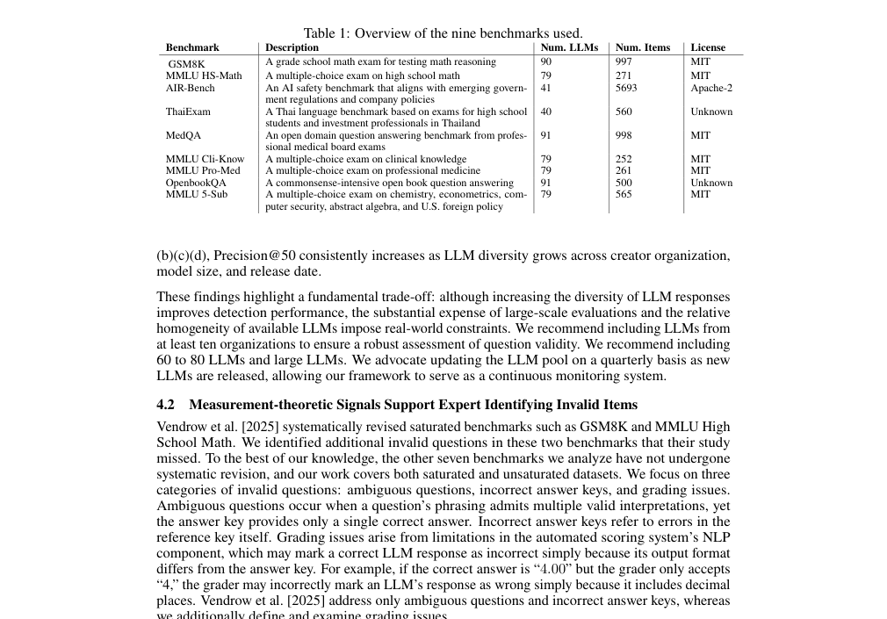
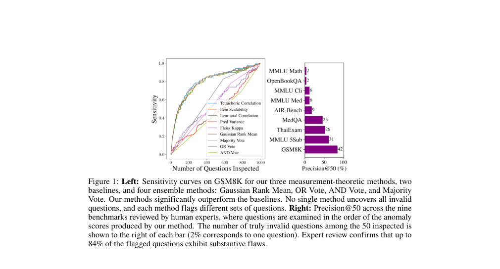
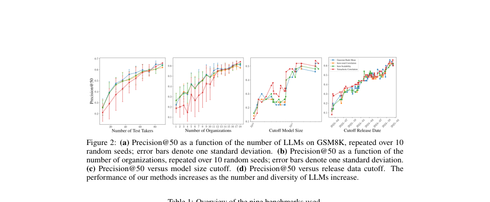
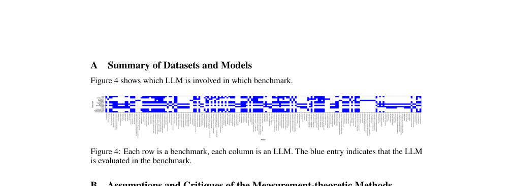
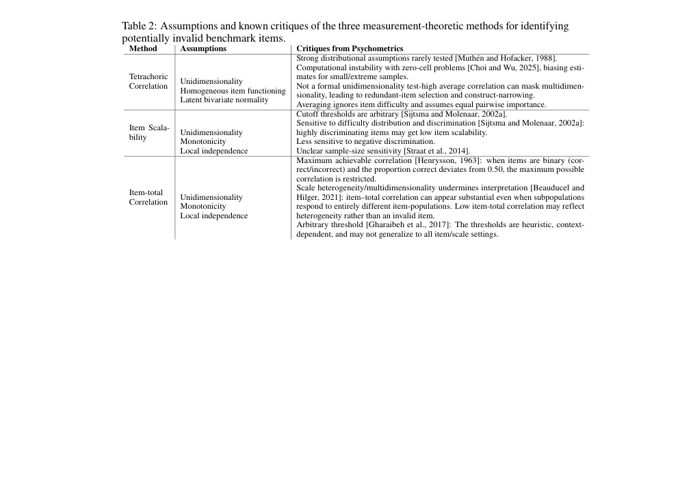

# AI 基准测试中的问题题目：发现与修订

**英文原题：** Fantastic Bugs and Where to Find Them in AI Benchmarks  
**作者：** Sang T. Truong、Yuheng Tu、Michael Hardy 等，Stanford University。  
**原稿：** 31 页。专业术语与数学符号尽量依据原稿保留。

> **覆盖说明：** 以下包含摘要全文翻译、主文方法和实证结果的详细中文译述、关键公式及图表中文说明。附录中的题目样例、长证明与 NeurIPS 检查清单没有全部逐句翻译；它们及完整参考文献均保留在逐页英文稿和原始 PDF 中。

## 摘要（全文翻译）

基准测试在推动人工智能进步方面发挥着关键作用，而无效的基准题目常常损害其可靠性。对数千道基准题目逐一进行人工排错和修正既不切实际，也已成为实现可信评估的一项重要瓶颈。本文提出一种**系统性基准修订框架**：通过分析模型回答的统计模式，标记可能存在缺陷的题目，再交由领域专家审查。该方法基于 AI 评估中常用的一个核心假设，即平均得分足以概括模型的整体表现。这个假设意味着测量实验由一个**单维潜在构念（unidimensional latent construct）**驱动，并由此对每道题的多种统计量规定了预期范围。当一题的经验统计值超出这些范围时，其存在问题的可能性就更高。本文在九个广泛使用的基准上进行验证，所提出的方法能够指导专家审查，并以最高 **84% 的精确率**识别存在问题的题目。此外，作者引入 LLM 裁判进行第一轮审查，进一步减少专家劳动。两部分结合形成了一种高效且可扩展的系统性基准修订框架。

## 1 引言

GSM8K、MMLU 等基准通过其评分与排行榜影响模型开发和资源投入；但这种比较只有在题目本身有效时才具有解释意义。错误的答案键、含糊的题目描述和不恰当的自动评分，都可能改变模型排序。原文援引先前对 GSM8K 的调查：约 5% 题目存在问题；修订前后，部分模型的相对排名发生了明显变化。

规模化审计的困难在于：大型基准有成千上万道题，覆盖医学、数学、语言和不同文化环境；判断正确答案往往需要专家参与，检查**评分错误（grading issues）**更需要比对模型输出，而不仅仅核对题目和答案。作者因此提出：先从多个 LLM 的作答矩阵中提取与测量理论相关的异常信号，再把最值得检查的问题交给人类专家，最后对发现的问题进行修改。

论文贡献包括：将心理测量方法移植到 AI 基准题目修订任务；在九个基准验证其筛查价值；利用 LLM 充当初步审查者，把专家注意力集中到不确定和高风险样本上。这里的统计方法输出的是**候选异常题目**，并不自动证明一道题无效。

## 2 相关工作

过去已有研究指出，标签错误、题目欠充分定义以及数据集偏差可能扭曲模型排名。对抗过滤、模型间分歧、高置信度错误预测和人工审计等方法虽能发现缺陷，但缺少统一的理论说明及适用于大量基准的筛查流程。

在传统测量理论中，**经典测量理论（Classical Test Theory）**、Cronbach's α、McDonald's ω、Guttman's λ6、**项目反应理论（Item Response Theory, IRT）**和 **Mokken 量表分析**为题目区分度、测量可靠性与单维性提供了方法。作者将其中可以利用“多个受试者对同一组题目作答”的思想改造为“多个 LLM 在同一基准上作答”的数据分析。

## 3 用于基准修订的测量理论信号

### 3.1 从模型作答矩阵出发

设基准有 \(N\) 道题、\(M\) 个被测模型；二元反应矩阵为 \(X\in\{0,1\}^{M\times N}\)。当第 \(i\) 个模型正确回答第 \(j\) 题时，\(X_{ij}=1\)，否则为 0。第 \(i\) 个模型的总分是：

\[
S_i=\sum_{j=1}^{N}X_{ij}.
\]

研究以“总分或平均分能充分表征目标能力”的惯常评价实践为起点，讨论该假设对题目之间统计关系的约束。论文首先提出：若总分对潜在能力是**充分统计量**，在其模型假设下将得到**单维潜在能力结构**；继而推导出 Rasch 模型形式：

\[
P(X_{ij}=1\mid \theta_i)=\sigma(\theta_i-z_j),
\]

其中 \(\theta_i\) 是模型能力、\(z_j\) 是题目难度、\(\sigma\) 为 sigmoid 函数。这里的推导涉及**局部独立性（local independence）**等条件；不可将其理解为所有现实基准都必然满足 Rasch 模型。

### 3.2 题间相关性与题目—总分相关性

在单一能力并满足相应单调性条件的模型下，能力更强的受试者倾向于在每道题上都有更高答对概率，因此题目对之间的协方差不应为负。作者据此利用三类信号识别异常题目：

- **Tetrachoric correlation（四分相关系数）**：衡量两道二元作答题背后潜在连续变量的相关程度；对单题可以汇总其与其他题的平均相关性。
- **Item scalability coefficient / Mokken 统计量（题目可扩展性/量表系数）**：对单题与其他题的共变程度进行衡量，检验题目是否与共同能力构念方向一致。低值或负值提示需要进一步核查。
- **Item-total correlation（题目—总分相关系数）**：衡量某题的回答向量与模型总得分向量之间的相关性。在作者设定的 Rasch 假设下，该相关性应为正。

如果一道题主要由不同于总体能力的技能决定，或者答案键存在问题，就可能出现与一般表现相反的作答关系。但**负相关是异常信号，不等于这道题一定错误**。多维基准中，能力结构本身就可能使不同题目相关性为负。原文用多维因子模型说明，在一阶近似下题间协方差的符号取决于 \(\lambda_j^{\top}\Sigma\lambda_k\)，其中 \(\lambda\) 是题目载荷、\(\Sigma\) 是能力协方差矩阵。

### 3.3 异常排序与集成

每个统计量都可以对可疑题目排序。作者将异常分数转换为**百分位秩**，再利用标准正态分布的逆 CDF 进行 Gaussian-rank 转换，并求均值形成集成分数。另一组集成规则先阈值化，再采用 OR Vote、AND Vote、Majority Vote。OR 往往扩大候选覆盖，AND 往往使初期命中更集中，但遗漏更多题目；因此不同信号具有互补性。

## 4 实验与发现

### 4.1 数据、任务与指标

**原论文表1：九个实验基准的数据规模与许可信息（PDF 第 7 页）**

英文原始标题（点击展开）

Table 1: Overview of the nine benchmarks used. Benchmark Description Num. LLMs Num. Items License

作者使用多个模型在基准上的历史作答结果，并以专家核查确认的问题作为评估依据。两个主要检测指标为：

\[
\mathrm{Sensitivity}(k)=\frac{TP(k)}{R},\qquad
\mathrm{Precision@}k=\frac{TP(k)}{k}.
\]

其中 \(R\) 是无效题总数；\(TP(k)\) 是检查异常排名前 \(k\) 道题后确认的无效题数。**Precision@k 更接近真实审计场景**：人工专家通常只有有限时间，因此最重要的是前几十道题能发现多少真正的问题。作者报告，对约 1,000 道题的单一基准运行所提出的统计方法通常约需一分钟（不含人工审阅）。

九个实验基准涵盖 GSM8K、MMLU 高中数学、AIR-Bench、ThaiExam、MedQA、MMLU 临床知识、MMLU 专业医学、OpenBookQA 和 MMLU 五学科子集，涵盖数学、医疗、安全、常识和跨语言场景。

### 4.2 GSM8K 的控制实验

**原论文图1：GSM8K 异常题检测灵敏度与九基准 Precision@50（PDF 第 6 页）**

英文原始标题（点击展开）

Figure 1: Left: Sensitivity curves on GSM8K for our three measurement-theoretic methods, two baselines, and four ensemble methods: Gaussian Rank Mean, OR Vote, AND Vote, and Majority Vote. Our methods significantly outperform the baselines. No single method uncovers all invalid questions, and each method flags different sets of questions. Right: Precision@50 across the nine benchmarks reviewed by human experts, where questions are examined in the order of the anomaly scores produced by our method. The number of truly invalid questions among the 50 inspected is shown to the right of each bar (2% corresponds to one question). Expert review confirms that up to 84% of the flagged questions exhibit substantive flaws.

论文使用 GSM8K-Platinum 标注，其中在 **997** 道题中有 **88** 道被标为无效。作者比较了三种测量理论方法、两种启发式基线（预测方差和 Fleiss' Kappa）及数种集成方案。图 1 左侧显示，理论信号在较浅的审阅深度下比基线更有效；但任何单一方法都不能找出所有问题，说明候选提取依赖统计假设和失效类型。

作者还研究了用于生成回答矩阵的模型数量、模型开发机构数量、模型规模和发布时间。图 2 表明，随着测试模型的数量与来源多样性增加，**Precision@50** 总体提高且随机波动减小。这一发现强调：如果所有受试模型都高度同质化，统计筛查的有效样本量可能下降。

### 4.3 九个基准的专家复核

**原论文图2：模型数量、来源、规模和发布时间对筛查结果的影响（PDF 第 7 页）**

英文原始标题（点击展开）

Figure 2: (a) Precision@50 as a function of the number of LLMs on GSM8K, repeated over 10 random seeds; error bars denote one standard deviation. (b) Precision@50 as a function of the number of organizations, repeated over 10 random seeds; error bars denote one standard deviation. (c) Precision@50 versus model size cutoff. (d) Precision@50 versus release data cutoff. The performance of our methods increases as the number and diversity of LLMs increase.

按异常排名审阅题目后，论文在九个基准中的部分数据集获得最高 **84%** 的有效问题识别精确率（不是所有基准均达到 84%）。发现的问题包括：题干缺失关键上下文、参考图像缺失、答案键错误、标准答案有多种合理表达但评分器只接受一种、OCR 导致数字误识别，以及受特定文化规范影响、难以给出唯一答案的问题。

这些缺陷可能影响不同领域的数据集，例如医疗问答题的临床背景不足，泰语考试中的字符识别错误，以及数学题中不完整的推导要求。论文强调，**领域专家审查仍是最终判定程序**；异常统计量的角色是帮助选择最值得优先审阅的题目。

### 4.4 使用 LLM 裁判加速第一轮审查

**原论文图3：LLM 裁判进行第一轮无效题审查的流程（PDF 第 10 页）**

英文原始标题（点击展开）

Figure 3: Procedure of the LLM-judge first pass.

在图 3 的流程中，模型裁判同时接收题目、官方答案键和若干模型实际回答，并将题目初步判定为有效或无效。对于被标记为无效的问题，它还要给出错误类别与简短理由。作者将错误划分为三类：**题目歧义（Ambiguous Question）**、**错误答案键（Incorrect Answer Key）**和**评分错误（Grading Issue）**。人类专家再核实模型的判断与解释。

对 GSM8K 的一组 100 道题进行初步审查时，论文报告人工检查认为约 30% 存在问题，其中以自动评分错误为主；使用文中的流程，LLM 初筛对所判定无效题的精确率达到 **98%**。需要区分的是，这个 98% 来自特定样本和初筛实验，不能直接外推至所有基准或所有裁判模型。

## 5 结论、局限与未来方向

论文提出将“发布一次就固定不变”的基准维护方式，转向**定期检测、专家验证和持续修订**。测量理论信号可以发现传统人工抽样或表层数据清洗难以发现的异常，但其有效性依赖潜在能力结构、反应矩阵质量及可获得的模型多样性。统计异常与人类认定的问题可能不完全一致；文化歧义、内容效度、后果效度等问题也无法仅凭数值解决。

未来研究包括利用主动抽样减少所需模型回答数、处理多级评分与开放式回答，以及将内容效度、现实后果效度纳入评价体系。对于地理空间智能体基准，这提示审计者可将模型行为矩阵与对题目的空间知识审查、GT 复核和执行结果校验结合，而不应孤立依赖某一种统计阈值。

## 术语对照

| 英文 | 中文 |
|---|---|
| Benchmark Revision | 基准题目修订 |
| Invalid Item | 无效题目/有缺陷题目 |
| Sum-score Sufficiency | 总分充分性 |
| Unidimensional Latent Construct | 单维潜在构念 |
| Rasch Model | Rasch 模型 |
| Item Response Theory (IRT) | 项目反应理论 |
| Tetrachoric Correlation | 四分相关系数 |
| Inter-item Correlation | 题间相关性 |
| Item-total Correlation | 题目—总分相关性 |
| Mokken Scaling | Mokken 量表分析 |
| Sensitivity | 灵敏度/召回率 |
| Precision@k | 前 k 项命中精确率 |
| Gaussian-rank Transform | 高斯秩变换 |
| Grading Issue | 评分问题 |

## 附录与参考文献

原 PDF 第 11 页起包括完整参考文献、测量方法假设与已知批评、典型无效题目实例、LLM 裁判提示词和会议报告清单。**本稿未对这些附录逐句汉化**；请查阅同包英文逐页提取稿及原始 PDF。数学证明出现特殊符号时，应优先依据原稿图像，不要仅凭纯文本层复制公式。

## 附录图表索引：原始截图与续表

以下为原稿附录的全部剩余图表截图；对于跨页内容，同一表号保留多张截图。所有截图均以原稿页数为准，非重新绘制。

### 图4 · 各基准和模型上的题目回应分布热力图（PDF 第14页）

原文标题：Figure 4: Each row is a benchmark, each column is an LLM. The blue entry indicates that the LLM is evaluated in the benchmark.

### 表2 · 测量理论方法的假设与已知局限（PDF 第14页）

原文标题：Table 2: Assumptions and known critiques of the three measurement-theoretic methods for identifying potentially invalid benchmark items.

## 全文原稿与翻译完整性的边界

- 本文为**主要研究内容的中文翻译与忠实译述**，不是逐页逐句汉化完成的全文译本。
- `英文原文_逐页完整提取.md` 包含全部 PDF 页的文字提取；`英文原文_逐页布局提取.txt` 可用于检索对照。
- `图表与逐页原稿索引.md` 保存全部原图/表和全部 PDF 页截图，相对路径有效。
- `参考文献_原文.md` 保留原始英文书目，不擅自翻译作者、刊名和 DOI。
- 数学公式、长表格、跨页图题和图内英文应以原 PDF 和 `source_pages/` 核对；文本层存在图中文字无法直接提取的可能。
