# GEOBench-VLM：面向地理空间任务的视觉语言模型基准

> **翻译范围说明**：摘要完整翻译；正文中关于任务分类、数据构建、实验与指标的内容为重点译述，非全部正文逐句翻译。

## 原文摘要｜完整中文翻译

近年来已有大量基准用于评价通用视觉语言模型（Vision-Language Models，VLMs），但它们并不能有效应对地理空间应用所特有的挑战。通用 VLM Benchmark 并不是针对地理空间数据的复杂性设计的，而地理空间数据对环境监测、城市规划和灾害管理等应用至关重要。该领域的主要困难包括时间变化检测、大规模目标计数、微小目标检测，以及理解遥感影像中不同实体之间的关系。为填补这一空白，作者提出 GEOBench-VLM：一个专门面向地理空间任务评价 VLM 的综合基准，覆盖场景理解、目标计数、定位、细粒度分类、分割和时序分析等任务。该基准包含一万多条经人工验证的指令，涵盖多种视觉条件、目标类型和尺度。作者使用这一基准评价多种先进视觉语言模型，以考察它们在地理空间任务中的能力。结果显示，现有 VLM 虽然具有潜力，但面对地理空间特有任务时仍存在明显困难。表现最好的 LLaVA-OneVision 在多项选择题（MCQ）上的准确率仅为 41.7%，略高于 GPT-4o，约为随机猜测水平的两倍。基准数据已在论文注明的 GitHub 仓库公开。

## 任务分类｜重点译述

GEOBench-VLM 将 31 种细粒度任务组织为 8 类地理空间视觉任务。论文的第一张示意图包含场景理解、目标分类、事件检测、目标定位与计数、图像描述、分割、非光学影像理解、时序理解等内容。题目既包括需要选择唯一正确答案的客观题，也包括对影像内容的描述或感知输出。

不同任务对空间尺度和视觉细节的要求显著不同。微小目标定位、相邻对象关系、灾害事件识别与跨时相变化等问题，不能简单用通用自然图像测试集上的成绩加以替代。

## 评测设计与发现｜重点译述

作者基于多源遥感数据、人工验证的指令与多种任务设置比较现有 VLM。不同任务采用与其输出形式相适配的评测方式，包括多项选择题准确率，以及与定位、分割和描述相关的指标。对于严谨的横向比较，应当分开统计各任务的结果，不能将“VLM 的视觉理解分数”直接理解为“Agent 的工具调用成功率”。

## 对研究的定位

该论文适合作为**感知层、地理空间视觉理解层**的 Benchmark 参照。它不以复杂 GIS 工具执行轨迹为主要评价对象，因此与你关注的工具参数、任务执行、GT 产物一致性存在评价层级差异。它可以成为对照论文，用于阐明“静态感知基准”与“可执行地学智能体基准”的边界。

## 图表阅读提示

- **图 1**：八类、31 项地理空间视觉语言评测任务的例子。
- **图 2–3**：基准内容与数据构建流程。
- **后续表格与图**：不同模型、不同任务类别下的性能比较。

## 核心学术术语对照

| 英文术语 | 中文译法 | 注释 |
|---|---|---|
| Benchmark | 评测基准 | 与数据集、任务集合、执行环境和评分协议区分 |
| Ground Truth (GT) | 参考真值、标准答案 | 可能是答案、代码、执行结果或轨迹，需按论文实际定义 |
| Agentic AI | 智能体人工智能 | 具有规划、工具操作、反馈利用等能力的系统 |
| Tool-Augmented Agent | 工具增强智能体 | 可调用外部 API、程序或领域工具的智能体 |
| Tool Calling | 工具调用 | 包含工具选择和参数绑定，而不只是文本中提及工具 |
| Workflow | 工作流 | 有依赖关系的操作流程 |
| Trajectory | 执行轨迹 | 动作、调用参数、环境反馈和可能的中间产物 |
| Geospatial Grounding | 地理空间锚定 | 将模型输出与实际地物、坐标、尺度、属性或数据对应 |
| Vision-Language Model (VLM) | 视觉语言模型 | 同时处理视觉输入和语言的模型 |
| Multimodal Large Language Model (MLLM) | 多模态大语言模型 | 支持多模态理解和推理 |
| Remote Sensing (RS) | 遥感 | 本研究语境中的对地观测数据分析 |
| Earth Observation (EO) | 地球观测 | 涵盖卫星、航空以及相关环境观测 |
| Retrieval-Augmented Generation (RAG) | 检索增强生成 | 通过外部信息检索增强生成和推理 |
| Semantic Similarity | 语义相似性 | 与正确执行并不等价 |
| Execution-Based Evaluation | 基于执行的评价 | 需要真实或受控的运行环境及验证标准 |
| Multiple-Choice Question (MCQ) | 多项选择题 | 不等同于多工具执行任务 |
| Multispectral | 多光谱 | 传感器多波段观测 |
| Synthetic Aperture Radar (SAR) | 合成孔径雷达 | 主动微波遥感成像方式 |
| Refined Caption | 改进图注 | 利用论文上下文补充的科学图注 |

---

## 原论文全部图表（按照 PDF 页码）

> 图表图片不重新绘制，使用原始 PDF 区域截图；复杂或包含跨栏内容的图表，请点击对应原始页面进行视觉核对。以下逐图展示是为了保证译稿中的图片引用完整，而非宣称邻近英文图题均已翻译。

### Figure 1 — 原论文第 1 页

**原文图题（保留英文）：** Figure 1. GEOBench-VLM comprehensively covers 31 fine-grained tasks categorized into 8 broad categories: scene and object classifica- tion, object detection, segmentation, captioning, event detection, non-optical and temporal understanding tasks.

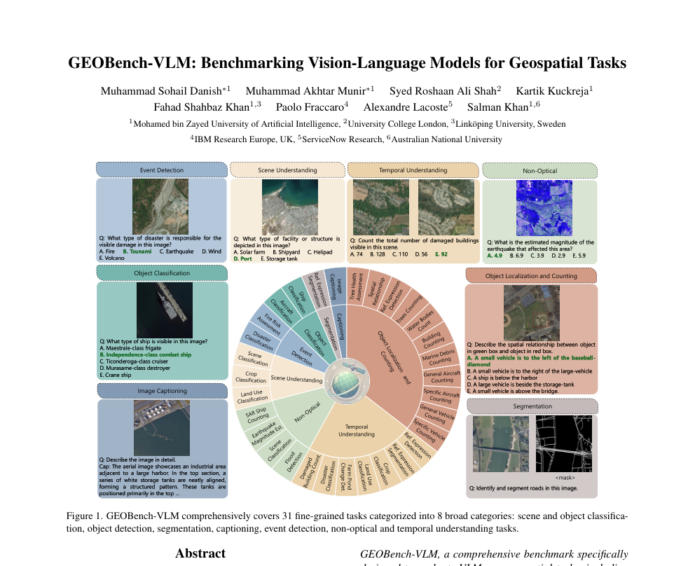

[查看完整原论文第 1 页](./source_pages/page-001.jpg)

### Table 1 — 原论文第 3 页

**原文图题（保留英文）：** Table 1. Overview of Generic and Geospatial-specific Datasets & Benchmarks, detailing modalities (O=Optical, PAN=Panchromatic, MS=Multi-spectral, IR=Infrared, SAR=Synthetic Aperture Radar, V=Video, MI=Multi-image, BT=Bi-Temporal, MT=Multi-temporal), data sources (DRSD=Diverse RS Datasets, OSM=OpenStreetMap, GE=Google Earth, answer types (MCQ=Multiple Choice, SC=Single Choice, FF=Free-Form, BBox=Bounding Box, Seg=Segmentation Mask), and annotation types (A=Automatic, M=Manual).

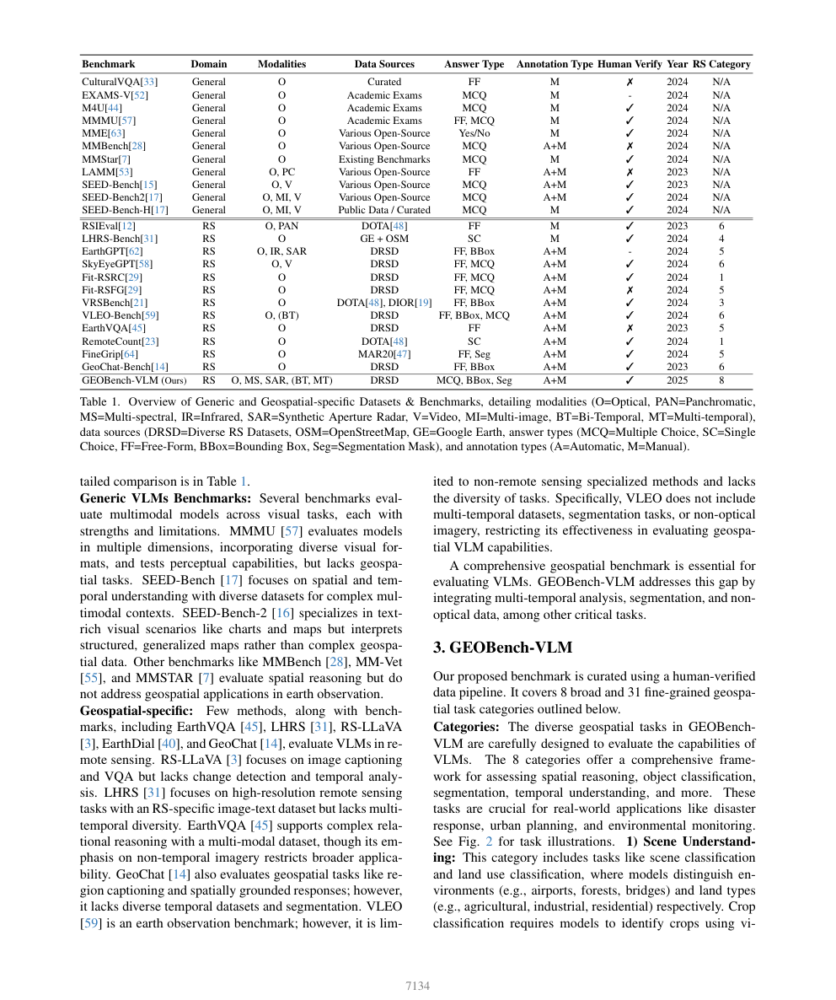

[查看完整原论文第 3 页](./source_pages/page-003.jpg)

### Figure 2 — 原论文第 4 页

**原文图题（保留英文）：** Figure 2. Comprehensive benchmark for VLMs in numerous geospatial tasks. This benchmark evaluates VLMs across eight core task categories, assessing their ability to interpret complex spatial data, classify scenes, identify and localize objects, detect events, generate captions, segment regions, analyze temporal changes, and process non-optical data. Tasks span from classifying landscapes and objects (e.g., land use, crop types, ships, aircraft) to counting, detecting hazards, and assessing disaster impact, testing VLMs on spatial reasoning.

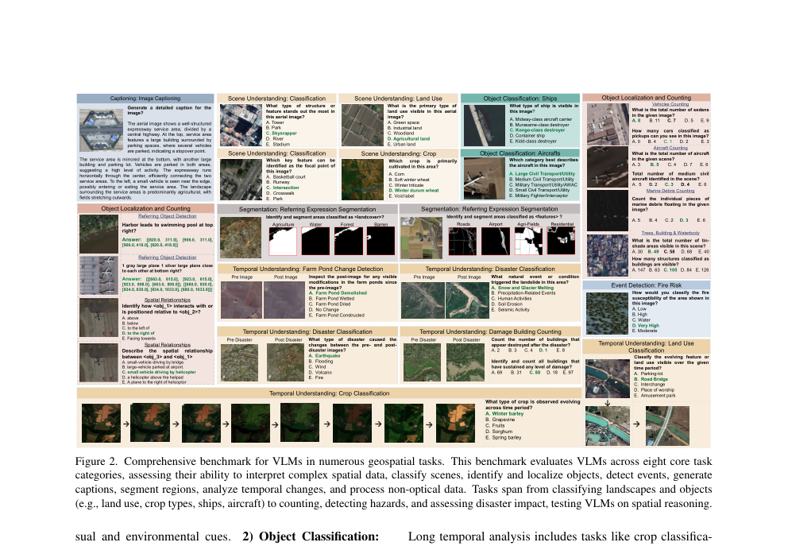

[查看完整原论文第 4 页](./source_pages/page-004.jpg)

### Figure 3 — 原论文第 5 页

**原文图题（保留英文）：** Figure 3. Data pipeline for the GEOBench-VLM: Our pipeline integrates diverse datasets, automated tools, and manual annotation. Tasks such as scene understanding, object classification, and non-optical analysis are based on classification datasets, while GPT-4o generates unique MCQs with five options: one correct answer, one semantically similar “closest” option, and three plausible alternatives. Spatial relationship tasks rely on manually annotated object pair relationships, ensuring consistency through cross-verification. Caption generation l

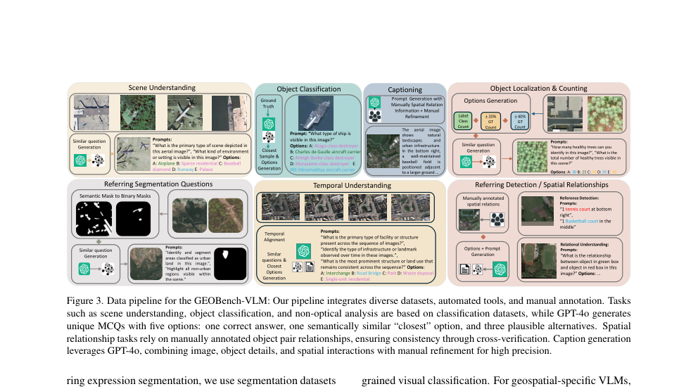

[查看完整原论文第 5 页](./source_pages/page-005.jpg)

### Figure 4 — 原论文第 6 页

**原文图题（保留英文）：** Figure 4. Performance summary of VLMs. LLaVA-OneVision achieves the average accuracy (41.7%), slightly outperforming GPT-4o, which is relatively better in building counting, and general aircraft counting. EarthDial demonstrates strong results in scene classification. The overall results highlight VLMs’ varying strengths across geospatial tasks, with even the best models achieving accuracy only slightly above double the random guess.

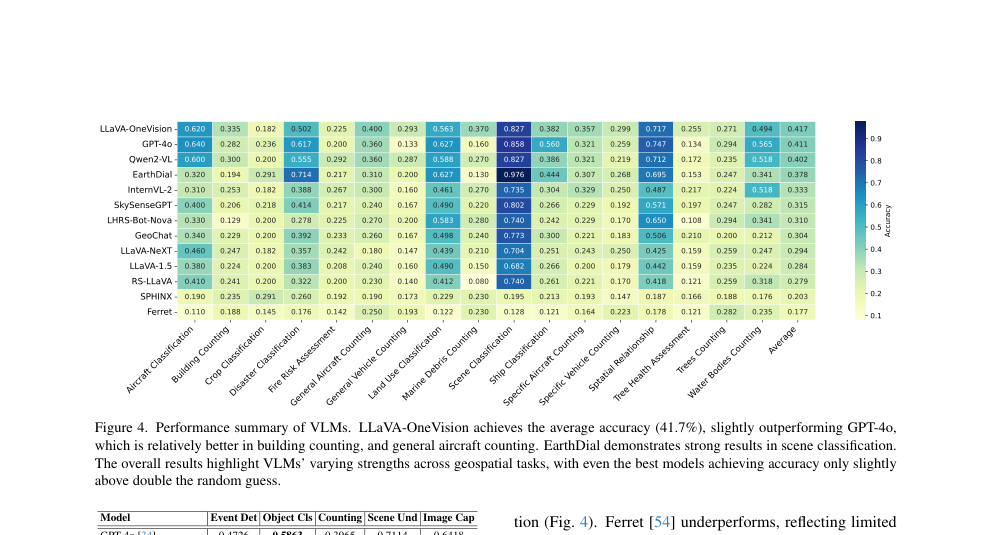

[查看完整原论文第 6 页](./source_pages/page-006.jpg)

### Table 2 — 原论文第 6 页

**原文图题（保留英文）：** Table 2. VLMs accuracies across geospatial tasks. Evaluation includes event detection, object classification, counting, scene un- derstanding, and image captioning. EarthDial performs better in event detection and scene understanding, demonstrating geospa- tial reasoning capabilities. GPT-4o performs best in object classi- fication, while LLaVA-OneVision leads in counting. As evaluated by BERT score [61], Sphinx excels in image captioning.

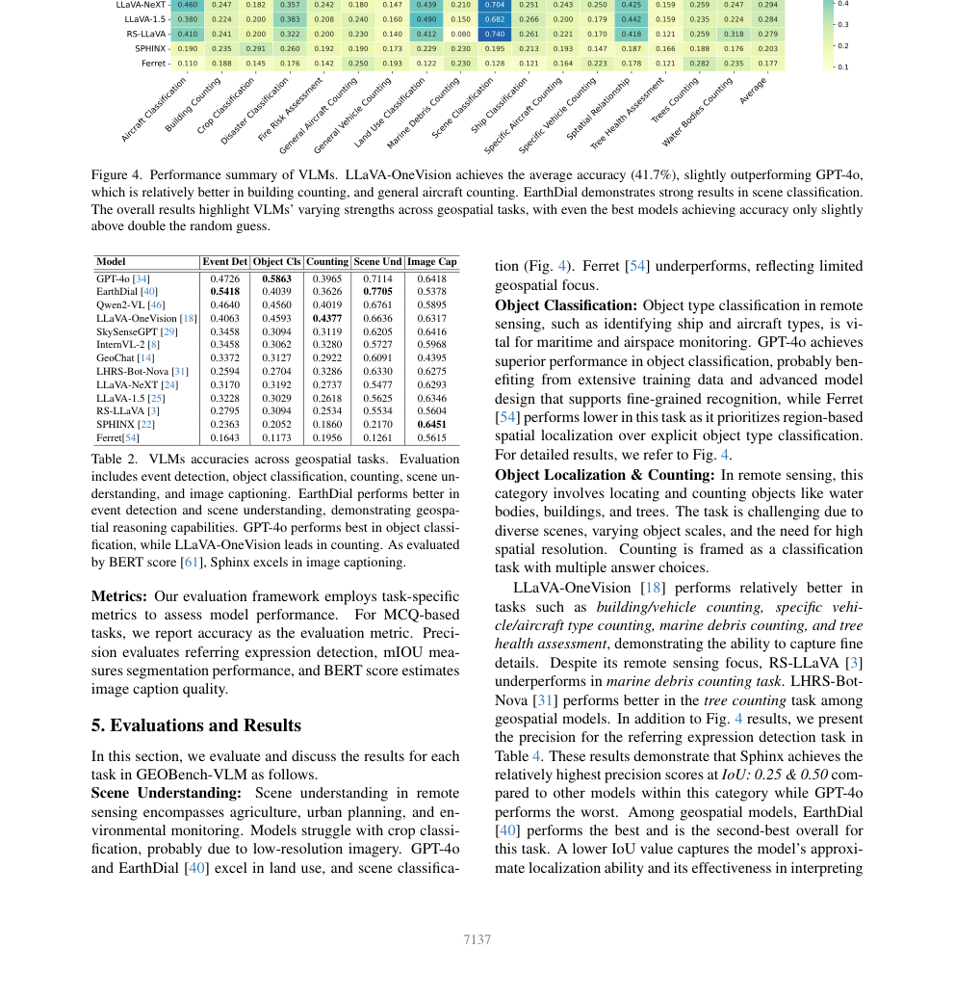

[查看完整原论文第 6 页](./source_pages/page-006.jpg)

### Table 3 — 原论文第 7 页

**原文图题（保留英文）：** Table 3. VLM performance on temporal geospatial tasks. Eval- uation spans crop type classification, disaster type classification, farm pond change detection (CD), land use classification, and damaged building counting. EarthDial performs best in land use classification, while GPT-4o achieves better performance in dis- aster classification and damaged building counting. Qwen2-VL stands second in disaster classification.

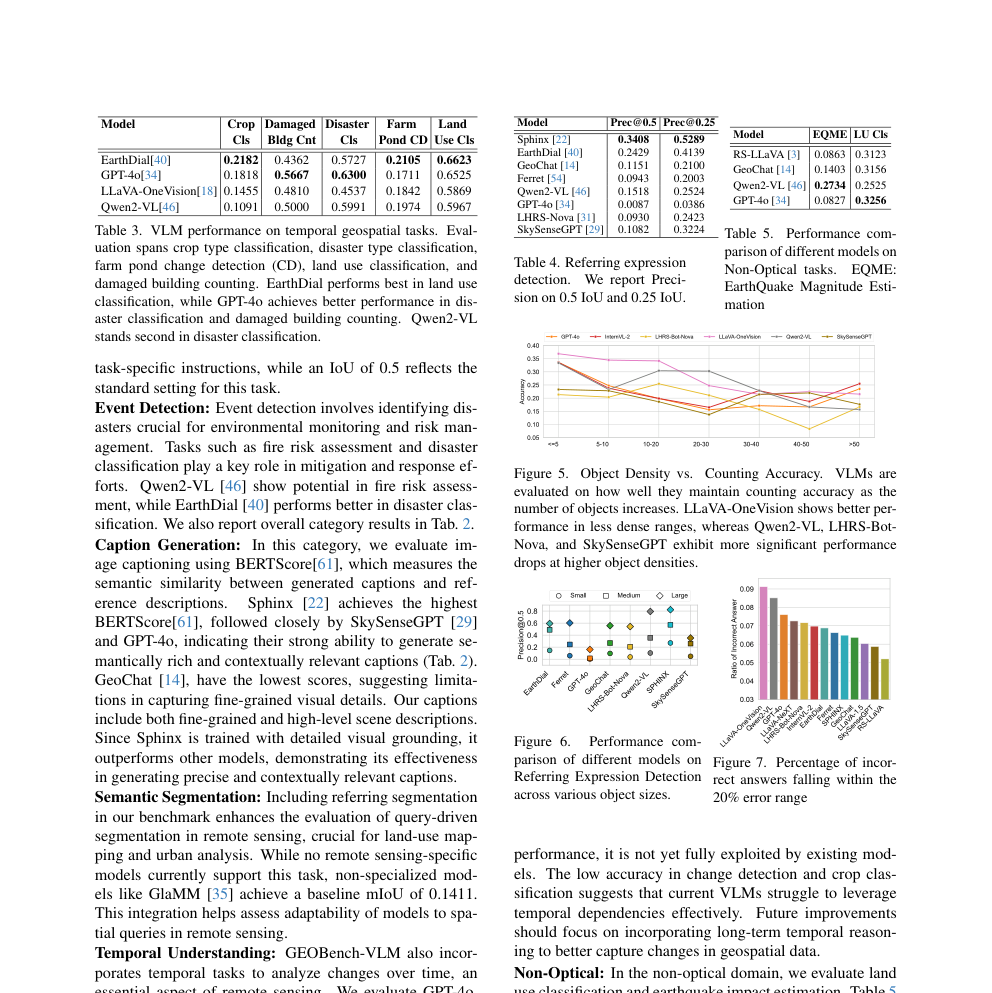

[查看完整原论文第 7 页](./source_pages/page-007.jpg)

### Table 5 — 原论文第 7 页

**原文图题（保留英文）：** Table 5. Performance com- parison of different models on Non-Optical tasks. EQME: EarthQuake Magnitude Esti- mation

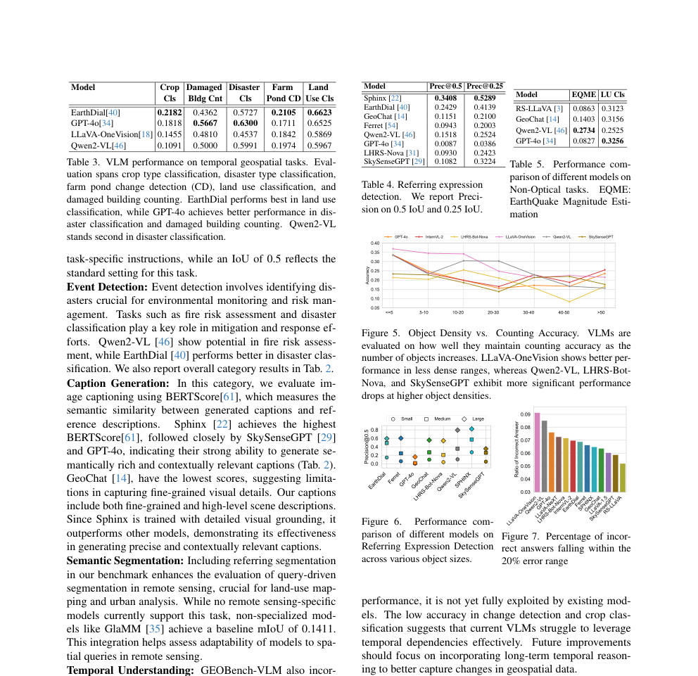

[查看完整原论文第 7 页](./source_pages/page-007.jpg)

### Table 4 — 原论文第 7 页

**原文图题（保留英文）：** Table 4. Referring expression detection. We report Preci- sion on 0.5 IoU and 0.25 IoU.

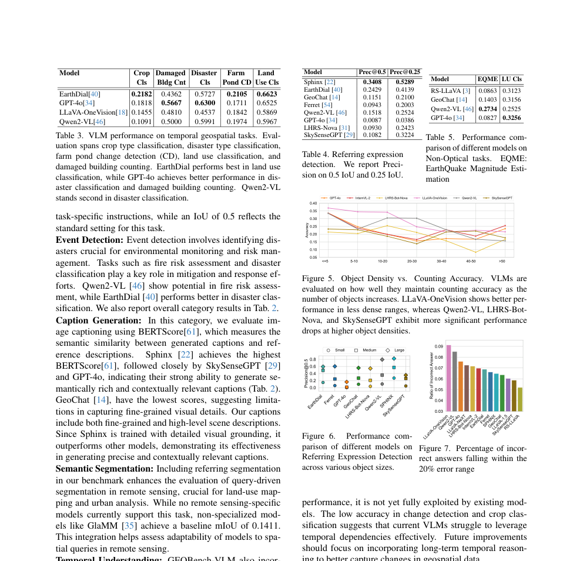

[查看完整原论文第 7 页](./source_pages/page-007.jpg)

### Figure 5 — 原论文第 7 页

**原文图题（保留英文）：** Figure 5. Object Density vs. Counting Accuracy. VLMs are evaluated on how well they maintain counting accuracy as the number of objects increases. LLaVA-OneVision shows better per- formance in less dense ranges, whereas Qwen2-VL, LHRS-Bot- Nova, and SkySenseGPT exhibit more significant performance drops at higher object densities.

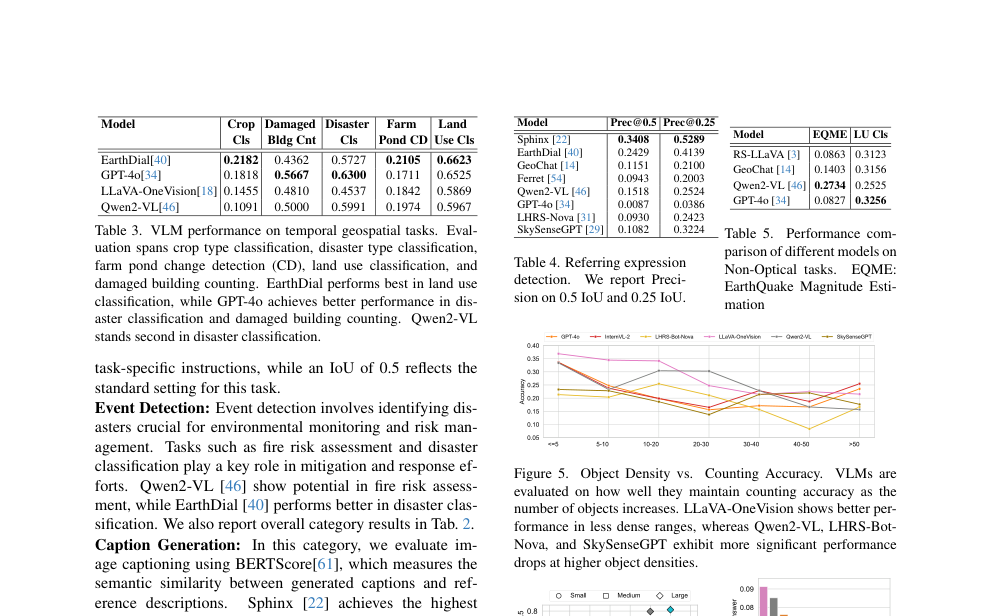

[查看完整原论文第 7 页](./source_pages/page-007.jpg)

### Figure 6 — 原论文第 7 页

**原文图题（保留英文）：** Figure 6. Performance com- parison of different models on Referring Expression Detection across various object sizes.

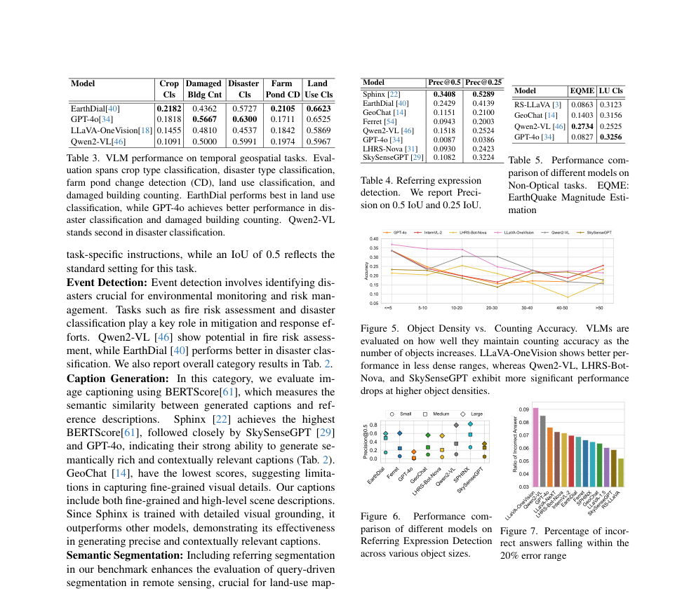

[查看完整原论文第 7 页](./source_pages/page-007.jpg)

### Figure 7 — 原论文第 7 页

**原文图题（保留英文）：** Figure 7. Percentage of incor- rect answers falling within the 20% error range

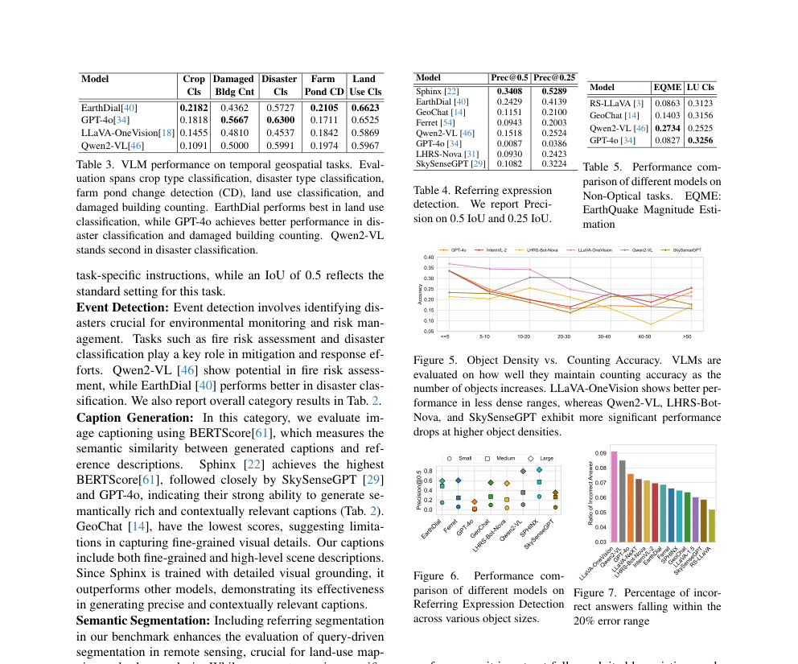

[查看完整原论文第 7 页](./source_pages/page-007.jpg)

### Figure 8 — 原论文第 8 页

**原文图题（保留英文）：** Figure 8. Accuracy Variance across different prompts.

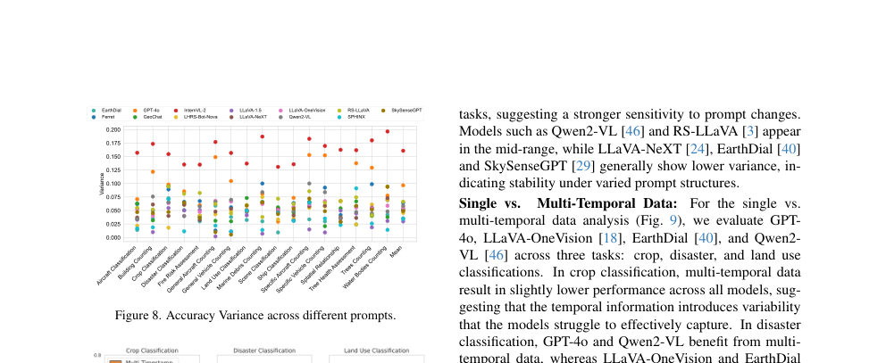

[查看完整原论文第 8 页](./source_pages/page-008.jpg)

### Figure 9 — 原论文第 8 页

**原文图题（保留英文）：** Figure 9. Single vs Multi-temporal.

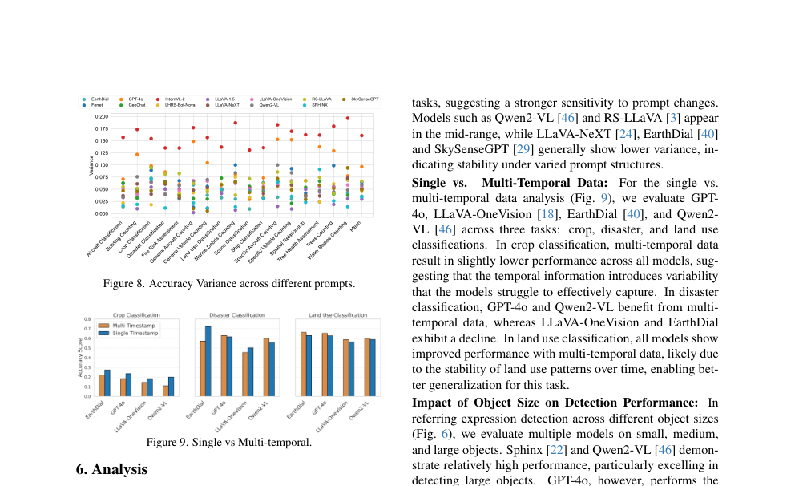

[查看完整原论文第 8 页](./source_pages/page-008.jpg)

## 逐页原文与翻译覆盖记录

| PDF 页码 | 英文原文 | 中文翻译状态 | 原版截图 |
|---|---|---|---|
| 1 | [英文原文](./英文原文_逐页全文.md) | 摘要已完整翻译；同页其他段落不保证全译 | [页面](./source_pages/page-001.jpg) |
| 2 | [英文原文](./英文原文_逐页全文.md) | 核心内容译述／本页未逐段全文翻译 | [页面](./source_pages/page-002.jpg) |
| 3 | [英文原文](./英文原文_逐页全文.md) | 核心内容译述／本页未逐段全文翻译 | [页面](./source_pages/page-003.jpg) |
| 4 | [英文原文](./英文原文_逐页全文.md) | 核心内容译述／本页未逐段全文翻译 | [页面](./source_pages/page-004.jpg) |
| 5 | [英文原文](./英文原文_逐页全文.md) | 核心内容译述／本页未逐段全文翻译 | [页面](./source_pages/page-005.jpg) |
| 6 | [英文原文](./英文原文_逐页全文.md) | 核心内容译述／本页未逐段全文翻译 | [页面](./source_pages/page-006.jpg) |
| 7 | [英文原文](./英文原文_逐页全文.md) | 核心内容译述／本页未逐段全文翻译 | [页面](./source_pages/page-007.jpg) |
| 8 | [英文原文](./英文原文_逐页全文.md) | 核心内容译述／本页未逐段全文翻译 | [页面](./source_pages/page-008.jpg) |
| 9 | [英文原文](./英文原文_逐页全文.md) | 核心内容译述／本页未逐段全文翻译 | [页面](./source_pages/page-009.jpg) |
| 10 | [英文原文](./英文原文_逐页全文.md) | 核心内容译述／本页未逐段全文翻译 | [页面](./source_pages/page-010.jpg) |
| 11 | [英文原文](./英文原文_逐页全文.md) | 核心内容译述／本页未逐段全文翻译 | [页面](./source_pages/page-011.jpg) |

> 如需获得完全逐句对应的中文版本，必须继续翻译原文主体与附录，并逐段人工校订。
