# GEOBench-VLM: Benchmarking Vision-Language Models for Geospatial Tasks：图表索引

**已识别明确标题的图表裁图：14 处。** PDF 中另有无单独标题的图片、图例和内嵌示意，均保留在 1:1 页码对应的完整截图中。

## Figure 1（第 1 页）

Figure 1. GEOBench-VLM comprehensively covers 31 fine-grained tasks categorized into 8 broad categories: scene and object classifica- tion, object detection, segmentation, captioning, event detection, non-optical and temporal understanding tasks.

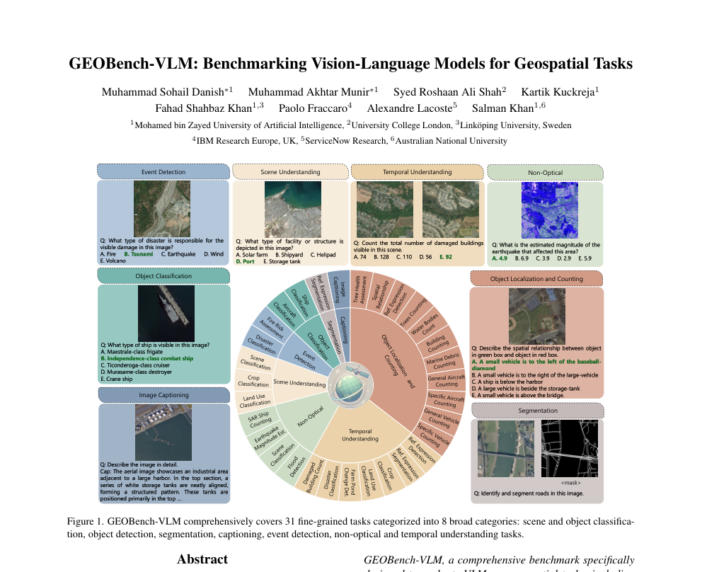

[查看第 1 页原始版面](./source_pages/page-001.jpg)

## Table 1（第 3 页）

Table 1. Overview of Generic and Geospatial-specific Datasets & Benchmarks, detailing modalities (O=Optical, PAN=Panchromatic, MS=Multi-spectral, IR=Infrared, SAR=Synthetic Aperture Radar, V=Video, MI=Multi-image, BT=Bi-Temporal, MT=Multi-temporal), data sources (DRSD=Diverse RS Datasets, OSM=OpenStreetMap, GE=Google Earth, answer types (MCQ=Multiple Choice, SC=Single Choice, FF=Free-Form, BBox=Bounding Box, Seg=Segmentation Mask), and annotation types (A=Automatic, M=Manual).

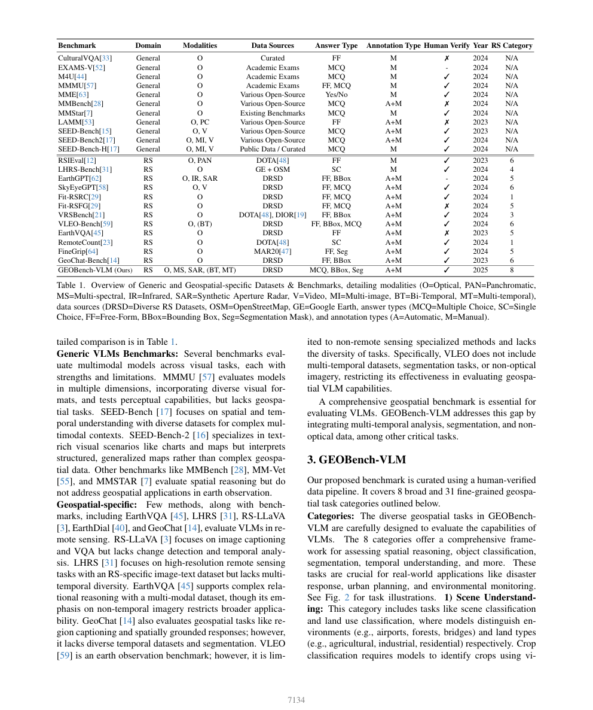

[查看第 3 页原始版面](./source_pages/page-003.jpg)

## Figure 2（第 4 页）

Figure 2. Comprehensive benchmark for VLMs in numerous geospatial tasks. This benchmark evaluates VLMs across eight core task categories, assessing their ability to interpret complex spatial data, classify scenes, identify and localize objects, detect events, generate captions, segment regions, analyze temporal changes, and process non-optical data. Tasks span from classifying landscapes and objects (e.g., land use, crop types, ships, aircraft) to counting, detecting hazards, and assessing disas

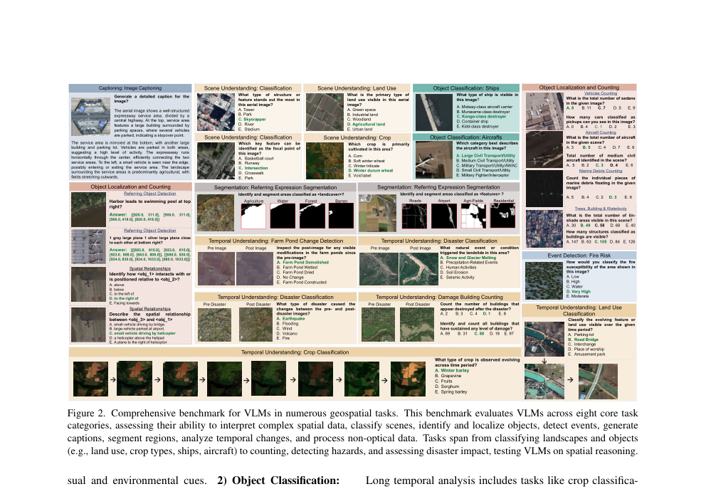

[查看第 4 页原始版面](./source_pages/page-004.jpg)

## Figure 3（第 5 页）

Figure 3. Data pipeline for the GEOBench-VLM: Our pipeline integrates diverse datasets, automated tools, and manual annotation. Tasks such as scene understanding, object classification, and non-optical analysis are based on classification datasets, while GPT-4o generates unique MCQs with five options: one correct answer, one semantically similar “closest” option, and three plausible alternatives. Spatial relationship tasks rely on manually annotated object pair relationships, ensuring consistenc

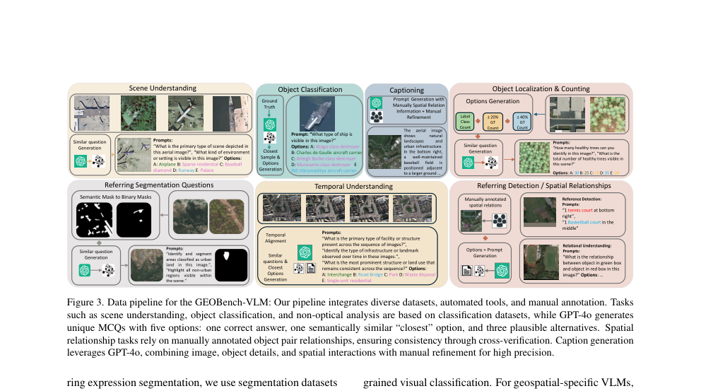

[查看第 5 页原始版面](./source_pages/page-005.jpg)

## Figure 4（第 6 页）

Figure 4. Performance summary of VLMs. LLaVA-OneVision achieves the average accuracy (41.7%), slightly outperforming GPT-4o, which is relatively better in building counting, and general aircraft counting. EarthDial demonstrates strong results in scene classification. The overall results highlight VLMs’ varying strengths across geospatial tasks, with even the best models achieving accuracy only slightly above double the random guess.

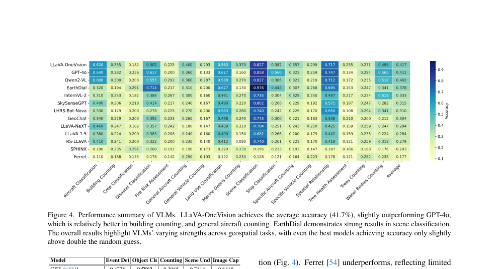

[查看第 6 页原始版面](./source_pages/page-006.jpg)

## Table 2（第 6 页）

Table 2. VLMs accuracies across geospatial tasks. Evaluation includes event detection, object classification, counting, scene un- derstanding, and image captioning. EarthDial performs better in event detection and scene understanding, demonstrating geospa- tial reasoning capabilities. GPT-4o performs best in object classi- fication, while LLaVA-OneVision leads in counting. As evaluated by BERT score [61], Sphinx excels in image captioning.

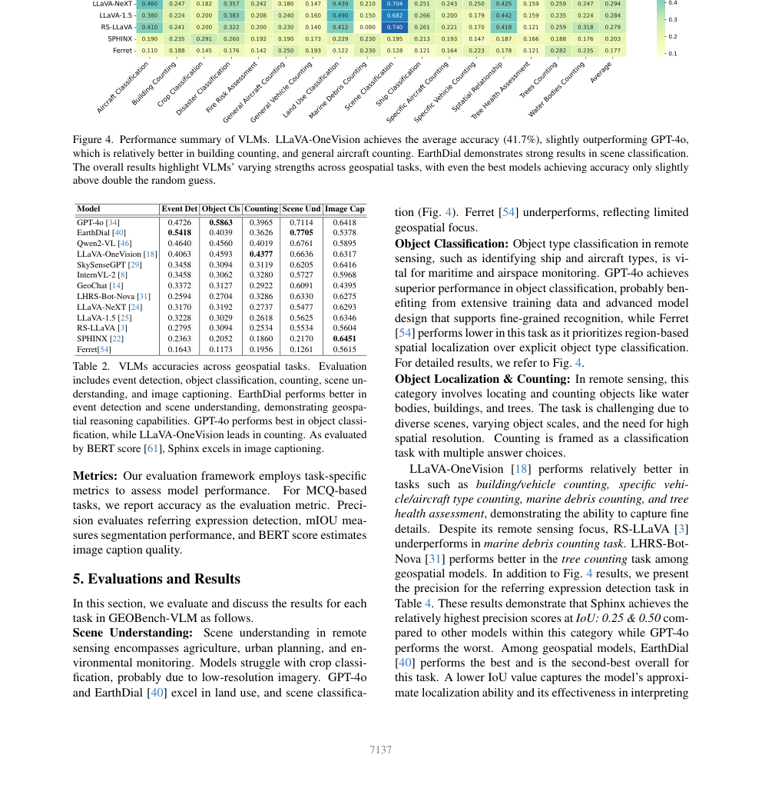

[查看第 6 页原始版面](./source_pages/page-006.jpg)

## Table 3（第 7 页）

Table 3. VLM performance on temporal geospatial tasks. Eval- uation spans crop type classification, disaster type classification, farm pond change detection (CD), land use classification, and damaged building counting. EarthDial performs best in land use classification, while GPT-4o achieves better performance in dis- aster classification and damaged building counting. Qwen2-VL stands second in disaster classification.

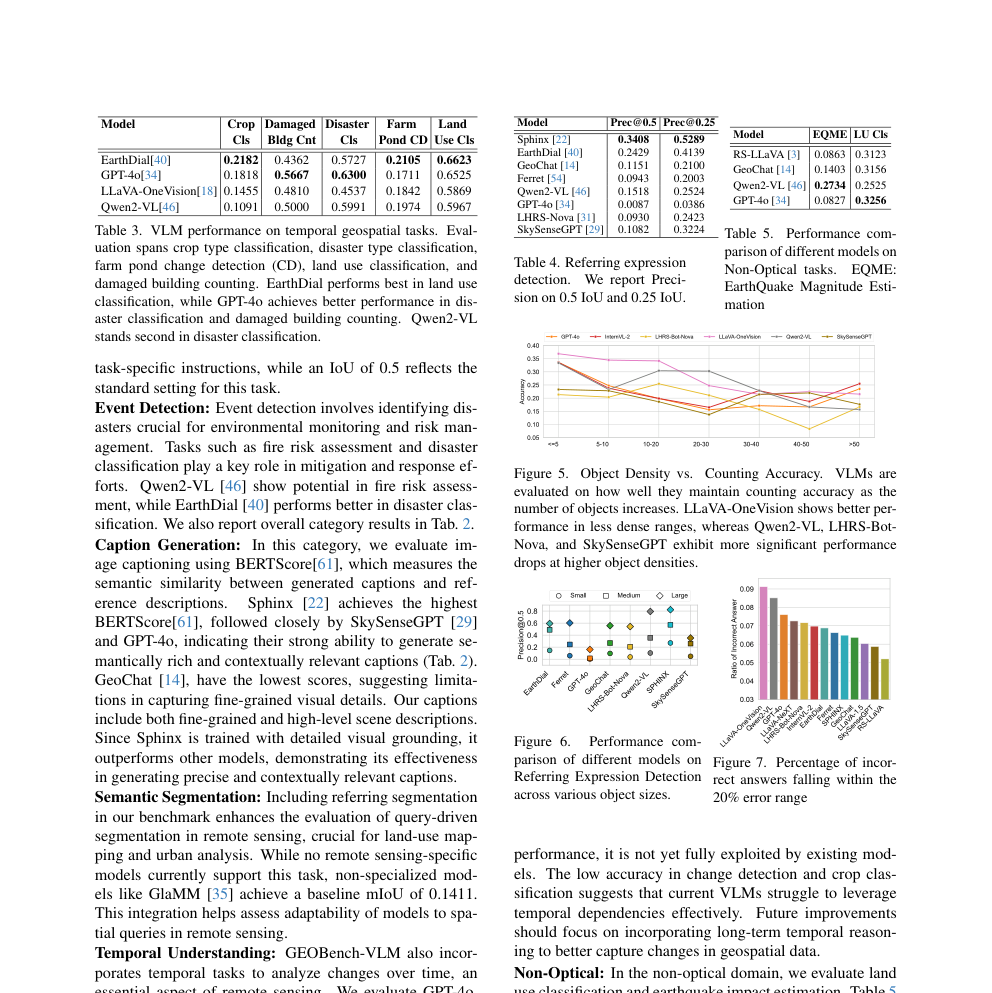

[查看第 7 页原始版面](./source_pages/page-007.jpg)

## Table 5（第 7 页）

Table 5. Performance com- parison of different models on Non-Optical tasks. EQME: EarthQuake Magnitude Esti- mation

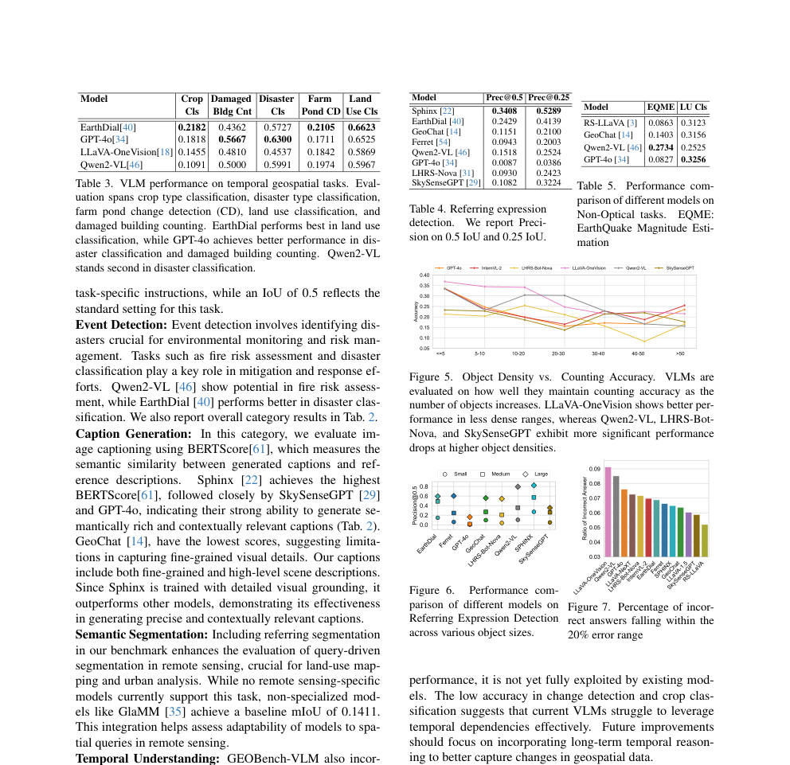

[查看第 7 页原始版面](./source_pages/page-007.jpg)

## Table 4（第 7 页）

Table 4. Referring expression detection. We report Preci- sion on 0.5 IoU and 0.25 IoU.

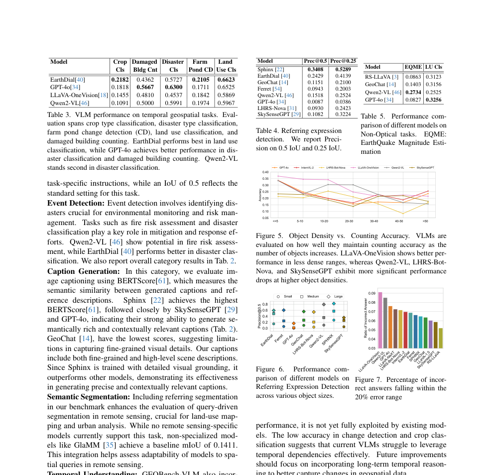

[查看第 7 页原始版面](./source_pages/page-007.jpg)

## Figure 5（第 7 页）

Figure 5. Object Density vs. Counting Accuracy. VLMs are evaluated on how well they maintain counting accuracy as the number of objects increases. LLaVA-OneVision shows better per- formance in less dense ranges, whereas Qwen2-VL, LHRS-Bot- Nova, and SkySenseGPT exhibit more significant performance drops at higher object densities.

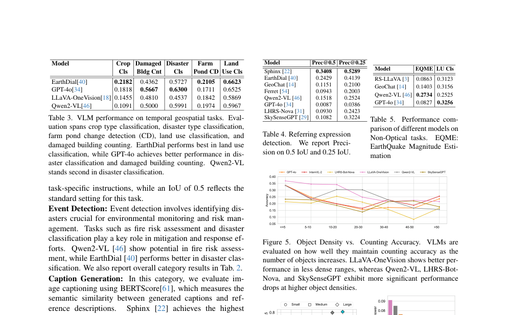

[查看第 7 页原始版面](./source_pages/page-007.jpg)

## Figure 6（第 7 页）

Figure 6. Performance com- parison of different models on Referring Expression Detection across various object sizes.

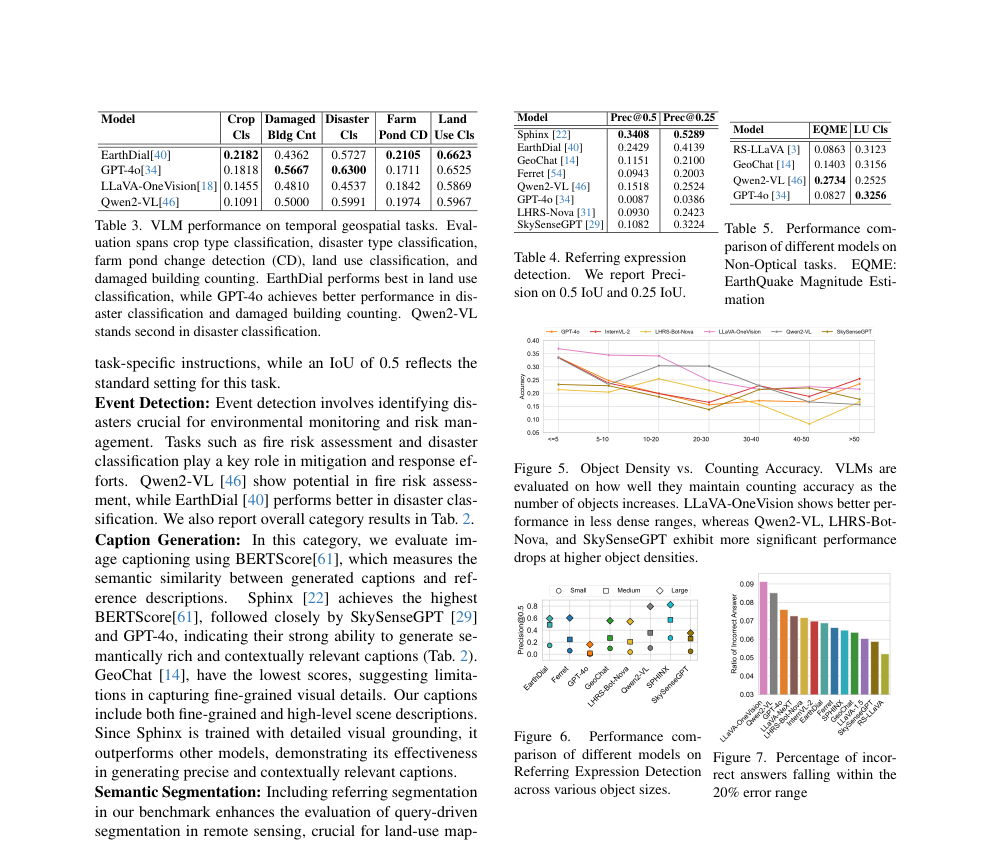

[查看第 7 页原始版面](./source_pages/page-007.jpg)

## Figure 7（第 7 页）

Figure 7. Percentage of incor- rect answers falling within the 20% error range

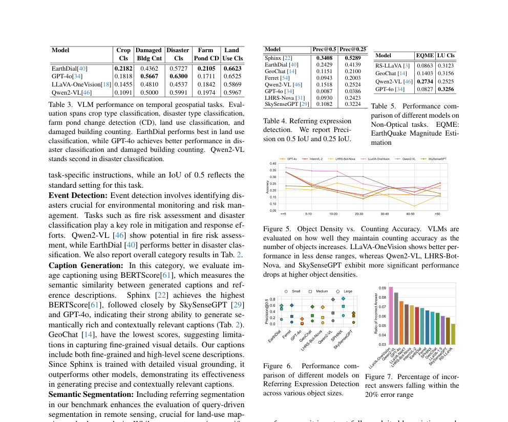

[查看第 7 页原始版面](./source_pages/page-007.jpg)

## Figure 8（第 8 页）

Figure 8. Accuracy Variance across different prompts.

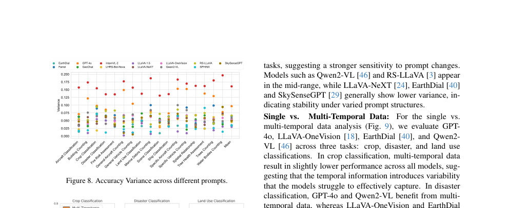

[查看第 8 页原始版面](./source_pages/page-008.jpg)

## Figure 9（第 8 页）

Figure 9. Single vs Multi-temporal.

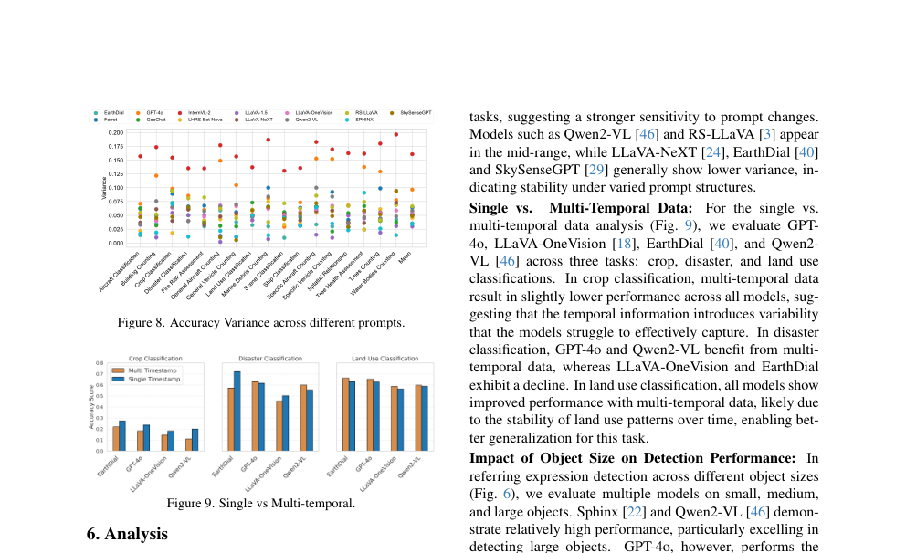

[查看第 8 页原始版面](./source_pages/page-008.jpg)
