# GIS Copilot：面向空间分析的自主 GIS 智能体

**原论文**：GIS_Copilot_towards_an_autonomous_GIS_agent_for_spatial_analysis
**作者**：Temitope Akinboyewa、Zhenlong Li、Huan Ning、M. Naser Lessani
**PDF 页数**：24

> 阅读说明：本文件提供按照原文结构整理的中文学术译述（涵盖研究背景、方法、评价、结果、附录说明），不是逐词、逐句覆盖全部英文的严格全文翻译。原 PDF 全部页面的英语文字、图表和参考文献保留于 `英文原文_逐页.md`、`original.pdf` 和 `source_pages/`。代码、模型名称、API 和学术引用保留原样，详情见 `QA_逐页核查.md`。

## 论文摘要（中文译文）

生成式人工智能（AI），特别是大语言模型（LLM）的近期进展，为空间分析带来了可观的应用前景，但其与成熟 GIS 平台的融合仍缺乏深入研究。本文提出一种将 LLM 嵌入现有 GIS 平台的框架，并以 QGIS 为案例。该框架利用 LLM 的推理与编程能力，结合包含关键 GIS 工具及其参数文档的知识体系，自主生成空间分析工作流，同时纳入 GeoPandas 等外部工具以增强地理处理能力。基于此，作者开发了 GIS Copilot，使用户能够使用自然语言与 QGIS 交互。研究测试了超过 100 项复杂度不同的任务，包括基础任务（单工具/图层）、中级任务（有操作指导的多步骤任务）和高级任务（无明确步骤指导的多步骤任务）。结果显示，该系统在基础与中级任务上取得较高成功率，但对高级任务的全自主执行仍面临挑战。GIS Copilot 通过减少非专业用户所需的地理空间知识，为构建自主 GIS 和简化空间分析工作流提供了可行路径；不过它尚未实现完全自主。

## 图片与原文索引

- 全文英文逐页提取：[英文原文_逐页.md](./英文原文_逐页.md)
- 逐页原稿截图：[逐页原稿_视觉索引.md](./逐页原稿_视觉索引.md)
- 图表索引：[图表索引.md](./图表索引.md)
- 核查与翻译覆盖说明：[QA_逐页核查.md](./QA_逐页核查.md)

---

## 中文正文（按 PDF 页码对应）

### PDF 第 1 页

## 论文封面及出版信息
论文发表于 *International Journal of Digital Earth*（2025），卷18第1期，文章编号2497489，DOI：10.1080/17538947.2025.2497489。首张 PDF 页为期刊出版封面、文章链接与版权信息，不是研究正文。

<small>对照：[原稿第 1 页](./source_pages/page-001.jpg) · [英文全文](./英文原文_逐页.md)</small>

---

### PDF 第 2 页

## 摘要与 1. 引言（上）
大语言模型在自然语言理解、推理和代码生成方面的进步，使空间数据处理、地理处理自动化和地理知识抽取成为自然语言驱动 GIS 的潜在应用。Li 和 Ning（2023）提出了自主 GIS 的愿景，并通过 LLM-Geo 展示了自动生成地理处理工作流的可能性；此后研究还涉及制图、灾害管理、GIS 问答和数据检索等。不过，在成熟 GIS 桌面平台中直接嵌入智能体并实现可靠执行，仍然是重要的开放问题。

作者以 QGIS 为宿主软件，将用户的空间分析请求转换为任务步骤，检索匹配的地理处理工具，并生成、执行 Python 代码，从而将自然语言交互与已有 GIS 功能连接起来。

<small>对照：[原稿第 2 页](./source_pages/page-002.jpg) · [英文全文](./英文原文_逐页.md)</small>

---

### PDF 第 3 页

## 1. 引言（续）
现有研究虽已探索生成式 AI 对 GIS 的辅助作用，却未充分解决 QGIS、ArcGIS Pro、GRASS GIS 等平台的复杂工具体系、数据标准、编程语言与用户定制流程之间的协调问题。可靠交互要求把自然语言准确映射为工具命令，正确填写专业参数，并让不同工具的输入输出连接起来。本文开发 QGIS 插件形式的 GIS Copilot，在图形界面接受请求、分解任务、选择工具、自动生成并执行 Python 代码。

研究贡献包括：（1）提供可扩展、可迁移到其他 GIS 平台的通用集成框架；（2）降低非专业用户使用复杂空间分析功能的技术门槛；（3）深度集成主流 GIS 软件，支持实时展示工具选择、推理与代码，并允许增加外部工具。作者明确指出，该系统虽展示了前景，但尚未达到完全自治。

## 2. 相关工作：2.1 自主 GIS 与生成式 AI
该领域研究涵盖数据检索、空间信息抽取、空间分析和制图。例如 LLM-Geo 通过 GPT-4 API 自动产生地理处理流程和分析代码；GeoGPT 使用 LangChain 与 GIS 工具库开展数据收集、处理、分析和制图；其他工作分别关注自然语言制图、地理空间基础模型与空间知识评估等。然而，复杂平台内的端到端工具执行仍有明显缺口。

<small>对照：[原稿第 3 页](./source_pages/page-003.jpg) · [英文全文](./英文原文_逐页.md)</small>

---

### PDF 第 4 页

## 2.2 在现有 GIS 平台中集成生成式 AI
论文比较了 QGIS 生态中的辅助插件、PyQGIS 脚本生成和图形模型生成等做法。部分插件只提供操作指导，有些虽能生成代码，却需要用户人工设定参数或执行。与这些工作相比，GIS Copilot 的目标是不只编写代码，还自动设置参数并执行空间分析；同时支持矢量、栅格和表格数据，向用户实时呈现步骤与代码，以提升可解释性。

作者还强调工具生态的可扩展性：除了 QGIS 原生算法，可接入 GDAL 和 Python 包。例如可调用 seaborn 等库进行可视化，并利用自动纠错机制提高对运行错误的适应能力。

<small>对照：[原稿第 4 页](./source_pages/page-004.jpg) · [英文全文](./英文原文_逐页.md)</small>

---

### PDF 第 5 页

## 3. 方法：3.1 GIS Copilot 框架
GIS Copilot 将 LLM 作为工具选择与编程的智能核心，通过图形界面、GIS 算法工具箱和工具说明文档与 QGIS 交互。其四个核心模块是：查询细化（Query Refining）、工具检索（Tool Retrieval）、数据理解（Data Understanding）和代码审查/调试（Code Review/Debugging）。前者把自然语言请求转为结构化 GIS 任务；第二个模块从向量化文档中检索相关算法；数据理解模块检查输入数据属性；代码审查/调试模块监控运行并修正错误。

**3.1.1 查询细化。** 该模块借助思维链提示，引导模型识别用户分析目标、确定适用空间操作，并用标准 GIS 专业术语改写任务说明。生成的结构化描述随后进入工具检索与代码生成。附录1提供提示词模板，附录2提供示例。

<small>对照：[原稿第 5 页](./source_pages/page-005.jpg) · [英文全文](./英文原文_逐页.md)</small>

---

### PDF 第 6 页

## 3.1.2 空间分析工具箱
QGIS 具有丰富的 GIS 数据管理、分析与可视化能力，算法来源包括 QGIS 原生处理工具、GDAL/OGR、GRASS GIS、SAGA GIS 和 Orfeo Toolbox。PyQGIS API 则可用于自动化操作、插件开发及调用 QGIS 功能。本文基于官方文档整理了 **390 个 QGIS 原生及 GDAL 工具**，其中包括 `native:buffer`、`qgis:selectbyattribute` 和 `gdal:slope` 等典型算法。

工具箱不仅支持内置工具，也允许用户以插件方式登记自定义函数。例如，可利用 GeoPandas、scipy、rasterio 组合开发核密度估计工具。新增工具需要按照约定结构编写精炼、规范的文档，使其能与检索及代码生成模块兼容。

## 3.1.3 工具检索（上）
模型虽然擅长 Python 代码生成，却不一定理解 PyQGIS 的具体算法签名和参数规则。为此每个工具的说明采用五个字段：`tool_ID`、`tool_name`、`brief_description`、`parameters` 和 `code_example`。附录3、4分别展示原生工具和自定义工具描述样例。全部文档转换为向量表示，并保存在基于 FAISS 的向量知识库中，用于构建检索增强生成（RAG）工作流。

**Figure 1：GIS Copilot 总体框架：自然语言请求、工具检索、数据理解、代码调试与 GIS 工具调用**

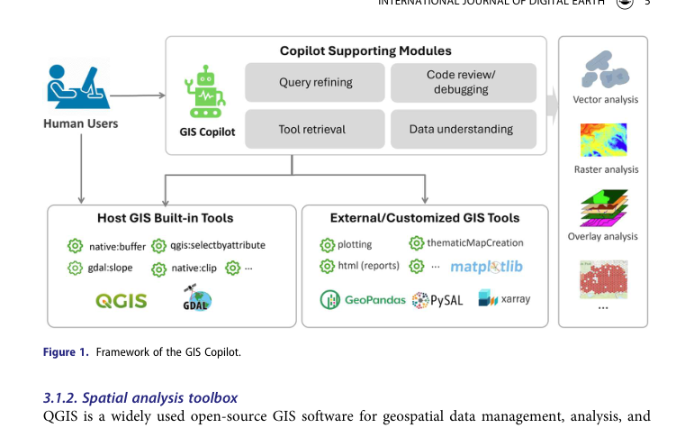

<small>对照：[原稿第 6 页](./source_pages/page-006.jpg) · [英文全文](./英文原文_逐页.md)</small>

---

### PDF 第 7 页

## 3.1.3 工具检索（续）
查询细化模块确定分析目标后，系统用语义相似度匹配知识库中最相关的 GIS 工具，再将候选工具及其参数、示例提供给 LLM。文档可按需检索片段，而不必将全部工具说明放入提示词；这降低了上下文开销，并缓解模型上下文窗口限制。

## 3.1.4 数据理解模块
数据理解模块调用 GPT-4 API 读取输入文件的基本信息，模拟 GIS 分析师开展工作前的“先理解数据”阶段。它识别文件格式、属性字段、坐标参考系统（CRS）、地理范围、栅格分辨率等信息，使 Copilot 能正确选择图层、字段与参数。用户因而不必在自然语言请求中列出每个字段名。

## 3.1.5 代码审查与调试
该模块使用结构化提示词对生成的代码进行检查，并在运行期间动态捕获异常。发现错误时，将任务描述、错误日志、数据上下文等组合为调试提示，让 GPT-4 生成修正版；随后重新审查、执行，以提高完成任务的可能性。附录5、6给出相关提示模板。

## 3.2 GIS Copilot 的工作流
QGIS 插件接收自然语言请求后，依次开展任务分解、工具检索与选择、根据文档生成 Python 代码、在 QGIS 环境执行与结果展示。执行输出可以载入地图图层，也可以生成图表、统计表或报告（图2）。

<small>对照：[原稿第 7 页](./source_pages/page-007.jpg) · [英文全文](./英文原文_逐页.md)</small>

---

### PDF 第 8 页

## 3.2.1 任务分析与工具选择
用户输入的问题首先经过查询细化，转换成具有明确分析目标及必要空间算子的领域任务。之后系统在 FAISS 向量数据库中检索候选工具，由 LLM 进行最终筛选；选中的工具文档及其参数定义和代码例子被送入代码生成环节。基于工具文档的生成方式旨在减少工具名、参数类型和调用格式错误。

## 3.2.2 代码生成与参数设置
系统针对已选算法编写可执行 Python 代码，并用具体数据与要求填写参数。例如用户要求选出人口超过 50,000 的县，代码需要将过滤条件设置为 `Population > 50000`，而不是只生成通用的属性选择模板。

## 3.2.3 执行和可视化
程序直接在 QGIS 中执行。缓冲区、叠置结果、重分类栅格等作为图层显示；统计结果可以显示为表、图、报告。若出现运行错误，自动调试模块可尝试修正并重新执行。

**Figure 2：GIS Copilot 工作流：任务分解、工具选择、代码执行与结果输出**

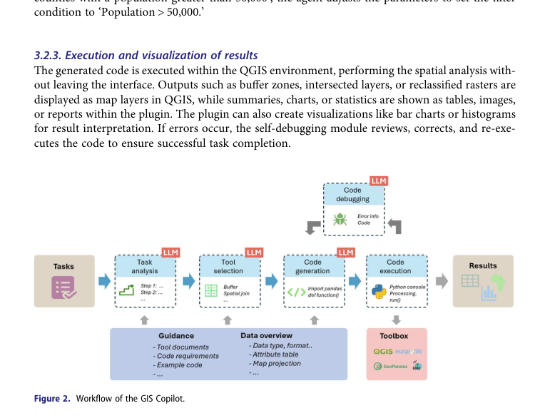

<small>对照：[原稿第 8 页](./source_pages/page-008.jpg) · [英文全文](./英文原文_逐页.md)</small>

---

### PDF 第 9 页

## 3.3 用户界面设计
GIS Copilot 的图形用户界面含六个选项卡：请求页（Request Page）、生成代码（Generated Code）、地理处理工作流（Geoprocessing Workflow）、报告（Reports）、设置（Settings）及帮助（Help）。请求页支持输入任务、实时查看代码和状态，并从 QGIS 图层面板选择参与分析的数据。代码页支持编辑、手动运行、保存和加载脚本；工作流页显示处理步骤；报告页显示图表和统计摘要；设置页可配置 API 密钥及工作目录。

## 4. 案例研究：4.1 基础任务
作者由具备 GIS、提示工程与智能体开发经验的研究者设计测试任务，并刻意避免依赖高级提示技巧，测试普通使用者能否用日常语言下达请求。任务划分为基础、中级、高级三种复杂度。基础任务通常需要一个工具和一到两个数据图层，例如计算面积、按属性筛选或一次缓冲分析。

**Figure 3：GIS Copilot 的 QGIS 插件用户界面**

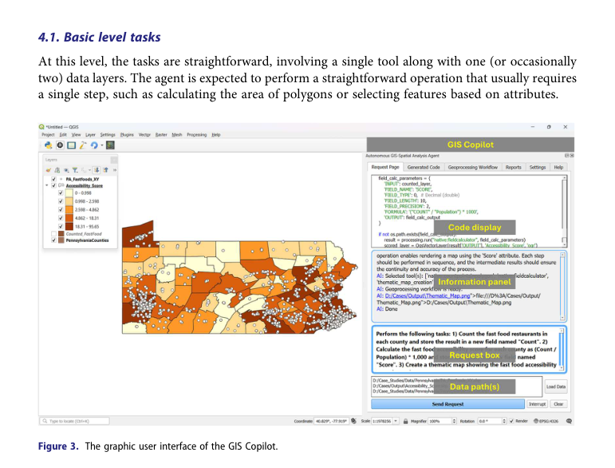

<small>对照：[原稿第 9 页](./source_pages/page-009.jpg) · [英文全文](./英文原文_逐页.md)</small>

---

### PDF 第 10 页

## 4.1.1 华盛顿特区医疗设施服务范围
利用来自 OpenStreetMap 的医院、诊所和药房点要素，用户要求在每个医疗设施周围建立 2,000 英尺服务覆盖区。智能体选择缓冲区工具，按请求设置距离参数并执行，成功生成服务范围（图4）。

## 4.1.2 从 DEM 生成等高线
该任务输入代表地形高程的 DEM 栅格，要求生成等高线矢量。智能体选择 `gdal:contour`，按用户指定的间隔配置参数，实现栅格高程到线要素的转换（图5；相关案例使用 50 米间距）。

## 4.1.3 选择人口较多的美国县
在包含人口字段的美国本土县级矢量数据中筛选人口超过 50,000 的县。智能体自动确定属性提取工具、筛选字段与阈值，生成可执行查询代码。

**Figure 4：华盛顿特区医疗设施 2000 英尺服务范围缓冲区**

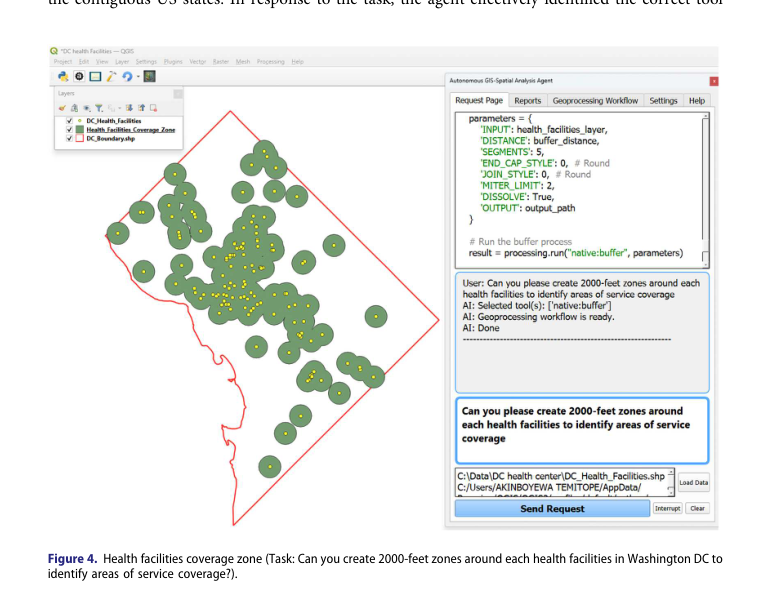

<small>对照：[原稿第 10 页](./source_pages/page-010.jpg) · [英文全文](./英文原文_逐页.md)</small>

---

### PDF 第 11 页

## 4.1.3 人口筛选（续）
图6展示大于 50,000 人口门槛的县级筛选结果。

## 4.1.4 宾夕法尼亚州土地覆盖裁剪
输入包括覆盖美国本土的 NLCD 土地覆盖栅格与宾夕法尼亚州边界矢量。智能体选择 GDAL 的按掩膜图层裁剪栅格工具，正确配置输入图层、输出路径与裁剪选项，生成仅覆盖州域的土地覆盖栅格（图7）。

## 4.2 中级任务
中级任务为多步骤、多工具流程，但用户会给出一般步骤或操作指导。智能体仍需为各步生成代码、设置数据输入输出并连接执行顺序。

**4.2.1 南卡罗来纳州各县平均高程分区统计。** 操作包括将 DEM 裁剪至州界、绘制裁剪后像元值直方图、以县为统计单元计算平均高程，最后制作县级分级设色图。输入为覆盖更广范围的 DEM、州界矢量以及县界矢量。

**Figure 5：由波多黎各 DEM 生成等高线**

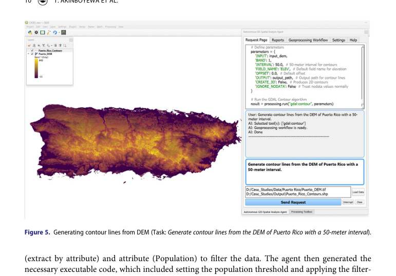

<small>对照：[原稿第 11 页](./source_pages/page-011.jpg) · [英文全文](./英文原文_逐页.md)</small>

---

### PDF 第 12 页

## 4.2.1 南卡罗来纳州平均高程统计（结果）
图8展示智能体生成的县级平均高程设色图及 DEM 像元值直方图，工作流图同时记录各步操作。

## 4.2.2 Richland 县地形分析
任务需要合并来自 USGS/SRTM 的四个 DEM 瓦片，形成覆盖研究区的高程栅格，然后依次计算坡度（slope）、坡向（aspect）、山体阴影（hillshade）、地形崎岖度指数（TRI）及地形位置指数（TPI）。各类地形参数分别输出地图，工作流示意图显示算法串联方式（图9）。

## 4.2.3 县域肥胖风险行为指数
任务结合美国本土县界 shapefile 和包含便利店、简餐餐厅、运动中心、健身场所及公园访问比例的 CSV 表，根据相应字段计算肥胖相关行为风险指数。

**Figure 6：美国本土人口超过 50000 的县级要素筛选**

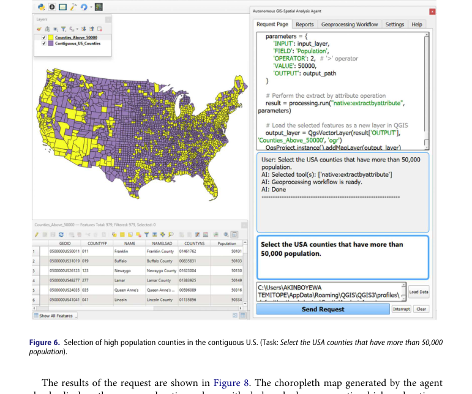

<small>对照：[原稿第 12 页](./source_pages/page-012.jpg) · [英文全文](./英文原文_逐页.md)</small>

---

### PDF 第 13 页

## 4.2.3 肥胖风险行为指数（结果）
智能体借助数据理解模块自行识别 CSV 和县级矢量中可连接的字段，完成属性关联、指标字段选择与专题制图；对应结果及工作流如图10所示。

## 4.3 高级任务
高级任务要求智能体在没有明确分步指导的情况下，自行决定“怎样做”：不仅需要选择工具和参数，还要设计完整多步分析并运行。用户一般只说明最终希望得到的结果。

**4.3.1 快餐可达性与肥胖率相关性。** 智能体首先基于县域人均快餐店数量计算快餐可达性指标，使用空间连接进行汇总，再将得分映射为分级设色图，最后比较其与县级肥胖率的关系，并绘制带回归线的散点图。

**Figure 7：提取宾夕法尼亚州土地覆盖数据**

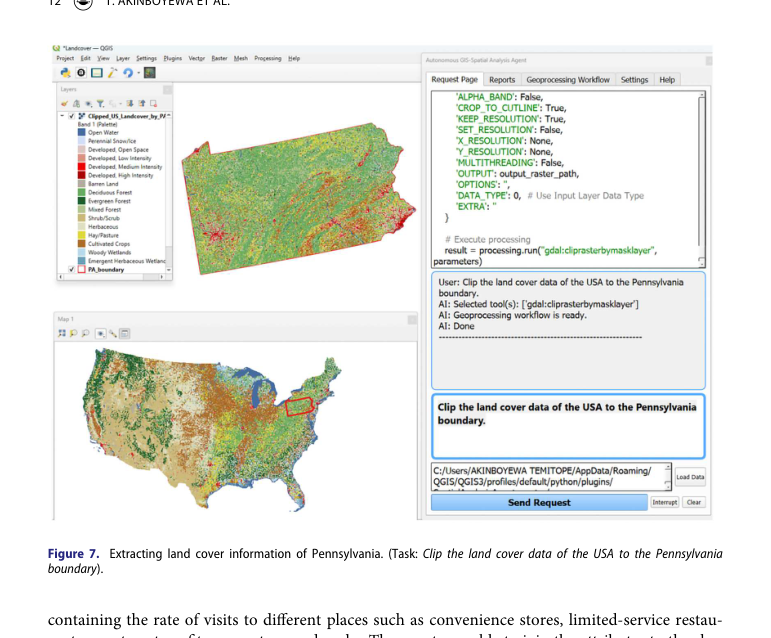

<small>对照：[原稿第 13 页](./source_pages/page-013.jpg) · [英文全文](./英文原文_逐页.md)</small>

---

### PDF 第 14 页

## 4.3.1 快餐可达性分析（结果）
图11显示宾夕法尼亚州县域快餐可达性分布和肥胖率关系的散点图。智能体能在用户未指定字段名的情况下，通过读取数据属性选择相关变量，生成专题图与回归关系图。

## 4.3.2 美国县级 COVID-19 病例空间分布
用户只要求“展示美国各县新冠病例的空间分布”。输入为美国人口普查局县界 shapefile 和《纽约时报》截至 2020 年 12 月的病例 CSV。正确完成该任务需要发现可连接的县级标识字段，将统计属性加入矢量图层，选择病例数字段并制图。

**Figure 8：南卡罗来纳州各县平均高程分区统计**

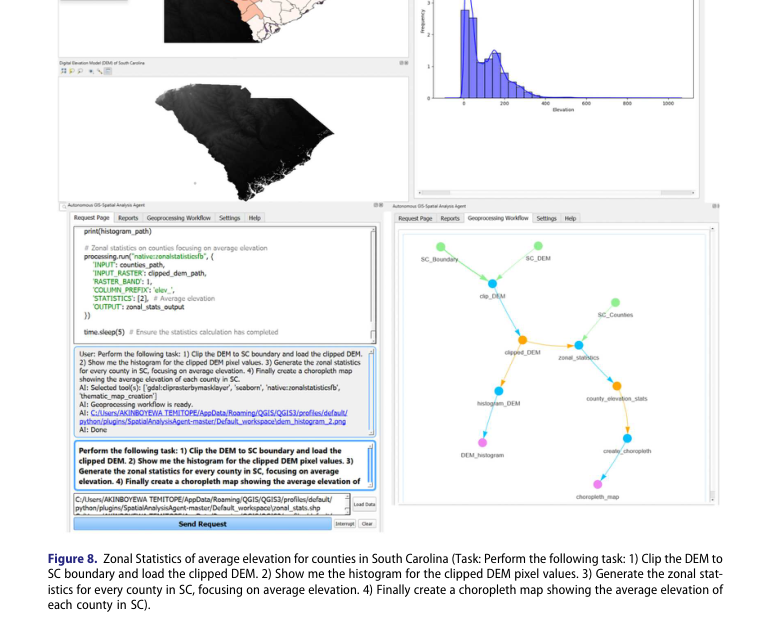

<small>对照：[原稿第 14 页](./source_pages/page-014.jpg) · [英文全文](./英文原文_逐页.md)</small>

---

### PDF 第 15 页

## 4.3.2 COVID-19 病例分布（结果）
智能体自动识别县界数据的 `GEOID` 与病例表的 `FIPS` 字段可用于关联，并选择 `cases` 表达病例数量，通过地图颜色展示病例空间分布（图12）。

## 4.3.3 基于遥感影像的 NDVI 计算
研究以尼日利亚 Akure 地区的矢量边界和 Landsat 8 影像为输入，要求从多光谱影像中正确选择近红外和红波段，再计算归一化植被指数（NDVI），输出栅格图。该案例考查模型识别波段、形成表达式和处理空间栅格的能力。

**Figure 9：Richland 县 DEM 合并及地形分析结果**

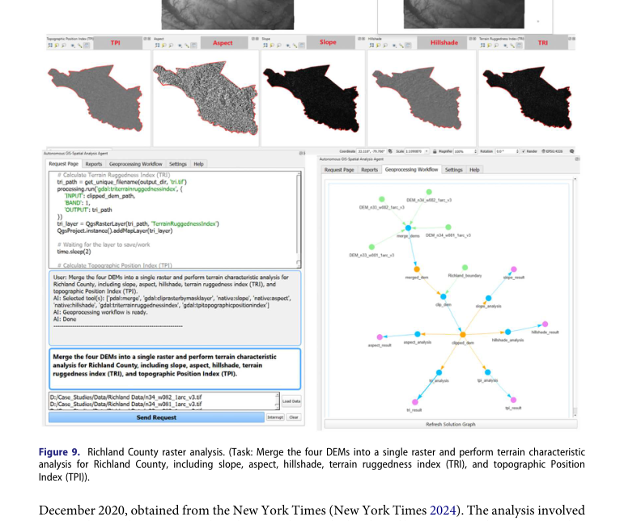

<small>对照：[原稿第 15 页](./source_pages/page-015.jpg) · [英文全文](./英文原文_逐页.md)</small>

---

### PDF 第 16 页

## 4.3.3 NDVI 计算（结果）
智能体选择近红外与红光波段，使用正确的 NDVI 计算方式生成指数栅格（图13）。作者说明，为便于阅读，最初自动生成的黑白色带后来经过人工调整，因此不能将图中最终配色完全归功于智能体。

## 4.4 性能评价
总计 **110 个任务**，基础、中级和高级分别为 60、30、20 项。成功定义为三次尝试内完成任务；三次均失败则计为失败。正文此处报告基础、中级、高级成功率分别为 **95%、80%、75%**；但原论文表1列出的成功率分别是 **92%、83%、75%**。两处数字并不一致，这里忠实保留并提示逐项核查，不擅自校正。作者表示工具选择整体较准确，主要失败原因在参数指定、数据字段兼容和坐标参考处理。

**Figure 10：美国县级肥胖风险行为指数专题图**

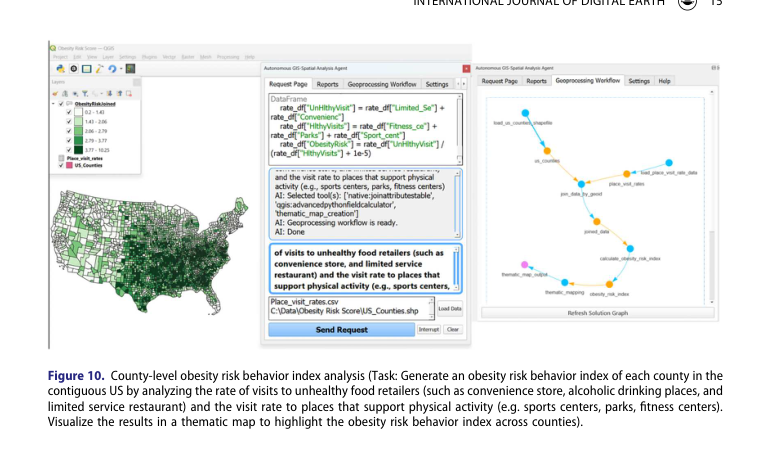

<small>对照：[原稿第 16 页](./source_pages/page-016.jpg) · [英文全文](./英文原文_逐页.md)</small>

---

### PDF 第 17 页

## 4.4 错误分析（上）
论文归纳三类主要失败机制。第一，**工具虽选对，但参数设置错误**，特别是将不符合工具输入条件的数据类型传入算法。第二，**连接字段名和数据兼容性问题**：shapefile 常将字段名限制为 10 个字符，可能与 CSV 中完整的字段名不一致。第三，**坐标投影问题**：未提前将不同坐标系统的图层重投影到一致坐标系，使裁剪、叠置等结果发生错位或失败。

**Figure 11：宾夕法尼亚州快餐可达性及与肥胖率的关系**

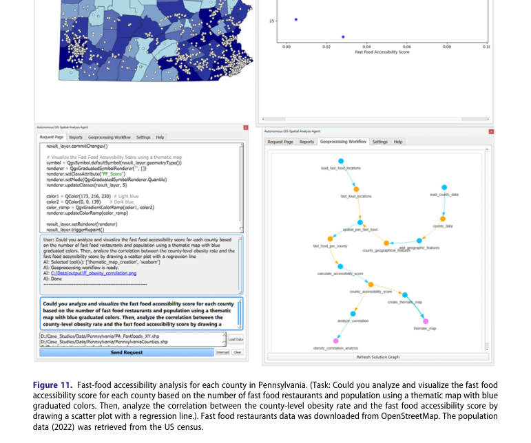

<small>对照：[原稿第 17 页](./source_pages/page-017.jpg) · [英文全文](./英文原文_逐页.md)</small>

---

### PDF 第 18 页

## 4.4 结果可视化
图12为美国新冠病例县级分布图，图13为 Akure 地区的 NDVI 结果。图中既展示最终输出，也展示代码和处理步骤，是检验智能体从自然语言请求到实际地图成果是否打通的重要证据。

**Figure 12：美国县级 COVID-19 病例空间分布**

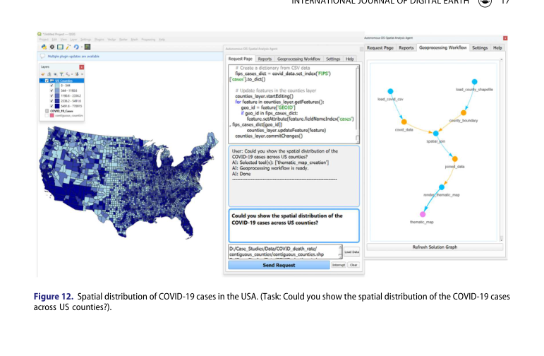

**Figure 13：Akure 地区基于 Landsat 8 生成的 NDVI**

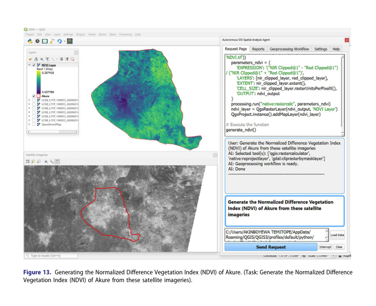

<small>对照：[原稿第 18 页](./source_pages/page-018.jpg) · [英文全文](./英文原文_逐页.md)</small>

---

### PDF 第 19 页

## 表1：性能评价及典型错误
按原表1，基础任务 60 项，首轮成功 52 项、第二轮成功 3 项、失败 5 项，表中写为 92% 成功率；中级任务 30 项，三次尝试成功数量分别为 13、4、8，失败 5 项，表中写为 83%；高级任务 20 项，依次成功 10、4、1 项，失败 5 项，为 75%。请注意正文第16页所写的 95% 和 80% 与表1不一致。

作者给出的具体错误包括：`gdal:proximity` 要求栅格输入，但智能体直接传入矢量道路图层；shapefile 字段被截断，导致与 CSV 的连接失败；影像和矢量边界坐标参考系统不同而未重投影，导致裁剪结果错位。

## 5. 讨论（上）
本文把 LLM 直接集成 QGIS，使用户可以在熟悉的 GIS 环境里选择图层、启动处理、观察代码与结果。系统既支持手动操作，也支持智能体自动执行。结构化工具文档、RAG 和可扩展接口降低了直接依赖全参数微调的成本，但作者强调用户仍应主动检查代码和结果，不应盲目信任“黑箱”自动分析。

**Table 1：三种复杂度任务的成功次数与总成功率（与正文文字部分不一致）**

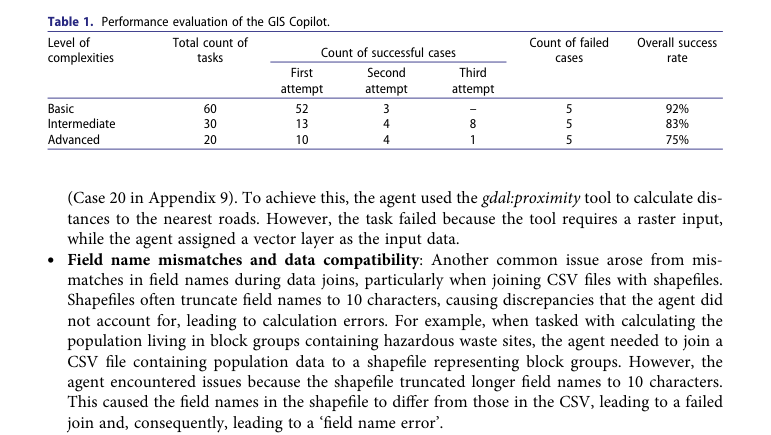

<small>对照：[原稿第 19 页](./source_pages/page-019.jpg) · [英文全文](./英文原文_逐页.md)</small>

---

### PDF 第 20 页

## 5. 讨论（续）
作者把 GIS Copilot 定位为“与 GIS 分析人员协同”的工具，而不是全面替代专家。实时呈现工具选择、代码和结果有助于解释与复核。该系统利用 RAG 和结构化文档解决模型缺乏专业 API 细节的问题；与每次工具更新都要重新训练的方式相比，更新文档知识库更灵活。但复杂任务仍可能受空间推理与数据处理逻辑错误影响。

## 6. 局限与未来研究
论文将完善数据验证、增强 GIS 基础知识、建立经验知识库、结合自动数据检索以及支持开源模型列为主要研究方向。

<small>对照：[原稿第 20 页](./source_pages/page-020.jpg) · [英文全文](./英文原文_逐页.md)</small>

---

### PDF 第 21 页

## 6.1 参数及数据验证模块
当前智能体可能把矢量输入送入只接受栅格的工具，或把某个字段用于类型不匹配的运算。未来应建立数据校验模块，交叉检查算法参数要求、输入数据类型及 CRS，并在必要时自动完成栅格化、类型转换和重投影。

## 6.2 加强 GIScience 基础知识
即使 GPT-4o 等模型具有较好的通用推理能力，也可能忽视重投影等地学前置条件，或误解 GDAL 等外部算法的专业语义。结构化文档和 RAG 能缓解参数知识不足，却不能完全替代对空间分析逻辑的理解。可考虑 LoRA 等参数高效微调方法进行专业增强。

## 6.3 建立基于经验的知识系统
空间分析包含大量难以从通用网络知识直接学到的实践经验，例如属性连接的字段数据类型要一致、缓冲区距离不能直接用角度当作米。作者建议构建存储“错误—诊断—修复”的经验数据库，随用户反馈不断更新，并将已验证修复复用于后续同类任务。这对应自主 GIS 的“自成长（self-growing）”目标。

## 6.4 与地理空间数据检索智能体集成
GIS Copilot 仍需用户提供输入数据；进一步接入能自动获取时空数据的智能体，可减少非专业用户的数据准备负担，提高端到端自主性。

<small>对照：[原稿第 21 页](./source_pages/page-021.jpg) · [英文全文](./英文原文_逐页.md)</small>

---

### PDF 第 22 页

## 6.4 地理空间数据检索（续）
已有研究实现了用于多源地理空间数据获取的 QGIS 插件，将此类能力与 GIS Copilot 集成有望实现从数据寻找、分析到出图的连续流程。

## 6.5 引入开源大语言模型
当前实现主要采用 GPT 系列模型。未来可结合 LLaMA 等开源模型，利用更可控的训练和定制方式提高 GIS 任务适配性、部署可访问性及数据处理灵活度。

## 7. 结论
本文给出将 LLM 深度整合到成熟 GIS 平台的方案，并在 QGIS 中实现自然语言驱动的 GIS Copilot。实践证明，它能够显著降低基础与中级任务的人工操作与编程门槛；但面对没有明确操作步骤的高复杂度任务，还未实现稳定的全自主执行。未来需要提升多步工作流规划、代码纠错和多平台适配能力。

本页还包括致谢、利益冲突和源代码及测试数据可用性声明，相关 URL 与机构名称在英文原文中保持原样。

<small>对照：[原稿第 22 页](./source_pages/page-022.jpg) · [英文全文](./英文原文_逐页.md)</small>

---

### PDF 第 23 页

## 参考文献（起）
本页主要为作者身份标识、出版信息与参考文献。为保持引用准确性，原文作者姓名、年份、期刊名和 DOI 保留在完整英文稿中，配有原 PDF 页图以供核查。

<small>对照：[原稿第 23 页](./source_pages/page-023.jpg) · [英文全文](./英文原文_逐页.md)</small>

---

### PDF 第 24 页

## 参考文献（续）
本页为英文书目条目。文献检索依赖原始英文题名和 DOI，因此按学术引用习惯保留其正式书目信息。

<small>对照：[原稿第 24 页](./source_pages/page-024.jpg) · [英文全文](./英文原文_逐页.md)</small>

---

## 专业术语对照

| 英文原词 | 中文处理 |
|---|---|
| autonomous GIS | 自主地理信息系统 |
| GIS Copilot | GIS 智能副驾驶 |
| query refining | 查询细化 |
| tool retrieval | 工具检索 |
| data understanding | 数据理解 |
| code review/debugging | 代码审查与调试 |
| RAG | 检索增强生成 |
| CRS | 坐标参考系统 |
| vector | 矢量 |
| raster | 栅格 |
| zonal statistics | 分区统计 |
| geoprocessing | 地理处理 |
| self-growing | 自成长 |

## 参考文献说明

论文参考文献书目保留作者、年份、刊物、英文题名和 DOI 的正式格式。请参见 [参考文献与英文附录_原文.md](./参考文献与英文附录_原文.md)，以及原始 PDF。
