# 图表索引与原始截图

下列图片均从上传的原始 PDF 页面渲染截取，编号依照原文；若表格跨栏或位置不规则，采用较大范围截图以保留数值。

## Figure 1 — PDF 第 6 页

**中文图题**：GIS Copilot 总体框架：自然语言请求、工具检索、数据理解、代码调试与 GIS 工具调用

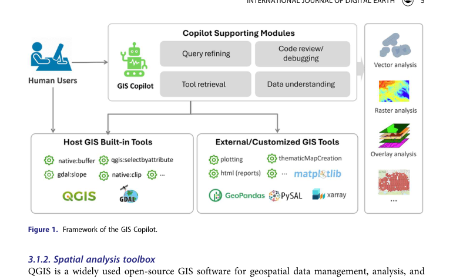

## Figure 2 — PDF 第 8 页

**中文图题**：GIS Copilot 工作流：任务分解、工具选择、代码执行与结果输出

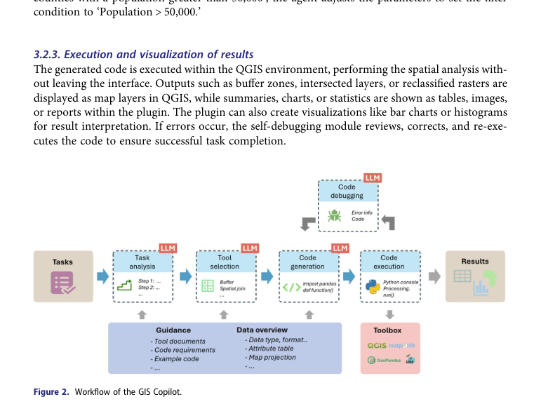

## Figure 3 — PDF 第 9 页

**中文图题**：GIS Copilot 的 QGIS 插件用户界面

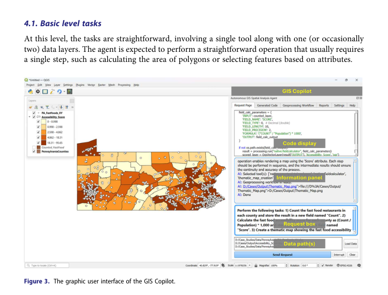

## Figure 4 — PDF 第 10 页

**中文图题**：华盛顿特区医疗设施 2000 英尺服务范围缓冲区

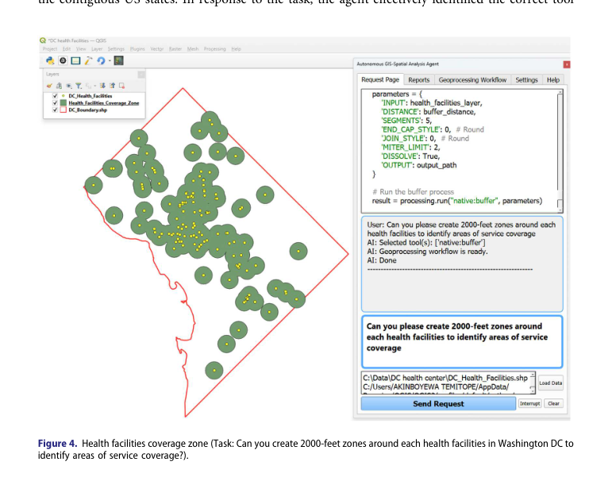

## Figure 5 — PDF 第 11 页

**中文图题**：由波多黎各 DEM 生成等高线

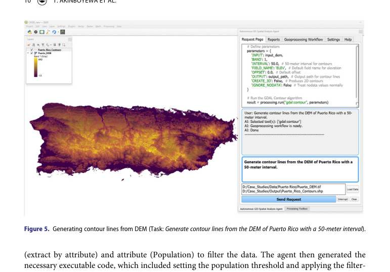

## Figure 6 — PDF 第 12 页

**中文图题**：美国本土人口超过 50000 的县级要素筛选

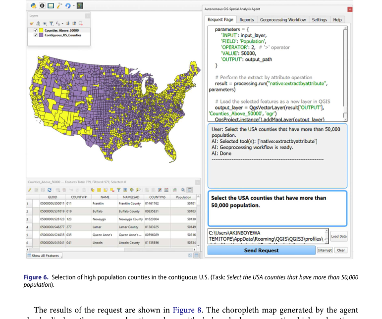

## Figure 7 — PDF 第 13 页

**中文图题**：提取宾夕法尼亚州土地覆盖数据

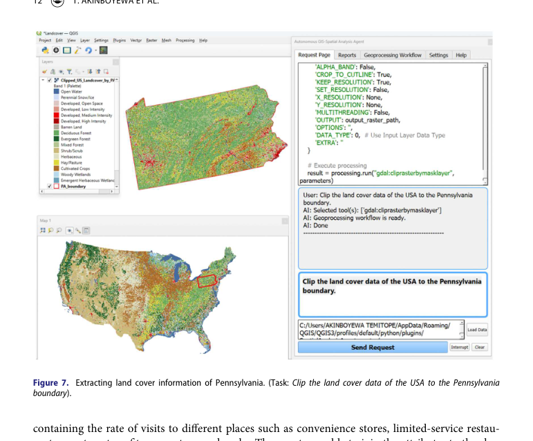

## Figure 8 — PDF 第 14 页

**中文图题**：南卡罗来纳州各县平均高程分区统计

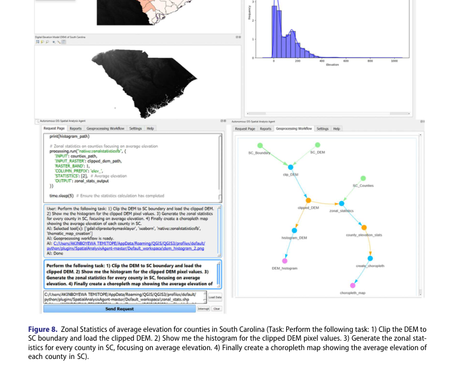

## Figure 9 — PDF 第 15 页

**中文图题**：Richland 县 DEM 合并及地形分析结果

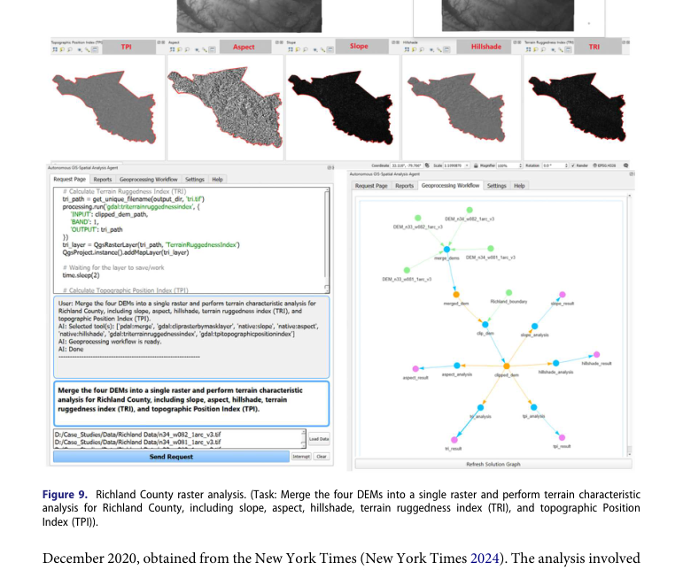

## Figure 10 — PDF 第 16 页

**中文图题**：美国县级肥胖风险行为指数专题图

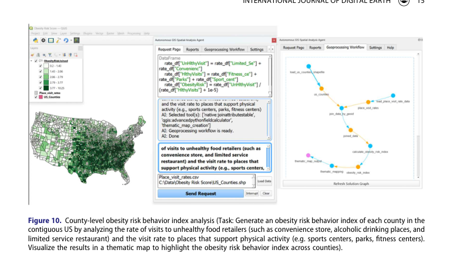

## Figure 11 — PDF 第 17 页

**中文图题**：宾夕法尼亚州快餐可达性及与肥胖率的关系

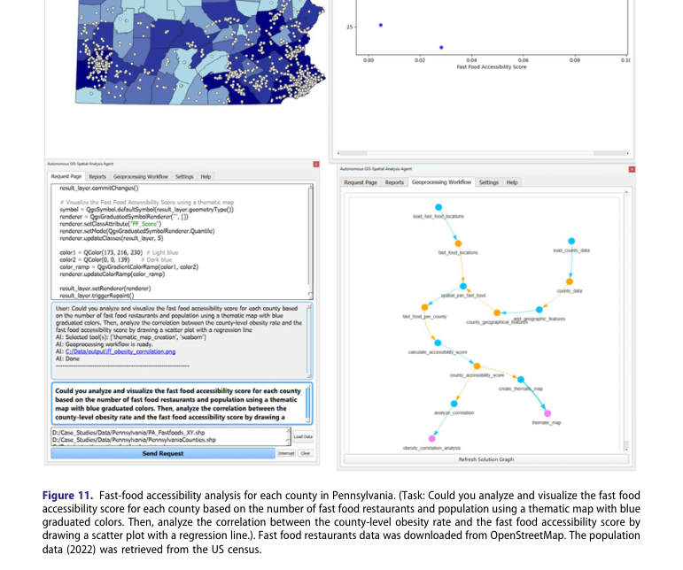

## Figure 12 — PDF 第 18 页

**中文图题**：美国县级 COVID-19 病例空间分布

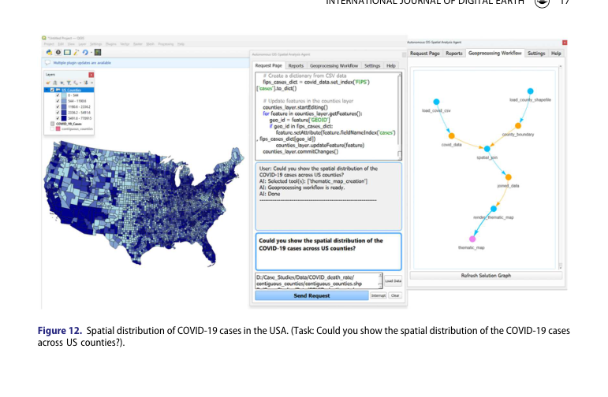

## Figure 13 — PDF 第 18 页

**中文图题**：Akure 地区基于 Landsat 8 生成的 NDVI

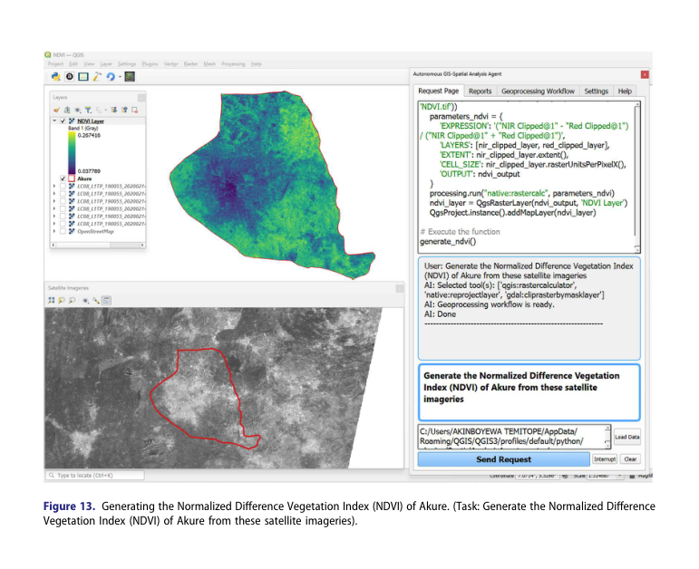

## Table 1 — PDF 第 19 页

**中文图题**：三种复杂度任务的成功次数与总成功率（与正文文字部分不一致）

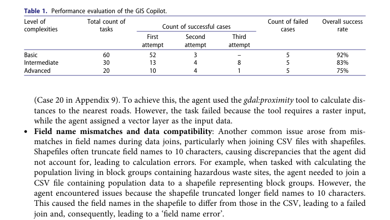

