# GIS-Copilot — 原始英文全文（按PDF页码提取）

> 提取顺序：优先按双栏从左到右、从上到下；图表/特殊公式排版请以所附原始 PDF 及 source_pages 为准。

原始 PDF 页数：**24**。

## PDF 第 1 页

International Journal of Digital Earth

ISSN: 1753-8947 (Print) 1753-8955 (Online) Journal homepage: www.tandfonline.com/journals/tjde20

GIS Copilot: towards an autonomous GIS agent
for spatial analysis

Temitope Akinboyewa, Zhenlong Li, Huan Ning & M. Naser Lessani

To cite this article: Temitope Akinboyewa, Zhenlong Li, Huan Ning & M. Naser Lessani (2025)
GIS Copilot: towards an autonomous GIS agent for spatial analysis, International Journal of
Digital Earth, 18:1, 2497489, DOI: 10.1080/17538947.2025.2497489

To link to this article:  https://doi.org/10.1080/17538947.2025.2497489

© 2025 The Author(s). Published by Informa
UK Limited, trading as Taylor & Francis
Group

View supplementary material

Published online: 28 Apr 2025.

Submit your article to this journal

Article views: 20304

View related articles

View Crossmark data

Citing articles: 70 View citing articles

Full Terms & Conditions of access and use can be found at
https://www.tandfonline.com/action/journalInformation?journalCode=tjde20

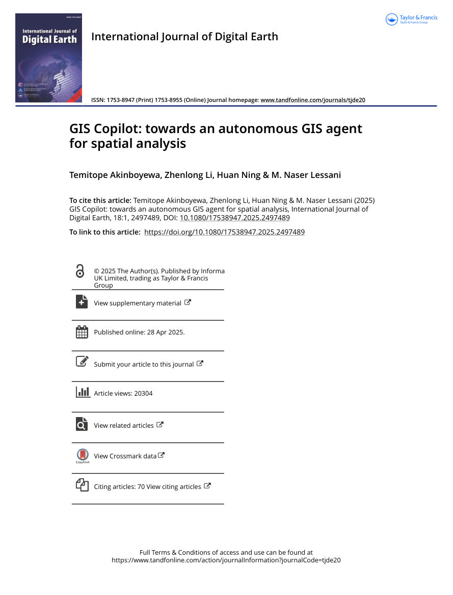

## PDF 第 2 页

INTERNATIONAL JOURNAL OF DIGITAL EARTH 
2025, VOL. 18, NO. 1, 2497489 
https://doi.org/10.1080/17538947.2025.2497489

GIS Copilot: towards an autonomous GIS agent for spatial analysis

Temitope Akinboyewa 
, Zhenlong Li 
, Huan Ning and M. Naser Lessani

Geoinformation and Big Data Research Lab, Department of Geography, The Pennsylvania State University, 
University Park, PA, USA

ABSTRACT  
Recent advancements in generative artificial intelligence (AI), particularly 
Large Language Models (LLMs), offer promising capabilities for spatial 
analysis. However, their integration with established GIS platforms 
remains underexplored. In this study, we propose a framework that 
embeds LLMs into existing GIS platforms, using QGIS as a case study. 
Our approach leverages LLMs’ reasoning and coding abilities to 
autonomously generate spatial analysis workflows through an informed 
agent equipped with comprehensive documentation of key GIS tools 
and parameters. External tools such as GeoPandas are also incorporated 
to enhance the system’s geoprocessing capabilities. Based on this 
framework, we developed a ‘GIS Copilot’ that enables users to interact 
with QGIS using natural language. We evaluated the copilot across over 
100 tasks of varying complexity including basic (single tool/layer), 
intermediate (multistep with guidance), and advanced (multistep 
without guidance). Results show high success rates for basic and 
intermediate tasks, with challenges remaining in fully autonomous 
execution of advanced tasks. The GIS Copilot advances the vision of 
autonomous GIS by enabling non-experts to perform geospatial analysis 
with minimal prior knowledge. While full autonomy is not yet achieved, 
the copilot demonstrates significant potential for simplifying GIS 
workflows and enhancing decision-making processes.

1. Introduction

ARTICLE HISTORY
Received 3 December 2024 
Accepted 17 April 2025

KEYWORDS  
Autonomous GIS; spatial 
analysis; QGIS; Copilot; 
generative AI; LLM

Recent advancements in generative artificial intelligence (AI), particularly the Large Language Models 
(LLMs), have gained significant attention in geographic information science (GIScience) through their 
abilities in natural language understanding, reasoning, and code generation. LLMs offer a wide range of 
potential applications within geographic information systems (GIS), including spatial data analysis, 
geoprocessing automation, and geospatial knowledge extraction. A pioneering study by (Li and 
Ning 2023) introduced autonomous GIS as a next-generation AI-powered GIS, demonstrating the 
potential of generative AI in generating geoprocessing workflows and conducting spatial analysis 
autonomously. More studies have further examined the integration of generative AI (LLMs) within 
GIS. For instance, researchers have explored its applications in cartography (Tao and Xu 2023; 
Zhang et al. 2024), disaster management (Akinboyewa et al. 2024; Hao et al. 2024), GIS-based question 
answering (Mooney et al. 2023; Zhang et al. 2024), location descriptions extraction (Hu et al. 2023), and

CONTACT  Zhenlong Li 
zhenlong@psu.edu
Geoinformation and Big Data Research Lab, Department of Geography, The 
Pennsylvania State University, 225 Walker Building, University Park, PA 16802, USA

Supplemental data for this article can be accessed online at https://doi.org/10.1080/17538947.2025.2497489.

© 2025 The Author(s). Published by Informa UK Limited, trading as Taylor & Francis Group 
This is an Open Access article distributed under the terms of the Creative Commons Attribution License (http://creativecommons.org/licenses/by/4.0/), 
which permits unrestricted use, distribution, and reproduction in any medium, provided the original work is properly cited. The terms on which this 
article has been published allow the posting of the Accepted Manuscript in a repository by the author(s) or with their consent.

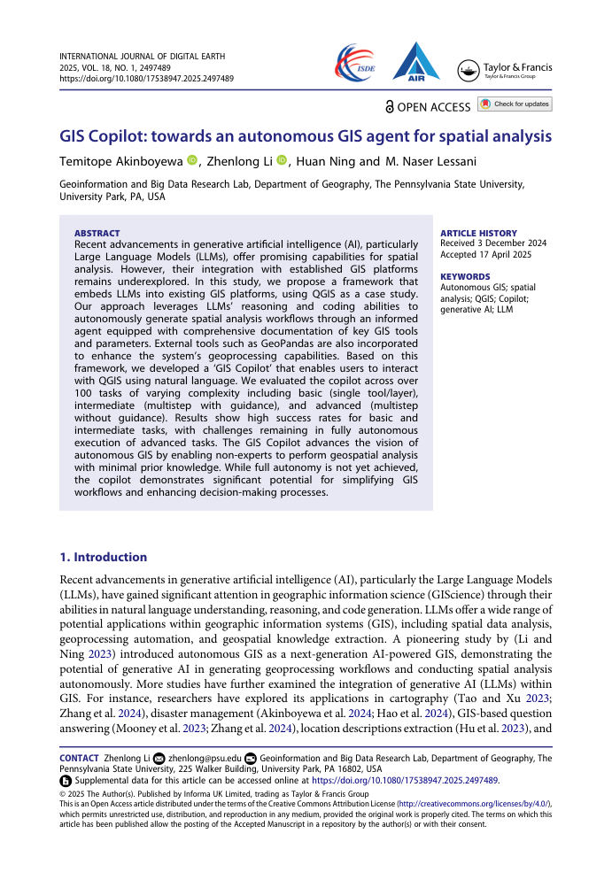

## PDF 第 3 页

2 
T. AKINBOYEWA ET AL.

geospatial data retrieval (Ning et al. 2025). These efforts collectively demonstrate that generative AI 
holds promise in enhancing and potentially transforming traditional GIS workflows.

While the integration of generative AI in GIS has shown significant promise, one key limitation is 
that these existing approaches have not fully embedded LLM capabilities within established GIS plat­
forms like QGIS (QGIS 2024), ArcGIS Pro (ESRI 2024), and GRASS GIS (GRASS GIS 2024). Li and 
Ning (2023) suggest that implementing autonomous GIS based on existing GIS platforms as a ‘co- 
pilot’ is likely the most practical and efficient approach, as established GIS platforms already provide 
extensive tools for spatial analysis, data management, and visualization. However, the integration of 
LLMs into GIS platforms like QGIS presents several challenges. First, GIS platforms are inherently 
complex, supporting diverse tools, libraries, and workflows for data visualization, spatial analysis, 
geoprocessing, and cartographic rendering. These tools often rely on diverse frameworks, data stan­
dards, and programming languages, complicating the creation of a single, cohesive workflow that 
integrates AI smoothly. Second, effective communication between the AI and existing GIS functions 
requires robust and error-free interaction. This involves translating natural language queries into GIS 
commands and ensuring that those commands align with GIS native tools and associated tool par­
ameters. Such a process demands extensive fine-tuning and specialized approaches to understand 
the full breadth of GIS tools and operations. Additionally, GIS workflows are often highly customized 
and problem specific. Developing an AI integration that can seamlessly adapt to these custom workfl­
ows, while being flexible enough to handle various user-defined parameters, is challenging.

To address these challenges, we propose a framework to integrate generative AI into a well-estab­
lished GIS platform that leverages the advanced capabilities of LLMs to interact with existing geoproces­
sing tools. To implement this framework, we developed a user-friendly plugin that serves as a ‘Copilot’ in 
the QGIS software, allowing users to perform spatial analysis through natural language queries. This GIS 
Copilot provides a graphic user interface where users can input a task (spatial problem), which the agent 
analyzes by breaking it into steps and selecting suitable GIS tools. It then generates and executes Python 
code for the task to produce the final result. By leveraging the existing capabilities of GIS platforms and 
enhancing them with AI-driven reasoning, this framework aims to overcome the limitations of previous 
efforts and contribute to the advancement of autonomous GIS research.

The key contributions of this study can be summarized as follows: 1) This study introduces an 
extensible and generalizable framework for integrating LLMs into established GIS platforms, setting 
a precedent for future developments in GIS Copilot and autonomous GIS across multiple platforms 
(e.g. ArcGIS, GRASS GIS). 2) This study creates pathways for GIS accessibility and adoption. By 
enabling natural language interaction and expanding GIS capabilities to non-expert users, this 
research demonstrates how AI-driven systems can potentially transform geospatial analysis in 
non-traditional GIS domains like public health, disaster response, and urban planning. 3) To the 
best of our knowledge, this is the first GIS Copilot deeply integrated into a well-established GIS plat­
form, supporting diverse geospatial tasks while enhancing transparency, real-time reasoning, and 
expandability for external tools. While full autonomy is not yet achieved, it brings us closer to rea­
lizing autonomous GIS systems for complex geospatial tasks with minimal human intervention.

The remainder of this paper is organized in this manner. Section 2 reviews related work on 
autonomous GIS and the integration of generative AI into geospatial tasks. Section 3 details the pro­
posed framework and prototype workflow. Section 4 presents the results from case studies and 
evaluation of the performance of the Copilot at different complexity levels of cases. Section 5 dis­
cusses the key findings and Section 6 discusses the limitations and potential future research direc­
tions. Finally, Section 7 concludes the paper.

2. Related work

2.1. Autonomous GIS and the integration of generative AI into geospatial tasks

The recent advancement of generative AI, particularly LLMs such as GPT-4 (OpenAI 2023), Llama 
(Meta), and Gemini (Gemini Team and Google 2023), has opened the avenue for researchers to

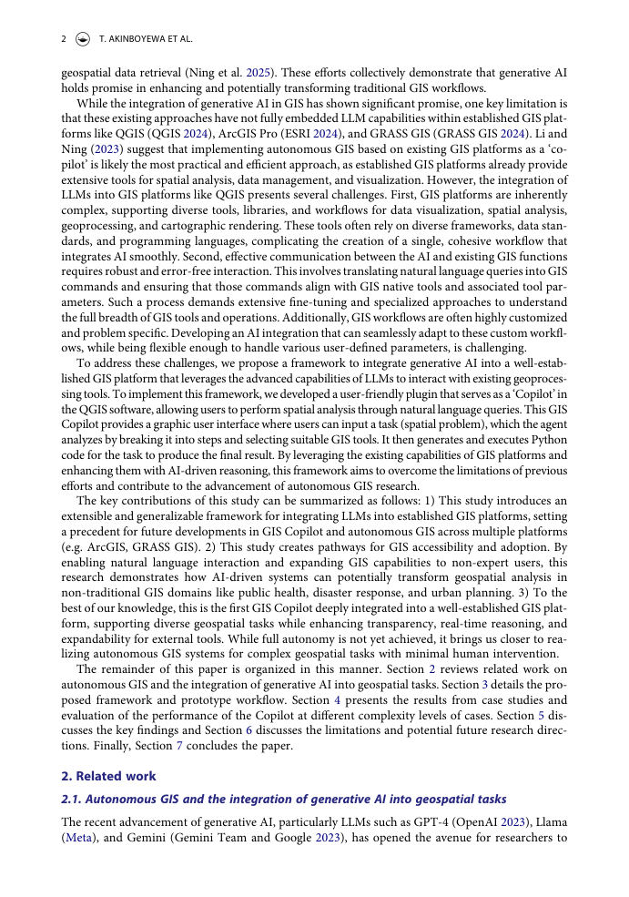

## PDF 第 4 页

INTERNATIONAL JOURNAL OF DIGITAL EARTH 
3

explore autonomous GIS (Li and Ning 2023; Wang et al. 2024). Researchers have leveraged LLMs to 
conceptualize and develop various autonomous GIS agents for geospatial data retrieval (Ning et al. 
2025), geospatial information extraction (Crooks and Chen 2024), and spatial analysis and mapping 
(Mansourian and Oucheikh 2024; Zhang et al. 2024). Among the pioneering studies, (Li and Ning 
2023) introduced LLM-Geo, a prototype demonstrating the potential of AI-powered GIS to auton­
omously perform geospatial operations such as numerical aggregation, chart generation, and map 
presentations using GPT-4 API. In another study, (Zhang et al. 2024) developed GeoGPT, which 
integrates the capabilities of LLMs with GIS tools to enhance the efficiency of geospatial operations, 
including data collection, processing, and analysis. By utilizing the LangChain framework, the LLM 
interprets user requests, plans the necessary steps, and sequentially executes relevant GIS tools from 
a predefined tool pool, encompassing tools for data collection, spatial analysis, and cartographic 
visualization. Additionally, (Lin et al. 2024) proposed a framework designed to automate shapefile 
processing tasks using a multi-agent approach.

Furthermore, several other studies have integrated LLMs into specific spatial tasks. For instance, (Tao 
and Xu 2023) explored the integration of ChatGPT into cartography to automate and enhance map- 
making tasks. Their study conducted experiments on generating thematic and mental maps by using 
natural language prompts in ChatGPT, which produced Python codes for geospatial visualization. In 
a relevant study, (Zhang et al. 2024) introduced MapGPT, an LLM-based mapping framework that inte­
grates GPT-4 with multiple mapping tools that allow users to interact through natural language descrip­
tions, simplifying the mapping process. (Mai et al. 2024) examine the potential of foundation models, 
including LLMs, for geospatial artificial intelligence (GeoAI). They evaluated the performance of exist­
ing pre-trained LLMs on a range of geospatial tasks, such as toponym recognition and location descrip­
tion, as well as multimodal tasks like urban use classification and remote sensing image analysis. (Xu et al. 
2024) developed a comprehensive benchmark to evaluate large language models (LLMs) on spatial tasks.

While these studies revealed the potential of generative AI in geospatial operations, one of the 
key limitations is that these approaches have not fully integrated generative AI capabilities within 
established GIS platforms.

2.2. Integrating generative AI into existing GIS platforms

Recent efforts have been made to integrate generative AI with established GIS platforms. (Ning et al. 
2025) introduced an autonomous GIS agent framework and a QGIS plugin to facilitate the auto­
mated downloading of geospatial data. While this study represents significant progress, it focuses 
primarily on data retrieval rather than the broader spectrum of spatial analysis tasks. (QChatGPT 
2024) is another LLM-based QGIS plugin, but its functionality is currently limited to offering gui­
dance on performing tasks rather than automating the tasks themselves. (IntelliGeo 2024) is a QGIS 
plugin that leverages LLMs to automate geospatial workflows. It is designed to assist GIS pro­
fessionals by automatically performing GIS operations through two primary methods: generating 
PyQGIS scripts or creating graphical models. Although promising, it is limited to generating gen­
eral code, requiring users to manually configure parameters in the code, reducing the automation 
level. Recently, (Mansourian and Oucheikh 2024) introduced ChatGeoAI which utilizes a fine- 
tuned Llama2 model to generate code that can be used to perform spatial tasks.

ESRI, a leading global provider of GIS software, has also taken advances toward integrating gen­
erative AI into ArcGIS, introducing AI-enhanced tools aimed at improving geoprocessing workfl­
ows (Crawford, Flater, and Neal 2024). This includes functionality that recommends suitable tools 
for specific operations, providing guidance but not automating tasks. Additionally, ESRI’s AI 
Assistant allows users to initiate GIS tasks through natural language inputs (ESRI 2024). However, 
this development is still in an early stage at the time of writing. ESRI also introduced Copilot for 
Microsoft 365 which allows users to search, and access maps, apps, and geospatial data within Arc­
GIS for Teams (ESRI 2024). More recently, NASA and Microsoft have collaborated to develop Earth 
Copilot, an AI-driven tool designed to simplify and democratize access to NASA’s extensive Earth

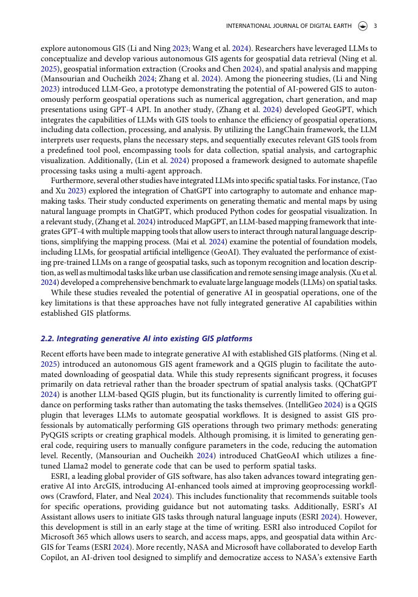

## PDF 第 5 页

4 
T. AKINBOYEWA ET AL.

science data through natural language queries, such as assessing the impact of specific events or 
environmental changes (Roth 2024).

While the integration of LLMs into GIS platforms, as demonstrated by the systems described 
above, represents an important step forward, our work distinguishes itself through several key inno­
vations. First, unlike systems like IntelliGeo (IntelliGeo 2024), which focus on general code gener­
ation and require manual configuration of parameters, the GIS Copilot does not only generate the 
code but also executes it autonomously to perform geospatial operations, eliminating the need for 
user intervention in task execution. Second, our framework is implemented through the develop­
ment of a GIS Copilot that is fully integrated into the GIS software itself to support a wide range of 
operations across various data types, including vector, raster, and attribute data in tabular files, 
which offers greater flexibility than systems limited to one or two data types of geospatial 
data. Third, the design of the GIS Copilot enhances transparency by providing explanations of 
the tool selection process and a real-time display of the reasoning process and generated code, offer­
ing users insights into the execution steps, features often absent in existing systems. Additionally, 
our framework is not limited to QGIS tools alone; it is designed to be expandable, allowing the inte­
gration of external libraries and tools. For example, the widely used Python package, seaborn, can 
be used for advanced charting, making certain tasks more efficient. Lastly, we incorporate a self-cor­
recting mechanism aimed at minimizing errors to enhance the system’s autonomy and adaptability 
during task execution.

3. Methodology

3.1. Framework of the GIS copilot

The GIS Copilot leverages the capabilities of LLMs to interact with existing GIS platforms (e.g. 
QGIS) via graphic user interface, GIS toolbox, and documents for the toolbox, to assist GIS 
users in conducting geospatial data processing and analysis tasks using the host GIS, as illustrated 
in Figure 1. The framework consists of four core modules, including query refining, tool retrieval, 
data understanding, and code review/debugging. The query refining module transforms the user’s 
raw query into structured GIS task descriptions. The tool retrieval module performs embedding- 
based retrieval of the most relevant geoprocessing tools from a vectorized documentation knowl­
edge base. The data understanding module analyzes the attributes of input datasets. The code 
review/debugging module automatically evaluates and corrects generated code by monitoring 
execution and prompting the agent for fixes. The GIS Copilot automatically determines the 
most suitable geospatial processing tools for various tasks, manages data processing workflows, 
and executes spatial analysis operations. It generates the code for the selected tools and uses 
the code review and debugging module to automatically correct errors that may arise before 
and during execution.

3.1.1. Query refining
The query refining module serves as the natural language understanding core of the GIS Copilot 
system. This module is designed to transform queries into concise, well-structured, and domain- 
specific GIS task descriptions that can guide downstream geoprocessing workflows. The module 
leverages a Chain-of-Thought (CoT) (Wei et al. 2022) prompting strategy applied to a LLM, to 
simulate expert-level reasoning about user intent. The implementation of this module uses a custom 
prompt template (Appendix 1) that guides the model through a multi-step process: identifying the 
user’s analytical goal, mapping it to relevant spatial operations, and summarizing the intended task 
using standardized GIS terminology. The refined task output generated by this module is sub­
sequently used by other components of the GIS Copilot. A sample of a refined user query is pro­
vided in Appendix 2.

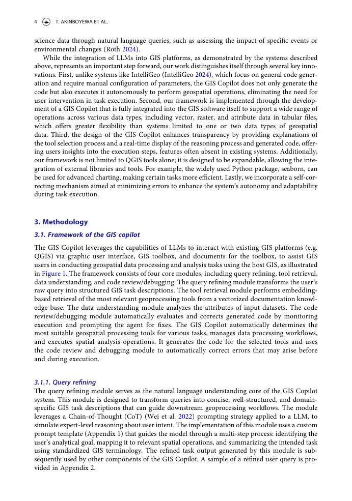

## PDF 第 6 页

Figure 1.  Framework of the GIS Copilot.

INTERNATIONAL JOURNAL OF DIGITAL EARTH 
5

3.1.2. Spatial analysis toolbox
QGIS is a widely used open-source GIS software for geospatial data management, analysis, and 
visualization. It offers tools from various algorithm providers, including QGIS native algorithms, 
GDAL/OGR, GRASS GIS, SAGA GIS, and Orfeo Toolbox, supporting diverse geospatial analyses. 
Additionally, its Python API, PyQGIS, allows users to automate tasks, create custom plugins, and 
access full QGIS functionality, making it highly adaptable for advanced spatial analysis and tool 
development (QGIS 2024).

The spatial analysis toolbox in this framework comprises both built-in and customized geoprocessing 
tools. Built-in tools include QGIS algorithms, such as native geoprocessing algorithms (e.g. ‘native:buffer’ 
for buffering and ‘qgis:selectbyattribute’ for attribute selection) and external providers like GDAL (e.g. 
‘gdal:slope’ for slope analysis). In the current implementation, 390 native QGIS and GDAL tools have 
been systematically compiled with reference to the resources available on the official QGIS documentation 
website (QGIS 2024). In addition, this framework is not limited to QGIS tools and is designed to be exten­
sible in a plug-and-play style to allow users to add new customized tools to meet specific tasks. For 
example, a tool used for performing kernel density estimation can be customized using GeoPandas, 
scipy, and rasterio Python libraries and registered to the GIS Copilot. For users creating custom tools, 
the same structure described in Section 3.1.3 must be followed to ensure compatibility with the GIS Copi­
lot framework. The documentation should be concise and well-organized, focusing on essential details. 
Thereafter, the customized tool can be added within the plugin interface.

3.1.3. Tool retrieval
The GIS Copilot is equipped with documentation of the GIS tools that are in the toolbox, allowing it 
to generate PyQGIS code for specific geoprocessing tasks within the QGIS software. Although 
LLMs excel in generating Python codes, they still lack the detailed domain-specific knowledge 
needed to generate PyQGIS code. To bridge this gap, a structured documentation system was devel­
oped, covering five key components for each tool: tool_ID, tool_name, brief_description, parameters, 
and code_example. A sample of a QGIS native tool and a customized tool are shown in Appendix 3 
and Appendix 4, respectively.

The tool documentation is retrieved to build a retrieval-augmented generation (RAG) pipeline. 
Specifically, all documentation content is transformed into vector representations (embeddings) 
and stored in a FAISS-based (Douze et al. 2024) vector database, a searchable knowledge base.

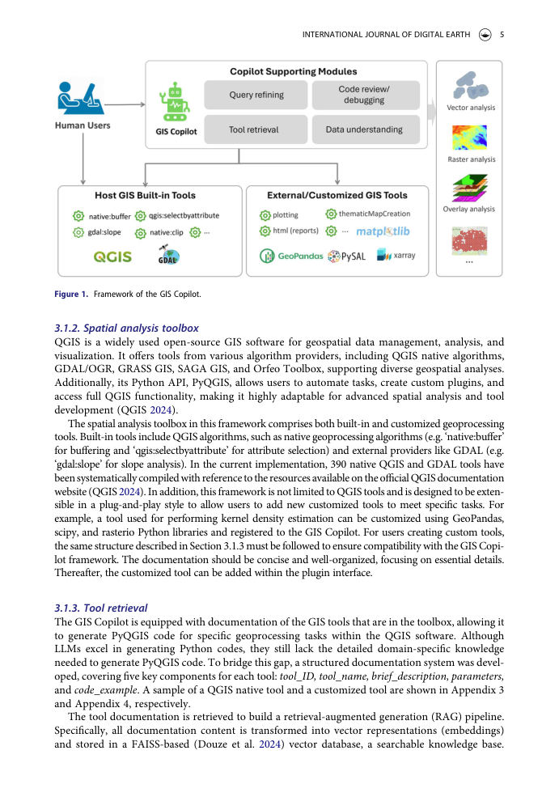

## PDF 第 7 页

6 
T. AKINBOYEWA ET AL.

When a spatial analysis task is defined – after being structured by the query refining module – a 
similarity search is performed against this vector database to identify tools whose descriptions 
align most closely with the user’s intent. The top most relevant tool(s) are retrieved and passed 
to a language model, which generates a structured recommendation that includes the selected 
tool(s). In addition to supporting tool selection, the embedded documentation enables targeted 
retrieval of specific components, such as parameter definitions or example usage. This selective 
retrieval is particularly important given the token limitations of LLMs: for instance, the GPT models 
used in this implementation have a context window ranging from 8,000–32,000 tokens (Lin et al. 
2023). By retrieving only the relevant parts of a tool’s documentation, the system ensures that 
the prompt remains within token limits while still providing the model with the essential context 
needed for accurate and executable code generation.

3.1.4. Data understanding module
The data understanding module leverages the GPT-4 API to identify key attributes of the input 
data. This module enables the agent to extract and interpret the structure and attributes of spatial 
data before being used for any analysis. It functions similarly to the initial step a human analyst 
would take when approaching a spatial analysis task – understanding the data to be analyzed. 
Specifically, it collects a wide range of critical information on the data for spatial analysis, such 
as file format, field names of the attribute table, coordinate reference system, geographic extent, 
and raster resolution. This information provides the GIS Copilot with a thorough overview and 
understanding of the data inputs, which guides it in selecting appropriate tools and attributes for 
performing geospatial operations. As a result, users are not required to specify data details such 
as field names in their task requests, making the Copilot more user-friendly.

3.1.5. Code review/debugging module
The code review/debugging module is an essential component designed to enhance the reliability 
and accuracy of generated code. This module enables the GIS Copilot to actively review the gener­
ated code and monitor the execution of the generated code in real-time to capture any errors that 
may arise. The implementation leverages GPT-4 API for code review, where a structured prompt 
guides evaluating the code against predefined requirements and examples from documentation. 
Real-time monitoring of code execution is performed by dynamically capturing output. Upon 
detecting an error, the module generates a debug prompt enriched with context, including the 
task, error details, and associated data, which is sent to GPT-4 for analysis and correction. The cor­
rected code undergoes further review and execution to increase the chances of successful execution. 
Appendix 5 and Appendix 6 provide samples of the prompt used for the code review and debugging 
operation respectively.

3.2. Workflow of the GIS copilot

The GIS Copilot is implemented as a plugin within QGIS. It interprets user requests in natural 
language and translates them into executable geoprocessing commands. As shown in Figure 2, 
the overall workflow begins by breaking down the user’s task into detailed steps. Once the task 
is well understood, the system identifies the appropriate geoprocessing tool(s) from a wide range 
of options, including QGIS native tools, GDAL, or customized tools. The tools are selected 
based on the steps analyzed during the task breakdown to ensure each step of the process is 
addressed by the most suitable tool. Based on the selected tool(s), the system generates executable 
Python code that is specifically designed to solve the spatial task. Throughout these steps, the system 
is guided by a set of predefined instructions, automatically generated metadata, and a comprehen­
sive tool list to ensure reliable task analysis, tool selection, and code generation. Finally, the code is 
executed, and the results are either loaded as map layers into QGIS or presented as reports, includ­
ing tables and charts.

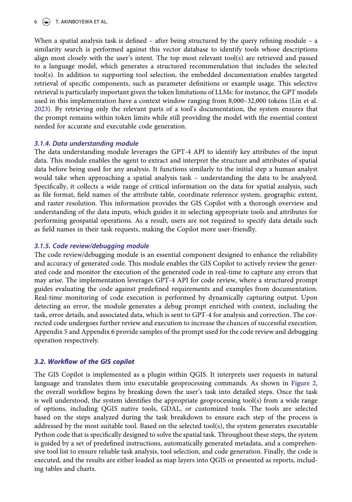

## PDF 第 8 页

3.2.1. Task analysis and tool selection

INTERNATIONAL JOURNAL OF DIGITAL EARTH 
7

When a user submits a spatial query in natural language, the agent processes the request to under­
stand the underlying spatial problem. This is achieved through the query refining module which 
refines the raw input into a structured and domain-specific GIS task description. The refined 
task includes clearly defined objectives and identifies the necessary spatial operations. Following 
task refining, the tool retrieval module performs a search over a vectorized documentation database 
using RAG technique. These retrieved tools are then passed to a language model, which selects the 
most suitable tool(s) and generates a structured recommendation. This is achieved through the 
Query Refining Module, which uses a Chain-of-Thought (CoT) prompting strategy to transform 
the raw input into a structured and domain-specific GIS task description. The refined task includes 
clearly defined objectives and identifies the necessary spatial operations. Once selected, the docu­
mentation for these tools – including parameter definitions and example usage – is passed to the 
code generation module, which uses it to construct executable Python code tailored to the 
refined task. This documentation-informed code generation ensures that tool-specific requirements 
are followed during execution.

3.2.2. Code generation and parameter setting
Once the appropriate tools have been selected, the GIS Copilot proceeds to generate executable 
Python code tailored to the task. This process is guided by the documentation associated with 
the selected tool(s), including their parameter requirements and code examples. The agent custo­
mizes the generated code to align with task-specific details. For instance, for a query like ‘select 
counties with a population greater than 50,000’, the agent adjusts the parameters to set the filter 
condition to ‘Population > 50,000.’

3.2.3. Execution and visualization of results
The generated code is executed within the QGIS environment, performing the spatial analysis with­
out leaving the interface. Outputs such as buffer zones, intersected layers, or reclassified rasters are 
displayed as map layers in QGIS, while summaries, charts, or statistics are shown as tables, images, 
or reports within the plugin. The plugin can also create visualizations like bar charts or histograms 
for result interpretation. If errors occur, the self-debugging module reviews, corrects, and re-exe­
cutes the code to ensure successful task completion.

Figure 2.  Workflow of the GIS Copilot.

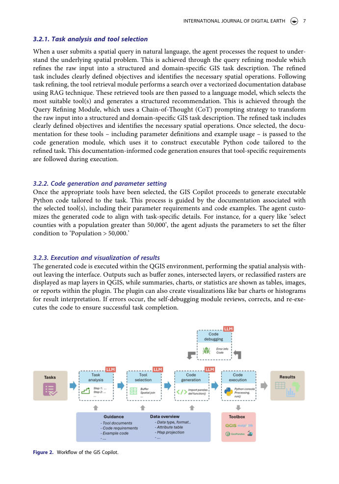

## PDF 第 9 页

8 
T. AKINBOYEWA ET AL.

3.3. User interface design

The graphic user interface of this GIS Copilot comprises six main tabs: Request Page, Generated 
Code, Geoprocessing Workflow, Reports, Settings and Help, as displayed in Figure 3. The Request 
Page allows users to submit requests, view AI-generated code in real-time, monitor the agent’s sta­
tus, and select datasets directly from the QGIS layer panel. To enable seamless integration with 
QGIS, users can select datasets for analysis directly from the QGIS layer panel by checking the layers 
they want to include and unchecking those to exclude. The Generated Code tab enables users to 
manually execute the generated code and make edits as needed, save, or load saved code from 
the local machine-generated code. The Geoprocessing Workflow tab visually outlines the steps 
for completing tasks. The Reports tab displays outputs like charts, plots, and summaries. The Set­
tings tab lets users configure the plugin, including API keys and default workspace where results are 
saved. Finally, the Help tab guides using the plugin.

4. Case studies

To demonstrate the capabilities of the GIS Copilot, spatial tasks were provided directly to the agent 
in natural language. The test cases were developed by the authors, who are GIS experts with sub­
stantial experience in geospatial analysis, prompt engineering, and agent development. It is worth 
noting that the design of the task requests does not require specialized prompt engineering skills, 
demonstrating that task requests can be composed by users regardless of their level of expertise in 
GIS or familiarity with LLMS. These cases were categorized into three levels of complexity: basic, 
intermediate, and advanced.

4.1. Basic level tasks

At this level, the tasks are straightforward, involving a single tool along with one (or occasionally 
two) data layers. The agent is expected to perform a straightforward operation that usually requires 
a single step, such as calculating the area of polygons or selecting features based on attributes.

Figure 3.  The graphic user interface of the GIS Copilot.

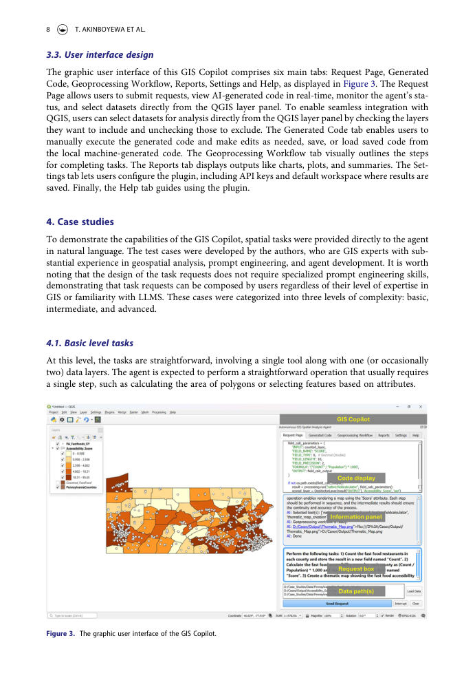

## PDF 第 10 页

INTERNATIONAL JOURNAL OF DIGITAL EARTH 
9

4.1.1. Health facilities coverage zone in Washington D.C., USA
This case involves creating service zones around health facilities in Washington D.C, United States. 
The input data was a vector layer of health facilities (hospitals, clinics, and pharmacies) obtained 
from OpenStreetMap (OpenStreetMap 2024). In this task, the agent was prompted to create 
2,000-foot zones around each health facility to identify areas of service coverage (Figure 4). The 
agent successfully selected the appropriate spatial analysis tool (the buffer tool) and generated 
executable code, which includes setting the required parameters (e.g. distance) based on the user 
query and executing the operation.

4.1.2. Generating contour lines from the digital elevation model (DEM)
In this case, the agent is tasked with generating contour lines from a Digital Elevation Model (DEM) 
dataset, a raster data layer that represents terrain elevation. This is a foundational spatial analysis 
task that is frequently used in geographic studies, such as topographical mapping, environmental 
modeling, and landscape visualization. The agent selected the tool gdal:contour from the available 
geoprocessing tools within the system. This tool is specifically designed to convert elevation data 
(raster) into contour lines (vector), based on user-defined intervals. In our case study, the output 
in vector format is shown in Figure 5.

4.1.3. Selection of high population counties in the US
This case demonstrates attribute query by selecting the US counties with a population exceeding 
50,000. The input dataset is a single vector layer that contains the population of all counties in 
the contiguous US states. In response to the task, the agent effectively identified the correct tool

Figure 4.  Health facilities coverage zone (Task: Can you create 2000-feet zones around each health facilities in Washington DC to 
identify areas of service coverage?).

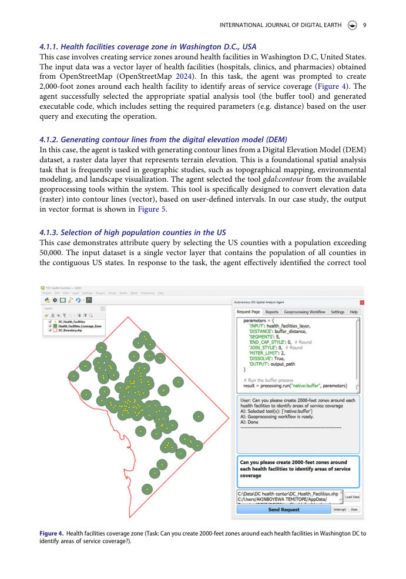

## PDF 第 11 页

10 
T. AKINBOYEWA ET AL.

Figure 5.  Generating contour lines from DEM (Task: Generate contour lines from the DEM of Puerto Rico with a 50-meter interval).

(extract by attribute) and attribute (Population) to filter the data. The agent then generated the 
necessary executable code, which included setting the population threshold and applying the filter­
ing operation based on the specified condition (Figure 6).

4.1.4. Extracting land cover data of Pennsylvania
This case focuses on extracting land cover data for Pennsylvania from a larger dataset covering the 
contiguous US. The input data includes land cover raster data from the National Land Cover Data­
base (NLCD) and a shapefile containing the boundary of Pennsylvania. The agent accurately 
selected the appropriate tool (the GDAL Clip Raster by Mask Layer tool) and generated the execu­
table code, configuring parameters such as the input layer, output path, and clipping settings. The 
agent was able to produce the clipped raster layer showing the land cover specific to Pennsylvania 
(Figure 7). The result provides a detailed view of various land cover categories within the state’s 
boundary.

4.2. Intermediate level tasks

At this level, tasks become more complex and involve multiple steps and tools. The agent is guided 
with specific instructions or a list of steps to perform the task. Although the steps are outlined, the 
agent still needs to generate the correct code for each step and link them together to perform the 
analysis. The focus here is to test the agent’s ability to follow a given general workflow while mana­
ging more than one process.

4.2.1. Zonal statistics of average elevation for counties in South Carolina
In this case, the agent is tasked with analyzing the average elevation for each county in South Car­
olina (SC) based on the DEM. This involved a series of geoprocessing steps: clipping the DEM to the 
boundary of SC, generating a histogram of the clipped DEM’s pixel values, calculating zonal stat­
istics, and creating a choropleth map. The input consists of three data layers: a DEM covering a 
region larger than SC and two vector layers containing SC’s boundary and all SC counties.

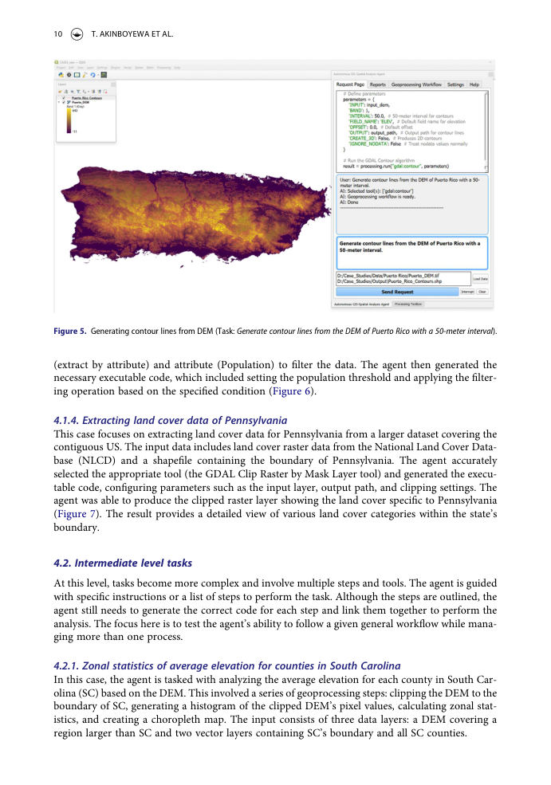

## PDF 第 12 页

INTERNATIONAL JOURNAL OF DIGITAL EARTH 
11

Figure 6.  Selection of high population counties in the contiguous U.S. (Task: Select the USA counties that have more than 50,000 
population).

The results of the request are shown in Figure 8. The choropleth map generated by the agent 
clearly displays the average elevation values, with darker shades representing higher elevations. 
Also, the histogram generated by the agent illustrates the distribution of pixel values from the 
clipped DEM. The geoprocessing workflow diagram illustrates the steps of the analysis.

4.2.2. Richland county terrain analysis
In this case, the agent was tasked with performing a detailed terrain analysis for Richland County, 
SC, by merging four DEM tiles obtained from the US Geological Survey (USGS) and Shuttle Radar 
Topography Mission (SRTM) dataset (USGS 2024). The generated geoprocessing workflow shows 
the sequence of steps to complete the task. The workflow began by merging the four individual 
DEMs to create an elevation model covering the area of interest. Once merged, the agent calculated 
multiple terrain characteristics, including slope, aspect, hillshade, Terrain Ruggedness Index (TRI), 
and Topographic Position Index (TPI). The outputs of each analysis step were displayed, with each 
terrain attribute as a separate map (Figure 9). The geoprocessing workflow diagram illustrates the 
steps of the analysis.

4.2.3. County-level obesity risk behavior index analysis
This task involves the calculation of an obesity risk behavior index across all counties in the con­
tiguous US. Two data layers – a shapefile containing the boundaries of all counties and a CSV file

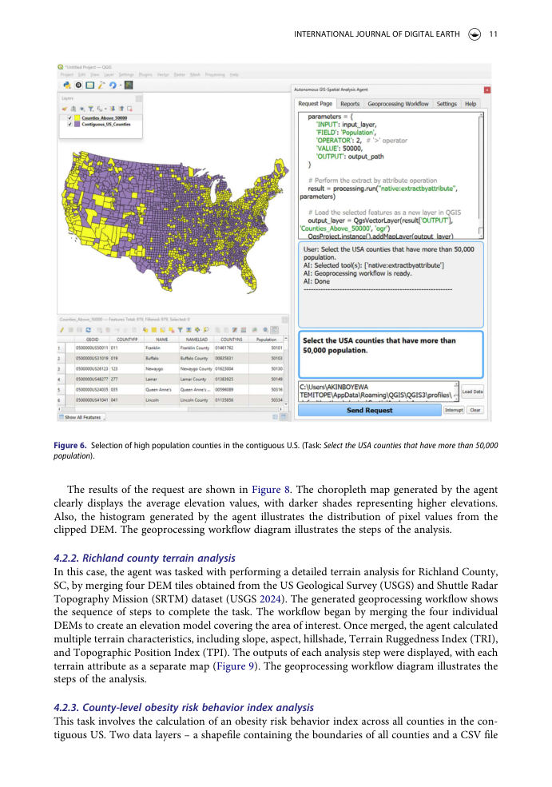

## PDF 第 13 页

12 
T. AKINBOYEWA ET AL.

Figure 7.  Extracting land cover information of Pennsylvania. (Task: Clip the land cover data of the USA to the Pennsylvania 
boundary).

containing the rate of visits to different places such as convenience stores, limited-service restau­
rants, sport centers, fitness centers, and parks. The agent was able to join the attributes to the sha­
pefile and select the fields needed for the analysis without any instruction from the user using the 
data understanding module. The thematic map and the geoprocessing workflow generated by the 
agent is presented in Figure 10.

4.3. Advanced level tasks

In the advanced level, tasks are multistep, and the agent is expected to determine the appropriate 
steps independently without explicit instructions, to devise the best approach for achieving the 
desired outcome. In other words, tasks are more natural in nature presenting the agent of ‘what’ 
the users want with limited guidance on ‘how’ to do it. The agent must select the right tools, gen­
erate the necessary code, and execute the entire process independently.

4.3.1. Fast-food accessibility and obesity correlation analysis for Pennsylvania counties
This operation involves analyzing and visualizing the fast-food accessibility score for each county in 
Pennsylvania and performing a correlation analysis between the fast-food accessibility score and the 
prevalence of obesity. The agent’s workflow began by calculating the fast-food accessibility score for 
each county based on the number of fast-food restaurants per capita by performing a spatial join 
operation. This was followed by generating a thematic map that displays counties with higher acces­
sibility scores in darker shades of blue. Next, the agent analyzed the correlation between county- 
level obesity rates and fast-food accessibility scores. The results of this analysis are shown in

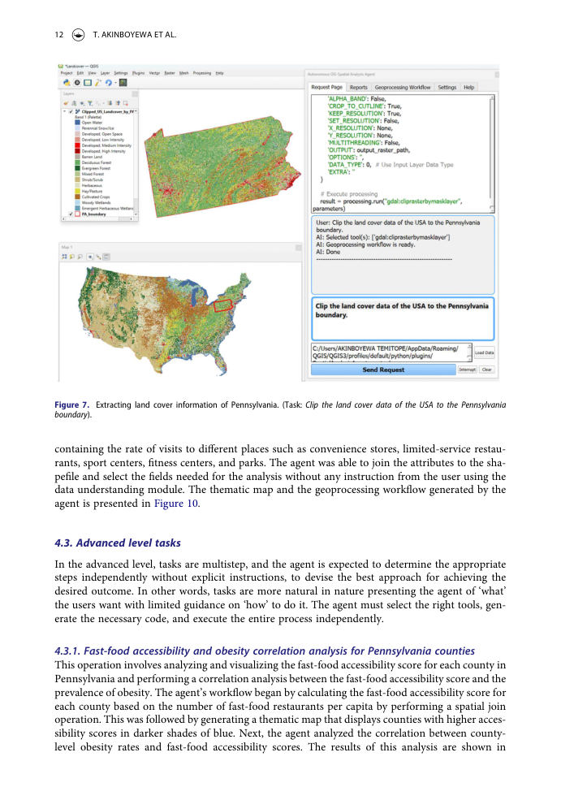

## PDF 第 14 页

INTERNATIONAL JOURNAL OF DIGITAL EARTH 
13

Figure 8.  Zonal Statistics of average elevation for counties in South Carolina (Task: Perform the following task: 1) Clip the DEM to 
SC boundary and load the clipped DEM. 2) Show me the histogram for the clipped DEM pixel values. 3) Generate the zonal stat­
istics for every county in SC, focusing on average elevation. 4) Finally create a choropleth map showing the average elevation of 
each county in SC).

Figure 11, where a scatter plot with a regression line highlights the relationship between fast-food 
accessibility and obesity rates across the state. The agent successfully managed the multistep pro­
cess, calculating accessibility scores to perform correlation analysis, and visualizing the results in 
both a thematic map and a scatter plot. It should be noted that all the specific fields used in the 
analysis were automatically selected by the agent without explicit user guidance enabled by the 
data understanding module.

4.3.2. Spatial distribution of COVID-19 cases across US counties
This task asks, ‘Could you show the spatial distribution of the COVID-19 cases across US counties?’ 
This request involves visualizing the spatial distribution of COVID-19 cases across US counties. 
The agent was provided with two datasets: shapefile of US county boundaries obtained from the 
US Census Bureau (US Census Bureau 2024) and a CSV file containing COVID-19 data as of

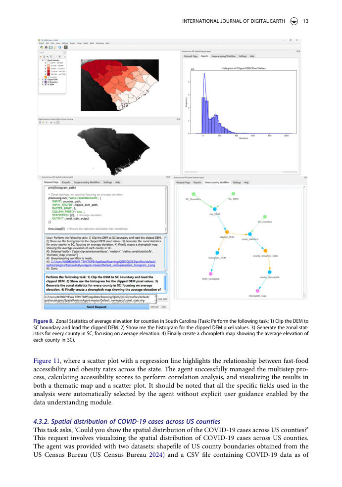

## PDF 第 15 页

14 
T. AKINBOYEWA ET AL.

Figure 9.  Richland County raster analysis. (Task: Merge the four DEMs into a single raster and perform terrain characteristic 
analysis for Richland County, including slope, aspect, hillshade, terrain ruggedness index (TRI), and topographic Position 
Index (TPI)).

December 2020, obtained from the New York Times (New York Times 2024). The analysis involved 
joining the attribute contained in the CSV data with the shapefile to create a thematic map that 
shows the COVID-19 cases across all the counties in the US. The agent successfully completed 
the task, automatically identifying the common fields, ‘GEOID’ and ‘FIPS’, for the join operation. 
It also selected the ‘cases’ field from the COVID-19 dataset to generate the thematic map. The geo­
processing workflow diagram generated by the agent and the resulting thematic map is shown in 
Figure 12. Counties with higher numbers of COVID-19 cases are represented by darker shades 
of blue on the map.

4.3.3. Generating the normalized difference vegetation index (NDVI) from satellite imageries
In this case, the agent was tasked with generating the Normalized Difference Vegetation Index 
(NDVI) for the city of Akure, Nigeria using multispectral satellite imagery. The request is ‘Generate

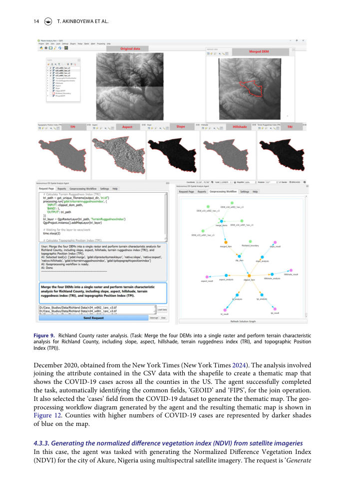

## PDF 第 16 页

INTERNATIONAL JOURNAL OF DIGITAL EARTH 
15

Figure 10.  County-level obesity risk behavior index analysis (Task: Generate an obesity risk behavior index of each county in the 
contiguous US by analyzing the rate of visits to unhealthy food retailers (such as convenience store, alcoholic drinking places, and 
limited service restaurant) and the visit rate to places that support physical activity (e.g. sports centers, parks, fitness centers). 
Visualize the results in a thematic map to highlight the obesity risk behavior index across counties).

the Normalized Difference Vegetation Index (NDVI) of Akure from these satellite imageries’. The 
input data comprises a shapefile of the Akure boundary and Landsat 8 satellite products from 
the USGS, which includes multiple image bands. The agent demonstrated its capability by auto­
matically identifying and selecting the correct bands, specifically the NIR and red bands, from 
the multispectral imagery. It then used these bands and applied the correct formula to generate 
the NDVI layer. The output was visualized as a raster map. The agent successfully managed the 
entire process, from band selection to calculation to ensure the correct bands were used and that 
the NDVI was calculated accurately (Figure 13). Note that the initial raster map generated by 
the agent used a black-and-white color ramp for symbology. The symbology was manually adjusted 
to enhance visualization in order to provide a clearer representation of the vegetation distribution 
in Akure, where areas of dense vegetation are represented by higher NDVI values, as shown in 
green, while shades of blue represent lower NDVI values. This example shows the agent’s ability 
to handle satellite imagery data and perform key calculations with minimal user input.

4.4. Performance evaluation

The performance of the GIS Copilot was assessed systematically using 110 tasks across three levels 
of complexity: basic, intermediate, and complex. Each level consisted of a set number of tasks, 
selected according to predefined criteria for task complexity (in Sections 4.1, 4.2, and 4.3). This 
structured approach ensured that the chosen tasks represented each complexity level to provide 
a balanced and meaningful evaluation framework. While definitions of complexity may vary, the 
selected tasks align closely with the GIS Copilot’s intended functionality and scope.

Success rates were recorded at each stage, tracking tasks completed on the first attempt as well as 
those required multiple attempts. Tasks that remained unsuccessful after three attempts were cate­
gorized as failures. The overall accuracy is determined by calculating the percentage of successful 
cases. As shown in Table 1, with 60 cases at the basic level (Appendix 7), the success rate recorded 
was 95%; among 30 intermediate-level tasks (Appendix 8), a success rate of 80% was observed, and 
for the advanced level, which included 20 cases (Appendix 9), the success rate was 75%.

We further evaluated the performance by analyzing the reasons behind the failed cases to under­
stand the underlying issues. Overall, tool selection was accurate, as the appropriate tools were

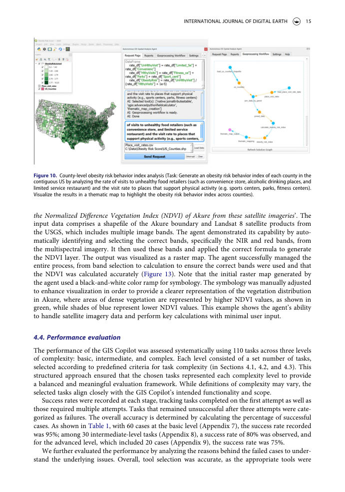

## PDF 第 17 页

16 
T. AKINBOYEWA ET AL.

Figure 11.  Fast-food accessibility analysis for each county in Pennsylvania. (Task: Could you analyze and visualize the fast food 
accessibility score for each county based on the number of fast food restaurants and population using a thematic map with blue 
graduated colors. Then, analyze the correlation between the county-level obesity rate and the fast food accessibility score by 
drawing a scatter plot with a regression line.). Fast food restaurants data was downloaded from OpenStreetMap. The population 
data (2022) was retrieved from the US census.

consistently chosen for each task. However, most of the failed cases are attributed to the following 
three major issues described below.

.
Incorrect parameter assignment: The most frequent cause of failure involved parameter setting 
errors. Despite selecting the correct tool, some tasks failed due to incompatible or incorrectly 
assigned parameters, leading to code execution issues. For example, when attempting to identify 
areas suitable for camping, the agent was instructed to select locations where the aspect of the 
area was greater than 100 and the distance to the closest road did not exceed 1000 meters

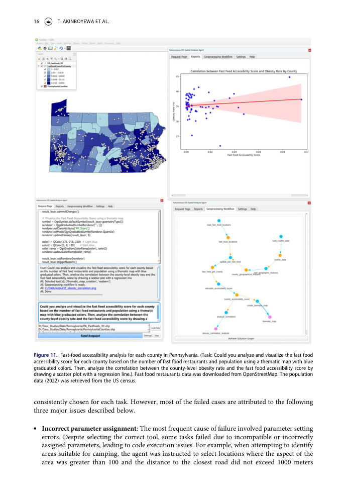

## PDF 第 18 页

INTERNATIONAL JOURNAL OF DIGITAL EARTH 
17

Figure 12.  Spatial distribution of COVID-19 cases in the USA. (Task: Could you show the spatial distribution of the COVID-19 cases 
across US counties?).

Figure 13.  Generating the Normalized Difference Vegetation Index (NDVI) of Akure. (Task: Generate the Normalized Difference 
Vegetation Index (NDVI) of Akure from these satellite imageries).

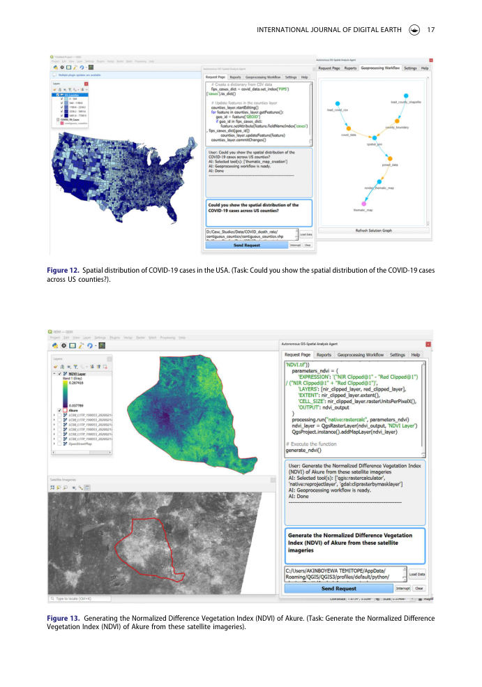

## PDF 第 19 页

18 
T. AKINBOYEWA ET AL.

Table 1.  Performance evaluation of the GIS Copilot.

Total count of 
tasks
Count of successful cases
Count of failed 
cases

Overall success 
rate
First 
attempt

Level of 
complexities

Third 
attempt
Basic
60
52
3
–
5
92%
Intermediate
30
13
4
8
5
83%
Advanced
20
10
4
1
5
75%

Second 
attempt

(Case 20 in Appendix 9). To achieve this, the agent used the gdal:proximity tool to calculate dis­
tances to the nearest roads. However, the task failed because the tool requires a raster input, 
while the agent assigned a vector layer as the input data.

.
Field name mismatches and data compatibility: Another common issue arose from mis­
matches in field names during data joins, particularly when joining CSV files with shapefiles. 
Shapefiles often truncate field names to 10 characters, causing discrepancies that the agent did 
not account for, leading to calculation errors. For example, when tasked with calculating the 
population living in block groups containing hazardous waste sites, the agent needed to join a 
CSV file containing population data to a shapefile representing block groups. However, the 
agent encountered issues because the shapefile truncated longer field names to 10 characters. 
This caused the field names in the shapefile to differ from those in the CSV, leading to a failed 
join and, consequently, leading to a ‘field name error’.

.
Projection issue: During testing, it was observed that the agent frequently omitted essential 
reprojection steps unless specifically instructed. This oversight led to misaligned spatial data, 
affecting the accuracy of the results, particularly in tasks that required consistent coordinate sys­
tems across layers. For instance, when tasked with clipping an image using the extent of a sha­
pefile where the shapefile and the image were in different coordinate systems, the agent did not 
reproject the shapefile to match the coordinate system of the image, the resulting clip operation 
was misaligned, leading to an error (Case 27 in Appendix 8).

5. Discussion

This study proposes a novel framework for integrating generative AI (LLMs) into established GIS plat­
forms, using QGIS as a case study. Based on this framework, we implemented a GIS Copilot through 
which GIS users interact with the software with natural language. A key feature of this GIS Copilot is 
the extensive range of tools included, covering a broad spectrum of geoprocessing functions such as 
vector and raster analyses. Additionally, the framework is designed to be extensible by allowing GIS 
users to add custom tools following a predefined template. This extensibility ensures that the Copilot 
remains adaptable to user needs and the continuous development of new GIS tools and analyses. This 
work aligns with the increasing recognition of the potential for AI-driven systems to automate and 
streamline geoprocessing workflows. By automating these processes, the framework simplifies spatial 
analysis, making GIS functionalities more accessible to both expert and non-expert users.

This GIS Copilot responds to the previous work of Li and Ning (2023), who envisioned the need 
for a copilot-style system in GIS to enhance automation and interaction with geospatial data. They 
demonstrated the potential for LLMs to autonomously generate geoprocessing workflows and 
emphasized the importance of integrating these capabilities directly into existing GIS software to 
unlock their full potential. By implementing a Copilot system within QGIS, this study illustrates 
how LLMs can be used to generate executable spatial analysis algorithms using existing well-devel­
oped GIS tools. A significant benefit of Copilot style integration with GIS platform is that users have 
direct interaction with the agent directly within the GIS environment, allowing them to load and 
select datasets, visualize results and select between manual operations and agent-driven workflows 
based on their preferences. This flexibility enables users to combine traditional manual GIS

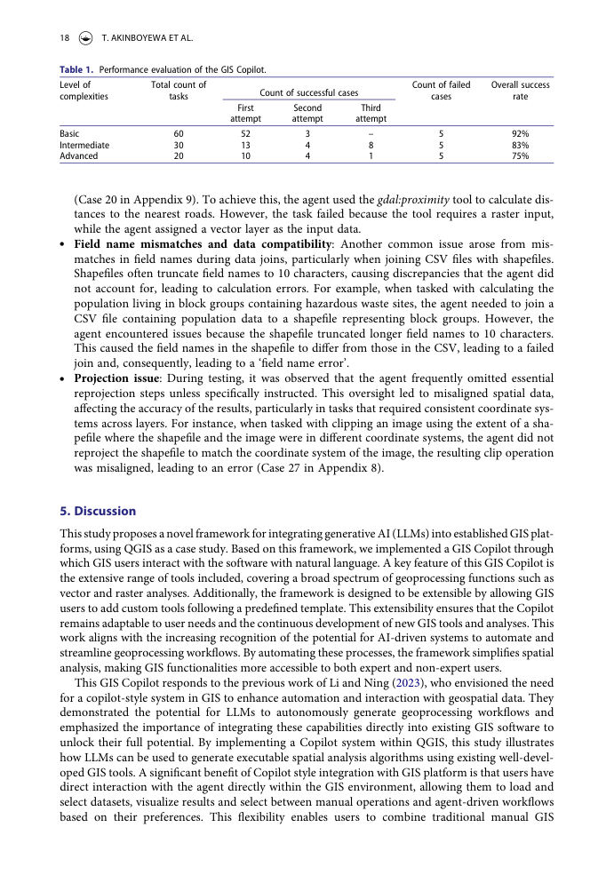

## PDF 第 20 页

INTERNATIONAL JOURNAL OF DIGITAL EARTH 
19

processes with the efficiency of AI-driven analysis, resulting in a hybrid approach. For instance, 
users can load datasets into QGIS and perform analyses, generate results by the agent and further 
perform analyses using either the Copilot or manual methods.

In evaluating the performance of the GIS Copilot, we analyzed its success rate for 110 tasks 
across three levels of complexity: basic, intermediate, and advanced level. At the basic level, tasks 
involved straightforward operations on one or two data layers, such as spatial buffering, calculating 
areas or filtering features based on attributes. The agent demonstrated high accuracy in selecting the 
appropriate tools and generating the necessary code. The reliability of the GIS Copilot at this level 
highlights its competence in automating foundational tasks with minimal intervention, offering an 
important utility for speeding up routine geospatial operations. At the intermediate level, the tasks 
require multistep which are described for the agent. Here, the agent not only needed to correctly 
select tools but also generate and execute the code in sequence. In these scenarios, the agent showed 
strong performance in generating geoprocessing workflows based on the multistep task description 
and managing the dependencies between different steps. The success in these tasks suggests that the 
agent can effectively operate as an assistant to handle more involved geospatial workflows, thereby 
reducing the need for users to do step-by-step manual coding. The advanced level tasks involve the 
highest complexity, where the tasks are more natural in nature, presenting the agent of ‘what’ the 
users want with limited guidance on ‘how’ to do it. Here, the agent needs to understand and reason 
the question and determine the geoprocessing workflow autonomously. This required the agent to 
interpret the natural language instructions, decide on an appropriate series of actions, select the cor­
rect tools, and execute the entire process without explicit guidance. While the agent showed 
promise at this level, especially in the tool selection and code generation, the success rate for 
these complex tasks was lower than simpler ones.

Explainability and trustworthiness are two critical concerns in generative AI applications, 
including GIScience (Kang, Gao, and Roth 2024; Tlili et al. 2023). While LLMs can generate 
impressive responses, their ‘black box’ nature makes it difficult for users to understand how specific 
outputs are produced. Without clear explanations of how outputs are generated, users may be reluc­
tant to fully adopt these models, especially when they play a significant role in data driven analyses 
and recommendations. To reduce these concerns, GIS Copilot has been designed to enhance trans­
parency at every step. Unlike traditional black-box models, the Copilot clearly presents each stage of 
the process, including tool selection and code generation, with generated code displayed in real 
time. Additionally, the generated code can be further edited and executed manually as needed. 
This approach allows users to inspect and understand each action taken by the Copilot, so that 
they can trace how results are achieved. Users are encouraged to review the generated code and 
results actively, rather than relying on them blindly. This approach highlights the collaborative 
nature of a ‘copilot’ system that supports rather than replaces expert decision-making in GIS.

We acknowledge that some advanced methods such as knowledge graphs, ontology-based reason­
ing, and fine-tuning are valuable techniques for enhancing the performance of LLMs in specialized 
domains. However, these methods are not immediately necessary within the scope of the GIS Copilot 
framework. By leveraging structured file-based documentation, RAG, the framework achieves sim­
plicity filling the gap in LLMs’ understanding of domain-specific tools (Luo et al. 2024; Tan et al. 
2024). Additionally, while fine-tuning may enhance LLM performance for specific tasks, it requires 
frequent retraining whenever tools or workflows change (Parthasarathy et al. 2024), making it less 
adaptable compared to the documentation-driven structure of this framework.

6. Limitations and future work

The GIS Copilot shows promising performance across the three levels of task complexities; how­
ever, certain issues were observed. These challenges point to potential areas for improvement 
and future research directions.

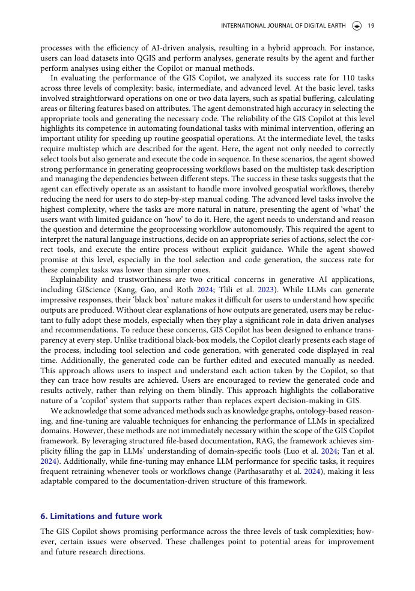

## PDF 第 21 页

20 
T. AKINBOYEWA ET AL.

6.1. The need for a data validation module to reduce tool and parameter mismatch

The GIS Copilot shows potential in handling tasks of varying complexity, but issues like incorrect 
parameter assignment were observed, hindering its performance. For instance, the agent occasion­
ally assigns vector data to parameters that require raster input. A good example of such is the gdal: 
proximity tool, where the input layer should be raster; however, the agent assigns a vector layer pro­
vided by the user without first converting it to raster, resulting in code failure. Improving the align­
ment between data types and tool requirements is needed to enhance the agent’s reliability. One way 
this can be achieved is by integrating a data validation module that crosses-references each par­
ameter with the data type required by the selected tool so that the data will be converted automati­
cally even if there is a mismatch.

6.2. Expanding LLMs knowledge in GIScience fundamentals

LLMs like GPT-4o, while capable of general-purpose reasoning, exhibit limited foundational 
knowledge in GIScience, particularly in domain-specific requirements such as the need for data 
reprojection under certain conditions (Li et al. 2025). During the advanced level testing, it was 
observed that the agent frequently omitted reprojection steps unless specifically instructed. 
Additionally, the agent occasionally struggles with interpreting certain GIS tools – especially 
from external providers like GDAL – leading to inaccurate function selection or parameter mis­
configuration. While the integration of structured documentation and an RAG mechanism effec­
tively addressed prompt length limitations by allowing the model to retrieve only the most 
relevant documentation segments on demand, there is still a need to address the challenge of spatial 
reasoning and tool logic comprehension. To address these, future work could explore fine-tuning 
approaches, such as adapter-based methods like Low-Rank Adaptation (LoRA) (Hu et al. 2021).

6.3. Building an experience-based knowledge system

The agent’s current knowledge is mostly derived from Internet sources, which lack the depth of 
practical GIS experience necessary for accurately performing specialized tasks. For instance, the 
agent may not recognize that data types in table join must align across columns, such as ensuring 
that strings match with strings and integers with integers or that buffer distances should be 
expressed in metric units rather than degrees. Without this foundational understanding, the 
agent is prone to errors that are easily detectable by GIS professionals yet may remain undetectable 
by inexperienced users. To address this issue, implementing an experience-based knowledge system 
that incorporates feedback loops that learn from user corrections could improve the agent’s prac­
tical understanding and adaptability. Such a system would act as a database that accumulates 
instances of errors and their solutions during agent-user interactions. Over time, this ‘experience 
database’ would function similarly to a repository of case-based learning, enabling the agent to 
recognize recurring issues, learn corrective actions, and apply these solutions autonomously in 
future tasks. This approach is one way of achieving the ‘self-growing’ goal of an autonomous 
GIS, allowing the agent to continuously evolve and improve based on accumulated experience. 
For example, if the agent encounters a table join error due to incompatible data types, it will refer­
ence its experience database to identify and implement a solution, such as converting one of the 
columns to the appropriate type.

6.4. Integration with a geospatial data retrieval agent

To advance the GIS Copilot toward full autonomy, integrating an agent capable of retrieving 
needed geospatial data is essential. An autonomous data retrieval agent would allow the Copilot 
to access and use relevant datasets directly, thereby reducing user input requirements and

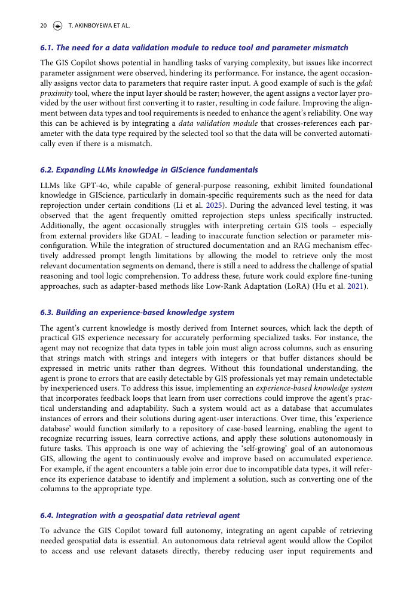

## PDF 第 22 页

INTERNATIONAL JOURNAL OF DIGITAL EARTH 
21

improving efficiency, especially for non-experts who may lack familiarity with data sourcing. 
Recently, (Ning et al. 2025) introduced an agent for retrieving geospatial data from different 
sources, implemented as a QGIS plugin. Integrating such an agent could help the Copilot access 
the data needed for analysis without requiring the user to supply it, which could bring the GIS Copi­
lot closer to a fully spatial analysis agent.

6.5. Exploring the integration of open-source LLM models

In this study, OpenAI GPT has been used as the primary language model to power the GIS Copilot 
to demonstrate the potential of the proposed approach. However, integrating open-source LLM 
models such as Meta’s LlaMA (Meta) could offer notable advantages, especially in terms of custo­
mization and accessibility, such as fine-tuning on GIS-specific tasks to further improve perform­
ance and alignment with specialized geospatial needs. Future studies could explore the 
integration of these open-source models into the GIS Copilot to provide a more accessible and cus­
tomizable alternative to commercial models.

7. Conclusions

The integration of generative AI into GIS represents a significant advancement in automating 
spatial analysis tasks. This study presents a framework for integrating LLMs directly into existing 
GIS platforms. The framework was implemented as a GIS Copilot in the QGIS environment. 
Through case studies across different levels of task complexity, the GIS Copilot proved effective 
in automating basic and intermediate geospatial tasks, reducing the need for manual operations 
and coding. While the Copilot performed well in these simpler tasks, challenges remain in achieving 
full autonomy for more advanced and multistep processes without explicitly telling it ‘how’.

Despite the limitations, the GIS Copilot represents a promising step toward the development of 
fully autonomous GIS and opens avenues for future exploration of AI-driven GIS solutions in 
GIScience. This study contributes to the broader vision of autonomous GIS, where AI-powered 
agents can autonomously perform spatial analysis to democratize access to geospatial analysis, 
transforming how users engage with geospatial data and spatial problems. While this approach 
marks significant progress toward democratizing GIS, we recognize further advancements are 
necessary to fully realize the vision of autonomous GIS. As advancements in generative AI capabili­
ties continue, further research will focus on improving the Copilot’s performance in handling com­
plex workflows, enhancing its error-correction mechanisms, and expanding its adaptability to other 
GIS platforms or explore standalone desktop or web-based interfaces to further simplify access for 
non-expert users.

Acknowledgment

We thank the three anonymous reviewers for their insightful suggestions and comments, which significantly 
improved the manuscript.

Disclosure statement

No potential conflict of interest was reported by the author(s).

Data and source code availability statement

The source code for the GIS Copilot is available on GitHub at https://shorturl.at/vRcm6. The data­
sets used for testing alongside the testing cases can be accessed through https://shorturl.at/bI4Ep.

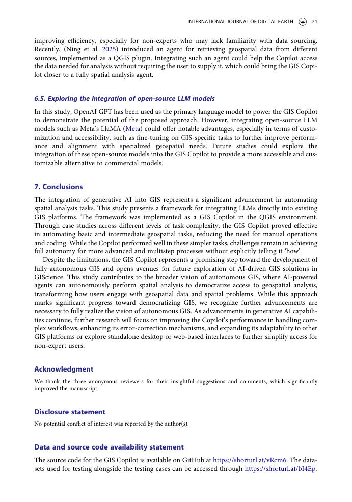

## PDF 第 23 页

22 
T. AKINBOYEWA ET AL.

ORCID

Temitope Akinboyewa 
http://orcid.org/0009-0009-7187-7911
Zhenlong Li 
http://orcid.org/0000-0002-8938-5466

References

Akinboyewa, T., H. Ning, M. N. Lessani, and Z. Li. 2024. “Automated Floodwater Depth Estimation Using Large 
Multimodal Model for Rapid Flood Mapping.” Computational Urban Science, https://doi.org/10.48550/ARXIV. 
2402.16684.
Crawford, M., D. Flater, and J. Neal. 2024. “AI-Enhanced User Experiences in ArcGIS Pro 3.3,” ArcGIS Blog. 
Accessed: Oct. 29, 2024. [Online]. Available: https://www.esri.com/arcgis-blog/products/arcgis-pro/analytics/ai- 
in-arcgis-pro-3-3/.
Crooks, A., and Q. Chen. 2024. “Exploring the New Frontier of Information Extraction Through Large Language 
Models in Urban Analytics.” Environment and Planning B: Urban Analytics and City Science 51 (3): 565–569. 
https://doi.org/10.1177/23998083241235495.
Douze, M., A. Guzhva, C. Deng, J. Johnson, G. Szilvasy, P. E. Mazaré, M. Lomeli, L. Hosseini, and H. Jégou. 2024. 
“The Faiss Library.” arXiv, https://doi.org/10.48550/ARXIV.2401.08281.
ESRI. 2024. ArcGIS Desktop. [Online]. Available: https://pro.arcgis.com/.
ESRI. 2024. “ArcGIS for Microsoft 365. https://doc.arcgis.com/en/microsoft-365/latest/teams/copilot-search- 
workflow.htm. Last accessed on 11/9/2024”.
Gemini Team and Google. 2023. “Gemini: A Family of Highly Capable Multimodal Models (tech. rep.).” Accessed: 
Oct. 18, 2024. [Online]. Available: https://storage.googleapis.com/deepmind-media/gemini/gemini_1_report.pdf.
GRASS GIS. 2024. http://grass.osgeo.org. [Online]. Available: https://grass.osgeo.org/.
Hao, Y., J. Qi, X. Ma, S. Wu, R. Liu, and X. Zhang. 2024. “An LLM-Based Inventory Construction Framework of 
Urban Ground Collapse Events with Spatiotemporal Locations.” ISPRS International Journal of Geo- 
Information 13 (4): 133. https://doi.org/10.3390/ijgi13040133
Hu, Y., G. Mai, C. Cundy, K. Choi, N. Lao, W. Liu, G. Lakhanpal, R. Z. Zhou, and K. Joseph. 2023. “Geo-knowledge- 
guided GPT Models Improve the Extraction of Location Descriptions from Disaster-Related Social Media 
Messages.” International Journal of Geographical Information Science 37 (11): 2289–2318. https://doi.org/10. 
1080/13658816.2023.2266495.
Hu, E. J., Y. Shen, P. Wallis, Z. Allen-Zhu, Y. Li, S. Wang, L. Wang, and W. Chen. 2021. “LoRA: Low-Rank 
Adaptation of Large Language Models.” arXiv, https://doi.org/10.48550/ARXIV.2106.09685.
IntelliGeo. 2024. “GIP Department, Faculty ITC, University of Twente.” Accessed: Oct. 18, 2024. [Online]. Available:

https://github.com/MahdiFarnaghi/intelli_geo.
Kang, Y., S. Gao, and R. E. Roth. 2024. “Artificial Intelligence Studies in Cartography: A Review and Synthesis of 
Methods, Applications, and Ethics.” Cartography and Geographic Information Science 51 (4): 599–630. https:// 
doi.org/10.1080/15230406.2023.2295943.
Li, Z., and H. Ning. 2023. “Autonomous GIS: The Next-Generation AI-Powered GIS.” International Journal of Digital 
Earth 16 (2): 4668–4686. https://doi.org/10.1080/17538947.2023.2278895.
Li, Z., H. Ning, S. Gao, K. Janowicz, W. Li, S. T. Arundel, C. Yang, et al. 2025. “GIScience in the Era of Artificial 
Intelligence: A Research Agenda Towards Autonomous GIS.” arXiv Preprint ArXiv:2503.23633.
Lin, J., M. Diesendruck, L. Du, and R. Abraham. 2023. “BatchPrompt: Accomplish More with Less.” arXiv, https:// 
doi.org/10.48550/ARXIV.2309.00384.
Lin, Q., R. Hu, H. Li, S. Wu, Y. Li, K. Fang, H. Feng, Z. Du, and L. Xu. 2024. “ShapefileGPT: A Multi-Agent Large 
Language Model Framework for Automated Shapefile Processing,” Oct. 23, 2024, arXiv:arXiv:2410.12376. 
Accessed: Oct. 26, 2024. [Online]. Available: http://arxiv.org/abs/2410.12376.
Luo, L., Z. Zhao, C. Gong, G. Haffari, and S. Pan. 2024. “Graph-constrained Reasoning: Faithful 
Reasoning on Knowledge Graphs with Large Language Models.” arXiv, https://doi.org/10.48550/ARXIV. 
2410.13080.
Mai, G., W. Huang, J. Sun, S. Song, D. Mishra, N. Liu, S. Gao, et al. 2024. “On the Opportunities and Challenges of 
Foundation Models for GeoAI (Vision Paper).” ACM Transactions on Spatial Algorithms and Systems 10 (2): 1–46. 
https://doi.org/10.1145/3653070.
Mansourian, A., and R. Oucheikh. 2024. “ChatGeoAI: Enabling Geospatial Analysis for Public Through Natural 
Language, with Large Language Models.” ISPRS International Journal of Geo-Information 13 (10): 348. https:// 
doi.org/10.3390/ijgi13100348.
Meta. “Llama 3.2.” [Online]. Available: https://www.llama.com/.
Mooney, P., W. Cui, B. Guan, and L. Juhász. 2023. “Towards Understanding the Geospatial Skills of ChatGPT: 
Taking a Geographic Information Systems (GIS) Exam.” Proceedings of the 6th ACM SIGSPATIAL international 
workshop on AI for geographic knowledge discovery, 85–94, Hamburg Germany: ACM.

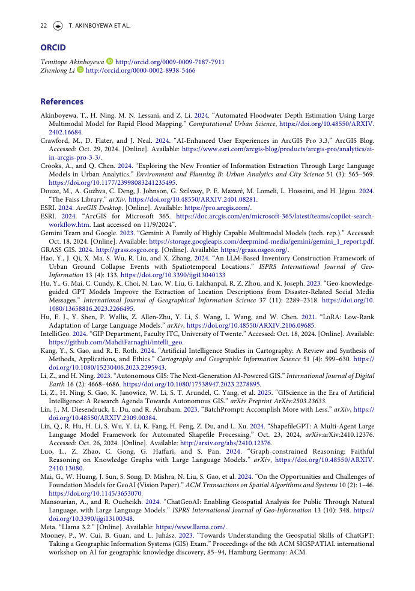

## PDF 第 24 页

INTERNATIONAL JOURNAL OF DIGITAL EARTH 
23

New York Times. 2024. “Coronavirus (Covid-19) Data in the United States (Archived).” Accessed: Oct. 18, 2024. 
[Online]. Available: https://github.com/nytimes/covid-19-data.
Ning, H., Z. Li, T. Akinboyewa, and M. N. Lessani. 2025. “An Autonomous GIS Agent Framework for Geospatial 
Data Retrieval.” International Journal of Digital Earth 18 (1): 2458688. https://doi.org/10.1080/17538947.2025. 
2458688.
OpenAI. 2023. “GPT-4 Technical Report.” arXiv, https://doi.org/10.48550/ARXIV.2303.08774.
OpenStreetMap. 2024. “OpenStreetMap.” Accessed: Oct. 18, 2024. [Online]. Available: https://www.openstreetmap. 
org/.
Parthasarathy, V. B., A. Zafar, A. Khan, and A. Shahid. 2024. “The Ultimate Guide to Fine-Tuning LLMs from Basics 
to Breakthroughs: An Exhaustive Review of Technologies, Research, Best Practices, Applied Research Challenges 
and Opportunities.” arXiv:ArXiv:2408.13296, https://doi.org/10.48550/arXiv.2408.13296.
QChatGPT. 2024. “Python. KIOS Research and Innovation Center of Excellence, University of Cyprus.” Accessed: 
Oct. 18, 2024. [Online]. Available: https://github.com/KIOS-Research/QChatGPT.
QGIS. 2024. http://qgis.org.
QGIS. 2024. “QGIS Documentation v3.34.” Accessed: Oct. 18, 2024. [Online]. Available: https://docs.qgis.org/3.34/ 
en/docs/user_manual/processing_algs/qgis/index.html.
Roth, E. 2024. “NASA’s AI Earth Copilot Will Take Your Questions About Our Planet.” [Online]. Available: https:// 
www.theverge.com/2024/11/14/24296758/nasa-ai-earth-copilot-microsoft.
Tan, X., X. Wang, Q. Liu, X. Xu, X. Yuan, and W. Zhang. 2024. “Paths-over-Graph: Knowledge Graph Empowered 
Large Language Model Reasoning.” arXiv, https://doi.org/10.48550/ARXIV.2410.14211.
Tao, R., and J. Xu. 2023. “Mapping with ChatGPT.” ISPRS International Journal of Geo-Information 12 (7): 284.

https://doi.org/10.3390/ijgi12070284.
Tlili, A., B. Shehata, M. A. Adarkwah, A. Bozkurt, D. T. Hickey, R. Huang, and B. Agyemang. 2023. “What if the Devil 
is my Guardian Angel: ChatGPT as a Case Study of Using Chatbots in Education.” Smart Learning Environments 
10 (1): 15. https://doi.org/10.1186/s40561-023-00237-x.
US Census Bureau. 2024. “TIGER/Line Shapefiles.” Accessed: Oct. 18, 2024. [Online]. Available: https://www.census. 
gov/geographies/mapping-files/time-series/geo/tiger-line-file.html.
USGS. 2024. “Shuttle Radar Topography Mission (SRTM).” Accessed: Oct. 18, 2024. [Online]. Available: https:// 
www.usgs.gov/publications/shuttle-radar-topography-mission-srtm.
Wang, S., T. Hu, H. Xiao, Y. Li, C. Zhang, H. Ning, R. Zhu, Z. Li, and X. Ye. 2024. “GPT, Large Language Models 
(LLMs) and Generative Artificial Intelligence (GAI) Models in Geospatial Science: A Systematic Review.” 
International Journal of Digital Earth 17 (1): 2353122. https://doi.org/10.1080/17538947.2024.2353122.
Wei, J., X. Wang, D. Schuurmans, M. Bosma, F. Xia, E. Chi, Q. V. Le, and D. Zhou. 2022. “Chain-of-Thought 
Prompting Elicits Reasoning in Large Language Models.” Advances in Neural Information Processing Systems, 
https://doi.org/10.48550/ARXIV.2201.11903.
Xu, L., S. Zhao, Q. Lin, L. Chen, Q. Luo, S. Wu, X. Ye, H. Feng, and Z. Du. 2024. “Evaluating Large Language Models 
on Spatial Tasks: A Multi-Task Benchmarking Study.” arXiv, https://doi.org/10.48550/ARXIV.2408.14438.
Zhang, Y., Z. He, J. Li, J. Lin, Q. Guan, and W. Yu. 2024. “MapGPT: An Autonomous Framework for Mapping by 
Integrating Large Language Model and Cartographic Tools.” Cartography and Geographic Information Science: 
717–743. https://doi.org/10.1080/15230406.2024.2404868.
Zhang, Y., C. Wei, Z. He, and W. Yu. 2024. “GeoGPT: An Assistant for Understanding and Processing Geospatial 
Tasks.” International Journal of Applied Earth Observation and Geoinformation 131:103976. https://doi.org/10. 
1016/j.jag.2024.103976.

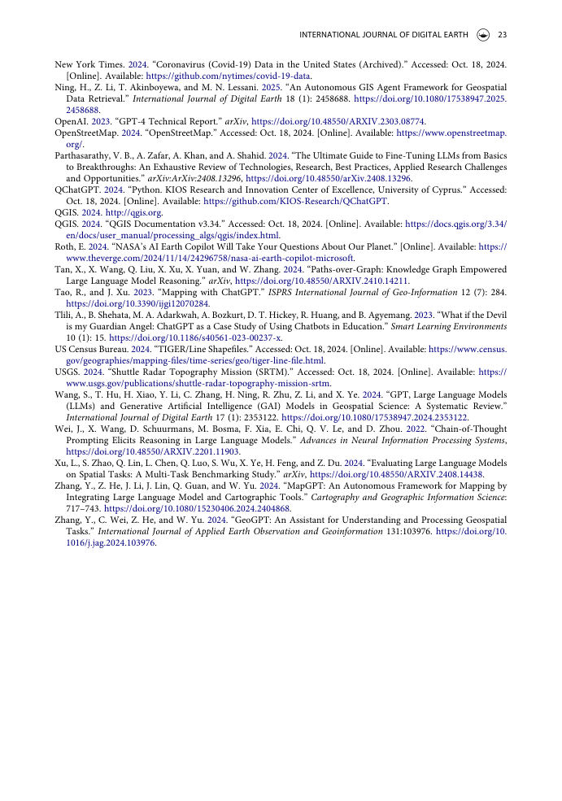
