# GISAgentBench：基于 GIS 从业者真实问题的 LLM 智能体 GIS 任务评测基准

> **英文原题**：GISAgentBench: A Practitioner-Sourced Benchmark for Evaluating LLM Agents on GIS Tasks  
> **作者**：Abhinav Pothuri¹、Zhe Jiang¹*、Zelin Xu¹、Di Yang²  
> **单位**：¹美国佛罗里达大学计算机与信息科学及工程系；²美国佛罗里达大学地理系  
> **通讯作者**：Zhe Jiang，zhe.jiang@ufl.edu  
> **原稿**：arXiv:2608.01645v1 [cs.AI]，2026 年 8 月 3 日。原 PDF 共 **29 页**。  
> **翻译约定**：保留 GIS、CRS、NoData、GT、LLM、VLM、API、ReAct、TSR、QCS、IoU、sMAPE 等缩写及程序标识符；译文中的“真实值 / 基准真值”对应 *ground truth*，“轨迹”对应 *trajectory*，“工具执行框架”对应 *harness*。图表保留论文原图，并在下方提供中文标题和必要的内容翻译。表格的行列和数值以原图为最终核对依据。

## 摘要（原文第 1 页）

地理信息系统（Geographic Information System，GIS）专业人员依赖多步骤空间分析工作流，为城市规划、灾害响应及环境监测中的决策提供支持。然而，这些工作流程繁琐、耗时且容易出错。尽管近期具备外部工具使用能力的大语言模型（Large Language Model，LLM）智能体有望实现地理空间分析自动化，但它们执行真实 GIS 工作流的能力仍缺乏充分研究。现有 GIS 智能体基准测试数据集大多来自教科书、教程或由 LLM 生成的初始任务，在规模和执行轨迹深度方面均存在限制。更重要的是，这些基准没有提供真实值输出（ground truth outputs），因而只能依赖代码相似度、轨迹匹配或 LLM/VLM 裁判等替代性评价信号，可能将工作流表面上的相似误认为任务结果正确。

为弥补这一缺口，我们提出 **GISAgentBench**：一个包含 **349 项多步骤 GIS 任务**的基准测试集。任务从 GIS Stack Exchange 真实从业者问题中整理而来，并在六个选定地理研究区域的真实公开数据上实例化。每项任务均配备可执行的参考轨迹以及精确的真实值输出文件，使得评估能够超越 LLM 裁判，直接进行严格、确定性且具有容差意识的输出匹配。对六种 LLM 模型的评估表明，真实 GIS 工作流仍极具挑战性：在严格容差评分下，表现最好的智能体仅完成了 **32.7%** 的任务，尽管大多数模型生成的输出与真实值较为接近。

## 1 引言（原文第 1–3 页）

地理信息系统（GIS）是一种用于存储、管理、分析和可视化空间参考数据的软件系统。它在应对灾害管理、城市规划、土地管理、气候适应和精准农业等重大社会挑战中发挥着重要作用（Goodchild，2010）。例如，美国联邦紧急事务管理署（FEMA）利用 GIS 分析地形、水文及宗地数据，划定洪水危险区域，进而制作支持美国国家洪水保险计划（承保规模达 1.3 万亿美元）的地图（FEMA，2026）。然而，此类成果很少只需要一次操作即可获得。即使是“识别洪泛区内的人口普查区并计算其人口统计重叠情况”这样目标明确的任务，分析人员也必须收集异构数据集、协调坐标系统和数据模式，从包含数百种基础功能的工具箱和程序库中选择合适的操作并设置参数，最终执行一长串地理处理步骤。如今，大量 GIS 分析师和技术人员每天通过图形地图界面或脚本式地理处理流水线完成这类分析（美国劳工统计局，2026）。

遗憾的是，专业 GIS 工作仍然繁琐、耗时且易错。近年来，具有工具使用能力（Schick 等，2024）和多步骤推理能力（Yao 等，2023；Wei 等，2022）的 LLM 为可能发生的重大范式转变提供了前景。从自然语言请求出发，LLM 智能体原则上可以把任务分解为空间操作，调用 GIS 工具执行工作流，并返回最终空间产品。已有生成并执行 GIS 代码或空间查询的初步系统展示了这一潜力（Li 和 Ning，2024；Zhang 等，2023；Chen 等，2024b）。如果智能体能够可靠地完成这些流程，既能自动化常规地理空间劳动，也能让非专业人员获得高级空间分析能力。

然而，GIS 任务给 LLM 智能体带来了独特挑战。专业 GIS 工作天然具有跨学科属性，同时涉及地理空间信息科学、空间数据库、GIS 软件、机器学习、统计学及遥感。这导致了一些通用代码生成和智能体基准中很少出现的失败模式。第一，未被发现的坐标参考系统（CRS）不匹配会悄然使其后的距离、面积及相交计算全部失效。第二，从业者的请求通常规定不充分，需要智能体推断预期的空间谓词、测量单位或属性模式。例如，要求获取“边界内部的要素”时，未必明确说明是否保留与边界接触的要素。第三，真实空间数据并不完美：栅格具有 NoData 掩膜，矢量图层可能存在无效、重叠或多部件几何。第四，GIS 分析包含漫长且彼此依赖的操作链，一个早期错误会传播到后续每个步骤。因此，即使某个工作流完全执行且没有报错，其空间结果仍可能是错误的。最后，评估本身也很困难，因为正确输出在几何表示上可能合理地存在差异，数值也可能落在允许误差范围内。

由此产生了一个尚未解决的根本问题：**前沿 LLM 智能体究竟能在多大程度上可靠地解决真实从业者面临的多步骤 GIS 任务？**

现有基准无法回答该问题。将 LLM 应用于 GIS 代码生成、空间数据库查询、城市分析和地图理解的系统（Li 和 Ning，2024；Zhang 等，2023；Li 等，2024；Feng 等，2024）主要是基于少量手工构建示例的演示，而非标准化评估。通用智能体及代码基准（Liu 等，2024；Mialon 等，2023；Yao 等，2022；Qin 等，2023；Chen 等，2021b；Lai 等，2023；Jimenez 等，2024）根据文本答案、网页交互或单元测试判断正确性，无法覆盖空间输出。地理空间代码生成评估（Gramacki 等，2024；Hou 等，2025）主要衡量代码合成，而非规划、工具选择、地理处理和输出验证的完整闭环。空间推理基准（Chen 等，2021a；Huang 等，2019；Chen 等，2024a；Xu 等，2025）主要考察地理知识或地图解释，而不涉及工具介导的地理处理。

最接近的研究是 GeoAnalystBench（Zhang 等，2025）、GeoBenchX（Krechetova 和 Kochedykov，2025）及 GeoAgentBench（Yu 等，2025），它们均评估工具调用智能体处理多步骤地理空间任务的能力（表 1）。但这些任务来自教科书、教程或 LLM 生成的种子任务，而非真实实践；规模仅为 50–202 个任务，参考轨迹平均约 5–7 次工具调用、最长不超过 17 次。更重要的是，没有一个基准提供可执行的真实值输出，因此不得不依靠代码相似度、轨迹匹配或 LLM/VLM 裁判等替代性信号，容易混淆“流程相似”和“任务正确”。此外，这些基准也没有预先标记任务中容易出错的位置。

**表 1　已有 GIS 智能体基准对比（原论文第 2 页）**

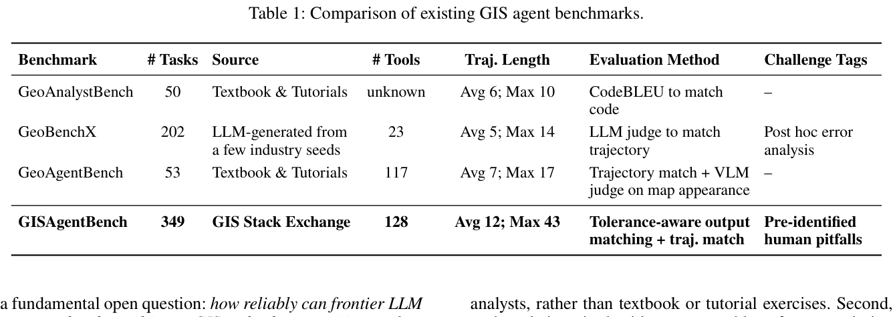

| 基准 | 任务数 | 来源 | 工具数 | 参考轨迹长度 | 评价方式 | 挑战标签 |
|---|---:|---|---:|---|---|---|
| GeoAnalystBench | 50 | 教科书与教程 | 未知 | 平均 6，最长 10 | 通过 CodeBLEU 匹配代码 | 无 |
| GeoBenchX | 202 | 基于少量行业种子由 LLM 生成 | 23 | 平均 5，最长 14 | LLM 裁判匹配轨迹 | 事后错误分析 |
| GeoAgentBench | 53 | 教科书与教程 | 117 | 平均 7，最长 17 | 轨迹匹配＋VLM 判断地图外观 | 无 |
| **GISAgentBench** | **349** | **GIS Stack Exchange** | **128** | **平均约 12，最长 43** | **容差感知输出匹配＋轨迹匹配** | **预先识别的人类常见陷阱** |

为填补这一空白，我们提出 GISAgentBench：其 349 项多步骤任务来自 GIS Stack Exchange（Stack Exchange, Inc.，2026）——面向 GIS 从业者的大型公开问答社区——并利用六个地理研究区域的真实公开数据进行实例化。据作者所知，这是首个取材于社区真实从业者问题、并使用精确真实值输出评分的 GIS 智能体基准。

从业者来源带来五项特征。**第一**，任务是真实分析人员在实际工作中提出的问题，而不是教材或教程练习。**第二**，每项任务都有可执行参考解法及精确真实值输出文件，能够用严格、确定性、容差感知的输出匹配方法评分。**第三**，同时评估智能体轨迹和最终输出，从而区分规划失败与执行失败。**第四**，规模和深度显著超越既有工作：349 项任务的参考解法最多需要 43 次 API 调用、平均 11.7 次，明显长于以往基准。**第五，也是最重要的一点**，作者预先标注任务中的实际注意事项，即 CRS、单位、NoData、边界及几何问题。这些条件对人类专家同样高度易错，可以检验 LLM 智能体是否会落入相同陷阱。

研究在统一框架下评估了六种 LLM 智能体：使用固定的 128 个 GIS API、确定性容差感知输出匹配和轨迹级诊断。结果表明，真实 GIS 工作流仍远超当前模型的可靠能力，最优模型在严格评分下也仅解决 32.7% 的任务。量化接近度分析进一步表明，智能体恢复几何形状的能力远好于恢复准确数值属性及完整记录集合；预先标注的陷阱能够预测任务失败，其中几何/拓扑错误及 CRS 不匹配破坏性最大。作者计划公开发布完整任务集、参考轨迹和真实值输出。

## 2 GIS 智能体基准（原文第 2–5 页）

GISAgentBench 由从 GIS Stack Exchange 从业者问题整理的 349 项多步骤 GIS 任务组成，并在六个研究区域的真实公开空间数据上构建。每项任务包含以从业者口吻表达的问题描述、输入数据集、明确所需文件及评分方式的输出契约（output contract）、可执行的参考轨迹，以及由专家标注的任务家族和实际易错陷阱。

任务划分为五类：

- **空间连接与地理编码（Spatial Joining & Geocoding，SJ&G）**：在空间与表格数据之间关联记录、坐标或要素，共 96 项任务。
- **空间叠加与适宜性分析（Spatial Overlay & Suitability Analysis，SO&SA）**：利用空间谓词、缓冲、相交或筛选准则组合图层，以确定满足空间约束的区域，共 93 项任务。
- **地形建模与水文分析（Terrain Modeling & Hydrological Analysis，TM&HA）**：根据高程数据生成坡度、排水、流域及水流相关结果，共 63 项任务。
- **空间格局分析（Spatial Pattern Analysis，SPA）**：测量几何、拓扑或分布结构，包括聚类、邻近格局、稀疏化和形态学，共 52 项任务。
- **遥感与影像分析（Remote Sensing & Image Analysis，RS&IA）**：利用掩膜、分类、像元计算或分区汇总处理栅格影像及派生指数，共 45 项任务。

**图 1　GISAgentBench 五大任务家族的示例（原文第 3 页）**

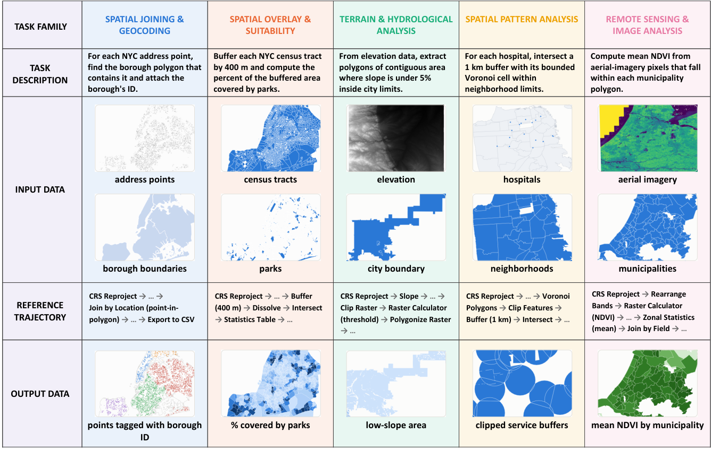

图中五列任务分别为：①纽约市各地址点匹配所属行政区多边形并附加行政区 ID；②对纽约市人口普查区建立 400 米缓冲区，计算其被公园覆盖的面积百分比；③从高程数据中提取市界内部坡度小于 5% 的连续区域多边形；④对每家医院，将其 1 千米缓冲区与受街区范围约束的 Voronoi 单元相交；⑤计算每个市镇多边形内部航空影像像元的平均 NDVI。每列都展示任务描述、输入数据、参考轨迹与输出数据。

智能体收到一项分析师会实际提出的任务和一组数据文件，必须返回指定文件；其字段、坐标系统和数值容差已经预先规定。完成任务意味着组合具名地理处理操作：每次操作读取一个或多个图层（包括带几何字段的表），并产生新文件。有些操作根据空间位置关联图层，例如识别点落在哪个多边形内部；有些构造新几何，例如距要素指定距离内的区域；还有些将像元网格汇总为每个区域的一个数值。由于每次调用依赖前一次生成的文件，任务是有依赖关系的工作流，而非独立查询集合；评分对象是**空间文件，而非字符串**。

### GIS API 工具执行框架

智能体只能通过固定的 **128 个 GIS API** 与空间数据交互。这些 API 由 QGIS 命令行接口及其 GDAL 算法支撑，同时结合 GeoPandas、Rasterio、Shapely、pandas/NumPy 和 SciPy。每个 API 均提供统一的类型化参数接口和明确的返回契约，六个被评估模型使用完全相同的工具集合。表 2 总结功能覆盖范围；附录 C 列出全部 128 个 API 及其描述和参数。固定工具框架设计是研究核心：每项任务都经过验证，确保可以使用这些 API 解决，因此不会把“缺少工具”混入模型能力差异；保持工具框架恒定后，能够单独考察不同智能体选择、配置参数及编排 GIS 操作的能力。

**表 2　128 个 API 的功能覆盖范围（原文第 4 页）**

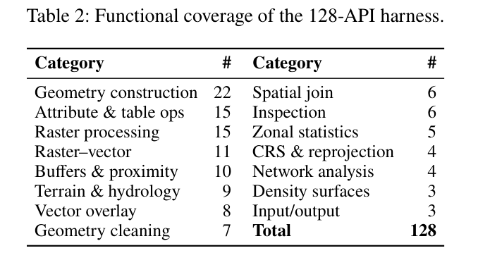

| 类别 | API 数量 | 类别 | API 数量 |
|---|---:|---|---:|
| 几何构造 | 22 | 空间连接 | 6 |
| 属性与表操作 | 15 | 检查 | 6 |
| 栅格处理 | 15 | 分区统计 | 5 |
| 栅格—矢量 | 11 | CRS 与重投影 | 4 |
| 缓冲与邻近 | 10 | 网络分析 | 4 |
| 地形与水文 | 9 | 密度表面 | 3 |
| 矢量叠加 | 8 | 输入 / 输出 | 3 |
| 几何清理 | 7 | **总计** | **128** |

### 2.1 任务集筛选与构建

GISAgentBench 建立于 GIS Stack Exchange，这是大型 GIS 从业者公开问答论坛。不同于基于教材、教程或合成任务的基准，它取材于地理空间业务分析中的真实问题：在职分析师自然提出问题，反映真实分析需求及工作流复杂度；由社区验证的答案则为构造参考解法提供基础。

**图 2　GISAgentBench 的任务构建流水线（原文第 4 页）**

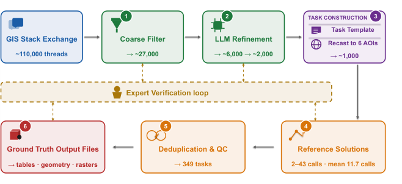

构建流程如下。首先爬取约 **110,000** 个问答主题，通过确定性筛选，根据 GIS 术语、工作流动词和数据上下文对主题评分，排除过短、主要讨论软件配置或地图显示而非空间分析、以及重复的帖子，留下约 **27,000** 个。随后用 GPT-5-mini 进行两轮 LLM 筛选：第一轮轻量初筛淘汰没有具体空间目标的帖子，留下约 **6,000** 个；第二轮更严格，仅保留需要不止一次操作、能够由固定输入复现且可以在不改变分析问题的前提下迁移到新数据的任务，得到约 **2,000** 个候选。

两轮筛选提示词并非一次性写成，而是通过专家反馈反复迭代：GIS 专家针对每版筛选标准，核查 50–100 个主题的初始批次，将反复出现的错误纳入提示词，直至筛选结果与专家判断一致。每个保留主题均转换为统一基准任务模板，包括从业者式提示词、指定区域内的输入数据、任务参数，以及列明输出文件、字段、空间参考和容差的输出契约。将任务重构到指定区域（2.2 节）、生成参考轨迹（2.3 节）后，删除无法从给定输入生成参考结果、轨迹重复或轨迹过短不足以要求多步骤推理的任务。最后，把具有相同有序操作序列的任务去重，形成 **349 项最终任务**。附录 B 给出了完整关键词词典、筛选阈值，以及筛选和任务起草提示词。

每项任务还由 GIS 专家标注其涉及的陷阱，包括 CRS 不匹配（244 项）、边界歧义（180 项）、几何和拓扑错误（113 项）、NoData 值（90 项）以及单位不匹配（47 项）。提前标注有助于检验智能体是否会落入人类专家常见的陷阱。表 3 将任务类型与陷阱类型交叉汇总，可见不同数据模型具有不同的风险结构。矢量家族主要受到坐标系和几何问题影响：空间连接与地理编码任务中，约 90% 存在 CRS 注意事项，约 46% 存在几何注意事项，而 NoData 极少（96 项中仅 3 项）。栅格家族恰好相反：地形建模任务约 59%、遥感任务约 62% 涉及 NoData。

**表 3　任务家族与从业者常见陷阱的交叉统计（原文第 4 页）**

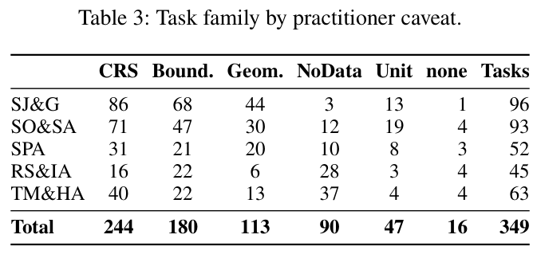

| 任务家族 | CRS | 边界 | 几何 | NoData | 单位 | 无标注 | 总任务 |
|---|---:|---:|---:|---:|---:|---:|---:|
| SJ&G | 86 | 68 | 44 | 3 | 13 | 1 | 96 |
| SO&SA | 71 | 47 | 30 | 12 | 19 | 4 | 93 |
| SPA | 31 | 21 | 20 | 10 | 8 | 3 | 52 |
| RS&IA | 16 | 22 | 6 | 28 | 3 | 4 | 45 |
| TM&HA | 40 | 22 | 13 | 37 | 4 | 4 | 63 |
| **总计** | **244** | **180** | **113** | **90** | **47** | **16** | **349** |

### 2.2 将任务在选定研究区域中进行地理重构

由于原始论坛讨论公开，其被采纳的答案已被搜索引擎收录，也可能包含在模型预训练数据中。将任务重新映射到不同地理区域，可以缓解这种数据泄漏：智能体面对的是从未在原讨论中出现的数据，因此不存在针对该实例的已发表答案。导入时对字段模式进行规范化，还能在字段名称层面减少泄漏。此过程保留任务的分析目标、空间谓词及数据角色，而改变地理区域、数据集、数据模式与最终数值。

这要求目标地理区域既各自包含丰富信息，又在整体上具有多样性。六个研究区域（表 4）为覆盖不同任务家族而选取，而非简单复制相同的图层组合：密集城市—海岸带及地籍环境适合连接、叠加和拓扑修复；山前地带与低起伏洪泛平原适合地形、水文及最小成本分析；人工水利控制景观适合受约束路径规划；具有国家标准化数据体系的欧洲环境可检验相同操作在美国数据约定之外的表现。各区域使用国家、城市及欧洲公共开放数据门户的数据，覆盖业务级矢量、栅格和表格图层。为确保源论坛主题所涉及的陷阱在重构后仍然存在，少数输入数据集经过轻微修改。附录 D 列出所有数据来源、主要图层的精确要素数量和每个栅格的完整特征。

**表 4　六个地理研究区域（原文第 5 页）**

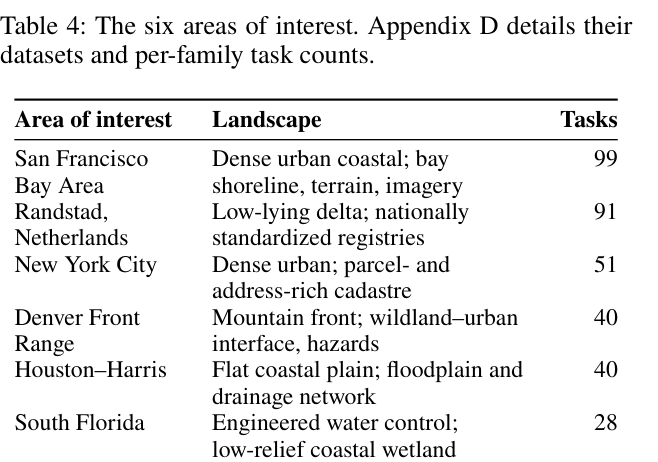

| 研究区域 | 景观特征 | 任务数 |
|---|---|---:|
| 旧金山湾区 | 密集城市海岸带；海湾海岸线、地形与影像 | 99 |
| 荷兰兰斯塔德（Randstad） | 低洼三角洲；国家级标准化登记系统 | 91 |
| 纽约市 | 高密度城市；宗地和地址数据丰富的地籍系统 | 51 |
| 丹佛山前地带 | 山前地区；野地—城市交界与灾害 | 40 |
| 休斯敦—哈里斯县 | 平坦海岸平原；洪泛区与排水网络 | 40 |
| 南佛罗里达 | 人工水利调控；低起伏海岸湿地 | 28 |

### 2.3 真实值参考轨迹与输出生成

每项任务附有可执行的参考轨迹及由其生成的输出文件。作者使用未被列入受评模型的 **Claude Fable 5** 模型生成并验证这些内容。发布的参考轨迹完全由智能体可以使用的同一套 128 个 API 表示，并在该工具框架中实际执行，生成真实值输出文件。为了交叉检验，作者还允许 Fable 5 直接访问输入数据并使用自由形式 Python，以独立推导和检查正确结果。整个基准的参考轨迹长度介于 **2–43 次 API 调用**，平均 **11.7 次**，涉及 92 个不同输入文件，体现了真实从业者工作流的组合深度。

质量保证分为两个步骤。首先，自动复查对每个参考步骤进行静态 API 签名验证，找出虚构工具、拼写错误的参数和未绑定的中间输出。其次，更重要的是，作者团队的三位 GIS 专家直接复核参考轨迹：不因为模型生成了某条轨迹或命令能够成功运行，就直接接受该轨迹。专家会逐步人工追踪、检查中间输出并目视核查最终空间结果。这项专家复核发现了自动验证无法捕捉的缺陷：字段计算引用上游操作从未产生的列；在未投影的高程模型上计算坡度；输出契约要求提示词从未保证存在的标识列。对于描述含糊、必须修改任务规范才能使其可解的任务，作者直接剔除，而不在原任务上就地修补。具体细节见附录 E。

## 3 实验评估（原文第 5–7 页）

### 3.1 实验设置

**框架。** 作者将每个模型都作为使用工具的智能体，在 LangChain 实现的单一 ReAct（Yao 等，2023）循环中运行。128 个 GIS API 分别注册为带类型的工具，因此所有模型看到相同接口。智能体在推理与行动之间交替，直至宣布完成或耗尽步骤预算；系统记录每次工具调用、参数、返回值和错误。

**指标。** 模型输出误差使用严格任务成功率（Task Success Rate，**TSR**）以及量化接近度评分（Quantitative Closeness Score，**QCS**）。TSR 是在较小容差阈值内与真实值匹配的任务比例；QCS 汇总非空间与空间属性的接近程度，缺失输出记为 0。非空间属性包括类别属性（加权 F1）与数值属性（1 − sMAPE，对称平均绝对百分比误差）。行通过输出契约指定的标识列进行匹配，而不是按记录位置匹配；属性评分只在已匹配行之间计算。空间属性包括栅格网格以及多点、多折线和多多边形几何，按实体级 F1 衡量：面积输出使用交并比（IoU）阈值，点和线输出使用距离阈值。另外报告轨迹接近度（以粗粒度功能类别比较关键 API 调用的相似性）、轨迹长度和工具调用错误率。完整定义见附录 F。

**基础设施。** 智能体执行和全部地理处理均在一台配备 32 核 CPU、512 GB 内存的计算节点上的可复现容器中完成。不使用 GPU；六个模型均通过托管 API 服务访问。附录 A 给出软件环境、解码参数和模型路由方式。

**模型。** 六种模型中，三种闭源模型为 Gemini-3.1-Pro、Claude-4.6-Opus 和 GPT-5.4；三种开源模型为 DeepSeek-V4-Pro、Qwen3.6-27B 和 GPT-OSS-120B。所有模型均评估全部 349 项任务，使用相同工具框架、提示词、最多 50 次工具调用的预算及贪心解码，以使测得差异主要反映模型能力而非外部脚手架。

### 3.2 总体输出准确率分析

表 5 总结各模型在全部任务及不同任务家族上的总体表现与输出准确性。没有一个智能体解决超过三分之一的任务。Gemini-3.1-Pro 的严格 TSR 最高，为 **0.327**，六模型平均为 **0.238**；三个闭源模型总体形成优势梯队，开源模型的成功率大约只有其一半。QCS 排名基本一致，但数值普遍高出 TSR 两至三倍（**0.380–0.663**），表明典型失败运行并非完全没有结果，而是恢复了大量预期内容。

**表 5　六种模型的严格任务成功率与量化接近度（原文第 6 页）**

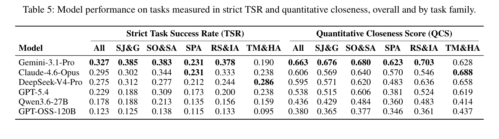

| 模型 | 严格 TSR（全部） | QCS（全部） |
|---|---:|---:|
| Gemini-3.1-Pro | **0.327** | **0.663** |
| Claude-4.6-Opus | 0.295 | 0.606 |
| DeepSeek-V4-Pro | 0.275 | 0.595 |
| GPT-5.4 | 0.229 | 0.538 |
| Qwen3.6-27B | 0.178 | 0.436 |
| GPT-OSS-120B | 0.123 | 0.380 |

任务难度主要由工作流类型决定，而非模型特定优势：六个模型的任务家族难度排序一致。空间叠加与适宜性分析最容易，空间格局分析最困难；后者 QCS 同样偏低，说明输出确实错误，而不只是略超出容差。地形建模出现相反情况：其 TSR 倒数第二，但 QCS 在各任务家族中最高，表明较长的栅格流水线往往能执行完毕，结果却略微超出严格容差。

数值接近度及分类一致性普遍较高，对模型的区分能力相对弱（表 6、表 7）；更有判别力的信号是记录覆盖率和几何。空间质量相对较好，实体级 F1 达 **0.76–0.89**，说明智能体恢复几何形状的能力远好于恢复完整且属性取值完全正确的记录集合。严格评分失败主要发生在属性和覆盖完整性层面，而不只是几何形状层面。

**表 6　非空间输出准确率（原文第 6 页）**

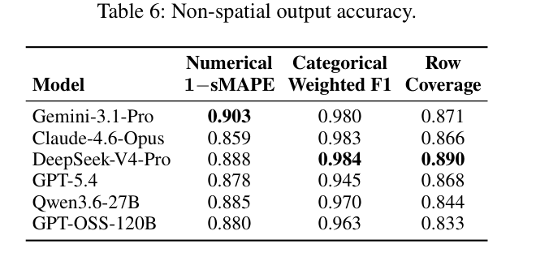

| 模型 | 数值 1−sMAPE | 类别加权 F1 | 行覆盖率 |
|---|---:|---:|---:|
| Gemini-3.1-Pro | 0.903 | 0.980 | 0.871 |
| Claude-4.6-Opus | 0.859 | 0.983 | 0.866 |
| DeepSeek-V4-Pro | 0.888 | 0.984 | 0.890 |
| GPT-5.4 | 0.878 | 0.945 | 0.868 |
| Qwen3.6-27B | 0.885 | 0.970 | 0.844 |
| GPT-OSS-120B | 0.880 | 0.963 | 0.833 |

**表 7　实体级匹配的空间输出准确率（原文第 6 页）**

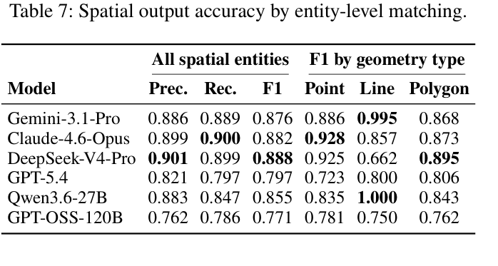

| 模型 | 精确率 | 召回率 | F1（总体） | 点 F1 | 线 F1 | 面 F1 |
|---|---:|---:|---:|---:|---:|---:|
| Gemini-3.1-Pro | 0.886 | 0.889 | 0.876 | 0.886 | 0.995 | 0.868 |
| Claude-4.6-Opus | 0.899 | 0.900 | 0.882 | 0.928 | 0.857 | 0.873 |
| DeepSeek-V4-Pro | 0.901 | 0.899 | 0.888 | 0.925 | 0.662 | 0.895 |
| GPT-5.4 | 0.821 | 0.797 | 0.797 | 0.723 | 0.800 | 0.806 |
| Qwen3.6-27B | 0.883 | 0.847 | 0.855 | 0.835 | 1.000 | 0.843 |
| GPT-OSS-120B | 0.762 | 0.786 | 0.771 | 0.781 | 0.750 | 0.762 |

### 3.3 智能体轨迹评估

图 3 将轨迹接近度与严格 TSR 对比。两者呈高度一致的趋势：执行更多必要操作的模型往往能完成更多任务，且两项指标均由相同的前三种模型领跑（相关系数 **r = 0.99**）。然而两种指标的绝对水平相差甚远：智能体覆盖了所需操作的 **68%–83%**，却仅完成 **12%–33%** 的任务。

**图 3　严格 TSR 与轨迹接近度的关系（原文第 6 页）**

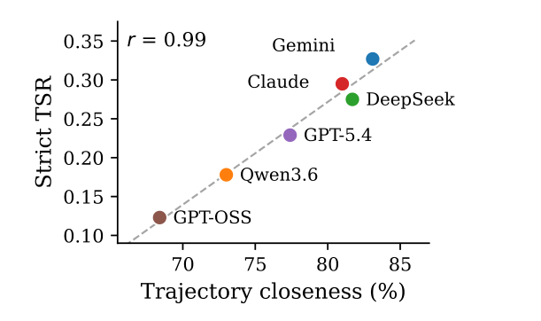

作者把轨迹接近度视为诊断指标，而非首要指标，仍以输出错误分析作为核心评价。直接把实际输出与精确真实值进行比较，是本基准区别于只能比对轨迹的既有研究的关键。正式的轨迹度量需要的不仅仅是一条正确参考轨迹：同一任务可能存在多种同样正确的轨迹，它们对独立步骤的执行顺序不同，也可能选择相互等价的操作。如何在这类空间中定义等价性留待未来研究。

模型轨迹的执行统计见表 8。平均每任务工具调用次数为 **13.6–28.5**。Qwen3.6-27B 的工具调用错误率更高，作者推测这可能与模型规模较小有关。工具错误率的排序与输出误差的排序也基本一致。

**表 8　平均每任务工具调用次数及工具调用错误率（原文第 6 页）**

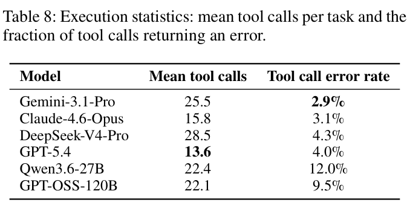

| 模型 | 平均工具调用次数 | 工具调用错误率 |
|---|---:|---:|
| Gemini-3.1-Pro | 25.5 | 2.9% |
| Claude-4.6-Opus | 15.8 | 3.1% |
| DeepSeek-V4-Pro | 28.5 | 4.3% |
| GPT-5.4 | 13.6 | 4.0% |
| Qwen3.6-27B | 22.4 | 12.0% |
| GPT-OSS-120B | 22.1 | 9.5% |

### 3.4 API 调用的计算成本

图 4 展示各模型在工具框架内执行任务所耗时间。由于不同云 API 服务商的计时不一致，作者不计入 LLM API 响应时间。GIS 工具执行时间呈现重尾分布，跨度达四个数量级：从不足一秒的属性编辑，到对 939,821 个地址点执行空间连接所需的 **2,633 秒**。耗时最长的 5% 运行占总执行时间的 38%，平均耗时约为中位数的两倍。不同模型触发的执行耗时差别不大，中位数从 Claude-4.6-Opus 的每任务 52 秒至 Gemini-3.1-Pro 的 72 秒，倍数为 1.38。模型的 token 消耗从 GPT-5.4 每任务 275k 到 DeepSeek-V4-Pro 每任务 829k。按任务家族拆分的结果见附录 G、H。

**图 4　各模型每任务工具执行时间分布（原文第 7 页，对数坐标；条形表示四分位距，圆点为中位数）**

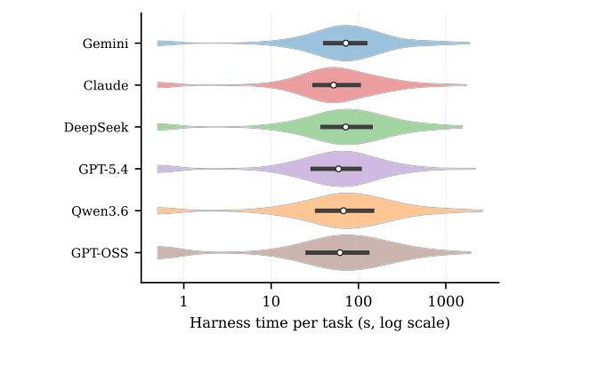

### 3.5 失败分析

对于每个有轨迹且最终输出错误的运行，评分系统生成书面诊断说明。作者将 **1,381** 条诊断说明按照固定机制集合进行人工标注，允许每次运行匹配多个标签；表 9 统计各机制出现频率。

**表 9　1,381 次“进行了尝试但结果错误”的运行中的失败机制（原文第 7 页）**

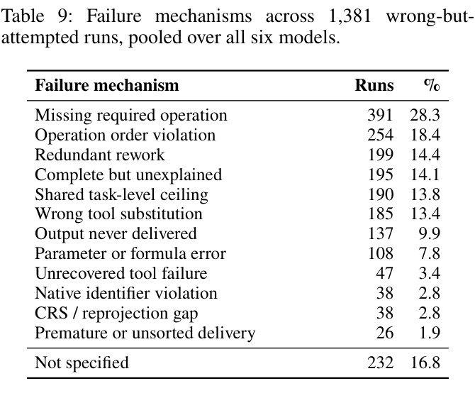

| 失败机制 | 运行次数 | 比例 |
|---|---:|---:|
| 缺失必要操作 | 391 | 28.3% |
| 操作顺序违反依赖关系 | 254 | 18.4% |
| 冗余返工 | 199 | 14.4% |
| 已完成但错误原因不明 | 195 | 14.1% |
| 多模型共同存在的任务级性能上限 | 190 | 13.8% |
| 使用错误工具替代 | 185 | 13.4% |
| 从未提交输出文件 | 137 | 9.9% |
| 参数或公式错误 | 108 | 7.8% |
| 工具失败后未恢复 | 47 | 3.4% |
| 违反原生标识符约束 | 38 | 2.8% |
| CRS / 重投影缺失 | 38 | 2.8% |
| 过早交付或输出未排序 | 26 | 1.9% |
| 未归类 | 232 | 16.8% |

失败主要集中在**工作流规划**而非单次工具调用。28.3% 的运行遗漏必要操作，18.4% 将正确操作以错误顺序执行；典型错误是先计算坡度，再对栅格重采样，而不是反过来。错误工具替代（13.4%）本质类似：智能体选用看似正确却在实际计算上不同的操作，例如本应使用汇总式空间连接，却采用普通空间连接。另外 14.4% 的运行重复或撤销已有步骤，无法收敛到正确结果。单次调用内部的参数或公式错误相对少见（7.8%）；9.9% 的运行计算了大量中间结果，却从未写出所要求的最终文件。

有三类标签反映的是分析局限，而不完全是智能体行为。**“已完成但错误原因不明”（14.1%）**是指任务所需操作全部以有效顺序执行，却仍输出错误结果，且仅凭工具名称序列无法找到原因；**“共享任务级上限”（13.8%）**是指全部模型在同一任务上以类似方式失败，提示问题可能在任务本身而非个体智能体；还有 **16.8%** 的诊断说明未能分配到已定义机制。

**按陷阱类型分析。** 数据完整性相关陷阱危害最大：在标注几何和拓扑错误的任务中，合并 TSR 降为 **0.152**；存在 CRS 不匹配时为 **0.220**；NoData 处理时为 **0.241**；边界歧义和单位不匹配等语言层面的陷阱则约为 **0.269–0.277**。空间谓词规定不足会产生语法上有效、语义上错误的输出，因此损害准确率，却不一定提高工具调用报错率。

### 3.6 案例研究

作者在每个任务家族中选取代表性的成功和失败案例，并将智能体输出与参考输出进行地图可视化对比。由于篇幅限制，这些案例均放在附录 I 中。

## 4 结论与未来工作（原文第 7 页）

本文介绍了 GISAgentBench，一个用于评估 LLM 智能体执行 GIS 专业人员实际开展的多步骤空间分析的基准。其 349 项任务源于真实从业者论坛中的问题，并重新映射到新地理区域，因此不存在针对重构实例的已发表答案。每项任务包含真实空间数据、可执行参考解法、真实值输出文件，以及标记从业者经常需要花费数小时排查的陷阱的专家注释。智能体通过固定的 128 个 GIS API 工作，并在任务指定容差内，将输出与参考结果进行确定性匹配；评分过程不依赖其他模型充当裁判。六种 LLM 智能体中，最强模型也仅完整解决 32.7% 的任务；失败以操作遗漏和操作顺序错误为主，而非格式错误的工具调用，说明当前能力瓶颈更偏向**工作流规划能力**，而不是 GIS 功能可访问性。

未来工作将把工具框架从开源库扩展到 ArcGIS Toolbox 等商业 GIS 工具库，从而覆盖现有 API 集不具备的功能；拓展目前主要集中在美国的研究区域；持续评测新发布的前沿模型，使基准能够反映能力前沿而非静态快照。对于开放式任务以及纯制图产品，确定性真实值输出匹配仍难以进行评分，因此相关评估仍是开放问题。

---

## 参考文献（原文第 7–9 页）

> 为确保能够准确检索和引用论文，作者姓名、论文英文原题、出版物名称、arXiv 编号和网址保留原始书目信息；下表补充主要学术文献题名的中文翻译。所有参考文献的**完整原始条目**随文逐条保留，不省略作者或来源。


```text
Chen, B.; Xu, Z.; Kirmani, S.; Ichter, B.; Driess, D.; Florence, P.; Sadigh, D.; Guibas, L.; and Xia, F. 2024a. SpatialVLM: Endowing Vision-Language Models with Spatial Reasoning Capabilities. arXiv preprint arXiv:2406.13537.
Chen, J.; Tang, J.; Qin, J.; Liang, X.; Liu, L.; Xing, E.; and
Lin, L. 2021a. GeoQA: A Geometric Question Answering
Benchmark Towards Multimodal Numerical Reasoning. In
Findings of the Association for Computational Linguistics:
ACL-IJCNLP.
Chen, M.; Tworek, J.; Jun, H.; Yuan, Q.; Pinto, H. P. d. O.;
Kaplan, J.; Edwards, H.; Burda, Y.; Joseph, N.; Brockman,
G.; et al. 2021b. Evaluating Large Language Models Trained
on Code. arXiv preprint arXiv:2107.03374.
Chen, Y.; Wang, W.; Lobry, S.; and Kurtz, C. 2024b. An
LLM Agent for Automatic Geospatial Data Analysis. arXiv
preprint arXiv:2410.18792.
City and County of Denver. 2026. Denver Open Data. https:
//opendata-geospatialdenver.hub.arcgis.com.
City and County of San Francisco. 2026. San Francisco Open
Data. https://data.sfgov.org.
City of New York. 2026. NYC Open Data. https://data.
cityofnewyork.us.
Colorado Department of Public Health and Environment.
2026. Colorado Geospatial Open Data. https://data-cdphe.
opendata.arcgis.com.
Federal Emergency Management Agency. 2026. FEMA
National Flood Hazard Layer. https://hazards.fema.gov/gis/
nfhl/rest/services/public/NFHL/MapServer.
Feng, J.; Liu, T.; Du, Y.; Guo, S.; Lin, Y.; and Li, Y. 2024.
CityGPT: Empowering Urban Spatial Cognition of Large
Language Models. arXiv preprint arXiv:2406.13948.
Goodchild, M. F. 2010. Towards Geodesign: Repurposing
Geography for the Design Professions. ESRI Press.
Gramacki, P.; Martins, B.; and Szymanski, B. 2024. Eval-
uation of Code LLMs on Geospatial Code Generation. In
Proceedings of the ACM SIGSPATIAL International Work-
shop on Advances in Resilient and Intelligent Cities.
Harris County, Texas. 2026. Harris County Open Data. https:
//geo-harriscounty.opendata.arcgis.com.
Hou, S.; Shen, Z.; Zhao, A.; Liang, J.; Gui, Z.; Guan, X.;
Li, R.; and Wu, H. 2025. GeoCode-GPT: A Large Language
Model for Geospatial Code Generation Tasks. International
Journal of Applied Earth Observation and Geoinformation.
Huang,Z.; Shen,Y.;Li, X.;Wei, Y.;Cheng,G.; Zhou,L.;Dai,
X.; and Qu, Y. 2019. GeoSQA: A Benchmark for Scenario-
based Question Answering in the Geography Domain at High
School Level. In Proceedings of the Conference on Empirical
Methods in Natural Language Processing and the Interna-
tional Joint Conference on Natural Language Processing,
5866–5871.
Jimenez, C. E.; Yang, J.; Wettig, A.; Yao, S.; Pei, K.; Press,
O.; and Narasimhan, K. 2024. SWE-bench: Can Language
Models Resolve Real-World GitHub Issues? arXiv preprint
arXiv:2310.06770.
Krechetova, V.; and Kochedykov, D. 2025. GeoBenchX:
Benchmarking LLMs in Agent Solving Multistep Geospatial
Tasks. In Proceedings of the ACM SIGSPATIAL Interna-
tional Workshop on Generative and Agentic AI for Multi-
Modality Space-Time Intelligence, 27–35.
Lai, Y.; Li, C.; Wang, Y.; Zhang, T.; Zhong, R.; Zettlemoyer,
L.; Yih, W.-t.; Fried, D.; Wang, S.; and Yu, T. 2023. DS-1000:
A Natural and Reliable Benchmark for Data Science Code
Generation. In Proceedings of the International Conference
on Machine Learning.
Li, Z.; and Ning, H. 2024. LLM-Geo: Autonomous GIS with
Large Language Models. Transactions in GIS.
Li, Z.; Xia, L.; Tang, J.; Xu, Y.; Shi, L.; Xia, L.; Yin, D.;
and Huang, C. 2024. UrbanGPT: Spatio-Temporal Large
Language Models. In Proceedings of the ACM SIGKDD
International Conference on Knowledge Discovery and Data
Mining.
Liu, X.; Yu, H.; Zhang, H.; Xu, Y.; Lei, X.; Lai, H.; Gu, Y.;
Ding, H.; Men, K.; Yang, K.; et al. 2024. AgentBench: Eval-
uating LLMs as Agents. In Proceedings of the International
Conference on Learning Representations.
Mialon, G.; Dessì, R.; Lomeli, M.; Nalmpantis, C.; Pasunuru,
R.; Raileanu, R.; Rozière, B.; Schick, T.; Dwivedi-Yu, J.; Ce-
likyilmaz, A.; et al. 2023. GAIA: A Benchmark for General
AI Assistants. arXiv preprint arXiv:2311.12983.
Miami-Dade County. 2026. Miami-Dade Open Data. https:
//gis-mdc.opendata.arcgis.com.
OpenStreetMap contributors. 2026. OpenStreetMap. https:
//overpass-api.de.
Publieke Dienstverlening Op de Kaart. 2026. Publieke Di-
enstverlening Op de Kaart (PDOK). https://api.pdok.nl.
Qin, Y.; Liang, S.; Ye, Y.; Zhu, K.; Yan, L.; Lu, Y.; Lin,
Y.; Cong, X.; Tang, X.; Qian, B.; et al. 2023. ToolBench:
Facilitating Large Language Models to Master 16000+ Real-
World APIs. arXiv preprint arXiv:2307.16789.
Schick, T.; Dwivedi-Yu, J.; Dessì, R.; Raileanu, R.; Lomeli,
M.; Zettlemoyer, L.; Cancedda, N.; and Scialom, T. 2024.
Toolformer: Language Models Can Teach Themselves to Use
Tools. Advances in Neural Information Processing Systems,
36.
South Florida Water Management District. 2026. South
Florida Water Management District Geodata. https://
geodata.sfwmd.gov.
Stack Exchange, Inc. 2026. GIS Stack Exchange. https:
//gis.stackexchange.com.
Statistics Netherlands. 2026. Statistics Netherlands (CBS)
Open Data. https://opendata.cbs.nl.
U.S. Bureau of Labor Statistics. 2026. Occupational Out-
look Handbook: Cartographers and Photogrammetrists, Sur-
veyors, and Surveying and Mapping Technicians. https:
//www.bls.gov/ooh/architecture-and-engineering/.
U.S. Census Bureau. 2026. US Census TIGER/Line Shape-
files. https://www.census.gov/geographies/mapping-files/
time-series/geo/tiger-line-file.html.
U.S. Geological Survey. 2026. USGS National Map. https:
//tnmaccess.nationalmap.gov/api/v1/products.
Wei, J.; Wang, X.; Schuurmans, D.; Bosma, M.; Xia, F.; Chi,
E.; Le, Q. V.; and Zhou, D. 2022. Chain-of-Thought Prompt-
ing Elicits Reasoning in Large Language Models. Advances
in Neural Information Processing Systems, 35.
Xu, Z.; Zhang, Y.; Adhikari, S.; Islam, S.; Xiao, T.; Liu, Z.;
Chen, S.; Yan, D.; and Jiang, Z. 2025. EarthSpatialBench:
Benchmarking Spatial Reasoning Capabilities of Multimodal
LLMs on Earth Imagery. arXiv preprint arXiv:2602.15918.
Yao, S.; Chen, H.; Yang, J.; and Narasimhan, K. 2022. Web-
Shop: Towards Scalable Real-World Web Interaction with
Grounded Language Agents. In Advances in Neural Infor-
mation Processing Systems, volume 35.
Yao, S.; Zhao, J.; Yu, D.; Du, N.; Shafran, I.; Narasimhan, K.;
and Cao, Y. 2023. ReAct: Synergizing Reasoning and Acting
in Language Models. In Proceedings of the International
Conference on Learning Representations.
Yu, B.; Yang, C.; Hou, D.; Liu, C.; Liu, J.; Wang, C.; Zhang,
Z.; Li, H.; and Yang, W. 2025. GeoAgentBench: Benchmark-
ing LLM Agents for Geospatial Tasks. arXiv preprint.
Zhang, Q.; Gao, S.; Wei, C.; Zhao, Y.; Nie, Y.; Chen, Z.;
Chen, S.; Su, Y.; and Sun, H. 2025. GeoAnalystBench: A
GeoAI Benchmark for Assessing Large Language Models
for Spatial Analysis Workflow and Code Generation. Trans-
actions in GIS, 29.
Zhang, Y.; Wei, C.; Wu, S.; He, Z.; and Yu, W.
2023. GeoGPT: Understanding and Processing Geospa-
tial Tasks through an Autonomous GPT. arXiv preprint
arXiv:2307.07930.
```


### 主要文献题名中文对照

| 英文文献标识 / 论文 | 中文题名 |
|---|---|
| SpatialVLM | SpatialVLM：赋予视觉—语言模型空间推理能力 |
| GeoQA | GeoQA：面向多模态数值推理的几何问答基准 |
| Evaluating Large Language Models Trained on Code | 评估基于代码训练的大语言模型 |
| An LLM Agent for Automatic Geospatial Data Analysis | 用于自动地理空间数据分析的 LLM 智能体 |
| CityGPT | CityGPT：增强大语言模型的城市空间认知能力 |
| Towards Geodesign | 迈向地理设计：将地理学重新应用于设计专业 |
| Evaluation of Code LLMs on Geospatial Code Generation | 代码大语言模型在地理空间代码生成任务上的评估 |
| GeoCode-GPT | GeoCode-GPT：用于地理空间代码生成任务的大语言模型 |
| GeoSQA | GeoSQA：高中地理领域情境式问答基准 |
| SWE-bench | SWE-bench：语言模型能否解决真实 GitHub 问题？ |
| GeoBenchX | GeoBenchX：评估 LLM 智能体解决多步骤地理空间任务的能力 |
| DS-1000 | DS-1000：自然且可靠的数据科学代码生成基准 |
| LLM-Geo | LLM-Geo：基于大语言模型的自主 GIS |
| UrbanGPT | UrbanGPT：时空大语言模型 |
| AgentBench | AgentBench：把大语言模型作为智能体进行评估 |
| GAIA | GAIA：通用人工智能助手评估基准 |
| ToolBench | ToolBench：使大语言模型掌握一万六千余个真实 API |
| Toolformer | Toolformer：语言模型能够自学使用工具 |
| EarthSpatialBench | EarthSpatialBench：基于地球影像评估多模态 LLM 的空间推理能力 |
| WebShop | WebShop：面向可落地语言智能体的可扩展真实网页交互 |
| ReAct | ReAct：协同语言模型中的推理与行动 |
| GeoAgentBench | GeoAgentBench：面向地理空间任务的大语言模型智能体基准 |
| GeoAnalystBench | GeoAnalystBench：评估大语言模型空间分析工作流及代码生成能力的 GeoAI 基准 |
| GeoGPT | GeoGPT：通过自主 GPT 理解并处理地理空间任务 |

---

# 附录（原文第 10–29 页）

以下附录记录复现实验所需的实现细节及实验设置，同时呈现因正文篇幅限制而未能纳入的扩展统计表与分析。

## 附录 A　可复现性细节（原文第 10 页）

### A.1 模型访问与解码

六个受测模型均通过托管 API 服务访问，没有模型部署在本地硬件，因此推理阶段不使用 GPU。Gemini-3.1-Pro、Claude-4.6-Opus、GPT-5.4 及 GPT-OSS-120B 通过代理供应商端点的机构 API 网关访问；DeepSeek-V4-Pro 和 Qwen3.6-27B 通过 OpenRouter 访问。论文中的全部实验运行于 **2026 年 7 月**。

表 A1 给出了全部使用的参数。解码为贪心模式：六个模型的温度显式设为 0，不覆盖 top-p、top-k 或重复惩罚等其他采样参数，统一采用供应商默认值。作者没有设置随机种子，因为托管 API 不提供随机种子控制；温度为 0 是唯一可用的确定性机制。因此不能保证托管模型的逐位完全复现，供应商还可能在固定端点名称后更改实际模型版本。每项任务、每种模型只运行一次，所以论文报告值是**单次运行结果**，不是重复实验的均值。

**表 A1　六模型统一采用的最终参数；未进行超参数搜索**

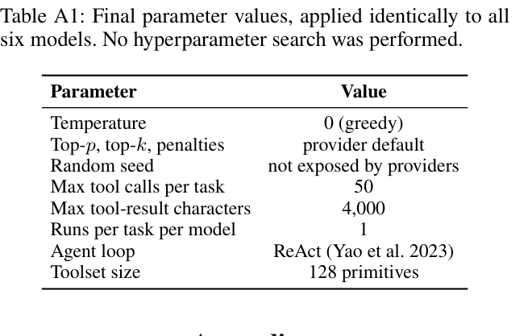

| 参数 | 值 |
|---|---|
| 温度（Temperature） | 0（贪心） |
| top-p、top-k、惩罚项 | 服务商默认 |
| 随机种子 | 服务商未开放 |
| 每项任务最多工具调用 | 50 |
| 工具返回结果最大字符数 | 4,000 |
| 每模型每任务运行次数 | 1 |
| 智能体循环 | ReAct（Yao 等，2023） |
| 工具集合大小 | 128 个基础功能 |

### A.2 软硬件环境

智能体执行及全部地理处理都在一台拥有 **32 个 CPU 核心、512 GB 内存**的计算节点上的可复现容器内运行，不使用 GPU。软件环境为 Ubuntu 25.10、Python 3.11.15、QGIS 4.0.2、GDAL/OGR 3.10.3、PROJ 9.6.0、GEOS 3.13.1、GeoPandas 1.1.3、Rasterio 1.4.4、Shapely 2.1.2 和 PyProj 3.7.2。由于基准中的每项任务均通过与已存储真实值文件进行确定性输出匹配来评分，因此在给定固定智能体轨迹集的情况下，评估过程可完全复现，不依赖生成这些轨迹时所使用的模型服务端点。

## 附录 B　任务集构建细节（原文第 10–12 页）

本附录给出正文 2.1 节中构建流水线的具体筛选标准和提示词。

### B.1 来源与爬取

通过 Stack Exchange API 从 GIS Stack Exchange 收集主题帖子，保留提问标题、正文、标签及回答正文。爬虫中还实现了针对第二个从业者论坛的抓取器，但本次发布未使用；GISAgentBench 中的每项任务均源自 GIS Stack Exchange。

### B.2 确定性预筛选

第一阶段完全不使用语言模型。系统根据 **7 组正向术语词典**和 **8 类排除词表**为每个主题评分，所有词项都被编译为含词边界的正则表达式。下列词表按流水线源码中的写法完整保留，避免把作为程序精确匹配键的英文字符串翻译后破坏其复现功能。词表类别依次为：GIS 核心术语（53）、工作流操作动词（54）、网络分析（19）、GIS API 术语（21）、数据上下文（27）、任务信号动词（28）、结果信号词（18）；排除词表包括“并非任务”（21）、“仅界面显示”（19）、“环境与安装”（14）、“在线服务”（12）、“软件推荐”（10）、“一般性问题”（5）、“低信息量求助”（10）和“代码报错”（10）。


<details><summary>展开完整正向与排除词典（精确英文检索词元）</summary>

```text
Positive dictionaries.
GIS core terminology (53). arcgis, arcgis pro, arcmap, arcpy, ar-
cpy.analysis, arcpy.conversion, arcpy.da, arcpy.management,
arcpy.mp, arcpy.na, arcpy.sa, contour, coordinate system, crs,
datum, datum transformation, dem, epsg, feature class, feature
layer, featureclass, file geodatabase, geodatabase, geographic
coordinate system, geometry, geoprocess, geoprocessing, geo-
tiff, gis, hydrology, image analyst, lidar, map algebra, nad83,
network analyst, parcel, point, polygon, polyline, projected co-
ordinate system, projection, raster, shapefile, spatial analyst,
spatial reference, tin, topology, utm, vector, watershed, web
mercator, wgs84, wkid.
Workflow verbs (54). add field, append, aspect, buffer, calculate
field, clip, contour, copy features, cost distance, cost path, de-
fine projection, dissolve, erase, euclidean distance, extract by
mask, extract values to points, feature class to feature class, flow
accumulation, flow direction, focal statistics, generate near ta-
ble, idw, intersect, join field, kernel density, kriging, least cost
path, make feature layer, make xy event layer, merge, mosaic to
new raster, near, pairwise buffer, pairwise clip, pairwise erase,
pairwise intersect, point density, project raster, raster calcula-
tor, reclassify, reproject, sample, select layer by attribute, select
layer by location, slope, snap raster, spatial join, stream order,
summarize within, table to table, tabulate intersection, union,
viewshed, zonal statistics.
Network analysis (19). add locations, closest facility, impedance,
location allocation, make closest facility analysis layer, make
closest facility layer, make od cost matrix analysis layer, make
route analysis layer, make service area layer, network dataset,
od cost matrix, origin destination cost matrix, route, routing,
service area, shortest path, solve tool, travel mode, turn restric-
tion.
GIS API terms (21). addfield, arcpy.describe, arcpy.exists, ar-
cpy.getcount, arcpy.listfeatureclasses, arcpy.listfields, ar-
cpy.management.getcount, calculatefield, copyfeatures, get-
count, insertcursor, listdatasets, listfeatureclasses, listfields,
listtables, makefeaturelayer, searchcursor, selectlayerbyat-
tribute, selectlayerbylocation, spatialreference, updatecursor.
Data context (27). .csv, .gdb, .geojson, .gpkg, .img, .shp, .tif, .tiff,
address, addresses, attribute table, building footprint, field
name, field names, latitude, line layer, longitude, objectid, point
layer, polygon layer, road network, shape@, shape@xy, sql,
street centerline, timestamp, where clause.

Task-signal verbs (28). aggregate, buffer, calculate, classify, clip,
compute, convert, create, derive, estimate, extract, find,
geocode, identify, intersect, join, overlay, produce, project, re-
pair, reverse geocode, route, sample, segment, summarize, tab-
ulate, transform, validate.
Result-signal terms (18). classification, count, csv, density, fea-
ture class, feature layer, hot spot, layer, mean, output, point,
polygon, polyline, raster, result, route, summary, table.
Blacklist families.
Not a task (21). account, announcement, career, community
guidelines, enhancement, feature request, hiring, idea, intern-
ship, job posting, license, licensing, login, moderator, pricing,
release notes, roadmap, server outage, service issue, status
page, subscription.
Interface only (19). display, export format, hatch fill, html margin,
icon, label, labeling, layout, legend, panel, pop up, popup, print
layout, render, ribbon, style only, styling, symbology, toolbar.
Environment and installation (14). cannot load, conda, corrupt
package, dependency, environment, failed to load, install, in-
stallation, package, packages, pip, plugin, upgrade, version.
Online services (12). access denied, arcgis online, geoserver, not
running, permission, portal, publish, publishing, refresh, ser-
vice unavailable, submitted but not running, sync.
Software recommendation (10). basemap provider, best soft-
ware, best tool, imagery provider, recommend a, recommend
software, recommendation, tile provider, what software, which
software.
General questions (5). general question, is there a way, what is
better, what is the difference, why does.
Weak help requests (10). any ideas, can anyone help, can some-
one help, does anyone know, i am stuck, i need help, not sure
why, please help, thanks in advance, what am i doing wrong.
Code errors (10). attributeerror, exception:, indexerror, keyer-
ror, runtimeerror, stack trace, syntaxerror, traceback, typeer-
ror, valueerror.
```

</details>


主题的关键词得分由命中的词典词项数量和匹配的任务类别数量相加得到。当一个主题包含某类任务至少两个主题词，或至少一个主题词与一个操作词时，认为命中该任务类别。满足下列任一条件时，主题被剔除：问题描述少于 **420 个字符**；关键词得分低于 **4**；没有命中任何任务家族且同时缺少工作流信号与至少两个数据上下文词；缺少任务或结果信号；数据上下文词少于两个。对于近似重复主题，通过小写化标题和问题正文前 **1,200** 个字符生成 SHA-256 特征签名，进行去重。

### B.3 LLM 筛选

随后由 GPT-5-mini 执行两轮筛选。第一轮是低成本初筛，对以下条件输出保留或拒绝决定。原提示词的中文译文如下：

> **若符合以下任一条件，则拒绝主题：**（1）不是 GIS 工作问题；（2）主要讨论账号、许可证、访问权限、设置、安装、依赖包、插件或版本；（3）主要讨论显示、颜色、标注、图例、版式、弹窗、表单、样式、设置或地图外观；（4）主要讨论代码语法、SQL 语法、API 语法、脚本错误或工具设置，而非 GIS 结果；（5）主要讨论文件导入导出、文件格式特性、元数据、存储或文档；（6）寻求一般性建议或解释，而非具体 GIS 输出；（7）仅为非常简单的一步转换、查询、报告、提取或清理；（8）主要讨论速度、硬件、压缩、并行或渲染；（9）GIS 目标不明确。

第二轮筛选更加严格，决定存活的论坛主题能否成为基准种子，原提示词的中文译文如下：

> **只保留能够成为高质量 GIS 基准种子的主题，并且必须同时满足：**（1）帖子包含真实 GIS 任务，而不只是程序错误、界面问题或软件问题；（2）任务有明确的空间目标和最终结果；（3）任务可以写成相同输入始终产生相同输出；（4）能够迁移到本地 GIS 文件而不改变原始问题；（5）工作量超过一次非常简单的工具调用；（6）帖子或答案提供了足以随后撰写 GIS 参考解法的细节。如果后续任务编写者需要虚构新的目标、猜测缺失事实或把帖子改写成另一道题，则拒绝。

此轮返回结构化输出，而非简单标签。结构包括：主题是否完整表述问题、地理重构是否能保留原意、短参考轨迹是否可行的布尔值，以及对复杂性、可用性、可复现性、歧义程度及参考解法清晰度的整数评分。

### B.4 任务起草

保留下来的主题被转换为基准任务模板：任务标识符、由标题/目标/输入/所需输出/约束组成的从业者式提示词、与选定区域具体文件绑定的输入数据角色、任务参数，以及指定文件类型、必需字段、空间参考与容差的输出契约。任务起草阶段必须保留原来的分析目标，明确禁止虚构另一个问题。需要重新发明问题才能完成的草稿应被拒绝，而不能随意修补。每份草稿还需要再经过一次模型审核，才能进入参考结果生成阶段。

原任务起草指令的中文译文如下：

> 根据一条 GIS 论坛主题创建一个本地 GIS 基准任务。只有当任务清晰、本地可执行、可核验，并且仍然与源帖子讨论的真实问题相同时，才返回 `status=ready`。如果任务需要缺失的数据、猜测的输入字段、虚构的栅格类别含义、虚构的选中要素、虚假的行配对、虚假的 ObjectID 匹配、不受支持的网络分析、人工决策或另一道 GIS 问题，则拒绝。只返回一个严格符合模式要求的 JSON 对象。

未通过模式或格式验证的草稿会送入修复提示词，允许修正字段，但仍受到同一条禁令约束：不得虚构另一道题。


## 附录 C　完整 GIS API 工具集（原文第 11–20 页）

论文在固定工具框架中向所有受测智能体公开 **128 个 API**，依功能分类汇总于表 C2/C3。以下完整保留每个 API 的**程序标识符与参数名**，并将说明翻译为中文。可选参数仍使用原文方括号表示；英文 docstring 的逐字文本可在随附的英文原文提取文件中核对。原文指出，128 个 API 中有 **111 个**实际出现在至少一条发布的参考轨迹中，其余虽可用但未被任何任务要求。约三分之二的 API 调用 QGIS 处理算法，其余直接使用 GeoPandas、Rasterio、Shapely、pandas/NumPy 或 SciPy，少数为框架内部的组合调用。


### 原文第 13 页：API 清单对照

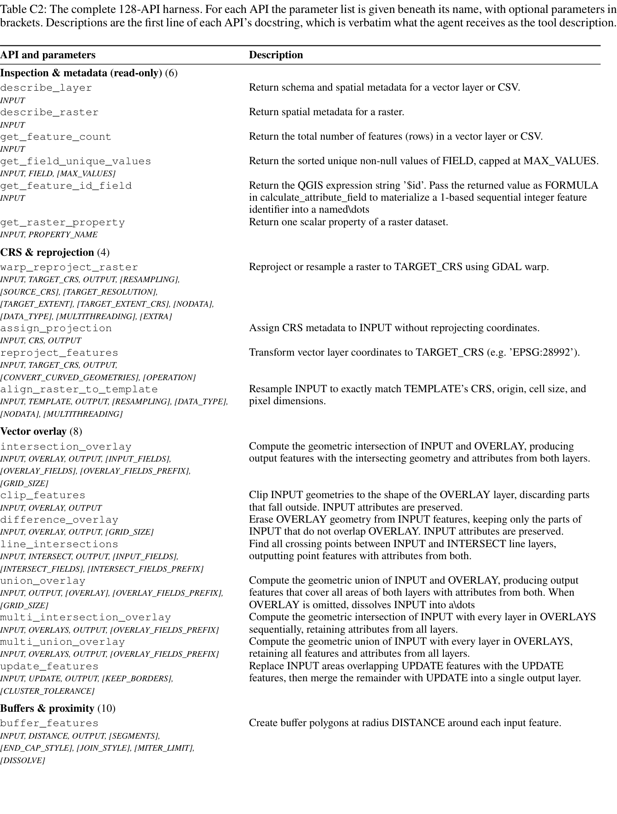

**检查与元数据（只读）**（续表）

| 序号 / API | 完整参数列表 | 中文功能说明 |
|---|---|---|
| 1. `describe_layer` | `INPUT` | 返回矢量图层或 CSV 的字段模式及空间元数据。 |
| 2. `describe_raster` | `INPUT` | 返回栅格的空间元数据。 |
| 3. `get_feature_count` | `INPUT` | 返回矢量图层或 CSV 中的要素（记录行）总数。 |
| 4. `get_field_unique_values` | `INPUT, FIELD, [MAX_VALUES]` | 返回 FIELD 字段排序后的非空唯一值，最多 MAX_VALUES 个。 |
| 5. `get_feature_id_field` | `INPUT` | 返回 QGIS 表达式 \`$id\`；把它作为 calculate_attribute_field 的 FORMULA，可将从 1 开始的顺序要素标识符写入具名字段（原始文档字符串在此以省略号截断）。 |
| 6. `get_raster_property` | `INPUT, PROPERTY_NAME` | 返回栅格数据集指定名称的单个标量属性。 |

**坐标参考系与重投影**（续表）

| 序号 / API | 完整参数列表 | 中文功能说明 |
|---|---|---|
| 7. `warp_reproject_raster` | `INPUT, TARGET_CRS, OUTPUT, [RESAMPLING], [SOURCE_CRS], [TARGET_RESOLUTION], [TARGET_EXTENT], [TARGET_EXTENT_CRS], [NODATA], [DATA_TYPE], [MULTITHREADING], [EXTRA]` | 使用 GDAL warp 将栅格重投影或重采样到 TARGET_CRS。 |
| 8. `assign_projection` | `INPUT, CRS, OUTPUT` | 为 INPUT 赋予 CRS 元数据，不实际改变几何坐标。 |
| 9. `reproject_features` | `INPUT, TARGET_CRS, OUTPUT, [CONVERT_CURVED_GEOMETRIES], [OPERATION]` | 将矢量图层坐标转换至 TARGET_CRS（例如 \`EPSG:28992\`）。 |
| 10. `align_raster_to_template` | `INPUT, TEMPLATE, OUTPUT, [RESAMPLING], [DATA_TYPE], [NODATA], [MULTITHREADING]` | 重采样 INPUT，使其 CRS、网格原点、像元大小及像素行列数完全匹配 TEMPLATE。 |

**矢量叠加**（续表）

| 序号 / API | 完整参数列表 | 中文功能说明 |
|---|---|---|
| 11. `intersection_overlay` | `INPUT, OVERLAY, OUTPUT, [INPUT_FIELDS], [OVERLAY_FIELDS], [OVERLAY_FIELDS_PREFIX], [GRID_SIZE]` | 计算 INPUT 与 OVERLAY 的几何交集，输出相交几何并包含两个图层的属性。 |
| 12. `clip_features` | `INPUT, OVERLAY, OUTPUT` | 依照 OVERLAY 图层的范围裁剪 INPUT 几何，舍弃外部部分并保留 INPUT 属性。 |
| 13. `difference_overlay` | `INPUT, OVERLAY, OUTPUT, [GRID_SIZE]` | 从 INPUT 要素中擦除与 OVERLAY 重叠的几何，仅保留非重叠部分和 INPUT 属性。 |
| 14. `line_intersections` | `INPUT, INTERSECT, OUTPUT, [INPUT_FIELDS], [INTERSECT_FIELDS], [INTERSECT_FIELDS_PREFIX]` | 找出 INPUT 与 INTERSECT 两个线图层的全部相交点，输出携带双方属性的点要素。 |
| 15. `union_overlay` | `INPUT, OUTPUT, [OVERLAY], [OVERLAY_FIELDS_PREFIX], [GRID_SIZE]` | 计算 INPUT 和 OVERLAY 的几何并集，覆盖两图层的全部区域，并保留双方属性；省略 OVERLAY 时可对 INPUT 进行融合（原说明以省略号截断）。 |
| 16. `multi_intersection_overlay` | `INPUT, OVERLAYS, OUTPUT, [OVERLAY_FIELDS_PREFIX]` | 依次计算 INPUT 与 OVERLAYS 中每个图层的几何交集，保留全部图层的属性。 |
| 17. `multi_union_overlay` | `INPUT, OVERLAYS, OUTPUT, [OVERLAY_FIELDS_PREFIX]` | 计算 INPUT 与 OVERLAYS 所有图层的几何并集，保留全部要素与属性。 |
| 18. `update_features` | `INPUT, UPDATE, OUTPUT, [KEEP_BORDERS], [CLUSTER_TOLERANCE]` | 使用 UPDATE 要素替换 INPUT 的重叠区域，再把其余区域与 UPDATE 合并为一个输出图层。 |

**缓冲与邻近分析**（续表）

| 序号 / API | 完整参数列表 | 中文功能说明 |
|---|---|---|
| 19. `buffer_features` | `INPUT, DISTANCE, OUTPUT, [SEGMENTS], [END_CAP_STYLE], [JOIN_STYLE], [MITER_LIMIT], [DISSOLVE]` | 以 DISTANCE 为半径为每个输入要素建立缓冲区多边形。 |

### 原文第 14 页：API 清单对照

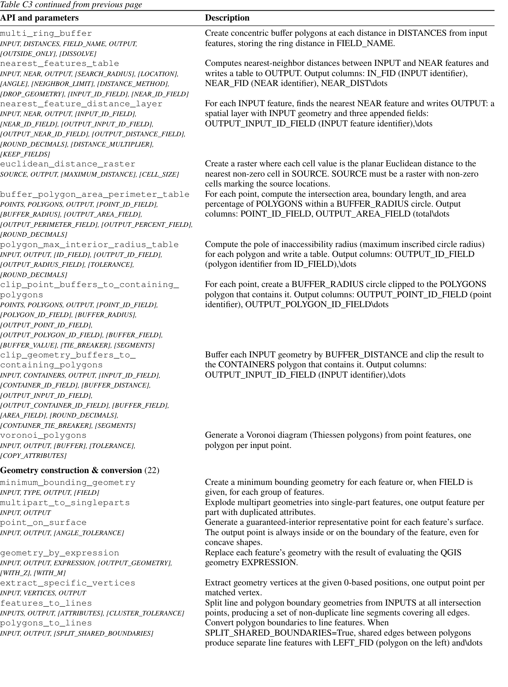

**缓冲与邻近分析**（续表）

| 序号 / API | 完整参数列表 | 中文功能说明 |
|---|---|---|
| 20. `multi_ring_buffer` | `INPUT, DISTANCES, FIELD_NAME, OUTPUT, [OUTSIDE_ONLY], [DISSOLVE]` | 按 DISTANCES 中的各个距离建立同心缓冲环，环距写入 FIELD_NAME。 |
| 21. `nearest_features_table` | `INPUT, NEAR, OUTPUT, [SEARCH_RADIUS], [LOCATION], [ANGLE], [NEIGHBOR_LIMIT], [DISTANCE_METHOD], [DROP_GEOMETRY], [INPUT_ID_FIELD], [NEAR_ID_FIELD]` | 计算 INPUT 和 NEAR 要素间的最近邻距离，并写入 OUTPUT 表；包含 IN_FID、NEAR_FID 和 NEAR_DIST 等字段。 |
| 22. `nearest_feature_distance_layer` | `INPUT, NEAR, OUTPUT, [INPUT_ID_FIELD], [NEAR_ID_FIELD], [OUTPUT_INPUT_ID_FIELD], [OUTPUT_NEAR_ID_FIELD], [OUTPUT_DISTANCE_FIELD], [ROUND_DECIMALS], [DISTANCE_MULTIPLIER], [KEEP_FIELDS]` | 为每个 INPUT 要素寻找最近的 NEAR 要素，输出保留 INPUT 几何并添加输入标识、邻近标识和距离等字段的空间图层。 |
| 23. `euclidean_distance_raster` | `SOURCE, OUTPUT, [MAXIMUM_DISTANCE], [CELL_SIZE]` | 创建欧氏距离栅格，每个像元存放到 SOURCE 中最近非零源像元的平面欧氏距离；SOURCE 的非零像元为源位置。 |
| 24. `buffer_polygon_area_perimeter_table` | `POINTS, POLYGONS, OUTPUT, [POINT_ID_FIELD], [BUFFER_RADIUS], [OUTPUT_AREA_FIELD], [OUTPUT_PERIMETER_FIELD], [OUTPUT_PERCENT_FIELD], [ROUND_DECIMALS]` | 以每个点为中心，在 BUFFER_RADIUS 圆内计算 POLYGONS 的相交面积、边界长度与面积百分比；输出相应标识及汇总字段。 |
| 25. `polygon_max_interior_radius_table` | `INPUT, OUTPUT, [ID_FIELD], [OUTPUT_ID_FIELD], [OUTPUT_RADIUS_FIELD], [TOLERANCE], [ROUND_DECIMALS]` | 计算每个多边形的最大内切圆半径（不可达极点半径），写入带多边形标识的表。 |
| 26. `clip_point_buffers_to_containing_polygons` | `POINTS, POLYGONS, OUTPUT, [POINT_ID_FIELD], [POLYGON_ID_FIELD], [BUFFER_RADIUS], [OUTPUT_POINT_ID_FIELD], [OUTPUT_POLYGON_ID_FIELD], [BUFFER_FIELD], [BUFFER_VALUE], [TIE_BREAKER], [SEGMENTS]` | 为每个点建立 BUFFER_RADIUS 圆并裁剪到包含该点的 POLYGONS 多边形，输出点和包含多边形的标识等字段。 |
| 27. `clip_geometry_buffers_to_containing_polygons` | `INPUT, CONTAINERS, OUTPUT, [INPUT_ID_FIELD], [CONTAINER_ID_FIELD], [BUFFER_DISTANCE], [OUTPUT_INPUT_ID_FIELD], [OUTPUT_CONTAINER_ID_FIELD], [BUFFER_FIELD], [AREA_FIELD], [ROUND_DECIMALS], [CONTAINER_TIE_BREAKER], [SEGMENTS]` | 对每个 INPUT 几何按 BUFFER_DISTANCE 建立缓冲，并裁剪到包含其几何的 CONTAINERS 多边形。 |
| 28. `voronoi_polygons` | `INPUT, OUTPUT, [BUFFER], [TOLERANCE], [COPY_ATTRIBUTES]` | 根据输入点生成 Voronoi（泰森）多边形，每个点对应一个多边形。 |

**几何构造与格式转换**（续表）

| 序号 / API | 完整参数列表 | 中文功能说明 |
|---|---|---|
| 29. `minimum_bounding_geometry` | `INPUT, TYPE, OUTPUT, [FIELD]` | 为每个要素构建最小包围几何；若指定 FIELD，则按字段分组构建。 |
| 30. `multipart_to_singleparts` | `INPUT, OUTPUT` | 将多部件几何拆为单部件，每个子部件生成独立要素并复制属性。 |
| 31. `point_on_surface` | `INPUT, OUTPUT, [ANGLE_TOLERANCE]` | 为每个要素表面生成代表点，保证该点位于要素内部或边界上，即使几何为凹多边形亦然。 |
| 32. `geometry_by_expression` | `INPUT, OUTPUT, EXPRESSION, [OUTPUT_GEOMETRY], [WITH_Z], [WITH_M]` | 利用 QGIS 几何表达式 EXPRESSION 的计算结果替换要素几何。 |
| 33. `extract_specific_vertices` | `INPUT, VERTICES, OUTPUT` | 按从 0 开始的顶点序号 VERTICES 提取指定顶点，每个匹配顶点生成一个点。 |
| 34. `features_to_lines` | `INPUTS, OUTPUT, [ATTRIBUTES], [CLUSTER_TOLERANCE]` | 在全部相交位置切分线和多边形边界，得到覆盖全部边的去重线段集合。 |
| 35. `polygons_to_lines` | `INPUT, OUTPUT, [SPLIT_SHARED_BOUNDARIES]` | 将多边形边界转换为线要素；可将共享边分别输出，并附带左右多边形标识。 |

### 原文第 15 页：API 清单对照

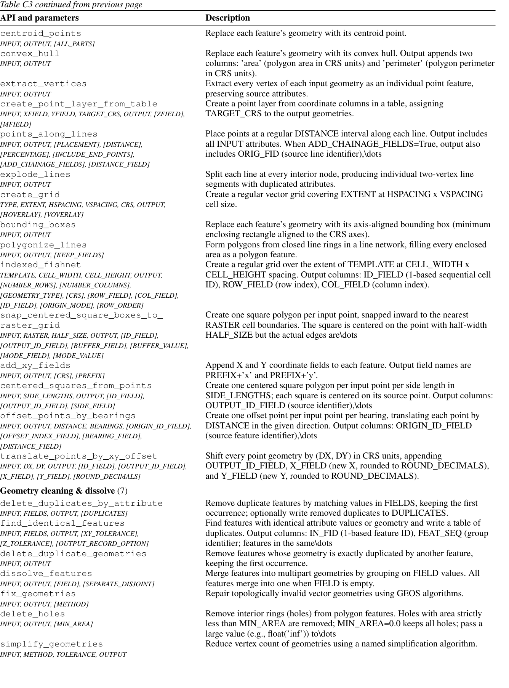

**几何构造与格式转换**（续表）

| 序号 / API | 完整参数列表 | 中文功能说明 |
|---|---|---|
| 36. `centroid_points` | `INPUT, OUTPUT, [ALL_PARTS]` | 将每个要素的几何替换为其质心点。 |
| 37. `convex_hull` | `INPUT, OUTPUT` | 将每个要素几何替换为凸包，并追加以 CRS 单位计算的 \`area\` 和 \`perimeter\` 属性。 |
| 38. `extract_vertices` | `INPUT, OUTPUT` | 将输入几何的所有顶点分别提取为点要素，保留原始属性。 |
| 39. `create_point_layer_from_table` | `INPUT, XFIELD, YFIELD, TARGET_CRS, OUTPUT, [ZFIELD], [MFIELD]` | 使用表格的 XFIELD 和 YFIELD 坐标字段建立点图层，并为输出几何指定 TARGET_CRS。 |
| 40. `points_along_lines` | `INPUT, OUTPUT, [PLACEMENT], [DISTANCE], [PERCENTAGE], [INCLUDE_END_POINTS], [ADD_CHAINAGE_FIELDS], [DISTANCE_FIELD]` | 沿各条线每隔 DISTANCE 放置一个点，保留 INPUT 属性；需要时增加源线 ID 和线性里程字段。 |
| 41. `explode_lines` | `INPUT, OUTPUT` | 在每个内部节点切分折线，得到由两个顶点组成的独立线段，并复制属性。 |
| 42. `create_grid` | `TYPE, EXTENT, HSPACING, VSPACING, CRS, OUTPUT, [HOVERLAY], [VOVERLAY]` | 创建覆盖 EXTENT、水平和垂直间距分别为 HSPACING 与 VSPACING 的规则矢量网格。 |
| 43. `bounding_boxes` | `INPUT, OUTPUT` | 用沿 CRS 坐标轴对齐的外包矩形替换每个要素几何。 |
| 44. `polygonize_lines` | `INPUT, OUTPUT, [KEEP_FIELDS]` | 将线网络的闭合环转换为多边形，为每个封闭区域生成面要素。 |
| 45. `indexed_fishnet` | `TEMPLATE, CELL_WIDTH, CELL_HEIGHT, OUTPUT, [NUMBER_ROWS], [NUMBER_COLUMNS], [GEOMETRY_TYPE], [CRS], [ROW_FIELD], [COL_FIELD], [ID_FIELD], [ORIGIN_MODE], [ROW_ORDER]` | 以 TEMPLATE 范围和 CELL_WIDTH × CELL_HEIGHT 间距建立规则网格，包含从 1 起的单元 ID、行号与列号字段。 |
| 46. `snap_centered_square_boxes_to_raster_grid` | `INPUT, RASTER, HALF_SIZE, OUTPUT, [ID_FIELD], [OUTPUT_ID_FIELD], [BUFFER_FIELD], [BUFFER_VALUE], [MODE_FIELD], [MODE_VALUE]` | 为每个输入点建立方形多边形，将边界向内对齐到最近的 RASTER 像元边界，目标半宽为 HALF_SIZE。 |
| 47. `add_xy_fields` | `INPUT, OUTPUT, [CRS], [PREFIX]` | 给每个要素追加 X、Y 坐标字段，名称使用 PREFIX 加 \`x\` 或 \`y\`。 |
| 48. `centered_squares_from_points` | `INPUT, SIDE_LENGTHS, OUTPUT, [ID_FIELD], [OUTPUT_ID_FIELD], [SIDE_FIELD]` | 为每个输入点及 SIDE_LENGTHS 的每种边长建立以点为中心的正方形，并保留来源标识等字段。 |
| 49. `offset_points_by_bearings` | `INPUT, OUTPUT, DISTANCE, BEARINGS, [ORIGIN_ID_FIELD], [OFFSET_INDEX_FIELD], [BEARING_FIELD], [DISTANCE_FIELD]` | 按各个方位角将每个点沿指定方向平移 DISTANCE，输出偏移点及来源标识等字段。 |
| 50. `translate_points_by_xy_offset` | `INPUT, DX, DY, OUTPUT, [ID_FIELD], [OUTPUT_ID_FIELD], [X_FIELD], [Y_FIELD], [ROUND_DECIMALS]` | 将每个点按 CRS 单位的 (DX, DY) 平移，并追加来源 ID 以及舍入后的新 X、Y 坐标字段。 |

**几何清理与融合**（续表）

| 序号 / API | 完整参数列表 | 中文功能说明 |
|---|---|---|
| 51. `delete_duplicates_by_attribute` | `INPUT, FIELDS, OUTPUT, [DUPLICATES]` | 通过匹配 FIELDS 的属性值删除重复要素，保留首条；可将被移除的重复项另行输出到 DUPLICATES。 |
| 52. `find_identical_features` | `INPUT, FIELDS, OUTPUT, [XY_TOLERANCE], [Z_TOLERANCE], [OUTPUT_RECORD_OPTION]` | 找出属性或几何相同的要素，输出重复关系表，包含 1 起始要素 ID 和重复组标识等字段。 |
| 53. `delete_duplicate_geometries` | `INPUT, OUTPUT` | 删除几何完全重复的要素，仅保留第一次出现的要素。 |
| 54. `dissolve_features` | `INPUT, OUTPUT, [FIELD], [SEPARATE_DISJOINT]` | 按 FIELD 字段的取值分组，将要素融合为多部件几何；FIELD 为空时全部融合为一个。 |
| 55. `fix_geometries` | `INPUT, OUTPUT, [METHOD]` | 使用 GEOS 算法修复拓扑无效的矢量几何。 |
| 56. `delete_holes` | `INPUT, OUTPUT, [MIN_AREA]` | 删除多边形内部环（孔洞）；按 MIN_AREA 决定删除阈值，0 表示不删孔洞。 |
| 57. `simplify_geometries` | `INPUT, METHOD, TOLERANCE, OUTPUT` | 使用指定简化算法减少几何中的顶点数量。 |

### 原文第 16 页：API 清单对照

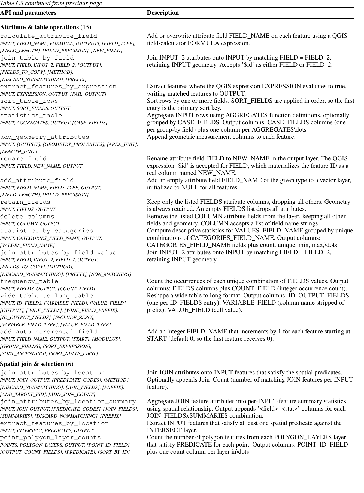

**属性与表操作**（续表）

| 序号 / API | 完整参数列表 | 中文功能说明 |
|---|---|---|
| 58. `calculate_attribute_field` | `INPUT, FIELD_NAME, FORMULA, [OUTPUT], [FIELD_TYPE], [FIELD_LENGTH], [FIELD_PRECISION], [NEW_FIELD]` | 根据 QGIS 字段计算器表达式 FORMULA，为每个要素新增或覆盖 FIELD_NAME 属性。 |
| 59. `join_table_by_field` | `INPUT, FIELD, INPUT_2, FIELD_2, [OUTPUT], [FIELDS_TO_COPY], [METHOD], [DISCARD_NONMATCHING], [PREFIX]` | 根据 FIELD = FIELD_2 的字段值，将 INPUT_2 属性连接到 INPUT，保留 INPUT 几何；支持 \`$id\` 作为连接字段。 |
| 60. `extract_features_by_expression` | `INPUT, EXPRESSION, OUTPUT, [FAIL_OUTPUT]` | 筛选 QGIS 表达式 EXPRESSION 为真的要素，写入 OUTPUT。 |
| 61. `sort_table_rows` | `INPUT, SORT_FIELDS, OUTPUT` | 根据 SORT_FIELDS 给记录排序，第一项为主排序键。 |
| 62. `statistics_table` | `INPUT, AGGREGATES, OUTPUT, [CASE_FIELDS]` | 根据 AGGREGATES 定义汇总 INPUT 记录，可按 CASE_FIELDS 分组，并输出分组键和汇总统计字段。 |
| 63. `add_geometry_attributes` | `INPUT, [OUTPUT], [GEOMETRY_PROPERTIES], [AREA_UNIT], [LENGTH_UNIT]` | 为每个要素追加几何测量字段，例如长度、面积或坐标信息。 |
| 64. `rename_field` | `INPUT, FIELD, NEW_NAME, OUTPUT` | 将属性字段 FIELD 重命名为 NEW_NAME；支持 \`$id\` 表达式并将其实体化为列。 |
| 65. `add_attribute_field` | `INPUT, FIELD_NAME, FIELD_TYPE, OUTPUT, [FIELD_LENGTH], [FIELD_PRECISION]` | 给矢量图层新增指定类型的 FIELD_NAME 空属性字段，所有要素初始值为 NULL。 |
| 66. `retain_fields` | `INPUT, FIELDS, OUTPUT` | 只保留 FIELDS 中列出的属性列，删除其余属性；始终保留几何；空列表则删除所有属性列。 |
| 67. `delete_columns` | `INPUT, COLUMN, OUTPUT` | 删除 COLUMN 指定的属性字段，同时保留其他字段及几何；COLUMN 可为字段名列表。 |
| 68. `statistics_by_categories` | `INPUT, CATEGORIES_FIELD_NAME, OUTPUT, [VALUES_FIELD_NAME]` | 按 CATEGORIES_FIELD_NAME 的唯一组合，对 VALUES_FIELD_NAME 计算描述性统计；输出类别键及数量、唯一值、极值等。 |
| 69. `join_attributes_by_field_value` | `INPUT, FIELD, INPUT_2, FIELD_2, OUTPUT, [FIELDS_TO_COPY], [METHOD], [DISCARD_NONMATCHING], [PREFIX], [NON_MATCHING]` | 按 FIELD = FIELD_2 的字段匹配关系，将 INPUT_2 属性连接到 INPUT 并保留 INPUT 几何。 |
| 70. `frequency_table` | `INPUT, FIELDS, OUTPUT, [COUNT_FIELD]` | 统计 FIELDS 每种唯一值组合的出现次数，输出分组字段及 COUNT_FIELD 整数计数。 |
| 71. `wide_table_to_long_table` | `INPUT, ID_FIELDS, [VARIABLE_FIELD], [VALUE_FIELD], [OUTPUT], [WIDE_FIELDS], [WIDE_FIELD_PREFIX], [ID_OUTPUT_FIELDS], [INCLUDE_ZERO], [VARIABLE_FIELD_TYPE], [VALUE_FIELD_TYPE]` | 将宽表转换成长表，输出标识字段、VARIABLE_FIELD（变量名）和 VALUE_FIELD（数值）等字段。 |
| 72. `add_autoincremental_field` | `INPUT, FIELD_NAME, OUTPUT, [START], [MODULUS], [GROUP_FIELDS], [SORT_EXPRESSION], [SORT_ASCENDING], [SORT_NULLS_FIRST]` | 添加自动递增的整数字段 FIELD_NAME，自 START 开始，每个要素递增 1，默认从 0 开始。 |

**空间连接与选择**（续表）

| 序号 / API | 完整参数列表 | 中文功能说明 |
|---|---|---|
| 73. `join_attributes_by_location` | `INPUT, JOIN, OUTPUT, [PREDICATE_CODES], [METHOD], [DISCARD_NONMATCHING], [JOIN_FIELDS], [PREFIX], [ADD_TARGET_FID], [ADD_JOIN_COUNT]` | 将满足指定空间谓词的 JOIN 属性连接到 INPUT；可追加 Join_Count 表示每个 INPUT 匹配的 JOIN 要素数。 |
| 74. `join_attributes_by_location_summary` | `INPUT, JOIN, OUTPUT, [PREDICATE_CODES], [JOIN_FIELDS], [SUMMARIES], [DISCARD_NONMATCHING], [PREFIX]` | 根据空间关系，对每个 INPUT 要素汇总匹配 JOIN 要素的字段统计，追加 \`<field>_<stat>\` 形式的属性列。 |
| 75. `extract_features_by_location` | `INPUT, INTERSECT, PREDICATE, OUTPUT` | 提取满足与 INTERSECT 图层至少一个空间谓词关系的 INPUT 要素。 |
| 76. `point_polygon_layer_counts` | `POINTS, POLYGON_LAYERS, OUTPUT, [POINT_ID_FIELD], [OUTPUT_COUNT_FIELDS], [PREDICATE], [SORT_BY_ID]` | 对每个点统计 POLYGON_LAYERS 中各图层符合 PREDICATE 的多边形数量，按图层分别输出计数字段。 |

### 原文第 17 页：API 清单对照

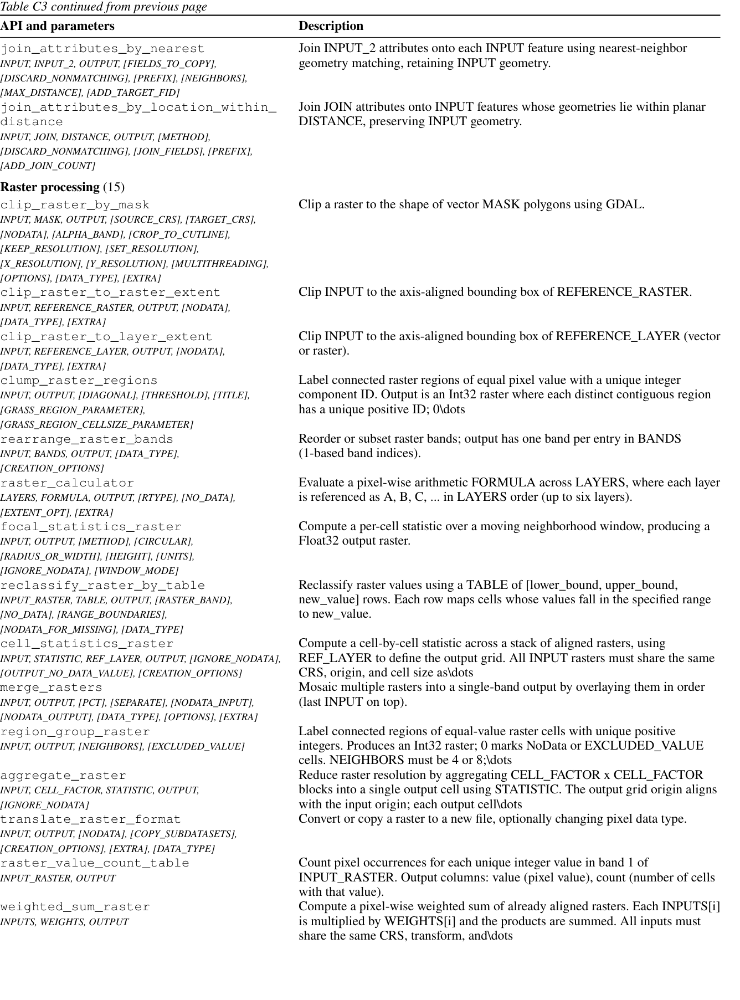

**空间连接与选择**（续表）

| 序号 / API | 完整参数列表 | 中文功能说明 |
|---|---|---|
| 77. `join_attributes_by_nearest` | `INPUT, INPUT_2, OUTPUT, [FIELDS_TO_COPY], [DISCARD_NONMATCHING], [PREFIX], [NEIGHBORS], [MAX_DISTANCE], [ADD_TARGET_FID]` | 使用最近邻几何匹配将 INPUT_2 属性连接到 INPUT，并保留 INPUT 几何。 |
| 78. `join_attributes_by_location_within_distance` | `INPUT, JOIN, DISTANCE, OUTPUT, [METHOD], [DISCARD_NONMATCHING], [JOIN_FIELDS], [PREFIX], [ADD_JOIN_COUNT]` | 将几何位于平面 DISTANCE 距离内的 JOIN 属性连接到 INPUT，保留 INPUT 几何。 |

**栅格处理**（续表）

| 序号 / API | 完整参数列表 | 中文功能说明 |
|---|---|---|
| 79. `clip_raster_by_mask` | `INPUT, MASK, OUTPUT, [SOURCE_CRS], [TARGET_CRS], [NODATA], [ALPHA_BAND], [CROP_TO_CUTLINE], [KEEP_RESOLUTION], [SET_RESOLUTION], [X_RESOLUTION], [Y_RESOLUTION], [MULTITHREADING], [OPTIONS], [DATA_TYPE], [EXTRA]` | 使用 GDAL 按矢量 MASK 多边形的形状裁剪栅格。 |
| 80. `clip_raster_to_raster_extent` | `INPUT, REFERENCE_RASTER, OUTPUT, [NODATA], [DATA_TYPE], [EXTRA]` | 根据 REFERENCE_RASTER 的轴对齐外包矩形裁剪 INPUT 栅格。 |
| 81. `clip_raster_to_layer_extent` | `INPUT, REFERENCE_LAYER, OUTPUT, [NODATA], [DATA_TYPE], [EXTRA]` | 根据 REFERENCE_LAYER（矢量或栅格）的轴对齐外包矩形裁剪 INPUT 栅格。 |
| 82. `clump_raster_regions` | `INPUT, OUTPUT, [DIAGONAL], [THRESHOLD], [TITLE], [GRASS_REGION_PARAMETER], [GRASS_REGION_CELLSIZE_PARAMETER]` | 给具有相同像元值的连通栅格区域分别赋予唯一正整数连通分量 ID，输出 Int32 栅格。 |
| 83. `rearrange_raster_bands` | `INPUT, BANDS, OUTPUT, [DATA_TYPE], [CREATION_OPTIONS]` | 重排或选取指定 BANDS 波段，输出每个索引对应一个波段；波段序号从 1 开始。 |
| 84. `raster_calculator` | `LAYERS, FORMULA, OUTPUT, [RTYPE], [NO_DATA], [EXTENT_OPT], [EXTRA]` | 按 LAYERS 顺序以 A、B、C 等变量引用最多六个图层，对像元执行算术 FORMULA。 |
| 85. `focal_statistics_raster` | `INPUT, OUTPUT, [METHOD], [CIRCULAR], [RADIUS_OR_WIDTH], [HEIGHT], [UNITS], [IGNORE_NODATA], [WINDOW_MODE]` | 在移动邻域窗口内逐像元计算统计量，输出 Float32 栅格。 |
| 86. `reclassify_raster_by_table` | `INPUT_RASTER, TABLE, OUTPUT, [RASTER_BAND], [NO_DATA], [RANGE_BOUNDARIES], [NODATA_FOR_MISSING], [DATA_TYPE]` | 根据 TABLE 中的 \`[下界, 上界, 新值]\` 记录，将指定范围内的栅格像元重分类为新值。 |
| 87. `cell_statistics_raster` | `INPUT, STATISTIC, REF_LAYER, OUTPUT, [IGNORE_NODATA], [OUTPUT_NO_DATA_VALUE], [CREATION_OPTIONS]` | 在对齐的栅格堆栈上逐像元求统计量，由 REF_LAYER 定义输出网格；输入必须具有相同 CRS、原点和像元大小。 |
| 88. `merge_rasters` | `INPUT, OUTPUT, [PCT], [SEPARATE], [NODATA_INPUT], [NODATA_OUTPUT], [DATA_TYPE], [OPTIONS], [EXTRA]` | 按顺序将多个栅格镶嵌为单波段输出，后列输入覆盖先列输入。 |
| 89. `region_group_raster` | `INPUT, OUTPUT, [NEIGHBORS], [EXCLUDED_VALUE]` | 对具有相同取值的连通像元区域赋予唯一正整数标签；产生 Int32 栅格，0 表示 NoData 或被排除的像元，可按 4 或 8 邻域连接。 |
| 90. `aggregate_raster` | `INPUT, CELL_FACTOR, STATISTIC, OUTPUT, [IGNORE_NODATA]` | 将 CELL_FACTOR × CELL_FACTOR 像元块按照 STATISTIC 聚合为一个新像元以降低栅格分辨率；输出网格原点与输入对齐。 |
| 91. `translate_raster_format` | `INPUT, OUTPUT, [NODATA], [COPY_SUBDATASETS], [CREATION_OPTIONS], [EXTRA], [DATA_TYPE]` | 将栅格复制或转换为新文件，可修改像元数据类型。 |
| 92. `raster_value_count_table` | `INPUT_RASTER, OUTPUT` | 统计 INPUT_RASTER 第 1 波段中每种唯一整数像元值出现的次数，输出 value 和 count 两列。 |
| 93. `weighted_sum_raster` | `INPUTS, WEIGHTS, OUTPUT` | 对已经对齐的输入栅格进行逐像元加权求和，计算各 INPUTS[i] × WEIGHTS[i] 的累加；输入要求同一 CRS 和网格变换。 |

### 原文第 18 页：API 清单对照

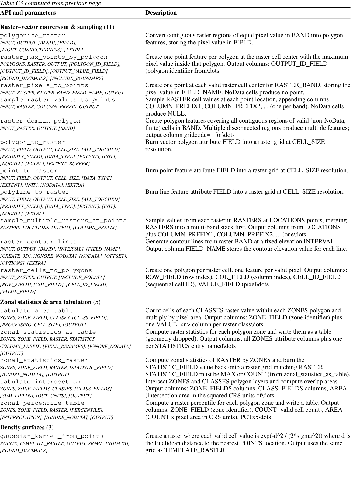

**栅格—矢量转换与采样**（续表）

| 序号 / API | 完整参数列表 | 中文功能说明 |
|---|---|---|
| 94. `polygonize_raster` | `INPUT, OUTPUT, [BAND], [FIELD], [EIGHT_CONNECTEDNESS], [EXTRA]` | 将 BAND 中像元值相等的连续区域转成多边形，并将像元值写入 FIELD。 |
| 95. `raster_max_points_by_polygon` | `POLYGONS, RASTER, OUTPUT, [POLYGON_ID_FIELD], [OUTPUT_ID_FIELD], [OUTPUT_VALUE_FIELD], [ROUND_DECIMALS], [INCLUDE_BOUNDARY]` | 对每个多边形在其内部最大像元值所在的栅格像元中心生成一个点，并输出多边形标识及像元值等字段。 |
| 96. `raster_pixels_to_points` | `INPUT_RASTER, RASTER_BAND, FIELD_NAME, OUTPUT` | 对 RASTER_BAND 每个有效像元中心建立点要素，像元值写入 FIELD_NAME；NoData 不产生点。 |
| 97. `sample_raster_values_to_points` | `INPUT, RASTER, COLUMN_PREFIX, OUTPUT` | 在各点位置采样 RASTER 的波段值，追加 COLUMN_PREFIX1、COLUMN_PREFIX2 等列；NoData 记为 NULL。 |
| 98. `raster_domain_polygon` | `INPUT_RASTER, OUTPUT, [BAND]` | 将栅格 BAND 的全部有效（非 NoData、有限值）连通区域转为多边形；不相连区域生成多个要素。 |
| 99. `polygon_to_raster` | `INPUT, FIELD, OUTPUT, CELL_SIZE, [ALL_TOUCHED], [PRIORITY_FIELD], [DATA_TYPE], [EXTENT], [INIT], [NODATA], [EXTRA], [EXTENT_BUFFER]` | 将多边形字段 FIELD 以 CELL_SIZE 分辨率烧录到栅格网格。 |
| 100. `point_to_raster` | `INPUT, FIELD, OUTPUT, CELL_SIZE, [DATA_TYPE], [EXTENT], [INIT], [NODATA], [EXTRA]` | 将点要素字段 FIELD 以 CELL_SIZE 分辨率烧录到栅格网格。 |
| 101. `polyline_to_raster` | `INPUT, FIELD, OUTPUT, CELL_SIZE, [ALL_TOUCHED], [PRIORITY_FIELD], [DATA_TYPE], [EXTENT], [INIT], [NODATA], [EXTRA]` | 将折线字段 FIELD 以 CELL_SIZE 分辨率烧录到栅格网格。 |
| 102. `sample_multiple_rasters_at_points` | `RASTERS, LOCATIONS, OUTPUT, [COLUMN_PREFIX]` | 先将 RASTERS 组合为多波段栅格，再在 LOCATIONS 点位采样各栅格值，追加带 COLUMN_PREFIX 前缀的字段。 |
| 103. `raster_contour_lines` | `INPUT, OUTPUT, [BAND], [INTERVAL], [FIELD_NAME], [CREATE_3D], [IGNORE_NODATA], [NODATA], [OFFSET], [OPTIONS], [EXTRA]` | 按照固定高程间隔 INTERVAL 从栅格 BAND 提取等值线，并用 FIELD_NAME 存储各线的高程值。 |
| 104. `raster_cells_to_polygons` | `INPUT_RASTER, OUTPUT, [INCLUDE_NODATA], [ROW_FIELD], [COL_FIELD], [CELL_ID_FIELD], [VALUE_FIELD]` | 将每个有效栅格像元生成单独的多边形，输出像元行号、列号、连续 ID 与取值等字段。 |

**分区统计与面积制表**（续表）

| 序号 / API | 完整参数列表 | 中文功能说明 |
|---|---|---|
| 105. `tabulate_area_table` | `ZONES, ZONE_FIELD, CLASSES, [CLASS_FIELD], [PROCESSING_CELL_SIZE], [OUTPUT]` | 计算 ZONES 每个区域内 CLASSES 各栅格类别的像元数并乘以像元面积，输出区域标识及每类面积字段。 |
| 106. `zonal_statistics_as_table` | `ZONES, ZONE_FIELD, RASTER, STATISTICS, COLUMN_PREFIX, [FIELD_RENAMES], [IGNORE_NODATA], [OUTPUT]` | 对每个多边形分区计算栅格统计量并写入无几何表，包含原 ZONES 属性和所要求的统计列。 |
| 107. `zonal_statistics_raster` | `ZONES, ZONE_FIELD, RASTER, [STATISTIC_FIELD], [IGNORE_NODATA], [OUTPUT]` | 按 ZONES 对 RASTER 做分区统计，再把 STATISTIC_FIELD（只支持 MAX 或 COUNT）烧录回与 RASTER 对齐的栅格。 |
| 108. `tabulate_intersection` | `ZONES, ZONE_FIELDS, CLASSES, [CLASS_FIELDS], [SUM_FIELDS], [OUT_UNITS], [OUTPUT]` | 计算 ZONES 与 CLASSES 多边形的相交面积，输出两层的类别字段及 AREA 相交面积（CRS 的平方单位）。 |
| 109. `zonal_percentile_table` | `ZONES, ZONE_FIELD, RASTER, [PERCENTILE], [INTERPOLATION], [IGNORE_NODATA], [OUTPUT]` | 为每个多边形区域计算栅格百分位数，并输出区域标识、有效像元数 COUNT、面积 AREA 及百分位字段。 |

**密度表面**（续表）

| 序号 / API | 完整参数列表 | 中文功能说明 |
|---|---|---|
| 110. `gaussian_kernel_from_points` | `POINTS, TEMPLATE_RASTER, OUTPUT, SIGMA, [NODATA], [ROUND_DECIMALS]` | 根据距最近 POINTS 位置的欧氏距离 d，对每个有效像元计算 \`exp(-d²/(2σ²))\`，输出采用 TEMPLATE_RASTER 网格。 |

### 原文第 19 页：API 清单对照

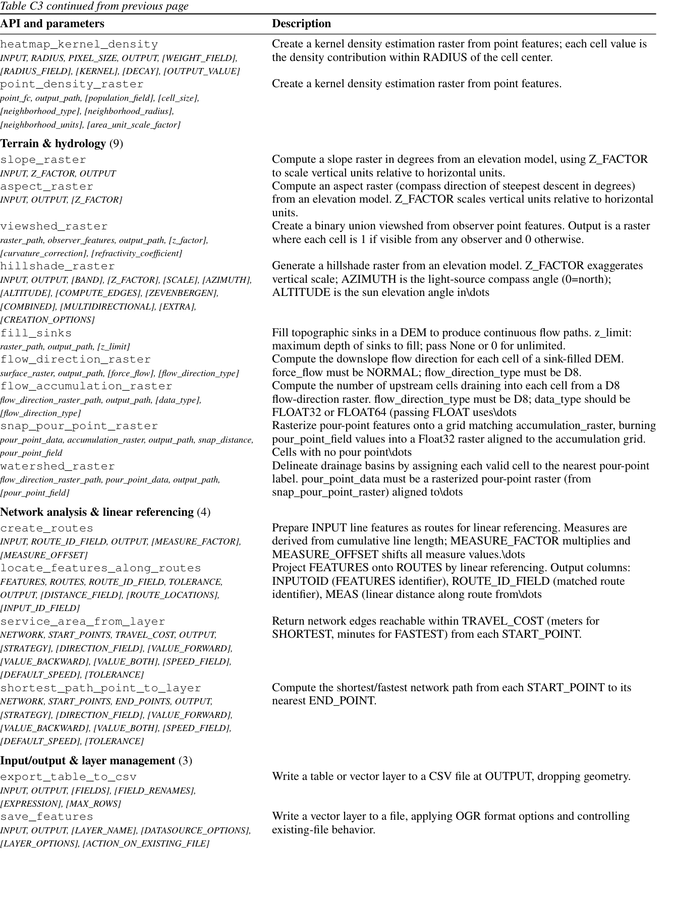

**密度表面**（续表）

| 序号 / API | 完整参数列表 | 中文功能说明 |
|---|---|---|
| 111. `heatmap_kernel_density` | `INPUT, RADIUS, PIXEL_SIZE, OUTPUT, [WEIGHT_FIELD], [RADIUS_FIELD], [KERNEL], [DECAY], [OUTPUT_VALUE]` | 以输入点生成核密度估计栅格，每个像元值为半径 RADIUS 内的核密度贡献。 |
| 112. `point_density_raster` | `point_fc, output_path, [population_field], [cell_size], [neighborhood_type], [neighborhood_radius], [neighborhood_units], [area_unit_scale_factor]` | 根据点要素创建核密度估计栅格。 |

**地形与水文**（续表）

| 序号 / API | 完整参数列表 | 中文功能说明 |
|---|---|---|
| 113. `slope_raster` | `INPUT, Z_FACTOR, OUTPUT` | 从高程模型计算以角度表示的坡度栅格，使用 Z_FACTOR 缩放垂直单位以匹配水平单位。 |
| 114. `aspect_raster` | `INPUT, OUTPUT, [Z_FACTOR]` | 根据高程模型计算坡向栅格，即最陡下降方向的方位角（度），垂直单位由 Z_FACTOR 调整。 |
| 115. `viewshed_raster` | `raster_path, observer_features, output_path, [z_factor], [curvature_correction], [refractivity_coefficient]` | 根据观察点生成二值联合可视域栅格；只要像元能被任一观察者看见则赋值 1，否则为 0。 |
| 116. `hillshade_raster` | `INPUT, OUTPUT, [BAND], [Z_FACTOR], [SCALE], [AZIMUTH], [ALTITUDE], [COMPUTE_EDGES], [ZEVENBERGEN], [COMBINED], [MULTIDIRECTIONAL], [EXTRA], [CREATION_OPTIONS]` | 根据高程模型生成地形晕渲栅格；Z_FACTOR 调整垂直夸张，AZIMUTH 为光源方位角（0 为北），ALTITUDE 为太阳高度角。 |
| 117. `fill_sinks` | `raster_path, output_path, [z_limit]` | 填平 DEM 中的地形洼地以生成连续水流路径；z_limit 为最大填洼深度，None 或 0 表示不限。 |
| 118. `flow_direction_raster` | `surface_raster, output_path, [force_flow], [flow_direction_type]` | 计算填洼 DEM 每个像元的下坡水流方向；force_flow 必须为 NORMAL，flow_direction_type 必须为 D8。 |
| 119. `flow_accumulation_raster` | `flow_direction_raster_path, output_path, [data_type], [flow_direction_type]` | 依据 D8 流向栅格，计算汇入每个像元的上游像元数；flow_direction_type 为 D8，数据类型建议 FLOAT32 或 FLOAT64。 |
| 120. `snap_pour_point_raster` | `pour_point_data, accumulation_raster, output_path, snap_distance, pour_point_field` | 将汇流点要素栅格化到与累积流量栅格一致的网格，把 pour_point_field 烧录为 Float32 值；无汇流点像元为缺失。 |
| 121. `watershed_raster` | `flow_direction_raster_path, pour_point_data, output_path, [pour_point_field]` | 依据流向栅格和与之对齐的已栅格化汇流点标签，将每个有效像元划归最近的汇流点流域。 |

**网络分析与线性参考**（续表）

| 序号 / API | 完整参数列表 | 中文功能说明 |
|---|---|---|
| 122. `create_routes` | `INPUT, ROUTE_ID_FIELD, OUTPUT, [MEASURE_FACTOR], [MEASURE_OFFSET]` | 将线要素转换为可用于线性参考的路线；里程由沿线累积长度导出，并使用 MEASURE_FACTOR 与 MEASURE_OFFSET 缩放和平移。 |
| 123. `locate_features_along_routes` | `FEATURES, ROUTES, ROUTE_ID_FIELD, TOLERANCE, OUTPUT, [DISTANCE_FIELD], [ROUTE_LOCATIONS], [INPUT_ID_FIELD]` | 将 FEATURES 以线性参考方式投影到 ROUTES；输出原要素 ID、所匹配路线 ID、沿线里程 MEAS 等字段。 |
| 124. `service_area_from_layer` | `NETWORK, START_POINTS, TRAVEL_COST, OUTPUT, [STRATEGY], [DIRECTION_FIELD], [VALUE_FORWARD], [VALUE_BACKWARD], [VALUE_BOTH], [SPEED_FIELD], [DEFAULT_SPEED], [TOLERANCE]` | 从各 START_POINT 出发，返回网络上在 TRAVEL_COST 预算内可达的边；SHORTEST 模式用米，FASTEST 模式用分钟。 |
| 125. `shortest_path_point_to_layer` | `NETWORK, START_POINTS, END_POINTS, OUTPUT, [STRATEGY], [DIRECTION_FIELD], [VALUE_FORWARD], [VALUE_BACKWARD], [VALUE_BOTH], [SPEED_FIELD], [DEFAULT_SPEED], [TOLERANCE]` | 为每个 START_POINT 计算到最近 END_POINT 的最短或最快网络路径。 |

**输入输出与图层管理**（续表）

| 序号 / API | 完整参数列表 | 中文功能说明 |
|---|---|---|
| 126. `export_table_to_csv` | `INPUT, OUTPUT, [FIELDS], [FIELD_RENAMES], [EXPRESSION], [MAX_ROWS]` | 将表格或矢量图层写成 OUTPUT 路径的 CSV，去除几何列。 |
| 127. `save_features` | `INPUT, OUTPUT, [LAYER_NAME], [DATASOURCE_OPTIONS], [LAYER_OPTIONS], [ACTION_ON_EXISTING_FILE]` | 按 OGR 格式选项将矢量图层保存为文件，并控制输出文件已存在时的行为。 |

### 原文第 20 页：API 清单对照

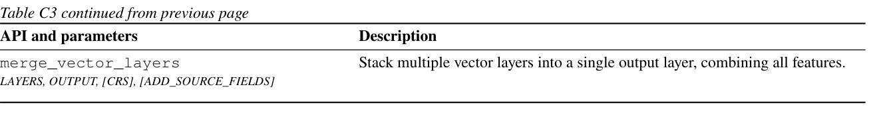

**输入输出与图层管理**（续表）

| 序号 / API | 完整参数列表 | 中文功能说明 |
|---|---|---|
| 128. `merge_vector_layers` | `LAYERS, OUTPUT, [CRS], [ADD_SOURCE_FIELDS]` | 将多个矢量图层堆叠合并成单个图层，包含全部要素。 |

> **说明**：表中标识符和参数列表是为复现实验保留的源代码级信息，并非汉化接口。原论文中的若干 docstring 本身以省略号截断；这些没有公开完整文字的部分不能由译者擅自补写。

---

## 附录 D　研究区域数据（原文第 21–22 页）

表 D5 列出各研究区域的主要矢量图层及精确要素数量，表 D6 列出全部栅格的像素尺寸与空间参考。要素数量从实际发布文件中统计，而非直接采用元数据声明。

需要注意：有些栅格以**地理坐标系统**提供，而其所属研究区域的分析参考系统是**投影坐标系统**；有些文件名中标称的分辨率也与实际交付栅格网格不完全一致。这两种情况都是公开数据本身的真实属性，也是 CRS 不匹配和单位不匹配陷阱的来源之一。

### D.1 数据来源

每个研究区域的数据来自公开数据门户，包括：USGS National Map（高程和影像）、美国人口普查局 TIGER/Line（交通及行政边界）、OpenStreetMap（交通、设施和水文）、地方开放数据门户（纽约、旧金山、丹佛、哈里斯县、科罗拉多州公共卫生与环境部门、迈阿密—戴德县以及南佛罗里达水资源管理区，涵盖宗地、洪水风险和行政数据集）、FEMA 国家洪水危险图层，以及荷兰 PDOK 和 CBS 服务（地址、街区、市镇、高程和正射摄影影像）。各来源的正式引用见前文参考文献。

### D.2 衍生及修改图层

大多数图层直接从其公开来源导入，不进行修改。为使数据质量陷阱基于真实可操作的条件而非纯粹假设，作者对以下三类数据进行了衍生处理。

**受控几何缺陷。** 对原本干净的地籍图层施加确定性的、使用固定种子的变换：在抽样子集中施加很小的正向缓冲并将结果追加回图层，形成**重叠宗地**；通过向内缓冲并保留差异环带，制造**狭长碎片（sliver）**。抽样采用固定步长与随机种子，因此每次重新生成的缺陷一致。发布的任务中使用了三个这样的图层。

**衍生栅格产品。** 如不存在合适的公开产品，则根据对应区域 DEM 的高程梯度计算栅格，并缩放到有明确文档说明的数值范围，构造地表通行成本栅格和灾害风险栅格，且严格继承源栅格网格。

**模式规范化。** 每个导入的矢量图层都会经过字段模式规范化，添加稳定的标识字段；对于 Shapefile 输出，还要将字段名截断到格式规定的 **10 字符**上限。这是地理重构的重要组成部分：智能体不能依靠记住论坛原帖中的字段名称来完成任务。

**表 D4　六个研究区域的景观特征、分析 CRS 与各任务家族的数量（原文第 22 页）**

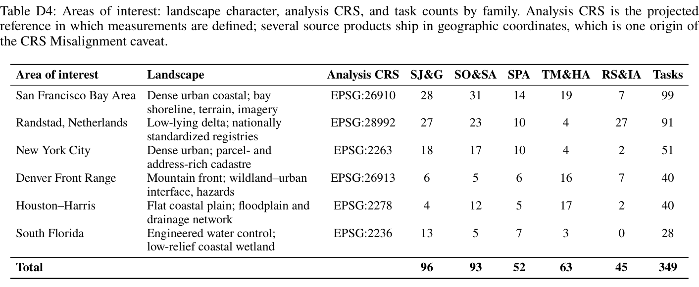

| 研究区域 | 分析 CRS | SJ&G | SO&SA | SPA | TM&HA | RS&IA | 总计 |
|---|---|---:|---:|---:|---:|---:|---:|
| 旧金山湾区 | EPSG:26910 | 28 | 31 | 14 | 19 | 7 | 99 |
| 荷兰兰斯塔德 | EPSG:28992 | 27 | 23 | 10 | 4 | 27 | 91 |
| 纽约市 | EPSG:2263 | 18 | 17 | 10 | 4 | 2 | 51 |
| 丹佛山前地带 | EPSG:26913 | 6 | 5 | 6 | 16 | 7 | 40 |
| 休斯敦—哈里斯县 | EPSG:2278 | 4 | 12 | 5 | 17 | 2 | 40 |
| 南佛罗里达 | EPSG:2236 | 13 | 5 | 7 | 3 | 0 | 28 |
| **总计** | — | **96** | **93** | **52** | **63** | **45** | **349** |

表 D4 中的“分析 CRS”指用于定义距离、面积等测量量的投影参考系统。部分源数据实际上仍以地理坐标提供，因而构成 CRS 误配的情形。

**表 D5　每个研究区域的主要矢量图层及准确要素数量**

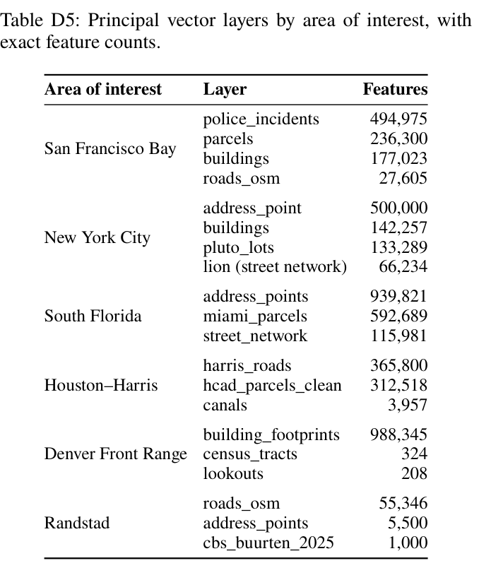

| 区域 | 图层（源文件名） | 要素数 |
|---|---|---:|
| 旧金山湾区 | `police_incidents` | 494,975 |
| 旧金山湾区 | `parcels` | 236,300 |
| 旧金山湾区 | `buildings` | 177,023 |
| 旧金山湾区 | `roads_osm` | 27,605 |
| 纽约市 | `address_point` | 500,000 |
| 纽约市 | `buildings` | 142,257 |
| 纽约市 | `pluto_lots` | 133,289 |
| 纽约市 | `lion`（街道网络） | 66,234 |
| 南佛罗里达 | `address_points` | 939,821 |
| 南佛罗里达 | `miami_parcels` | 592,689 |
| 南佛罗里达 | `street_network` | 115,981 |
| 休斯敦—哈里斯县 | `harris_roads` | 365,800 |
| 休斯敦—哈里斯县 | `hcad_parcels_clean` | 312,518 |
| 休斯敦—哈里斯县 | `canals` | 3,957 |
| 丹佛山前地带 | `building_footprints` | 988,345 |
| 丹佛山前地带 | `census_tracts` | 324 |
| 丹佛山前地带 | `lookouts` | 208 |
| 兰斯塔德 | `roads_osm` | 55,346 |
| 兰斯塔德 | `address_points` | 5,500 |
| 兰斯塔德 | `cbs_buurten_2025` | 1,000 |

**表 D6　各研究区域的栅格产品、尺寸与源文件 CRS（EPSG 编码）**

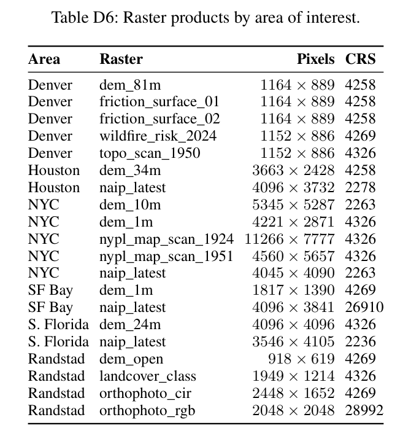

| 区域 | 栅格名 | 像素尺寸 | EPSG |
|---|---|---|---:|
| 丹佛 | `dem_81m` | 1164 × 889 | 4258 |
| 丹佛 | `friction_surface_01` | 1164 × 889 | 4258 |
| 丹佛 | `friction_surface_02` | 1164 × 889 | 4258 |
| 丹佛 | `wildfire_risk_2024` | 1152 × 886 | 4269 |
| 丹佛 | `topo_scan_1950` | 1152 × 886 | 4326 |
| 休斯敦 | `dem_34m` | 3663 × 2428 | 4258 |
| 休斯敦 | `naip_latest` | 4096 × 3732 | 2278 |
| 纽约市 | `dem_10m` | 5345 × 5287 | 2263 |
| 纽约市 | `dem_1m` | 4221 × 2871 | 4326 |
| 纽约市 | `nypl_map_scan_1924` | 11266 × 7777 | 4326 |
| 纽约市 | `nypl_map_scan_1951` | 4560 × 5657 | 4326 |
| 纽约市 | `naip_latest` | 4045 × 4090 | 2263 |
| 旧金山湾区 | `dem_1m` | 1817 × 1390 | 4269 |
| 旧金山湾区 | `naip_latest` | 4096 × 3841 | 26910 |
| 南佛罗里达 | `dem_24m` | 4096 × 4096 | 4326 |
| 南佛罗里达 | `naip_latest` | 3546 × 4105 | 2236 |
| 兰斯塔德 | `dem_open` | 918 × 619 | 4269 |
| 兰斯塔德 | `landcover_class` | 1949 × 1214 | 4326 |
| 兰斯塔德 | `orthophoto_cir` | 2448 × 1652 | 4269 |
| 兰斯塔德 | `orthophoto_rgb` | 2048 × 2048 | 28992 |

## 附录 E　真实值生成与验证（原文第 21–23 页）

### E.1 生成

参考轨迹及其输出文件由 **Claude Fable 5** 生成并验证。作者有意将其排除在受测智能体之外，以确保没有任何被评分的模型参与编写自身比较的真实值。

真实值生成运行于特意赋予更高权限的环境中：参考解法编写者可以直接访问输入数据，并使用自由形式的 Python 推导或交叉检查正确结果；受测智能体不享有这些权限。但最终发布的参考轨迹必须完全使用与受测智能体相同的 128-API 工具框架表达，并且在该框架内部实际执行，以生成基准真实值文件。因此，**正确答案的定义在工具框架外完成，而实际用于评分的输出在工具框架内生产**。

参考轨迹由按顺序排列的 API 调用构成，每一步指明 API 名称、已绑定参数和输出句柄。作者生成提示词对工具范围施加以下限制（原文指令的中文翻译）：

> 只能使用所提供、已解析工具目录中的工具。不得假设存在未列出的工具、输入字段、外部数据集、人工编辑、隐藏的预处理步骤或任务的其他解释。

这一约束不仅靠提示词声明，而且由执行器强制验证：如果参考轨迹调用了未向智能体公开的函数，执行器会拒绝该步骤，因此脱离发布框架的参考轨迹无法执行或发布。

### E.2 自动化验证

生成序列在执行前经过静态校验。检查参数名是否符合真实 API 签名、输出句柄是否已绑定以及引用是否可解析。不合格序列送入“验证—修复”过程，可以更正 API 名称、参数或调整步骤顺序，但不得改变所解的任务。原文验证指令的中文翻译为：

> 检查拟议的真实值工具序列是否存在基础工具使用问题。检查工具名、参数名、占位符、遗漏步骤和最终输出路径。不要改变任务。如果发布的工具列表无法支持按当前文字规定的任务，则返回 `reject`。只返回一个符合模式的 JSON 对象。

这条指令刻意限制验证器的职责：它只是工具使用检查员，而不是第二位任务作者。如果某条序列无法在发布的工具框架中修复，就应直接拒绝，而非另写一个更简单的任务。这解释了为什么一些候选任务在流水线中被剔除，而不是削弱条件以适应工具。存活的序列会在基准环境内执行；只有执行生成格式正确且满足输出契约的文件，任务才会被保留。

### E.3 专家复核

自动化检查只能保证轨迹结构正确并能执行完毕，无法确定计算的量是否符合真实任务意图。因此，作者团队中的三位 GIS 专家对参考轨迹进行直接审阅，逐步骤手工追踪，同时检查中间结果并目视检验最终空间输出。发布的每条参考轨迹都经过了专家复核；其中一部分还经过专门审核轮次的再次核验，并拥有更完整的任务级审核记录。

专家审查发现了以下自动校验难以识别的缺陷，因为相应轨迹可能完整执行并生成表面合理的结果：

- 字段计算所引用的列并未由上游操作产生，使结果全为 0 或 NULL；
- 在地理坐标系下直接测量面积和距离，导致结果单位实际上以“度”及其平方表达；
- 在未经投影的 DEM 上计算坡度或其他地形导数；
- 输出契约将一个提示词从未保证存在、或在导出过程中已经更名的列作为主键；
- 行匹配中的偏移一位（off-by-one）和字段截断错误；
- 在修复无效几何之前测量几何，而不是在修复之后测量。

凡是专家发现任务描述含糊，或者必须改变问题规范才能令其可解的任务，都从发布集中移除，而不是直接在原地修补。

## 附录 F　评价指标的完整定义（原文第 23–24 页）

本附录补充正文第 3.2 节所述评分定义。**所有评分均为确定性的**：没有任何语言模型参与评判，也不存在将智能体轨迹直接与参考轨迹逐步匹配的正式得分指标（轨迹接近度只用于诊断）。

### F.1 严格任务成功率（Strict Task Success Rate）

只有当任务声明的全部结构检查通过，且每个匹配数值都位于任务规定的容差内时，才将某次运行判为正确。结构检查包括：坐标参考系统、几何类型、数据类型、栅格尺寸及 NoData 编码、必需输出字段。单项任务使用绝对容差 **1×10⁻⁶** 与相对容差 **0.01%** 的组合。因此评分是容差感知的，而不是要求二进制字节完全一致：仅由浮点噪声引起的差异可以通过，真正由单位或投影错误产生的差异不能通过。严格 TSR 是逐任务的**二元判定**，不允许部分得分。

### F.2 记录集合一致性（Row-Set Agreement）

把记录作为集合匹配，绝不按原始行顺序匹配。匹配器按如下顺序尝试：①任务输出契约声明的标识字段；②几何键，将记录与几何实体对应；③自动识别的唯一字段；④最后采用根据记录值求解的最优分配。最后一种回退方式偏乐观，因为它寻找最有利的行配对，所以在这种情况下计算的接近度应当视作**上界**。根据获得的对应关系计算精确率、召回率和 F1。

作者将召回率（被匹配的参考记录比例）称为 **行覆盖率（row coverage）**，因为它能揭示“只输出部分记录”的问题：若模型输出很少几行且这些行都正确，其接近度仍可能很高，但覆盖率会很低。

### F.3 非空间属性

对数值属性，使用“1 减去归一化误差”评分，并截断至 [0,1]。论文报告对称百分比误差的接近度，以及以参考均值归一化的均方根误差（RMSE）；底层记录还保留加权平均绝对百分比误差、基于相关性的拟合一致性，以及落入各任务指定容差的单元格比例。

类别属性使用加权 F1，但只在真实值中存在多于一个类别的字段上评分。单类别字段被排除，因为任何始终输出该常数值的系统都会得到满分，从而人为推高汇总得分。

两种属性评分都只在成功匹配的记录之间计算，因此必须与行集合覆盖率共同解读。只输出少数正确行的模型会得到高接近度、低覆盖率；作者通过**覆盖率加权**形成单一分数，对这类部分输出施加惩罚。

### F.4 空间属性

几何通过**实体级匹配**评分。对每个参考几何，检查是否存在容差内对应的输出几何。多边形必须达到至少 **0.5 的 IoU（交并比）**；点和线必须落在距离阈值 **ε** 以内。实体召回率是找到对应输出的参考实体比例；实体精确率是能够匹配参考实体的输出实体比例。针对多点、多折线和多多边形输出分别报告实体 F1。

作者选择实体级匹配而不是将全部几何合并后做集合级 IoU，理由有二。第一，集合级 IoU 只有在几何并集计算可处理时才能计算，因此它实际上只在自动筛出的部分输出上评估；输出更少或更简单的模型可能只在较小样本上评分，不按任务覆盖加权的原始 IoU 可能错误排名。第二，整体区域重叠看起来很高时，独立要素的数量仍可能不正确；实体级匹配能发现这一问题，而集合级 IoU 不能。

### F.5 轨迹接近度（Trajectory Closeness）

轨迹接近度测量某个任务参考工作流所包含的操作，有多少被智能体实际完成，**与最终输出是否正确无关**。它只是诊断指标，不纳入任何一个首要得分指标。

比较基于粗粒度的**功能角色**，而不是精确 API 名称。工具框架内有些 API 可以完成相同操作，例如双图层和多图层并集，仅在输入数量上不同。若直接比对函数名，会因智能体选择了合法替代操作而给予不合理惩罚。先按功能对 API 分组，再比较相应集合，可以区分“做了哪些操作”与“具体使用了哪个函数”。只读检查调用（描述图层、统计要素等）在两边都被排除，因为这些操作不会推动地理处理工作流进入新的状态，剩余调用则是改变状态的操作。

**角色映射。** 固定查找表把 128 个 API 映射到约 **103 种不同的语义角色**，复合工具可以同时对应多个角色。映射是确定性的、机械执行的，不需要模型作出判断。映射表分两轮独立构建并协调：第一轮按工具执行的 GIS 操作分组；第二轮在不知道第一轮结果的情况下，按工具调用的底层 QGIS/GDAL 处理算法分组。两轮的调整兰德指数（ARI）为 **0.27**。由于它们对应不同分类构念，作者认为这种程度的一致性符合预期。对 **68 对**存在争议的工具配对逐一裁决，进而发现并改正第一轮中的 **5 处真实标注错误**。

**评分。** 将参考轨迹中的只读检查调用删除，再将其角色去重成集合，即得到任务所需角色集合 **R**；将智能体真实轨迹通过同一映射转换为角色集合 **A**，但删除返回错误的调用，因为报错调用并未真正完成操作。轨迹接近度为：

\[
\operatorname{TrajectoryCloseness}=\frac{|R\cap A|}{|R|}
\]

若智能体调用了功能等价的替代操作，也将对应的所需角色视为已满足。参考轨迹中没有使用的额外操作会被记录，但不会扣分，因此该指标实际上只衡量必要操作的**召回率**，没有精确率项。

**需求集合。** 参考轨迹被视为一种正确解法，而非唯一解法，它构成需求角色的硬上限：绝不要求参考轨迹未使用的角色。如果至少有一个在严格 TSR 下完成任务的模型，没有调用某一参考角色或等价替代角色，则该角色还会从该任务的必需集合中删除，以避免惩罚已经被事实证明并非必要的步骤。这种删除必须具有成功案例证据，并且适用于整个任务：349 项任务中，**156 项**至少有一个可删角色，共计删除 **375 个角色要求**。有 **8 项任务**因此失去全部必需角色，指标分母为 0，这些任务被判为不可评分（ungradeable），而非强行给出一个数值。

**顺序。** 只有少量在数据中不存在反例的依赖约束才用于检查操作顺序；有害的额外插入只在单一受到严格条件限制的情形下检查。两者都只记录为信息性标志，不从轨迹接近度中扣分，符合作者对存在约定歧义的情况尽可能宽容的原则。

**验证。** 南佛罗里达与休斯敦两个研究区域（共 **68 项任务**）在构建角色映射表时被完全留出。轨迹接近度与严格正确性的相关程度在留出集和校准集上相近：行级点二列相关系数分别为 **r = 0.440** 和 **r = 0.420**，说明角色映射没有明显过拟合用于设计映射的任务。汇总全部 349 项任务后，行级相关为 **r = 0.424**，模型级相关为 **r = 0.977**。

**局限。** 由于要求用角色“集合”表示，参考轨迹即使把同一操作应用到两个不同图层，也只贡献一个必需角色；智能体只调用一次便可取得全部对应分数。此指标仅比较操作身份，不检查参数，因此即使在错误图层或错误参数下调用了正确类型的操作，也会被视为已满足。这也是作者只把轨迹接近度用于诊断、而非作为正式评分的原因；如何在多条等价参考轨迹的空间中定义严格的轨迹级指标仍有待研究。

### F.6 轨迹诊断指标

对每次运行还记录：轨迹长度（发出的 API 调用总数）、工具调用错误率（返回错误的调用比例，涵盖参数正确性、输入有效性及空间参考处理等问题）、模型推理消耗的实际墙钟时间（wall-clock time）以及消耗的 token 数量。

## 附录 G　分任务家族耗时（原文第 24 页）

表 G7 汇总了按任务家族区分的平均每任务工具框架执行时间，对正文总体统计作补充。工具执行时间仅包括在评估环境内部执行 GIS 操作的时间；不包括等待模型 API 端点返回的时间，后者主要受供应商与网络条件影响，而不完全代表任务难度。

**表 G7　按任务家族划分的每任务平均工具执行时间（秒）**

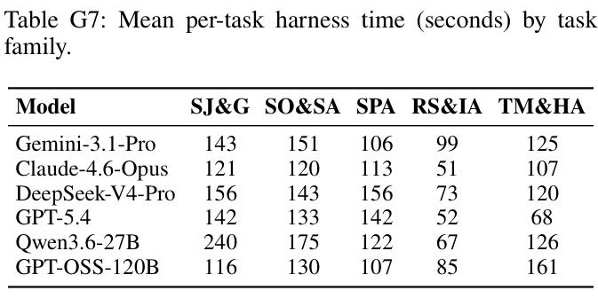

| 模型 | SJ&G | SO&SA | SPA | RS&IA | TM&HA |
|---|---:|---:|---:|---:|---:|
| Gemini-3.1-Pro | 143 | 151 | 106 | 99 | 125 |
| Claude-4.6-Opus | 121 | 120 | 113 | 51 | 107 |
| DeepSeek-V4-Pro | 156 | 143 | 156 | 73 | 120 |
| GPT-5.4 | 142 | 133 | 142 | 52 | 68 |
| Qwen3.6-27B | 240 | 175 | 122 | 67 | 126 |
| GPT-OSS-120B | 116 | 130 | 107 | 85 | 161 |

## 附录 H　按任务家族统计的 Token 消耗（原文第 24 页）

表 H8 给出每任务平均 token 用量，既包括整体值，也包括各任务家族，补充正文第三节的综合统计。对于大多数模型，栅格分析相关家族消耗 token 较多，而空间连接与地理编码通常最省。

**表 H8　整体及各任务家族的平均每任务 token 消耗（×10³，原文每列最低值加粗）**

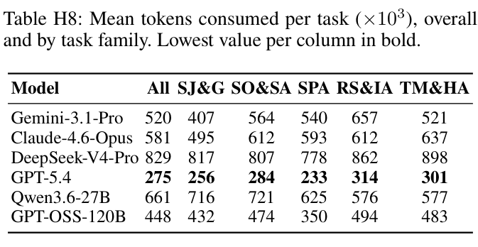

| 模型 | 全部 | SJ&G | SO&SA | SPA | RS&IA | TM&HA |
|---|---:|---:|---:|---:|---:|---:|
| Gemini-3.1-Pro | 520 | 407 | 564 | 540 | 657 | 521 |
| Claude-4.6-Opus | 581 | 495 | 612 | 593 | 612 | 637 |
| DeepSeek-V4-Pro | 829 | 817 | 807 | 778 | 862 | 898 |
| **GPT-5.4** | **275** | **256** | **284** | **233** | **314** | **301** |
| Qwen3.6-27B | 661 | 716 | 721 | 625 | 576 | 577 |
| GPT-OSS-120B | 448 | 432 | 474 | 350 | 494 | 483 |

## 附录 I　案例研究（原文第 24–29 页）

正文 3.6 节提到的每个任务家族的代表性成功与失败案例在此展开，并用地图对比智能体输出与参考输出。每个案例都包括智能体实际接收的任务、所使用的输出契约、参考轨迹和智能体轨迹、并排可视化结果及最终评估。结果中的“通过/失败”采用严格二元评分，量化接近度采用附录 F 的 QCS。下述函数名按基准工具框架公开的名称保留，原图左侧为参考输出、右侧为智能体输出。

### I.1 空间连接与地理编码

#### 成功案例：一英里范围内的目的地点数量

**任务 ID**：`counting_destinations_within_one_mile_of_origins`

**目标。** 对科罗拉多州山前地带的每个起始点，统计距其 **1 英里（1609.344 m）**以内的目的地点数量。

**约束。** 搜索半径严格为 1 英里，即 1609.344 m；恰好位于边界上的目的地点也计入；在 `EPSG:26913` 下测量。需要给每个起始点添加整数字段 `DEST_CNT_1` 表示目的地点数量，并保留起始点原有属性；输出 CRS 为 `EPSG:26913`。

**输出契约。** `origins_with_counts`——点要素类（Point），`EPSG:26913`，必需字段 `DEST_CNT_1`。

**参考轨迹（11 步）。**

```text
reproject_features → reproject_features → get_feature_id_field
→ calculate_attribute_field → calculate_attribute_field
→ calculate_attribute_field → nearest_features_table
→ frequency_table → join_table_by_field
→ calculate_attribute_field → save_features
```

**智能体轨迹。** Gemini-3.1-Pro 用 **9 次调用、0 次错误**完成：先重投影两个图层，再以一次 `join_attributes_by_location_within_distance` 调用取代参考解法中三步计数逻辑，随后重命名及清理字段。虽然操作路径更短、结构不同，最终答案相同。

**结果。** 严格评分**通过**，QCS = **1.00**；六个模型均通过该任务，图中展示 Gemini-3.1-Pro 作为代表。

**图 I1　空间连接与地理编码成功案例：参考输出（左）与智能体输出（右）**

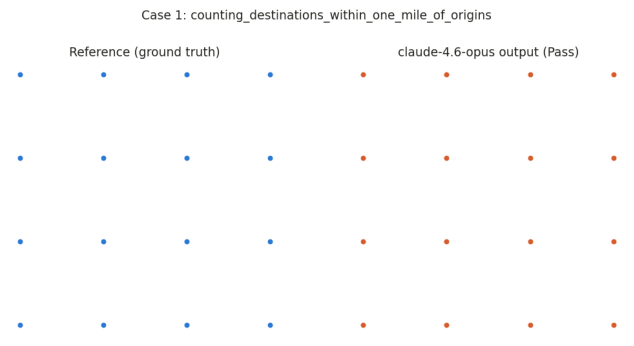

#### 失败案例：在未投影几何上生成内部点

**任务 ID**：`creating_interior_points_with_projected_coordinates`

**目标。** 对旧金山湾区每个街区多边形，生成一个**保证位于多边形内部**的点，并附加源多边形的原生 FID 及该点的投影坐标。

**约束。** 输出点必须位于其源多边形内部（不能仅在边界上），坐标计算使用 `EPSG:26910`。输出字段包括 `POLY_FID`（原生多边形 FID）、`X_EPSG2691`（以米计、保留两位小数的 X 坐标）和 `Y_EPSG2691`（以米计、保留两位小数的 Y 坐标）；还要保留源多边形属性；输出 CRS 为 `EPSG:26910`。

**输出契约。** `artifact_point_shapefile`——点要素类，CRS `EPSG:26910`；必需字段 `POLY_FID`、`X_EPSG2691`、`Y_EPSG2691`。

**参考轨迹（8 步）。**

```text
reproject_features → get_feature_id_field
→ calculate_attribute_field → point_on_surface
→ add_geometry_attributes → calculate_attribute_field
→ calculate_attribute_field → save_features
```

**智能体轨迹。** DeepSeek-V4-Pro 使用 **14 次调用、0 次报错**，但在重投影之前先调用了 `point_on_surface`，然后再做重投影，并使用 `add_xy_fields` 而非 `add_geometry_attributes` 导出坐标。**分歧发生于第 1 步**：在投影前与投影后计算内部代表点，会产生不同点位；即使这些点都可能位于相同多边形内部，也不能保证满足精确输出契约。

**结果。** 严格评分**失败**，QCS = **0.00**，工具调用错误数为 0。轨迹完全正常结束，并生成一个看似有效的点图层，但点的位置并不是参考位置。

**图 I2　空间连接与地理编码失败案例：内部点坐标不一致**

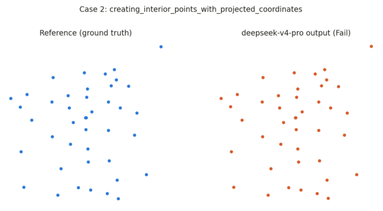

### I.2 空间叠加与适宜性分析

#### 成功案例：县界向内缩进

**任务 ID**：`creating_inland_county_boundary_inset`

**目标。** 根据哈里斯县边界多边形，生成向内缩进 **3,000 m** 后的多边形。

**约束。** 将县界向内缩进 3,000 m，只保留有效且非空的多边形部分；每个产生的多边形部分单独成为输出要素。输出字段 `orig_fid`（县界原生 FID）与 `inset_m`（所有要素均取 3000）；输出 CRS `EPSG:26915`。

**输出契约。** `houston_county_inland_agent`——多边形要素类，CRS `EPSG:26915`；必需字段 `orig_fid`、`inset_m`。

**参考轨迹（10 步）。**

```text
save_features → get_feature_id_field → calculate_attribute_field
→ reproject_features → buffer_features → fix_geometries
→ multipart_to_singleparts → calculate_attribute_field
→ add_geometry_attributes → extract_features_by_expression
```

**智能体轨迹。** Claude-4.6-Opus 通过 **8 次调用、0 次报错**完成：重投影、缓冲、拆分多部件、计算字段以及保留所需字段。它没有执行参考轨迹里的 `fix_geometries` 与最终基于表达式的清理；但在这个具体输入上，由于原县界不存在已有的拓扑缺陷，这两项清理并非必要，因此较短的路径仍然正确。

**结果。** 严格评分**通过**，QCS = **1.00**；六种模型全部通过，图中展示 Claude-4.6-Opus。

**图 I3　空间叠加与适宜性分析成功案例：县界内缩结果**

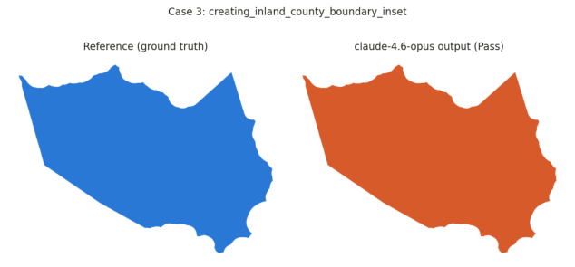

#### 失败案例：要求保留原 CRS 的海岸线裁剪

**任务 ID**：`clipping_shoreline_to_boroughs`

**目标。** 将纽约市海岸线折线裁剪到各行政区多边形之内，并报告各原始海岸线段的裁剪后长度。

**约束。** 只保留位于行政区内部的海岸线几何；长度应在 `EPSG:2263` 中测量。最终同时输出：①采用**输入海岸线原始 CRS** 的裁剪后折线；②包含 `source_fid`（原生海岸线 FID）和 `length_m`（米，保留两位小数）的 CSV。

**输出契约。** `clipped_shoreline_agent`——折线要素类；CRS 必须与 `input_dir/nyc_new_york/transport/shoreline.shp` 一致；以及 `clipped_lengths_csv`——CSV，必需字段 `source_fid`、`length_m`。

**参考轨迹（10 步）。**

```text
reproject_features → reproject_features
→ fix_geometries → fix_geometries → clip_features
→ get_feature_id_field → calculate_attribute_field
→ calculate_attribute_field → reproject_features
→ export_table_to_csv
```

**智能体轨迹。** Gemini-3.1-Pro 发出 **34 次调用**，其中 **1 次报错**。它在重投影前尝试字段计算，然后进行重投影和裁剪；首次调用 `clip_features` 时，因为尚未执行 `fix_geometries`，触发真实的 `TopologyException: side location conflict`（常见无效几何症状）。智能体随后通过修复几何并重新裁剪进行了恢复，但最终仍未满足完整的 CRS 保留及输出要求。

**结果。** 严格评分**失败**，QCS = **0.499**，是附录中较接近正确结果的失败案例之一。六种模型中只有 DeepSeek-V4-Pro（1/6）正确保留了输入 CRS。

**图 I4　空间叠加与适宜性分析失败案例：海岸线裁剪及 CRS 保留问题**

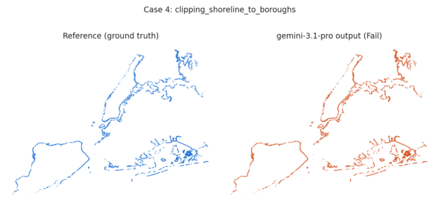

### I.3 地形建模与水文分析

#### 成功案例：运河网络拓扑分类

**任务 ID**：`classifying_multichannel_canal_segments`

**目标。** 对休斯敦运河线网络中经平面化处理的每条线段，判断其属于多河道（multichannel）还是单河道（single-channel），并报告长度。

**约束。** 在全部相交点处切分线段，使网络平面化；“岛状多边形”定义为由平面化线网围合且面积大于 0 的多边形。如果某线段与任一岛状多边形相交，则 `is_multich = 1`，否则取 0。输出字段为 `ORIG_FID`（源折线原生 FID）、`is_multich`（0/1）与 `length_m`（在 `EPSG:26915` 下以米计、保留两位小数的线段长度）；输出 CRS `EPSG:26915`。

**输出契约。** `classified_canals`——折线要素类，CRS `EPSG:26915`，必需字段 `ORIG_FID`、`is_multich`、`length_m`。

**参考轨迹（12 步）。**

```text
reproject_features → get_feature_id_field
→ calculate_attribute_field → features_to_lines
→ polygonize_lines → get_feature_id_field
→ calculate_attribute_field → join_attributes_by_location_summary
→ calculate_attribute_field → calculate_attribute_field
→ retain_fields → save_features
```

**智能体轨迹。** Claude-4.6-Opus 进行了 **14 次调用、0 次报错**，先采用同样的 `features_to_lines → polygonize_lines` 平面化过程，再以普通 `join_attributes_by_location` 和自行组织的 `add_geometry_attributes`、`extract_features_by_expression` 等操作替代参考解法中的一次汇总型 `join_attributes_by_location_summary` 调用。尽管轨迹结构不同，结果仍满足输出契约。

**结果。** 严格评分**通过**，QCS = **1.00**。六种模型全部通过；原文称这是该基准中唯一六模型全部通过的地形建模任务。图中展示 Claude-4.6-Opus。

**图 I5　地形建模与水文分析成功案例：运河网络拓扑分类**

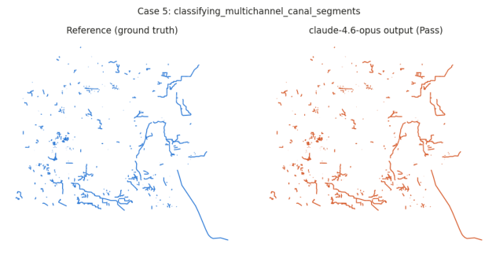

#### 失败案例：陡坡区域多边形化

**任务 ID**：`polygonizing_steep_slope_areas`

**目标。** 从科罗拉多州山前地带 DEM 生成多边形，表示 **10 m** 分析网格上坡度至少 **20%** 的连续区域。

**约束。** 坡度应以百分比表示、分析分辨率为 10 m；坡度 ≥ 20% 的像元为陡坡，要把连续陡坡像元分组。输出属性为 `raster_value`（类别标识，契约实际字段使用 `raster_val`）、`slope__pct`（多边形内最大坡度百分比，保留两位小数）及 `area_m2`（在 `EPSG:26913` 下计算的平方米面积，保留两位小数）；输出 CRS `EPSG:26913`。

**输出契约。** `agent_shapefile`——多边形要素类，CRS `EPSG:26913`，必需字段 `raster_val`、`slope__pct`、`area_m2`。此处提示词叙述与输出契约的字段拼写存在差异，译文分别如实保留。

**参考轨迹（17 步）。**

```text
warp_reproject_raster → slope_raster
→ raster_calculator → raster_calculator
→ polygonize_raster → extract_features_by_expression
→ reproject_features → get_feature_id_field
→ calculate_attribute_field → zonal_statistics_as_table
→ join_table_by_field → calculate_attribute_field
→ calculate_attribute_field → add_geometry_attributes
→ calculate_attribute_field → retain_fields → save_features
```

**智能体轨迹。** Claude-4.6-Opus 使用 **19 次调用、1 次报错**，在坡度阈值处理之前与参考解法基本一致，却在 `polygonize_raster` 前额外插入 `clump_raster_regions`，试图预先对相邻像元分组。但 `polygonize_raster` 本身已经具有这项处理能力，额外步骤造成冗余，并改变了后续文件和 ID 的传递关系。

**结果。** 严格评分**失败**，QCS = **0.00**；六种模型中没有任何一个通过（0/6）。其中四种模型的工具调用错误不超过一次，说明失败主要在最终多边形集合，而非流程无法运行。

**图 I6　地形建模与水文分析失败案例：陡坡多边形化**

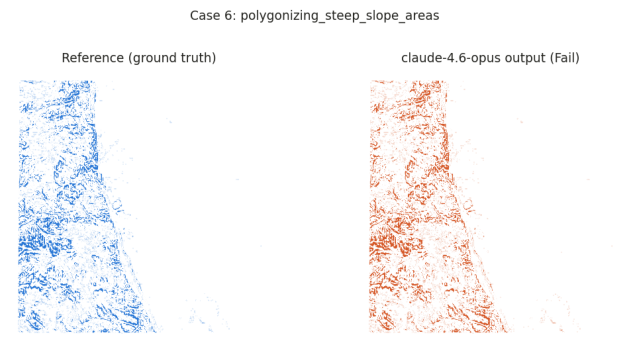

### I.4 空间格局分析

#### 成功案例：网格内公园相交数量统计

**任务 ID**：`counting_park_overlaps_in_grid_cells`

**目标。** 在南佛罗里达公园范围内创建 **1 km** 的多边形网格，统计各网格与多少个**不同的公园多边形**相交。

**约束。** 网格单元大小为 1,000 m；同一个输入公园要素无论包含多少个多边形，都至多对该网格计数贡献 1；没有相交公园的单元 `park_count = 0`。网格多边形必须包含 `grid_id`（整数单元标识）和 `park_count`；输出 CRS `EPSG:32617`。

**输出契约。** `richness_grid`——多边形要素类，CRS `EPSG:32617`，必需字段 `grid_id`、`park_count`。

**参考轨迹（11 步）。**

```text
reproject_features → get_feature_id_field
→ calculate_attribute_field → fix_geometries
→ indexed_fishnet → intersection_overlay
→ frequency_table → join_table_by_field
→ calculate_attribute_field → save_features → retain_fields
```

**智能体轨迹。** Claude-4.6-Opus 使用 **10 次调用、0 次报错**建立相同网格，并以一次 `join_attributes_by_location_summary` 替代参考解法中的“叠加—计数—字段连接”三步操作；这种汇总型连接捷径与前述运河分类成功案例相似。

**结果。** 严格评分**通过**，QCS = **1.00**；六个模型中有四个通过（4/6），图中展示 Claude-4.6-Opus。

**图 I7　空间格局分析成功案例：网格中公园相交数统计**

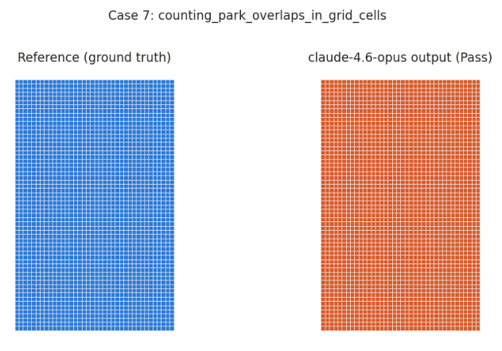

#### 失败案例：由 Voronoi 单元裁剪的医院缓冲区

**任务 ID**：`sf_bay_voronoi_clipped_hospital_buffers_1_km`

**目标。** 对旧金山湾区每家医院，生成一个多边形，表示以医院为中心的 **1,000 m** 圆与其处于街区边界内的有界 Voronoi 单元的交集。

**约束。** 根据医院点建立 Voronoi 单元，单元范围受合并后的街区总范围约束；每家医院的输出多边形等于其 1,000 m 圆与对应 Voronoi 单元的交集。在 `EPSG:26910` 中测量。输出字段 `hospit_fid`（医院原生 FID）和 `buffer_rad`（固定为 1000）；输出 CRS `EPSG:26910`。

**输出契约。** `agent_shp`——多边形要素类，CRS `EPSG:26910`，必需字段 `hospit_fid`、`buffer_rad`。

**参考轨迹（15 步）。**

```text
reproject_features → reproject_features
→ get_feature_id_field → calculate_attribute_field
→ voronoi_polygons → dissolve_features
→ clip_features → buffer_features
→ fix_geometries → fix_geometries
→ intersection_overlay → extract_features_by_expression
→ calculate_attribute_field → retain_fields → save_features
```

**智能体轨迹。** Gemini-3.1-Pro 发出 **9 次调用、0 次报错**：重投影、融合、Voronoi 分割、裁剪之后，使用单个特化的 `clip_point_buffers_to_containing_polygons` 来替代参考解法中的“缓冲—相交—表达式筛选”组合，且完全跳过两次 `fix_geometries`。**分歧点**是特化工具的替代，它不能完整复现原参考流程所定义的空间结果。

**结果。** 严格评分**失败**，QCS = **0.00**，工具调用错误为 0。六种模型中只有 Claude-4.6-Opus（1/6）完成该任务；多个挑战因素叠加使其成为较难的案例。这也是正文图 1 中空间格局分析家族使用的示例。

**图 I8　空间格局分析失败案例：Voronoi 限制下的医院缓冲区**

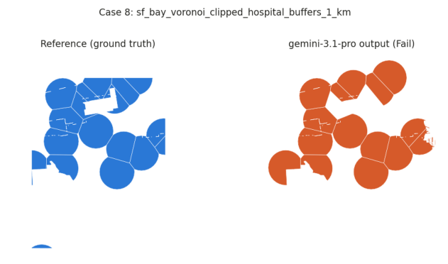

### I.5 遥感与影像分析

#### 成功案例：从彩色红外正射影像计算 NDVI

**任务 ID**：`extract_ndvi_values_at_randstad_address_points_from_cir_orthophoto`

**目标。** 在兰斯塔德区域每个地址点的位置，从彩色红外（CIR）正射影像计算 NDVI，并将结果附加到原点图层。

**约束。** 近红外 NIR 为**第 1 波段**，红光 R 为**第 2 波段**，NDVI = (NIR − R) / (NIR + R)。如果任一采样波段为 NoData 或 NIR + R = 0，则 NDVI 取 NULL。NDVI 字段类型 `Float32`，保留 4 位小数；保留全部地址点原有属性；输出 CRS `EPSG:28992`。

**输出契约。** `agent_shapefile`——点要素类，CRS `EPSG:28992`，必需字段 `NDVI`。

**参考轨迹（9 步）。**

```text
reproject_features → rearrange_raster_bands
→ rearrange_raster_bands → raster_calculator
→ sample_raster_values_to_points → rename_field
→ calculate_attribute_field → delete_columns → save_features
```

**智能体轨迹。** Claude-4.6-Opus 发出 **8 次调用、0 次报错**，先在点位置直接采样原正射影像各波段，再通过属性字段公式根据采样波段值计算 NDVI，最后才重投影。这相当于先采样再计算指数，与参考轨迹“先计算指数再采样”的顺序不同，但在本案例中得到完全相同的 NDVI 值。

**结果。** 严格评分**通过**，QCS = **1.00**；六模型中有三个通过（3/6），图中展示 Claude-4.6-Opus。

**图 I9　遥感与影像分析成功案例：彩色红外正射影像 NDVI 采样**

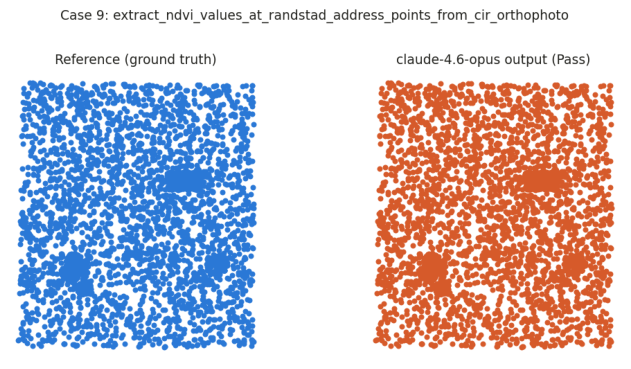

#### 失败案例：跳过重投影的土地覆盖栅格多边形化

**任务 ID**：`vectorize_randstad_landcover_raster_classes_into_polygons`

**目标。** 将兰斯塔德土地覆盖栅格转换为矢量多边形，把具有相同类别值且按 **8 邻域**相连的像元合并为连通区域。

**约束。** 采用包含对角相邻关系的八连通规则；每个连通区域对应一个多边形；`raster_val` 字段存放整数像元值；输出 CRS `EPSG:28992`。

**输出契约。** `vector_shapefile`——多边形要素类，CRS `EPSG:28992`，必需字段 `raster_val`。

**参考轨迹（5 步）。**

```text
warp_reproject_raster → polygonize_raster
→ fix_geometries → calculate_attribute_field → save_features
```

**智能体轨迹。** Claude-4.6-Opus 只进行 **1 次工具调用、0 次报错**：直接针对原始栅格调用 `polygonize_raster`，然后提交结果。**分歧点是第 1 步**：因为省略 `warp_reproject_raster`，生成的多边形沿用源栅格的地理 CRS（`EPSG:4326`，角度单位），而不是输出契约要求的 `EPSG:28992`（米）。作者直接通过两个文件的 CRS 元数据确认了这一点。

**结果。** 严格评分**失败**，QCS = **0.00**；六种模型全部失败（0/6）。作者将其描述为**没有预标记陷阱的控制任务**。每种模型执行时只有 0 或 1 次工具错误，因此失败反映了具体必要步骤缺失，而非栅格转矢量这一能力普遍无法使用。

**图 I10　遥感与影像分析失败案例：土地覆盖多边形化后 CRS 不符合要求**

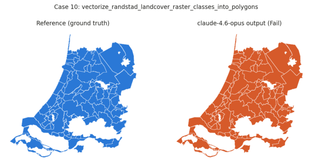

---

## 术语对照（译者整理，非原文新增结论）

| 英文术语 | 中文译名 | 使用说明 |
|---|---|---|
| Ground Truth（GT） | 真实值 / 基准真值 | 本文指执行参考流程得到的**文件级结果**，不只是参考步骤或文字答案 |
| Output contract | 输出契约 | 文件类型、字段、CRS、数据类型及数值容差等明确约束 |
| Harness | 固定工具执行框架 | 对所有模型公开的一致 GIS API 集合及执行环境 |
| Reference trajectory | 参考轨迹 | 按序记录的 API 调用、参数及输出句柄 |
| Strict Task Success Rate（TSR） | 严格任务成功率 | 完全满足结构要求与容差条件的任务占比 |
| Quantitative Closeness Score（QCS） | 量化接近度评分 | 综合考量部分输出与真值的数值、类别、记录及几何接近度 |
| Trajectory closeness | 轨迹接近度 | 参考所需操作角色的覆盖程度；不作为最终正确性评分 |
| Caveat / Pitfall | 任务注意事项 / 易错陷阱 | 提前标注的 CRS、几何、NoData、边界与单位难点 |
| Entity-level matching | 实体级匹配 | 按空间要素逐一寻找对应实体，而非只比较几何并集 |
| Row coverage | 行覆盖率 | 参考记录中有多少行得到对应输出 |
| Spatial predicate | 空间谓词 | 包含、相交、相接、邻近等空间关系判定 |
| Geographic recasting | 地理重构 | 保持分析目标，改变区域、数据集、字段和数值以降低泄漏 |

