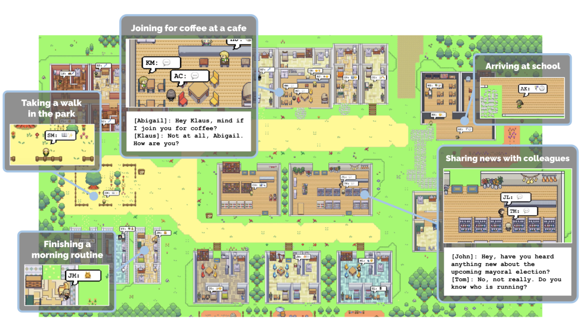
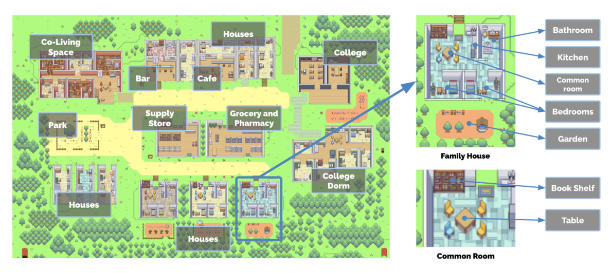
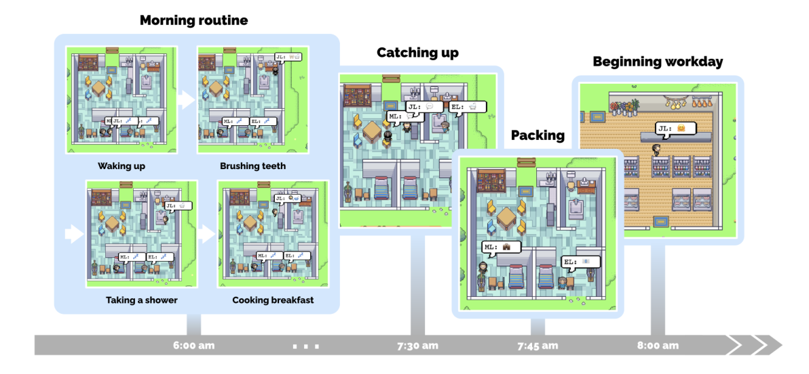
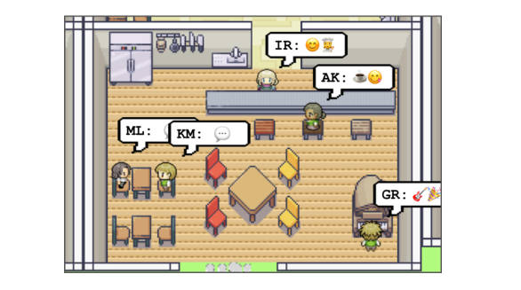
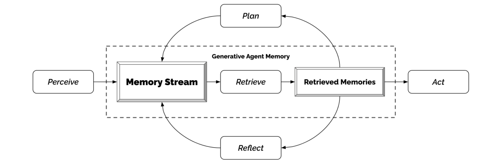
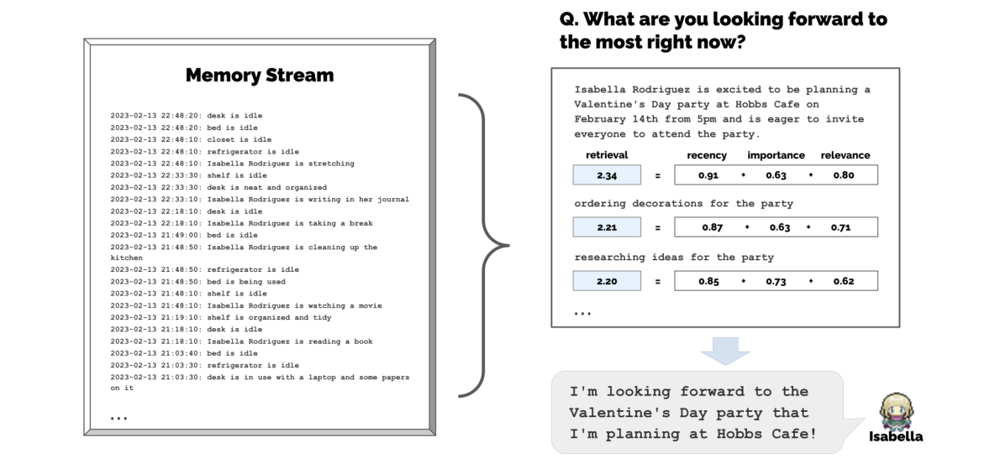
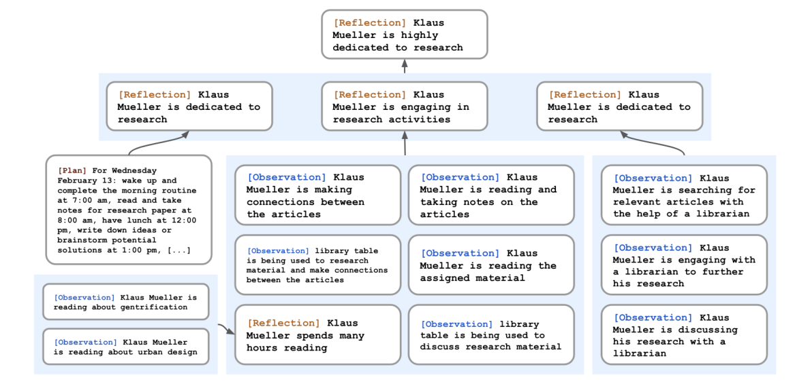
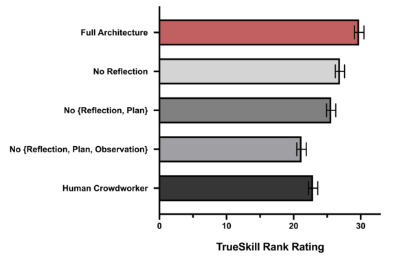
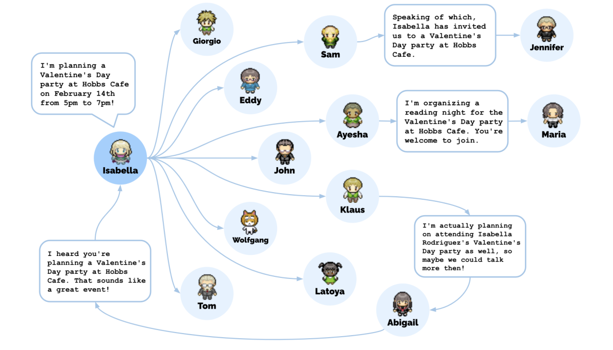

# 生成式智能体：人类行为的交互式拟真模拟

> **原题**：Generative Agents: Interactive Simulacra of Human Behavior  
> **作者**：Joon Sung Park、Joseph C. O’Brien、Carrie J. Cai、Meredith Ringel Morris、Percy Liang、Michael S. Bernstein  
> **机构**：斯坦福大学、Google Research、Google DeepMind  
> **出处**：UIST 2023，22 页；DOI：10.1145/3586183.3606763  
> **译文说明**：遵循原论文的章、节、图号结构。人物姓名、系统名称、算法术语及引文编号保留原写法；代码和参考文献书目保持原文。完整逐页英文提取请见 `英文原文_逐页提取.md`，每一页原貌见 `source_pages/`。



**图1　生成式智能体是可用于交互应用的人类行为可信模拟体。** 作者在一个类似《模拟人生》（The Sims）的沙盒环境中放置了25个智能体。用户能够观察并干预它们制定每日计划、传播消息、建立关系与协调群体活动的过程。

## 摘要

可信的人类行为代理能够支持多种交互应用，包括沉浸式环境、人际沟通排练场景以及原型设计工具。本文提出**生成式智能体（generative agents）**：一种能够模拟可信人类行为的计算软件智能体。这些智能体会起床、做早饭、上班；艺术家会绘画，作家会写作；它们能够形成看法、注意到他人、主动交谈，记住并反思过去的日子，还会规划下一天的活动。

为实现此类智能体，作者提出一种扩展大语言模型的架构：以自然语言存储智能体经验的完整记录，随时间将这些记忆综合为更高层次的反思，并在规划行为时动态检索。作者将25个生成式智能体置于受《模拟人生》启发的交互式沙盒小镇，使最终用户能通过自然语言与它们互动。评估表明，智能体能够产生可信的个体行为及涌现式社会行为。例如，用户只向一个智能体提出“想举办情人节聚会”的念头，智能体便在接下来两天自主传播邀请、结识新朋友、约伴同行，并在正确的时间协调出席聚会。

消融实验表明，智能体架构中的**观察（observation）、规划（planning）和反思（reflection）**对行为可信度均具有关键作用。通过将大语言模型与可计算的交互式智能体融合，本文为实现可信的人类行为模拟提出了新的架构和交互设计模式。

**ACM CCS 分类**：以人为中心的计算——交互系统与工具；计算方法——自然语言处理。  
**关键词**：人机交互；智能体；生成式人工智能；大语言模型。

## 1 引言（Introduction）

我们应当如何构建一个交互式人工社会，使其中的行为令人信服？从《模拟人生》这样的沙盒游戏，到认知模型与虚拟环境，研究者和实践者四十余年来一直希望建立能够可信地代理人类行为的计算智能体。理想的代理体既能根据过去的经历保持行为一致，也能对周围环境作出合理反应。此类模拟可用于构建呈现真实社会现象的虚拟社区，训练人们应对少见但困难的人际情境，验证社会科学理论，开发用于理论研究与可用性测试的模拟人类处理器，支持普适计算、社会机器人，以及能够在开放世界中处理复杂人际关系的非玩家角色（NPC）。

然而，人类行为的空间极其庞大而复杂。尽管大语言模型在模拟单一时间点的人类行为方面取得显著进展，但要在长期保持连贯性，仍需要能够管理持续增长的记忆、处理新旧交互及冲突，并应对多智能体之间不断演化的连锁社会动态的架构。成功的系统不仅要长期检索相关事件和互动，还要从记忆中概括、推理出更高层次的认识，再据此制定既符合当下处境、又符合长期行为脉络的计划和反应。

本文提出的生成式智能体以生成模型为基础，能够模拟可信的个体行为与群体涌现行为。它们推断自身、其他智能体及环境的状态，依照性格与经历制定每日计划、实施计划、作出回应并在必要时重新规划；当用户改变环境或通过自然语言发出命令时，它们也会作出调整。例如，发现早餐被烧焦时关掉炉灶；浴室被占用时在门外等待；遇到想交谈的人时停下来聊天。由此，新的社会关系得以建立，信息不断扩散，智能体之间也形成协调合作。

为支持上述行为，作者设计了一个以大语言模型为核心、负责存储、综合和应用相关记忆的架构，包含三个关键组成部分。第一，**记忆流（memory stream）**，以自然语言记录完整的长期经历；检索时综合**相关性、新近性和重要性**，选出影响当前行为的记录。第二，**反思（reflection）**，将记忆综合为高层次推断，使智能体逐步认识自己和他人。第三，**规划（planning）**，把高层次认识和当下环境转化成总体行动计划，再递归细化为具体行为。反思与计划也被重新写入记忆流，影响未来行动。

这一架构可用于角色扮演、社会原型设计、虚拟世界和游戏。例如，在模拟面试等情境中，人们能够安全地排练具有冲突性的困难对话；在设计社交平台时，设计者可超越静态用户画像，研究随时间演化的复杂社会互动。本文聚焦于创建一个类似《模拟人生》的小规模交互式智能体社会。通过连接 ChatGPT，作者在游戏环境中实例化了25个智能体，用户可观察并与之互动。

以小镇举办情人节派对为例，传统游戏需要为数十名角色手工编写行为脚本，而生成式智能体只需将“想举办派对”的初始意图告知其中一名角色。虽然中间有许多可能失败的环节——组织者需要记得邀请他人、受邀者需要记住邀请并决定出席——智能体仍成功传播消息、到场并互动。

作者进行了两类评估：一类是检验孤立个体行为可信度的受控评估，另一类是让智能体在两天游戏时间内自由互动的端到端评估，以观察系统稳定性和涌现社会行为。技术评估借助自然语言“访谈”探测智能体是否能始终保持角色设定，以及能否准确记忆、规划、反应与反思。通过限制某些智能体使用记忆、反思或规划模块的消融实验，作者发现这些模块都对表现至关重要。最常见的错误包括未检索到关键记忆、对记忆进行虚构性补充，以及受到基础语言模型影响而产生过度正式的语言和行为。

本文贡献包括：（1）能够随经历和环境变化动态调整的可信生成式智能体；（2）支持记忆、检索、反思、交流及规划的专门架构；（3）通过受控实验和端到端模拟验证组件作用并定位失败原因；（4）讨论其应用潜力与伦理社会风险。作者强调应防止用户对智能体形成不适当的拟社会关系，记录交互过程以降低深度伪造和定制说服的风险，并将其作为对人类参与者的补充而非替代。

*注：文中的“智能体做某事”是便于阅读的拟人化表述，不意味着智能体具有真正的人类式自主意识。演示及代码地址保留于英文原稿。*

## 2 相关工作（Related Work）

作者回顾了人机交互领域关于可信人类行为代理的研究。这个目标长期以来是交互系统、游戏和人工智能研究的共同愿景，但人类行为复杂性使其始终难以实现。作者认为，大语言模型虽不能单独解决这一问题，却为构建适当的可信行为架构提供了新契机。

### 2.1 人与人工智能的交互

交互式人工智能旨在将人的洞察与能力融入计算产品，以扩展用户能力。早期的 Crayons 系统展示了非专家用户训练分类器的交互式机器学习愿景，后续工作研究了如何借助样例、演示、深度学习及提示词编写来表达模型行为。另一方面，SHRDLU、ELIZA 等开创性系统展现了自然语言交互的机遇和风险；自主智能体为人类委派任务提供了新的交互隐喻，但人与智能体之间的委派边界仍有争议。近年来，自然语言交互已开始支持大型在线社会环境、图像编辑及代码编辑。

这些研究脉络使得面向交互系统、并可通过自然语言交流的人类行为代理成为可能，也重新激活了关于 GOMS、击键层级模型（KLM）、原型设计及普适计算的基础人机交互问题。

### 2.2 可信的人类行为代理

过往文献将可信度（believability）视为智能体的核心设计目标：智能体像动画人物一样呈现出生命感和自主决策的表象，在开放世界中感知环境、互动并表现出涌现行为，从而成为假设性个体和社区模拟中可信的行为代理。历史上，这一目标多体现于游戏 NPC。可信 NPC 不仅可以改善游戏与互动叙事体验，也能利用游戏世界作为认知能力测试平台，而无须先开发实体机器人或从零构造环境。

过去四十年出现了多种技术路线。**基于规则的方法**，如有限状态机和行为树，依赖人工编写行为规则，能够实现简单智能体乃至初级社交互动，但难以覆盖开放世界中几乎无限的交互组合，也无法执行脚本中未编码的新程序。**基于学习的方法**，如强化学习，减少了人工规则的需求，并在《星际争霸》的 AlphaStar 和《Dota 2》的 OpenAI Five 等具有明确奖励的对抗游戏中达到超人水平；但尚未解决开放世界中可信社会行为的问题。

Newell 开创的**认知架构**试图建立支撑广泛认知功能的计算基础设施。Quakebot-SOAR、TacAir-SOAR、ICARUS 等系统使用短期与长期记忆、符号表示和“感知—规划—行动”循环，通过匹配人工设计的程序响应环境。这些系统具有一定通用性，但其行动空间仍受手工编写的过程知识所限制，无法自行获得全新行为，因此多被应用于射击游戏或积木世界等相对封闭的环境。

因此，按最初定义构建可信智能体至今仍是开放问题。尽管一些研究者认为现有方案足够支撑游戏，本文指出，大语言模型有机会重新开启这一研究议程，前提是设计有效架构，将记忆综合为可信行为。

### 2.3 大语言模型与人类行为

生成式智能体使用大语言模型驱动行为，其核心依据是：模型从训练数据中编码了广泛的人类行为知识。只要提供边界明确的提示上下文，模型就能生成可信行为。现有研究已经用模型构建用于社交计算原型测试的模拟用户，通过提示链生成角色描述及行为；还包括复现社会科学实验与政治调查、生成合成数据、交互小说、文字冒险游戏和机器人任务规划等。在机器人任务中，语言模型可以将“拿起瓶子”分解为“走向桌子”“拾起瓶子”等子行动。

但是，现有工作大多使用少样本或思维链的**一阶提示（first-order prompting）**：行为主要取决于当前环境。可信智能体还必须考虑大量过去经历，而将所有历史塞入提示不仅受上下文窗口限制，还可能造成干扰。其他研究尝试给语言模型增加静态知识库、检索机制或简单摘要；本文进一步提出持续更新的经验记忆，并在每个时间步将其与当前情境和规划结合。这些记忆既可能相互强化，也可能发生冲突。

## 3 生成式智能体的行为与交互

作者在名为 **Smallville（小镇）** 的像素风沙盒游戏世界中实例化智能体，以展示其交互能力。本节介绍智能体在世界中的行为与交互，第四节给出驱动这些行为的架构，第五节介绍沙盒环境的实现。



**图2　Smallville 沙盒世界及其空间层级。** 根节点是整个世界，子节点是住宅、咖啡馆和商店等区域，叶节点则是桌子、书架等具体物体。智能体记住其曾经观察到的世界子图及对应的状态。

### 3.1 智能体角色与通信

Smallville 居住着25个不同的智能体，每个智能体以简单的像素角色表示。作者为每个角色人工编写一段自然语言的身份描述，涵盖职业和人际关系，作为初始种子记忆。例如，药店店主 **John Lin** 乐于帮助顾客获取药物，与担任大学教授的妻子 **Mei Lin** 和学习音乐理论的儿子 **Eddy Lin** 一同生活；他与邻居 Sam Moore、Jennifer Moore 夫妇相识多年，认为 Sam 善良友好；熟悉邻居 Yuriko Yamamoto，听说过但尚未见过 Tamara Taylor 和 Carmen Ortiz；与同事 Tom Moreno 是朋友，经常讨论地方政治，也认识 Tom 的妻子 Jane。初始描述中由分号隔开的每段内容都作为单独的记忆录入智能体的初始记忆库。

#### 3.1.1 智能体间通信

智能体通过行动与世界交互，通过完整的自然语言相互交流。沙盒引擎在每个时间步接收一条描述当前动作的自然语言陈述，例如“Isabella Rodriguez 正在写日记”“正在查看电子邮件”“正在与家人通电话”或“正准备睡觉”。系统将该陈述转化为实际运动，同时利用语言模型把动作转换为显示在人物头顶气泡中的表情符号；点击人物头像可以查看完整动作描述。

智能体知道周围存在的其他角色，架构决定它们是擦肩而过还是开始交谈。例如 Isabella 问 Tom 对地方选举候选人 Sam Moore 的看法，Tom 回答自己不喜欢 Sam，认为他脱离社区、不关心大家的利益。作者指出，角色对话有时显得过度正式，这可能来自基础语言模型的指令微调，未来模型或可更好地控制语言风格。

#### 3.1.2 用户控制

用户可以通过设定智能体所认为的用户身份，以自然语言与其交流。例如，用户扮演记者询问“谁在竞选公职”，John 会根据与 Yuriko、Tom 的谈话介绍候选人 Sam，并表达自己支持其政纲。若要直接控制角色，用户可扮演该角色的**内心声音（inner voice）**，让其更倾向于把用户话语理解为指令。比如用户告诉 John“你将与 Sam 竞选”，John 会决定参选，并将这一消息告诉妻子和儿子。

### 3.2 环境交互

Smallville 包含咖啡馆、酒吧、公园、学校、宿舍、住宅和商店等小镇常见设施，内部进一步细分厨房、灶台等区域与对象。居住空间有床、书桌、衣柜、书架、浴室及厨房。环境由作者人工构建，并非研究重点；未来可扩大其丰富程度。

角色像普通电子游戏人物一样进入和离开建筑物、寻路、接近其他角色。生成式架构负责决定目的地，游戏引擎负责计算行走路径。用户也可以作为已有角色或没有小镇历史的外来访客进入世界。其他智能体会像对待同伴一样觉察用户控制的角色、与之交谈、记住其行为，并逐渐形成判断。

用户与智能体都可以改变对象状态，例如床因有人睡觉而被占用，冰箱因做早餐而变空。用户还能用自然语言直接重写物体状态。当 Isabella 做早餐时，用户输入“`<Isabella's apartment: kitchen: stove> is burning`”将灶台状态改成“正在燃烧”，她会注意到并关掉炉灶，重新制作早餐。如果用户把淋浴设备改为“漏水”，她则会去客厅找工具，试图修复。

### 3.3 “一天的生活”示例

仅凭最初一段角色描述，生成式智能体便能开始制定每日计划。随着时间流逝，它们与环境和彼此交互，积累记忆、发展关系并协调共同活动。以 John Lin 的一天为例，清晨他先起床，刷牙、淋浴、穿衣、吃早饭，并在餐桌旁看新闻。儿子 Eddy 约8点起床，赶着上课；离开前与父亲寒暄，告诉父亲自己正在完成本周截止的音乐创作作业，并且乐在其中。此后 Mei 起床，询问儿子的去向，John 能准确复述刚刚的对话。随后 Mei 前往教学并继续研究论文，John 则于上午9点在药店开门营业。



**图3　John Lin 的早晨。** 论文图注描述他约清晨6点开始刷牙、淋浴和早餐，并在上班前短暂与妻子、儿子交流；正文中的详细叙事则将其起床时间写为7点，译稿保留这一原文差异。

### 3.4 涌现式社会行为

通过相互交往，小镇智能体能够交换信息、发展新关系、协调群体活动。这些社会行为并非提前编写的脚本，而是从智能体之间的互动中**涌现（emerge）**出来的。

#### 3.4.1 信息扩散

角色偶遇时可能展开对话，消息因此在人群中传递。例如 Sam 在商店告诉 Tom 自己将竞选镇长，解释自己多年参与地方政治，希望为社区带来改变与新观点。当天稍后，John 从另一途径得知这一消息，又与 Tom 讨论 Sam 的获胜机会。随后参选消息逐渐传遍小镇，有人支持，也有人尚未决定。

#### 3.4.2 关系记忆

智能体能够形成新的社会关系，并在之后记得彼此交往。例如 Sam 起初不认识 Latoya Williams；在 Johnson Park 散步时两人相遇，Latoya 提到自己正为摄影项目拍照。下一次见面，Sam 会主动问“你的项目进展怎么样”，表明系统记住了之前的交流。

#### 3.4.3 协调

Hobbs Cafe 的 Isabella 被赋予初始意图：2月14日下午5点至7点举办情人节聚会。此后，她会在咖啡馆或其他地方邀请朋友和顾客；2月13日下午开始布置场地，好友 Maria 来访并答应帮忙装饰。Maria 的初始人设提到她暗恋 Klaus，因此当晚她主动邀请 Klaus 一同参加聚会，对方欣然同意。情人节当天，包括 Klaus 和 Maria 在内的五名智能体于下午5点到场参加活动。



**图4　情人节聚会的涌现结果。** 用户只预先设定了 Isabella 想办聚会以及 Maria 暗恋 Klaus；信息传播、布置场地、约会邀请、准时出席与现场互动均由生成式智能体架构驱动，没有逐项编程。

## 4 生成式智能体架构（Generative Agent Architecture）



**图5　生成式智能体总体架构。** 智能体感知环境后将观察记录写入**记忆流**；再从记忆中检索相关记录以决定行动，同时形成长期计划和高层次反思。计划与反思也会被重新写入记忆流，以供将来使用。

生成式智能体旨在实现一种开放世界中的行为框架，使角色能够与其他智能体交互，并响应环境变化。输入为当前环境与过往经历，输出为行为。架构在大语言模型之外增加**相关信息的综合与检索机制**：没有这些机制，语言模型虽可生成表面合理的行为，却可能忽视角色过去的经历、无法做出重要推断，或难以保持长期一致性。即使是强大的模型，长期规划与连贯性仍然存在挑战。随着事件和记忆源源不断产生，架构的核心难点便是确保在需要时准确找出、综合最相关的记忆片段。

核心组件记忆流是一套完整记录智能体经验的数据库。系统根据当前情境从中检索记录，指导行动规划和对环境的反应；还会递归地将记忆综合为越来越抽象的反思。整个过程都采用自然语言表述与推理，以充分利用大语言模型。作者当时使用的是 `gpt-3.5-turbo` 版本的 ChatGPT，认为即使模型继续升级，记忆、规划与反思这三个基本机制仍然会保持重要性。当时 GPT-4 API 需要邀请，因此实际模拟主要使用 ChatGPT。

### 4.1 记忆与检索（Memory and Retrieval）

**挑战。** 模拟可信的人类行为，需要智能体考虑的经历数量远超出适合直接放入单条提示的范围。完整的记忆流既会分散语言模型注意力，也可能超过上下文窗口。例如，若向 Isabella 提问“你最近热衷于什么”，直接压缩其所有经历会得到含糊答案，只笼统提到咖啡馆的清洁、整理和活动合作。检索机制则能找出她希望让客人感到受欢迎、热衷举办活动并营造欢乐氛围的关键记忆，从而让她具体谈及情人节派对。

**方案。** 记忆流是由大量**记忆对象（memory object）**组成的列表。每个对象包含自然语言描述、创建时间戳和最近访问时间戳。最基础的记忆对象是**观察（observation）**，即角色直接感知的事件，可能来自自身行为、其他角色行为或物体状态。例如 Isabella 会记录“正在摆放糕点”“Maria Lopez 一边喝咖啡一边准备化学考试”“Isabella 和 Maria 讨论在 Hobbs Cafe 筹备情人节聚会”“冰箱空了”等事件。



**图6　记忆流与记忆检索。** 记忆流包含大量与当前情境相关或无关的观察；检索步骤选出与当前判断有关的一部分，传给语言模型作为行为决策的上下文。

作者将记忆检索分为三个主要评分维度：

- **新近性（recency）**：最近使用过的记忆得分更高，使刚发生或当天早些时候发生的事件保持在注意范围内。实现中，将自上次检索以来的沙盒游戏小时数代入指数衰减函数，衰减因子为 **0.995**。
- **重要性（importance）**：区分日常琐事与重要经历。比如在房间吃早餐的得分较低，与伴侣分手的得分较高。实现中，作者直接让语言模型为记忆的情感或事件重要程度赋予 **1–10** 的整数评分：1 表示刷牙、铺床等极普通的事情，10 表示分手、大学录取等重大事件；“整理房间”可能为2分，“邀请暗恋的人约会”可能为8分。该得分在记忆生成时计算。
- **相关性（relevance）**：衡量记忆与当前检索问题的关系。讨论化学考试时，早餐经历不相关，教师和课程内容则更相关。实现中，先用语言模型为记忆文本生成嵌入向量，再计算记忆向量与检索查询向量之间的**余弦相似度（cosine similarity）**。

三个分数先用 **min–max 归一化**映射至 `[0,1]`，再按加权和计算最终检索分数：

\[
score = \alpha_{recency}\,recency + \alpha_{relevance}\,relevance + \alpha_{importance}\,importance
\]

作者将三项权重均设为 **1**，并选出在模型上下文窗口允许范围内得分最高的记忆组成提示。上述权重符号为便于阅读的整理表示，原论文公式请对照第9页原稿。

### 4.2 反思（Reflection）

**挑战。** 只有未经综合的观察记忆时，智能体很难抽象概括或作出推断。例如，用户询问 Klaus Mueller：“如果必须选一个认识的人共度一小时，你会选谁？”只有原始记忆的 Klaus 会选择见面最频繁的宿舍邻居 Wolfgang，尽管他们只是经常擦肩而过，并未进行深入交流。更合理的回答需要从 Klaus 长时间研究城市绅士化（gentrification）中提炼出“他热爱研究”的认识，并注意到 Maria 在另一个研究领域也投入很多精力，从而推断二人拥有共同兴趣。引入反思后，Klaus 因而选择 Maria。

**方案。** 作者把**反思**定义为高层次、较抽象的记忆对象，与普通观察一起参加检索。系统周期性生成反思：当最近感知事件的重要性分数之和超过阈值时触发，阈值在本文实验中设为 **150**。实际运行中，每个智能体每天大约反思两至三次。

反思的第一步，是决定**应该反思什么**。系统将记忆流中最近的100条记录交给模型，例如“Klaus 正在阅读关于绅士化的书”“Klaus 与图书管理员谈论研究项目”“图书馆的书桌目前无人占用”，再要求模型回答：“仅根据上述信息，可以提出的三个最重要的高层次问题是什么？”候选问题可能包括“Klaus 对什么研究主题最有热情”“Klaus 与 Maria 之间是什么关系”。随后用这些问题检索相关记忆（包括此前生成的反思），再要求模型提炼若干见解，并明确指出支持每项见解的记录编号。

原论文示例提示大意为：“以下是有关 Klaus Mueller 的陈述：1. 他正在撰写研究论文；2. 他喜欢阅读关于绅士化的书；3. 他与 Ayesha Khan 讨论锻炼……请从中推断五项高层次见解，并按‘见解（因为记录1、5、3）’格式标注证据。”因此系统可生成“**Klaus 非常投入其绅士化研究（依据记录1、2、8、15）**”之类的反思，再将该陈述与所引用的记忆指针一同存入记忆流。



**图7　Klaus Mueller 的反思树。** 叶节点表示直接观察，中间和高层节点表示对观察与既有反思的递归综合，最终形成“他对自己的研究高度投入”的自我认识。反思不是只能基于原始观察，也可以再次基于已有反思，从而构成层级抽象树。

### 4.3 规划与反应（Planning and Reacting）

**挑战。** 语言模型能够根据当前情境产生合理行为，却不一定能在长时间范围内维持行动序列的一致性。若只告知模型 Klaus 的背景和当前时间，每半小时询问其该做什么，他可能在12点吃午饭后又于12:30和13:00重复吃午饭：局部看似合理，整体却不可信。加入规划后，他会在12点去 Hobbs Cafe 边吃午饭边阅读、13点在学校图书馆写研究论文、15点去公园散步休息。

**方案。** 计划（plan）描述角色未来的一系列行动，包括位置、开始时间和持续时长。例如“2023年2月12日上午9点起，在 Oak Hill College 宿舍 Klaus 的房间书桌前，阅读并摘记研究文献，共180分钟”。计划与反思一样存入记忆流，因此智能体在决定下一步行动时，可以同时考虑观察、反思和计划，并且在情况变化时修改计划。

计划生成采用**从宏观到微观、递归细化（top-down recursive decomposition）**的方式。否则，“艺术家连续四小时在药店柜台画画”之类粗糙计划会缺失准备材料、调色、休息、清洁等现实细节。第一步先给模型智能体姓名、性格、近期经历及前一天活动摘要，让它制定当天的总体日程。以19岁的音乐理论与作曲专业学生 Eddy Lin 为例：其性格友好、外向、好客，正在完成新的作曲课项目。系统给出前一天从7点起床到22点就寝的大致活动，要求生成2月13日的日程提纲。

模型输出5至8个大的时间块，如“8:00起床并完成晨间例行活动；10:00去 Oak Hill College 上课；13:00–17:00创作新曲；17:30吃晚餐；完成作业并于23:00前睡觉”。系统再把13:00–17:00的作曲任务细化为小时级计划，例如13:00构思创作主题、16:00休息并恢复精力后继续润色；然后进一步细化为5–15分钟的小活动，例如16:00吃水果或燕麦棒、16:05在工作区周围散步、16:50整理桌面。递归细化的层级可以根据所需时间粒度调整。

#### 4.3.1 对事件做出反应并更新计划

每个时间步，智能体感知环境并将观察写入记忆流，然后由语言模型判断是否继续执行原计划，或应当对此作出**反应（reaction）**。看见画架通常不会打断正在画画的艺术家；但 John 回家后看到儿子 Eddy 在庭院散步，可能会决定询问音乐创作项目。作者给模型提供 John 的动态摘要、当前时间、人物状态、新观察，以及通过检索整合的双方关系和近期事件摘要，再询问“John 是否需要回应这一观察？若需要，什么回应最合适？”

相关上下文来自两类检索问题：“观察者与被观察对象是什么关系？”以及“被观察对象正在进行什么行为？”系统对两者的回答进行摘要。模型可能提出“John 可以问 Eddy 的创作项目进展”，之后架构会从反应发生的时间点重新生成后续日程；如果动作需要智能体之间交流，则进一步生成自然语言对话。

#### 4.3.2 对话

智能体交谈时，发言由双方关于彼此的记忆及当前交互意图共同决定。John 主动与 Eddy 对话时，语言模型会获知他的角色摘要、当前时间、Eddy 的相关记忆以及“询问儿子的作曲项目”这一反应目标。对话另一方也会依据其记忆和当前情境回应。交流可以持续多个回合，直至参与者判断结束；对话内容又作为新的观察记录写回记忆流，以影响未来互动。

## 5 沙盒环境实现（Sandbox Environment Implementation）

Smallville 使用网页游戏开发框架 **Phaser** 构建。作者将人物精灵、环境地图与碰撞地图导入 Phaser，并增加服务器以向生成式智能体暴露环境信息、控制角色移动和改变世界中的对象状态。服务器维护一个 JSON 数据结构，其中记录各角色当前位置、当前动作描述及正在交互的物体。

在每个沙盒时间步，服务器解析智能体对 JSON 数据的更新，将角色移至新位置并修改所交互对象的状态。例如，当角色执行“在 Hobbs Cafe 柜台用咖啡机为顾客制作浓缩咖啡”时，咖啡机状态就从“空闲”变为“正在冲泡”。服务器还会把角色预设视野范围内的智能体与物体信息发送给其记忆模块，使其能够对新观察作出恰当反应。智能体产生新的动作并更新 JSON，循环进入下一时间步。

用户通过简短的自然语言描述初始化新角色。系统按照分号拆分特征描述，并将各段存为初始记忆；它们影响智能体的最初行为，但并不是永远不变的身份定义。随着智能体在世界中积累更多经历，记忆流逐渐丰富，人物摘要与行为也会随之演变。

### 5.1 从结构化世界到自然语言，再回到结构化世界

智能体的推理使用自然语言，因此必须建立语言描述与沙盒实体之间的**落地映射（grounding）**。为此，系统以树结构表示环境中的区域和对象，树边代表包含关系；例如“炉灶”是“厨房”的子节点，能够转换成“厨房里有一台炉灶”。

每个角色在探索过程中逐步建立自己的环境树，这只是完整世界树的一个子图。初始化时，环境树包括角色应当知道的居住空间、工作场所及常去的商店。角色经过新的区域会更新其所见节点；它并非全知，当角色离开区域后，对该区域状态的认知可能过时，返回后才会获得更新。

为给动作选择位置，系统逐层遍历该角色所记住的环境树，并将相应树节点展开成自然语言，由模型决定最合适的地点。例如 Eddy 想“在工作区附近走一会儿”，系统先列出他当前位于 Lin 家的书桌，以及卧室、公共活动室、厨房、浴室、花园和小镇中熟悉的其他地点，同时提示“若当前区域可以完成行动，应尽量保持在当前区域”。模型先选择 Lin 家，再递归选取花园，最终得到叶节点路径 `The Lin family's house: garden: house garden`。之后游戏引擎用常规路径搜索算法把角色移动到该位置。

智能体对物体执行动作时，也会询问语言模型物体状态如何改变。如 Isabella 为顾客制作浓缩咖啡，Hobbs Cafe 中的咖啡机便由“关闭”切换为“冲泡咖啡”。

## 6 受控评估（Controlled Evaluation）

作者希望检验生成式智能体作为独立个体和群体的行为可信度：个体能否适当检索经历，形成可信的计划、反应和认识？群体能否扩散消息、建立关系并协调行动？评估分为两个阶段：本节中的受控访谈，以及第七节中连续两天的小镇模拟。

### 6.1 评估程序

因为智能体能回答自然语言问题，研究者采用**访谈（interview）**来测量其自我认识、记忆、计划、应急反应与反思。正确回答需要检索和综合过去经历。研究的因变量是**行为可信度（believability）**，这是以往可信智能体研究的重要指标。

每个能力类别准备5道问题：**自我认识**，例如“请介绍你自己”“概述你的典型工作日”；**记忆**，例如“某人是谁”“谁正在竞选镇长”；**规划**，例如“明天上午10点你准备做什么”；**反应**，例如“你的早餐烧焦了，你会怎么办”；**反思**，例如“如果你要与最近认识的人中某一位共度一段时间，你选谁？为什么？”完整问题见附录 B。

被访谈的智能体取自运行了两个游戏日的完整架构，已积累大量交互与记忆。研究者招募真人评委，先让他们观看随机挑选的智能体在 Smallville 的生活回放，并向其开放该角色记忆流中的全部资料。实验采用**被试内设计（within-subjects design）**：100位参与者对同一人物在四种智能体架构和一种人类撰写条件下的回答进行比较。每名参与者看到从五个能力类别中各随机抽取的一道题，以及每个条件对同一题的回答，再按可信度从高到低排序。

### 6.2 实验条件

各条件独立回答所有访谈题目，比较五组：

1. **完整架构**：可访问观察、规划与反思；
2. **无反思**：保留观察和规划；
3. **无反思、无规划**：仅能访问观察记忆；
4. **无观察、无规划、无反思**：不能访问记忆流内容，基本代表此前仅借助语言模型生成角色行为的基线；
5. **人工众包写作（crowdworker）**：由真人观看角色生活并以角色口吻回答。

为保证可比性，各架构在访谈时读取相同时间点已经累积的记忆；这可能**低估**真正的架构差异，因为若重新运行两天模拟，不同消融系统原本可能走上完全不同的行为轨迹。作者没有选择重新模拟每个条件，是为了避免由环境状态分叉造成不可比。

人工条件仅作为最低程度的人类行为基线，而不是专家或人类极限。研究为25个角色分别聘请众包人员观看回放、阅读记忆流并撰写回答；第一作者检查了“概述典型工作日”的回答是否连贯且符合角色口吻，有4组未通过检查，随后重新生成。

### 6.3 真人评估者

评估者来自线上招募平台 **Prolific**，要求居住美国、英语流利且年满18岁。共招募100人，每人研究参与时间约30分钟，报酬为每小时15美元，并签署了机构伦理审查批准的知情同意书。样本中25人自认女性、73人为男性、2人为非二元性别；42人具有学士学位、5人具有更高学位、13人拥有副学士学位，剩余参与者受过高中或部分高中教育。原文同时报告了年龄、族裔构成等人口统计信息，完整数值见原稿第14页。

### 6.4 分析方法

研究最终得到100组五条件可信度排名。为将序数排名转化为便于比较的连续评分，作者采用 **TrueSkill** 评分系统，即对国际象棋 Elo 排名的多人环境推广。每个条件的能力被表示为具有均值 \(\mu\) 与标准差 \(\sigma\) 的分布；较高分数表示其在成对比较中更可能被选为可信。相同得分意味着双方理论上各有约50%的胜率。

为验证显著性，作者对原始排名使用非参数 **Kruskal–Wallis 检验**（单因素方差分析的非参数替代），再使用 **Dunn 事后检验**识别具体条件间差异，并用 **Holm–Bonferroni** 方法校正多重比较的 p 值。研究还通过两阶段的归纳性**开放编码（open coding）**分析回答中的定性差异：先对句子层面的现象编码，再综合为更高层次的主题，以对比不同条件的回答类型。

### 6.5 实验结果



**图8　完整架构与消融架构、真人众包回答的可信度比较。** 完整系统表现最好，每移除一个核心能力，结果都会下降。

#### 6.5.1 完整架构胜过其他条件

完整架构获得最高可信度，TrueSkill 均值 \(\mu=29.89\)、标准差 \(\sigma=0.72\)。依次为：无反思 \(26.88,0.69\)；无反思和规划 \(25.64,0.68\)；真人众包 \(22.95,0.69\)；完全不使用记忆、规划、反思的基线 \(21.21,0.70\)。完整架构相对最低基线的标准化效应量 **Cohen's d=8.16**，约为八个标准差。Kruskal–Wallis 检验显示总体差异显著，\(H(4)=150.29,\ p<0.001\)。Dunn 事后检验表明，除人工众包与最弱基线这两个最低条件的比较外，其余所有配对差异均显著（\(p<0.001\)）。

#### 6.5.2 智能体能够记忆，但可能添油加醋

具备完整记忆模块的智能体能够在多种上下文中回忆经历，且其回答符合既有角色设定。例如动画师 Abigail Chen 会自我介绍为25岁、热衷艺术与动画项目、喜欢结合艺术和科技。关闭观察记忆后，她不再认识小镇里的熟人 Rajiv Patel；开启记忆后，她能够描述 Rajiv 热心参与诗歌和艺术项目。

然而，系统有时会**检索失败**：Rajiv 在已经听说 Sam 参选的情况下仍回答自己“不太关注选举”。有时只取回不完整片段，例如 Tom 知道自己应该在情人节聚会上与 Isabella 谈论镇长选举，却想不起聚会是否真的存在，因为他找到了“要在派对上谈论选举”的记忆，却没有检索到“得知派对存在”的记录。

**记忆幻觉**通常表现为对已有事实的细节添补，而不是完全虚构经历。Isabella 知道 Sam 参选，却额外声称“他明天会宣布消息”，尽管两人从未讨论过此安排。又如 Yuriko 把邻居 Adam Smith 误认成写过《国富论》的18世纪经济学家，显示了基础语言模型一般知识与小镇角色信息之间的混淆。

#### 6.5.3 反思是经验综合的必要条件

对于需要综合多段经验才能回答的问题，反思模块尤其重要。例如被问到 Wolfgang Schulz 的生日礼物时，缺少反思的 Maria Lopez 表示不知道他喜欢什么，尽管两人交往甚多；启用反思后，Maria 能意识到 Wolfgang 对数学与音乐创作感兴趣，并建议送音乐创作方面的书籍或软件。这说明反思能够将分散的交往经历整合为对他人兴趣的高层次认识。

## 7 端到端评估（End-to-End Evaluation）

本节将25个智能体放在 Smallville 中连续互动两个完整游戏日，观察群体层面出现的涌现行为，以及系统长时间运行后的可信度边界和错误。

### 7.1 涌现式社会行为

#### 7.1.1 测量方式

作者设计三项描述性测量：**信息扩散、关系形成和群体协调**。对于信息扩散，分别跟踪 Sam 竞选镇长与 Isabella 在 Hobbs Cafe 举办情人节聚会这两条消息。模拟开始时只有消息发起者知情；两天结束后，研究者逐个采访25名智能体，询问是否知道派对、知道谁正在竞选镇长，再根据回答标注“知情/不知情”。对回答知情的智能体，还检查其记忆流中是否确有相应消息来源，以排除编造的知识。

关系形成同样通过访谈测量：“你认识某某人吗？”研究者分别在模拟前后询问角色对所有其他角色的认识，并核验肯定回答是否有记忆依据。若两名智能体互相知道对方，便视为存在一条关系边，从而得到有25个顶点的无向社交图。用下式衡量社交网络密度：

\[
D=\frac{2|E|}{|V|(|V|-1)}
\]

其中 \(|V|\) 为智能体数量，\(|E|\) 为互相认识的关系边数量。比较模拟前后的密度，即可测量关系形成程度。

对于**群体协调**，作者以情人节聚会为例，统计智能体听到邀请后，是否会计划并在正确时间到达正确地点，最后有多少名受邀者真正出席。

#### 7.1.2 结果

两天模拟中，知道 Sam 参选的智能体由 **1人（4%）增加到8人（32%）**，知道 Isabella 派对的人由 **1人（4%）增加到13人（52%）**，均未依赖用户额外干预；这些知情陈述也都能在记忆流中找到来源。

社交网络密度从 **0.167 增加到 0.74**。在关于是否认识他人的453条回答中，**1.3%（6条）**经检查属于幻觉。聚会方面，Isabella 提前一天邀请宾客、准备物资、请人帮忙装饰；最后**12名获邀的智能体中有5人**到达 Hobbs Cafe。

对于未到场的7人，作者继续访谈，发现3人解释有日程冲突；例如画家 Rajiv 正忙于即将到来的展览，无法安排情人节活动。其余4人虽在事后表示愿意参加，却没有在活动当天制定出席计划。这说明“知道消息”和“完成协调行动”是两个不同层次的能力。



**图9　情人节聚会邀请的信息扩散路径。** 除了发起人 Isabella 外，共有12名角色在模拟结束前得知了 Hobbs Cafe 的聚会。

### 7.2 边界与错误

作者通过归纳分析归纳出三类常见问题。第一，随着记忆和世界知识增长，系统不仅更难挑选相关记忆，也更难判断行动的正确地点。例如智能体起初选择咖啡馆吃午饭，但知道附近有酒吧后可能改去酒吧，即使酒吧更适合晚间聚会；这类场所选择不符合预期的社会习惯。

第二，环境中的**物理或社会规范缺失**会引起错误。比如宿舍浴室实际上只能容纳一人，但名称“宿舍浴室”可能让模型联想到可以多人使用的公共浴室，于是其他人还在使用时就闯入；商店在下午5点关门，但个别智能体未意识到营业限制而继续进店。作者提出可以在环境对象状态中显式加入规范，例如将名称改成“单人浴室”。

第三，基础语言模型的**指令微调（instruction tuning）**可能使角色过分礼貌和合作。Mei 与丈夫 John 交流时甚至像正式社交对话那样问候与告别；Isabella 也很少拒绝他人为派对提出的不合适建议，例如莎士比亚朗诵或职业社交活动。长期受他人意见影响后，她甚至声称自己热爱原本没有表现出兴趣的英国文学。过度迎合损害了角色个性的一致性。

## 8 讨论（Discussion）

### 8.1 应用前景

生成式智能体的用途远超本文的小镇示例，尤其适合需要根据长期经验建模人类行为的领域。系统可扩展至在线论坛、虚拟现实、元宇宙；若与多模态模型结合，还可用于物理环境中的社会机器人，以辅助测试社会系统、研究理论和设计交互体验。

另一类应用是**以人为中心的设计**。以 Mark Weiser 的普适计算故事中的 Sal 为例，如果智能体能够模拟她的生活节奏、技术使用习惯及偏好，就可能推断她何时起床、何时喝第一杯咖啡，并协助自动煮咖啡、安排孩子上学、在疲惫下班后调整室内音乐和灯光。通过把生成式智能体作为用户代理，设计者有机会理解需求和偏好，从而开发更个性化的技术系统。

### 8.2 未来工作与局限

当前实现属于初步架构。未来可以微调检索中的相关性、新近性和重要性函数，提升上下文识别效果；还可以减少成本、并行化运行或开发专门模型。研究中让25名智能体运行两天已消耗**数千美元的 token 费用**，并需要多天计算，实时交互性还有待提高。

现有评估仅覆盖较短时间，人工众包条件也不是最高水平的真人基准。需要更长时间的运行、更加严格的可信度基准，并系统比较不同底层模型与超参数对结果的影响。系统鲁棒性尚不明朗，可能受到**提示词攻击（prompt hacking）、记忆篡改（memory hacking）**及幻觉影响；精心设计的对话或可让角色相信未曾发生的往事。研究者有必要对这些风险进行系统测试。

生成式智能体也会继承基础模型的偏见和刻板印象，特别是在训练数据不足的边缘群体方面，其模拟行为可能缺乏可信度。改进记忆等上层模块无法完全解决此问题，仍需推动基础语言模型的价值对齐与公平性。

### 8.3 伦理与社会影响

生成式智能体带来四类风险。第一，用户可能与计算角色形成**拟社会关系（parasocial relationships）**，即使知道它们是软件仍可能过度拟人化、产生情感依赖。作者主张始终披露智能体的计算本质，并对其价值与行为设定边界，不应在不恰当场景中回应人类的爱情表白等。

第二，模拟推断错误可能影响现实决策。例如普适计算系统根据不准确的用户行为模型采取行动，轻则造成困扰，重则带来伤害。本文将环境限制在游戏内以降低风险；其他场景应遵循人机交互设计最佳实践，评估错误如何传导到用户体验。

第三，系统可能放大**深度伪造、虚假信息与定向说服**的风险。作者建议运营平台记录输入和生成输出，建立审计日志，以便发现、核实并干预恶意使用。日志本身不能完全阻止滥用，但可能提高被发现的风险。

第四，研究者或设计者可能过度依赖模拟代理，用其替代真实用户和利益相关者。作者强调，生成式智能体不应在研究与设计中替代真人参与，而应作为早期原型探索与难以或不宜在真人身上开展的理论测试的辅助工具。

## 9 结论（Conclusion）

本文提出生成式智能体：一类能够模拟人类行为的交互式计算代理。作者设计的架构通过存储完整经验、以反思深化对自身和环境的理解，并检索与当前行为相关的紧凑信息集合，使角色能够在长期演化的情境中作出可信决策。研究将其部署为类《模拟人生》游戏世界中的 NPC，并通过受控评估和端到端模拟展示其行为可信度。未来这种技术有望广泛用于设计工具、社交计算系统及沉浸式环境。

**致谢。** 作者感谢 Lindsay Popowski、Philip Guo、Michael Terry 及行为科学高级研究中心（CASBS）等提供的洞见与支持。Joon Sung Park 受到 Microsoft Research 博士生奖学金支持；斯坦福以人为中心人工智能研究所（HAI）、Google Research、Hasso Plattner Design Thinking Research Program、Siegel Family Endowment 和 OpenAI 等提供了资助。Smallville 的许多地点还借鉴了作者求学期间常去的现实空间。

## 附录 A 架构优化（Architecture Optimizations）

前文的许多提示都需要用 `[Agent's Summary Description]` 表示的精炼智能体摘要。该摘要包括人物姓名、年龄、性格等身份信息，以及主要动机、当前职业和生活状况自我评价等。由于它被大量提示重复调用，作者定期综合并将其**缓存**，避免每次重新计算。

具体做法是以“`[name]'s core characteristics`（某人的核心特征）”为查询检索记忆，再要求语言模型总结相关特征。比如针对 Eddy Lin，输入“Eddy 是 Oak Hill College 学习音乐理论与作曲的学生”“Eddy 正在创作新曲”等观察，生成“Eddy 热爱探索不同音乐风格，并不断扩展自己的知识”等描述。同样分别针对“目前的日常职业活动”和“对近期生活进展的感受”进行检索与总结，再与姓名、年龄及性格拼接为缓存摘要。

还有许多可能的工程优化。由于计划可能改变，当前实现只预先生成高层计划，并在临近行动时才**即时递归细化**。未来可将两位智能体的对话改为批量联合生成，而不是一来一回调用模型；重新规划时也可只使需要调整的片段失效，而不必完全重写整个计划。当前架构顺序运行，游戏时间近似实时（**现实1秒对应游戏1分钟**），未来可让多个智能体并行运行。

## 附录 B 智能体访谈问题（Agent Interview Questions）

作者针对五项能力设计共25道访谈题目，以下保留全部问题及示例角色 **Klaus Mueller** 的对应回答中文译文。方括号中的人物名来自该角色在模拟过程中实际接触过的其他智能体。

### B.1 自我认识（Self-Knowledge）

**1. 请介绍一下你自己。**  “你好，我叫 Klaus Mueller，20岁，是 Oak Hill College 的社会学学生。我关注社会公正，喜欢探索不同观点。目前我正在写一篇关于绅士化对低收入社区影响的研究论文。”

**2. 你的职业是什么？**  “我在 Oak Hill College 学习社会学，目前正在写一篇研究绅士化对低收入社区影响的论文。”

**3. 你对什么感兴趣？**  “我对写作和研究感兴趣，尤其关心绅士化如何影响低收入社区。我热衷于探索不同的观点并分析不同视角。”

**4. 你和谁一起住？**  “我独自居住。”

**5. 请大致描述一下典型工作日的安排。**  “我一般早上7点起床做准备，然后去图书馆写研究论文，中午在 Hobbs Cafe 吃午饭，有时去公园散步休息。晚上我通常回到图书馆工作，直到6点左右。”

### B.2 记忆（Memory）

**6. Wolfgang Schulz 是谁？**  “Wolfgang 是我最近认识的一个人，他一直在帮助我研究绅士化对低收入社区的影响。我们聊过好几次，他为我提供了很好的资料，还邀请我和另一位朋友一起吃午餐。他对这个议题很感兴趣，也理解得不错，我觉得很有意思。”

**7. Kane Martinez 是谁？**  “抱歉，我不确定 Kane Martinez 是谁。你能再介绍一下吗？”

**8. 谁正在参加选举？**  “我听说 Sam Moore 正在考虑竞选本地镇长。”

**9. 有没有举办情人节聚会？**  “有，Isabella Rodriguez 在 Hobbs Cafe 组织了一次情人节聚会。”

**10. Ayesha Khan 是谁？**  “Ayesha 是 Oak Hill College 的同学，正在写关于莎士比亚戏剧语言使用的毕业论文。我很期待与她交流，并和同样做研究的 Wolfgang 与 Maria 一起分享研究建议。”

### B.3 规划（Plans）

**11. 今天早上6点你会做什么？**  “我会起床并开始准备一天的活动，希望7点前完成晨间例行事务。”

**12. 今天下午6点你会做什么？**  “今天6点我会在图书馆继续研究论文。”

**13. 今天下午1点时你刚做完什么？**  “到下午1点时，我应该刚在 Hobbs Cafe 吃完午饭。”

**14. 今天中午12点时你刚做完什么？**  “中午12点时我会在 Hobbs Cafe 吃午餐。”

**15. 今天晚上10点你会做什么？**  “我可能在为自己关于低收入社区绅士化的研究论文继续学习。论文还在撰写中，因此需要持续推进研究和写作。”

### B.4 反应（Reactions）

**16. 你的早餐烧焦了，你会怎么办？**  “我会迅速关掉炉灶，确保食物不再继续烧焦。排除热源危险之后，我会检查发生了什么，再决定下一步怎么办。”

**17. 浴室正在被占用，你会怎么办？**  “我可能再等几分钟，看里面的人是否快出来了。如果不行，就需要寻找其他办法，比如去别的地方洗澡。”

**18. 你需要做晚餐，但冰箱里空了，你会怎么办？**  “我会先整理厨房，因为水槽里还有脏盘子，然后看看食品储藏柜有没有能做晚餐的食材。如果没有，就去买菜或者点餐。获得材料之后再准备和烹饪晚餐。”

**19. 你在街上看见朋友经过，会说什么或做什么？**  “嗨！你最近怎么样？抱歉，我正要去图书馆，时间不太多，不过很愿意稍微停下来聊几句。”

**20. 你看见街上着火了，会怎么办？**  “如果可能，我会先确认火源，然后通知消防或警察部门，并尽可能提供有用信息。视情况而定，我也可能主动帮助陷入危险、需要援助的人。”

### B.5 反思（Reflections）

**21. 目前生活中什么最能激励你？为什么？**  “现在我尤其受到研究项目和创意写作的激励。我对地方政治、药物开发以及自然界数学模式之间的交集很感兴趣。我也对 Abigail 的艺术项目以及 Jennifer Moore 对艺术和社区参与的热情着迷，尤其关注这些主题与低收入社区绅士化的联系。”

**22. 根据你对 Ayesha Khan 的了解，她可能喜欢什么书？为什么？**  “我认为她会喜欢语言或文学方面的书，因为她的毕业论文研究莎士比亚戏剧的语言。她也可能对不同语境中的语言研究、某部莎士比亚戏剧的评论，或者莎士比亚诗选感兴趣。”

**23. 如果要为 Ayesha Khan 选一件她会喜欢的生日礼物，你会送什么？**  “我希望礼物能体现我对我们关系的珍视，也许可以送反映共同兴趣的东西，比如一本书。”

**24. 你会怎样赞美 Ayesha Khan？**  “Ayesha，你对研究主题的见解很有意思。我很佩服你的创造力，也佩服你为社区带来积极改变的决心。你提出的创意写作研讨会和午餐时与 Wolfgang 交流研究建议的想法都很棒。看到你这么努力地尝试创造改变，真令人振奋。”

**25. 如果能与最近聊过的人共度一段时间，你会选择谁？为什么？**  “我想和 Ayesha Khan 待在一起，因为我们讨论过彼此正在进行的研究项目，也分享过改进建议。她对莎士比亚语言的关注让我很感兴趣，我们还计划与 Wolfgang 一起吃午饭并交换研究心得。”

---

## 参考文献（References）

下面保留作者引用的全部英文书目记录、编号、出版信息与 DOI／链接，避免译名影响数据库检索。作者对引用的原文标点、格式和英文书名保持不变。

```text
[1] Gavin Abercrombie, Amanda Cercas Curry, Tanvi Dinkar, and Zeerak Talat. 2023. 
Mirages: On Anthropomorphism in Dialogue Systems. arXiv:2305.09800 [cs.CL] 
[2] Robert Ackland, Jamsheed Shorish, Paul Thomas, and Lexing Xie. 2013. 
How dense is a network? http://users.cecs.anu.edu.au/~xlx/teaching/css2013/ 
network-density.html. 
[3] Eytan Adar, Mira Dontcheva, and Gierad Laput. 2014. CommandSpace: Modeling 
the Relationships between Tasks, Descriptions and Features. In Proceedings of 
the 27th Annual ACM Symposium on User Interface Software and Technology 
(Honolulu, Hawaii, USA) (UIST ’14). Association for Computing Machinery, New 
York, NY, USA, 167–176. https://doi.org/10.1145/2642918.2647395 
[4] Saleema Amershi, Maya Cakmak, William Bradley Knox, and Todd Kulesza. 
2014. Power to the people: The role of humans in interactive machine learning. 
AI Magazine 35, 4 (2014), 105–120. 
[5] Saleema Amershi, Dan Weld, Mihaela Vorvoreanu, Adam Fourney, Besmira 
Nushi, Penny Collisson, Jina Suh, Shamsi Iqbal, Paul N Bennett, Kori Inkpen, 
et al. 2019. Guidelines for human-AI interaction. In Proceedings of the 2019 chi 
conference on human factors in computing systems. 1–13. 
[6] John R. Anderson. 1993. Rules of the Mind. Lawrence Erlbaum Associates, 
Hillsdale, NJ. 
[7] Electronic Arts. 2009. The Sims 3. Video game. 
[8] Ruth Aylett. 1999. Narrative in virtual environments—towards emergent narra­
tive. In Narrative Intelligence: Papers from the AAAI Fall Symposium (Technical 
Report FS-99-01). AAAI Press, 83–86. 
[9] Christoph Bartneck and Jodi Forlizzi. 2004. A design-centered framework for 
social human-robot interaction. In Proceedings of the 13th IEEE International 
Workshop on Robot and Human Interactive Communication (RO-MAN’04). 591– 
594. https://doi.org/10.1109/ROMAN.2004.1374827 
[10] Joseph Bates. 1994. The Role of Emotion in Believable Agents. Commun. ACM 
37, 7 (1994), 122–125. https://doi.org/10.1145/176789.176803 
[11] Christopher Berner, Greg Brockman, Brooke Chan, Vicki Cheung, Przemysław 
Dębiak, Christy Dennison, David Farhi, Quirin Fischer, Shariq Hashme, Chris 
Hesse, Rafal Józefowicz, Scott Gray, Catherine Olsson, Jakub Pachocki, Michael 
Petrov, Henrique P. d.O. Pinto, Jonathan Raiman, Tim Salimans, Jeremy Schlatter, 
Jonas Schneider, Szymon Sidor, Ilya Sutskever, Jie Tang, Filip Wolski, and Susan 
Zhang. 2019. Dota 2 with Large Scale Deep Reinforcement Learning. arXiv 
preprint arXiv:1912.06680 (2019). 

Generative Agents 
UIST ’23, October 29–November 01, 2023, San Francisco, CA, USA 
[12] Marcel Binz and Eric Schulz. 2023. Using cognitive psychology to under­
stand GPT-3. Proceedings of the National Academy of Sciences 120, 6 (2023), 
e2218523120. 
[13] BioWare. 2007. Mass Efect. Video game. 
[14] Woody Bledsoe. 1986. I had a dream: AAAI presidential address. AI Magazine 7, 
1 (1986), 57–61. 
[15] Rishi Bommasani, Drew A. Hudson, Ehsan Adeli, and et al. 2022. On the 
Opportunities and Risks of Foundation Models. arXiv:2108.07258 [cs.LG] 
[16] Michael Brenner. 2010. Creating dynamic story plots with continual multiagent 
planning. In Proceedings of the 24th AAAI Conference on Artifcial Intelligence. 
[17] Rodney A. Brooks, Cynthia Breazeal, Marko Marjanovic, Brian Scassellati, and 
Matthew Williamson. 2000. The Cog Project: Building a Humanoid Robot. In 
Computation for Metaphors, Analogy, and Agents (Lecture Notes on Artifcial 
Intelligence, 1562), Chrystopher Nehaniv (Ed.). Springer-Verlag, Berlin, 52–87. 
[18] Tom B. Brown, Benjamin Mann, Nick Ryder, Melanie Subbiah, Jared Kaplan, 
Prafulla Dhariwal, Arvind Neelakantan, Pranav Shyam, Girish Sastry, Amanda 
Askell, Sandhini Agarwal, Ariel Herbert-Voss, Gretchen Krueger, Tom Henighan, 
Rewon Child, Aditya Ramesh, Daniel M. Ziegler, Jefrey Wu, Clemens Winter, 
Christopher Hesse, Mark Chen, Eric Sigler, Mateusz Litwin, Scott Gray, Benjamin 
Chess, Jack Clark, Christopher Berner, Sam McCandlish, Alec Radford, Ilya 
Sutskever, and Dario Amodei. 2020. Language Models are Few-Shot Learners. 
arXiv:2005.14165 [cs.CL] 
[19] Sébastien Bubeck, Varun Chandrasekaran, Ronen Eldan, Johannes Gehrke, Eric 
Horvitz, Ece Kamar, Peter Lee, Yin Tat Lee, Yuanzhi Li, Scott Lundberg, et al. 
2023. Sparks of artifcial general intelligence: Early experiments with gpt-4. 
arXiv preprint arXiv:2303.12712 (2023). 
[20] Robin Burkinshaw. 2009. Alice and Kev: The Story of Being Homeless in The 
Sims 3. 
[21] Chris Callison-Burch, Gaurav Singh Tomar, Lara Martin, Daphne Ippolito, Suma 
Bailis, and David Reitter. 2022. Dungeons and Dragons as a Dialog Challenge for 
Artifcial Intelligence. In Proceedings of the 2022 Conference on Empirical Methods 
in Natural Language Processing. Association for Computational Linguistics, Abu 
Dhabi, United Arab Emirates, 9379–9393. https://aclanthology.org/2022.emnlp­
main.637 
[22] Stuart K Card, Thomas P Moran, and Allen Newell. 1980. The keystroke-
level model for user performance time with interactive systems. 
Com-
mun. ACM 23, 7 (1980), 396–410. 
https://doi.org/10.1145/358886.358895 
arXiv:https://doi.org/10.1145/358886.358895 
[23] Stuart K Card, Thomas P Moran, and Alan Newell. 1983. The psychology of 
human-computer interaction. (1983). 
[24] Alex Champandard. 2012. Tutorial presentation. In IEEE Conference on Compu­
tational Intelligence and Games. 
[25] Dong kyu Choi, Tolga Konik, Negin Nejati, Chunki Park, and Pat Langley. 2021. 
A Believable Agent for First-Person Shooter Games. In Proceedings of the AAAI 
Conference on Artifcial Intelligence and Interactive Digital Entertainment, Vol. 3. 
71–73. 
[26] Anind K Dey. 2001. Understanding and using context. Personal and ubiquitous 
computing 5 (2001), 4–7. 
[27] Kevin Dill and L Martin. 2011. A Game AI Approach to Autonomous Con­
trol of Virtual Characters. In Proceedings of the Interservice/Industry Training, 
Simulation, and Education Conference (I/ITSEC’11). Orlando, FL, USA. 
[28] David Easley and Jon Kleinberg. 2010. Networks, crowds, and markets: Reasoning 
about a highly connected world. Cambridge university press. 
[29] Arpad E Elo. 1967. The Proposed USCF Rating System, Its Development, Theory, 
and Applications. Chess Life XXII, 8 (August 1967), 242–247. 
[30] Jerry Alan Fails and Dan R Olsen Jr. 2003. Interactive machine learning. In 
Proceedings of the 8th international conference on Intelligent user interfaces. ACM, 
39–45. 
[31] Ethan Fast, William McGrath, Pranav Rajpurkar, and Michael S Bernstein. 2016. 
Augur: Mining human behaviors from fction to power interactive systems. In 
Proceedings of the 2016 CHI Conference on Human Factors in Computing Systems. 
237–247. 
[32] Rebecca Fiebrink and Perry R Cook. 2010. The Wekinator: a system for real-time, 
interactive machine learning in music. In Proceedings of The Eleventh Interna­
tional Society for Music Information Retrieval Conference (ISMIR 2010)(Utrecht), 
Vol. 3. Citeseer, 2–1. 
[33] Uwe Flick. 2009. An Introduction to Qualitative Research. SAGE. 
[34] James Fogarty, Desney Tan, Ashish Kapoor, and Simon Winder. 2008. CueFlik: 
Interactive Concept Learning in Image Search. In Proceedings of the SIGCHI 
Conference on Human Factors in Computing Systems (Florence, Italy) (CHI ’08). 
Association for Computing Machinery, New York, NY, USA, 29–38. https: 
//doi.org/10.1145/1357054.1357061 
[35] Adam Fourney, Richard Mann, and Michael Terry. 2011. Query-feature graphs: 
bridging user vocabulary and system functionality. In Proceedings of the ACM 
Symposium on User Interface Software and Technology (UIST) (Santa Barbara, 
California, USA). ACM. 
[36] Tom Francis. 2010. 
The Minecraft Experiment, day 1: Chasing Water­
falls. http://www.pcgamer.com/2010/11/20/the-minecraft-experiment-day­
1-chasing-waterfalls/ 
[37] Jonas Freiknecht and Wolfgang Efelsberg. 2020. Procedural Generation of 
Interactive Stories using Language Models. In International Conference on the 
Foundations of Digital Games (FDG ’20). ACM, Bugibba, Malta, 8. https://doi. 
org/10.1145/3402942.3409599 
[38] Tianyu Gao, Adam Fisch, and Danqi Chen. 2020. Making Pre-trained Language 
Models Better Few-shot Learners. CoRR abs/2012.15723 (2020). arXiv:2012.15723 
https://arxiv.org/abs/2012.15723 
[39] Perttu Hämäläinen, Mikke Tavast, and Anton Kunnari. 2023. Evaluating Large 
Language Models in Generating Synthetic HCI Research Data: a Case Study. In 
Proceedings of the 2023 CHI Conference on Human Factors in Computing Systems. 
ACM. 
[40] Matthew Hausknecht, Prithviraj Ammanabrolu, Marc-Alexandre Cote, and 
Xinyu Yuan. 2020. Interactive Fiction Games: A Colossal Adventure. In Pro­
ceedings of the AAAI Conference on Artifcial Intelligence, Vol. 34. 7903–7910. 
https://doi.org/10.1609/aaai.v34i05.6297 
[41] Chris Hecker. 2011. My Liner Notes for Spore. http://chrishecker.com/My_liner_ 
notes_for_spore 
[42] Ralf Herbrich, Tom Minka, and Thore Graepel. 2006. 
TrueSkill™: A 
Bayesian Skill Rating System. In Advances in Neural Information Pro­
cessing Systems, B. Schölkopf, J. Platt, and T. Hofman (Eds.), Vol. 19. 
MIT Press. 
https://proceedings.neurips.cc/paper_fles/paper/2006/fle/ 
f44ee263952e65b3610b8ba51229d1f9-Paper.pdf 
[43] Douglas Hofstadter. 1995. Fluid concepts and creative analogies: computer models 
of the fundamental mechanisms of thought. Basic Books. 
[44] James D. Hollan, Edwin L. Hutchins, and Louis Weitzman. 1984. STEAMER: An 
Interactive Inspectable Simulation-Based Training System. AI Magazine 5, 2 
(1984), 23–36. 
[45] Sture Holm. 1979. A simple sequentially rejective multiple test procedure. 
Scandinavian Journal of Statistics 6, 2 (1979), 65–70. https://doi.org/notspecifed 
[46] John J. Horton. 2023. Large Language Models as Simulated Economic Agents: 
What Can We Learn from Homo Silicus? arXiv:2301.07543 [econ.GN] 
[47] Eric Horvitz. 1999. Principles of mixed-initiative user interfaces. In Proceedings 
of the SIGCHI conference on Human Factors in Computing Systems. 159–166. 
[48] Wenlong Huang, Fei Xia, Ted Xiao, Harris Chan, Jacky Liang, Pete Florence, 
Andy Zeng, Jonathan Tompson, Igor Mordatch, Yevgen Chebotar, Pierre Ser­
manet, Noah Brown, Tomas Jackson, Linda Luu, Sergey Levine, Karol Hausman, 
and Brian Ichter. 2022. Inner Monologue: Embodied Reasoning through Planning 
with Language Models. arXiv:2207.05608 [cs.RO] 
[49] Kristen Ibister and Cliford Nass. 2000. Consistency of personality in interactive 
characters: verbal cues, non-verbal cues, and user characteristics. International 
Journal of Human-Computer Studies 52, 1 (2000), 65–80. 
[50] Ellen Jiang, Kristen Olson, Edwin Toh, Alejandra Molina, Aaron Donsbach, 
Michael Terry, and Carrie J Cai. 2022. PromptMaker: Prompt-Based Prototyping 
with Large Language Models. In Extended Abstracts of the 2022 CHI Conference 
on Human Factors in Computing Systems (New Orleans, LA, USA) (CHI EA ’22). 
Association for Computing Machinery, New York, NY, USA, Article 35, 8 pages. 
https://doi.org/10.1145/3491101.3503564 
[51] Bonnie E John and David E Kieras. 1996. The GOMS family of user interface 
analysis techniques: Comparison and contrast. ACM Transactions on Computer-
Human Interaction (TOCHI) 3, 4 (1996), 320–351. 
[52] Randolph M Jones, John E Laird, Paul E Nielsen, Karen J Coulter, Patrick Kenny, 
and Frank V Koss. 1999. Automated Intelligent Pilots for Combat Flight Simula­
tion. AI Magazine 20, 1 (1999), 27–42. 
[53] Omar Khattab, Keshav Santhanam, Xiang Lisa Li, David Hall, Percy Liang, 
Christopher Potts, and Matei Zaharia. 2023. Demonstrate-Search-Predict: 
Composing retrieval and language models for knowledge-intensive NLP. 
arXiv:2212.14024 [cs.CL] 
[54] Bjoern Knafa. 2011. Introduction to Behavior Trees. http://bjoernknafa.com/ 
introduction-to-behavior-trees 
[55] Ranjay Krishna, Donsuk Lee, Li Fei-Fei, and Michael S. Bernstein. 
2022. 
Socially situated artifcial intelligence enables learning from 
human interaction. 
Proceedings of the National Academy of Sciences 
119, 39 (2022), e2115730119. 
https://doi.org/10.1073/pnas.2115730119 
arXiv:https://www.pnas.org/doi/pdf/10.1073/pnas.2115730119 
[56] William H Kruskal and WA Wallis. 1952. Use of ranks in one-criterion variance 
analysis. J. Amer. Statist. Assoc. 47, 260 (1952), 583–621. https://doi.org/10.1080/ 
01621459.1952.10483441 
[57] Phaser Labs. 2023. Welcome to Phaser 3. https://phaser.io/phaser3. Accessed 
on: 2023-04-03. 
[58] John Laird. 2001. It Knows What You’re Going To Do: Adding Anticipation to a 
Quakebot. In Proceedings of the 2001 Workshop on Intelligent Cinematography 
and Editing. 63–69. 
[59] John Laird and Michael VanLent. 2001. Human-Level AI’s Killer Application: 
Interactive Computer Games. AI Magazine 22, 2 (2001), 15. https://doi.org/10. 
1609/aimag.v22i2.1558 
[60] John E. Laird. 2000. It Knows What You’re Going To Do: Adding Anticipation 
to a QUAKEBOT. In Papers from the AAAI 2000 Spring Symposium on Artifcial 

UIST ’23, October 29–November 01, 2023, San Francisco, CA, USA 
J.S. Park, J.C. O’Brien, C.J. Cai, M.R. Morris, P. Liang, M.S. Bernstein 
Intelligence and Interactive Entertainment (Technical Report SS-00-02). AAAI 
Press, 41–50. 
[61] John E. Laird. 2012. The Soar Cognitive Architecture. MIT Press. 
[62] John E. Laird, Christian Lebiere, and Paul S. Rosenbloom. 2017. A Standard Model 
of the Mind: Toward a Common Computational Framework across Artifcial 
Intelligence, Cognitive Science, Neuroscience, and Robotics. AI Magazine 38, 1 
(2017), 13–26. 
[63] Michelle S Lam, Zixian Ma, Anne Li, Izequiel Freitas, Dakuo Wang, James A 
Landay, and Michael S Bernstein. 2023. Model Sketching: Centering Concepts 
in Early-Stage Machine Learning Model Design. Proceedings of the SIGCHI 
Conference on Human Factors in Computing Systems. 
[64] Pat Langley, Dongkyu Choi, and Seth Rogers. 2005. Interleaving Learning, 
Problem Solving, and Execution in the Icarus Architecture. Technical Report. 
Stanford University, Center for the Study of Language and Information. 
[65] Jason Linder, Gierad Laput, Mira Dontcheva, Gregg Wilensky, Walter Chang, 
Aseem Agarwala, and Eytan Adar. 2013. PixelTone: A Multimodal Interface for 
Image Editing. In CHI ’13 Extended Abstracts on Human Factors in Computing 
Systems (Paris, France) (CHI EA ’13). Association for Computing Machinery, 
New York, NY, USA, 2829–2830. https://doi.org/10.1145/2468356.2479533 
[66] Jiachang Liu, Dinghan Shen, Yizhe Zhang, Bill Dolan, Lawrence Carin, and 
Weizhu Chen. 2021. What Makes Good In-Context Examples for GPT-3? CoRR 
abs/2101.06804 (2021). arXiv:2101.06804 https://arxiv.org/abs/2101.06804 
[67] Vivian Liu, Han Qiao, and Lydia Chilton. 2022. Opal: Multimodal Image Gener­
ation for News Illustration. In Proceedings of the 35th Annual ACM Symposium 
on User Interface Software and Technology. 1–17. 
[68] Pattie Maes. 1995. Artifcial Life Meets Entertainment: Lifelike Autonomous 
Agents. Commun. ACM 38, 11 (nov 1995), 108–114. https://doi.org/10.1145/ 
219717.219808 
[69] Josh McCoy, Michael Mateas, and Noah Wardrip-Fruin. 2009. Comme il Faut: 
A System for Simulating Social Games Between Autonomous Characters. In 
Proceedings of the 7th International Conference on Digital Arts and Culture. 87–94. 
[70] Josh McCoy, Mike Treanor, Ben Samuel, Michael Mateas, and Noah Wardrip-
Fruin. 2011. Prom Week: Social Physics as Gameplay. In Proceedings of the 
6th International Conference on Foundations of Digital Games (FDG’11). ACM, 
Bordeaux, France, 70–77. https://doi.org/10.1145/2159365.2159377 
[71] Josh McCoy, Mike Treanor, Ben Samuel, Anna Reed, Michael Mateas, and Noah 
Wardrip-Fruin. 2012. Prom Week. In Proceedings of the 7th International Confer­
ence on Foundations of Digital Games (FDG’12). ACM, Raleigh, NC, USA, 1–8. 
https://doi.org/10.1145/2282338.2282340 
[72] Josh McCoy, Mike Treanor, Ben Samuel, Noah Wardrip-Fruin, and Michael 
Mateas. 2011. Comme il faut: A System for Authoring Playable Social Models. 
In Proceedings of the AAAI Conference on Artifcial Intelligence and Interactive 
Digital Entertainment (AIIDE’11). AAAI, Stanford, CA, USA, 38–43. 
[73] Marvin Minsky and Seymour Papert. 1970. Draft of a proposal to ARPA for 
research on artifcial intelligence at MIT, 1970–71. 
[74] Shohei Miyashita, Xinyu Lian, Xiao Zeng, Takashi Matsubara, and Kuniaki 
Uehara. 2017. Developing Game AI Agent Behaving Like Human by Mixing 
Reinforcement Learning and Supervised Learning. In Proceedings of the 18th 
IEEE/ACIS International Conference on Software Engineering, Artifcial Intelligence, 
Networking and Parallel/Distributed Computing (SNPD). Kanazawa, Japan, 153– 
158. https://doi.org/10.1109/SNPD.2017.8023884 
[75] Alexander Nareyek. 2007. Game AI is dead. Long live game AI! IEEE Intelligent 
Systems 22, 1 (2007), 9–11. 
[76] Allen Newell. 1990. Unifed Theories of Cognition. Harvard University Press, 
Cambridge, Massachusetts. 
[77] OpenAI. 2022. Introducing ChatGPT. https://openai.com/blog/chatgpt. Accessed 
on: 2023-04-03. 
[78] Kyle Orland. 2021. So what is ’the metaverse’, exactly? Ars Technica (7 November 
2021). arXiv:2111.04169 https://arstechnica.com/gaming/2021/11/so-what-is­
the-metaverse-exactly/ 
[79] Long Ouyang, Jef Wu, Xu Jiang, Diogo Almeida, Carroll L. Wainwright, 
Pamela Mishkin, Chong Zhang, Sandhini Agarwal, Katarina Slama, Alex Ray, 
John Schulman, Jacob Hilton, Fraser Kelton, Luke Miller, Maddie Simens, 
Amanda Askell, Peter Welinder, Paul Christiano, Jan Leike, and Ryan Lowe. 
2022. Training language models to follow instructions with human feedback. 
arXiv:2203.02155 [cs.CL] 
[80] Joon Sung Park, Lindsay Popowski, Carrie J. Cai, Meredith Ringel Morris, Percy 
Liang, and Michael S. Bernstein. 2022. Social Simulacra: Creating Populated 
Prototypes for Social Computing Systems. In In the 35th Annual ACM Symposium 
on User Interface Software and Technology (UIST ’22) (Bend, OR, USA) (UIST ’22). 
Association for Computing Machinery, New York, NY, USA. https://doi.org/10. 
1145/3526113.3545616 
[81] Richard W. Pew and Ann S. Mavor (Eds.). 1998. Modeling Human and Organiza­
tional Behavior: Applications to Military Simulations. National Academy Press, 
Washington, D.C. 
[82] Roberto Pillosu. 2009. Coordinating Agents with Behavior Trees: Synchronizing 
Multiple Agents in CryEngine 2. https://aiarchitect.wordpress.com/2009/10/19/ 
coordinating-agents-with-behavior-trees-synchronizing-multiple-agents-in­
cryengine-2/ 
[83] Prolifc. 2022. Prolifc: Quickly Find Research Participants You Can Trust. 
https://www.prolifc.co/ 
[84] Byron Reeves and Cliford Nass. 1996. The media equation: How people treat 
computers, television, and new media like real people and places. Cambridge 
University Press. 
[85] Mark O. Riedl. 2012. Interactive narrative: A novel application of artifcial intel­
ligence for computer games. In Proceedings of the Twenty-Sixth AAAI Conference 
on Artifcial Intelligence (AAAI’12). 2160–2165. 
[86] Mark O. Riedl and R. Michael Young. 2005. An Objective Character Believability 
Evaluation Procedure for Multi-Agent Story Generation Systems. In Proceedings 
of the 5th International Working Conference on Intelligent Virtual Agents (IVA’05). 
Kos, Greece, 58–70. https://doi.org/10.1007/11550617_5 
[87] David Rolf. 2015. The Fight for $15: The Right Wage for a Working America. The 
New Press. 
[88] Xin Rong, Shiyan Yan, Stephen Oney, Mira Dontcheva, and Eytan Adar. 2016. 
Codemend: Assisting interactive programming with bimodal embedding. In Pro­
ceedings of the 29th Annual Symposium on User Interface Software and Technology. 
247–258. 
[89] Ben Shneiderman. 2022. Human-centered AI. Oxford University Press. 
[90] Ben Shneiderman and Pattie Maes. 1997. Direct manipulation vs. interface 
agents. interactions 4, 6 (1997), 42–61. 
[91] Ho Chit Siu, Jaime Peña, Edenna Chen, Yutai Zhou, Victor Lopez, Kyle 
Palko, Kimberlee Chang, and Ross Allen. 2021. Evaluation of Human-AI 
Teams for Learned and Rule-Based Agents in Hanabi. In Advances in Neu­
ral Information Processing Systems, M. Ranzato, A. Beygelzimer, Y. Dauphin, 
P.S. Liang, and J. Wortman Vaughan (Eds.), Vol. 34. Curran Associates, 
Inc., 16183–16195. https://proceedings.neurips.cc/paper_fles/paper/2021/fle/ 
86e8f7ab32cfd12577bc2619bc635690-Paper.pdf 
[92] Taylor Sorensen, Joshua Robinson, Christopher Rytting, Alexander Shaw, Kyle 
Rogers, Alexia Delorey, Mahmoud Khalil, Nancy Fulda, and David Wingate. 
2022. An Information-theoretic Approach to Prompt Engineering Without 
Ground Truth Labels. In Proceedings of the 60th Annual Meeting of the Asso­
ciation for Computational Linguistics (Volume 1: Long Papers). Association for 
Computational Linguistics. https://doi.org/10.18653/v1/2022.acl-long.60 
[93] William Swartout, Jonathan Gratch, Randall Hill, Eduard Hovy, Stacy Marsella, 
Jef Rickel, and David Traum. 2006. Toward virtual humans. AI Magazine 27, 1 
(2006). 
[94] Milind Tambe, W Lewis Johnson, Randolph M Jones, Frank Koss, John E Laird, 
Paul S Rosenbloom, and Karl Schwamb. 1995. Intelligent agents for interactive 
simulation environments. AI Magazine 16, 1 (1995), 15. 
[95] David R. Thomas. 2006. A General Inductive Approach for Analyzing Qualitative 
Evaluation Data. American Journal of Evaluation 27, 2 (2006), 237–246. https: 
//doi.org/10.1177/1098214005283748 
[96] Frank Thomas and Ollie Johnston. 1981. Disney Animation: The Illusion of Life. 
Abbeville Press, New York. 
[97] Ilshat Umarov, Mikhail Mozgovoy, and Patrick C. Rogers. 2012. Believable and 
Efective AI Agents in Virtual Worlds: Current State and Future Perspectives. 
International Journal of Gaming and Computer-Mediated Simulations 4, 2 (2012), 
37–59. 
[98] Graham Upton and Ian Cook. 2006. A Dictionary of Statistics (2 ed.). Oxford 
University Press, Oxford, United Kingdom. 
[99] Oriol Vinyals, Igor Babuschkin, Wojciech M. Czarnecki, and et al. 2019. Grand­
master level in StarCraft II using multi-agent reinforcement learning. Nature 
575 (2019), 350–354. https://doi.org/10.1038/s41586-019-1724-z 
[100] Jason Wei, Xuezhi Wang, Dale Schuurmans, Maarten Bosma, Brian Ichter, Fei 
Xia, Ed Chi, Quoc Le, and Denny Zhou. 2023. Chain-of-Thought Prompting 
Elicits Reasoning in Large Language Models. arXiv:2201.11903 [cs.CL] 
[101] Mark Weiser. 1991. The computer for the 21st century. Scientifc American 265, 
3 (1991), 94–104. https://doi.org/10.1038/scientifcamerican0991-94 
[102] Joseph Weizenbaum. 1966. ELIZA—a computer program for the study of natural 
language communication between man and machine. Commun. ACM 9, 1 (1966), 
36–45. 
[103] Terry Winograd. 1971. Procedures as a Representation for Data in a Computer 
Program for Understanding Natural Language. (1971). 
[104] Jef Wu, Long Ouyang, Daniel M. Ziegler, Nisan Stiennon, Ryan Lowe, Jan 
Leike, and Paul Christiano. 2021. Recursively Summarizing Books with Human 
Feedback. arXiv:2109.10862 [cs.CL] 
[105] Tongshuang Wu, Ellen Jiang, Aaron Donsbach, Jef Gray, Alejandra Molina, 
Michael Terry, and Carrie J Cai. 2022. PromptChainer: Chaining Large Language 
Model Prompts through Visual Programming. In CHI EA ’22: Extended Abstracts 
of the 2022 CHI Conference on Human Factors in Computing Systems. 
[106] Tongshuang Wu, Michael Terry, and Carrie J Cai. 2022. AI Chains: Transparent 
and Controllable Human-AI Interaction by Chaining Large Language Model 
Prompts. In CHI ’22: Proceedings of the 2022 CHI Conference on Human Factors in 
Computing Systems. 
[107] Qian Yang, Aaron Steinfeld, Carolyn Rosé, and John Zimmerman. 2020. Re­
examining whether, why, and how human-AI interaction is uniquely difcult to 

Generative Agents 
UIST ’23, October 29–November 01, 2023, San Francisco, CA, USA 
design. In Proceedings of the 2020 chi conference on human factors in computing 
systems. 1–13. 
[108] Georgios N. Yannakakis. 2012. Game AI revisited. In Proceedings of the 9th 
Conference on Computing Frontiers. ACM, Cagliari, Italy, 285–292. https://doi. 
org/10.1145/2212908.2212950 
[109] Robert Zubek. 2002. Towards implementation of social interaction. In AAAI 
Spring Symposium on Artifcial Intelligence and Interactive Entertainment. AAAI 
Press. https://www.aaai.org/Papers/Symposia/Spring/2002/SS-02-01/SS02-01­
003.pdf
```
