# GeoAgent：通过地理空间工具增强大语言模型的地址标准化能力

**原题：** GeoAgent: To Empower LLMs using Geospatial Tools for Address Standardization  
**作者：** Chenghua Huang、Shisong Chen、Zhixu Li、Jianfeng Qu、Yanghua Xiao、Jiaxin Liu、Zhigang Chen  
**会议：** Findings of ACL 2024，第 6048–6063 页。  
**代码：** https://github.com/chenghuahuang/GeoAgent

> 本文中文稿依照原文顺序整理摘要、第 1–5 节、局限性、致谢与附录要点；表中数字、地址示例、S2 token、数学公式、代码和原始提示词不作臆改。英文逐页完整提取稿另存于 `英文全文_逐页提取.md`；全部 16 页原稿截图和 15 个图表截图随包提供。

## 摘要

现代导航地图、网约车、外卖配送和物流服务存在大量用户手动输入的非标准地址。这些地址往往含有信息缺失、拼写错误、口语化描述和方位偏移等不规范现象，给地址匹配和地址链接等下游任务带来困难。为此，本文提出 **GeoAgent**：一种由大语言模型（LLM）和地理空间工具集合共同构成的新框架。它利用 LLM 的语义理解能力，并通过专门地理工具融入空间知识，实现高效的地址标准化。

为了验证方法的有效性和实用性，作者还构建了包含复杂非标准地址的大规模数据集，填补了既有数据集在此类任务上的空白，可用于训练和评估地址标准化模型。实验表明，GeoAgent 能有效改善地址处理质量，并显著增强多个地址相关下游任务中模型的性能。

## 1 引言

随着 Google Maps、Uber、Uber Eats 和物流服务普及，用户输入的地址文本不断积累。但是，这些文本经常包含地址成分缺失、拼写错误、方向性位移描述或口语化描述等问题。图 1 展示了三种看似不同但实际指向同一位置的表达：仅给出模糊道路名称的蛋糕店地址、位于两个道路交叉口西南方向 20 米的蛋糕店，以及位于某大学五号门对面的蛋糕店。它们都应被规范为同一条标准地址。为了实现这一点，模型必须既理解文本语义，也具备足够精确的空间知识。

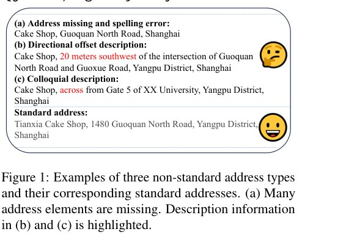

*图 1 中文图题：三类非标准地址及其对应的标准地址，包括缺失或拼写错误、方向偏移描述和口语化位置描述。*

传统地址标准化方法通常依赖字符串匹配和人工规则，比如根据行政层级树拆分地址，再利用地址层级数据库补齐缺失成分。这些方法难以涵盖细粒度、多样化的口语表述。神经网络方法及地址文本预训练方法虽然取得进展，但需要大量标注数据，而且通常无法直接对“西南 20 米”等描述实施精确的空间运算。

大语言模型表现出较强的语义理解能力，但单独使用它仍面临三项局限：第一，**空间相似性与文本相似性不一致**，两个写法明显不同的地址可能位于同一个路口两侧，模型缺少精细的地理常识；第二，**地理空间知识经常变化**，商店、企业和道路随时可能改动，参数化存储的 LLM 难以及时更新；第三，**数值计算精度不足**，难以可靠处理距离和方向偏移。

GeoAgent 通过工具交互弥补这些缺点：使用外部知识库提供精细的地点信息，把知识存储在向量数据库而不是频繁重新训练 LLM，并通过空间计算工具处理方向和距离关系。作者还建立复杂非标准地址数据集，覆盖地理编码、地址标准化、地址匹配和地址链接任务，并提出考虑地址各部分位置重要性的指标 **GeoRouge**。

本文的主要贡献是：（1）LLM 与专业空间工具集成的 GeoAgent；（2）包含真实场景复杂非标准地址的新数据集及专门的 GeoRouge 评价指标；（3）利用下游任务实验证明标准化处理带来的性能增益。

## 2 相关工作

**地址标准化。** 既有方法大体分为基于标准地址匹配的方法和基于地址要素拆分的方法。前者要求建立高质量、大规模的标准地址库，随后使用模糊规则匹配；后者按行政层级拆分、识别并补全地址，采用规则、统计模型或深度学习技术。面对多样化的口语化地址组合，传统方法泛化能力受限，尤其难以处理包含相对位置描述的输入。

**地理预训练模型。** 一些研究通过地理语料预训练或特定任务设计，将地理知识注入模型以改进地理任务。不过，这些工作多着眼于下游任务性能，而非从源头提升地址数据质量。直接激活 LLM 参数中的地理知识一般只能得到较粗粒度的空间知识。GeoAgent 则借助外部知识库与工具，引入细粒度地理知识。

**利用 LLM Agent 解决专门任务。** LLM Agent 利用任务分解、决策泛化与语言理解能力，与环境交互，以解决模型单独推理不擅长的任务。相关模式已应用于机器人、法律和复杂推理。本文将这一路径用于地址标准化，通过外部工具获得空间信息并执行准确的地理计算。

## 3 GeoAgent 方法

**地址标准化定义。** 将输入的非标准地址记作 \(S\)，输出的标准地址记作 \(S^*\)。标准地址指符合地址书写规范的表达。作者以中国城市地址为例，给出“省—市—区—街道—门牌号—POI 名称”的标准排列，并在附录 E 中讨论语言间地址排列习惯差异。

整个 GeoAgent 包含三阶段：（1）任务规划（Task Planning），根据输入地址拆分所需工具操作；（2）任务执行（Task Execution），按照规划依次调用工具并返回结果；（3）地址文本标准化（Address Text Standardization），将执行结果与原始文本结合，输出 \(S^*\)。

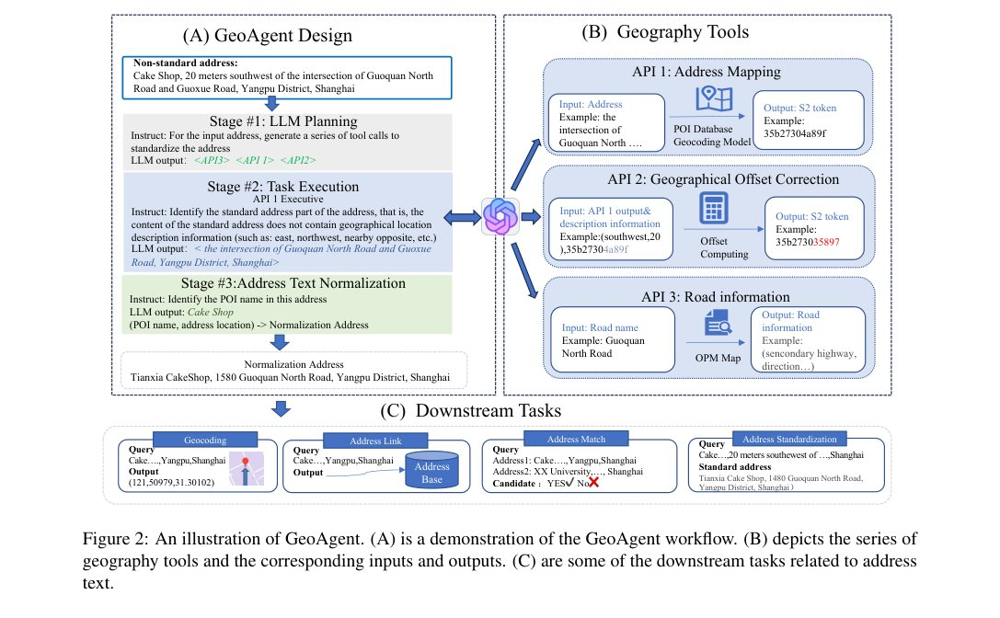

*图 2 中文图题：（A）GeoAgent 工作流程；（B）三个地理空间工具及其输入输出；（C）地理编码、地址链接、地址匹配和地址标准化等下游任务。*

### 3.1 任务规划

GeoAgent 试图使 LLM 按照人类处理非标准地址的直觉工作。对于包含位置描述的地址，人通常先确定不含描述性修饰的标准地址所对应的位置，即**地址映射（Address Mapping）**，再根据“相交口西南方向 20 米”等文字对定位结果进行**偏移修正（Offset Correction）**。

因此，不同描述形式会引发不同的工具调用序列。例如，对“上海市杨浦区国权北路与国学路交叉口西南 20 米处蛋糕店”，规划先调用 API 3 获取道路资料，再调用 API 1 查询基准位置，最后调用 API 2 进行方向和距离偏移计算。

### 3.2 任务执行

执行模块根据规划序列调用工具，LLM 从地址中抽取所需参数。工具集包含地址映射、偏移计算及道路信息三部分；图 2 给出了主要输入输出，附录表 6 列出了相应 API 调用示例及提示。

#### 3.2.1 地址映射工具

该工具将地址文本映射到真实地理位置。例如，“上海市杨浦区国权北路与国学路交叉口”映射为 S2 token `35b27304a89f`。作者选择 **Google S2** 编码而不是经纬度直接表示位置。

工具含两个组件：一是**标准 POI 数据库**，包含上海约 **140 万**条标准化兴趣点（Point of Interest，POI）地址，以“标准地址—S2 token”配对保存；二是**地理编码模型（Geocoding Model）**，当输入地址无法直接命中数据库时，将“地址到空间位置”的映射建模为序列到序列（seq2seq）任务，采用 Transformer 将地址文本编码并解码成 S2 token，学习地址文本与地理位置之间的关联。

由于中文地址中开头的省、市、区等层级通常表示更大空间范围，前部 token 出错带来的空间偏差往往更大，作者提出 **GeoEntropy** 损失，对不同位置和不同 S2 token 赋予不同权重。其损失设计同时考虑：（1）地址序列中越靠前的 token 越重要；（2）S2 编码某一层级的类别虽然均有 16 个可能值（`a–f`、`0–9`），不同类别之间对应的空间距离却不相同。因而使用位置权重向量及 token 类别之间的距离权重矩阵。原文公式 (1)、(2) 的精确排版及符号请对照第 5 页原稿；附录 B 给出了对该损失设计的验证。

#### 3.2.2 偏移计算工具

工具输入为 LLM 从地址中抽取的描述性位置要素以及地址映射工具的结果，输出按描述性偏移修正后的地理位置。

对**方向性描述**（例如“东南 200 米”），根据初始位置、方位角和位移距离进行精确空间运算。对**口语化描述**（例如“附近”“紧挨着”“对面”），根据词语语义决定如何处理：收到“对面”时，利用道路信息判断跨路方向及由道路等级推断的路宽，再求出修正位置；收到“附近”或“紧挨着”时，直接沿用地址映射工具的结果，因为偏移距离较小，误差在可接受范围内。

#### 3.2.3 道路信息工具

这一工具提高偏移方向和距离计算精度。很多地址描述依赖道路方位，例如“某两条道路交叉口西北方向 50 米”。如果起始点 50 米范围内存在与给定偏移方向相差不超过 **±22.5°** 的道路，便将该道路方向作为偏移方向。作者利用 OpenStreetMap 道路网络信息获取道路方向和等级，后者还能辅助估计宽度。工具输入为道路名称，输出包含道路走向及主干道、乡村道路等道路等级资料。

### 3.3 地址文本标准化

根据定位结果与原始地址，LLM 提取 POI 名称，再结合地点和名称查询标准 POI 数据库。若成功匹配，直接输出该 POI 的标准地址；否则结合原始地址中的可用信息构建结果。

**POI 数据库链接。** 利用 LLM 提取出的 POI 名称和位置，通过 POI 名称相似度与 S2 token 空间相似度联合匹配。若匹配成功，使用标准 POI 地址作为标准化输出。

**地址信息整合。** 当无法直接链接 POI 时，通过开源 OPM/OSM 道路数据对行政区、路名和描述性信息进行修正。行政区信息按层级补全；路名根据道路网络和近似名称选择最可能的道路；最终结合原本识别的 POI 名称得到标准地址。

### 3.4 指令微调

为了使 LLM 能按照指定的 `<at[]>` 等工具调用标记和参数格式输出，作者人工设计了部分含工具调用的对话指令，并使用 ChatGPT 扩充，随后对模型进行微调。指令模板和具体对话示例保留在原文附录 A.3 与表 6 中。

## 4 实验

研究比较 GeoAgent 标准化之前和之后，地址标准化及三个下游任务的表现，包括地址匹配、地理编码和地址链接。

### 4.1 数据集构建

由于已有数据集缺少带描述性位置信息的非标准地址，作者基于启发式规则及标准 POI 库构建新数据集，使其覆盖真实应用中的复杂情况。数据集支持三种任务：地理编码、地址链接和地址标准化。

一类构造策略是**地址成分缺失**：以 **15%** 的概率删除行政区、字符或其他地址组成部分，模拟手工输入中常见的信息缺失和拼写问题。另一类策略是**描述性信息补充**：根据 POI 库中的距离和方向为地址添加相对位置表达。最后还使用 ChatGPT 丰富口语化描述的多样性；相关提示见附录 D.2。

作者构造约 **77 万**条非标准地址，按任务分配训练、开发及测试样本；各类任务的具体分布见表 1。

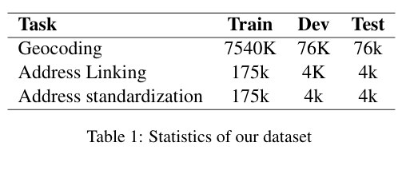

### 4.2 评价指标与基线

**地址标准化：** 比较平均编辑距离（Average Edit Distance，AED）与作者提出的 GeoRouge-N，它在传统 N-gram 相似性之外考虑地址要素在序列中的位置权重，强调行政区层级和元素顺序的重要性。基线包括商业地址标准化服务 AS-1。

**地理编码：** 使用精确地理位置之间的平均距离误差（Average Distance，AD），并报告预测位置落在真实位置 **100 米**或 **1 千米**范围内的准确率，分别记为 `Ac@100M` 与 `Ac@1KM`；比较商用地理编码接口及其叠加 GeoAgent 标准化后的表现。

**地址匹配：** 判断两条地址是否表示同一实体，类别为完全匹配、部分匹配和不匹配。基线包含 BERT、RoBERTa、StructBert 和 MGeo，使用精确率（Precision）、召回率（Recall）、宏平均 F1（Macro F1）评估；模型在 GeoAgent 标准化后的训练和验证数据上重新训练和测试。

**地址链接：** 将输入链接到标准 POI 库中的具体地址。系统先按行政区过滤候选，随后为候选评分，召回分数最高的 5 项；评价指标为 `MRR@5`，使用 MGeo 作为基线。

### 4.3 整体结果

**地址标准化。** GeoAgent 将非标准地址相对于标准地址的 AED 从 **12.12** 降至 **3.742**，相差 **8.378**；GeoRouge-1/2/3/4 分别达到 **0.926 / 0.892 / 0.871 / 0.852**，说明模型不仅有效纠正了文本，而且能兼顾地址元素的顺序。结果支持作者的判断：地址标准化应显式处理描述性位置内容。案例见附录 C.1。

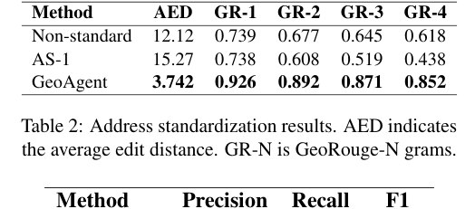

**地理编码。** 两种外部地理编码服务在先经 GeoAgent 标准化后，平均位置误差分别下降约 **66.55 米**与 **42.41 米**。直接使用 GeoAgent 得到的平均距离误差为 **53.05 米**，`Ac@100M = 86.6%`，`Ac@1KM = 97.7%`。这支持“先定位标准地址，再处理描述性位移”的设计。

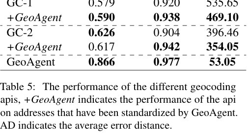

**地址匹配。** 将 GeoAgent 作为预处理步骤后，多个模型的地址匹配效果得到提高，特别是 RoBERTa 和 StructBert：原文报告约 **+8.3** 与 **+11.3** 个百分点的宏 F1 改善。StructBert+GeoAgent 的最终表现超过 MGeo。细分类别分析显示，标准化能提高部分匹配地址间的相似度，并降低不匹配地址间的相似度，从而提升分类能力。

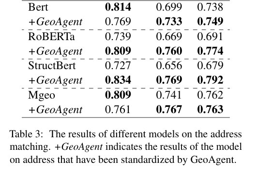

**地址链接。** 叠加 GeoAgent 后，MGeo 的 `MRR@5` 由 **0.698** 提高至 **0.744**，表明地址标准化也能改善候选地址的链接排序。

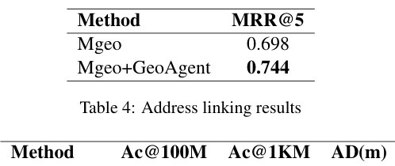

## 5 结论

本文提出 GeoAgent，以解决现代应用中常见的非标准地址问题。GeoAgent 将 LLM 的任务规划及工具调用能力用于弥补精细空间知识和精准空间计算方面的不足；同时构建了复杂非标准地址数据集，改善现有任务数据的覆盖缺口。多个下游任务的实验表明，GeoAgent 标准化处理能有效提升地址相关模型的表现。

### 局限性

首先，实验主要基于中文地址。框架本身原则上不依赖特定语言，但不同语言的地址表达习惯不一样，迁移时需对 GeoLoss 和 GeoRouge 等设计作相应调整。其次，受资源限制，作者采用 ChatGLM-6B 作为核心模型，它在指令理解和遵循方面存在局限，因此使用微调来保证输出格式；随着模型能力发展，未来可能通过上下文学习（in-context learning）取代微调。第三，框架由多个阶段构成，可能出现**级联错误**：例如某位置地理编码误差约 50 米、又位于两个行政区边界附近时，可能导致所属行政区判断错误，尽管作者认为这种情况相对少见。

### 致谢

作者感谢匿名审稿人的宝贵意见。工作受到国家自然科学基金、上海市科技创新行动计划、中国博士后科学基金及浙江实验室开放课题的支持；具体项目编号保留在英文原文第 9 页。

## 附录与图表原件

> 以下保留实验附录的对应图片、方法要点与原稿页码。源文详细实现、算法步骤与可执行提示词仍应以 `英文全文_逐页提取.md` 的第 11–16 页为准。

### 附录 A：模型与工具实现细节

原文讨论地址映射和地理编码 Transformer 的实现设置，以及用于工具调用的指令微调。表 6 给出地理空间 API 的调用模板、提示说明和输入输出示例，这些标记符（如 `<at[]>`）需要原样保留，否则无法直接复现。

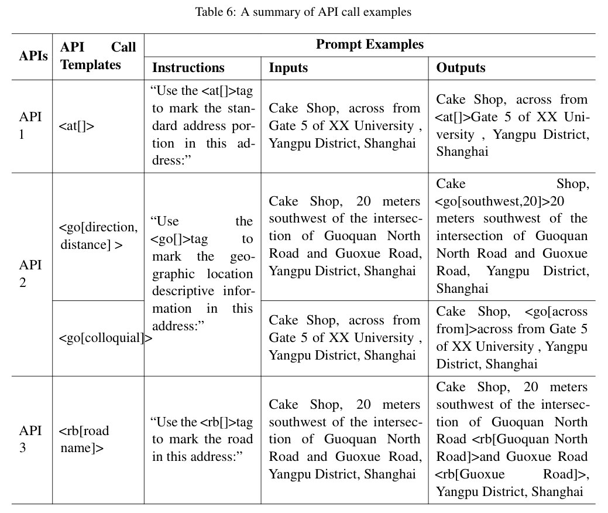

### 附录 B：损失函数消融

附录分析考虑地址顺序与 S2 空间距离的 GeoEntropy 损失。表 7 报告损失函数消融结果，用于检验不同位置和 token 距离权重的作用。

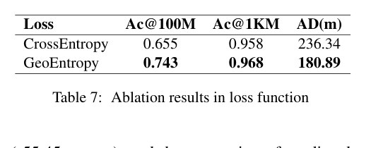

### 附录 C：案例研究

附录 C.1 分析地址标准化实际案例，C.2 检查地理编码定位误差和工具链的贡献，C.3 则分析完全匹配、部分匹配和不匹配三类地址的预测变化。图 3 展示不同 API 方法对应的地址定位与目标地点的偏差。

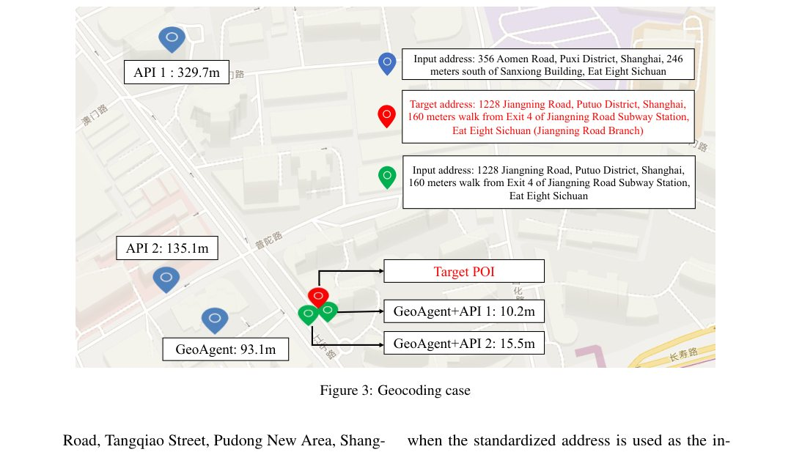

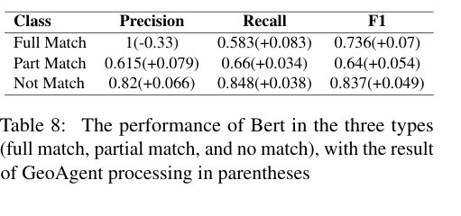

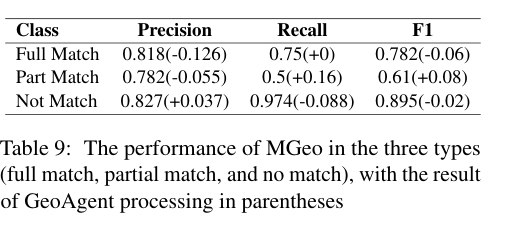

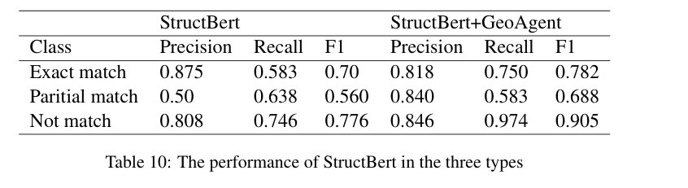

### 附录 D：数据集生成

原文用伪代码展示如何从已有标准地址创建带描述性位置的非标准地址；候选距离、路口位置和不同口语表达的处理构成生成流程。生成数据和自然语言提示中的地址字段、距离阈值及地名保持英文供核查，见第 15–16 页。

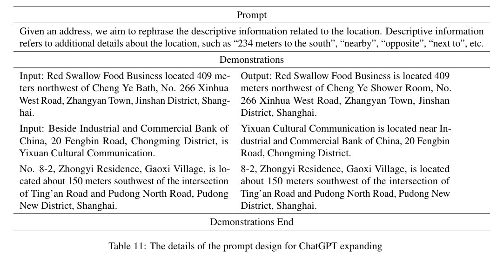

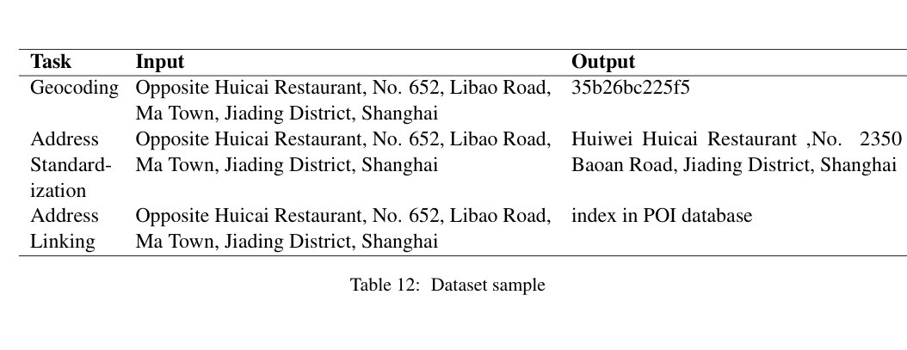

### 附录 E：跨语言泛化讨论

作者认为框架在逻辑上不依赖中文，但各语言地址组成部分的排列不同。英文地址可能与中文地址在行政区从小到大的表达顺序上相反，因此需要调整 GeoLoss 对序列位置赋予的权重，以及 GeoRouge 的权重计算方式；具体修改依照原文第 15 页给出的公式进行。

## 术语对照

| 英文 | 中文 |
|---|---|
| address standardization | 地址标准化 |
| non-standard address | 非标准地址 |
| address mapping | 地址映射 |
| geographic offset correction | 地理位置偏移修正 |
| road information tool | 道路信息工具 |
| S2 token | S2 空间编码 token |
| point of interest (POI) | 兴趣点 |
| geocoding | 地理编码 |
| address matching / linking | 地址匹配 / 地址链接 |
| GeoEntropy / GeoRouge | 地理信息熵损失 / GeoRouge 指标（专名） |
| cascading errors | 级联错误 |

## 参考文献

作者列出的参考文献及准确著录信息在 [`英文全文_逐页提取.md`](./英文全文_逐页提取.md) 第 9–11 页。为方便检索，书目保留作者、英文题名、年份、会议或期刊名，不将书目条目机械翻译为不规范中文题名。
