# 图表索引（PDF 原稿截图）

- 原稿：`Huang 等 - 2024 - GeoAgent To Empower LLMs using Geospatial Tools for Address Standardization.pdf`
- 页数：16 页
- 以下页码均为 PDF 实际页序（从 1 开始），不是页脚印刷页码。

## 图 1 — PDF 第 1 页

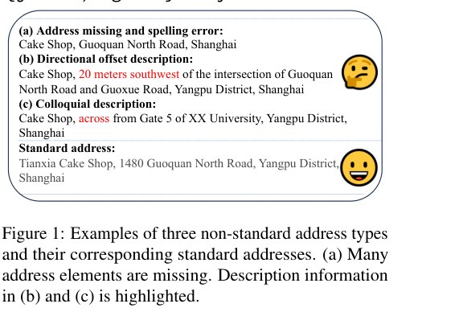

> 原文标注：Figure 1: Examples of three non-standard address types

## 图 2 — PDF 第 3 页

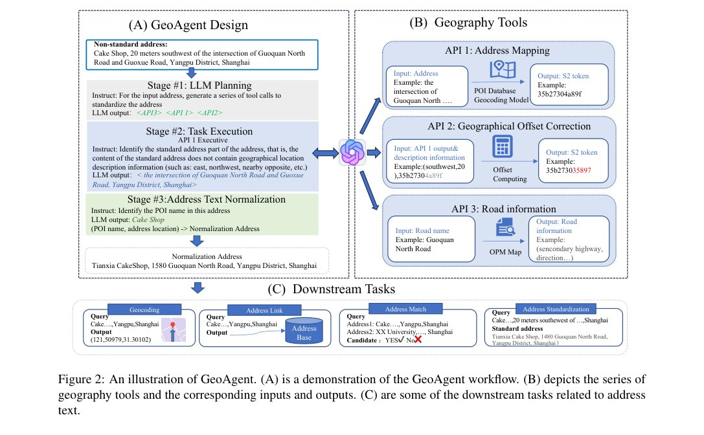

> 原文标注：Figure 2: An illustration of GeoAgent. (A) is a demonstration of the GeoAgent workflow. (B) depicts the series of

## 表 1 — PDF 第 6 页

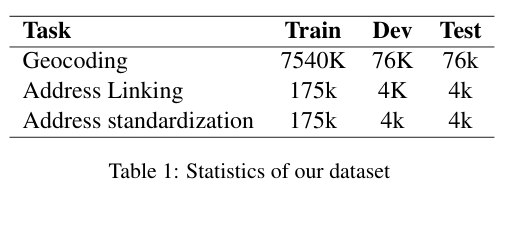

> 原文标注：Table 1: Statistics of our dataset

## 表 4 — PDF 第 8 页

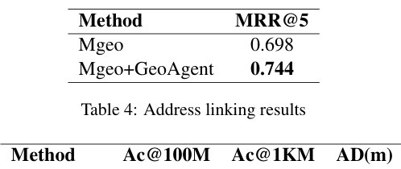

> 原文标注：Table 4: Address linking results

## 表 2 — PDF 第 8 页

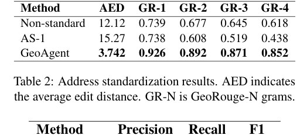

> 原文标注：Table 2: Address standardization results. AED indicates

## 表 5 — PDF 第 8 页

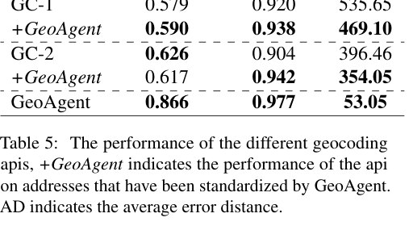

> 原文标注：Table 5: The performance of the different geocoding

## 表 3 — PDF 第 8 页

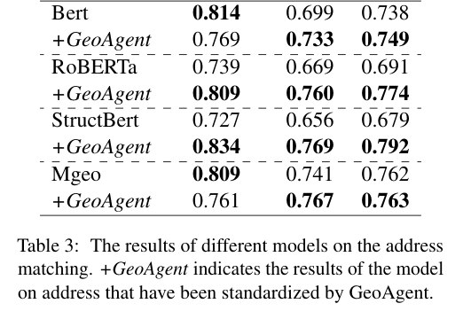

> 原文标注：Table 3: The results of different models on the address

## 表 6 — PDF 第 12 页

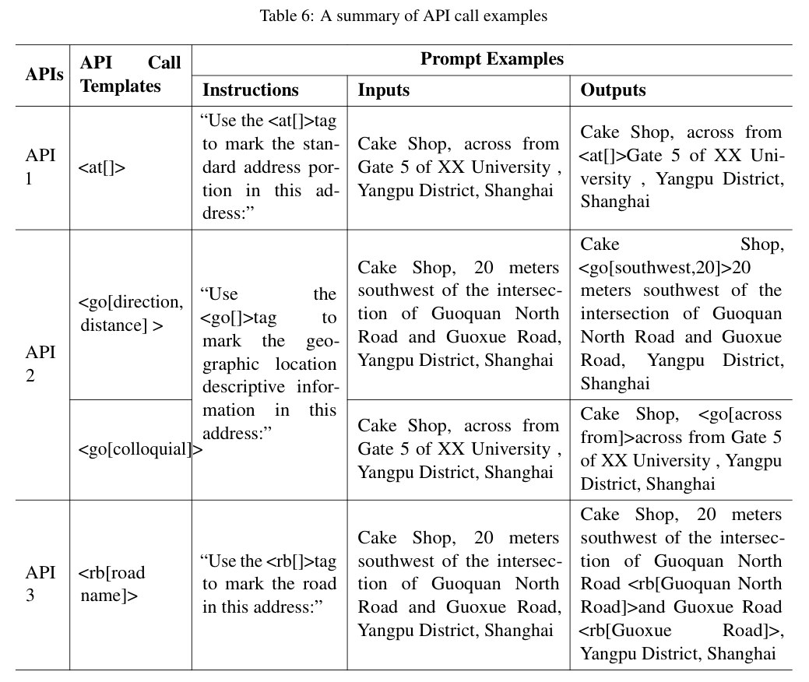

> 原文标注：Table 6: A summary of API call examples

## 表 7 — PDF 第 12 页

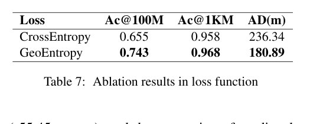

> 原文标注：Table 7: Ablation results in loss function

## 图 3 — PDF 第 13 页

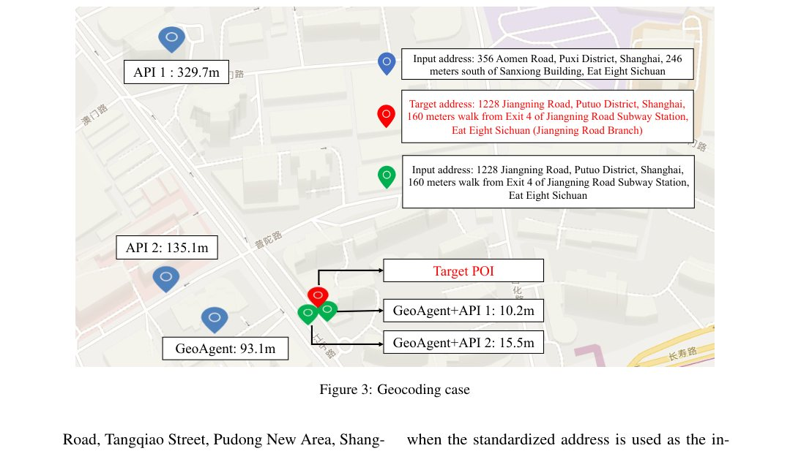

> 原文标注：Figure 3: Geocoding case

## 表 8 — PDF 第 14 页

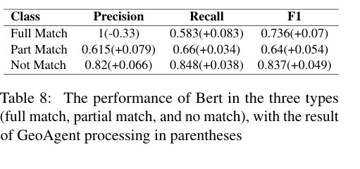

> 原文标注：Table 8: The performance of Bert in the three types

## 表 9 — PDF 第 14 页

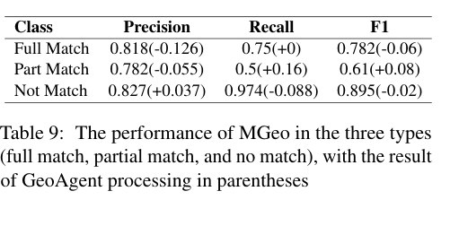

> 原文标注：Table 9: The performance of MGeo in the three types

## 表 11 — PDF 第 16 页

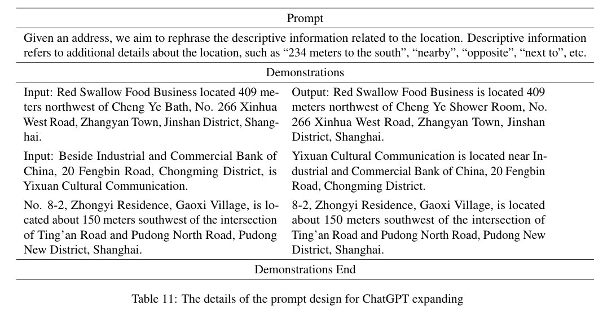

> 原文标注：Table 11.

## 表 10 — PDF 第 15 页

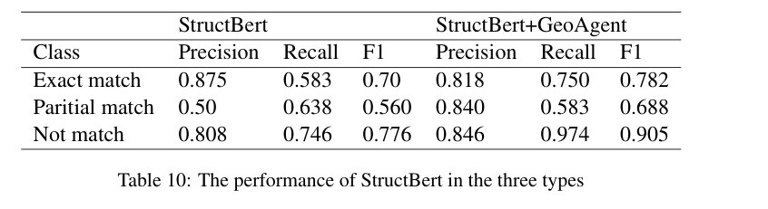

> 原文标注：Table 10: The performance of StructBert in the three types

## 表 12 — PDF 第 16 页

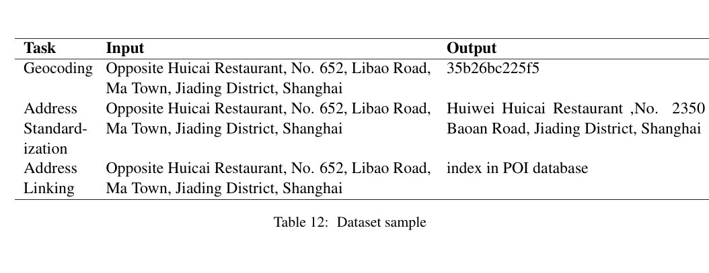

> 原文标注：Table 12: Dataset sample
