# 英文原文：逐页提取（不翻译、不删减）

## PDF 第 1 页

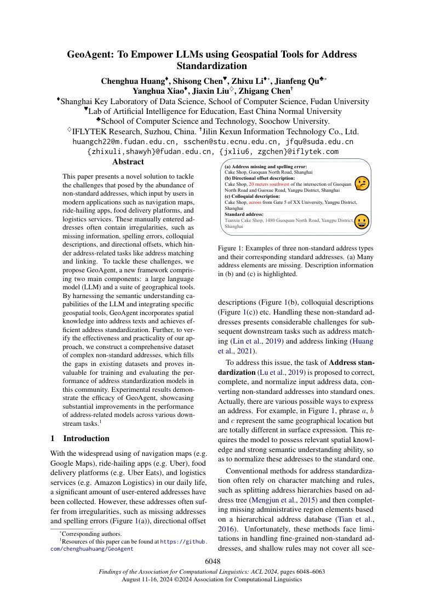

~~~~text
Findings of the Association for Computational Linguistics: ACL 2024, pages 6048–6063
August 11-16, 2024 ©2024 Association for Computational Linguistics
GeoAgent: To Empower LLMs using Geospatial Tools for Address
Standardization
Chenghua Huang♦, Shisong Chen♥, Zhixu Li♦*, Jianfeng Qu♣*
Yanghua Xiao♦, Jiaxin Liu♢, Zhigang Chen✝
♦Shanghai Key Laboratory of Data Science, School of Computer Science, Fudan University
♥Lab of Artificial Intelligence for Education, East China Normal University
♣School of Computer Science and Technology, Soochow University.
♢IFLYTEK Research, Suzhou, China. ✝Jilin Kexun Information Technology Co., Ltd.
huangch22@m.fudan.edu.cn, sschen@stu.ecnu.edu.cn, jfqu@suda.edu.cn
{zhixuli,shawyh}@fudan.edu.cn, {jxliu6, zgchen}@iflytek.com
Abstract
This paper presents a novel solution to tackle
the challenges that posed by the abundance of
non-standard addresses, which input by users in
modern applications such as navigation maps,
ride-hailing apps, food delivery platforms, and
logistics services. These manually entered ad-
dresses often contain irregularities, such as
missing information, spelling errors, colloquial
descriptions, and directional offsets, which hin-
der address-related tasks like address matching
and linking. To tackle these challenges, we
propose GeoAgent, a new framework compris-
ing two main components: a large language
model (LLM) and a suite of geographical tools.
By harnessing the semantic understanding ca-
pabilities of the LLM and integrating specific
geospatial tools, GeoAgent incorporates spatial
knowledge into address texts and achieves ef-
ficient address standardization. Further, to ver-
ify the effectiveness and practicality of our ap-
proach, we construct a comprehensive dataset
of complex non-standard addresses, which fills
the gaps in existing datasets and proves in-
valuable for training and evaluating the per-
formance of address standardization models in
this community. Experimental results demon-
strate the efficacy of GeoAgent, showcasing
substantial improvements in the performance
of address-related models across various down-
stream tasks.1
1
Introduction
With the widespread using of navigation maps (e.g.
Google Maps), ride-hailing apps (e.g. Uber), food
delivery platforms (e.g. Uber Eats), and logistics
services (e.g. Amazon Logistics) in our daily life,
a significant amount of user-entered addresses have
been collected. However, these addresses often suf-
fer from irregularities, such as missing addresses
and spelling errors (Figure 1(a)), directional offset
*Corresponding authors.
1Resources of this paper can be found at https://github.
com/chenghuahuang/GeoAgent
(a) Address missing and spelling error:
Cake Shop, Guoquan North Road, Shanghai
(b) Directional offset description:
Cake Shop, 20 meters southwest of the intersection of Guoquan
North Road and Guoxue Road, Yangpu District, Shanghai
(c) Colloquial description:
Cake Shop, across from Gate 5 of XX University, Yangpu District, 
Shanghai
Standard address:
Tianxia Cake Shop, 1480 Guoquan North Road, Yangpu District, 
Shanghai
Figure 1: Examples of three non-standard address types
and their corresponding standard addresses. (a) Many
address elements are missing. Description information
in (b) and (c) is highlighted.
descriptions (Figure 1(b), colloquial descriptions
(Figure 1(c)) etc. Handling these non-standard ad-
dresses presents considerable challenges for sub-
sequent downstream tasks such as address match-
ing (Lin et al., 2019) and address linking (Huang
et al., 2021).
To address this issue, the task of Address stan-
dardization (Lu et al., 2019) is proposed to correct,
complete, and normalize input address data, con-
verting non-standard addresses into standard ones.
Actually, there are various possible ways to express
an address. For example, in Figure 1, phrase a, b
and c represent the same geographical location but
are totally different in surface expression. This re-
quires the model to possess relevant spatial knowl-
edge and strong semantic understanding ability, so
as to normalize these addresses to the standard one.
Conventional methods for address standardiza-
tion often rely on character matching and rules,
such as splitting address hierarchies based on ad-
dress tree (Mengjun et al., 2015) and then complet-
ing missing administrative region elements based
on a hierarchical address database (Tian et al.,
2016). Unfortunately, these methods face limi-
tations in handling fine-grained non-standard ad-
dresses, and shallow rules may not cover all sce-
6048
~~~~

## PDF 第 2 页

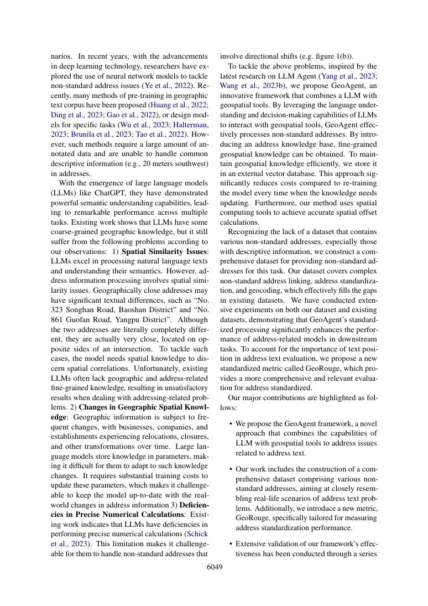

~~~~text
narios. In recent years, with the advancements
in deep learning technology, researchers have ex-
plored the use of neural network models to tackle
non-standard address issues (Ye et al., 2022). Re-
cently, many methods of pre-training in geographic
text corpus have been proposed (Huang et al., 2022;
Ding et al., 2023; Gao et al., 2022), or design mod-
els for specific tasks (Wu et al., 2023; Halterman,
2023; Brunila et al., 2023; Tao et al., 2022). How-
ever, such methods require a large amount of an-
notated data and are unable to handle common
descriptive information (e.g., 20 meters southwest)
in addresses.
With the emergence of large language models
(LLMs) like ChatGPT, they have demonstrated
powerful semantic understanding capabilities, lead-
ing to remarkable performance across multiple
tasks. Existing work shows that LLMs have some
coarse-grained geographic knowledge, but it still
suffer from the following problems according to
our observations: 1) Spatial Similarity Issues:
LLMs excel in processing natural language texts
and understanding their semantics. However, ad-
dress information processing involves spatial simi-
larity issues. Geographically close addresses may
have significant textual differences, such as “No.
323 Songhan Road, Baoshan District” and “No.
861 Guofan Road, Yangpu District”. Although
the two addresses are literally completely differ-
ent, they are actually very close, located on op-
posite sides of an intersection.
To tackle such
cases, the model needs spatial knowledge to dis-
cern spatial correlations. Unfortunately, existing
LLMs often lack geographic and address-related
fine-grained knowledge, resulting in unsatisfactory
results when dealing with addressing-related prob-
lems. 2) Changes in Geographic Spatial Knowl-
edge: Geographic information is subject to fre-
quent changes, with businesses, companies, and
establishments experiencing relocations, closures,
and other transformations over time. Large lan-
guage models store knowledge in parameters, mak-
ing it difficult for them to adapt to such knowledge
changes. It requires substantial training costs to
update these parameters, which makes it challenge-
able to keep the model up-to-date with the real-
world changes in address information 3) Deficien-
cies in Precise Numerical Calculations: Exist-
ing work indicates that LLMs have deficiencies in
performing precise numerical calculations (Schick
et al., 2023). This limitation makes it challenge-
able for them to handle non-standard addresses that
involve directional shifts (e.g. figure 1(b)).
To tackle the above problems, inspired by the
latest research on LLM Agent (Yang et al., 2023;
Wang et al., 2023b), we propose GeoAgent, an
innovative framework that combines a LLM with
geospatial tools. By leveraging the language under-
standing and decision-making capabilities of LLMs
to interact with geospatial tools, GeoAgent effec-
tively processes non-standard addresses. By intro-
ducing an address knowledge base, fine-grained
geospatial knowledge can be obtained. To main-
tain geospatial knowledge efficiently, we store it
in an external vector database. This approach sig-
nificantly reduces costs compared to re-training
the model every time when the knowledge needs
updating. Furthermore, our method uses spatial
computing tools to achieve accurate spatial offset
calculations.
Recognizing the lack of a dataset that contains
various non-standard addresses, especially those
with descriptive information, we construct a com-
prehensive dataset for providing non-standard ad-
dresses for this task. Our dataset covers complex
non-standard address linking, address standardiza-
tion, and geocoding, which effectively fills the gaps
in existing datasets. We have conducted exten-
sive experiments on both our dataset and existing
datasets, demonstrating that GeoAgent’s standard-
ized processing significantly enhances the perfor-
mance of address-related models in downstream
tasks. To account for the importance of text posi-
tion in address text evaluation, we propose a new
standardized metric called GeoRouge, which pro-
vides a more comprehensive and relevant evalua-
tion for address standardized.
Our major contributions are highlighted as fol-
lows:
• We propose the GeoAgent framework, a novel
approach that combines the capabilities of
LLM with geospatial tools to address issues
related to address text.
• Our work includes the construction of a com-
prehensive dataset comprising various non-
standard addresses, aiming at closely resem-
bling real-life scenarios of address text prob-
lems. Additionally, we introduce a new metric,
GeoRouge, specifically tailored for measuring
address standardization performance.
• Extensive validation of our framework’s effec-
tiveness has been conducted through a series
6049
~~~~

## PDF 第 3 页

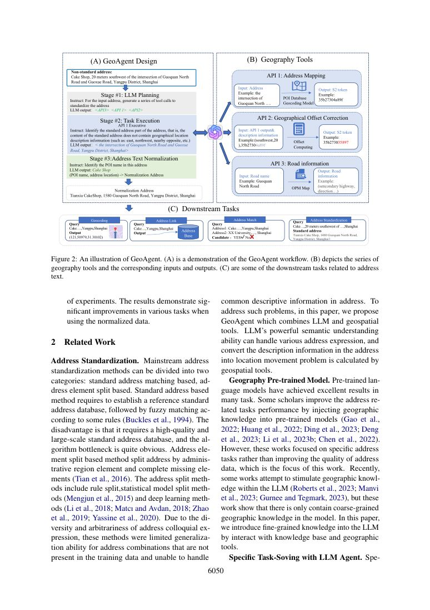

~~~~text
Cake Shop, 20 meters southwest of the intersection of Guoquan North 
Road and Guoxue Road, Yangpu District, Shanghai
API 1: Address Mapping
POI Database
Geocoding Model
API 2: Geographical Offset Correction
API 3: Road information
Non-standard address:
Normalization Address
Tianxia CakeShop, 1580 Guoquan North Road, Yangpu District, Shanghai
Input: Address
Example: the 
intersection of
Guoquan North ….
Output: S2 token
Example: 
35b27304a89f
Input: API 1 output& 
description information
Example:(southwest,20
),35b27304a89f
Output: S2 token
Example: 
35b273035897
Offset 
Computing
Input: Road name
Example: Guoquan
North Road
OPM Map
Output: Road 
information
Example: 
(sencondary highway, 
direction…)
Instruct: For the input address, generate a series of tool calls to 
standardize the address
LLM output：<API3>  <API 1>  <API2>
API 1 Executive
Instruct: Identify the standard address part of the address, that is, the 
content of the standard address does not contain geographical location 
description information (such as: east, northwest, nearby opposite, etc.)
LLM output：< the intersection of Guoquan North Road and Guoxue
Road, Yangpu District, Shanghai>
Instruct: Identify the POI name in this address
LLM output: Cake Shop 
(POI name, address location) -> Normalization Address
Stage #1: LLM Planning
Stage #2: Task Execution
Stage #3:Address Text Normalization
Query
Address1: Cake….,Yangpu,Shanghai
Address2: XX University,…, Shanghai
Candidate ：YES✔No❌
Query
Cake….,Yangpu,Shanghai
Output
(121,50979,31.30102)
Query
Cake…,Yangpu,Shanghai
Output
Address 
Base
Query
Cake…,20 meters southewest of …,Shanghai
Standard address
Tianxia Cake Shop, 1480 Guoquan North Road, 
Yangpu District, Shanghai）
Geocoding
Address Link
Address Match
Address Standardization
(A) GeoAgent Design
(B)  Geography Tools
(C)  Downstream Tasks
Figure 2: An illustration of GeoAgent. (A) is a demonstration of the GeoAgent workflow. (B) depicts the series of
geography tools and the corresponding inputs and outputs. (C) are some of the downstream tasks related to address
text.
of experiments. The results demonstrate sig-
nificant improvements in various tasks when
using the normalized data.
2
Related Work
Address Standardization. Mainstream address
standardization methods can be divided into two
categories: standard address matching based, ad-
dress element split based. Standard address based
method requires to establish a reference standard
address database, followed by fuzzy matching ac-
cording to some rules (Buckles et al., 1994). The
disadvantage is that it requires a high-quality and
large-scale standard address database, and the al-
gorithm bottleneck is quite obvious. Address ele-
ment split based method split address by adminis-
trative region element and complete missing ele-
ments (Tian et al., 2016). The address split meth-
ods include rule split,statistical model split meth-
ods (Mengjun et al., 2015) and deep learning meth-
ods (Li et al., 2018; Matcı and Avdan, 2018; Zhao
et al., 2019; Yassine et al., 2020). Due to the di-
versity and arbitrariness of address colloquial ex-
pression, these methods were limited generaliza-
tion ability for address combinations that are not
present in the training data and unable to handle
common descriptive information in address. To
address such problems, in this paper, we propose
GeoAgent which combines LLM and geospatial
tools. LLM’s powerful semantic understanding
ability can handle various address expression, and
convert the description information in the address
into location movement problem is calculated by
geospatial tools.
Geography Pre-trained Model. Pre-trained lan-
guage models have achieved excellent results in
many task. Some scholars improve the address re-
lated tasks performance by injecting geographic
knowledge into pre-trained models (Gao et al.,
2022; Huang et al., 2022; Ding et al., 2023; Deng
et al., 2023; Li et al., 2023b; Chen et al., 2022).
However, these works focused on specific address
tasks rather than improving the quality of address
data, which is the focus of this work. Recently,
some works attempt to stimulate geographic knowl-
edge within the LLM (Roberts et al., 2023; Manvi
et al., 2023; Gurnee and Tegmark, 2023), but these
work show that there is only contain coarse-grained
geographic knowledge in the model. In this paper,
we introduce fine-grained knowledge into the LLM
by interact with knowledge base and geographic
tools.
Specific Task-Soving with LLM Agent. Spe-
6050
~~~~

## PDF 第 4 页

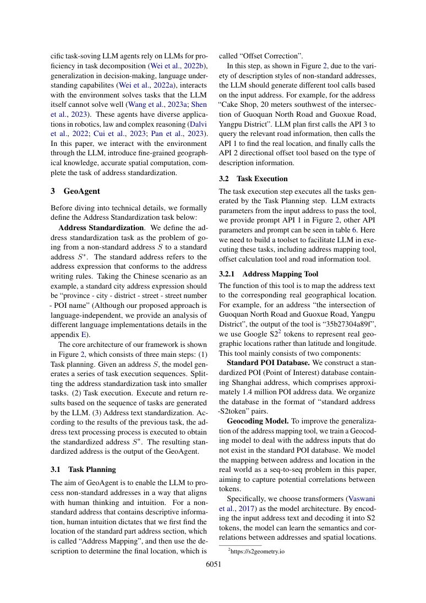

~~~~text
cific task-soving LLM agents rely on LLMs for pro-
ficiency in task decomposition (Wei et al., 2022b),
generalization in decision-making, language under-
standing capabilites (Wei et al., 2022a), interacts
with the environment solves tasks that the LLM
itself cannot solve well (Wang et al., 2023a; Shen
et al., 2023). These agents have diverse applica-
tions in robotics, law and complex reasoning (Dalvi
et al., 2022; Cui et al., 2023; Pan et al., 2023).
In this paper, we interact with the environment
through the LLM, introduce fine-grained geograph-
ical knowledge, accurate spatial computation, com-
plete the task of address standardization.
3
GeoAgent
Before diving into technical details, we formally
define the Address Standardization task below:
Address Standardization. We define the ad-
dress standardization task as the problem of go-
ing from a non-standard address S to a standard
address S∗. The standard address refers to the
address expression that conforms to the address
writing rules. Taking the Chinese scenario as an
example, a standard city address expression should
be “province - city - district - street - street number
- POI name” (Although our proposed approach is
language-independent, we provide an analysis of
different language implementations details in the
appendix E).
The core architecture of our framework is shown
in Figure 2, which consists of three main steps: (1)
Task planning. Given an address S, the model gen-
erates a series of task execution sequences. Split-
ting the address standardization task into smaller
tasks. (2) Task execution. Execute and return re-
sults based on the sequence of tasks are generated
by the LLM. (3) Address text standardization. Ac-
cording to the results of the previous task, the ad-
dress text processing process is executed to obtain
the standardized address S∗. The resulting stan-
dardized address is the output of the GeoAgent.
3.1
Task Planning
The aim of GeoAgent is to enable the LLM to pro-
cess non-standard addresses in a way that aligns
with human thinking and intuition.
For a non-
standard address that contains descriptive informa-
tion, human intuition dictates that we first find the
location of the standard part address section, which
is called “Address Mapping”, and then use the de-
scription to determine the final location, which is
called “Offset Correction”.
In this step, as shown in Figure 2, due to the vari-
ety of description styles of non-standard addresses,
the LLM should generate different tool calls based
on the input address. For example, for the address
“Cake Shop, 20 meters southwest of the intersec-
tion of Guoquan North Road and Guoxue Road,
Yangpu District”. LLM plan first calls the API 3 to
query the relevant road information, then calls the
API 1 to find the real location, and finally calls the
API 2 directional offset tool based on the type of
description information.
3.2
Task Execution
The task execution step executes all the tasks gen-
erated by the Task Planning step. LLM extracts
parameters from the input address to pass the tool,
we provide prompt API 1 in Figure 2, other API
parameters and prompt can be seen in table 6. Here
we need to build a toolset to facilitate LLM in exe-
cuting these tasks, including address mapping tool,
offset calculation tool and road information tool.
3.2.1
Address Mapping Tool
The function of this tool is to map the address text
to the corresponding real geographical location.
For example, for an address “the intersection of
Guoquan North Road and Guoxue Road, Yangpu
District”, the output of the tool is “35b27304a89f”,
we use Google S22 tokens to represent real geo-
graphic locations rather than latitude and longitude.
This tool mainly consists of two components:
Standard POI Database. We construct a stan-
dardized POI (Point of Interest) database contain-
ing Shanghai address, which comprises approxi-
mately 1.4 million POI address data. We organize
the database in the format of “standard address
-S2token” pairs.
Geocoding Model. To improve the generaliza-
tion of the address mapping tool, we train a Geocod-
ing model to deal with the address inputs that do
not exist in the standard POI database. We model
the mapping between address and location in the
real world as a seq-to-seq problem in this paper,
aiming to capture potential correlations between
tokens.
Specifically, we choose transformers (Vaswani
et al., 2017) as the model architecture. By encod-
ing the input address text and decoding it into S2
tokens, the model can learn the semantics and cor-
relations between addresses and spatial locations.
2https://s2geometry.io
6051
~~~~

## PDF 第 5 页

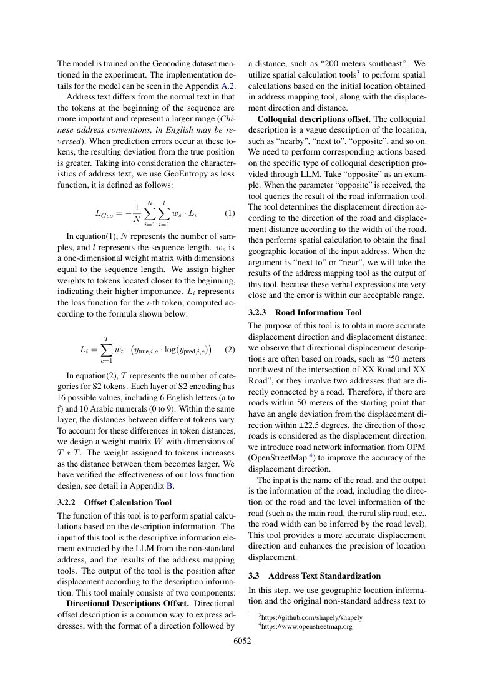

~~~~text
The model is trained on the Geocoding dataset men-
tioned in the experiment. The implementation de-
tails for the model can be seen in the Appendix A.2.
Address text differs from the normal text in that
the tokens at the beginning of the sequence are
more important and represent a larger range (Chi-
nese address conventions, in English may be re-
versed). When prediction errors occur at these to-
kens, the resulting deviation from the true position
is greater. Taking into consideration the character-
istics of address text, we use GeoEntropy as loss
function, it is defined as follows:
LGeo = −1
N
N
X
i=1
l
X
i=1
ws · Li
(1)
In equation(1), N represents the number of sam-
ples, and l represents the sequence length. ws is
a one-dimensional weight matrix with dimensions
equal to the sequence length. We assign higher
weights to tokens located closer to the beginning,
indicating their higher importance. Li represents
the loss function for the i-th token, computed ac-
cording to the formula shown below:
Li =
T
X
c=1
wt ·
ytrue,i,c · log(ypred,i,c)

(2)
In equation(2), T represents the number of cate-
gories for S2 tokens. Each layer of S2 encoding has
16 possible values, including 6 English letters (a to
f) and 10 Arabic numerals (0 to 9). Within the same
layer, the distances between different tokens vary.
To account for these differences in token distances,
we design a weight matrix W with dimensions of
T ∗T. The weight assigned to tokens increases
as the distance between them becomes larger. We
have verified the effectiveness of our loss function
design, see detail in Appendix B.
3.2.2
Offset Calculation Tool
The function of this tool is to perform spatial calcu-
lations based on the description information. The
input of this tool is the descriptive information ele-
ment extracted by the LLM from the non-standard
address, and the results of the address mapping
tools. The output of the tool is the position after
displacement according to the description informa-
tion. This tool mainly consists of two components:
Directional Descriptions Offset. Directional
offset description is a common way to express ad-
dresses, with the format of a direction followed by
a distance, such as “200 meters southeast”. We
utilize spatial calculation tools3 to perform spatial
calculations based on the initial location obtained
in address mapping tool, along with the displace-
ment direction and distance.
Colloquial descriptions offset. The colloquial
description is a vague description of the location,
such as “nearby”, “next to”, “opposite”, and so on.
We need to perform corresponding actions based
on the specific type of colloquial description pro-
vided through LLM. Take “opposite” as an exam-
ple. When the parameter “opposite” is received, the
tool queries the result of the road information tool.
The tool determines the displacement direction ac-
cording to the direction of the road and displace-
ment distance according to the width of the road,
then performs spatial calculation to obtain the final
geographic location of the input address. When the
argument is “next to” or “near”, we will take the
results of the address mapping tool as the output of
this tool, because these verbal expressions are very
close and the error is within our acceptable range.
3.2.3
Road Information Tool
The purpose of this tool is to obtain more accurate
displacement direction and displacement distance.
we observe that directional displacement descrip-
tions are often based on roads, such as “50 meters
northwest of the intersection of XX Road and XX
Road”, or they involve two addresses that are di-
rectly connected by a road. Therefore, if there are
roads within 50 meters of the starting point that
have an angle deviation from the displacement di-
rection within ±22.5 degrees, the direction of those
roads is considered as the displacement direction.
we introduce road network information from OPM
(OpenStreetMap 4) to improve the accuracy of the
displacement direction.
The input is the name of the road, and the output
is the information of the road, including the direc-
tion of the road and the level information of the
road (such as the main road, the rural slip road, etc.,
the road width can be inferred by the road level).
This tool provides a more accurate displacement
direction and enhances the precision of location
displacement.
3.3
Address Text Standardization
In this step, we use geographic location informa-
tion and the original non-standard address text to
3https://github.com/shapely/shapely
4https://www.openstreetmap.org
6052
~~~~

## PDF 第 6 页

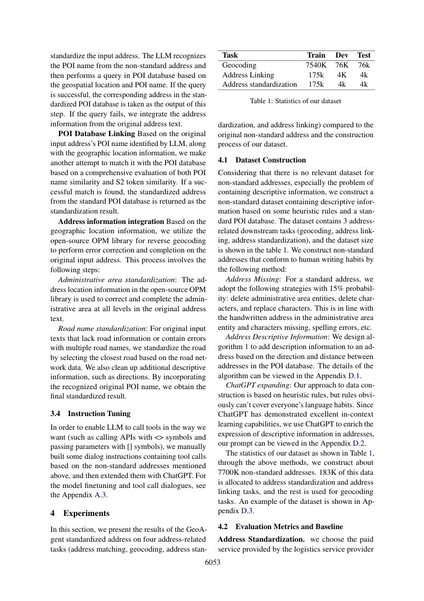

~~~~text
standardize the input address. The LLM recognizes
the POI name from the non-standard address and
then performs a query in POI database based on
the geospatial location and POI name. If the query
is successful, the corresponding address in the stan-
dardized POI database is taken as the output of this
step. If the query fails, we integrate the address
information from the original address text.
POI Database Linking Based on the original
input address’s POI name identified by LLM, along
with the geographic location information, we make
another attempt to match it with the POI database
based on a comprehensive evaluation of both POI
name similarity and S2 token similarity. If a suc-
cessful match is found, the standardized address
from the standard POI database is returned as the
standardization result.
Address information integration Based on the
geographic location information, we utilize the
open-source OPM library for reverse geocoding
to perform error correction and completion on the
original input address. This process involves the
following steps:
Administrative area standardization: The ad-
dress location information in the open-source OPM
library is used to correct and complete the admin-
istrative area at all levels in the original address
text.
Road name standardization: For original input
texts that lack road information or contain errors
with multiple road names, we standardize the road
by selecting the closest road based on the road net-
work data. We also clean up additional descriptive
information, such as directions. By incorporating
the recognized original POI name, we obtain the
final standardized result.
3.4
Instruction Tuning
In order to enable LLM to call tools in the way we
want (such as calling APIs with <> symbols and
passing parameters with [] symbols), we manually
built some dialog instructions containing tool calls
based on the non-standard addresses mentioned
above, and then extended them with ChatGPT. For
the model finetuning and tool call dialogues, see
the Appendix A.3.
4
Experiments
In this section, we present the results of the GeoA-
gent standardized address on four address-related
tasks (address matching, geocoding, address stan-
Task
Train
Dev
Test
Geocoding
7540K
76K
76k
Address Linking
175k
4K
4k
Address standardization
175k
4k
4k
Table 1: Statistics of our dataset
dardization, and address linking) compared to the
original non-standard address and the construction
process of our dataset.
4.1
Dataset Construction
Considering that there is no relevant dataset for
non-standard addresses, especially the problem of
containing descriptive information, we construct a
non-standard dataset containing descriptive infor-
mation based on some heuristic rules and a stan-
dard POI database. The dataset contains 3 address-
related downstream tasks (geocoding, address link-
ing, address standardization), and the dataset size
is shown in the table 1. We construct non-standard
addresses that conform to human writing habits by
the following method:
Address Missing: For a standard address, we
adopt the following strategies with 15% probabil-
ity: delete administrative area entities, delete char-
acters, and replace characters. This is in line with
the handwritten address in the administrative area
entity and characters missing, spelling errors, etc.
Address Descriptive Information: We design al-
gorithm 1 to add description information to an ad-
dress based on the direction and distance between
addresses in the POI database. The details of the
algorithm can be viewed in the Appendix D.1.
ChatGPT expanding: Our approach to data con-
struction is based on heuristic rules, but rules obvi-
ously can’t cover everyone’s language habits. Since
ChatGPT has demonstrated excellent in-context
learning capabilities, we use ChatGPT to enrich the
expression of descriptive information in addresses,
our prompt can be viewed in the Appendix D.2.
The statistics of our dataset as shown in Table 1,
through the above methods, we construct about
7700K non-standard addresses. 183K of this data
is allocated to address standardization and address
linking tasks, and the rest is used for geocoding
tasks. An example of the dataset is shown in Ap-
pendix D.3.
4.2
Evaluation Metrics and Baseline
Address Standardization. we choose the paid
service provided by the logistics service provider
6053
~~~~

## PDF 第 7 页

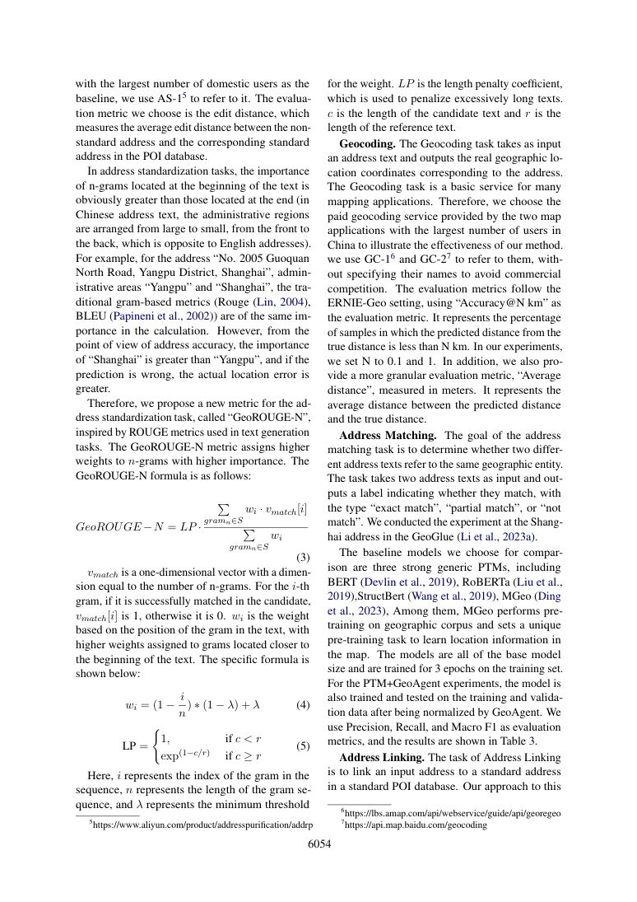

~~~~text
with the largest number of domestic users as the
baseline, we use AS-15 to refer to it. The evalua-
tion metric we choose is the edit distance, which
measures the average edit distance between the non-
standard address and the corresponding standard
address in the POI database.
In address standardization tasks, the importance
of n-grams located at the beginning of the text is
obviously greater than those located at the end (in
Chinese address text, the administrative regions
are arranged from large to small, from the front to
the back, which is opposite to English addresses).
For example, for the address “No. 2005 Guoquan
North Road, Yangpu District, Shanghai”, admin-
istrative areas “Yangpu” and “Shanghai”, the tra-
ditional gram-based metrics (Rouge (Lin, 2004),
BLEU (Papineni et al., 2002)) are of the same im-
portance in the calculation. However, from the
point of view of address accuracy, the importance
of “Shanghai” is greater than “Yangpu”, and if the
prediction is wrong, the actual location error is
greater.
Therefore, we propose a new metric for the ad-
dress standardization task, called “GeoROUGE-N”,
inspired by ROUGE metrics used in text generation
tasks. The GeoROUGE-N metric assigns higher
weights to n-grams with higher importance. The
GeoROUGE-N formula is as follows:
GeoROUGE −N = LP ·
P
gramn∈S
wi · vmatch[i]
P
gramn∈S
wi
(3)
vmatch is a one-dimensional vector with a dimen-
sion equal to the number of n-grams. For the i-th
gram, if it is successfully matched in the candidate,
vmatch[i] is 1, otherwise it is 0. wi is the weight
based on the position of the gram in the text, with
higher weights assigned to grams located closer to
the beginning of the text. The specific formula is
shown below:
wi = (1 −i
n) ∗(1 −λ) + λ
(4)
LP =
(
1,
if c < r
exp(1−c/r)
if c ≥r
(5)
Here, i represents the index of the gram in the
sequence, n represents the length of the gram se-
quence, and λ represents the minimum threshold
5https://www.aliyun.com/product/addresspurification/addrp
for the weight. LP is the length penalty coefficient,
which is used to penalize excessively long texts.
c is the length of the candidate text and r is the
length of the reference text.
Geocoding. The Geocoding task takes as input
an address text and outputs the real geographic lo-
cation coordinates corresponding to the address.
The Geocoding task is a basic service for many
mapping applications. Therefore, we choose the
paid geocoding service provided by the two map
applications with the largest number of users in
China to illustrate the effectiveness of our method.
we use GC-16 and GC-27 to refer to them, with-
out specifying their names to avoid commercial
competition. The evaluation metrics follow the
ERNIE-Geo setting, using “Accuracy@N km” as
the evaluation metric. It represents the percentage
of samples in which the predicted distance from the
true distance is less than N km. In our experiments,
we set N to 0.1 and 1. In addition, we also pro-
vide a more granular evaluation metric, “Average
distance”, measured in meters. It represents the
average distance between the predicted distance
and the true distance.
Address Matching. The goal of the address
matching task is to determine whether two differ-
ent address texts refer to the same geographic entity.
The task takes two address texts as input and out-
puts a label indicating whether they match, with
the type “exact match”, “partial match”, or “not
match”. We conducted the experiment at the Shang-
hai address in the GeoGlue (Li et al., 2023a).
The baseline models we choose for compar-
ison are three strong generic PTMs, including
BERT (Devlin et al., 2019), RoBERTa (Liu et al.,
2019),StructBert (Wang et al., 2019), MGeo (Ding
et al., 2023), Among them, MGeo performs pre-
training on geographic corpus and sets a unique
pre-training task to learn location information in
the map. The models are all of the base model
size and are trained for 3 epochs on the training set.
For the PTM+GeoAgent experiments, the model is
also trained and tested on the training and valida-
tion data after being normalized by GeoAgent. We
use Precision, Recall, and Macro F1 as evaluation
metrics, and the results are shown in Table 3.
Address Linking. The task of Address Linking
is to link an input address to a standard address
in a standard POI database. Our approach to this
6https://lbs.amap.com/api/webservice/guide/api/georegeo
7https://api.map.baidu.com/geocoding
6054
~~~~

## PDF 第 8 页

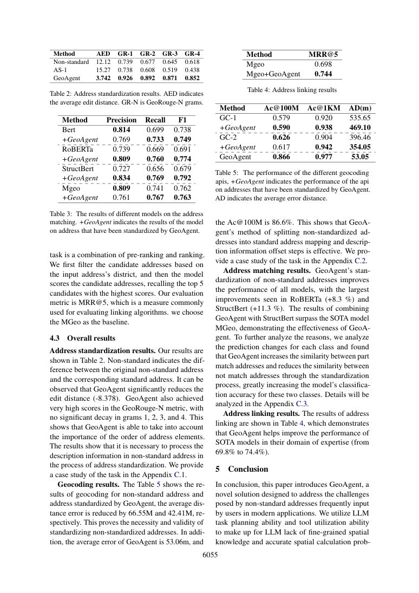

~~~~text
Method
AED
GR-1
GR-2
GR-3
GR-4
Non-standard
12.12
0.739
0.677
0.645
0.618
AS-1
15.27
0.738
0.608
0.519
0.438
GeoAgent
3.742
0.926
0.892
0.871
0.852
Table 2: Address standardization results. AED indicates
the average edit distance. GR-N is GeoRouge-N grams.
Method
Precision
Recall
F1
Bert
0.814
0.699
0.738
+GeoAgent
0.769
0.733
0.749
RoBERTa
0.739
0.669
0.691
+GeoAgent
0.809
0.760
0.774
StructBert
0.727
0.656
0.679
+GeoAgent
0.834
0.769
0.792
Mgeo
0.809
0.741
0.762
+GeoAgent
0.761
0.767
0.763
Table 3: The results of different models on the address
matching. +GeoAgent indicates the results of the model
on address that have been standardized by GeoAgent.
task is a combination of pre-ranking and ranking.
We first filter the candidate addresses based on
the input address’s district, and then the model
scores the candidate addresses, recalling the top 5
candidates with the highest scores. Our evaluation
metric is MRR@5, which is a measure commonly
used for evaluating linking algorithms. we choose
the MGeo as the baseline.
4.3
Overall results
Address standardization results. Our results are
shown in Table 2. Non-standard indicates the dif-
ference between the original non-standard address
and the corresponding standard address. It can be
observed that GeoAgent significantly reduces the
edit distance (-8.378). GeoAgent also achieved
very high scores in the GeoRouge-N metric, with
no significant decay in grams 1, 2, 3, and 4. This
shows that GeoAgent is able to take into account
the importance of the order of address elements.
The results show that it is necessary to process the
description information in non-standard address in
the process of address standardization. We provide
a case study of the task in the Appendix C.1.
Geocoding results. The Table 5 shows the re-
sults of geocoding for non-standard address and
address standardized by GeoAgent, the average dis-
tance error is reduced by 66.55M and 42.41M, re-
spectively. This proves the necessity and validity of
standardizing non-standardized addresses. In addi-
tion, the average error of GeoAgent is 53.06m, and
Method
MRR@5
Mgeo
0.698
Mgeo+GeoAgent
0.744
Table 4: Address linking results
Method
Ac@100M
Ac@1KM
AD(m)
GC-1
0.579
0.920
535.65
+GeoAgent
0.590
0.938
469.10
GC-2
0.626
0.904
396.46
+GeoAgent
0.617
0.942
354.05
GeoAgent
0.866
0.977
53.05
Table 5: The performance of the different geocoding
apis, +GeoAgent indicates the performance of the api
on addresses that have been standardized by GeoAgent.
AD indicates the average error distance.
the Ac@100M is 86.6%. This shows that GeoA-
gent’s method of splitting non-standardized ad-
dresses into standard address mapping and descrip-
tion information offset steps is effective. We pro-
vide a case study of the task in the Appendix C.2.
Address matching results. GeoAgent’s stan-
dardization of non-standard addresses improves
the performance of all models, with the largest
improvements seen in RoBERTa (+8.3 %) and
StructBert (+11.3 %). The results of combining
GeoAgent with StructBert surpass the SOTA model
MGeo, demonstrating the effectiveness of GeoA-
gent. To further analyze the reasons, we analyze
the prediction changes for each class and found
that GeoAgent increases the similarity between part
match addresses and reduces the similarity between
not match addresses through the standardization
process, greatly increasing the model’s classifica-
tion accuracy for these two classes. Details will be
analyzed in the Appendix C.3.
Address linking results. The results of address
linking are shown in Table 4, which demonstrates
that GeoAgent helps improve the performance of
SOTA models in their domain of expertise (from
69.8% to 74.4%).
5
Conclusion
In conclusion, this paper introduces GeoAgent, a
novel solution designed to address the challenges
posed by non-standard addresses frequently input
by users in modern applications. We utilize LLM
task planning ability and tool utilization ability
to make up for LLM lack of fine-grained spatial
knowledge and accurate spatial calculation prob-
6055
~~~~

## PDF 第 9 页

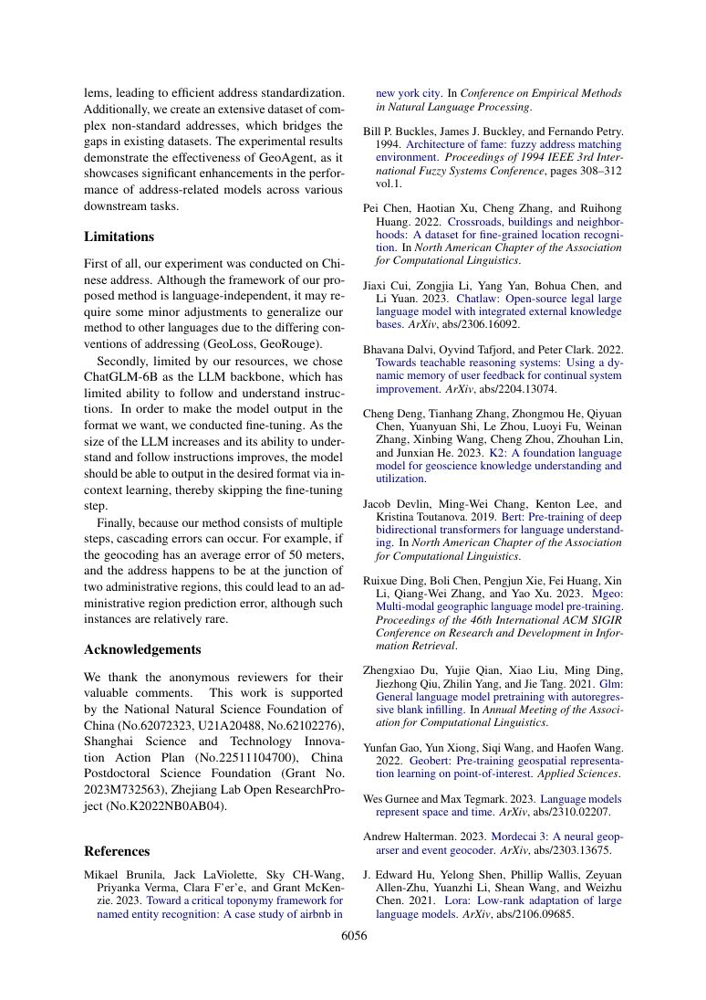

~~~~text
lems, leading to efficient address standardization.
Additionally, we create an extensive dataset of com-
plex non-standard addresses, which bridges the
gaps in existing datasets. The experimental results
demonstrate the effectiveness of GeoAgent, as it
showcases significant enhancements in the perfor-
mance of address-related models across various
downstream tasks.
Limitations
First of all, our experiment was conducted on Chi-
nese address. Although the framework of our pro-
posed method is language-independent, it may re-
quire some minor adjustments to generalize our
method to other languages due to the differing con-
ventions of addressing (GeoLoss, GeoRouge).
Secondly, limited by our resources, we chose
ChatGLM-6B as the LLM backbone, which has
limited ability to follow and understand instruc-
tions. In order to make the model output in the
format we want, we conducted fine-tuning. As the
size of the LLM increases and its ability to under-
stand and follow instructions improves, the model
should be able to output in the desired format via in-
context learning, thereby skipping the fine-tuning
step.
Finally, because our method consists of multiple
steps, cascading errors can occur. For example, if
the geocoding has an average error of 50 meters,
and the address happens to be at the junction of
two administrative regions, this could lead to an ad-
ministrative region prediction error, although such
instances are relatively rare.
Acknowledgements
We thank the anonymous reviewers for their
valuable comments.
This work is supported
by the National Natural Science Foundation of
China (No.62072323, U21A20488, No.62102276),
Shanghai
Science
and
Technology
Innova-
tion Action Plan (No.22511104700),
China
Postdoctoral Science Foundation (Grant No.
2023M732563), Zhejiang Lab Open ResearchPro-
ject (No.K2022NB0AB04).
References
Mikael Brunila, Jack LaViolette, Sky CH-Wang,
Priyanka Verma, Clara F’er’e, and Grant McKen-
zie. 2023. Toward a critical toponymy framework for
named entity recognition: A case study of airbnb in
new york city. In Conference on Empirical Methods
in Natural Language Processing.
Bill P. Buckles, James J. Buckley, and Fernando Petry.
1994. Architecture of fame: fuzzy address matching
environment. Proceedings of 1994 IEEE 3rd Inter-
national Fuzzy Systems Conference, pages 308–312
vol.1.
Pei Chen, Haotian Xu, Cheng Zhang, and Ruihong
Huang. 2022. Crossroads, buildings and neighbor-
hoods: A dataset for fine-grained location recogni-
tion. In North American Chapter of the Association
for Computational Linguistics.
Jiaxi Cui, Zongjia Li, Yang Yan, Bohua Chen, and
Li Yuan. 2023. Chatlaw: Open-source legal large
language model with integrated external knowledge
bases. ArXiv, abs/2306.16092.
Bhavana Dalvi, Oyvind Tafjord, and Peter Clark. 2022.
Towards teachable reasoning systems: Using a dy-
namic memory of user feedback for continual system
improvement. ArXiv, abs/2204.13074.
Cheng Deng, Tianhang Zhang, Zhongmou He, Qiyuan
Chen, Yuanyuan Shi, Le Zhou, Luoyi Fu, Weinan
Zhang, Xinbing Wang, Cheng Zhou, Zhouhan Lin,
and Junxian He. 2023. K2: A foundation language
model for geoscience knowledge understanding and
utilization.
Jacob Devlin, Ming-Wei Chang, Kenton Lee, and
Kristina Toutanova. 2019. Bert: Pre-training of deep
bidirectional transformers for language understand-
ing. In North American Chapter of the Association
for Computational Linguistics.
Ruixue Ding, Boli Chen, Pengjun Xie, Fei Huang, Xin
Li, Qiang-Wei Zhang, and Yao Xu. 2023. Mgeo:
Multi-modal geographic language model pre-training.
Proceedings of the 46th International ACM SIGIR
Conference on Research and Development in Infor-
mation Retrieval.
Zhengxiao Du, Yujie Qian, Xiao Liu, Ming Ding,
Jiezhong Qiu, Zhilin Yang, and Jie Tang. 2021. Glm:
General language model pretraining with autoregres-
sive blank infilling. In Annual Meeting of the Associ-
ation for Computational Linguistics.
Yunfan Gao, Yun Xiong, Siqi Wang, and Haofen Wang.
2022. Geobert: Pre-training geospatial representa-
tion learning on point-of-interest. Applied Sciences.
Wes Gurnee and Max Tegmark. 2023. Language models
represent space and time. ArXiv, abs/2310.02207.
Andrew Halterman. 2023. Mordecai 3: A neural geop-
arser and event geocoder. ArXiv, abs/2303.13675.
J. Edward Hu, Yelong Shen, Phillip Wallis, Zeyuan
Allen-Zhu, Yuanzhi Li, Shean Wang, and Weizhu
Chen. 2021. Lora: Low-rank adaptation of large
language models. ArXiv, abs/2106.09685.
6056
~~~~

## PDF 第 10 页

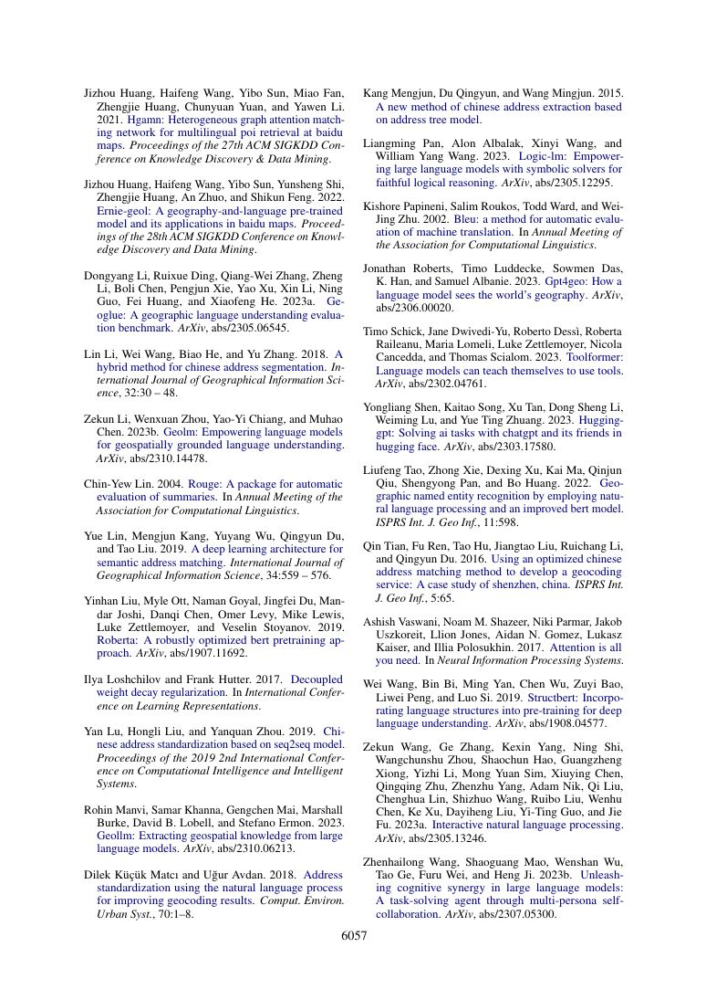

~~~~text
Jizhou Huang, Haifeng Wang, Yibo Sun, Miao Fan,
Zhengjie Huang, Chunyuan Yuan, and Yawen Li.
2021. Hgamn: Heterogeneous graph attention match-
ing network for multilingual poi retrieval at baidu
maps. Proceedings of the 27th ACM SIGKDD Con-
ference on Knowledge Discovery & Data Mining.
Jizhou Huang, Haifeng Wang, Yibo Sun, Yunsheng Shi,
Zhengjie Huang, An Zhuo, and Shikun Feng. 2022.
Ernie-geol: A geography-and-language pre-trained
model and its applications in baidu maps. Proceed-
ings of the 28th ACM SIGKDD Conference on Knowl-
edge Discovery and Data Mining.
Dongyang Li, Ruixue Ding, Qiang-Wei Zhang, Zheng
Li, Boli Chen, Pengjun Xie, Yao Xu, Xin Li, Ning
Guo, Fei Huang, and Xiaofeng He. 2023a.
Ge-
oglue: A geographic language understanding evalua-
tion benchmark. ArXiv, abs/2305.06545.
Lin Li, Wei Wang, Biao He, and Yu Zhang. 2018. A
hybrid method for chinese address segmentation. In-
ternational Journal of Geographical Information Sci-
ence, 32:30 – 48.
Zekun Li, Wenxuan Zhou, Yao-Yi Chiang, and Muhao
Chen. 2023b. Geolm: Empowering language models
for geospatially grounded language understanding.
ArXiv, abs/2310.14478.
Chin-Yew Lin. 2004. Rouge: A package for automatic
evaluation of summaries. In Annual Meeting of the
Association for Computational Linguistics.
Yue Lin, Mengjun Kang, Yuyang Wu, Qingyun Du,
and Tao Liu. 2019. A deep learning architecture for
semantic address matching. International Journal of
Geographical Information Science, 34:559 – 576.
Yinhan Liu, Myle Ott, Naman Goyal, Jingfei Du, Man-
dar Joshi, Danqi Chen, Omer Levy, Mike Lewis,
Luke Zettlemoyer, and Veselin Stoyanov. 2019.
Roberta: A robustly optimized bert pretraining ap-
proach. ArXiv, abs/1907.11692.
Ilya Loshchilov and Frank Hutter. 2017. Decoupled
weight decay regularization. In International Confer-
ence on Learning Representations.
Yan Lu, Hongli Liu, and Yanquan Zhou. 2019. Chi-
nese address standardization based on seq2seq model.
Proceedings of the 2019 2nd International Confer-
ence on Computational Intelligence and Intelligent
Systems.
Rohin Manvi, Samar Khanna, Gengchen Mai, Marshall
Burke, David B. Lobell, and Stefano Ermon. 2023.
Geollm: Extracting geospatial knowledge from large
language models. ArXiv, abs/2310.06213.
Dilek Küçük Matcı and U˘gur Avdan. 2018. Address
standardization using the natural language process
for improving geocoding results. Comput. Environ.
Urban Syst., 70:1–8.
Kang Mengjun, Du Qingyun, and Wang Mingjun. 2015.
A new method of chinese address extraction based
on address tree model.
Liangming Pan, Alon Albalak, Xinyi Wang, and
William Yang Wang. 2023. Logic-lm: Empower-
ing large language models with symbolic solvers for
faithful logical reasoning. ArXiv, abs/2305.12295.
Kishore Papineni, Salim Roukos, Todd Ward, and Wei-
Jing Zhu. 2002. Bleu: a method for automatic evalu-
ation of machine translation. In Annual Meeting of
the Association for Computational Linguistics.
Jonathan Roberts, Timo Luddecke, Sowmen Das,
K. Han, and Samuel Albanie. 2023. Gpt4geo: How a
language model sees the world’s geography. ArXiv,
abs/2306.00020.
Timo Schick, Jane Dwivedi-Yu, Roberto Dessì, Roberta
Raileanu, Maria Lomeli, Luke Zettlemoyer, Nicola
Cancedda, and Thomas Scialom. 2023. Toolformer:
Language models can teach themselves to use tools.
ArXiv, abs/2302.04761.
Yongliang Shen, Kaitao Song, Xu Tan, Dong Sheng Li,
Weiming Lu, and Yue Ting Zhuang. 2023. Hugging-
gpt: Solving ai tasks with chatgpt and its friends in
hugging face. ArXiv, abs/2303.17580.
Liufeng Tao, Zhong Xie, Dexing Xu, Kai Ma, Qinjun
Qiu, Shengyong Pan, and Bo Huang. 2022. Geo-
graphic named entity recognition by employing natu-
ral language processing and an improved bert model.
ISPRS Int. J. Geo Inf., 11:598.
Qin Tian, Fu Ren, Tao Hu, Jiangtao Liu, Ruichang Li,
and Qingyun Du. 2016. Using an optimized chinese
address matching method to develop a geocoding
service: A case study of shenzhen, china. ISPRS Int.
J. Geo Inf., 5:65.
Ashish Vaswani, Noam M. Shazeer, Niki Parmar, Jakob
Uszkoreit, Llion Jones, Aidan N. Gomez, Lukasz
Kaiser, and Illia Polosukhin. 2017. Attention is all
you need. In Neural Information Processing Systems.
Wei Wang, Bin Bi, Ming Yan, Chen Wu, Zuyi Bao,
Liwei Peng, and Luo Si. 2019. Structbert: Incorpo-
rating language structures into pre-training for deep
language understanding. ArXiv, abs/1908.04577.
Zekun Wang, Ge Zhang, Kexin Yang, Ning Shi,
Wangchunshu Zhou, Shaochun Hao, Guangzheng
Xiong, Yizhi Li, Mong Yuan Sim, Xiuying Chen,
Qingqing Zhu, Zhenzhu Yang, Adam Nik, Qi Liu,
Chenghua Lin, Shizhuo Wang, Ruibo Liu, Wenhu
Chen, Ke Xu, Dayiheng Liu, Yi-Ting Guo, and Jie
Fu. 2023a. Interactive natural language processing.
ArXiv, abs/2305.13246.
Zhenhailong Wang, Shaoguang Mao, Wenshan Wu,
Tao Ge, Furu Wei, and Heng Ji. 2023b. Unleash-
ing cognitive synergy in large language models:
A task-solving agent through multi-persona self-
collaboration. ArXiv, abs/2307.05300.
6057
~~~~

## PDF 第 11 页

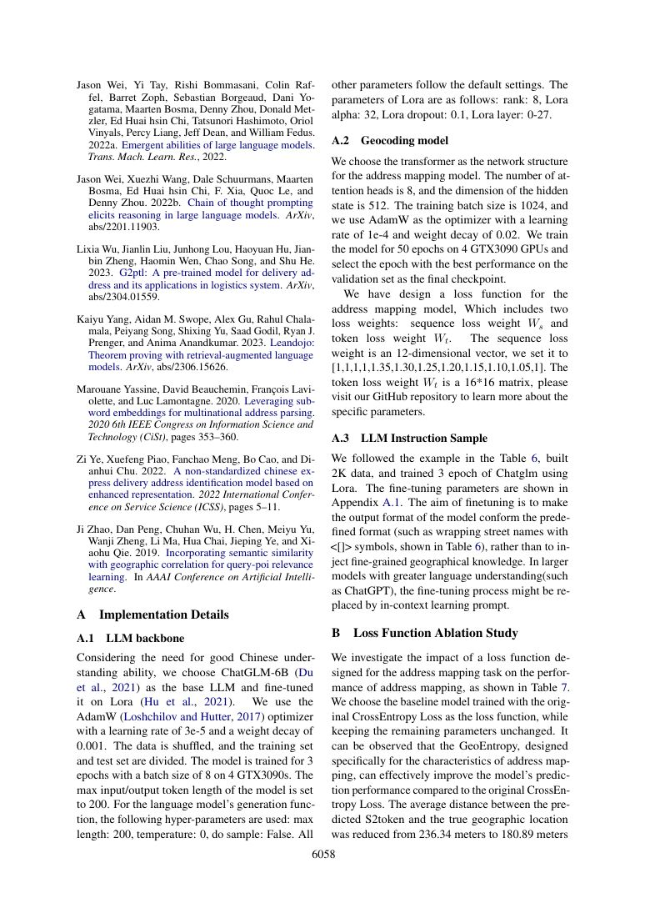

~~~~text
Jason Wei, Yi Tay, Rishi Bommasani, Colin Raf-
fel, Barret Zoph, Sebastian Borgeaud, Dani Yo-
gatama, Maarten Bosma, Denny Zhou, Donald Met-
zler, Ed Huai hsin Chi, Tatsunori Hashimoto, Oriol
Vinyals, Percy Liang, Jeff Dean, and William Fedus.
2022a. Emergent abilities of large language models.
Trans. Mach. Learn. Res., 2022.
Jason Wei, Xuezhi Wang, Dale Schuurmans, Maarten
Bosma, Ed Huai hsin Chi, F. Xia, Quoc Le, and
Denny Zhou. 2022b. Chain of thought prompting
elicits reasoning in large language models. ArXiv,
abs/2201.11903.
Lixia Wu, Jianlin Liu, Junhong Lou, Haoyuan Hu, Jian-
bin Zheng, Haomin Wen, Chao Song, and Shu He.
2023. G2ptl: A pre-trained model for delivery ad-
dress and its applications in logistics system. ArXiv,
abs/2304.01559.
Kaiyu Yang, Aidan M. Swope, Alex Gu, Rahul Chala-
mala, Peiyang Song, Shixing Yu, Saad Godil, Ryan J.
Prenger, and Anima Anandkumar. 2023. Leandojo:
Theorem proving with retrieval-augmented language
models. ArXiv, abs/2306.15626.
Marouane Yassine, David Beauchemin, François Lavi-
olette, and Luc Lamontagne. 2020. Leveraging sub-
word embeddings for multinational address parsing.
2020 6th IEEE Congress on Information Science and
Technology (CiSt), pages 353–360.
Zi Ye, Xuefeng Piao, Fanchao Meng, Bo Cao, and Di-
anhui Chu. 2022. A non-standardized chinese ex-
press delivery address identification model based on
enhanced representation. 2022 International Confer-
ence on Service Science (ICSS), pages 5–11.
Ji Zhao, Dan Peng, Chuhan Wu, H. Chen, Meiyu Yu,
Wanji Zheng, Li Ma, Hua Chai, Jieping Ye, and Xi-
aohu Qie. 2019. Incorporating semantic similarity
with geographic correlation for query-poi relevance
learning. In AAAI Conference on Artificial Intelli-
gence.
A
Implementation Details
A.1
LLM backbone
Considering the need for good Chinese under-
standing ability, we choose ChatGLM-6B (Du
et al., 2021) as the base LLM and fine-tuned
it on Lora (Hu et al., 2021).
We use the
AdamW (Loshchilov and Hutter, 2017) optimizer
with a learning rate of 3e-5 and a weight decay of
0.001. The data is shuffled, and the training set
and test set are divided. The model is trained for 3
epochs with a batch size of 8 on 4 GTX3090s. The
max input/output token length of the model is set
to 200. For the language model’s generation func-
tion, the following hyper-parameters are used: max
length: 200, temperature: 0, do sample: False. All
other parameters follow the default settings. The
parameters of Lora are as follows: rank: 8, Lora
alpha: 32, Lora dropout: 0.1, Lora layer: 0-27.
A.2
Geocoding model
We choose the transformer as the network structure
for the address mapping model. The number of at-
tention heads is 8, and the dimension of the hidden
state is 512. The training batch size is 1024, and
we use AdamW as the optimizer with a learning
rate of 1e-4 and weight decay of 0.02. We train
the model for 50 epochs on 4 GTX3090 GPUs and
select the epoch with the best performance on the
validation set as the final checkpoint.
We have design a loss function for the
address mapping model, Which includes two
loss weights:
sequence loss weight Ws and
token loss weight Wt.
The sequence loss
weight is an 12-dimensional vector, we set it to
[1,1,1,1,1.35,1.30,1.25,1.20,1.15,1.10,1.05,1]. The
token loss weight Wt is a 16*16 matrix, please
visit our GitHub repository to learn more about the
specific parameters.
A.3
LLM Instruction Sample
We followed the example in the Table 6, built
2K data, and trained 3 epoch of Chatglm using
Lora. The fine-tuning parameters are shown in
Appendix A.1. The aim of finetuning is to make
the output format of the model conform the prede-
fined format (such as wrapping street names with
<[]> symbols, shown in Table 6), rather than to in-
ject fine-grained geographical knowledge. In larger
models with greater language understanding(such
as ChatGPT), the fine-tuning process might be re-
placed by in-context learning prompt.
B
Loss Function Ablation Study
We investigate the impact of a loss function de-
signed for the address mapping task on the perfor-
mance of address mapping, as shown in Table 7.
We choose the baseline model trained with the orig-
inal CrossEntropy Loss as the loss function, while
keeping the remaining parameters unchanged. It
can be observed that the GeoEntropy, designed
specifically for the characteristics of address map-
ping, can effectively improve the model’s predic-
tion performance compared to the original CrossEn-
tropy Loss. The average distance between the pre-
dicted S2token and the true geographic location
was reduced from 236.34 meters to 180.89 meters
6058
~~~~

## PDF 第 12 页

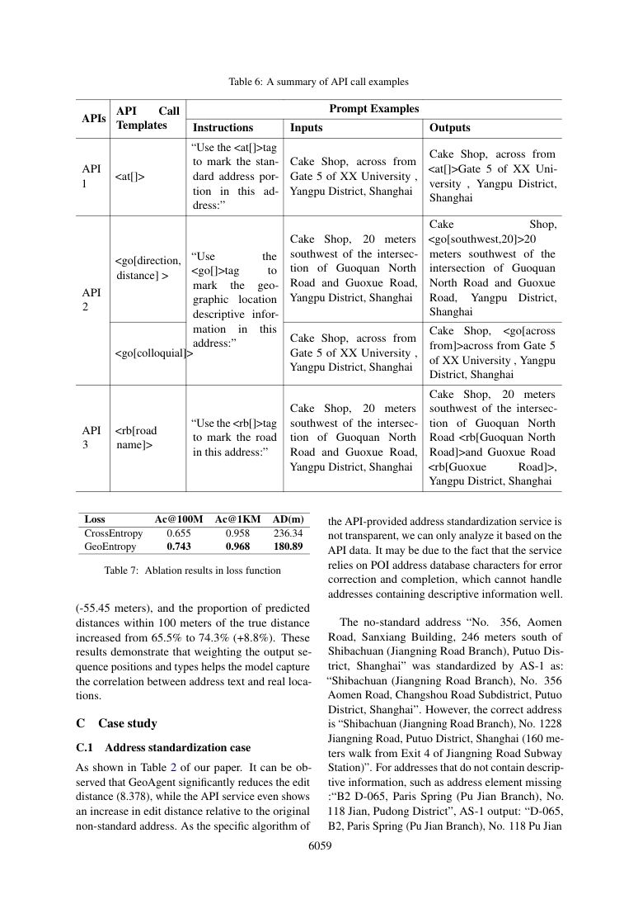

~~~~text
Table 6: A summary of API call examples
APIs
API
Call
Templates
Prompt Examples
Instructions
Inputs
Outputs
API
1
<at[]>
“Use the <at[]>tag
to mark the stan-
dard address por-
tion in this ad-
dress:”
Cake Shop, across from
Gate 5 of XX University ,
Yangpu District, Shanghai
Cake Shop, across from
<at[]>Gate 5 of XX Uni-
versity , Yangpu District,
Shanghai
API
2
<go[direction,
distance] >
“Use
the
<go[]>tag
to
mark
the
geo-
graphic
location
descriptive infor-
mation
in
this
address:”
Cake
Shop,
20
meters
southwest of the intersec-
tion of Guoquan North
Road and Guoxue Road,
Yangpu District, Shanghai
Cake
Shop,
<go[southwest,20]>20
meters southwest of the
intersection of Guoquan
North Road and Guoxue
Road,
Yangpu
District,
Shanghai
<go[colloquial]>
Cake Shop, across from
Gate 5 of XX University ,
Yangpu District, Shanghai
Cake
Shop,
<go[across
from]>across from Gate 5
of XX University , Yangpu
District, Shanghai
API
3
<rb[road
name]>
“Use the <rb[]>tag
to mark the road
in this address:”
Cake
Shop,
20
meters
southwest of the intersec-
tion of Guoquan North
Road and Guoxue Road,
Yangpu District, Shanghai
Cake
Shop,
20
meters
southwest of the intersec-
tion of Guoquan North
Road <rb[Guoquan North
Road]>and Guoxue Road
<rb[Guoxue
Road]>,
Yangpu District, Shanghai
Loss
Ac@100M
Ac@1KM
AD(m)
CrossEntropy
0.655
0.958
236.34
GeoEntropy
0.743
0.968
180.89
Table 7: Ablation results in loss function
(-55.45 meters), and the proportion of predicted
distances within 100 meters of the true distance
increased from 65.5% to 74.3% (+8.8%). These
results demonstrate that weighting the output se-
quence positions and types helps the model capture
the correlation between address text and real loca-
tions.
C
Case study
C.1
Address standardization case
As shown in Table 2 of our paper. It can be ob-
served that GeoAgent significantly reduces the edit
distance (8.378), while the API service even shows
an increase in edit distance relative to the original
non-standard address. As the specific algorithm of
the API-provided address standardization service is
not transparent, we can only analyze it based on the
API data. It may be due to the fact that the service
relies on POI address database characters for error
correction and completion, which cannot handle
addresses containing descriptive information well.
The no-standard address “No.
356, Aomen
Road, Sanxiang Building, 246 meters south of
Shibachuan (Jiangning Road Branch), Putuo Dis-
trict, Shanghai” was standardized by AS-1 as:
“Shibachuan (Jiangning Road Branch), No. 356
Aomen Road, Changshou Road Subdistrict, Putuo
District, Shanghai”. However, the correct address
is “Shibachuan (Jiangning Road Branch), No. 1228
Jiangning Road, Putuo District, Shanghai (160 me-
ters walk from Exit 4 of Jiangning Road Subway
Station)”. For addresses that do not contain descrip-
tive information, such as address element missing
:“B2 D-065, Paris Spring (Pu Jian Branch), No.
118 Jian, Pudong District”, AS-1 output: “D-065,
B2, Paris Spring (Pu Jian Branch), No. 118 Pu Jian
6059
~~~~

## PDF 第 13 页

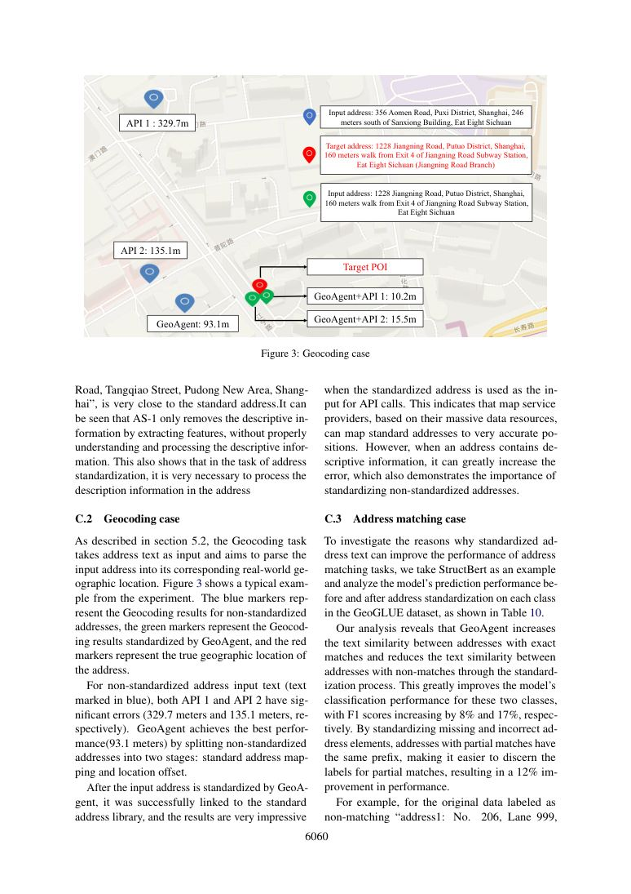

~~~~text
API 1 : 329.7m
API 2: 135.1m
GeoAgent: 93.1m
GeoAgent+API 1: 10.2m
GeoAgent+API 2: 15.5m
Target POI
Input address: 356 Aomen Road, Puxi District, Shanghai, 246 
meters south of Sanxiong Building, Eat Eight Sichuan
Target address: 1228 Jiangning Road, Putuo District, Shanghai, 
160 meters walk from Exit 4 of Jiangning Road Subway Station, 
Eat Eight Sichuan (Jiangning Road Branch)
Input address: 1228 Jiangning Road, Putuo District, Shanghai, 
160 meters walk from Exit 4 of Jiangning Road Subway Station, 
Eat Eight Sichuan
Figure 3: Geocoding case
Road, Tangqiao Street, Pudong New Area, Shang-
hai”, is very close to the standard address.It can
be seen that AS-1 only removes the descriptive in-
formation by extracting features, without properly
understanding and processing the descriptive infor-
mation. This also shows that in the task of address
standardization, it is very necessary to process the
description information in the address
C.2
Geocoding case
As described in section 5.2, the Geocoding task
takes address text as input and aims to parse the
input address into its corresponding real-world ge-
ographic location. Figure 3 shows a typical exam-
ple from the experiment. The blue markers rep-
resent the Geocoding results for non-standardized
addresses, the green markers represent the Geocod-
ing results standardized by GeoAgent, and the red
markers represent the true geographic location of
the address.
For non-standardized address input text (text
marked in blue), both API 1 and API 2 have sig-
nificant errors (329.7 meters and 135.1 meters, re-
spectively). GeoAgent achieves the best perfor-
mance(93.1 meters) by splitting non-standardized
addresses into two stages: standard address map-
ping and location offset.
After the input address is standardized by GeoA-
gent, it was successfully linked to the standard
address library, and the results are very impressive
when the standardized address is used as the in-
put for API calls. This indicates that map service
providers, based on their massive data resources,
can map standard addresses to very accurate po-
sitions. However, when an address contains de-
scriptive information, it can greatly increase the
error, which also demonstrates the importance of
standardizing non-standardized addresses.
C.3
Address matching case
To investigate the reasons why standardized ad-
dress text can improve the performance of address
matching tasks, we take StructBert as an example
and analyze the model’s prediction performance be-
fore and after address standardization on each class
in the GeoGLUE dataset, as shown in Table 10.
Our analysis reveals that GeoAgent increases
the text similarity between addresses with exact
matches and reduces the text similarity between
addresses with non-matches through the standard-
ization process. This greatly improves the model’s
classification performance for these two classes,
with F1 scores increasing by 8% and 17%, respec-
tively. By standardizing missing and incorrect ad-
dress elements, addresses with partial matches have
the same prefix, making it easier to discern the
labels for partial matches, resulting in a 12% im-
provement in performance.
For example, for the original data labeled as
non-matching “address1: No.
206, Lane 999,
6060
~~~~

## PDF 第 14 页

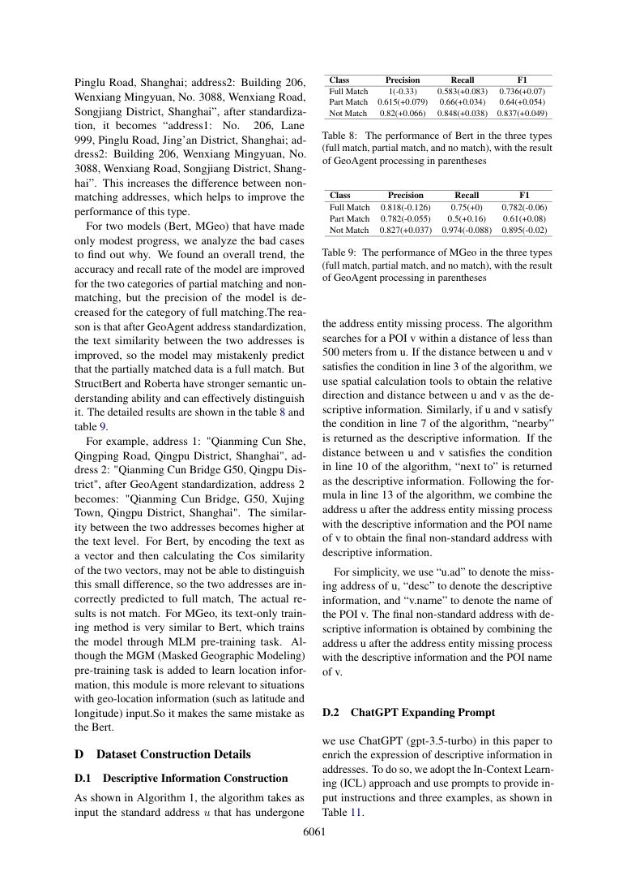

~~~~text
Pinglu Road, Shanghai; address2: Building 206,
Wenxiang Mingyuan, No. 3088, Wenxiang Road,
Songjiang District, Shanghai”, after standardiza-
tion, it becomes “address1:
No.
206, Lane
999, Pinglu Road, Jing’an District, Shanghai; ad-
dress2: Building 206, Wenxiang Mingyuan, No.
3088, Wenxiang Road, Songjiang District, Shang-
hai”. This increases the difference between non-
matching addresses, which helps to improve the
performance of this type.
For two models (Bert, MGeo) that have made
only modest progress, we analyze the bad cases
to find out why. We found an overall trend, the
accuracy and recall rate of the model are improved
for the two categories of partial matching and non-
matching, but the precision of the model is de-
creased for the category of full matching.The rea-
son is that after GeoAgent address standardization,
the text similarity between the two addresses is
improved, so the model may mistakenly predict
that the partially matched data is a full match. But
StructBert and Roberta have stronger semantic un-
derstanding ability and can effectively distinguish
it. The detailed results are shown in the table 8 and
table 9.
For example, address 1: "Qianming Cun She,
Qingping Road, Qingpu District, Shanghai", ad-
dress 2: "Qianming Cun Bridge G50, Qingpu Dis-
trict", after GeoAgent standardization, address 2
becomes: "Qianming Cun Bridge, G50, Xujing
Town, Qingpu District, Shanghai". The similar-
ity between the two addresses becomes higher at
the text level. For Bert, by encoding the text as
a vector and then calculating the Cos similarity
of the two vectors, may not be able to distinguish
this small difference, so the two addresses are in-
correctly predicted to full match, The actual re-
sults is not match. For MGeo, its text-only train-
ing method is very similar to Bert, which trains
the model through MLM pre-training task. Al-
though the MGM (Masked Geographic Modeling)
pre-training task is added to learn location infor-
mation, this module is more relevant to situations
with geo-location information (such as latitude and
longitude) input.So it makes the same mistake as
the Bert.
D
Dataset Construction Details
D.1
Descriptive Information Construction
As shown in Algorithm 1, the algorithm takes as
input the standard address u that has undergone
Class
Precision
Recall
F1
Full Match
1(-0.33)
0.583(+0.083)
0.736(+0.07)
Part Match
0.615(+0.079)
0.66(+0.034)
0.64(+0.054)
Not Match
0.82(+0.066)
0.848(+0.038)
0.837(+0.049)
Table 8: The performance of Bert in the three types
(full match, partial match, and no match), with the result
of GeoAgent processing in parentheses
Class
Precision
Recall
F1
Full Match
0.818(-0.126)
0.75(+0)
0.782(-0.06)
Part Match
0.782(-0.055)
0.5(+0.16)
0.61(+0.08)
Not Match
0.827(+0.037)
0.974(-0.088)
0.895(-0.02)
Table 9: The performance of MGeo in the three types
(full match, partial match, and no match), with the result
of GeoAgent processing in parentheses
the address entity missing process. The algorithm
searches for a POI v within a distance of less than
500 meters from u. If the distance between u and v
satisfies the condition in line 3 of the algorithm, we
use spatial calculation tools to obtain the relative
direction and distance between u and v as the de-
scriptive information. Similarly, if u and v satisfy
the condition in line 7 of the algorithm, “nearby”
is returned as the descriptive information. If the
distance between u and v satisfies the condition
in line 10 of the algorithm, “next to” is returned
as the descriptive information. Following the for-
mula in line 13 of the algorithm, we combine the
address u after the address entity missing process
with the descriptive information and the POI name
of v to obtain the final non-standard address with
descriptive information.
For simplicity, we use “u.ad” to denote the miss-
ing address of u, “desc” to denote the descriptive
information, and “v.name” to denote the name of
the POI v. The final non-standard address with de-
scriptive information is obtained by combining the
address u after the address entity missing process
with the descriptive information and the POI name
of v.
D.2
ChatGPT Expanding Prompt
we use ChatGPT (gpt-3.5-turbo) in this paper to
enrich the expression of descriptive information in
addresses. To do so, we adopt the In-Context Learn-
ing (ICL) approach and use prompts to provide in-
put instructions and three examples, as shown in
Table 11.
6061
~~~~

## PDF 第 15 页

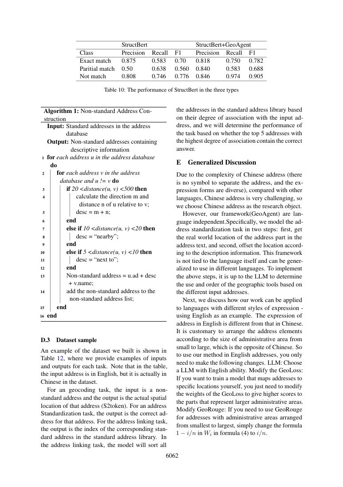

~~~~text
StructBert
StructBert+GeoAgent
Class
Precision
Recall
F1
Precision
Recall
F1
Exact match
0.875
0.583
0.70
0.818
0.750
0.782
Paritial match
0.50
0.638
0.560
0.840
0.583
0.688
Not match
0.808
0.746
0.776
0.846
0.974
0.905
Table 10: The performance of StructBert in the three types
Algorithm 1: Non-standard Address Con-
struction
Input: Standard addresses in the address
database
Output: Non-standard addresses containing
descriptive information
1 for each address u in the address database
do
2
for each address v in the address
database and u != v do
3
if 20 <distance(u, v) <500 then
4
calculate the direction m and
distance n of u relative to v;
5
desc = m + n;
6
end
7
else if 10 <distance(u, v) <20 then
8
desc = “nearby”;
9
end
10
else if 5 <distance(u, v) <10 then
11
desc = “next to”;
12
end
13
Non-standard address = u.ad + desc
+ v.name;
14
add the non-standard address to the
non-standard address list;
15
end
16 end
D.3
Dataset sample
An example of the dataset we built is shown in
Table 12, where we provide examples of inputs
and outputs for each task. Note that in the table,
the input address is in English, but it is actually in
Chinese in the dataset.
For an geocoding task, the input is a non-
standard address and the output is the actual spatial
location of that address (S2token). For an address
Standardization task, the output is the correct ad-
dress for that address. For the address linking task,
the output is the index of the corresponding stan-
dard address in the standard address library. In
the address linking task, the model will sort all
the addresses in the standard address library based
on their degree of association with the input ad-
dress, and we will determine the performance of
the task based on whether the top 5 addresses with
the highest degree of association contain the correct
answer.
E
Generalized Discussion
Due to the complexity of Chinese address (there
is no symbol to separate the address, and the ex-
pression forms are diverse), compared with other
languages, Chinese address is very challenging, so
we choose Chinese address as the research object.
However, our framework(GeoAgent) are lan-
guage independent.Specifically, we model the ad-
dress standardization task in two steps: first, get
the real world location of the address part in the
address text, and second, offset the location accord-
ing to the description information. This framework
is not tied to the language itself and can be gener-
alized to use in different languages. To implement
the above steps, it is up to the LLM to determine
the use and order of the geographic tools based on
the different input addresses.
Next, we discuss how our work can be applied
to languages with different styles of expression -
using English as an example. The expression of
address in English is different from that in Chinese.
It is customary to arrange the address elements
according to the size of administrative area from
small to large, which is the opposite of Chinese. So
to use our method in English addresses, you only
need to make the following changes. LLM: Choose
a LLM with English ability. Modify the GeoLoss:
If you want to train a model that maps addresses to
specific locations yourself, you just need to modify
the weights of the GeoLoss to give higher scores to
the parts that represent larger administrative areas.
Modify GeoRouge: If you need to use GeoRouge
for addresses with administrative areas arranged
from smallest to largest, simply change the formula
1 −i/n in Wi in formula (4) to i/n.
6062
~~~~

## PDF 第 16 页

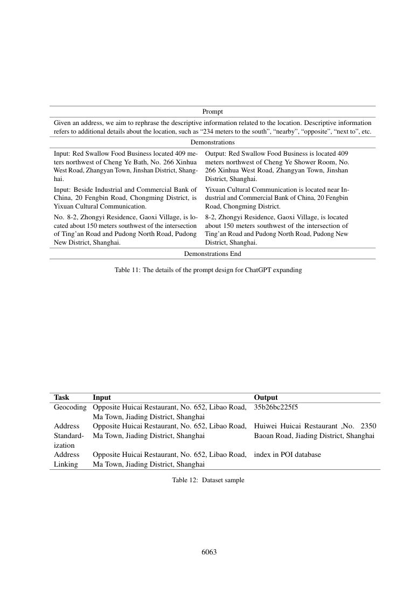

~~~~text
Prompt
Given an address, we aim to rephrase the descriptive information related to the location. Descriptive information
refers to additional details about the location, such as “234 meters to the south”, “nearby”, “opposite”, “next to”, etc.
Demonstrations
Input: Red Swallow Food Business located 409 me-
ters northwest of Cheng Ye Bath, No. 266 Xinhua
West Road, Zhangyan Town, Jinshan District, Shang-
hai.
Output: Red Swallow Food Business is located 409
meters northwest of Cheng Ye Shower Room, No.
266 Xinhua West Road, Zhangyan Town, Jinshan
District, Shanghai.
Input: Beside Industrial and Commercial Bank of
China, 20 Fengbin Road, Chongming District, is
Yixuan Cultural Communication.
Yixuan Cultural Communication is located near In-
dustrial and Commercial Bank of China, 20 Fengbin
Road, Chongming District.
No. 8-2, Zhongyi Residence, Gaoxi Village, is lo-
cated about 150 meters southwest of the intersection
of Ting’an Road and Pudong North Road, Pudong
New District, Shanghai.
8-2, Zhongyi Residence, Gaoxi Village, is located
about 150 meters southwest of the intersection of
Ting’an Road and Pudong North Road, Pudong New
District, Shanghai.
Demonstrations End
Table 11: The details of the prompt design for ChatGPT expanding
Task
Input
Output
Geocoding
Opposite Huicai Restaurant, No. 652, Libao Road,
Ma Town, Jiading District, Shanghai
35b26bc225f5
Address
Standard-
ization
Opposite Huicai Restaurant, No. 652, Libao Road,
Ma Town, Jiading District, Shanghai
Huiwei Huicai Restaurant ,No.
2350
Baoan Road, Jiading District, Shanghai
Address
Linking
Opposite Huicai Restaurant, No. 652, Libao Road,
Ma Town, Jiading District, Shanghai
index in POI database
Table 12: Dataset sample
6063
~~~~
