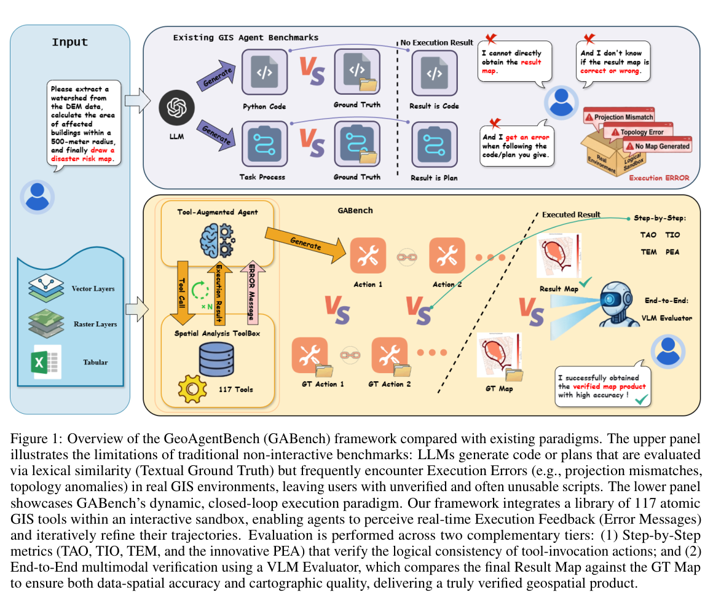
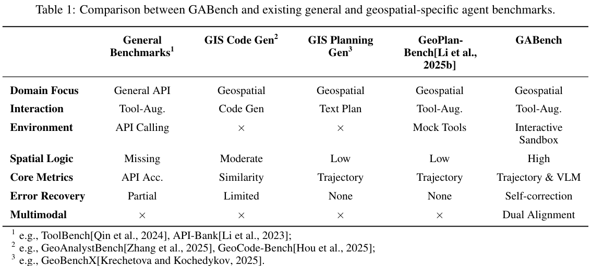
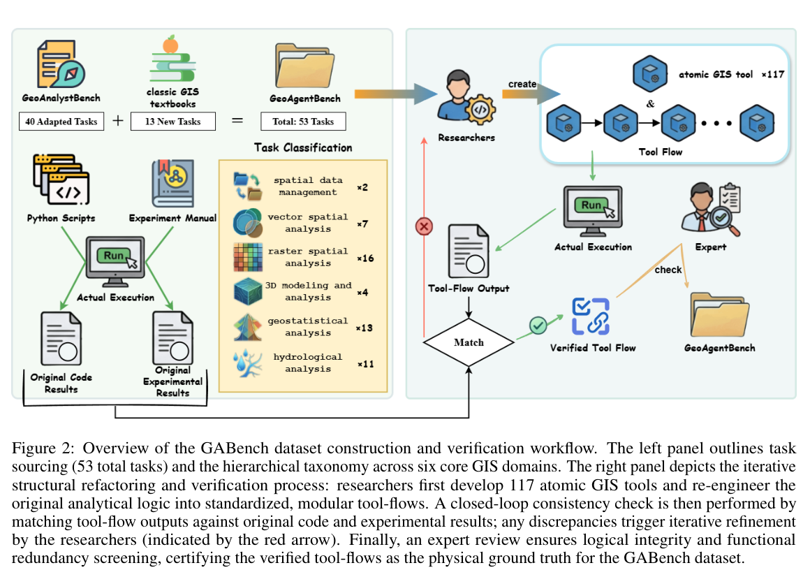
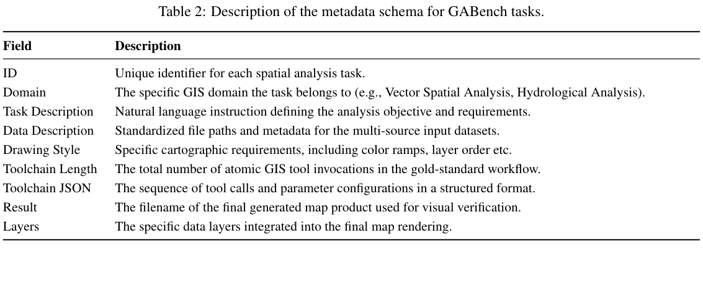
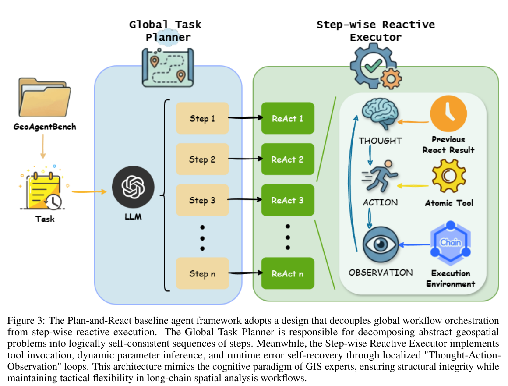
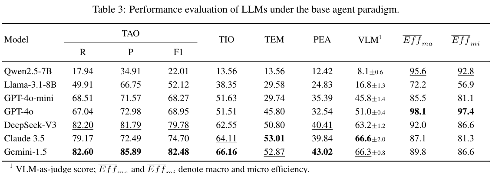
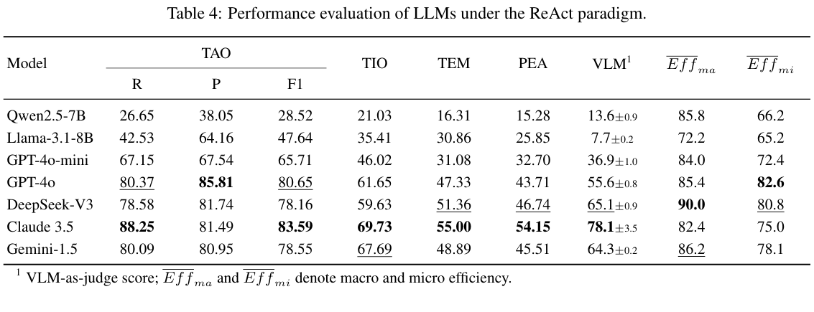
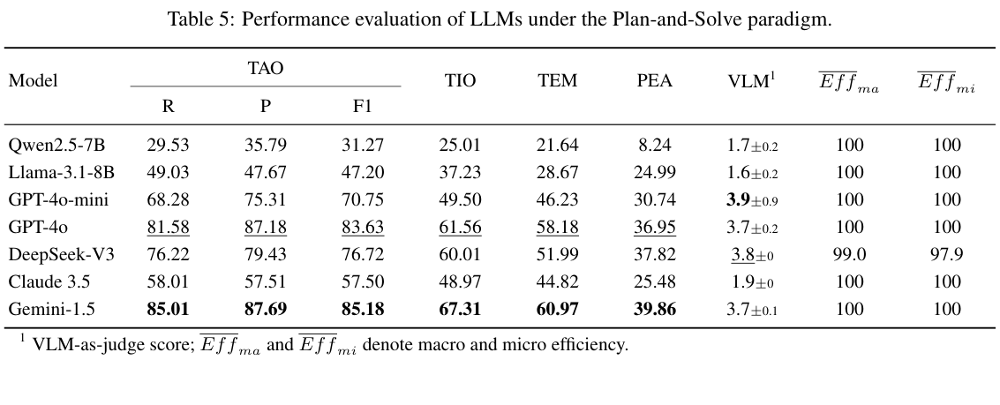
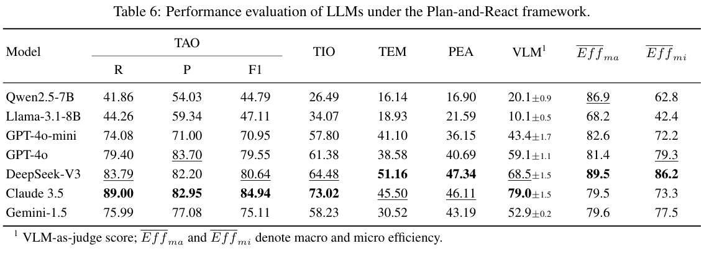

# GeoAgentBench：面向空间分析工具增强型智能体的动态执行基准

**原题**：*GeoAgentBench: A Dynamic Execution Benchmark for Tool-Augmented Agents in Spatial Analysis*  
**作者**：Bo Yu、Cheng Yang、Dongyang Hou（通讯作者）、Chengfu Liu、Jiayao Liu、Chi Wang、Zhiming Zhang、Haifeng Li、Wentao Yang  
**机构**：中南大学地球科学与信息物理学院；湖南科技大学地球科学与空间信息工程学院  
**版本**：arXiv:2604.13888v1，2026-04-15（预印本）  
**代码与数据**：https://github.com/geox-lab/GABench

> **译文说明**：本文件按论文原有章节组织，保留 GIS 算法名、基准名、工具函数名、参数符号和引用标识。图表为从原始 PDF 直接裁切的图像。论文的逐页英文提取、全部 20 页原稿图像分别见同目录的英文 Markdown 和 `source_pages/`。原文中的数学公式及其原始版式同时可在对应页图像中核对。

## 摘要

将大语言模型（Large Language Models，LLMs）引入地理信息系统（Geographic Information Systems，GIS），标志着空间分析向自主化迈进的范式转变。然而，由于地理空间工作流具有复杂、多步骤的特性，评估此类基于 LLM 的智能体仍然面临困难。现有基准主要依赖静态文本或代码匹配，忽视了动态运行时反馈以及空间分析输出的多模态性质。为弥补这一缺口，我们提出 GeoAgentBench（GABench）：一种专门面向工具增强型 GIS 智能体的动态、交互式评测基准。

GABench 提供集成 **117 个原子 GIS 工具**的真实执行沙箱，覆盖 **6 个核心 GIS 领域中的 53 项典型空间分析任务**。考虑到在动态 GIS 环境中，精确的参数配置是决定执行成功与否的首要因素，我们设计了**参数执行准确率**（Parameter Execution Accuracy，PEA），采用“**最后一次尝试对齐**”（Last-Attempt Alignment）策略，量化智能体隐式参数推断的准确程度。同时，提出基于**视觉—语言模型**（Vision-Language Model，VLM）的验证方法，以评估数据空间准确性及地图制图风格遵循程度。

此外，为应对参数不一致和运行时异常导致的频繁任务失败，我们提出一种模拟专家认知工作流的新型智能体架构——**Plan-and-React（规划—反应）**，通过分离全局编排和逐步骤响应式执行来提高可靠性。对七种代表性 LLM 的广泛实验表明，该架构显著优于传统框架，能够在逻辑严密性与执行鲁棒性之间取得更佳平衡，尤其表现在多步骤推理与错误恢复方面。研究揭示了当前智能体的能力边界，并为评估与推进下一代自主 GeoAI 建立了较为稳健的标准。

**关键词**：GeoAI；工具增强型智能体；空间分析；评测基准。

## 1 引言

空间分析是地理信息科学（GIScience）最基本的工具之一，广泛用于城市规划、环境监测、灾害评估和交通管理等关键场景［Liao et al., 2023；Larkin et al., 2023；Pham et al., 2021；Shahi et al., 2023；Shao et al., 2024；Guo et al., 2025；Cui et al., 2024］。但地理空间分析任务天然具有挑战性，通常需要整合多源异构数据，并执行多步骤的空间计算工作流［Li et al., 2016；Liakos and Panagos, 2022；Wang et al., 2025；He et al., 2025］。随着空间数据采集能力以及遥感、物联网（IoT）等技术快速发展，现代空间分析任务日趋复杂。因此，提升空间分析工作流的自动化与智能化水平，已经成为地理空间人工智能（GeoAI）的重要研究目标［Janowicz et al., 2020；Peng et al., 2025］。

不同于孤立的预测任务，现实世界中的地理空间分析通常表现为由多种空间操作构成的复杂工作流。一个综合分析流程可能包含数据清洗、坐标重投影、空间叠加、空间统计建模和地图可视化等多个步骤，而且这些步骤之间常存在严格的逻辑依赖。传统 GeoAI 研究主要关注为单一任务构建专门的端到端模型，通过参数优化直接拟合输入与输出之间的映射［Ronneberger et al., 2015；Kipf and Welling, 2017］。这一范式却忽略了空间分析任务中普遍存在的工作流异质性：即便分析目标相同，具体流程也很少固定不变，而是高度依赖数据源特征。例如，在同时处理矢量和栅格等多源异构格式、不同空间尺度或不同坐标参考系统（CRS）的输入时，需要动态调整数据预处理、空间算子选择、参数配置和空间统计建模等环节［Yao et al., 2024］。传统端到端模型的架构相对僵化，缺乏编排多步骤、非线性分析逻辑的能力，难以应付多变的真实地理场景。现实中的复杂 GIS 分析因而仍严重依赖领域专家借助专业软件进行人工规划与操作。这限制了地理空间技术的普及和自动化，也凸显了向高度智能化、自主化地理空间系统转型的迫切需求［Li and Ning, 2023；Li et al., 2017］。

近些年，随着 LLM 能力显著增强，以 LLM 为决策核心构建工具增强型智能体成为研究热点［Schick et al., 2023］。不同于传统端到端模型，这类智能体能够利用自然语言理解用户意图，将复杂问题分解为一系列可执行子任务，并动态调度外部工具实现计算逻辑。目前，它们已经在代码生成、数据分析和软件自动化等领域展现出巨大潜力［Zhang et al., 2024；Xie et al., 2024］。相关地理空间研究也证实，LLM 具备丰富的地理知识和较强的空间推理能力［Roberts et al., 2023；Mai et al., 2022］；VLM 则在遥感图像的语义理解方面表现出色［Lobry et al., 2020；Kuckreja et al., 2024］。这些进展为开发空间智能体提供了认知基础。具备空间推理与工具调用能力的智能体，有望弥合通用语义推理与专业空间计算之间的鸿沟：以 LLM 进行任务分解和工作流规划，精确编排外部 GIS 工具完成空间计算，将传统上由领域专家手动操作的复杂分析流程转变为自然语言驱动的自动化过程，从而降低地理空间智能技术的使用门槛［Huang et al., 2024］。

然而，实现这一愿景的关键前提，是能够系统评估智能体是否真正具备完成复杂空间分析任务的能力。空间分析是 GIS 中认知复杂度高、逻辑链条长的计算过程，对智能体的规划能力、工具执行能力及运行时错误恢复能力提出严格要求。学术界虽然已提出若干相关基准——如通用 API 调用基准 ToolBench［Qin et al., 2024］和 API-Bank［Li et al., 2023］，以及专门针对地理空间任务的 GeoAnalystBench［Zhang et al., 2025］、GeoBenchX［Krechetova and Kochedykov, 2025］和 GeoPlan-Bench［Li et al., 2025b］——但在评估真实、复杂的空间分析工作流时，仍存在显著局限（表 1）。

**首先，现有评估多采用非交互式范式，缺乏真实执行环境中的动态反馈闭环。**主要表现为三类不足：（1）以规划为导向的工作流评估，如 GeoBenchX，只在文本层面验证任务计划的逻辑一致性，而忽视实际可执行性；（2）代码相似度的表层度量，如 GeoAnalystBench，主要比较模型生成脚本与专家参考代码的词法相似性，无法评价其在真实地理空间环境中的运行效果；（3）模拟调用验证，如 GeoPlan-Bench，使用模拟环境返回虚拟的工具执行结果，而不是在真实 GIS 软件基础设施中执行。真实空间分析环境却充满不确定性：即使逻辑合理的计划，也可能因为 CRS 不匹配、空间拓扑无效或数据格式冲突等异常而在运行时失败［Longley et al., 2015］。智能体需要依赖实时反馈进行错误诊断与动态调整，因此非交互式评估既无法准确衡量真实任务表现，也难以捕捉其面对领域特定错误时的自主调试与自我纠正能力［Shinn et al., 2023］。

**其次，现有基准缺乏系统性覆盖，未能充分解构地理空间分析固有的复杂性。**目前，许多地理空间评测框架起源于遥感领域［Shabbir et al., 2025；Feng et al., 2025］，其中 GIS 任务往往只是辅助组成部分，主要限于面积计算、距离测量和简单空间关系判断等基础操作。虽然 GeoBenchX 试图面向商业 GIS 从业者构建多步骤任务，并将其按难度划分为“合并—可视化”“处理—合并—可视化”“空间操作（如缓冲与叠加）”以及“热力图与等值线生成”四级，但所覆盖的业务场景依然有限，无法充分体现真实地理空间分析中高度复杂的业务需求。其任务大多表现为孤立算子的组合，缺乏对复杂空间逻辑链的深入模拟，因而难以系统衡量智能体对真实长链分析工作流的综合处理能力。

**最后，现有评估过度简化为文本级比较，忽视空间分析交付物的多模态性质。**完整的 GIS 分析工作流往往不仅产出文字，还会产生 GeoJSON、TIFF 等空间数据文件以及最终地图。空间数据的几何正确性与地图渲染质量却很少被纳入统一评估框架。

针对上述空白，本文提出动态交互环境下的空间分析智能体基准 GABench（图 1）。该基准不同于静态文本匹配方法，专门面向工具增强型智能体，在集成全面原子 GIS 工具库的执行沙箱中实现真实的闭环工具调用。每个测试样本包括自然语言任务说明与多源空间数据；智能体必须根据用户指令自主制定分析工作流，在沙箱内动态调用和组合专用 GIS 工具开展空间计算，最终生成地图可视化成果。

*图 1　GABench 框架与既有范式的比较。上部展示传统非交互基准的局限：LLM 输出的代码或计划仅与文本参考答案做词法比较，在真实 GIS 环境中可能遭遇投影不匹配、拓扑异常等执行错误，用户得到未验证且可能不可用的脚本。下部展示 GABench 的动态闭环机制：117 个原子 GIS 工具构成交互沙箱，智能体接收实时错误反馈并反复修正轨迹；评估包括逐步工具调用指标 TAO、TIO、TEM、PEA，以及基于 VLM 的最终结果地图与 Ground Truth（GT）地图多模态比较，同时关注数据空间准确性和制图质量。*

**本文主要贡献包括四点：**（1）构建包含 117 个原子工具、53 项任务、6 个 GIS 核心领域的动态交互式基准，在真实执行沙箱中评估长链编排、隐式参数推断及基于执行反馈的错误恢复；（2）提出融合 PEA 与 VLM 验证的多层级评估体系，同时评价工具级配置精度和最终地图成果质量；（3）设计 Plan-and-React 架构，将全局流程编排与局部响应式执行解耦，在预先定义的分析蓝图中嵌入“思考—行动—观察”（Thought–Action–Observation）循环，以减轻纯 ReAct 的推理漂移及 Plan-and-Solve 的执行僵化；（4）在 Base Agent、ReAct、Plan-and-Solve 和 Plan-and-React 四种范式下，系统研究主流 LLM 的多步骤推理和错误恢复能力边界。

*表 1　与现有通用及地理空间专用基准的比较。比较维度依次为领域重点、交互方式、执行环境、空间逻辑、核心指标、错误恢复及多模态评估；GABench 采用交互式沙箱，以轨迹和 VLM 为核心指标，支持自我纠错与双重对齐。脚注中的代表基准包括 ToolBench、API-Bank、GeoAnalystBench、GeoCode-Bench、GeoBenchX。*

## 2 相关工作

### 2.1 地理空间基础模型

近年来，以大语言模型为代表的通用基础模型在自然语言处理和复杂逻辑推理方面取得突破。视觉—语言模型（VLM）进一步将单一文本模态拓展到多模态理解，使模型具有更强的视觉感知和跨模态交互能力。依托海量训练数据，通用模型表现出良好的泛化及零样本、少样本学习能力，为地理空间智能从领域专用小模型转向通用智能系统奠定了基础［Huang et al., 2026］。

但是，地理空间数据固有的高度异质性、空间依赖性及复杂拓扑规则，使得直接应用通用模型通常无法充分捕捉领域深层语义［Mai et al., 2022；Ji et al., 2025］。因此，研究者开始探索地理空间定制基础模型［Janowicz et al., 2025］。在语言建模方向，K2［Deng et al., 2024］通过在数百万份地球科学文献上持续预训练及指令微调，增强模型的地学知识理解；GeoLLM［Manvi et al., 2024］将 OpenStreetMap 矢量网络和坐标信息注入提示词，展示了从 LLM 中直接提取和增强地理空间知识的可能性。在视觉与多模态领域，遥感 VLM 将遥感影像与自然语言描述对齐，在遥感视觉问答（VQA）、场景分类和目标定位等感知任务上取得突出表现［Li et al., 2025a；An et al., 2024］。AllSpark［Shao et al., 2025］还提出支持十种异构时空模态的统一框架，拓展了对多源数据的协同理解能力。

虽然专业知识获取和多模态感知取得显著进展，地理空间基础模型仍难以支持复杂空间分析。一方面，现有模型主要面向事实问答、文本摘要与基本地理实体识别，空间推理及工具调用能力尚未得到充分探索。另一方面，真实复杂分析依赖对 GDAL、GeoPandas、空间数据库等专业 GIS 算子和外部软件进行多步骤集成调用，而多数开源地理空间基础模型在指令微调阶段缺少高质量 GIS 工具调用逻辑链训练数据，因而难以处理参数配置、拓扑错误检测、运行时自我纠错等复杂操作。

### 2.2 地理空间智能体

基于 LLM 的自主智能体近年来成为人工智能研究的核心热点。不同于只执行静态文本生成的传统 LLM，这些智能体结合记忆、任务规划和外部工具调用等模块，实现对环境的动态感知与交互［Liu et al., 2025］。

受通用智能体发展的启发，地理空间研究者积极构建面向 GIS 与复杂遥感任务的专用智能体。在 GIS 领域，“自主 GIS”（Autonomous GIS）理论框架尝试利用 LLM 的语言理解和代码生成能力，实现从空间数据发现、获取到分析与可视化的全生命周期自动化［Li and Ning, 2023］。随后出现了一系列原生地理空间智能体系统：LLM-Find 面向地理数据检索，根据自然语言指令执行与调试代码，从预定义的开放接口自主搜索、下载指定格式的空间数据［Ning et al., 2025］；GIS Copilot 将 LLM 嵌入 QGIS 等开源 GIS 平台，使非专家能够通过对话生成并执行空间分析代码［Akinboyewa et al., 2025］；ShapefileGPT 等多智能体系统通过将复杂任务规划与具体工具调用分离，实现针对 Shapefile 等特定矢量数据的高效处理闭环［Lin et al., 2025］。

在遥感领域，智能体用于降低多模态观测数据处理的门槛与操作复杂度。REMSA 智能体能够依据用户自然语言需求，从元数据库自主检索、匹配并推荐合适的遥感基础模型［Chen et al., 2025］；GeoLLM-Squad 等多智能体系统则建立协调与分工机制，将复杂的遥感分析工作流分配给负责检索、分析和可视化的专业子智能体，提高大规模影像处理效率［Lee et al., 2025］。

尽管这些空间智能体在自动制图、数据检索和基础空间分析中潜力巨大，但在真实、复杂工作流中仍有明显局限：一方面，现有系统高度依赖通用 LLM 的零样本代码生成能力，缺乏感知和自动纠正空间分析特有错误的机制；遇到 CRS 不匹配、拓扑无效、参数设置错误等运行时问题时，难以独立诊断并恢复执行。另一方面，它们在单算子或明确逐步指导的任务中表现尚可，但对步骤未知、依赖复杂的长链工作流，任务分解和动态编排能力仍然薄弱［Akinboyewa et al., 2025］。因此，亟须系统评估智能体在复杂地理空间场景中的综合能力边界。

### 2.3 地理空间智能体基准评测

随着大模型工具学习能力的发展，ToolBench［Qin et al., 2024］和 API-Bank［Li et al., 2023］等通用基准已经较为成熟。这些基准虽然涵盖大量 API 调用场景，却通常把工具视为无状态的通用函数，难以体现地理空间分析固有的空间语义约束，例如多源数据之间的坐标系统转换逻辑、几何拓扑有效性检查等。

在地理空间领域，ThinkGeo［Shabbir et al., 2025］和 Earth-Agent［Feng et al., 2025］等近期研究主要面向遥感影像智能体和评价，但重点往往是栅格影像的视觉感知与基于图像的语义问答，本质上属于影像信息提取。真实 GIS 应用不仅要识别地理对象，还需要动态调用工具，对复杂矢量数据、拓扑关系和多步骤空间分析工具链进行逻辑推理。

在代码生成和数据分析领域，DS-1000［Lai et al., 2023］等研究已表明，基于执行的评测优于静态文本评价。但目前地理空间专用评估仍多受限于静态范式：无论是在自然语言中生成任务计划（GeoBenchX、GeoPlan-Bench），还是生成 Python 脚本（GeoAnalystBench、GeoCode-Bench），都主要依据生成内容与静态 GT 的文本相似度或代码匹配程度评分。脱离真实执行环境的评价缺少情境锚定：即便代码或计划在语法上与标准答案相似，也可能因为参数阈值敏感性、空几何或文件锁等问题，在异构数据上执行崩溃。缺少真实环境中的反馈闭环，就无法量化智能体面对运行时错误的鲁棒性与自我纠错能力。

此外，既有评估体系对地图可视化质量关注不足。地理分析的最终结果往往是一幅地图；虽然通用图表领域已有 MatPlotBench［Yang et al., 2024］等探索，但地理地图还涉及复杂的投影与地图符号学问题。以文本匹配为主的指标无法充分评估地图美观程度与符号表达精度，使端到端评价不完整。本文的 GABench 因而通过原生 GIS 工具库构建闭环执行环境，引入多维任务体系、基于运行时反馈的动态评价，以及使用 VLM 进行的端到端多模态成果验证，期望建立更符合真实 GIS 逻辑与复杂性的评价标准。

## 3 基准设计

GABench 采用模块化、集成化架构，旨在弥合高层推理与实际地理空间计算之间的鸿沟。如图 2 所示，该基准由基于专业 GIS 领域的分层任务体系，以及原子 GIS 工具库驱动的动态执行沙箱构成。本节介绍从任务分类、专家主导的重构到标准化元数据架构的整个基准构建过程。

*图 2　GABench 数据集的构建和验证流程。左侧展示 53 项任务的来源及六个 GIS 核心领域的分层分类；右侧展示迭代式结构重构与验证：研究者首先开发 117 个原子工具，把原始分析逻辑重写成标准化、模块化工具流；随后将工具流输出与原始代码、实验结果比较进行闭环一致性校验，若发现偏差便迭代修正；最后经专家审核逻辑完整性和功能冗余，确认通过验证的工具流可作为数据集的物理 Ground Truth。*

### 3.1 任务类别与来源

为全面覆盖复杂地理空间分析所需核心能力，研究依据经典 GIS 文献和教材［Tang and Yang, 2012］构建分层任务分类体系（图 2），既覆盖矢量、栅格数据模型，也使逻辑复杂度从基本几何操作逐步提升至复杂过程模拟。六大核心领域分别为：（1）空间数据管理；（2）矢量空间分析；（3）栅格空间分析；（4）三维建模与分析；（5）地统计分析；（6）水文分析。该分层体系为系统评估长链推理和多步骤工具编排奠定了基础。

任务集首先严格筛选 GeoAnalystBench［Zhang et al., 2025］的 50 个案例，排除依赖闭源数据或 ArcGIS 专有格式的 10 项，以保证与开放地理空间计算生态兼容。深入检查后发现，剩余 40 项也无法直接用于自主工具编排，原因有二：（1）**逻辑粒度过粗**：原人工设计工作流只包含“加载数据”“插值”“合并”等高层语义抽象，而非细粒度、可执行操作，不利于智能体动态调度子任务；（2）**单体脚本结构**：配套 Python 代码主要由面向单一任务的大段脚本组成，难以拆成可复用的原子工具。因此，作者并未直接沿用原始代码，而是完全重构分析逻辑；与此同时，修改任务指令以强制生成地图成果，并统一所有文件访问路径，支持端到端验证。

为弥补原基准覆盖不足，尤其是复杂水文分析场景的缺口，研究又从经典 GIS 教材［Tang and Yang, 2012］系统引入 13 项高难度任务，最终形成覆盖全部六大领域、具有明确地理意义的 53 项代表性任务。

### 3.2 逐步工具链与任务执行沙箱

为克服单体脚本和粗粒度逻辑抽象的局限，研究对任务集进行了深度结构重构。典型的城市热岛分析可以体现粒度与逻辑严密性的改进：GeoAnalystBench 将其流程定义为七个高层语义步骤——（1）加载数据、（2）插值、（3）筛选、（4）合并、（5）求平均、（6）突出显示、（7）可视化。这些步骤虽然表达了语义意图，却存在关键逻辑缺口，缺乏自主智能体所需的执行细节。例如，“插值”生成连续栅格表面，而“求平均”需要按多边形汇总，二者之间隐含了空间数据模型冲突，传统基准并未处理。

相较之下，GABench 利用 117 个标准化 GIS 工具构成精细的原子工具流：使用 `ordinary_kriging` 明确执行插值，并设定网格边界、分辨率（如 `nx=100`、`ny=100`）和变差函数模型；引入 `zonal_statistics` 作为计算桥梁，将热度栅格汇总到 `CensusBlock` 矢量图层；将模糊的“突出显示”进一步具体化为两步：先用 `filter_features_by_expression` 进行准确的空间筛选，再用 `create_multilayer_map` 按指定视觉参数（如 `OrRd` 色带、`alpha` 透明度）叠加基础热度图与高风险突出显示图层。

这种原子设计使每一步都对应明确的空间操作，提供严格且可执行的基线。工具开发遵循通用性、非任务特化和高复用性原则，并引入专家审核，对功能冗余进行筛查、验证各任务的最优工具流。研究同时建立了一致性闭环校验：以原始脚本［Zhang et al., 2025］或经典 GIS 实验［Tang and Yang, 2012］的执行产物为参考，要求重构工作流的输出在语义与数据层面（例如几何拓扑及属性精度）严格一致。经验证的输出构成 GABench 的**已验证物理真实值**（Verified Physical Ground Truth），推动评估从表层代码匹配转向自主工具编排。

为了自动执行这些工作流，GABench 以 GeoPandas、Rasterio 和 Shapely 等原生 Python 开源地理空间技术栈搭建轻量级交互式运行沙箱。沙箱通过三项机制在智能体与实际数据间建立桥梁：（1）为每个任务配置独立的上下文工作区，利用持久化状态管理实时保存中间数据流与结果；（2）设计隔离式“去噪反馈”机制，截获复杂的 Python traceback，将其提炼为语义清晰的错误信息再反馈给智能体，以缓解幻觉和参数漂移；（3）执行严格的文件写入策略，模拟文件锁异常等真实 GIS 资源冲突，促使智能体在真实反馈驱动的执行环境中自主诊断并恢复错误。

### 3.3 GABench 描述

为了保障可复现性与系统化执行，GABench 为每个任务规定标准化元数据模式（表 2），在高层人类指令与机器可执行工具流之间建立桥梁。任务具有唯一 ID，以及所属的 **Domain（领域）**，如矢量空间分析；**Task Description（任务描述）**定义自然语言分析目标；**Data Description（数据描述）**给出多源输入数据的标准化文件路径与元数据；**Drawing Style（绘图风格）**规定色带、图层顺序等制图要求；**Toolchain Length（工具链长度）**记录黄金标准工作流中的原子工具调用次数；**Toolchain JSON** 提供结构化调用序列及参数配置；**Result（结果）**指定供视觉核对的输出地图文件名；**Layers（图层）**描述最终制图包含的数据图层。

*表 2　GABench 任务元数据模式：包含任务标识、领域、任务说明、输入数据说明、制图风格、工具链长度、工具链 JSON、结果文件名和地图图层等字段。*

对最终 53 项任务的统计表明，平均每项任务涉及 **6.7 次工具调用**，最长工具链为 **17 步**；每项任务平均需要 **2.06 个输入图层**，往往需要复杂的数据连接和叠加操作。这种高密度的工具—数据交互，专门用于衡量空间常识理解、长链工具编排及隐式参数推断等核心能力。与强调单步算子的旧基准相比，GABench 的多步骤任务更贴近专业 GIS 工作流的真实复杂度。

为保证评估中的一致性和环境隔离，完整数据集和执行框架采用现代工程标准搭建。研究使用 `uv` 依赖管理器，对 GeoPandas、Rasterio 等地理空间计算栈实施严格版本锁定，以消除依赖冲突造成的系统级干扰，确保不同实验平台能够获得一致的错误诊断反馈与执行结果。透明、稳定的评测环境为识别自主空间智能体的能力边界提供了可靠基础。

## 4 多层级评估指标：利用 PEA 与 VLM 改进评价

为了全面量化工具增强型 GIS 智能体在动态沙箱中的表现，研究提出超越传统静态文本匹配的多层级评价体系。该体系继承 TAO、TIO 和 TEM 等常用轨迹指标，并重点引入两个技术创新：**参数执行准确率（PEA）**和**基于 VLM 的多模态验证机制**。具体从三方面评价智能体：（1）**逐步骤轨迹一致性**，通过 PEA 精确评估隐式参数推断；（2）**端到端成果质量**，使用 VLM 自动评价数据空间准确性与制图风格；（3）**运行效率**，测量资源利用情况。三类指标共同为刻画自主智能体处理真实 GIS 复杂任务的能力边界提供更严格、客观的标准。

### 4.1 轨迹级评价与 PEA 指标

为严格评估地理空间工作流的逻辑编排能力，本文根据 Earth-Agent［Feng et al., 2025］的轨迹评估原则，采用 TAO（Tools-Any-Order，工具集合匹配）、TIO（Tools-In-Order，工具顺序匹配）和 TEM（Tools-Exact-Match，工具精确匹配），量化工具调用序列的结构一致性。这些指标可以有效衡量所规划路径的正确性，但不足以细致评价单次工具调用的参数精度。为此，研究提出 PEA，以衡量工具层面的参数设置是否有效。PEA 不同于以路径为中心的传统指标，它将智能体最终的有效调用与中间试错日志区分开来，通过“最后一次尝试对齐”策略，更准确衡量复杂、不确定的空间任务中的隐式参数推断能力。

**工具无序匹配（Tools-Any-Order，TAO）**旨在衡量智能体识别并检索完成任务所需原子空间工具集合的能力，不考虑调用顺序。令执行中智能体调用的工具集合为 $T_{pred}$，参考答案工具集合为 $T_{gt}$；通过精确率 $P$ 和召回率 $R$ 的调和平均数评价：

$$
F_1=\frac{2PR}{P+R},\quad
P=\frac{|T_{pred}\cap T_{gt}|}{|T_{pred}|},\quad
R=\frac{|T_{pred}\cap T_{gt}|}{|T_{gt}|}.\tag{1}
$$

地理空间分析任务具有严格的逻辑依赖关系，例如坐标重投影必须先于面积计算。为评估分析工作流的逻辑完整性，研究进一步提出以下两个顺序维度。

**工具顺序匹配（Tools-In-Order，TIO）**衡量智能体对工具调用先后顺序的掌握程度。借鉴最长公共子序列（Longest Common Subsequence，LCS）的概念，计算预测轨迹中保持正确相对次序的标准工具数量占 GT 流程总步数的比例，从而客观反映工作流拓扑逻辑结构的正确性。对于智能体插入的无破坏性步骤（例如数据验证），该指标具有较强鲁棒性：

$$
TIO=\frac{|LCS(T_{pred},T_{gt})|}{|T_{gt}|}.\tag{2}
$$

其中，$T_{pred}$、$T_{gt}$ 分别表示预测和参考工具调用序列，$LCS(\cdot)$ 表示两者的最长公共子序列。

**工具精确匹配（Tool-Exact-Match，TEM）**采用严格的前缀匹配原则，衡量智能体对标准操作程序（Standard Operating Procedure，SOP）的准确遵循程度。具体计算从分析过程开始起，与 GT 始终完全一致的工具调用前缀占标准流程总长度的比例，可深入刻画长链依赖场景下分析路径的准确性：

$$
TEM=\frac{|LCP(T_{pred},T_{gt})|}{|T_{gt}|}.\tag{3}
$$

其中，$LCP(\cdot)$ 为最长公共前缀（Longest Common Prefix），即两个序列从首个元素开始连续匹配的最长部分。

**参数执行准确率（Parameter Execution Accuracy，PEA）**专门量化关键工作流中参数配置的精确性及智能体的实际执行效果。复杂任务中的智能体常依据环境反馈进行试错；传统的顺序比较容易把中间失败调用当作最终行为，从而误判。为将真实执行能力与无关交互日志分离，作者提出包含**反向对齐（Backward Alignment）**和**正向评价（Forward Evaluation）**的双阶段计算框架。

在反向对齐阶段，系统使用逆向检索策略，将 GT 的每个逻辑节点与智能体在对应节点的**最后一次工具调用**对齐，即“Last-Attempt Alignment”。其依据是：在长链工作流中，经过反思和纠正后的最后操作，才是决定该步骤实际结果的关键变量。在正向评价阶段，引入**动态变量映射（Dynamic Variable Mapping）**，容纳模型生成中间文件名的随机性，同时要求这些映射在后续拓扑输入之间始终一致。进一步地，为降低参数幻觉风险，加入**物理状态检查（Physical State Check）**：对涉及文件路径的重要参数，系统直接验证文件是否真实存在于输出沙箱目录中。对于可视化等工具，适当放宽标题等非确定性风格参数的严格比较，以适应不同模型合理的样式差异。公式为：

$$
PEA=\frac{1}{N}\sum_{i=1}^{N}\mathbf{1}\!\left(
Tool^{(i)}_{last}=Tool^{(i)}_{gt}\ \land\
Params^{(i)}_{last}\overset{M,E}{\simeq}Params^{(i)}_{gt}
\right).\tag{4}
$$

其中，$N$ 是 GT 序列中的总步数；$Tool^{(i)}_{last}$ 是反向检索窗口中与 GT 第 $i$ 步对应的最终工具实例；$\overset{M,E}{\simeq}$ 表示参数语义等价性判断，同时受**动态变量映射 $M$**和沙箱中的**物理文件存在性验证 $E$**约束。PEA 将智能体的最终执行效果与冗余试错交互分离，有助于准确评价隐式参数推断能力，并结合真实沙箱反馈建立模型实际可靠性的评估依据。

### 4.2 新的基于 VLM 的端到端评价指标

轨迹级指标虽然可以衡量工具调用的逻辑，却不能充分体现最终地理空间交付物的有效性。复杂空间分析工作流往往以可视化地图作为最终产物，因此研究引入 VLM 驱动的多模态自动验证机制，对生成地图的数据空间准确性和制图风格进行严格端到端评价。与文本匹配相比，这一方法提供了可扩展的自动化替代方案，减轻人工检查负担，并检验最终地图是否不仅计算正确，而且符合既定的专业制图规范。

具体采用**基于参考答案的视觉对比策略**。为尽量降低 VLM 评分的主观性，系统将智能体生成地图与执行标准工具轨迹得到的 GT 地图并置，合成为对比图。作为裁判的 VLM 同时接收原始任务描述及对比图，仔细比较视觉和空间特征，并给出 **0–100 分**的量化评分。评价集中在两个维度：（1）**数据与空间准确性（Data and Spatial Accuracy）**：检验地图中地理要素的形态、空间拓扑关系和定量统计结果是否与 GT 严格一致，识别底层数据处理可能出现的偏差；（2）**制图风格遵循程度（Cartographic Style Adherence）**：检查色带分布、图层叠加顺序等视觉渲染是否符合用户意图及地图制图规范。

### 4.3 运行效率指标

针对轨迹执行效率，为量化工作流的冗余程度与资源利用效果，研究根据工具调用轨迹定义效率指标 $Eff$，从宏观和微观两个层面分别衡量任务执行的平均最优性与全局资源利用率。对于第 $i$ 个成功执行的任务，步骤效率定义为：

$$
Eff^{(i)}=\frac{N^{(i)}_{gt}}{\max(N^{(i)}_{gt},N^{(i)}_{pred})}.\tag{5}
$$

整体宏观效率和微观效率为：

$$
Eff_{macro}=\frac{1}{M}\sum_{i=1}^{M}Eff^{(i)};\tag{6}
$$

$$
Eff_{micro}=\frac{\sum_{i=1}^{M}N^{(i)}_{gt}}{\sum_{i=1}^{M}\max(N^{(i)}_{gt},N^{(i)}_{pred})}.\tag{7}
$$

其中，$N^{(i)}_{gt}$ 与 $N^{(i)}_{pred}$ 分别是第 $i$ 个任务在 GT 和预测轨迹中的步数，$M$ 是成功完成的任务总数。$Eff_{macro}$ 反映每个任务的路径规划平均表现，$Eff_{micro}$ 从全局考察执行大量任务时的冗余控制能力。指标值严格落在 $[0,1]$，用于衡量复杂空间分析过程中的执行简洁性与资源利用效率。

## 5 新型 Plan-and-React 架构

自主地理空间智能体的有效性取决于其底层推理范式能否同时应对长链逻辑一致性和实时数据不确定性。为确定适合专业 GIS 工作流的推理模式，本文先系统考察 Base Agent、ReAct 和 Plan-and-Solve 三类代表性架构，识别各自根本局限，再提出旨在调和战略规划与执行灵活性的 **Plan-and-React** 架构。

**Base Agent** 是工具使用评估的基本对照组。该范式向模型提供标准化工具定义（schema）和自然语言指令，并允许模型接收动态沙箱的实时执行反馈，但不提供显式的多步骤推理或内部错误恢复机制，主要检测模型在零样本场景中直接调度工具的能力。由于没有内部推理循环，Base Agent 易发生参数幻觉，也难以在复杂工作流中维持逻辑连续性。

**ReAct**［Yao et al., 2023］通过经典的“思考—行动—观察”（Thought–Action–Observation）循环改进 Base Agent：智能体在每个步骤进行局部推理，根据环境观察动态决定下一步行动。它重视实时响应，但在长链地理空间任务中经常产生**推理漂移**。由于缺少全局路线图，智能体可能在深入的工具调用过程中偏离最终目标，陷入冗余循环或分叉分析路径，最终超过执行限制。

**Plan-and-Solve**［Wang et al., 2023］强调执行前的全局任务分解，让智能体首先生成覆盖整个任务的静态步骤序列，以解决推理漂移问题。它擅长解构复杂地理空间问题，却在遇到无法预见的数据异常时表现出执行僵化。GIS 任务中坐标不匹配、拓扑错误很常见；僵硬的“先规划、后执行”逻辑无法从运行时错误中恢复。一旦中间某步失败，智能体缺少调整轨迹的机制，后续计划随即无法使用。

**Plan-and-React** 认识到专业 GIS 操作既要求战略严密性，又不可避免地存在战术不确定性，因此将推理过程在结构上拆分为两个协同组件：**全局任务规划器（Global Task Planner）**与**逐步响应式执行器（Step-wise Reactive Executor）**。

首先，智能体不急于与环境交互，而是由全局任务规划器充当“首席分析师”（图 3 的 Global Planning）：理解复杂自然语言指令，在任何工具调用之前形成整体分析蓝图，将总体地理问题拆分为逻辑自洽的子任务序列，建立相对确定的分析锚点。这一蓝图可防止纯 ReAct 中常见的无限循环与推理漂移。

随后，逐步响应式执行器（图 3 的 Step-wise Execution）处理多源空间数据的局部不确定性。它在动态沙箱中对每个计划子任务执行局部“思考—行动—观察”循环。核心创新在于**受约束的灵活性**：如果工具调用因“拓扑错误”等问题失败，执行器不会放弃全局目标，而是根据反馈自主定位局部问题（例如修复自相交几何），并在当前步骤约束内重试。这样将全局结构引导与局部反馈驱动的错误恢复融合，使智能体既能保持明确的分析目标，又能动态适应异构空间数据的复杂情况。

*图 3　Plan-and-React 基线框架将全局工作流编排与逐步响应式执行解耦：全局任务规划器把抽象地理空间问题拆分为逻辑自洽的步骤序列；逐步响应式执行器通过局部“思考—行动—观察”循环完成工具调用、动态参数推断与运行时错误自恢复。这种架构模拟 GIS 专家的认知模式，兼顾长链空间分析的结构完整性与战术灵活性。*

## 6 实验

### 6.1 实验设置

为全面评估不同智能体架构的性能边界，研究选择七种模型，包括开源模型 Qwen2.5-7B-Instruct［Qwen et al., 2025］、Llama-3.1-8B-Instruct［Grattafiori et al., 2024］和 DeepSeek-V3［DeepSeek-AI et al., 2025］，以及闭源模型 GPT-4o［OpenAI et al., 2024］、GPT-4o-mini、Gemini-2.5-Flash［Comanici et al., 2025］和 Claude Sonnet 4.6。为研究推理逻辑的影响，对每个模型分别在 Base Agent、ReAct、Plan-and-Solve、Plan-and-React 四种交互范式下进行评估。所有模型采用默认 API 配置，使用标准化系统提示词保持一致性。

在实验执行阶段，闭环 GIS 引擎对每个任务施加 **30 步**的最大调用限制，防止模型幻觉导致冗余循环。根据 GT 执行耗时的压力测试结果（峰值小于 **300 秒**），为每次工具调用设置严格的 **360 秒**超时，以过滤参数错误引起的无效长时间循环，使评估集中于智能体编排空间工作流的实际效果。系统通过实时监测和强制终止任务执行，构建可复现、可观察的基准环境，用于统一分析不同任务中的成功率与逻辑推理偏差。

在多模态评价阶段，采用 **GPT-4o** 作为裁判模型。对每一组“GT—预测”图像对进行 **3 次独立重复评价（$n=3$）**，结果以“均值 ± 标准差”表示。基于视觉检查的 GT 对比弥补了文本匹配无法衡量制图质量的不足；重复独立评估在一定程度上缓解模型生成的随机波动，量化地图规范与空间信息表达的稳健性，使最终指标更全面反映智能体端到端空间分析表现。

### 6.2 Base Agent 范式下的结果

表 3 显示，Base Agent 下模型表现具有明显层级差异。闭源前沿模型 Gemini-2.5-Flash 和 Claude Sonnet 4.6 在各项准确性指标上总体领先。其中，Gemini-2.5-Flash 的工具检索（TAO-F1：**82.48%**）和参数执行（PEA：**43.02%**）表现最佳；Claude Sonnet 4.6 的工具链精确匹配（TEM：**53.01%**）及视觉评估（**66.57%**）尤为突出。从 TAO 到 TIO 再到 TEM 的逐级下降，揭示了长链空间工作流维持结构完整性的巨大难度。尤其是 PEA，即使最强模型也未超过 **45%**，说明缺少反馈机制时，模型对坐标系统编码、空间阈值等专业 GIS 参数的隐式推断普遍不足。

此外，GPT-4o 的执行效率最高（$Eff>97\%$），而 Qwen2.5-7B、Llama-3.1-8B 等轻量级开源模型，在逻辑编排与视觉输出质量方面与顶尖模型存在明显差距。这意味着主流 LLM 虽已具备基础 GIS 工具调用能力，但简单的零样本调度不足以满足地理空间分析严格的逻辑依赖和动态错误修正要求，支持进一步引入更复杂的智能体交互范式。

*表 3　Base Agent 下七个模型的性能比较。列包括 TAO 的召回率 R、精确率 P、F1，TIO、TEM、PEA、VLM 评分、宏观效率和微观效率；VLM 数值采用均值 ± 标准差。*

### 6.3 ReAct 范式下的结果

表 4 给出了 ReAct（思考—行动—观察）范式的模型表现。相较于表 3 的 Base Agent，ReAct 的动态反馈使多数模型表现明显提高。Claude Sonnet 4.6 在这一范式下展现出最强的逻辑编排和自我纠错能力：工具检索 TAO-F1 为 **83.59%**，顺序一致性 TIO 为 **69.73%**，参数执行准确率 PEA 为 **54.15%**，VLM 视觉评分显著提升至 **78.11%**。

ReAct 对参数执行 PEA 的提升尤其明显，领先模型的增幅通常超过 **10 个百分点**，为“实时执行反馈能够引导模型纠正 GIS 工具调用中的参数偏差”提供了实验证据。开源模型 DeepSeek-V3 在视觉评估（约 **65.06%**）和宏观效率（**89.95%**）上表现不俗，具有接近顶级闭源模型的潜力。不过，ReAct 的迭代试错与重试过程也增加了计算开销，因此执行效率相对于 Base 模式下降。总体上，ReAct 的反馈闭环显著缩小了通用 LLM 与专业地理空间计算要求之间的差距，尤其在多步骤几何转换和空间关联任务中展现出更强的鲁棒性。

*表 4　ReAct 下七个模型的工具集合匹配、顺序匹配、精确匹配、参数执行准确率、视觉评分及宏观／微观效率。*

### 6.4 Plan-and-Solve 范式下的结果

表 5 反映 Plan-and-Solve 最突出的特征：**极高的执行效率与极低的输出质量形成强烈反差**。由于“先规划、后执行”逻辑僵化，缺少运行时动态调整机制，几乎所有模型的宏观、微观执行效率都达到理论上限 **100%**，表明其严格遵循预定步骤，几乎没有冗余尝试。但这种无反馈执行却带来灾难性的最终结果：所有模型的 VLM 评分都**低于 4.0 分**，远低于 Base Agent 和 ReAct。虽然 Gemini-2.5-Flash 与 GPT-4o 在工具识别（TAO-F1 均高于 **83%**）和 PEA 方面仍维持一定水平，地理空间工作流对文件路径依赖、坐标系统变换等环境状态的高度敏感，却使微小的规划偏差因缺乏容错和恢复机制而导致整体失败。这一比较证明，复杂 GIS 任务不能只依靠宏观规划和线性执行，而缺少微观动态反馈。

*表 5　Plan-and-Solve 下七个模型的各项性能。VLM 成果质量评分普遍接近零，而执行效率接近或达到 100%。*

### 6.5 Plan-and-React 范式下的结果

表 6 显示，Plan-and-React 在不同模型上都较好平衡了逻辑严密性与执行成功率。Claude Sonnet 4.6 在此框架下获得最佳综合表现，TAO-F1 达 **84.94%**，TIO 达 **73.02%**，VLM 视觉评分达到 **79.03%**，显著优于单一传统范式。DeepSeek-V3 也取得良好表现，尤其在 PEA（**47.34%**）和视觉质量方面具有较强鲁棒性。

实验表明，Plan-and-React 通过全局预设计划减少了纯 ReAct 的盲目试错（效率指标相较 ReAct 回升），又利用局部响应式修正克服了 Plan-and-Solve 在地理空间环境中缺乏灵活性的缺陷。这种协同效应提高了智能体处理多步骤 GIS 工作流的端到端成功表现，并为开发具有专业地理空间逻辑推理能力的自主智能体提供技术基线。

四种范式的系统比较揭示了当前自主空间分析的能力边界：Base Agent 具备基础工具调用能力，却难以处理专业 GIS 中严格的逻辑依赖和长链推理；ReAct 通过局部“思考—行动—观察”循环提高运行时恢复能力，但复杂全局目标常导致推理漂移或冗余循环；Plan-and-Solve 擅长宏观任务分解，但静态执行使其难以面对参数配置错误或环境异常。相比之下，Plan-and-React 在多数评价指标上表现更优，尤其体现在 PEA 与 VLM 端到端成果验证上。宏观蓝图规划与微观响应式执行相分离，模拟了人类 GIS 专家的认知过程，使智能体能够保持明确的分析目标，同时灵活应对数据不确定性和隐式参数要求。结果强调：**全局引导与局部反馈驱动纠正的协同，是处理真实空间分析复杂性的关键。**

*表 6　Plan-and-React 下七个模型的工具调用轨迹、参数执行、VLM 视觉评价与效率指标。*

## 7 结论

本文提出 GeoAgentBench（GABench），一个专门面向地理信息系统领域工具增强型智能体的动态交互式评测基准。通过超越传统静态文本和代码匹配，该基准建立以实际执行为基础的严格框架，整合具有百余个原子 GIS 工具的专业沙箱，以及多样化、复杂的多步骤空间分析任务。基于 VLM 的多模态评价机制进一步确保，空间智能体不仅按逻辑编排能力接受评价，也根据最终空间产物的准确性和制图质量接受检验。

多种先进 LLM 的实验结果显示：当前基础模型虽然在高层任务分解方面具有显著潜力，但在复杂地理空间工作流的隐式参数推断及可靠错误恢复方面仍面临突出挑战。研究强调，Plan-and-React 所体现的全局规划与局部响应式调试协同，对于应对真实 GIS 操作的不确定性和严格逻辑依赖至关重要。随着真正的自主 GIS 逐步实现，GABench 可提供必要的科学基础和标准化指标，引导下一代 GeoAI 系统发展。未来工作将扩展更复杂的时空建模和多智能体协同工作流，进一步缩小通用人工智能与专业地理知识之间的差距，让复杂空间问题求解更加普及和自动化。

## 参考文献（References）

为避免书目检索信息失真，作者、期刊、会议、卷期、DOI 与 URL 按原文保留；以下按论文排序提供**中文题名对照**，随后附完整英文书目记录。

1. Akinboyewa et al. (2025)：**GIS Copilot：迈向用于空间分析的自主 GIS 智能体**。
2. An et al. (2024)：**Choice：大视觉—语言模型遥感能力评测**。
3. Chen et al. (2025)：**REMSA：面向遥感基础模型选择的 LLM 智能体**。
4. Comanici et al. (2025)：**Gemini 2.5：推进高级推理、多模态、长上下文和下一代智能体能力的前沿**。
5. Cui et al. (2024)：**基于投影变换的车辆检测对抗样本**。
6. DeepSeek-AI et al. (2025)：**DeepSeek-V3 技术报告**。
7. Deng et al. (2024)：**K2：用于地球科学知识理解和利用的基础语言模型**。
8. Feng et al. (2025)：**Earth-Agent：利用智能体释放地球观测的全部潜力**。
9. Grattafiori et al. (2024)：**Llama 3 模型家族**。
10. Guo et al. (2025)：**TriMem：遥感 VLM 持续学习的三重记忆框架**。
11. He et al. (2025)：**STDCformer：使用时空因果去混杂策略的人群流量预测 Transformer 模型**。
12. Hou et al. (2025)：**大语言模型能够生成地理空间代码吗？**
13. Huang, C. et al. (2024)：**GeoAgent：利用地理空间工具赋能大语言模型进行地址标准化**。
14. Huang, X. et al. (2026)：**开源大语言模型塑造 GeoAI 未来的作用**。
15. Janowicz et al. (2020)：**GeoAI：地理知识发现及其他任务中的空间显式人工智能技术**。
16. Janowicz et al. (2025)：**GeoFM：地理基础模型将如何重塑空间数据科学与 GeoAI？**
17. Ji et al. (2025)：**用于地理空间推理的基础模型：评估大语言模型对几何和拓扑空间关系的理解能力**。
18. Kipf & Welling (2017)：**基于图卷积网络的半监督分类**。
19. Krechetova & Kochedykov (2025)：**GeoBenchX：基于智能体的多步骤地理空间任务求解中 LLM 的基准评测**。
20. Kuckreja et al. (2024)：**GeoChat：面向遥感的有依据大型视觉—语言模型**。
21. Lai et al. (2023)：**DS-1000：面向数据科学代码生成的自然可靠基准**。
22. Larkin et al. (2023)：**全球二氧化氮污染的时空土地利用回归模型**。
23. Lee et al. (2025)：**面向遥感工作流的多智能体地理空间 Copilot**。
24. Li, D. et al. (2017)：**地球观测大脑：智能地球观测系统**。
25. Li, H. et al. (2025a)：**DDFAV：遥感大型视觉—语言模型的数据集与评价基准**。
26. Li, K. et al. (2025b)：**通过层次化任务抽象机制设计领域专用智能体**。
27. Li, M. et al. (2023)：**API-Bank：工具增强型 LLM 的综合评测基准**。
28. Li, S. et al. (2016)：**地理空间大数据处理理论与方法：综述及研究挑战**。
29. Li, Z. & Ning (2023)：**自主 GIS：下一代人工智能驱动的 GIS**。
30. Liakos & Panagos (2022)：**大规模土壤空间数据地理处理面临的挑战**。
31. Liao et al. (2023)：**城市结构对城市土地利用效率的时空影响：来自中国 280 个城市的证据**。
32. Lin et al. (2025)：**ShapefileGPT：用于自动化 Shapefile 处理的多智能体大语言模型框架**。
33. Liu et al. (2025)：**基于 LLM 的 AI 智能体反馈机制综述**。
34. Lobry et al. (2020)：**RSVQA：遥感数据的视觉问答**。
35. Longley et al. (2015)：**地理信息科学与系统**。
36. Mai et al. (2022)：**迈向地理空间人工智能基础模型（展望论文）**。
37. Manvi et al. (2024)：**GeoLLM：从大语言模型中提取地理空间知识**。
38. Ning et al. (2025)：**面向地理空间数据检索的自主 GIS 智能体框架**。
39. OpenAI et al. (2024)：**GPT-4o 系统卡**。
40. Peng et al. (2025)：**通过频率完备性学习重新思考领域无关的持续学习**。
41. Pham et al. (2021)：**结合多准则决策分析与深度学习的洪水风险评估**。
42. Qin et al. (2024)：**ToolLLM：让大语言模型掌握 16000 多个真实世界 API**。
43. Qwen et al. (2025)：**Qwen2.5 技术报告**。
44. Roberts et al. (2023)：**GPT4GEO：语言模型如何看待世界地理**。
45. Ronneberger et al. (2015)：**U-Net：用于生物医学图像分割的卷积网络**。
46. Schick et al. (2023)：**Toolformer：语言模型可以教会自己使用工具**。
47. Shabbir et al. (2025)：**ThinkGeo：评估遥感任务中的工具增强型智能体**。
48. Shahi et al. (2023)：**道路交通事故空间分析与基于使用者的道路安全评估：鹿特丹案例**。
49. Shao, R. et al. (2024)：**同质分词器很重要：面向遥感影像理解的同质视觉 Tokenizer**。
50. Shao, R. et al. (2025)：**AllSpark：以语言为参照框架、覆盖十种模态的多模态时空通用智能模型**。
51. Shinn et al. (2023)：**Reflexion：通过语言强化学习的语言智能体**。
52. Tang & Yang (2012)：**ArcGIS 地理信息系统空间分析实验教程（第二版）**。
53. Wang, L. et al. (2023)：**Plan-and-Solve 提示：改进大语言模型零样本思维链推理**。
54. Wang, Y. et al. (2025)：**面向特征与结构分布偏移的因果不变地理网络表示**。
55. Xie et al. (2024)：**OSWorld：评估真实计算机环境中开放式任务的多模态智能体**。
56. Yang et al. (2024)：**MatPlotAgent：LLM 智能体科学数据可视化的方法和评价**。
57. Yao, S. et al. (2023)：**ReAct：语言模型中推理与行动的协同**。
58. Yao, Y. et al. (2024)：**融合多源地理空间数据与深度学习技术估计中国减贫效率**。
59. Zhang, K. et al. (2024)：**CodeAgent：利用工具集成的智能体系统改进真实仓库级代码生成**。
60. Zhang, Q. et al. (2025)：**GeoAnalystBench：评估大语言模型空间分析工作流与代码生成能力的 GeoAI 基准**。
61. Zhang, W. et al. (2024)：**Data-Copilot：通过自主工作流连接海量数据与人类**。

### 原文完整书目数据

T. Akinboyewa, Z. Li, H. Ning, and M. N. Lessani. GIS copilot: Towards an autonomous GIS agent for spatial analysis.
International Journal of Digital Earth, 18(1):2497489, 2025. ISBN: 1753-8947.
X. An, J. Sun, Z. Gui, and W. He. Choice: benchmarking the remote sensing capabilities of large vision-language
models. arXiv preprint arXiv:2411.18145, 2024.
B. Chen, T. E. Bök, B. Rasti, V. Markl, and B. Demir. REMSA: An LLM Agent for Foundation Model Selection in
Remote Sensing. arXiv preprint arXiv:2511.17442, 2025.
G. Comanici, E. Bieber, M. Schaekermann, I. Pasupat, N. Sachdeva, I. Dhillon, M. Blistein, O. Ram, D. Zhang,
E. Rosen, L. Marris, S. Petulla, C. Gaffney, A. Aharoni, N. Lintz, et al. Gemini 2.5: Pushing the Frontier with

Advanced Reasoning, Multimodality, Long Context, and Next Generation Agentic Capabilities, Dec. 2025. URL
http://arxiv.org/abs/2507.06261. arXiv:2507.06261 [cs].
J. Cui, W. Guo, H. Huang, X. Lv, H. Cao, and H. Li. Adversarial examples for vehicle detection with projection
transformation. IEEE Transactions on Geoscience and Remote Sensing, 62:1–18, 2024. ISBN: 0196-2892.
DeepSeek-AI, A. Liu, B. Feng, B. Xue, B. Wang, B. Wu, C. Lu, C. Zhao, C. Deng, et al. DeepSeek-V3 Technical
Report, Feb. 2025. URL http://arxiv.org/abs/2412.19437. arXiv:2412.19437 [cs].
C. Deng, T. Zhang, Z. He, Q. Chen, Y. Shi, Y. Xu, L. Fu, W. Zhang, X. Wang, and C. Zhou. K2: A foundation language
model for geoscience knowledge understanding and utilization. In Proceedings of the 17th ACM international
conference on web search and data mining, pages 161–170, 2024.
P. Feng, Z. Lv, J. Ye, X. Wang, X. Huo, J. Yu, W. Xu, W. Zhang, L. Bai, and C. He. Earth-agent: Unlocking the full
landscape of earth observation with agents. arXiv preprint arXiv:2509.23141, 2025.
A. Grattafiori, A. Dubey, A. Jauhri, A. Pandey, A. Kadian, A. Al-Dahle, A. Letman, et al. The Llama 3 Herd of Models,
Nov. 2024. URL http://arxiv.org/abs/2407.21783. arXiv:2407.21783 [cs].
W. Guo, J. Cui, X. Cui, J. Li, Z. Zhang, R. Shao, M. Guo, and H. Li. TriMem: Tri-Fold Memory Framework for
Continual Learning of VLMs in Remote Sensing. IEEE Transactions on Geoscience and Remote Sensing, 2025.
ISBN: 0196-2892.
S. He, P. Shen, P. Xu, Q. Luo, and H. Li. STDCformer: A transformer-based model with a spatial-temporal causal
de-confounding strategy for crowd flow prediction. Information Fusion, page 103645, 2025. ISBN: 1566-2535.
S. Hou, Z. Shen, J. Liang, H. Jiao, A. Zhao, Y. Qing, D. Peng, Z. Gui, X. Guan, and L. Xiang. Can large language
models generate geospatial code? Geo-Spatial Information Science, pages 1–35, 2025. ISBN: 1009-5020.
C. Huang, S. Chen, Z. Li, J. Qu, Y. Xiao, J. Liu, and Z. Chen. Geoagent: To empower llms using geospatial tools for
address standardization. In Findings of the association for computational linguistics: ACL 2024, pages 6048–6063,
2024.
X. Huang, Z. Tu, X. Ye, and M. Goodchild. The role of open-source llms in shaping the future of geoai. Annals of GIS,
pages 1–10, 2026. ISBN: 1947-5683.
K. Janowicz, S. Gao, G. McKenzie, Y. Hu, and B. Bhaduri. GeoAI: spatially explicit artificial intelligence techniques
for geographic knowledge discovery and beyond, volume 34. Taylor & Francis, 2020. ISBN 1365-8816. Issue: 4
Pages: 625-636 Publication Title: International Journal of Geographical Information Science.
K. Janowicz, G. Mai, W. Huang, R. Zhu, N. Lao, and L. Cai. GeoFM: how will geo-foundation models reshape spatial
data science and GeoAI? International Journal of Geographical Information Science, 39(9):1849–1865, 2025. ISBN:
1365-8816.
Y. Ji, S. Gao, Y. Nie, I. Majić, and K. Janowicz. Foundation models for geospatial reasoning: assessing the capabilities
of large language models in understanding geometries and topological spatial relations. International Journal of
Geographical Information Science, 39(9):1866–1903, 2025. ISBN: 1365-8816.
T. N. Kipf and M. Welling. Semi-Supervised Classification with Graph Convolutional Networks. In 5th Interna-
tional Conference on Learning Representations, ICLR 2017, Toulon, France, April 24-26, 2017, Conference Track
Proceedings. OpenReview.net, 2017. URL https://openreview.net/forum?id=SJU4ayYgl.
V. Krechetova and D. Kochedykov. GeoBenchX: Benchmarking LLMs in agent solving multistep geospatial tasks. In
Proceedings of the 1st ACM SIGSPATIAL International Workshop on Generative and Agentic AI for Multi-Modality
Space-Time Intelligence, pages 27–35, 2025.
K. Kuckreja, M. S. Danish, M. Naseer, A. Das, S. Khan, and F. S. Khan. GeoChat: Grounded Large Vision-Language
Model for Remote Sensing. pages 27831–27840, 2024. URL https://openaccess.thecvf.com/content/
CVPR2024/html/Kuckreja_GeoChat_Grounded_Large_Vision-Language_Model_for_Remote_Sensing_
CVPR_2024_paper.html.
Y. Lai, C. Li, Y. Wang, T. Zhang, R. Zhong, L. Zettlemoyer, W.-T. Yih, D. Fried, S. I. Wang, and T. Yu. DS-1000: A
Natural and Reliable Benchmark for Data Science Code Generation. In A. Krause, E. Brunskill, K. Cho, B. Engelhardt,
S. Sabato, and J. Scarlett, editors, International Conference on Machine Learning, ICML 2023, 23-29 July 2023,
Honolulu, Hawaii, USA, volume 202 of Proceedings of Machine Learning Research, pages 18319–18345. PMLR,
2023. URL https://proceedings.mlr.press/v202/lai23b.html.
A. Larkin, S. Anenberg, D. L. Goldberg, A. Mohegh, M. Brauer, and P. Hystad. A global spatial-temporal land use
regression model for nitrogen dioxide air pollution. Frontiers in Environmental Science, 11:1125979, 2023. ISBN:
2296-665X.

C. Lee, V. Paramanayakam, A. Karatzas, Y. Jian, M. Fore, H. Liao, F. Yu, R. Li, I. Anagnostopoulos, and
D. Stamoulis. Multi-Agent Geospatial Copilots for Remote Sensing Workflows. CoRR, abs/2501.16254, 2025.
doi:10.48550/ARXIV.2501.16254. URL https://doi.org/10.48550/arXiv.2501.16254. arXiv: 2501.16254.
D. Li, M. Wang, Z. Dong, X. Shen, and L. Shi. Earth observation brain (EOB): An intelligent earth observation system.
Geo-spatial information science, 20(2):134–140, 2017. ISBN: 1009-5020.
H. Li, X. Zhang, and H. Qu. Ddfav: Remote sensing large vision language models dataset and evaluation benchmark.
Remote Sensing, 17(4):719, 2025a. ISBN: 2072-4292.
K. Li, J. Wang, Z. Wang, H. Qiao, W. Zhang, D. Meng, and X. Cao. Designing Domain-Specific Agents via
Hierarchical Task Abstraction Mechanism. CoRR, abs/2511.17198, 2025b. doi:10.48550/ARXIV.2511.17198. URL
https://doi.org/10.48550/arXiv.2511.17198. arXiv: 2511.17198.
M. Li, Y. Zhao, B. Yu, F. Song, H. Li, H. Yu, Z. Li, F. Huang, and Y. Li. API-Bank: A Comprehensive Benchmark
for Tool-Augmented LLMs. In H. Bouamor, J. Pino, and K. Bali, editors, Proceedings of the 2023 Conference
on Empirical Methods in Natural Language Processing, EMNLP 2023, Singapore, December 6-10, 2023, pages
3102–3116. Association for Computational Linguistics, 2023. doi:10.18653/V1/2023.EMNLP-MAIN.187. URL
https://doi.org/10.18653/v1/2023.emnlp-main.187.
S. Li, S. Dragicevic, F. A. Castro, M. Sester, S. Winter, A. Coltekin, C. Pettit, B. Jiang, J. Haworth, and A. Stein. Geospa-
tial big data handling theory and methods: A review and research challenges. ISPRS journal of Photogrammetry and
Remote Sensing, 115:119–133, 2016. ISBN: 0924-2716.
Z. Li and H. Ning. Autonomous GIS: the next-generation AI-powered GIS. International Journal of Digital Earth, 16
(2):4668–4686, 2023. ISBN: 1753-8947.
L. Liakos and P. Panagos. Challenges in the geo-processing of big soil spatial data. Land, 11(12):2287, 2022. ISBN:
2073-445X.
X. Liao, C. Fang, T. Shu, and Y. Ren. Spatiotemporal impacts of urban structure upon urban land-use efficiency:
Evidence from 280 cities in China. Habitat International, 131:102727, 2023. ISBN: 0197-3975.
Q. Lin, R. Hu, H. Li, S. Wu, Y. Li, K. Fang, H. Feng, Z. Du, and L. Xu. ShapefileGPT: A multi-agent large language
model framework for automated shapefile processing. International Journal of Digital Earth, 18(2):2577884, 2025.
ISBN: 1753-8947.
Z. Liu, X. Bai, K. Chen, X. Chen, X. Li, Y. Xiang, J. Liu, H.-D. Li, Y. Wang, and L. Nie. A survey on the feedback
mechanism of LLM-based AI agents. In Proceedings of the Thirty-Fourth International Joint Conference on Artificial
Intelligence, pages 10582–10592. International Joint Conferences on Artificial Intelligence, 2025.
S. Lobry, D. Marcos, J. Murray, and D. Tuia. RSVQA: Visual Question Answering for Remote Sensing Data.
IEEE Transactions on Geoscience and Remote Sensing, 58(12):8555–8566, Dec. 2020. ISSN 1558-0644.
doi:10.1109/TGRS.2020.2988782. URL https://ieeexplore.ieee.org/abstract/document/9088993.
P. A. Longley, M. F. Goodchild, D. J. Maguire, and D. W. Rhind. Geographic information science and systems. John
Wiley & Sons, 2015. ISBN 1-118-67695-5.
G. Mai, C. Cundy, K. Choi, Y. Hu, N. Lao, and S. Ermon. Towards a foundation model for geospatial artificial
intelligence (vision paper). In Proceedings of the 30th International Conference on Advances in Geographic
Information Systems, pages 1–4, 2022.
R. Manvi, S. Khanna, G. Mai, M. Burke, D. B. Lobell, and S. Ermon. GeoLLM: Extracting Geospatial Knowledge from
Large Language Models. In The Twelfth International Conference on Learning Representations, ICLR 2024, Vienna,
Austria, May 7-11, 2024. OpenReview.net, 2024. URL https://openreview.net/forum?id=TqL2xBwXP3.
H. Ning, Z. Li, T. Akinboyewa, and M. N. Lessani. An autonomous GIS agent framework for geospatial data retrieval.
International Journal of Digital Earth, 18(1):2458688, 2025. ISBN: 1753-8947.
OpenAI, A. Hurst, A. Lerer, A. P. Goucher, A. Perelman, A. Ramesh, A. Clark, A. J. Ostrow, A. Welihinda, A. Hayes,
A. Radford, A. M ˛
adry, et al. GPT-4o System Card, Oct. 2024. URL http://arxiv.org/abs/2410.21276.
arXiv:2410.21276 [cs].
J. Peng, H. Zhang, J. Shen, Z. Li, J. Ma, and H. Li. Rethinking Domain-Agnostic Continual Learning via Frequency
Completeness Learning. Information Fusion, page 103961, 2025. ISBN: 1566-2535.
B. T. Pham, C. Luu, D. Van Dao, T. Van Phong, H. D. Nguyen, H. Van Le, J. von Meding, and I. Prakash. Flood risk
assessment using deep learning integrated with multi-criteria decision analysis. Knowledge-based systems, 219:
106899, 2021. ISBN: 0950-7051.

Y. Qin, S. Liang, Y. Ye, K. Zhu, L. Yan, Y. Lu, Y. Lin, X. Cong, X. Tang, B. Qian, S. Zhao, L. Hong, R. Tian, R. Xie,
J. Zhou, M. Gerstein, D. Li, Z. Liu, and M. Sun. ToolLLM: Facilitating Large Language Models to Master 16000+
Real-world APIs. In The Twelfth International Conference on Learning Representations, ICLR 2024, Vienna, Austria,
May 7-11, 2024. OpenReview.net, 2024. URL https://openreview.net/forum?id=dHng2O0Jjr.
Qwen, A. Yang, B. Yang, B. Zhang, B. Hui, B. Zheng, B. Yu, C. Li, D. Liu, F. Huang, H. Wei, H. Lin, J. Yang, J. Tu,
J. Zhang, J. Yang, J. Yang, J. Zhou, J. Lin, K. Dang, K. Lu, K. Bao, K. Yang, L. Yu, M. Li, M. Xue, P. Zhang, Q. Zhu,
R. Men, R. Lin, T. Li, T. Tang, T. Xia, X. Ren, X. Ren, Y. Fan, Y. Su, Y. Zhang, Y. Wan, Y. Liu, Z. Cui, Z. Zhang, and
Z. Qiu. Qwen2.5 Technical Report, Jan. 2025. URL http://arxiv.org/abs/2412.15115. arXiv:2412.15115
[cs].
J. Roberts, T. Lüddecke, S. Das, K. Han, and S. Albanie. GPT4GEO: How a Language Model Sees the World’s
Geography. Nov. 2023. URL https://openreview.net/forum?id=egKxRC5gf8.
O. Ronneberger, P. Fischer, and T. Brox. U-Net: Convolutional Networks for Biomedical Image Segmentation. In
N. Navab, J. Hornegger, W. M. W. III, and A. F. Frangi, editors, Medical Image Computing and Computer-Assisted
Intervention - MICCAI 2015 - 18th International Conference Munich, Germany, October 5 - 9, 2015, Proceedings,
Part III, volume 9351 of Lecture Notes in Computer Science, pages 234–241. Springer, 2015. doi:10.1007/978-3-
319-24574-4_28. URL https://doi.org/10.1007/978-3-319-24574-4_28.
T. Schick, J. Dwivedi-Yu, R. Dessì, R. Raileanu, M. Lomeli, E. Hambro, L. Zettlemoyer, N. Cancedda, and T. Scialom.
Toolformer: Language models can teach themselves to use tools. Advances in neural information processing systems,
36:68539–68551, 2023.
A. Shabbir, M. A. Munir, A. Dudhane, M. U. Sheikh, M. H. Khan, P. Fraccaro, J. Bernabé-Moreno, F. S. Khan, and
S. Khan. ThinkGeo: Evaluating Tool-Augmented Agents for Remote Sensing Tasks. CoRR, abs/2505.23752, 2025.
doi:10.48550/ARXIV.2505.23752. URL https://doi.org/10.48550/arXiv.2505.23752. arXiv: 2505.23752.
S. Shahi, M. Brussel, and A. Grigolon. Spatial analysis of road traffic crashes and user based assessment of road safety:
A case study of Rotterdam. Traffic injury prevention, 24(7):567–576, 2023. ISBN: 1538-9588.
R. Shao, Z. Zhang, C. Tao, Y. Zhang, C. Peng, and H. Li. Homogeneous tokenizer matters: Homogeneous visual
tokenizer for remote sensing image understanding. ISPRS Journal of Photogrammetry and Remote Sensing, 218:
294–310, 2024. ISBN: 0924-2716.
R. Shao, C. Yang, Q. Li, L. Xu, X. Yang, X. Li, M. Li, Q. Zhu, Y. Zhang, and Y. Li. AllSpark: A multimodal
spatiotemporal general intelligence model with ten modalities via language as a reference framework. IEEE
Transactions on Geoscience and Remote Sensing, 63:1–20, 2025. ISBN: 0196-2892.
N. Shinn, F. Cassano, A. Gopinath, K. Narasimhan, and S. Yao. Reflexion: Language agents with verbal reinforcement
learning. Advances in neural information processing systems, 36:8634–8652, 2023.
G. Tang and X. Yang. Experimental Tutorial of ArcGIS Geographic Information System Spatial Analysis. Science
Press, Beijing, 2nd edition, 2012. [in Chinese].
L. Wang, W. Xu, Y. Lan, Z. Hu, Y. Lan, R. K.-W. Lee, and E.-P. Lim. Plan-and-Solve Prompting: Improving Zero-Shot
Chain-of-Thought Reasoning by Large Language Models. In A. Rogers, J. L. Boyd-Graber, and N. Okazaki, editors,
Proceedings of the 61st Annual Meeting of the Association for Computational Linguistics (Volume 1: Long Papers),
ACL 2023, Toronto, Canada, July 9-14, 2023, pages 2609–2634. Association for Computational Linguistics, 2023.
doi:10.18653/V1/2023.ACL-LONG.147. URL https://doi.org/10.18653/v1/2023.acl-long.147.
Y. Wang, S. He, Q. Luo, H. Yuan, L. Zhao, J. Zhu, and H. Li. Causal invariant geographic network representations
with feature and structural distribution shifts. Future Generation Computer Systems, 169:107814, 2025. ISBN:
0167-739X.
T. Xie, D. Zhang, J. Chen, X. Li, S. Zhao, R. Cao, T. J. Hua, Z. Cheng, D. Shin, and F. Lei. Osworld: Benchmarking
multimodal agents for open-ended tasks in real computer environments. Advances in Neural Information Processing
Systems, 37:52040–52094, 2024.
Z. Yang, Z. Zhou, S. Wang, X. Cong, X. Han, Y. Yan, Z. Liu, Z. Tan, P. Liu, D. Yu, Z. Liu, X. Shi, and M. Sun.
MatPlotAgent: Method and Evaluation for LLM-Based Agentic Scientific Data Visualization. In L.-W. Ku, A. Martins,
and V. Srikumar, editors, Findings of the Association for Computational Linguistics, ACL 2024, Bangkok, Thailand
and virtual meeting, August 11-16, 2024, volume ACL 2024 of Findings of ACL, pages 11789–11804. Association
for Computational Linguistics, 2024. doi:10.18653/V1/2024.FINDINGS-ACL.701. URL https://doi.org/10.
18653/v1/2024.findings-acl.701.
S. Yao, J. Zhao, D. Yu, N. Du, I. Shafran, K. R. Narasimhan, and Y. Cao. ReAct: Synergizing Reasoning and Acting
in Language Models. In The Eleventh International Conference on Learning Representations, ICLR 2023, Kigali,
Rwanda, May 1-5, 2023. OpenReview.net, 2023. URL https://openreview.net/forum?id=WE_vluYUL-X.

Y. Yao, J. Zhou, Z. Sun, Q. Guan, Z. Guo, Y. Xu, J. Zhang, Y. Hong, Y. Cai, and R. Wang. Estimating China’s
poverty reduction efficiency by integrating multi-source geospatial data and deep learning techniques. Geo-Spatial
Information Science, 27(4):1000–1016, 2024. ISBN: 1009-5020.
K. Zhang, J. Li, G. Li, X. Shi, and Z. Jin. Codeagent: Enhancing code generation with tool-integrated agent systems
for real-world repo-level coding challenges. In Proceedings of the 62nd Annual Meeting of the Association for
Computational Linguistics (Volume 1: Long Papers), pages 13643–13658, 2024.
Q. Zhang, S. Gao, C. Wei, Y. Zhao, Y. Nie, Z. Chen, S. Chen, Y. Su, and H. Sun. GeoAnalystBench : A GeoAI
Benchmark for Assessing Large Language Models for Spatial Analysis Workflow and Code Generation. Trans. GIS,
29(7), 2025. doi:10.1111/TGIS.70135. URL https://doi.org/10.1111/tgis.70135.
W. Zhang, Y. Shen, W. Lu, and Y. Zhuang. Data-Copilot: Bridging Billions of Data and Humans with Autonomous
Workflow. In ICLR 2024 Workshop on Large Language Model (LLM) Agents.
