# GeoAnalystBench：评估大语言模型空间分析工作流与代码生成能力的 GeoAI 基准

**作者：** Qianheng Zhang, Song Gao, Chen Wei, Yibo Zhao, Ying Nie, Ziru Chen, Shijie Chen, Yu Su, Huan Sun  
**机构：** 美国威斯康星大学麦迪逊分校地理系 GeoDS Lab；俄亥俄州立大学计算机科学与工程系  
**期刊：** *Transactions in GIS*，2025，29:e70135  
**DOI：** https://doi.org/10.1111/tgis.70135  
**收稿／修订／录用：** 2025-03-04／2025-08-25／2025-09-29  
**通讯作者：** Song Gao（song.gao@wisc.edu）  
**资助：** 美国国家科学基金会，项目号 2112606  
**开源数据：** https://github.com/GeoDS/GeoAnalystBench

> 术语采用“空间分析／地理处理（spatial analysis/geoprocessing）”“有效率（valid rate, VR）”“工作流长度平均绝对偏差（MAD）”“文本相似度（TS）”“领域知识（DK）”“数据集描述（DD）”“代码 BLEU（CodeBLEU）”等标准写法。此处保留英文论文原始数字、模型版本、代码、公式及图表，供交叉核对。

## 摘要

大语言模型（LLM）的进步推动了自动化地理空间分析和 GIS 工作流的研究，但模型的实际能力仍不确定。作者主张，在宣称实现全面 GIS 自动化之前，应当先用明确定义的地理处理任务进行严格评价。为此，本文提出 **GeoAnalystBench**：一个由 GIS 专家验证的基准，包含从真实世界地理空间问题提炼的 **50 项 Python 任务**。每个任务配有最低限度的交付成果，评估内容包括工作流有效性、结构一致性、语义相似度和代码质量（CodeBLEU）。研究测试了闭源与开源模型，发现显著差距：ChatGPT-4o-mini 等商业模型的工作流有效率可达 **95%**，CodeBLEU 为 **0.39**；DeepSeek-R1-7B 等较小开源模型经常生成不完整或不一致的工作流（有效率 **48.5%**，CodeBLEU **0.272**）。深度空间推理任务，例如空间关系判断和最优选址，对所有模型都最具挑战性。结果既展示了现阶段 LLM 在 GIS 自动化方面的潜力与局限，也为包含人类专家参与的 GeoAI 研究提供了可复现的评价框架。

**关键词：** 基准测试；GeoAI；语言智能体；大语言模型；空间分析。

## 1 引言

生成式人工智能和基础模型（大语言模型、视觉基础模型、多模态模型）推动了地理空间人工智能的发展[Jakubik et al. 2023；Wu et al. 2023；Huang et al. 2024；Mai et al. 2024；Wang et al. 2024]。LLM 既可以担任语言助手和智能副驾驶（copilot），也可以构成独立智能体，让普通用户通过自然语言操作复杂系统。研究人员已对大模型在多学科的规划、推理和任务求解能力进行了探索。在 GIS 领域，大模型被用于理解地理对象间空间关系、创建地图与图表以及生成 WKT 等表示；初步成果说明，未来有望通过自然语言自动采集、分析与可视化空间数据，降低 GIS 使用门槛。

然而，现有工作多数仅研究孤立操作（如创建缓冲区或绘制地图），对模型能否依照专家逻辑，连续执行空间连接、叠置分析、栅格计算等多步骤操作，尚缺乏系统验证。核心问题在于：**大语言模型如何像 GIS 专家一样构思并执行复杂空间分析任务？** 为此，论文提出三项研究问题：

- **RQ1：** 与开源模型相比，闭源专有模型在地理空间工作流和代码生成上有何表现？
- **RQ2：** 领域知识（Domain Knowledge, DK）和数据集描述（Dataset Description, DD）在提高工作流生成准确性方面分别发挥什么作用？
- **RQ3：** 大模型如何处理代码生成中的不同问题，包括语法、逻辑结构和空间数据操作？

更广泛地说，GIS 的专业知识门槛、复杂的数据类型、程序环境及软件平台限制了其普及。作者希望通过自动化工具减少这些障碍，使更多用户从空间数据中获得可操作的地理洞察。这也与自治 GIS（GeoMachina）长期以来追求实现更高程度智能化的目标相呼应。但实现这一愿景之前，必须回答模型是否能复现 GIS 专家在操作顺序、参数选择和领域推理方面的逻辑。

以寻找新增消防站的合适位置为例，GIS 专家需要先加载现有消防站和社区数据，依据服务距离／通行时间构建缓冲区，再执行裁剪或差集以找出服务不足区域。工作流具有连续依赖性：一步建立在前一步的输出之上，顺序对人类专家是直观的，但大模型不一定理解。模型是否能识别空间连接与几何运算的先后次序？是否知道 JSON 文件可能代表点位置，并应转换为 GeoDataFrame？结构化推理与逻辑顺序有望减少工具和参数幻觉。

GeoAnalystBench 的任务来源于 GIS 在线教程和学术出版物，共有 50 项主要地理处理任务，每项可细分为约 3—10 个子步骤。研究以自然语言指令驱动模型求解，系统比较模型和人工专家工作流的长度及结构差异，结合人工标注和 CodeBLEU 等指标对代码进行检验。研究将为提升提示策略、GIS 自动化工具及人机混合空间分析流程提供依据。整体框架见图1。

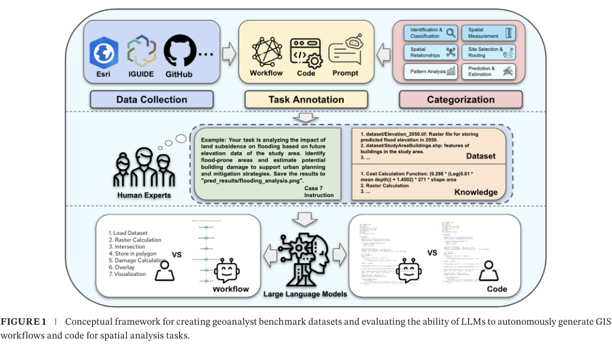

本文贡献主要包括：（1）开发可系统比较大模型与专家 GIS 工作流的 GeoAI 基准；（2）分析大模型构造 GIS 任务逻辑结构时的差异，比较不同应用类别的表现；（3）同时使用人工专家和自动化指标（包括 CodeBLEU）量化代码质量和工作流准确性；（4）为提示工程、GIS 自动化以及人机协作流程提供实践依据。

## 2 相关工作

### 2.1 大语言模型与 GIS 的融合

大模型的泛化能力和可适应性使其能够借助提示词设计和领域微调应用到 GIS 自动化与空间推理。LLM-Geo（Li and Ning，2023）较早提出自治 GIS 框架，将空间分析拆解为输入、操作、中间数据和最终输出，并表示为有向图，使模型能够推理多步工作流，推进通用语言模型向领域求解器转变。随后，GeoGPT 允许用户通过自然语言创建、收集、执行 GIS 工作流；GeoTool-GPT 通过标注的 GIS 指令与求解数据微调，提高调用 GIS 工具的能力；BB-GeoGPT 利用 GIS 文献和维基百科语料增强领域问答，显示领域适应对空间语义理解的意义。

后续的 GIS Copilot 将智能体嵌入 QGIS，用于生成和执行空间处理流程；GeoBenchX 关注多步骤地理空间工具调用及避免幻觉；Ning 等研究自治 GIS 地理数据检索；Li 等提出自治 GIS 的自主目标、自主等级、核心功能和操作尺度等概念；Van de Weghe 等分析 LLM 与 GIS 整合的机遇和挑战；Janowicz 等综述大模型与地理基础模型对空间数据科学的影响。这些研究表明系统能力迅速提升，但仍然需要统一、全面、负责任的评估协议。

### 2.2 GIS 大模型评估基准

除直接开发 GIS 专用模型外，另一研究路线着眼于通过基准揭示当前模型的优势和弱点。**GeoGLUE** 衡量地理文本相似检索、地理要素标注、地理实体对齐等能力，考虑地理命名的层次性与口语表达。**GeoQA** 是包含 4,998 项几何问题的多模态数据集，带有求解程序注释，支持比较文字与图形联合输入下的数值推理能力。

Gramacki 等构建地理空间 Python 代码生成基准，含 **20 个独立任务和 77 个示例**，覆盖 GeoPandas、Shapefile、GeoJSON 等，发现模型表现依赖任务复杂度、输入布局和具体库，但可用工具范围限制其普适性。**GEE-OPs** 从 Google Earth Engine 平台收集 **185,236** 段代码，并利用抽象语法树（AST）分析操作符关系，从而增强模型对 GEE 编程结构的学习。

其他基准如 GeoBenchX、GEOBench-VLM 扩展到多步骤、工具型和多模态推理。ScienceAgentBench 含 **102 项**跨四门科学学科的任务，包含地理信息科学与制图子任务，使用独立 Python 程序的执行型评价。现有基准大多聚焦文本理解、单步操作或问答；即便拓展到综合任务，模型内部的推理过程也可能不可解释，或含有幻觉。作者认为 GeoAnalystBench 的区别在于：把工作流结构、工具链逻辑及其与专家解题过程的一致性作为核心评价对象，将代码生成、空间推理与过程自动化纳入同一框架。

## 3 GeoAnalystBench 基准数据集

为支持特定领域的能力评估，本文从 GIS 软件平台、在线课程、教程及学术文献收集了 **50 项基于 Python 的地理处理任务**。每项通常包含 **3—10 个子任务**：即使最简单的例子，也需要读取数据、至少调用一个分析工具，并保存最终结果。任务及步骤长度详见原文补充表 S1—S3。作者选择 Python 作为主要目标，是因为它非常适用于 GIS 工作流自动化。任务覆盖遥感、生态学、气候变化、社会科学等应用场景，虽然主题不局限于传统 GIS，但均源于真实空间数据分析实践；相关代码与工作流同时注意开源和版权约束。

### 3.1 标注流程

基准首先收集 2025 年之前公开的 GIS 教程，包括 Esri Learn 课程和高校实验指导材料。GIS 专家对内容进行人工改写、抽象、标注，以区别于原教程的表述，尽量避免模型简单记忆原始案例。标注者先使用 ArcGIS 或 QGIS 根据教程重现任务，再把冗长的操作过程总结成简洁的地理处理工作流，之后转换为可操作的 Python 脚本，最后记录所需的领域知识和数据集说明。作者核查了资料的作者来源和人工编辑历史。部分任务采用 Esri ModelBuilder 教程，能够产生确定性输出，以供与 LLM 生成代码比较。

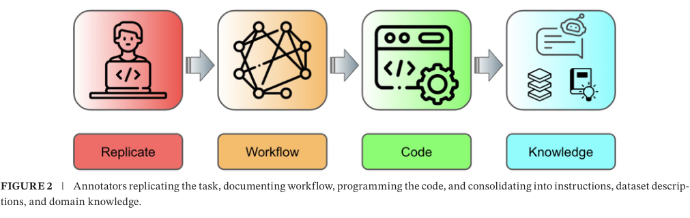

每个任务配有约 100 词的自然语言指令，描述期待使用的空间数据处理方法与工具；领域知识解释缓冲区、空间统计、洪灾财产损失估计等术语与算法；数据集描述包含 CSV、GeoJSON、GeoTIFF 等格式，文件大小、字段、关键属性和缩写含义。研究还参考了类似检索增强生成（RAG）的做法，用不同组合的知识提示检验额外信息是否改善模型表现。

**表1：GeoAnalystBench 任务字段。**

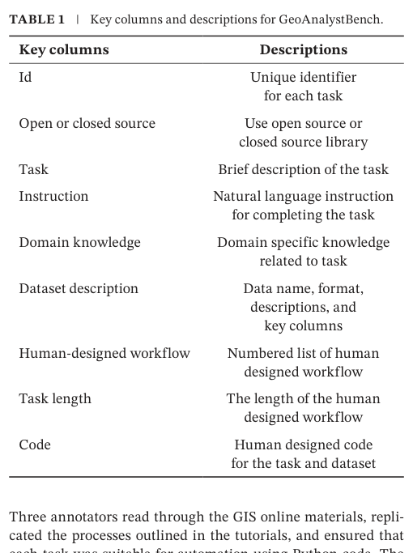

表中字段包括唯一任务 ID、开源或闭源库、任务简述、自然语言指令、领域知识、数据集描述、人工设计的分步工作流、工作流长度，以及对应数据集的人工编写代码。三名标注人员阅读并复现教程，检查任务是否能够使用 Python 自动化完成，分别说明输入数据、中间工具与最终产物。标注者互相检查以减少错误，并将必要的数据组织信息、参数和数据字段写入任务说明。

### 3.2 空间分析任务类别

作者借鉴 GIS 中的空间分析理论，将任务组织为涵盖不同推理方式的类别，并通过图3展示其任务数量。类别包括：

1. **理解位置（Understanding where）：** 识别、分类、描述地理位置和其属性。
2. **测量大小、形状与分布（Measuring size, shape, and distribution, M）：** 空间距离、面积、几何形态与分布特征的测量。
3. **确定地点之间的关系（Determining how places are related, DR）：** 比较位置、邻近、叠置、拓扑等空间关系。
4. **寻找最佳位置和路径（Finding the best locations and paths, F）：** 选址、网络分析、最优路径及位置决策。
5. **发现并量化模式（Detecting and quantifying patterns, DP）：** 识别空间集聚、趋势、异常与空间异质性。
6. **空间插值与预测建模（Spatial interpolation and predictive modeling, S）：** 对未采样区域估计值或从历史数据预测时空趋势。

此外，还涉及空间问题的数据准备、管理及结果可视化等操作。同一道任务最多可归入三种类别，以体现复杂任务的交叉属性，帮助按空间分析能力维度检查模型的优缺点。

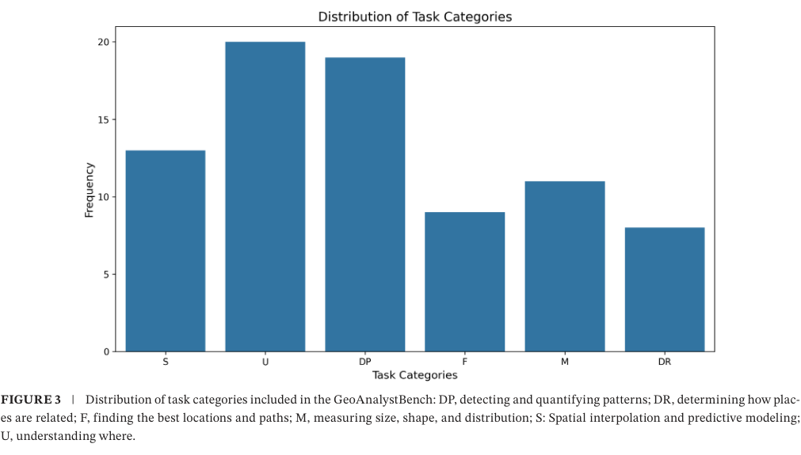

## 4 评价指标

评价的主要对象是自然语言空间分析请求引导的两类输出：**地理处理工作流**与**可执行代码**。研究指定 Python 为主要编程语言，为每个任务制作四种输入条件：仅任务说明；任务加领域知识（DK）；任务加数据集描述（DD）；任务加额外完整上下文（DK+DD）。研究比较三种商业模型 ChatGPT-4o-mini、Claude 3.5 Sonnet、Gemini 1.5 Flash，及三种开源／开放权重模型 Llama 3.1 8B、CodeLlama 7B、DeepSeek-R1-7B。每种提示条件收集三份响应。闭源模型通过官方 API 调用，温度设为 **0.7**；开源模型在配有 NVIDIA RTX 2080 Super 和 Intel Core i7 的工作站上通过 vLLM 运行。另有 Tesla P40 GPU 用于案例可视化和参考代码检验。

有些任务故意不明确缓冲距离、聚类阈值等参数，以考察模型能否按照合理 GIS 惯例自行假定默认值。这模拟了非专业用户真实提问时信息缺失的情形。例如“为城市学校建立缓冲区”没有指定距离，模型选用的距离反映其对城市空间分析惯例的理解。作者依据专家设计的工作流或可接受的 GIS 约定判断这些假定，但并未将参数歧义任务单独标注为一个类别，认为可在后续研究中系统探索。

### 4.1 工作流评价（Workflow Evaluation）

**（1）有效性（Validity / VR）。** 有效响应数占全部响应的比例。当响应包含可提取的工作流步骤清单时，被视为候选有效响应；研究结合自动解析与人工复核，检查其是否形成相对完整、连贯、符合任务要求的地理处理步骤序列。有效率高代表模型较能遵从指令并保持基本逻辑连贯；但**这不是执行验证得到的真实任务成功率**。

**（2）复杂度与长度偏差（Complexity / MAD）。** 用工作流中的步骤数刻画模型分解问题的方式。由于多数任务可在六步以内完成，作者计算模型与专家参考步骤数之间的平均绝对偏差：

\[
\operatorname{MAD}=\frac{1}{N}\sum_{i=1}^{N}\left|L_i^{\mathrm{LLM}}-L_i^{\mathrm{human}}\right|.
\]

这里 \(L_i^{\mathrm{LLM}}\) 与 \(L_i^{\mathrm{human}}\) 分别代表第 \(i\) 项任务的模型生成与人工专家设计的工作流长度。MAD 越小，代表步骤长度与专家设计越接近；较大的数值可能意味着模型把任务过度复杂化或过度简化。该指标具备可解释性和较好的任务无关性，但仅测量结构长度相似性，不能充分保证步骤语义或结果正确。

**（3）文本语义相似度（Text Similarity, TS）。** 利用预训练句向量模型 `all-MiniLM-L6-v2` 将工作流编码为语义嵌入，再计算模型与人工工作流向量的余弦相似度。数值范围为 **−1 至 1**，越高表示语义越接近。较高的正相似度意味着整体描述更贴近专家步骤和相关依赖关系。

三个维度联合用于衡量模型是否生成有效工作流、能否重现专家组织 GIS 工具的思路，以及是否避免不必要的步骤。工作流生成的约束提示词要求模型使用自动推理并解释每步，利用 NetworkX 表达工作流图、Graphviz `dot` 布局图形，允许部分子任务并行，且最终只输出**用于生成工作流的代码，不实现实际分析**。提示词的完整英文格式保留在逐页英文原文（PDF 第8页）中。

### 4.2 代码评价（Code Evaluation）

作者采用 **CodeBLEU**[Ren et al., 2020]，将类似 BLEU 的文本匹配与抽象语法树（AST）、变量数据流评价相结合。包括四项：

- **N-gram 匹配：** 计算生成代码与参考代码中词项及词组片段的重合程度。
- **加权 N-gram 匹配：** 对重要的词项和代码符号赋予不同权重。
- **AST 语法匹配：** 检验代码抽象语法结构的相似性与语法一致程度。
- **语义数据流匹配：** 判断变量与函数间的依赖和数据操作逻辑是否与人工代码类似。

论文在面向数据驱动型空间分析任务的前提下，采用如下组合分数：

\[
\operatorname{CodeBLEU}=0.2\,N\text{-gram}+0.2\,\text{Weighted N-gram}
+0.3\,\text{AST Syntax Match}+0.3\,\text{Semantic Data-flow Match}.
\]

作者指出，互联网 GIS 教程中的人工代码可能在 LLM 时代受到 AI 代码影响，因此参考代码同时覆盖模型普及之前和之后的示例，并把 ArcGIS Pro ModelBuilder 自动导出的代码纳入比较。ModelBuilder 支持在可视化界面中连线组合输入数据、地理处理工具与输出，并导出格式更稳定的 ArcPy Python 代码，因而可作为较统一的参考格式。

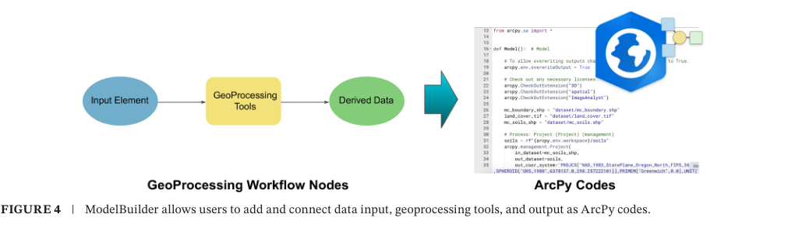

代码生成提示要求模型先自动推理和说明子步骤，再使用较新 Python 包生成代码，把代码放在主函数下，不使用其他辅助函数、不输出解释性文字，并限制使用特定的 ArcPy 工具集。提示词的原版表达详见英文原文第8页。

## 5 实验结果

### 5.1 工作流生成

比较的闭源模型为 ChatGPT-4o-mini、Claude 3.5 Sonnet、Gemini 1.5 Flash；开源模型为 DeepSeek-R1-7B、Llama-3.1-8B、CodeLlama-7B。所有模型按 0.7 温度条件评价。表2总结了工作流有效率（VR）、文本相似度（TS）以及仅指令（WK）、加入领域知识（DK）、数据集描述（DD）、两者同时加入等条件下的 MAD 与标准差。

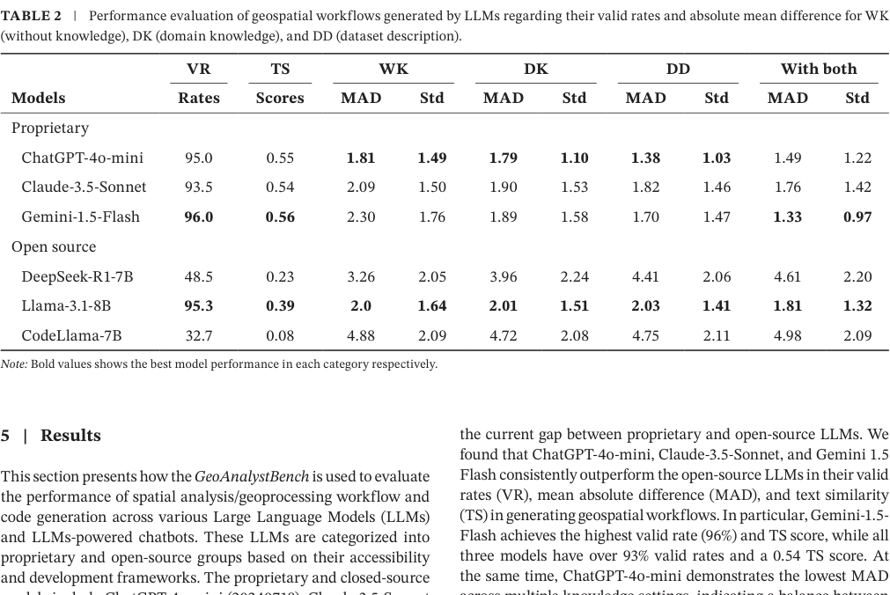

总体上，商业模型在有效率、长度一致性及语义相似度方面领先。**Gemini 1.5 Flash** 的工作流有效率为 **96.0%**、TS 为 **0.56**，居于前列；**ChatGPT-4o-mini** 有效率 **95.0%**、TS **0.55**，并在多个上下文条件下取得较低 MAD；**Claude 3.5 Sonnet** 有效率 **93.5%**、TS **0.54**。这些模型的偏差波动通常较小，说明其生成流程更加稳定。

开源模型表现分化：**Llama 3.1 8B** 的有效率达到 **95.3%**，在若干指标上接近商业模型，表明较小规模模型经适当领域调优也可能用于 GIS 自动化；而 **DeepSeek-R1-7B** 有效率仅 **48.5%**、TS **0.23**，**CodeLlama-7B** 有效率 **32.7%**、TS **0.08**，且 MAD 较高，说明它们在该实验环境中难以构造完整一致的多步骤空间工作流。

作者将 DeepSeek-R1-7B 的表现不足部分归因于知识蒸馏：通过较大型教师模型训练较小学生模型虽然有利于推理成本控制，但可能牺牲复杂情境下的多步推理深度与泛化能力。空间分析依赖逐级决策、空间情境与严格操作顺序，因此模型可能倾向模式拟合而非充分的逻辑计算。不过这一解释属于作者的分析假设，研究并未独立做因果实验验证。完整版 DeepSeek-R1 671B 可能表现更好，但需要更高计算资源。

针对 RQ2，加入 DK 与 DD 通常有助于提高商业模型的表现，显示结构化背景信息有利于减少任务与数据理解错误。作者建议未来重视 GIS 领域语料训练、模型推理策略优化和计算成本评估。

### 5.2 代码生成

为回答 RQ3，作者比较六种模型生成地理空间 Python 代码的 CodeBLEU。结果见表3：**ChatGPT-4o-mini 0.390**，**Claude 3.5 Sonnet 0.370**，**Gemini 1.5 Flash 0.358**，**Llama 3.1 8B 0.340**，**CodeLlama-7B 0.319**，**DeepSeek-R1-7B 0.272**。商业模型在研究条件下整体优于开源模型，ChatGPT-4o-mini 平均得分最高；Claude 对外加语境尤其敏感，当同时包含领域知识和数据描述时，CodeBLEU 可达 **0.406**，而某些开源模型在额外上下文下反而退步。

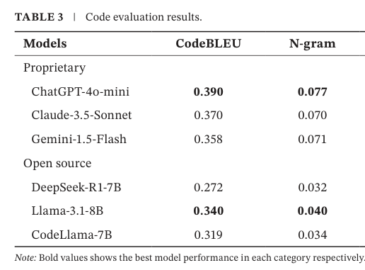

分量指标显示，模型生成代码的 AST 语法分数平均约 **0.501**，但原始 N-gram 平均约 **0.0539**、加权 N-gram 平均约 **0.074**，数据流分数平均约 **0.274**。这说明模型往往可以写出具有合法语法结构的代码，却未必遵循相同的变量依赖关系和分析逻辑。较低的词项重合度也可能仅来自不同的等价实现，因此不宜仅以词面相似度判断地理处理结果是否正确。论文建议将 GIS 专用微调和更严格的逻辑约束结合，以提升复杂代码的稳定性。

### 5.3 不同空间分析类别的表现

图5展示不同任务类别的工作流 MAD。ChatGPT、Claude 和 Gemini 通常在各类别取得较低的长度偏差。DeepSeek-R1-7B 和 CodeLlama 尤其不擅长依赖高级空间推理的任务，例如确定位置间关系（DR）、寻找最佳位置与路径（F）及预测建模（S）。Llama 3.1 8B 在开源模型中表现较好，在测量大小、形状和分布（M）一类甚至可能优于部分商业模型。

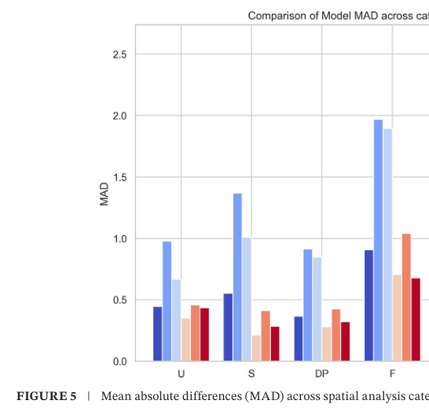

总体而言，**F 和 DR 两类最困难**，因为最优化、空间网络分析与分层决策可能超出了通用语言模型既有训练分布；发现与量化空间模式（DP）、测量大小和几何分布（M）等类别相对容易，可能更接近常见统计模式识别和几何计算。但 DP、空间插值与预测建模（S）的模型间差异仍然很大，说明模型尚缺乏一致的空间预测推理能力。研究建议加强 GIS 专用预训练、更具空间语义的嵌入及人机协作。

### 5.4 开源与闭源模型的比较

综合多个指标，ChatGPT、Claude 和 Gemini 在此基准中更稳定、更均衡。作者还比较了 ArcPy 与开源 Python 地理计算库的 CodeBLEU（图6）。ArcPy 集成于 ArcGIS 生态，工具名称和接口规范相对统一，在线文档丰富，ModelBuilder 导出的代码格式亦相对稳定；GeoPandas、Shapely、Rasterio 等开源生态虽然灵活，却存在 API 和版本更新节奏不同的问题，这可能导致模型生成工作流的差异。作者据此推测 ArcPy 在某些专门 GIS 任务中可能更具可预测性，但不能据此推断所有闭源工具在功能或结果上都优于开源生态。

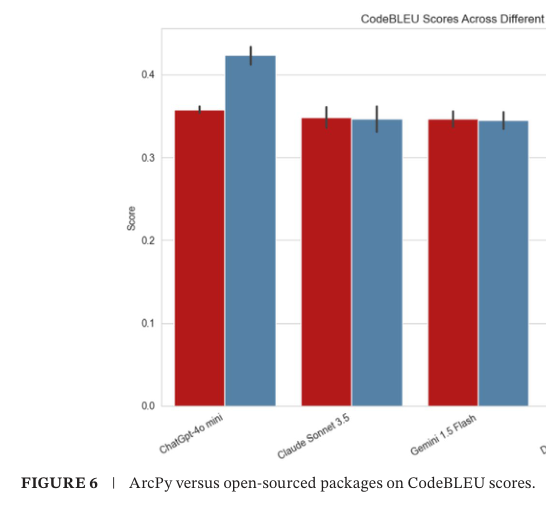

## 6 案例研究

### 6.1 案例一：动物运动的家域范围与空间集聚识别

**背景。** 研究任务来自 Esri 动物家域建模教程，对应补充表 S3 的任务 43，使用 **2009 年加拿大阿尔伯塔省西南部麋鹿（elk）GPS 跟踪点**分析家域范围、空间活动热点和群体聚类。这对野生动物保护、栖息地管理和空间利用研究具有意义。案例使用三种主要地理处理：最小外接几何（凸包）、核密度估计（KDE）和基于密度的聚类（DBSCAN），最后叠加成地图。论文发现麋鹿活动主要集中在 Piikani 保留地附近的山地和森林，也有一些群体的活动范围延伸到东侧人类活动区域。

**工作流比较。** 表4并列展示专家在 ModelBuilder 中定义的操作与 ChatGPT-4o-mini 生成的步骤。两者均采用凸包、核密度和聚类方法，但专家直接使用 ModelBuilder 的默认显示和紧凑工具序列，而 LLM 增加数据清洗、绘制轨迹、结果分析与地理数据库保存等步骤。更长的工作流有时有助于文档化和自动化，但不一定更高效。这说明单独评价工作流长度不够，还需结合语义相似性。

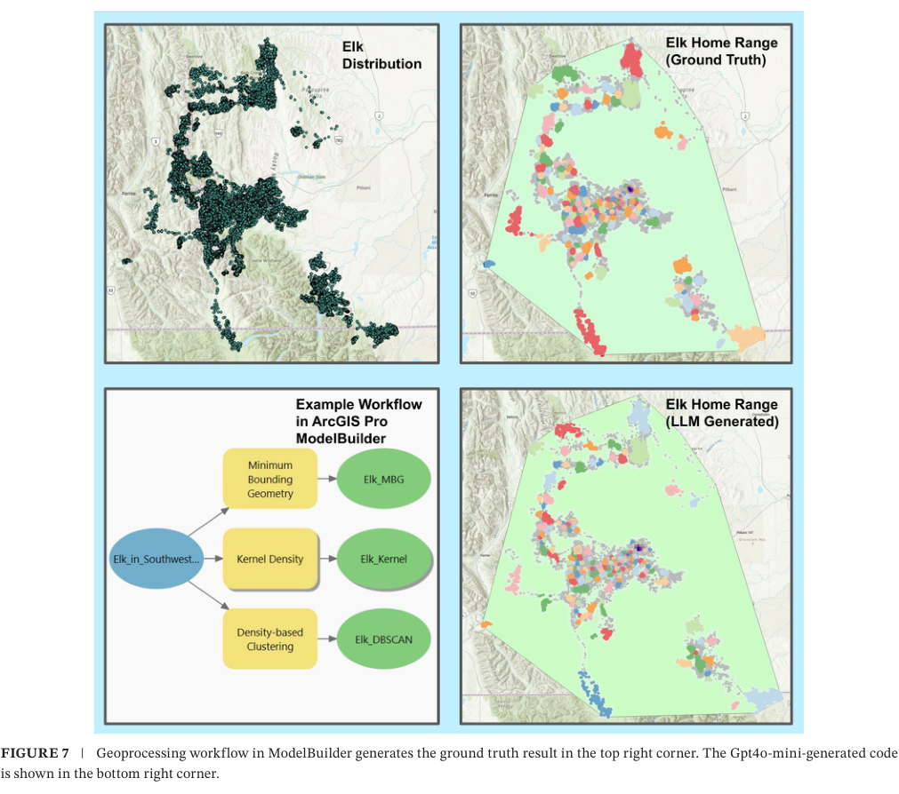

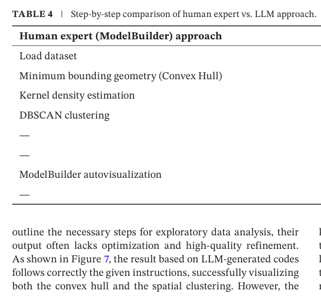

**结果比较。** 模型生成的代码基本遵循指令，正确生成凸包和聚类分布。然而 LLM 使用的 KDE 栅格像元尺寸约为专家优化值的**两倍**，使核密度图空间分辨率降低。DBSCAN 的邻域搜索距离、最小点数等默认参数也会改变结果解释。由此可见，即使工作流步骤看似合理，具体 GIS 参数仍会深刻影响分析输出。非专业用户通常难以察觉这些问题，作者建议集成交互式参数调节和解释性提示。

### 6.2 案例二：交通事故空间热点分析

**背景。** 研究对象为美国佛罗里达州 Brevard 县，使用 **2010—2015 年交通事故点、道路网络和网络空间权重矩阵**识别道路事故热点。案例对应补充表 S3 的任务 46，来源于 Esri“驾驶者最危险道路”教程。常规专家流程将事故点吸附到道路，对路段统计事故发生率，随后利用 Getis–Ord Gi* 热点分析方法生成统计显著的高风险路段。研究指出高速公路、桥梁与交通路口等车辆汇聚区域更容易形成热点。

**工作流比较。** 人工专家采用明确的 ArcGIS 工具和参数，强调可重复的逐步处理；LLM 则用较抽象的自然语言步骤描述“筛选事故—匹配道路—分析热点—绘图”。表5显示两者主要逻辑相近，但专家步骤更加精确、可直接对应 ArcPy 工具；LLM 步骤适应范围较广，却可能缺少实施细节。

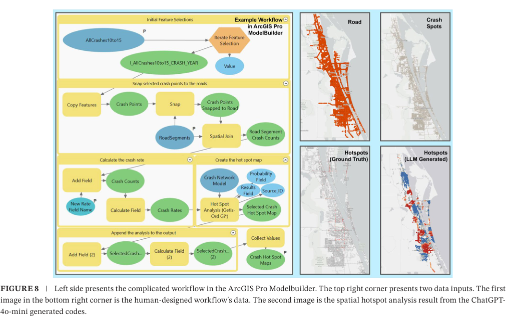

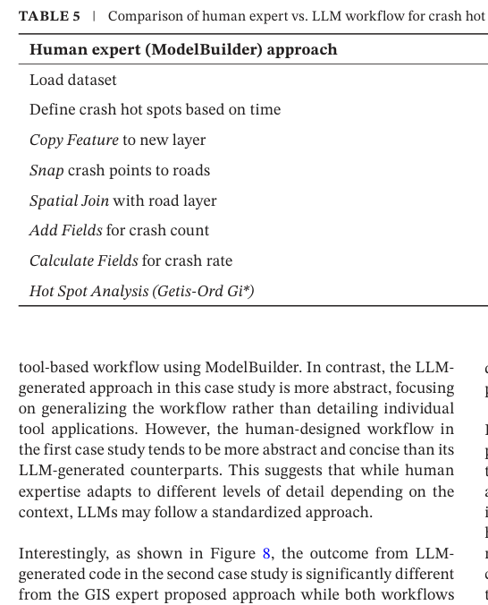

**输出比较。** 两种工作流表面类似，地图结果却显著不同。人工流程基于**路段事故率**进行热点分析，突出高风险道路的网络结构；LLM 代码实际上更接近**事故点空间集聚**分析，得到事故位置的统计冷热区。前者回答“哪些道路危险”，后者回答“哪些地理区域事故多”。此差异说明，步骤语义相近并不足以保证空间分析对象、空间统计单元及最终回答目标的一致性。工作流评估必须重视空间关系与输出语义的正确性。

## 7 讨论

GeoAnalystBench 的比较说明商业模型在有效率、工作流一致性与代码质量方面相对领先，可能得益于规模更大、类型更多的训练语料、成熟的指令微调以及人类反馈强化学习。它们不仅更容易生成语法正确的代码，也更能将 GIS 领域知识与数据集说明整合成连贯的处理管线。

不同空间分析类别的能力差异凸显通用 LLM 的局限。寻找最佳位置和路径（F）、确定空间关系（DR）需要复杂优化、空间网络和层级决策；测量几何特征（M）、发现空间模式（DP）更接近统计与几何模式识别，因而通常较容易。开源模型内部差异也很大：Llama-3.1-8B 在部分场景接近闭源模型，说明高质量 GIS 语料微调可为需要可解释、可定制系统的用户提供具有竞争力的替代品。

从应用角度，工作流有效率、MAD 和 CodeBLEU 分别反映输出组织的基本可用程度、步骤长度的经济性和代码形式与参考代码的相似性。论文认为，这些指标能够帮助判断自动化系统的稳健性，但三者**并不能直接等价于真实 GIS 执行成功、地图数值正确或空间结果可靠**。研究因此提出：结合闭源模型的能力优势与开源模型的领域训练，并引入 RAG、人在回路验证、结果核查流程，可能形成更可靠的 GeoAI 系统。

## 8 结论

本文通过 GeoAnalystBench 评估当前大模型在 GIS 工作流及代码生成方面的能力。领先模型在多种空间分析任务上已经建立有力的能力基线，但与普通数据分析相比，需要深度空间关系理解和最优决策的任务仍然困难。应用 GIS 软件文档的检索增强生成技术、面向 GIS 的专门训练与参数验证，可能进一步改善结果。

GeoAnalystBench 的价值不止于提供真实任务及最低限度的交付成果，还在于以专家工作流为比较对象，观察大模型是否以与专业 GIS 分析员相似的逻辑处理问题。它与 ScienceAgentBench 等强调执行和科学任务自动化的基准互补，尤其侧重空间推理及地理处理过程。

作者也承认如下局限：任务场景与预设参数有限，难以完全代表新的复杂业务问题；基准工作流多采用线性结构，未充分描述可并行的多个分支；模型生成代码面临数据类型不兼容、错误参数传递、坐标参考系处理和空间变换失配等执行风险；一些样例源自公开教程，无法彻底排除训练数据污染。因此未来需要更丰富的真实任务、完善的验证程序、更强的空间分析语料、对 RAG 的系统研究，以及面向 GIS 用户的实际使用测试。维护和审计地学专用 Benchmark 需要社区共同参与。

## 致谢、利益冲突与数据声明

**致谢。** 研究获得美国国家科学基金会资助的 ICICLE（Intelligent Cyberinfrastructure with Computational Learning in the Environment）人工智能研究机构支持，基金号 **2112606**。论文中的观点、发现和建议均为作者意见，不一定代表资助方立场。

**利益冲突。** 作者声明不存在利益冲突。

**数据可用性。** 支撑本文结论的数据已在 GeoAnalystBench 公开：https://github.com/GeoDS/GeoAnalystBench 。

**尾注。** 两个案例对应 Esri 教程：

1. https://learn.arcgis.com/en/projects/model-animal-home-range/
2. https://learn.arcgis.com/en/projects/determine-the-most-dangerous-roads-for-drivers/

## 参考文献（原文保留）

学术参考文献保留英文书目信息以确保检索准确；完整条目位于 `英文原文_逐页.md` 的 PDF 第 16—18 页，以及 `原始论文.pdf` 中。

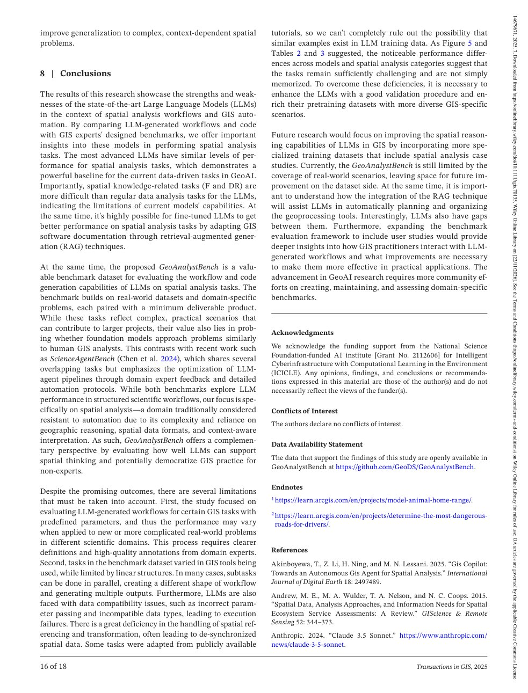

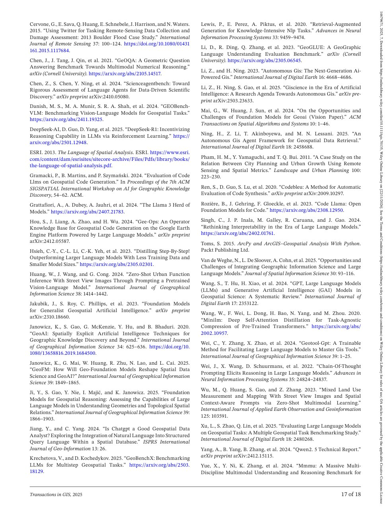

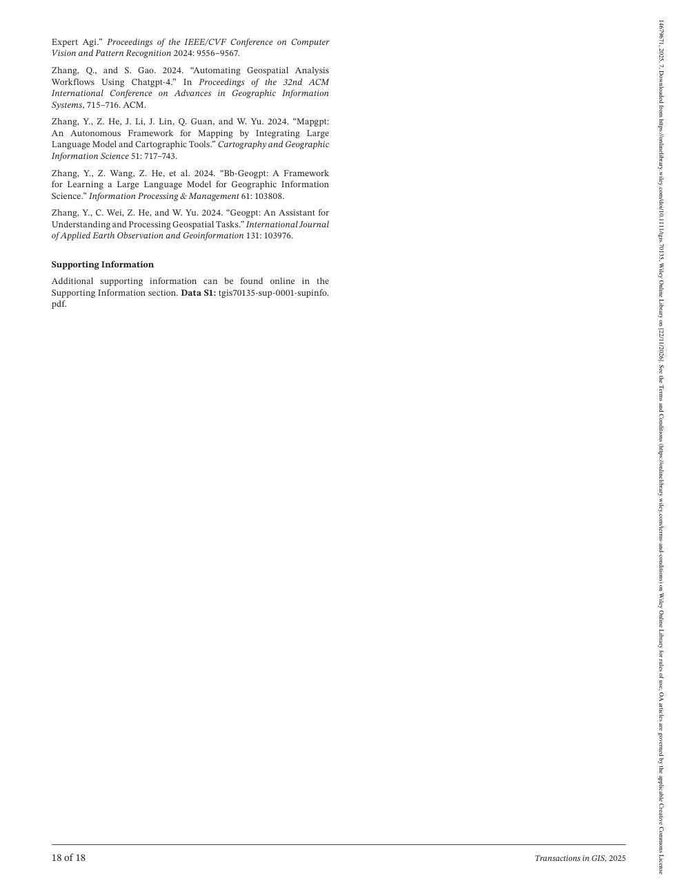
