# 图表索引

- **Figure 1**（PDF 第 3 页）：FIGURE 1 | Conceptual framework for creating geoanalyst benchmark datasets and evaluating the ability of LLMs to autonomously generate GIS workflows and code for spatial analysis tasks.

  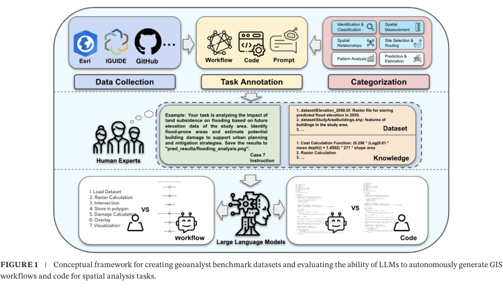

- **Figure 2**（PDF 第 5 页）：FIGURE 2 | Annotators replicating the task, documenting workflow, programming the code, and consolidating into instructions, dataset descriptions, and domain knowledge.

  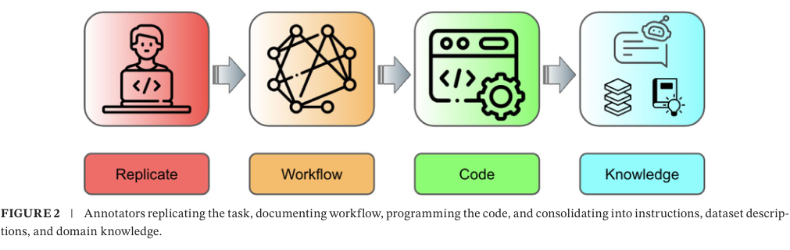

- **Table 1**（PDF 第 5 页）：TABLE 1 | Key columns and descriptions for GeoAnalystBench.

  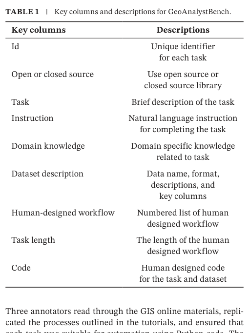

- **Figure 3**（PDF 第 6 页）：FIGURE 3 | Distribution of task categories included in the GeoAnalystBench: DP, detecting and quantifying patterns; DR, determining how places are related; F, finding the best locations and paths; M, measuring size, shape, and distribution; S: Spatial interpolation and predictive modeling; U, unders

  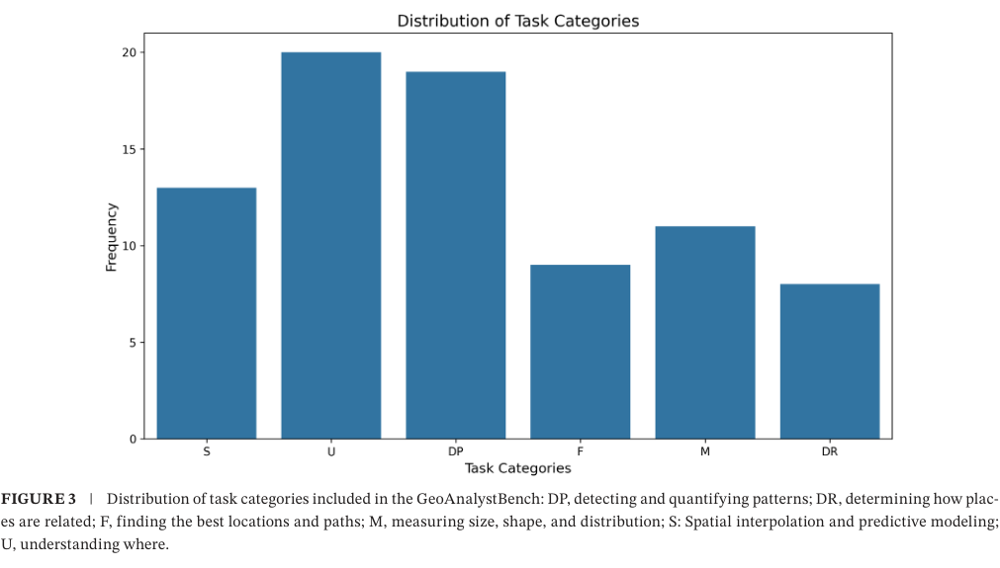

- **Figure 4**（PDF 第 8 页）：FIGURE 4 | ModelBuilder allows users to add and connect data input, geoprocessing tools, and output as ArcPy codes.

  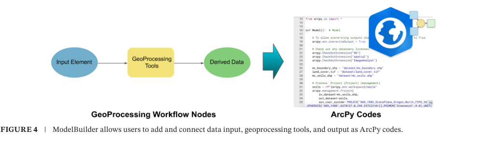

- **Table 2**（PDF 第 9 页）：TABLE 2 | Performance evaluation of geospatial workflows generated by LLMs regarding their valid rates and absolute mean difference for WK (without knowledge), DK (domain knowledge), and DD (dataset description).

  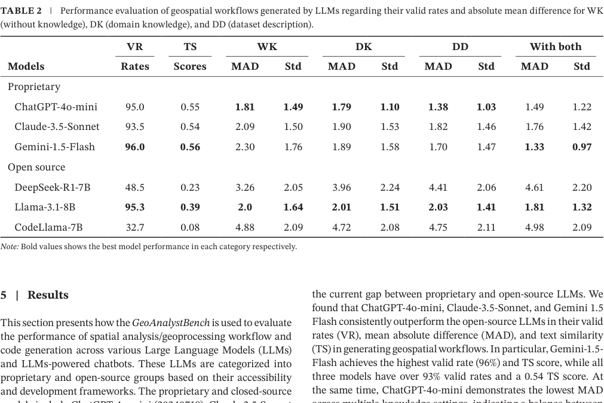

- **Table 3**（PDF 第 10 页）：TABLE 3 | Code evaluation results.

  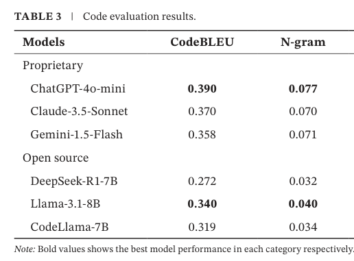

- **Figure 5**（PDF 第 11 页）：FIGURE 5 | Mean absolute differences (MAD) across spatial analysis categories.

  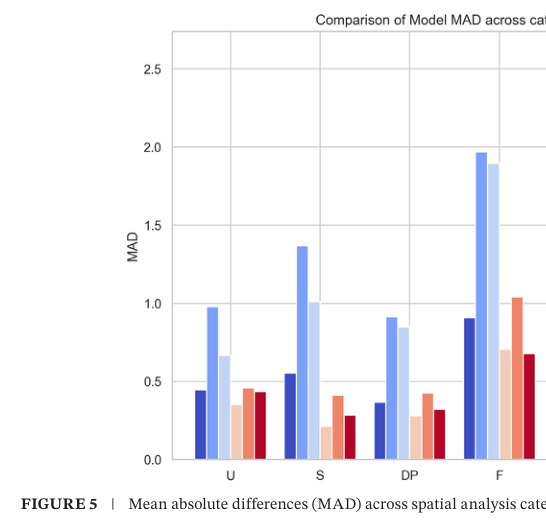

- **Figure 6**（PDF 第 12 页）：FIGURE 6 | ArcPy versus open-sourced packages on CodeBLEU scores.

  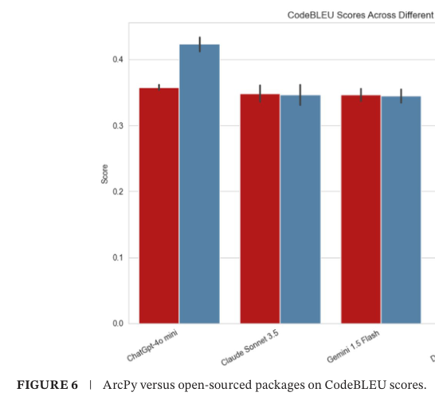

- **Figure 7**（PDF 第 13 页）：FIGURE 7 | Geoprocessing workflow in ModelBuilder generates the ground truth result in the top right corner. The Gpt4o-mini-generated code is shown in the bottom right corner.

  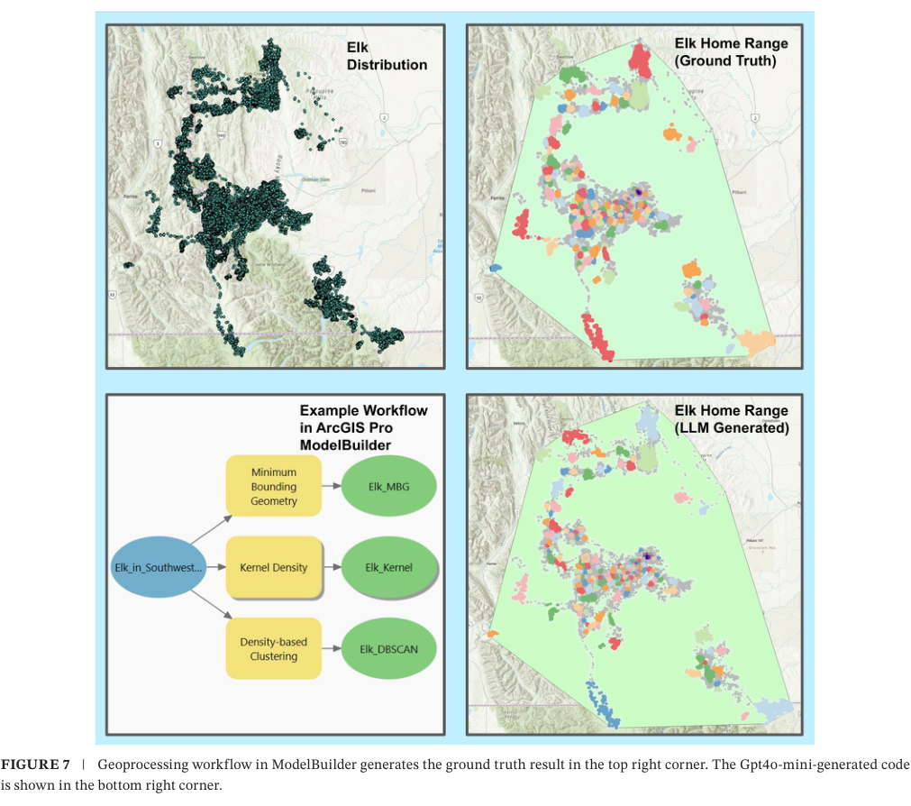

- **Table 4**（PDF 第 13 页）：TABLE 4 | Step-by-step comparison of human expert vs. LLM approach.

  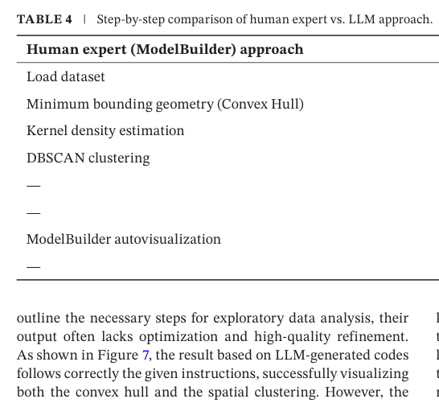

- **Figure 8**（PDF 第 14 页）：FIGURE 8 | Left side presents the complicated workflow in the ArcGIS Pro Modelbuilder. The top right corner presents two data inputs. The first image in the bottom right corner is the human-designed workflow's data. The second image is the spatial hotspot analysis result from the ChatGPT4o-mini gene

  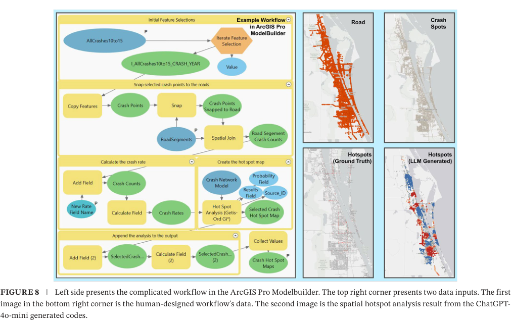

- **Table 5**（PDF 第 15 页）：TABLE 5 | Comparison of human expert vs. LLM workflow for crash hot spot detection.

  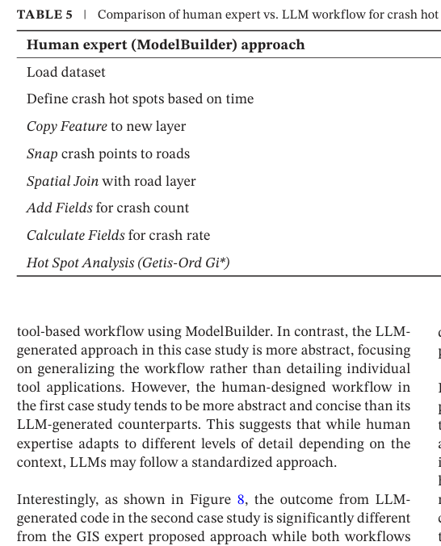
