# GeoBenchX：面向智能体求解多步骤地理空间任务的大语言模型基准评测

**作者：** Varvara Krechetova（世界银行，美国纽约）；Denis Kochedykov（摩根大通，美国纽约）  
**发表：** ACM SIGSPATIAL GeoGenAgent '25，2025 年 11 月 3—6 日，美国明尼阿波利斯  
**DOI：** [10.1145/3764915.3770721](https://doi.org/10.1145/3764915.3770721)  
**开源仓库：** https://github.com/Solirinai/GeoBenchX

> 译名对照：tool calling = 工具调用；reference solution = 参考解；candidate solution = 候选解；LLM-as-Judge = 大语言模型裁判；match / partial match / no match = 匹配／部分匹配／不匹配；solvable / unsolvable = 可求解／不可求解；ground truth = 真实值／标准答案（依上下文）。本文中的 *match rate* 指由参考解匹配评估所得的比例，不能自动等同于真实 GIS 环境中的执行成功率。参考文献保留原文书目信息，便于准确检索。

## 摘要

本文构建了一个基准，用于评估大语言模型（LLM）在与商业 GIS 从业人员相关的多步骤地理空间任务中的工具调用能力。研究采用一个配备 23 项地理空间功能的简洁工具调用智能体，评估 Claude Sonnet 3.5 和 4、Claude Haiku 3.5、Gemini 2.0 Flash、Gemini 2.5 Pro Preview、GPT-4o、GPT-4.1 以及 o4-mini 等商业模型。基准任务按照复杂度分为四类，既包含可求解任务，也包含专门设计的不可求解任务，以测试模型的拒绝能力。作者开发了一个以 LLM-as-Judge 为基础的评估框架，将智能体给出的候选解与参考解进行比较。结果表明，o4-mini 和 Claude 3.5 Sonnet 总体表现最佳；GPT-4.1、GPT-4o 和 Gemini 2.5 Pro Preview 也有较强表现，其中后两者在识别不可求解任务方面相对更有效。Claude Sonnet 4 倾向于给出任意形式的解答而不是拒绝任务，因此准确率较低。不同模型的 Token 消耗存在显著差异，Anthropic 模型通常消耗更多 Token。典型错误包括误解几何关系、依赖过时的世界知识以及低效的数据操作。作者开源了基准任务集、评估框架及数据生成管线，为 GeoAI 中 LLM 的持续评测提供一种标准化途径。

**关键词：** 大语言模型（LLM）；地理空间分析；函数调用；LLM-as-Judge 评估；GIS 工具；基准测试；空间推理；工具增强智能体。

**ACM 学科分类：** 计算方法——人工智能、智能体、多智能体系统、信息抽取；通用与参考——会议论文集、评估。

## 1 引言

本文构建了一个基准任务集，并提出一种基于 LLM-as-Judge 的简洁方法，用以比较主流商业大模型在解决多步骤地理空间问题时的工具调用表现。此类任务不同于一般文本任务：模型需要掌握真实的地理事实知识，理解具有空间定义的数据、坐标参考系统以及多种空间数据类型。作者采用相对简单的工具调用智能体，专门考察模型自身能力，测试 Anthropic 的 Claude Sonnet 3.5、Sonnet 4、Haiku 3.5，Google 的 Gemini 2.0 Flash 和 Gemini 2.5 Pro Preview，以及 OpenAI 的 GPT-4o、GPT-4.1、o3-mini、o4-mini。

研究以商业 GIS 从业人员的现实需求为导向，这直接影响任务、模型与评估框架的选择。不同于相邻领域的其他基准，本文关注社会经济分析，以及报告、政策文件、新闻文章中的地图制图需求，例如制作专题地图、按条件查找地理对象、统计某个地理边界内的对象数量等。在实际应用中，从业人员通常希望直接通过对话界面调用 GIS 工具完成任务。尤其重要的是，当已有数据或工具不足以解决问题时，模型应正确识别任务不可求解并告知用户，从而降低生成虚假结果的风险。作者选择研究当时产业界使用的先进商业模型，并将评估设计为可自动重复执行的流程，以应对商用模型频繁更新的特点。

论文首先介绍任务求解智能体与工具；其次说明基准任务的生成方法及构成；再介绍由多个 LLM 裁判组成的结果评估方案，并对评估器自身进行测试；最后比较各求解模型的能力指标和 Token 成本效率。

## 2 相关研究

生成式 AI 与可访问的大语言模型促进了 GeoAI 的发展。现有方向包括：用 GPT-4 分析旅行网络的空间推理、距离与高程估计、路径和供应链问题[22]；将地理知识融入预训练语言模型[20]；通过 LLM-Geo 构建自主 GIS 应用[14]；面向 GIS 软件的 GIS Copilot[1]；集成制图工具的 MapGPT[11]；借助视觉参考进行地图样式设计[24]；通过多智能体框架提高 Shapefile 矢量数据处理效率[15]；生成式智能体在智慧交通中的应用[26]；以及将自然语言查询转为可执行代码的模型微调[17]。相关基准研究也开始评估模型的地理空间常识[3,21]、GIS 编码能力[9]，以及它们对涉及地理知识、GIS 知识、空间知识的任务和提示词变化的敏感性[27]。

## 3 实验设置

### 3.1 智能体

实验使用 LangGraph 预构建的 ReAct 智能体[13]，由选定的大语言模型调用一组功能工具完成任务。作者有意选择简单架构，以尽可能测量**模型本身**的贡献，避免复杂智能体结构掩盖模型之间的差异。考虑到商业应用重视结果一致性，而不希望响应剧烈波动，除不支持该参数的模型外，测试时将温度设置为 0[8,19]。

智能体独立处理用户任务，不使用人在回路（Human-in-the-Loop）干预。由于一次任务通常需要多次工具调用且不一定沿最短路径求解，研究允许最多 25 轮“模型提出工具调用—接收工具返回结果”的交互。预试验显示，再减少轮数会使部分复杂任务无法完成，而进一步增加轮数并不会提高成功率。

系统提示词为智能体指定身份、环境和求解规则，要求其不要向用户请求澄清，也不要直接输出解决问题的代码，而应提供生成的地图、使用的数据集名称及解释。规则规定何时拒绝任务、何时可以不调用工具直接给出空操作序列、何时认定数据覆盖不足，以及用户未明确地图数据字段时如何选择列。任务文本随后作为用户消息发送至模型的 Chat API。

### 3.2 智能体工具

智能体拥有 23 个工具，用于数据操作、计算、可视化，以及报告任务无法求解。工具支持读取表格、矢量与栅格数据；对 DataFrame 和 GeoDataFrame 进行合并、分类或数值筛选；操作字段；进行空间连接、按位置筛选、缓冲区构建、栅格等值线提取；可视化 GeoDataFrame 并绘制分级统计图、热力图等。实现依赖 GeoPandas[5]、Rasterio[6]、GDAL[23]、Shapely[7]，以及 Matplotlib、Plotly、Pandas、NumPy。还特别设置 `reject_task` 工具：当智能体认为数据或工具无法完成请求时，该工具返回不可求解提示。

工具的返回值被纳入自然语言对话消息。如果结果是 DataFrame 或 GeoDataFrame，返回消息会描述行数、列名、数据类型和非空单元格等信息。需要跨工具传递的数据表存储于各工具均可访问的 `data-store` 字典中。后文将用于考察模型的任务集合称作 *benchmark set*，将工具求解时使用的统计与地理数据称作 *datasets*。为了避免线上 API 连通性、接口升级或源数据变化造成基准波动，研究将数据快照存储于本地实验环境，而不是每次都在线请求。每个任务中的模型与工具对话历史以及绘图输出均保存为 HTML，方便检查最终答复、地图和中间结果。

### 3.3 数据集

下载自在线 API 的数据基本保持原样，仅为开发方便做两项调整：统一矢量数据中的国家名称，使其对应统计数据、便于定位过滤错误；统一积雪覆盖栅格中的 NoData 值。这些处理并非基准评估的必要条件。数据由三类构成：**18 份 CSV 统计面板数据**，包括经济、人口、一氧化碳、温室气体排放和部分次国家级结核病数据；**21 份 Shapefile 矢量数据**，含国家和地方行政区、湖泊等面要素，野火、城市、美国 Amtrak 车站、地震、海港、矿产设施、电站等点要素，以及河流、铁路等线要素；**11 幅栅格数据**，包括积雪覆盖、洪水范围与国家级人口分布。

## 4 基准任务集

研究构建了 200 余个任务，按照数据处理和地理处理复杂度划分为四组。在第 6 节所观察到的二分类匹配率水平下，按 Wald 方法估算，这一规模大致对应 90% 置信度下 5% 的误差边界。各组均包含在现有工具／数据条件下可求解的任务，以及看似相近但实际不可求解的任务；还包含少量无需调用工具、直接利用模型常识即可回答的任务，以辅助调试。实际评估中的任务总数为 **202**，其中 **123 个可求解、79 个不可求解**。

### 4.1 任务类别

**第一类：合并—可视化（Merge–visualize），36 项。** 将按年份和地区组织的表格数值与对应地理要素连接，并制作分级统计地图或双变量地图。例如“绘制全球人均 GDP 与人均电力消费的关系图”。这一类最简单，通常仅需 2—3 次工具调用；其中 6 项无法利用现有工具和数据求解。

**第二类：处理—合并—可视化（Process–merge–visualize），56 项。** 先对表格或空间数据进行筛选、字段计算等处理，再生成分级统计地图或双变量地图。例如“比较西亚国家的农村人口占比”。这类任务需要更多世界地理知识和工具类型，复杂度高于第一类，其中 24 项不可求解。

**第三类：空间操作（Spatial operations），53 项。** 涉及空间连接、创建缓冲区、检查栅格重叠、栅格运算、按矢量位置提取栅格值、依据栅格值筛选几何体或计算距离等。结果可能是一个数值，地图并非始终必需。例如“孟加拉国铁路 1 公里范围内居住着多少人？”这一组要求跨数据类型操作、掌握更多工具并保持多步骤逻辑一致，其中 22 项不可求解。

**第四类：热力图与等值线（Heatmaps, contour lines），54 项。** 需在理解栅格内容的基础上执行要素选择、叠置等空间操作，并创建热力图或从栅格生成等值线。例如“绘制人口高增长地区的地震发生热力图”。这是最具挑战性的一类：模型不仅要判断现有热力图／等值线工具是否适用，还须正确配置复杂参数。其中 27 项不可求解。

### 4.2 任务生成

每类任务的种子问题来自行业从业人员和公开出版物。作者再利用 Claude 3.5 Sonnet，结合种子问题、工具说明和可用数据集列表，分别扩展生成可求解与不可求解问题。生成结果经过人工检查，仅保留质量较高的任务。

### 4.3 任务标注

为了评估模型给出的结果，每个任务均配有格式接近 Python 代码片段的参考解（Ground Truth），并注明对应工具调用及参数。作者先通过 GPT-4o 或 Claude 3.5 Sonnet 生成参考解草稿，之后逐项人工审查和改写。200 多项任务中的每一项都获得一个或多个参考解。参考解可呈现为三种形式：（1）带参数的工具调用序列；（2）空序列 `[]`，表示模型仅凭常识即可回答；（3）单个 `reject_task` 调用，表示给定数据和工具无法解决任务。

一段非空参考解的概念形式如下：

```python
# 对整体参考解的说明
toolcall1(arg11=..., arg12=...)  # 对第一步的说明
toolcall2(arg21=..., arg22=...)  # 对第二步的说明
# ...
```

现实任务可能存在歧义或多条合理分析路径，因此同一道题允许拥有多个参考解。例如“比较非洲国家中铁路网络显著与不显著地区的淡水取用量”可采取以下不同解释：由于“显著”没有明确阈值而直接拒绝；分别绘制铁路与淡水取用量分布图；将两类数据合并为双变量地图；或者自行采用一个阈值后比较两个国家组的统计量。参考解中的注释还可向评估器说明允许的替代参数、参数变化或可选步骤，以判断候选解与标准解是否语义等价。

约 **74%** 的可求解任务拥有 4—6 步的参考解，另有 **28%** 具有更多步骤（最多 14 步）。两项比例之和超过 100%，因为一个任务可以有多个不同长度的参考解。

## 5 评估方法

### 5.1 基于匹配的评估器

作者利用大模型理解代码的能力[10,16,18]，将标准参考解与候选解都表示为 Python 代码片段。LLM 生成代码的评估一般包含基于执行（execution-based）和基于匹配（matching-based）两类方法[2,25]。地理空间分析的输出可能同时包含多幅图像／地图、数字结果与文字叙述，对这类混合结果进行统一而可靠的执行结果比对十分困难，且逐题创建对应的执行型真实值往往不现实。因此，论文出于实用性与效率考虑，采用基于参考解的多模型 LLM-as-Judge 方案。

评估器比较同一题下候选工具调用解与一个或多个参考解的**语义等价性**，因此可以容纳步骤顺序、工具参数或执行路径不同但最终分析逻辑等价的情况。研究同时比较候选解和参考解的长度，关注探索过程中的多余步骤带来的成本；分析工具调用序列也有助于发现模型行为并指导后续智能体调优（本文没有针对基准进行此类调优）。

裁判小组由 **Claude Sonnet 3.5、GPT-4.1、Gemini 2.5 Pro Preview** 组成。裁判提示词包括身份设定、所有工具的说明、评分体系、判断标准，以及带有分数和推理依据的示例。每个裁判需输出：（1）候选解与参考解是否匹配的判断理由；（2）匹配得分，其中 `2` 表示匹配，`1` 表示部分匹配，`0` 表示不匹配。

### 5.2 对评估器本身进行评估

作者从所有任务中按照任务类别进行分层随机抽样，抽取 **50 项任务**（约占任务集 25%）。研究者人工评价这些任务的候选解，记录匹配分数及理由，再让各候选裁判独立打分，并比较裁判与人工标注的一致程度。测试了九种裁判模型：Gemini 2.0 Flash、Gemini 2.5 Pro Preview、Gemini 2.5 Flash Preview；Claude Sonnet 3.5、3.7、4；GPT-4o、GPT-4.1、GPT-4.1 mini。各厂商模型家族中与人工最接近的分别是 GPT-4.1（**96%**）、Claude Sonnet 3.5（**94%**）和 Gemini 2.5 Pro Preview（**88%**）。为减少依赖单一厂商训练策略所引入的差异，作者按模型家族各选一名代表，而非单纯选择成绩最高的三种模型。最终评估时，三个裁判的匹配频率估计取平均值。

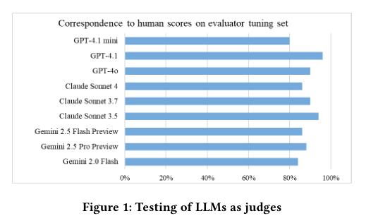

## 6 大语言模型评估结果

### 6.1 实验过程

求解智能体共测试九种模型及版本：`gemini-2.0-flash-001`、`gemini-2.5-pro-preview-05-06`、`claude-3-5-haiku-20241022`、`claude-3-5-sonnet-20241022`、`claude-sonnet-4-20250514`、`gpt-4o-2024-08-06`、`gpt-4.1-2025-04-14`、`o3-mini-2025-01-31` 和 `o4-mini-2025-04-16`。所有模型使用同一套任务；除不支持温度参数的 o3-mini、o4-mini 外，温度设为 0。

作者按照四种任务类别及“可求解（123）／不可求解（79）”分别统计匹配、不匹配与部分匹配比例，同时计算候选解的调用步数与参考解长度之间的平均差异，并以候选解长度为尺度加以表达，以衡量求解效率。o3-mini 在 103 道题中没有调用工具而仅给出思考过程，并拒绝了 75 道题；虽然不可求解任务识别准确率为 0.75，但由于实际工具使用效率明显不足，未参与后续主体比较。

### 6.2 可求解与不可求解任务的表现

研究发现，部分模型在“正确拒绝不可求解任务”与“解决可求解任务”之间存在明显权衡（见表1、表2、表7和图2）。Claude Sonnet 4 与 Haiku 3.5 在可求解任务上更强，但更倾向于给出答案而不是拒绝；Sonnet 4 在可求解任务上的成功率比不可求解任务高出三倍以上。Gemini 2.5 Pro Preview 较擅长识别不可求解任务，GPT-4o 与 o4-mini 的拒绝能力也显著强于求解能力。每个模型家族中存在一个两类任务表现相对均衡的型号：Claude Sonnet 3.5、Gemini 2.0 Flash 和 GPT-4.1。

不可求解任务的候选解往往更长，说明模型持续尝试多种路径，最终仍不得不放弃。对可求解任务，多数模型的解题长度与参考解接近；Claude Sonnet 4 则经常产生不必要的长序列。仅考虑可求解任务时，Sonnet 4 以 **0.55** 的匹配率最好，其次为 o4-mini（**0.51**）、Sonnet 3.5、GPT-4.1 等。但即使最佳模型也仅能成功完成略多于半数任务，其他大多数模型低于一半。部分匹配率在 Claude Haiku 3.5、GPT-4.1、Sonnet 4、Gemini 2.5 Pro Preview 等模型中达到约 0.16—0.22，提示通过较小幅度的工具与智能体改进，部分近似正确的求解或许可以转化为成功结果。

**表1：79 项不可求解任务的成功识别率。**

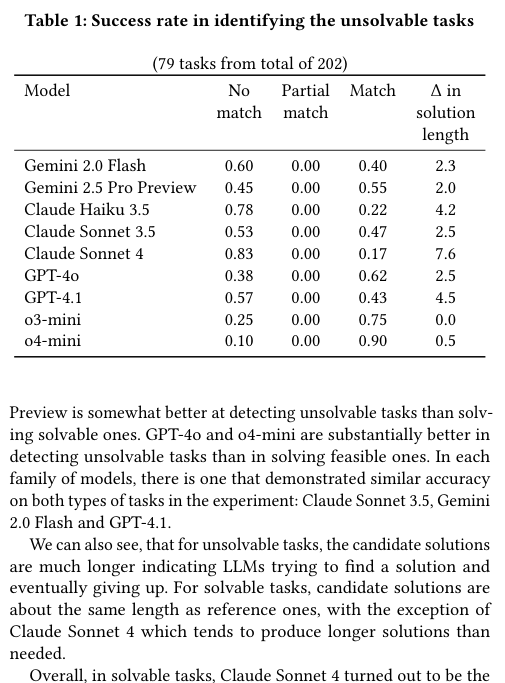

**表2：123 项可求解任务的成功率。**

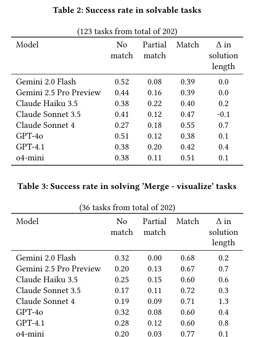

### 6.3 不同任务组的表现

在最简单、且以可求解任务为主的“合并—可视化”组中，多数模型成功率超过 0.60。o4-mini 最好（0.77），Claude Sonnet 3.5 和 Sonnet 4 分别约为 0.72、0.71。进入“处理—合并—可视化”组后，解题长度上升而准确率下降；GPT-4o、Claude Sonnet 3.5、o4-mini 三者超过 0.60，其中 o4-mini 达 0.75。其余模型基本在 0.50 或以下。

Claude Sonnet 4 的冗长行为尤其明显：该组中其候选解平均比参考解长约 **330%**，而 Claude Haiku 3.5 长约 **190%**。这些额外操作常表现为重复或失败的步骤、不必要或失败的可视化，以及过早加载不需要的数据。其结果可能产生更多错误、导致最终回复不可用，或达到调用轮数上限。评估器即使被要求不惩罚额外步骤，也可能对过长序列给出较低评价。这两个模型常见问题还包括尝试处理不可求解任务、数据筛选失误、错误选择地图数据集或时间，以及无法正确反映较新的世界变化（如 BRICS 扩员）。

在“空间操作”组中，仅 o4-mini 的成功率达到 0.56。但它在该组拒绝了 **62%** 的任务，高于它在全部任务中约 49% 的拒绝比例，因此候选解也较短；Sonnet 3.5、Gemini 2.5 Pro Preview 与 GPT-4o 的成功率约在 0.38—0.40。六个模型的候选解平均长度达到标准解两倍以上。最后一组“热力图、等值线”整体最困难，o4-mini 由于更善于判断不可求解任务，以 **0.60** 位居第一，Gemini 2.5 Pro Preview 与 GPT-4o 排在其后。

**表3：合并—可视化组（36 项）。**

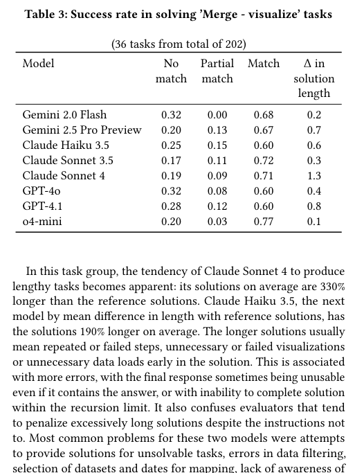

**图2：不同 LLM 和任务组的成功匹配比例。**

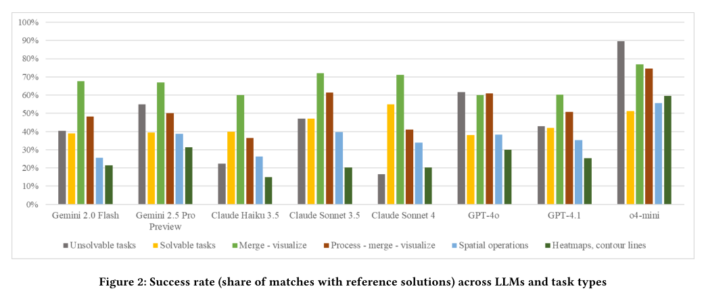

**表4：处理—合并—可视化组（56 项）。**

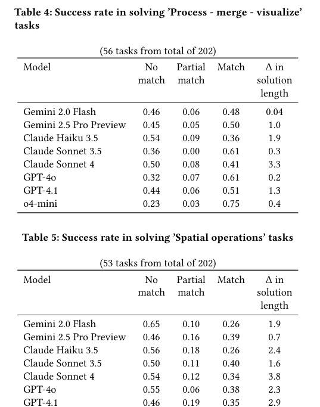

**表5：空间操作组（53 项）。**

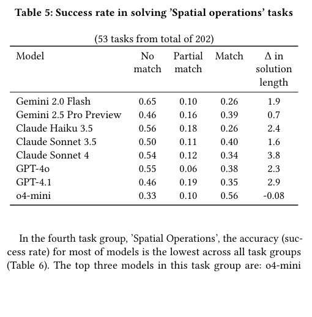

**表6：热力图和等值线组（54 项）。**

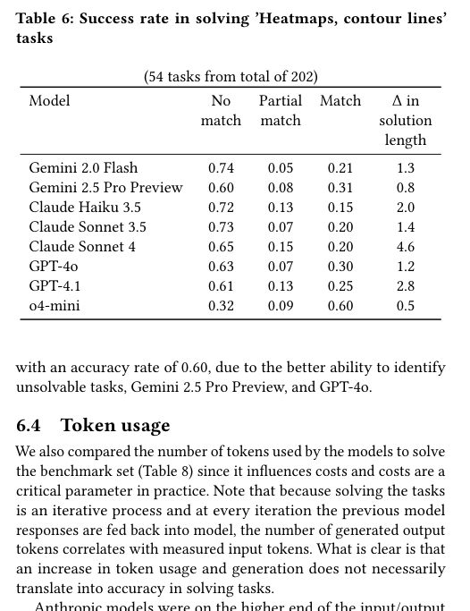

### 6.4 Token 消耗

Token 用量决定实际部署成本。由于智能体采用迭代调用，每轮都会重新传入此前的模型响应，输入 Token 量与输出 Token 量之间存在联系。但生成更多 Token 不必然意味着任务成功率更高。Anthropic 模型普遍拥有较高的 Token 开销，其中 Claude Sonnet 4 的输入 Token 用量可达到部分竞品的 2—3 倍，输出 Token 用量可高达 5 倍，但其准确率未必优于 Sonnet 3.5、GPT-4o、GPT-4.1 或 Gemini 2.5 Pro Preview。甚至较便宜的 Claude Haiku 3.5，因为生成 Token 较多，在整个基准上的总成本也超过此次测试的任意 Google 或 OpenAI 模型。o4-mini 的表现尤其有趣：它的输入 Token 量位居最低的三个模型之列，但输出 Token 量最高，约为 Claude Sonnet 4 的三倍、GPT-4.1 的八倍。

**表7：按任务类别比较模型匹配率。**

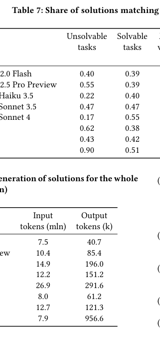

**表8：完成整套基准时的总 Token 用量（单次运行）。**

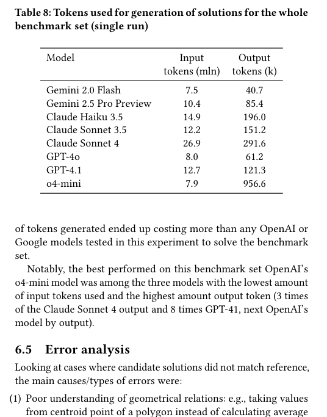

### 6.5 错误分析

针对无法与参考解匹配的候选结果，作者总结了九类主要错误：

1. **误解几何关系。** 例如应计算多边形整体均值，却使用其质心点处的数值；在判断几何重叠时错误使用线要素的质心；不了解几何对象的质心可能位于对象边界之外。
2. **缺少近期世界知识。** 模型能够处理广为人知的国际区域分组，但对“尼罗河上游／下游国家”等含糊分类或 2024 年 BRICS 扩员等较新变化判断不佳，即使相关事件早于模型的知识截止时间。
3. **过度依赖模型内部知识。** 模型使用自己熟悉的国家名称拼写来过滤数据，而不是检查数据集中的实际取值，即使拥有查看字段值的工具。
4. **数据操作低效。** 例如直接合并美国所有县，而不是先过滤目标州；可以按洲或地区过滤时，却逐国筛选；重复筛选使上下文混乱并偏离解题路线。
5. **遗漏空间范围限定。** 例如问题只涉及美国的湖泊，却保留了整个北美地区的湖泊。
6. **拿不完整的数据强行求解。** 当数据空间覆盖不足时，仍尝试使用现有区域数据提供一个看似有帮助的答案，而不是正确拒绝任务。
7. **擅自改变原始问题。** 为使任务变得可解而修改任务要求，而非完成用户真正提出的问题。
8. **凭空编造数据处理步骤和阈值。** 包括在执行过程中拒绝本来可求解的任务、无依据地添加过滤阈值或国家名称，以及执行与提供的数据集没有关系的操作。
9. **绕过可用工具与数据。** 未按要求调用提供的工具和数据集，就直接回答或拒绝任务。

根据这些错误，作者认为，若加入人在回路机制以澄清含糊条件、分步指导求解，并提供更清晰的地理范围信息，模型表现可能显著改善。观察还发现，将工具划分得更细、使其功能更专门化，也有助于提高智能体准确率。

## 7 结论

本文建立了多步骤地理空间任务基准，提出评估框架，并比较了主流商业大语言模型。结果显示，具有工具调用能力的商业模型已经能够处理一些表述口语化、存在歧义、缺少部分信息、初始指导有限的地理空间任务。但是表现高度依赖问题复杂度、所需空间推理程度，以及模型是否存在“宁可给出答案也不愿拒绝”的倾向。

在本文的整体比较中，**o4-mini** 表现最佳；**Claude Sonnet 3.5** 总体位居第二，多类任务的准确率排名进入前三。其他三种在两个或三个任务类别中进入前三的模型存在明显取舍：Sonnet 4 擅长可求解任务，却不善识别无法完成的任务；GPT-4o 与 Gemini 2.5 Pro Preview 相对善于正确拒绝任务；GPT-4.1 与 Gemini 2.0 Flash 在拒绝与求解之间更均衡，但总体准确率较低。

从运行成本考虑，作者认为 o4-mini 在较适中成本下兼顾较高准确率，可能是地理空间智能体的较优选择；Gemini 2.0 Flash 是具有一定性能的高成本效率选择。Anthropic 模型在简单或可求解任务中表现良好，但更倾向强行给出答案，加之 Token 用量和成本较高，可能构成应用缺点。以上结论仅适用于论文采用的模型版本、任务、工具、裁判和实验设置，不宜直接推广至其他系统。

## 8 局限性

研究没有为不同模型分别调整提示词；没有向模型提供人类反馈引导求解；评估主要针对**求解算法／工具调用过程**，而不评价拒绝文本或最终数字答复本身；任务集规模中等；也没有系统测量重复运行结果的方差，只考察了二项比例的置信边界。

## 参考文献与原始版面

为保证作者名、发表信息、DOI 与引用编号能够准确检索，参考文献的完整英文条目保存在 `英文原文_逐页.md`（PDF 第 8 页）及 `原始论文.pdf` 中。该页的原版图像也保留如下，覆盖全部参考文献条目：

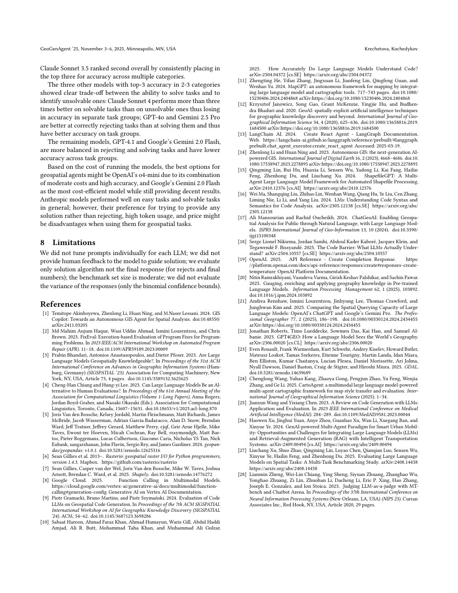

**版权及使用声明：** 原论文关于个人或课堂用途的复制、引用与再分发权限声明，请以首页 `原始论文.pdf` 为准。
