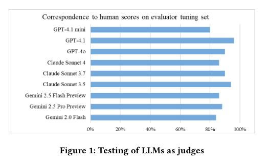
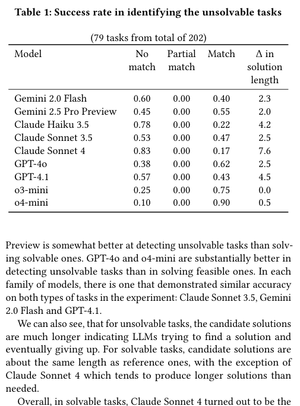
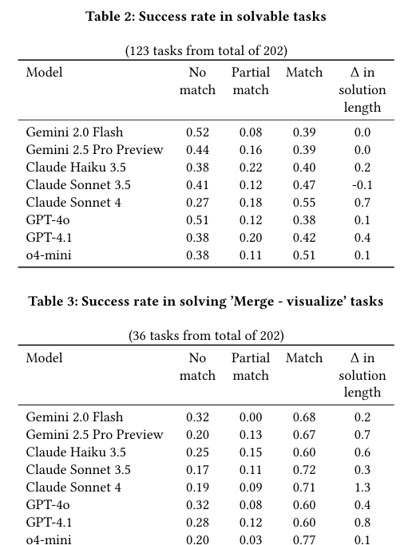
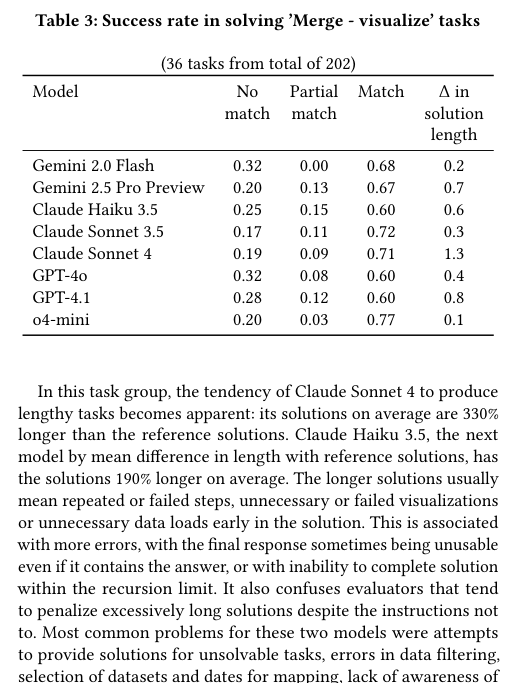
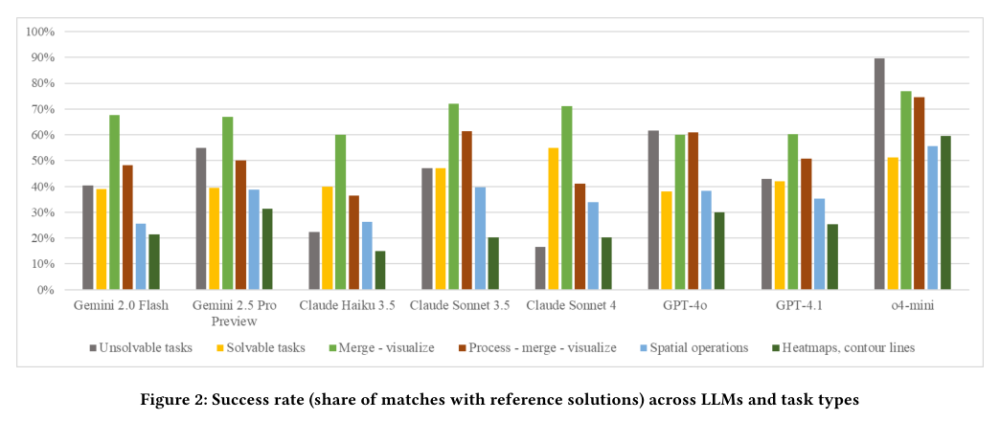
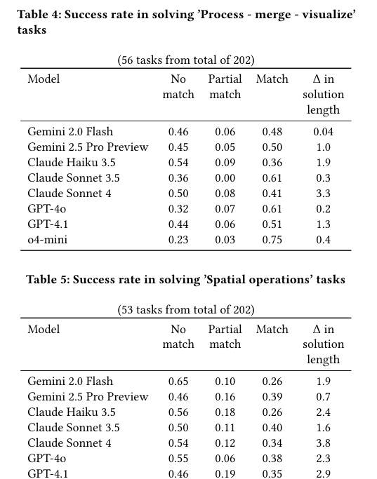
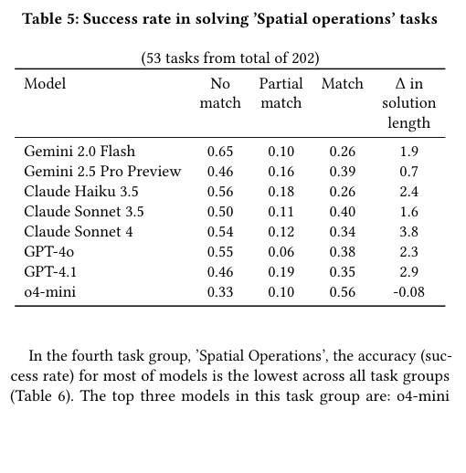
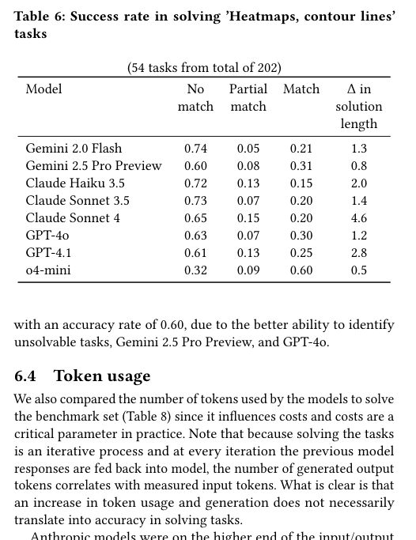
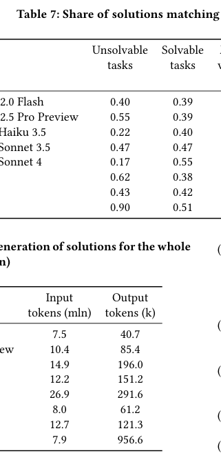
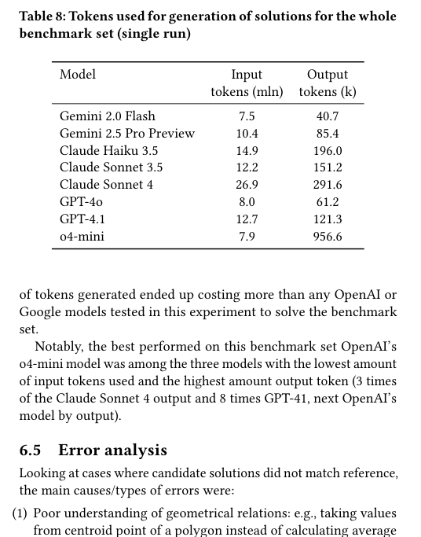

# 图表索引

- **Figure 1**（PDF 第 4 页）：Figure 1: Testing of LLMs as judges

  

- **Table 1**（PDF 第 5 页）：Table 1: Success rate in identifying the unsolvable tasks

  

- **Table 2**（PDF 第 5 页）：Table 2: Success rate in solvable tasks

  

- **Table 3**（PDF 第 5 页）：Table 3: Success rate in solving ’Merge - visualize’ tasks

  

- **Figure 2**（PDF 第 6 页）：Figure 2: Success rate (share of matches with reference solutions) across LLMs and task types

  

- **Table 4**（PDF 第 6 页）：Table 4: Success rate in solving ’Process - merge - visualize’ tasks

  

- **Table 5**（PDF 第 6 页）：Table 5: Success rate in solving ’Spatial operations’ tasks

  

- **Table 6**（PDF 第 6 页）：Table 6: Success rate in solving ’Heatmaps, contour lines’ tasks

  

- **Table 7**（PDF 第 7 页）：Table 7: Share of solutions matching across models and tasks groups

  

- **Table 8**（PDF 第 7 页）：Table 8: Tokens used for generation of solutions for the whole benchmark set (single run)

  
