# GeoBenchX: Benchmarking LLMs in Agent Solving Multistep Geospatial Tasks

> 逐页英语原文。文本依据上传 PDF 提取，尽量按双栏阅读顺序还原；图表中的文字请以对应截图为准。

**总页数：8；来源：用户上传 PDF。**

---

## PDF 第 001 页

GeoBenchX: Benchmarking LLMs in Agent Solving Multistep Geospatial Tasks

Varvara Krechetova World Bank New York, USA

Abstract

This paper establishes a benchmark for evaluating tool-calling capabilities of large language models (LLMs) on multi-step geospatial tasks relevant to commercial GIS practitioners. We assess eight commercial LLMs (Claude Sonnet 3.5 and 4, Claude Haiku 3.5, Gemini 2.0 Flash, Gemini 2.5 Pro Preview, GPT-4o, GPT-4.1 and o4-mini) using a simple tool-calling agent equipped with 23 geospatial functions. Our benchmark comprises tasks in four categories of increasing complexity, with both solvable and intentionally unsolvable tasks to test rejection accuracy. We develop a LLM-as-Judge evaluation framework to compare agent solutions against reference solutions. Results show o4-mini and Claude 3.5 Sonnet achieve the best overall performance, OpenAI’s GPT-4.1, GPT-4o and Google’s Gemini 2.5 Pro Preview do not fall far behind, but the last two are more efficient in identifying unsolvable tasks. Claude Sonnet 4, due its preference to provide any solution rather than reject a task, proved to be less accurate. We observe significant differences in token usage, with Anthropic models consuming more tokens than competitors. Common errors include misunderstanding geometrical relationships, relying on outdated knowledge, and inefficient data manipulation. The resulting benchmark set, evaluation framework, and data generation pipeline are released as open-source resources 1, providing one more standardized method for the ongoing evaluation of LLMs for GeoAI.

CCS Concepts

• Computing methodologies →Artificial intelligence; Intelligent agents; Multi-agent systems; Information extraction; • General and reference →General conference proceedings; Evaluation.

Keywords

Large Language Models (LLMs), Geospatial Analysis, Function Calling, LLM-as-Judge Evaluation, GIS Tools, Benchmarks, Spatial Reasoning, Tool-based Agents

ACM Reference Format: Varvara Krechetova and Denis Kochedykov. 2025. GeoBenchX: Benchmarking LLMs in Agent Solving Multistep Geospatial Tasks. In The 1st

1Available at https://github.com/Solirinai/GeoBenchX

Permission to make digital or hard copies of all or part of this work for personal or classroom use is granted without fee provided that copies are not made or distributed for profit or commercial advantage and that copies bear this notice and the full citation on the first page. Copyrights for components of this work owned by others than the author(s) must be honored. Abstracting with credit is permitted. To copy otherwise, or republish, to post on servers or to redistribute to lists, requires prior specific permission and/or a fee. Request permissions from permissions@acm.org. GeoGenAgent ’25, Minneapolis, MN, USA © 2025 Copyright held by the owner/author(s). Publication rights licensed to ACM. ACM ISBN /2025/11 https://doi.org/10.1145/3764915.3770721

Denis Kochedykov JP Morgan Chase & Co New York, USA

ACM SIGSPATIAL International Workshop on Generative and Agentic AI for Multi-Modality Space-Time Intelligence (GeoGenAgent ’25), November 3–6, 2025, Minneapolis, MN, USA. ACM, New York, NY, USA, 8 pages. https: //doi.org/10.1145/3764915.3770721

1 Introduction

In this paper, we create a benchmark set and describe a simple LLM-as-Judge based methodology to compare the tool-calling performance of several leading commercial large language models (LLMs) with function-calling abilities for solving a range of multistep geospatial tasks. Geospatial tasks are distinct in that they require LLMs to have good factual geographical knowledge, understanding how to work with spatially defined data, what are coordinate reference systems, and various types of spatial data. We used a simple tool-calling agent to specifically assess the LLMs capabilities and have tested several models: Anthropic’s Claude Sonnet 3.5, 4, Claude Haiku 3.5; Google’s Gemini 2.0 Flash, Gemini Pro 2.5 Preview; OpenAI’s GPT-4o, GPT-4.1, o3-mini and o4-mini. Our focus is on the commercial GIS practitioner requirements, which influences the choice of tasks, models and evaluation framework. Unlike other adjacent benchmarks, we focus on tasks needed for socio-economic analysis and mapping for reports, policy papers, news articles, and the like: tasking agent to make various types of maps, to find geographical objects by some conditions, to count objects within certain geographic boundaries. For these tasks, practitioners would use LLM equipped with GIS tools in a chat environment. Also, importantly for practitioners, we test the ability of LLMs to correctly recognize when the task cannot be solved with given tools and inform the user to reduce the risk of hallucinated outputs. Next, we selected the most current advanced commercial LLMs used in the industry setting for benchmarking. Lastly, the evaluation method we use allows for automation of the ongoing evaluation which is increasingly important with frequent models updates in commercial settings. The paper is structured as follows. First, we describe the tasksolving agent and the set of tools. Second, we describe how the benchmark set of tasks was created and its composition. Third, we detail the approach to evaluation of the results of the task-solver agent using a panel of LLM-as-Judge evaluators and testing the evaluator performance itself. Finally, we compare the performance metrics of the solver agent based on different LLMs and the cost efficiency in terms of token usage.

2 Related works

Research in the field of GeoAI, a part of spatial data science at the intersection with Artificial Intelligence (AI) [12], got a boost with recent advances in generative AI and the deployment of accessible LLMs. GeoAI researchers actively explore the capabilities of

本页原版截图（含所有图片、公式、表格）

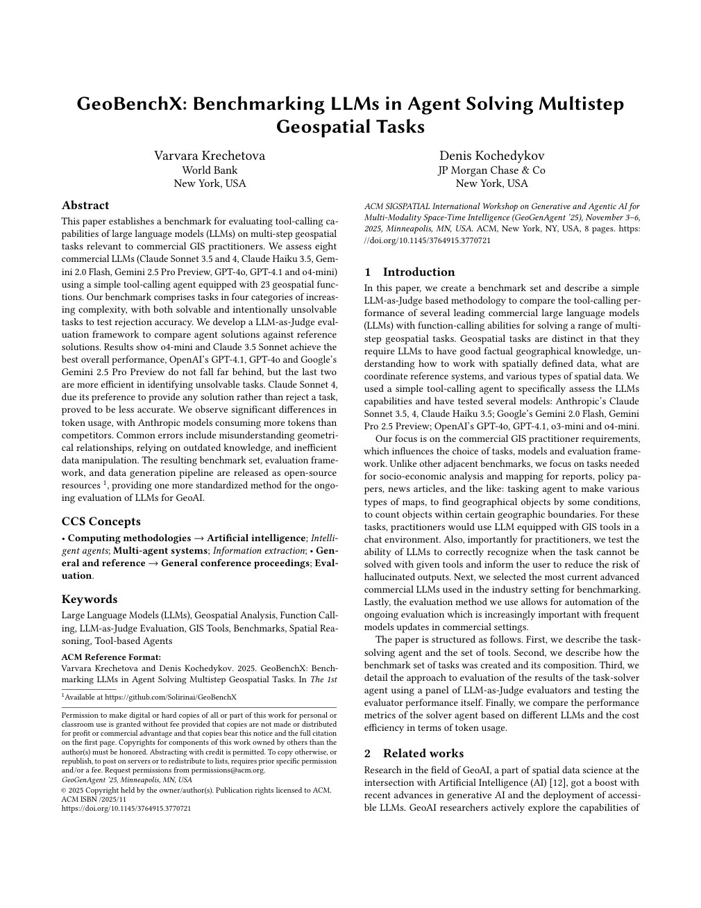

---

## PDF 第 002 页

GeoGenAgent ’25, November 3–6, 2025, Minneapolis, MN, USA Krechetova, Kochedykov

the available models in relation to geospatial data science, design their applications, and methods to improve their performance. The avenues explored include analysis of the ability of LLM (GPT-4) for spatial reasoning in travel networks, distance and elevation estimations, route and supply chain analysis [22]; integration of geography knowledge in pre-trained language models [20], creating autonomous LLM-based GIS applications (LLM-Geo) [14], GIS Copilot for GIS software [1], integrating LLM and cartography tools into MapGPT [11], testing LLMs in styling maps using reference visuals [24], combining several LLMs to increase the efficiency of spatial data processing in the multi-agent framework for automated processing of vector data in shapefile format [15], benefits of generative AI agents in smart mobility[26], fine-tuning LLM to process natural language queries into executable code[17]. There is a benchmarking of LLM performance in spatial tasks in progress, with analysis of LLMs’ geospatial knowledge[3, 21], of GIS coding abilities[9], the recent study testing models on several groups of tasks that require geographic, GIS, and spatial knowledge, including changes in their performance in response to changes in prompts [27].

3 Experiment setup 3.1 Agent

The experiment setup is based on the pre-built Langgraph ReAct agent [13] equipped to call one of the selected LLMs with a list of tools (functions) to solve tasks. We intentionally choose a simple agent architecture to measure the contribution of the LLMs themselves into the final performance, not compensated and leveled by complex agent architectures. Typical practical requirements are that the variability in outputs is undesirable, but consistency in responses is critical, so the models were tested at temperature 0, which reduces variability and increases consistency of outputs [8, 19]. The agent processed a given user task without Human-In-TheLoop involvement. Each task normally requires series of tool calls to solve and the agent does not always find the shortest solutions, so we allowed up to 25 iterations of “LLM suggests a tool call –> LLM receives the tool response”. This number was selected after initial trials of the agent that showed that fewer iterations were not enough for some complex tasks, while allowing more steps did not increase the success rates (accuracy). The agent is supplied with a simple system prompt that sets the persona, briefly describes the setting, and the rules for solving the tasks. The agent is explicitly instructed not to ask the user for clarifications and not to provide code to solve the task, but to reply with the resulting map, names of the datasets used, and explanations. The set of rules contains instructions on when to reject the task and when to leave the solution empty (meaning that no tools are needed to answer user’s question), when to consider the data unavailable (if the available data do not fully cover the geography asked in the task), and how to select columns for mapping data if the user did not specify (implied conditions frequent in production user questions). The text of the task is supplied as the next message for the LLM’s Chat API as the user prompt.

3.2 Agent tools

To enable the agent to solve the tasks, it is provided with 23 tools to implement the necessary data manipulations, calculations, and visualizations or to report a task unsolvable. Tools can read tabular data, geospatial data in vector or raster formats, perform operations on dataframes and geodataframes (merge, filter by categorical or numerical values), their columns, perform spatial operations on geodataframes and rasters (spatial joins, filtering by locations, creating buffers, generate contour lines from raster), visualize geodataframes, generate choropleth maps and heatmaps. The tools leverage GIS-specific libraries like GeoPandas [5], Rasterio [6], GDAL [23], Shapely [7], and common data analysis libraries like Matplotlib, Plotly, Pandas, and Numpy. To distinguish the situations in which the agent stops solving the task because it thinks that the task could not be solved with the datasets / tools provided, the agent was equipped with an additional tool reject_task that simply returned the message that the task is unsolvable. The outputs of the tool functions were formatted as natural part of the tool response message. When a tool result included a dataframe or geodataframe, information about its length, columns, data types, and non-empty cells was included in the tool response message. Where dataframes or geodataframes needed to be passed between tools, they were stored in the data-store dictionary accessible to all tools. For clarity, hereafter we refer to the set of tasks used to evaluate the agent as “benchmark set” and the statistical and geodata used by the tools to solve the tasks as “datasets”. To avoid variability of benchmarking due to possible data API connection issues, data API changes, and data changes behind the scenes, we opt to store the snapshots of datasets in the local experimentation environment rather than fetching data from online APIs every time. For each task, the conversation history between LLM and tools along with any plotted outputs is saved as html file making the final LLM response, maps and intermediate outputs available for debugging.

3.3 Datasets

The datasets were used as-is after downloading from online APIs, except for two modifications made to ease development: country names in the vector geodataset were harmonized with statistical datasets for easier visual identification of filtering issues, and the NoData value in snow cover rasters was unified. These changes were not required for the benchmarking itself. The data included: Statistical data: panel data in csv format (18 datasets): data on economic and population indicators, data on CO and greenhouse gas emissions, tuberculosis cases at subnational levels. Geometry data: vector data in shapefile format (21 datasets): polygon geometries (national or subnational units, lakes), points geometries (wildfire locations, urban places, Amtrak stations, earthquake occurrences, seaports, mineral extraction facilities, power stations at global or national level), line geometries (rivers, railways continent or national extent). Raster data: (11 rasters): accumulated snow cover, flood extents, population data at national level.

本页原版截图（含所有图片、公式、表格）

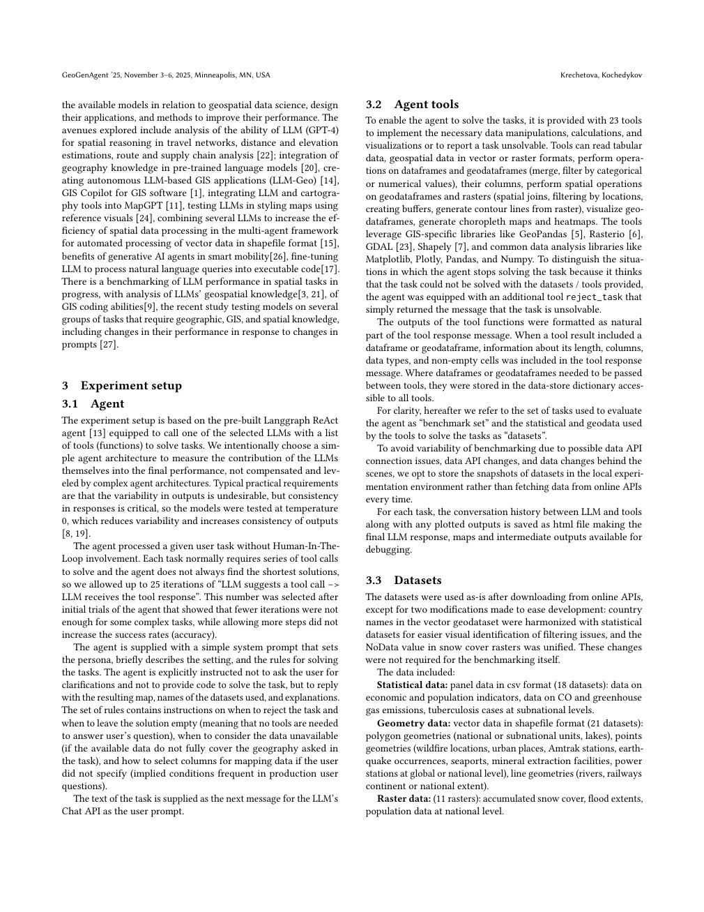

---

## PDF 第 003 页

GeoBenchX: Benchmarking LLMs in Agent Solving Multistep Geospatial Tasks GeoGenAgent ’25, November 3–6, 2025, Minneapolis, MN, USA

4 Benchmark set

We created a set of 200+ tasks, grouped by type and complexity. For estimating a binary match rate at the level of match we see in results section (6) – this sample size corresponds approximately to 5% margin of error with 90% confidence according to Wald method. Each group included tasks that could be solved with the tools and datasets provided (solvable tasks), tasks that looked similar but could not be solved with the tools or datasets provided (unsolvable tasks). For debugging purposes, we also added a few tasks that did not require use of the provided tools or datasets to solve.

4.1 Groups

Depending on the complexity of data processing or geoprocessing, the task groups are as follows: Merge - visualize (36 tasks): require to join tabular numeric data (panel data for one or multiple indicators, e.g. countries-by-years) with a geographic geometry data and make a choropleth or bivariate map. Example: “Map the relationship between GDP per capita and electric power consumption per capita globally”. This is the most straightforward group, the tasks mostly require two-three tool calls. Only 6 of these tasks were not solvable with given tools/data. Due to simplicity of the tasks, there is limited variation in their content and solutions and a smaller number provided enough coverage. Process - merge - visualize (56 tasks): require some processing of either tabular or geometry data (filtering or operations on columns) and then creating a choropleth or bivariate map. Example: “Compare rural population percentages in Western Asian countries”. The tasks in this group are more complicated, require the use of knowledge of the world geography and the use of a wider variety of tools. About half of the tasks, 24, are not solvable with given tools/data. Spatial operations (53 tasks): require spatial joins, creating buffers around selected geometries, checking overlaps between rasters, performing calculations on rasters, finding values from raster using geometry data or filtering geometries based on raster values, calculating distances. They might require a numerical answer, and the creation of actual maps might be optional. This group is more challenging than the previous two, as it requires the agent to work with different types of datasets in one task, navigate the full set of available tools, and maintain the overall logic of the solution through all its steps. Example: “How many people live within 1 km from a railway in Bangladesh?”. In this group, 22 of the tasks were not solvable. Heatmaps, contour lines (54 tasks): required performing spatial operations (selection, overlaps, etc.), understanding the contents of rasters, and making a heatmap or generating contour lines as one of the steps. Example: “Create a heatmap of earthquake occurrences in regions with high population growth”. This was the most challenging set, as the agent had to figure out if the heatmaps and contour lines tools were actually able to solve the task and to make correct decisions on a complex set of arguments. In this group, 27 tasks were not solvable.

4.2 Tasks creation

For each group, the seed tasks were sourced from industry professionals and publications. Then more tasks were generated by using

the Claude 3.5 Sonnet model based on: the seed tasks, description of the tools, and the lists of available datasets. Unsolvable and solvable tasks were generated separately. The generated tasks were then manually reviewed to keep only high-quality tasks in the set.

4.3 Tasks annotation

To allow the evaluation of LLM-generated solutions, each task was annotated with the ground truth, reference solution, formatted as snippets of Python code (see more in Section 5). To create the annotation, we have started by generating draft reference solutions by the agent using GPT-4o or Claude 3.5 Sonnet models. We then manually reviewed and rewrote every solution. Each of the 200+ tasks was annotated with one or multiple ground-truth reference solutions. Reference solution could be

(1) Sequence of tool-calls with arguments; similar to a python code snippet (2) Empty sequence [] of tool-calls meaning that the task can be solved from the LLM’s world knowledge (3) A single special tool call reject_task meaning that the task should be rejected as it cannot be solved with given tools/- data

A non-empty reference solution looked as follows for the evaluator:

#overall reference solution comment toolcall1(arg11 =..., arg12 =..., ...) #call1 comment toolcall2(arg21 =..., arg12 =..., ...) #call2 comment ...

One task sometimes allows multiple solutions because tasks in practice are often ambiguous and multiple analytical approaches are possible for them based on the provided data and tools. For example, task “Compare the freshwater withdrawal between African countries with and without significant railway networks” can be solved:

• by rejecting because it’s not specific enough (user needs to clarify what’s “significant” railway networks); • by making separate maps of railway networks and water withdrawals for African countries; • by combining the data and mapping bivariate map to show the relation; • by implying some threshold and computing statistical metrics for 2 groups of countries.

We also used comments as a way to record some information important for the evaluator to make a judgment about whether the candidate solution and the reference solution are semantically equivalent. For example, providing alternative arguments to the tool call, specifying variations in arguments or marking optional steps. Approximately 74% of the solvable tasks have reference solutions consisting of 4-6 steps (tool-calls) and 28% consist of more steps (up to 14 steps). The numbers do not total to 100% as a task can have multiple reference solutions.

本页原版截图（含所有图片、公式、表格）

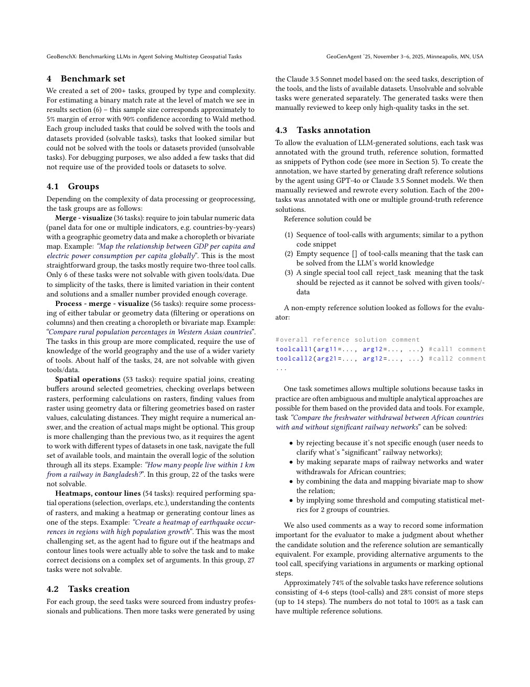

---

## PDF 第 004 页

GeoGenAgent ’25, November 3–6, 2025, Minneapolis, MN, USA Krechetova, Kochedykov

5 Evaluation approach 5.1 Matching-based evaluator

To leverage the LLMs ability to comprehend code [10, 16, 18], we represented both reference and candidate solutions as snippets of Python code as in 4.3. In code evaluation, the two widely used approaches are: execution-based and matching-based, both used for the evaluation of LLM-generated code [2, 25]. Since the outputs of agent on geospatial analytical tasks contain multiple images/maps, numbers, a narrative, and sometimes all of it as in the section 4.3 example, reliably comparing them via execution-based approach would be challenging and annotation of tasks with such ground truth is rarely practical. We opt for the matching-based approach for practicality and efficiency. We used reference-based LLM-as-Judge with multiple LLM judges to compare the solutions generated by the agent (“candidate solutions”) and reference solutions for the same task. Compared to human evaluation, the use of LLMs to compare the generated solution and reference is cost- and time-efficient [4]; if multiple rounds of evaluation are needed due to changes in tasks, their number, or evaluated LLMs, it offers reproducibility [4] and scalability [28]. We asked LLM judge to compare semantic equivalence of the solution; this took care of situations where reference and candidate solutions had different order of steps, different arguments for toolcalls or even took a different path to the same analytical outcome. We also compared the lengths of the reference and candidate solutions, since the agent often takes some steps to figure out a path to answering the user question, and such extra steps might be costly (see 6.4). Looking into solution code also provides interesting insights into how LLM solves the tasks and allows agent tuning (which we did not do for this benchmarking). For evaluation of the solutions we used a panel of judges: Claude Sonnet 3.5, GPT-4.1 and Gemini 2.5 Pro Preview. The evaluator prompt included: persona setting, description of all tools, scoring taxonomy, instructions on how evaluate solutions, examples of evaluated solutions, corresponding scores and reasoning behind each score. The evaluator was instructed to analyze the candidate solution for the task and produce (1) reasoning for matching any of the reference solutions for the task and the candidate solution and (2) the matching score (’2’: match, ’0’: not a match, ’1’: partial match).

5.2 Evaluating the evaluator

We evaluated and tuned the evaluator itself on the set of 50 tasks (about 25% of the benchmark set) randomly sampled with stratification from all tasks, respecting the task groups. We manually scored candidate solutions for these tasks, providing a match score and reasoning for it. We then ran the evaluator on the same tasks candidate solutions and we compared human annotator match scores and evaluator produced match scores. Nine models were tested as judges (Gemini 2.0 Flash, Gemini 2.5 Pro Preview, Gemini 2.5 Flash Preview; Claude Sonnet 3.5, 3.7, 4; GPT-4o, GPT-4.1, GPT-4.1 mini) and from each family of models the one with the results closest to human annotator scores was selected for the panel: GPT-4.1 with 96% of scores matching the manual scores, Claude Sonnet 3.5 (94%) and Gemini 2.5 Pro Preview (88%) (see Figure 1). The top models of each family were selected

Figure 1: Testing of LLMs as judges

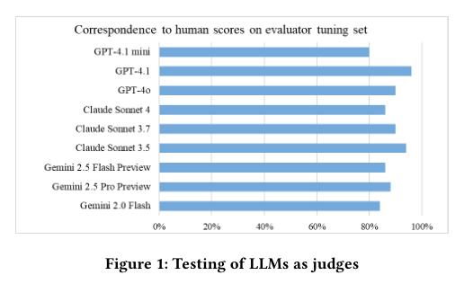

rather than simply the top three models to reduce variance in the evaluation results due to differences in training and tuning of the models by different providers. In the evaluator, we use all the 3 above LLMs as judges and average their match frequency estimates.

6 LLMs evaluation results 6.1 Experiment procedure

Nine models were tested in the solver agent: gemini-2.0-flash-001, gemini-2.5-pro-preview-05-06, claude-3-5-haiku-20241022, claude3-5-sonnet-20241022, claude-sonnet-4-20250514, gpt-4o-2024-08-06, gpt-4.1-2025-04-14, o3-mini-2025-01-31, o4-mini-2025-04-16. Each LLM was tested on the same benchmark set of tasks, at temperature 0 (except o3-mini, o4-mini which do not support the temperature parameter). The frequency of each of the match scores was calculated: (1) separately by each group of tasks as per 4.1 and (2) for solvable tasks (123 tasks) and unsolvable tasks (79 tasks) across all groups. To benchmark how efficient an LLM is at solving a task compared to the reference solution, we also calculated the mean difference between the length (number of steps) of the reference solution for the task (or average length of reference solutions if multiple) and the candidate solution. We express this difference relative to the length of candidate solution (so 0.5 means 50% more steps in the candidate solution). The o3-mini model generated empty solutions (no tool calls, just thinking) for 103 tasks and rejected 75 tasks, and while the accuracy in identification of unsolvable tasks thus was 0.75, the model was excluded from further analysis due to obvious inefficiency in using tools to solve tasks.

6.2 Performance on solvable and unsolvable tasks

The first observation is that some models demonstrate a trade-off between the ability to identify and reject unsolvable tasks and the ability to solve tasks (Table 1, Table 2, Table 7, Figure 2). Claude Sonnet 4 and Haiku 3.5 perform better on solvable tasks but prioritize giving any answer over rejecting tasks, with Claude Sonnet 4 being a prominent case with a success rate on solvable tasks more than three times higher than on unsolvable ones. Gemini 2.5 Pro

本页原版截图（含所有图片、公式、表格）

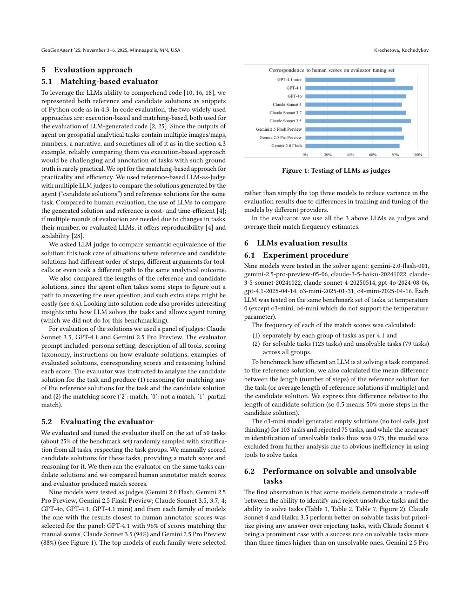

---

## PDF 第 005 页

GeoBenchX: Benchmarking LLMs in Agent Solving Multistep Geospatial Tasks GeoGenAgent ’25, November 3–6, 2025, Minneapolis, MN, USA

Table 1: Success rate in identifying the unsolvable tasks

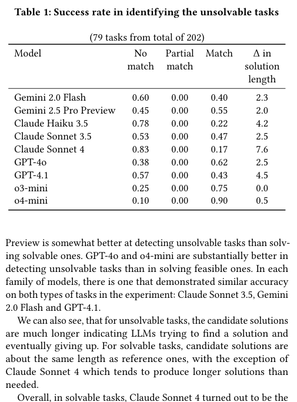

(79 tasks from total of 202)

Model No Partial Match Δ in match match solution length

Gemini 2.0 Flash 0.60 0.00 0.40 2.3 Gemini 2.5 Pro Preview 0.45 0.00 0.55 2.0 Claude Haiku 3.5 0.78 0.00 0.22 4.2 Claude Sonnet 3.5 0.53 0.00 0.47 2.5 Claude Sonnet 4 0.83 0.00 0.17 7.6 GPT-4o 0.38 0.00 0.62 2.5 GPT-4.1 0.57 0.00 0.43 4.5 o3-mini 0.25 0.00 0.75 0.0 o4-mini 0.10 0.00 0.90 0.5

Preview is somewhat better at detecting unsolvable tasks than solving solvable ones. GPT-4o and o4-mini are substantially better in detecting unsolvable tasks than in solving feasible ones. In each family of models, there is one that demonstrated similar accuracy on both types of tasks in the experiment: Claude Sonnet 3.5, Gemini 2.0 Flash and GPT-4.1. We can also see, that for unsolvable tasks, the candidate solutions are much longer indicating LLMs trying to find a solution and eventually giving up. For solvable tasks, candidate solutions are about the same length as reference ones, with the exception of Claude Sonnet 4 which tends to produce longer solutions than needed. Overall, in solvable tasks, Claude Sonnet 4 turned out to be the best model, followed by o4-mini, Claude Sonnet 3.5, GPT-4.1, and the rest of the models were very close in their success rates (Table 2). However, the highest success rate is only slightly more than half (0.55 and 0.51), and most of the tested models are successful in less than half of the cases (note again that we specifically chose a trivial agent architecture to benchmark the ability of LLMs themselves rather than a particular agentic architecture). Some models have a relatively high proportion of solutions that partially match ground truth solutions (0.16-0.22 for Claude Haiku 3.5, GPT-4.1, Claude Sonnet 4, and Gemini 2.5 Pro Preview), meaning these solutions are very close to correct and models success rates might be increased with minor changes to the agent and tools.

6.3 Performance by task groups

We then examine LLMs performance by task groups without distinguishing between solvable and unsolvable tasks within each group. In the ’Merge - visualize’ task group (Table 3), the easiest and, mostly, solvable, almost all models achieved accuracy over 0.6. The o4-mini had the highest accuracy, followed by Claude Sonnet 3.5, 4, all with success rates over 0.7. In the ’Process - merge - visualize’ task group, accuracy starts to decrease while the solution lengths increase (Table 4). The top three models by accuracy achieve success rates over 0.6: GPT-4o, Claude Sonnet 3.5, and o4-mini, with o4-mini notably outperforming the other eight models at 0.75 accuracy. The rest have accuracy 0.5 or lower.

Table 2: Success rate in solvable tasks

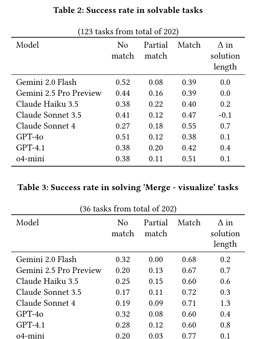

(123 tasks from total of 202)

Model No Partial Match Δ in match match solution length

Gemini 2.0 Flash 0.52 0.08 0.39 0.0 Gemini 2.5 Pro Preview 0.44 0.16 0.39 0.0 Claude Haiku 3.5 0.38 0.22 0.40 0.2 Claude Sonnet 3.5 0.41 0.12 0.47 -0.1 Claude Sonnet 4 0.27 0.18 0.55 0.7 GPT-4o 0.51 0.12 0.38 0.1 GPT-4.1 0.38 0.20 0.42 0.4 o4-mini 0.38 0.11 0.51 0.1

Table 3: Success rate in solving ’Merge - visualize’ tasks

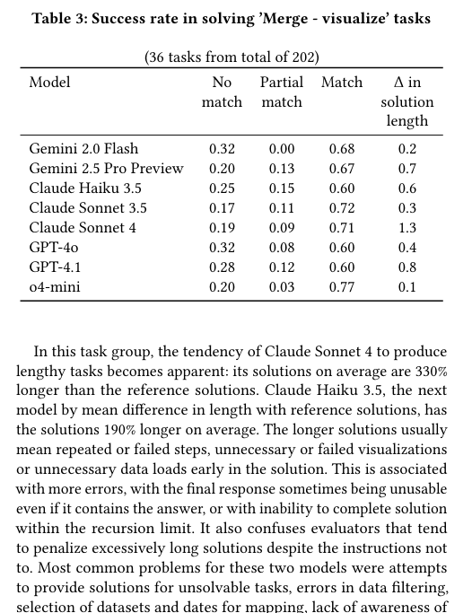

(36 tasks from total of 202)

Model No Partial Match Δ in match match solution length

Gemini 2.0 Flash 0.32 0.00 0.68 0.2 Gemini 2.5 Pro Preview 0.20 0.13 0.67 0.7 Claude Haiku 3.5 0.25 0.15 0.60 0.6 Claude Sonnet 3.5 0.17 0.11 0.72 0.3 Claude Sonnet 4 0.19 0.09 0.71 1.3 GPT-4o 0.32 0.08 0.60 0.4 GPT-4.1 0.28 0.12 0.60 0.8 o4-mini 0.20 0.03 0.77 0.1

In this task group, the tendency of Claude Sonnet 4 to produce lengthy tasks becomes apparent: its solutions on average are 330% longer than the reference solutions. Claude Haiku 3.5, the next model by mean difference in length with reference solutions, has the solutions 190% longer on average. The longer solutions usually mean repeated or failed steps, unnecessary or failed visualizations or unnecessary data loads early in the solution. This is associated with more errors, with the final response sometimes being unusable even if it contains the answer, or with inability to complete solution within the recursion limit. It also confuses evaluators that tend to penalize excessively long solutions despite the instructions not to. Most common problems for these two models were attempts to provide solutions for unsolvable tasks, errors in data filtering, selection of datasets and dates for mapping, lack of awareness of recent updates (like expansion of BRICS) even for models released after the events. In the third task group, ’Spatial operations’ only o4-mini achieves a success rate 0.56 (Table 5). However, in this task group o4-mini rejected 62% of tasks, which is higher than for the whole set (49%), hence the shorter mean difference between length of the ground truth and o4-mini solutions. Claude Sonnet 3.5, Gemini 2.5 Pro Preview, GPT-4o follow with the success rates 0.38-0.40. Six of the tested models have solutions on average more than twice as long as the reference solutions and the issues associated with this.

本页原版截图（含所有图片、公式、表格）

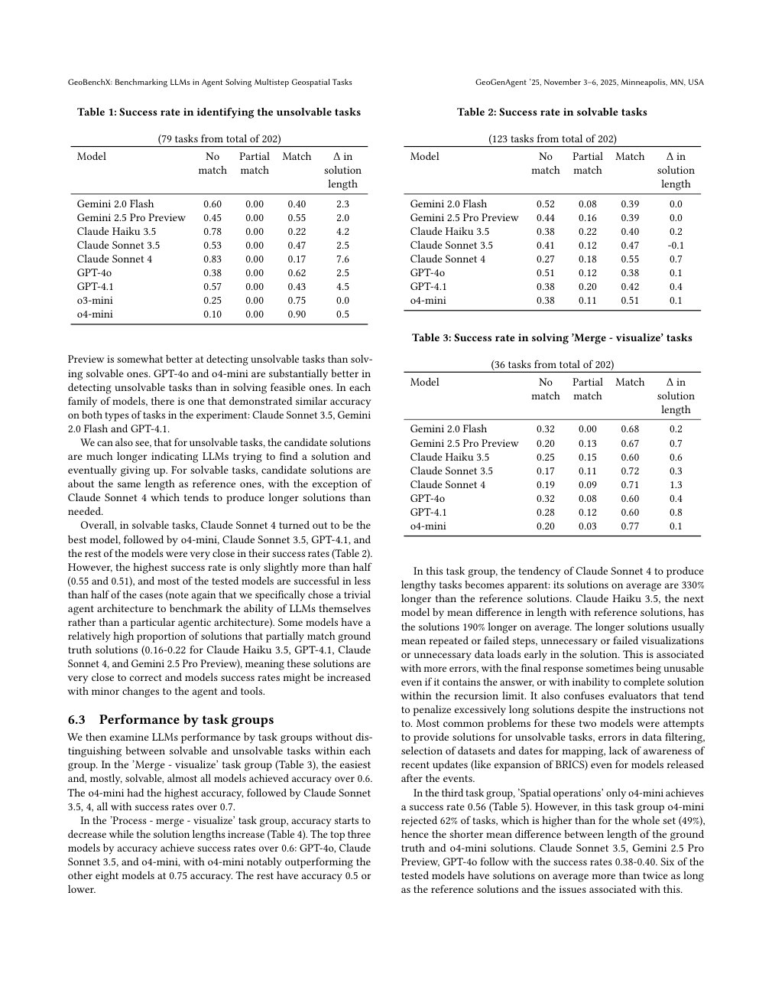

---

## PDF 第 006 页

GeoGenAgent ’25, November 3–6, 2025, Minneapolis, MN, USA Krechetova, Kochedykov

Figure 2: Success rate (share of matches with reference solutions) across LLMs and task types

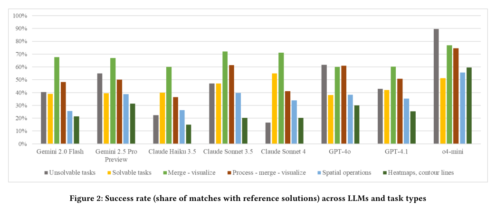

Table 4: Success rate in solving ’Process - merge - visualize’ tasks

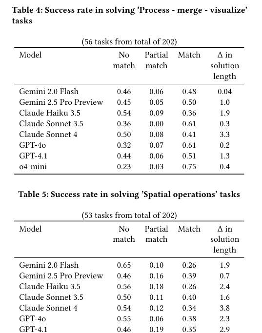

(56 tasks from total of 202)

Model No Partial Match Δ in match match solution length

Gemini 2.0 Flash 0.46 0.06 0.48 0.04 Gemini 2.5 Pro Preview 0.45 0.05 0.50 1.0 Claude Haiku 3.5 0.54 0.09 0.36 1.9 Claude Sonnet 3.5 0.36 0.00 0.61 0.3 Claude Sonnet 4 0.50 0.08 0.41 3.3 GPT-4o 0.32 0.07 0.61 0.2 GPT-4.1 0.44 0.06 0.51 1.3 o4-mini 0.23 0.03 0.75 0.4

Table 5: Success rate in solving ’Spatial operations’ tasks

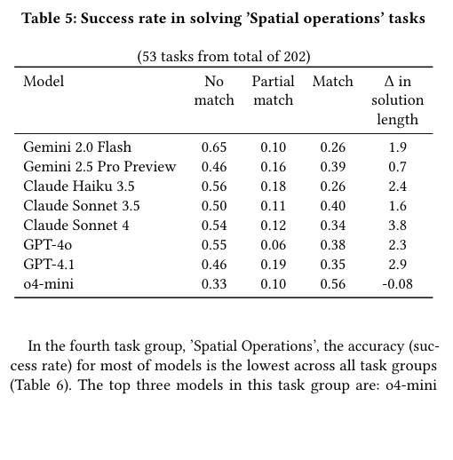

(53 tasks from total of 202)

Model No Partial Match Δ in match match solution length

Gemini 2.0 Flash 0.65 0.10 0.26 1.9 Gemini 2.5 Pro Preview 0.46 0.16 0.39 0.7 Claude Haiku 3.5 0.56 0.18 0.26 2.4 Claude Sonnet 3.5 0.50 0.11 0.40 1.6 Claude Sonnet 4 0.54 0.12 0.34 3.8 GPT-4o 0.55 0.06 0.38 2.3 GPT-4.1 0.46 0.19 0.35 2.9 o4-mini 0.33 0.10 0.56 -0.08

In the fourth task group, ’Spatial Operations’, the accuracy (success rate) for most of models is the lowest across all task groups (Table 6). The top three models in this task group are: o4-mini

Table 6: Success rate in solving ’Heatmaps, contour lines’ tasks

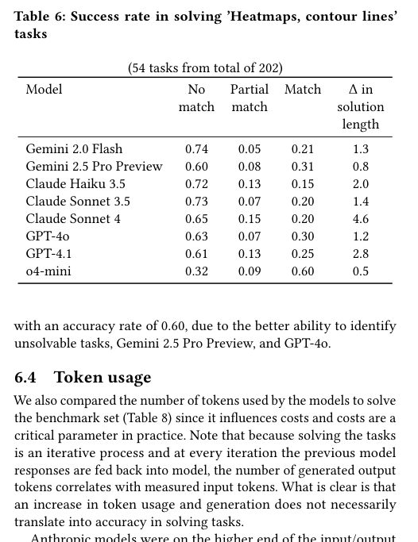

(54 tasks from total of 202)

Model No Partial Match Δ in match match solution length

Gemini 2.0 Flash 0.74 0.05 0.21 1.3 Gemini 2.5 Pro Preview 0.60 0.08 0.31 0.8 Claude Haiku 3.5 0.72 0.13 0.15 2.0 Claude Sonnet 3.5 0.73 0.07 0.20 1.4 Claude Sonnet 4 0.65 0.15 0.20 4.6 GPT-4o 0.63 0.07 0.30 1.2 GPT-4.1 0.61 0.13 0.25 2.8 o4-mini 0.32 0.09 0.60 0.5

with an accuracy rate of 0.60, due to the better ability to identify unsolvable tasks, Gemini 2.5 Pro Preview, and GPT-4o.

6.4 Token usage

We also compared the number of tokens used by the models to solve the benchmark set (Table 8) since it influences costs and costs are a critical parameter in practice. Note that because solving the tasks is an iterative process and at every iteration the previous model responses are fed back into model, the number of generated output tokens correlates with measured input tokens. What is clear is that an increase in token usage and generation does not necessarily translate into accuracy in solving tasks. Anthropic models were on the higher end of the input/output tokens used. Claude Sonnet 4, due to its reasoning ability, creates 2-3 times more input tokens and up to 5 times more output tokens than competitors, yet achieves similar or worse accuracy than models like Claude Sonnet 3.5, GPT-4o, GPT-4.1 and Gemini 2.5 Pro Preview (Table 7). Anthropic models are more expensive in use: the most affordable of the three, Claude 3.5 Haiku, due to the amount

本页原版截图（含所有图片、公式、表格）

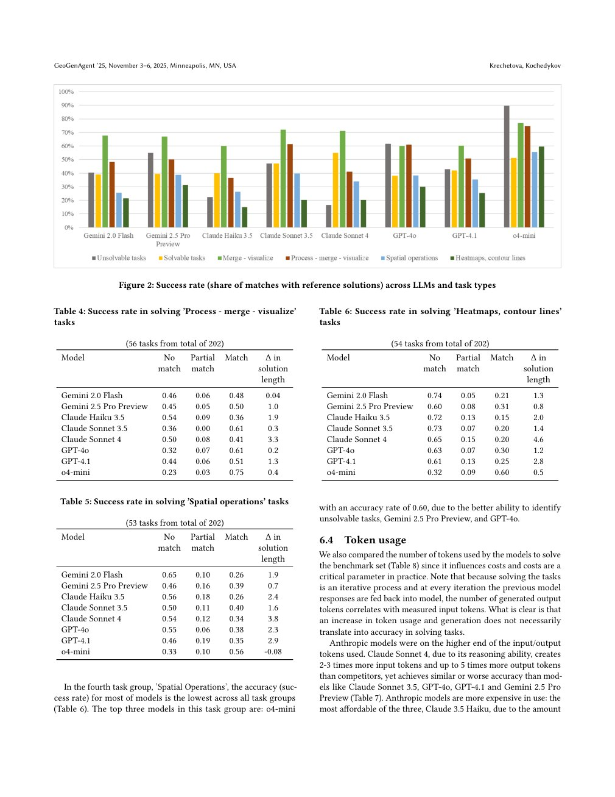

---

## PDF 第 007 页

GeoBenchX: Benchmarking LLMs in Agent Solving Multistep Geospatial Tasks GeoGenAgent ’25, November 3–6, 2025, Minneapolis, MN, USA

Table 7: Share of solutions matching across models and tasks groups

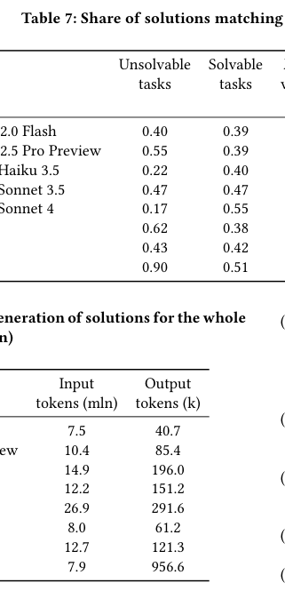

Model Unsolvable Solvable Merge - Process - Spatial Heatmaps, tasks tasks visualize merge - operations contour visualize lines

Gemini 2.0 Flash 0.40 0.39 0.68 0.48 0.26 0.21 Gemini 2.5 Pro Preview 0.55 0.39 0.67 0.50 0.39 0.31 Claude Haiku 3.5 0.22 0.40 0.60 0.36 0.26 0.15 Claude Sonnet 3.5 0.47 0.47 0.72 0.61 0.40 0.20 Claude Sonnet 4 0.17 0.55 0.71 0.41 0.34 0.20 GPT-4o 0.62 0.38 0.60 0.61 0.38 0.30 GPT-4.1 0.43 0.42 0.60 0.51 0.35 0.25 o4-mini 0.90 0.51 0.77 0.75 0.56 0.60

Table 8: Tokens used for generation of solutions for the whole benchmark set (single run)

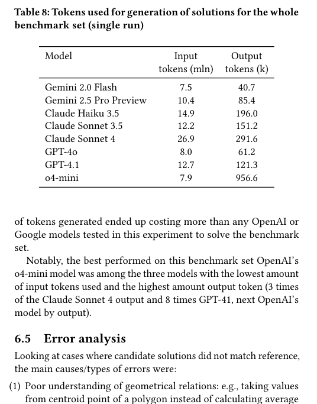

Model Input Output tokens (mln) tokens (k)

Gemini 2.0 Flash 7.5 40.7 Gemini 2.5 Pro Preview 10.4 85.4 Claude Haiku 3.5 14.9 196.0 Claude Sonnet 3.5 12.2 151.2 Claude Sonnet 4 26.9 291.6 GPT-4o 8.0 61.2 GPT-4.1 12.7 121.3 o4-mini 7.9 956.6

of tokens generated ended up costing more than any OpenAI or Google models tested in this experiment to solve the benchmark set. Notably, the best performed on this benchmark set OpenAI’s o4-mini model was among the three models with the lowest amount of input tokens used and the highest amount output token (3 times of the Claude Sonnet 4 output and 8 times GPT-41, next OpenAI’s model by output).

6.5 Error analysis

Looking at cases where candidate solutions did not match reference, the main causes/types of errors were:

(1) Poor understanding of geometrical relations: e.g., taking values from centroid point of a polygon instead of calculating average value over polygon, trying to use centroids of lines while looking for geometries overlaps, not understanding that object’s centroid can lie outside the boundary of the object, etc. (2) Lack of recent world knowledge: LLMs worked well with established international groupings, but struggled with ambiguous groupings (Upper/Lower Nile countries) or with more recent changes (e.g., BRICS expansion in 2024), even if the event happened before the model’s cut-off date. (3) Over-reliance on the world knowledge: using internally known spelling of names rather than dataset values for filtering, despite having tools to check column values.

(4) Inefficient data manipulations: merging without prefiltering (e.g., merging with all USA counties instead of first filtering to specific state); filtering by countries when filtering by continent/region was possible, and/or repeating filtering steps sometimes confusing LLM and derailing solutions. (5) Skipping steps that would narrow down the geodatasets to the required geography. E.g keeping all the North American lakes when the question was about USA. (6) Attempting to solve with partial data, trying to be helpful by using whatever geography was available instead of rejecting tasks with insufficient data coverage. (7) Modifying tasks to make them solvable rather than solving the original problem. (8) Hallucinating unjustified data processing steps, rejecting solvable tasks in the middle of solution, using some numbers for thresholds or names of countries in filters without justification or connection with provided datasets. (9) Answering/rejecting the task without using the tools and dataset provided.

Looking at models’ mistakes, it is likely that all models will perform much better if there is human-in-the-loop to disambiguate vague situations or provide step-by-step instructions on how to solve the task and more detailed explanations of the geographical scope of the tasks. It was also observed that making the tools more narrow specialized improved the accuracy of the agent.

7 Conclusions

We have created a benchmark dataset for multistep geospatial tasks, introduced an evaluation framework and evaluated the leading mainstream commercial LLMs on these tasks. The analysis indicates that the commercially available LLMs with function calling can be used successfully to solve geospatial tasks even when tasks are stated casually, with ambiguity, missing information, and minimal initial instructions. The performance of the models varies by the complexity of geospatial tasks, the degree of spatial thinking required to solve them, and how strongly the model is skewed to provide any answer at all rather than reject an unsolvable task. In terms of comparative performance (see Table 7 and Figure 2), the OpenAI’s o4-mini showed the best results overall. Anthropic’s

本页原版截图（含所有图片、公式、表格）

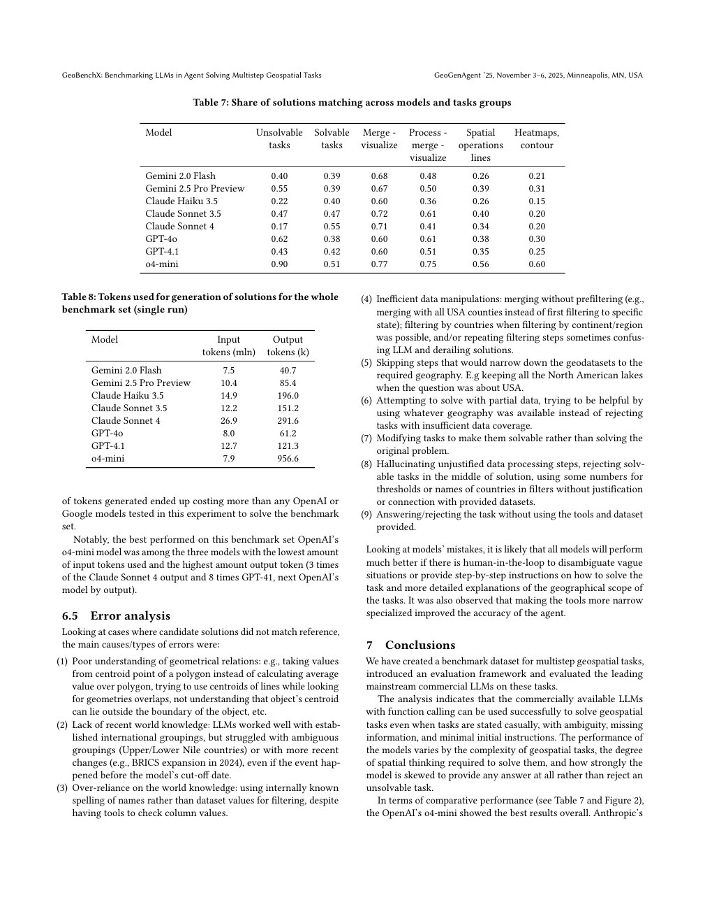

---

## PDF 第 008 页

GeoGenAgent ’25, November 3–6, 2025, Minneapolis, MN, USA Krechetova, Kochedykov

Claude Sonnet 3.5 ranked second overall by consistently placing in the top three for accuracy across multiple categories. The three other models with top-3 accuracy in 2-3 categories showed clear trade-off between the ability to solve tasks and to identify unsolvable ones: Claude Sonnet 4 performs more than three times better on solvable tasks than on unsolvable ones thus losing in accuracy in separate task groups; GPT-4o and Gemini 2.5 Pro are better at correctly rejecting tasks than at solving them and thus have better accuracy on task groups. The remaining models, GPT-4.1 and Google’s Gemini 2.0 Flash, are more balanced in rejecting and solving tasks and have lower accuracy across task groups. Based on the cost of running the models, the best options for geospatial agents might be OpenAI’s o4-mini due to its combination of moderate costs and high accuracy, and Google’s Gemini 2.0 Flash as the most cost-efficient model while still providing decent results. Anthropic models performed well on easy tasks and solvable tasks in general; however, their preference for trying to provide any solution rather than rejecting, high token usage, and price might be disadvantages when using them for geospatial tasks.

8 Limitations

We did not tune prompts individually for each LLM; we did not provide human feedback to the model to guide solution; we evaluate only solution algorithm not the final response (for rejects and final numbers); the benchmark set size is moderate; we did not evaluate the variance of the responses (only the binomial confidence bounds).

References

[1] Temitope Akinboyewa, Zhenlong Li, Huan Ning, and M.Naser Lessani. 2024. GIS Copilot: Towards an Autonomous GIS Agent for Spatial Analysis. doi:10.48550/ arXiv.2411.03205 [2] Md Mahim Anjum Haque, Wasi Uddin Ahmad, Ismini Lourentzou, and Chris Brown. 2023. FixEval: Execution-based Evaluation of Program Fixes for Programming Problems. In 2023 IEEE/ACM International Workshop on Automated Program Repair (APR). 11–18. doi:10.1109/APR59189.2023.00009 [3] Prabin Bhandari, Antonios Anastasopoulos, and Dieter Pfoser. 2023. Are Large Language Models Geospatially Knowledgeable?. In Proceedings of the 31st ACM International Conference on Advances in Geographic Information Systems (Hamburg, Germany) (SIGSPATIAL ’23). Association for Computing Machinery, New York, NY, USA, Article 75, 4 pages. doi:10.1145/3589132.3625625 [4] Cheng-Han Chiang and Hung-yi Lee. 2023. Can Large Language Models Be an Alternative to Human Evaluations?. In Proceedings of the 61st Annual Meeting of the Association for Computational Linguistics (Volume 1: Long Papers), Anna Rogers, Jordan Boyd-Graber, and Naoaki Okazaki (Eds.). Association for Computational Linguistics, Toronto, Canada, 15607–15631. doi:10.18653/v1/2023.acl-long.870 [5] Joris Van den Bossche, Kelsey Jordahl, Martin Fleischmann, Matt Richards, James McBride, Jacob Wasserman, Adrian Garcia Badaracco, Alan D. Snow, Brendan Ward, Jeff Tratner, Jeffrey Gerard, Matthew Perry, cjqf, Geir Arne Hjelle, Mike Taves, Ewout ter Hoeven, Micah Cochran, Ray Bell, rraymondgh, Matt Bartos, Pieter Roggemans, Lucas Culbertson, Giacomo Caria, Nicholas YS Tan, Nick Eubank, sangarshanan, John Flavin, Sergio Rey, and James Gardiner. 2024. geopandas/geopandas: v1.0.1. doi:10.5281/zenodo.12625316 [6] Sean Gillies et al. 2013–. Rasterio: geospatial raster I/O for Python programmers, version 1.4.3. Mapbox. https://github.com/rasterio/rasterio [7] Sean Gillies, Casper van der Wel, Joris Van den Bossche, Mike W. Taves, Joshua Arnott, Brendan C. Ward, et al. 2025. Shapely. doi:10.5281/zenodo.14776272 [8] Google Cloud. 2025. Function Calling in Multimodal Models. https://cloud.google.com/vertex-ai/generative-ai/docs/multimodal/functioncalling#generation-config Generative AI on Vertex AI Documentation. [9] Piotr Gramacki, Bruno Martins, and Piotr Szymański. 2024. Evaluation of Code LLMs on Geospatial Code Generation. In Proceedings of the 7th ACM SIGSPATIAL International Workshop on AI for Geographic Knowledge Discovery (SIGSPATIAL ’24). ACM, 54–62. doi:10.1145/3687123.3698286 [10] Sabaat Haroon, Ahmad Faraz Khan, Ahmad Humayun, Waris Gill, Abdul Haddi Amjad, Ali R. Butt, Mohammad Taha Khan, and Muhammad Ali Gulzar.

2025. How Accurately Do Large Language Models Understand Code? arXiv:2504.04372 [cs.SE] https://arxiv.org/abs/2504.04372 [11] Zhengting He, Yifan Zhang, Jingxuan Li, Jianfeng Lin, Qingfeng Guan, and Wenhao Yu. 2024. MapGPT: an autonomous framework for mapping by integrating large language model and cartographic tools. 717–743 pages. doi:10.1080/ 15230406.2024.2404868 arXiv:https://doi.org/10.1080/15230406.2024.2404868 [12] Krzysztof Janowicz, Song Gao, Grant McKenzie, Yingjie Hu, and Budhendra Bhaduri and. 2020. GeoAI: spatially explicit artificial intelligence techniques for geographic knowledge discovery and beyond. International Journal of Geographical Information Science 34, 4 (2020), 625–636. doi:10.1080/13658816.2019. 1684500 arXiv:https://doi.org/10.1080/13658816.2019.1684500 [13] LangChain AI. 2024. Create React Agent - LangGraph Documentation. Web. https://langchain-ai.github.io/langgraph/reference/prebuilt/#langgraph. prebuilt.chat_agent_executor.create_react_agent Accessed: 2025-03-19. [14] Zhenlong Li and Huan Ning and. 2023. Autonomous GIS: the next-generation AIpowered GIS. International Journal of Digital Earth 16, 2 (2023), 4668–4686. doi:10. 1080/17538947.2023.2278895 arXiv:https://doi.org/10.1080/17538947.2023.2278895 [15] Qingming Lin, Rui Hu, Huaxia Li, Sensen Wu, Yadong Li, Kai Fang, Hailin Feng, Zhenhong Du, and Liuchang Xu. 2024. ShapefileGPT: A MultiAgent Large Language Model Framework for Automated Shapefile Processing. arXiv:2410.12376 [cs.AI] https://arxiv.org/abs/2410.12376 [16] Wei Ma, Shangqing Liu, Zhihao Lin, Wenhan Wang, Qiang Hu, Ye Liu, Cen Zhang, Liming Nie, Li Li, and Yang Liu. 2024. LMs: Understanding Code Syntax and Semantics for Code Analysis. arXiv:2305.12138 [cs.SE] https://arxiv.org/abs/ 2305.12138 [17] Ali Mansourian and Rachid Oucheikh. 2024. ChatGeoAI: Enabling Geospatial Analysis for Public through Natural Language, with Large Language Models. ISPRS International Journal of Geo-Information 13, 10 (2024). doi:10.3390/ ijgi13100348 [18] Serge Lionel Nikiema, Jordan Samhi, Abdoul Kader Kaboré, Jacques Klein, and Tegawendé F. Bissyandé. 2025. The Code Barrier: What LLMs Actually Understand? arXiv:2504.10557 [cs.SE] https://arxiv.org/abs/2504.10557 [19] OpenAI. 2025. API Reference - Create Completion Response. https: //platform.openai.com/docs/api-reference/responses/create#responses-createtemperature OpenAI Platform Documentation. [20] Nitin Ramrakhiyani, Vasudeva Varma, Girish Keshav Palshikar, and Sachin Pawar. 2025. Gauging, enriching and applying geography knowledge in Pre-trained Language Models. Information Processing Management 62, 1 (2025), 103892. doi:10.1016/j.ipm.2024.103892 [21] Andrea Renshaw, Ismini Lourentzou, Jinhyung Lee, Thomas Crawford, and Junghwan Kim and. 2025. Comparing the Spatial Querying Capacity of Large Language Models: OpenAI’s ChatGPT and Google’s Gemini Pro. The Professional Geographer 77, 2 (2025), 186–198. doi:10.1080/00330124.2024.2434455 arXiv:https://doi.org/10.1080/00330124.2024.2434455 [22] Jonathan Roberts, Timo Lueddecke, Sowmen Das, Kai Han, and Samuel Albanie. 2023. GPT4GEO: How a Language Model Sees the World’s Geography. arXiv:2306.00020 [cs.CL] https://arxiv.org/abs/2306.00020 [23] Even Rouault, Frank Warmerdam, Kurt Schwehr, Andrey Kiselev, Howard Butler, Mateusz Loskot, Tamas Szekeres, Etienne Tourigny, Martin Landa, Idan Miara, Ben Elliston, Kumar Chaitanya, Lucian Plesea, Daniel Morissette, Ari Jolma, Nyall Dawson, Daniel Baston, Craig de Stigter, and Hiroshi Miura. 2025. GDAL. doi:10.5281/zenodo.14639689 [24] Chenglong Wang, Yuhao Kang, Zhaoya Gong, Pengjun Zhao, Yu Feng, Wenjia Zhang, and Ge Li. 2025. CartoAgent: a multimodal large language model-powered multi-agent cartographic framework for map style transfer and evaluation. International Journal of Geographical Information Science (2025), 1–34. [25] Jianxun Wang and Yixiang Chen. 2023. A Review on Code Generation with LLMs: Application and Evaluation. In 2023 IEEE International Conference on Medical Artificial Intelligence (MedAI). 284–289. doi:10.1109/MedAI59581.2023.00044 [26] Haowen Xu, Jinghui Yuan, Anye Zhou, Guanhao Xu, Wan Li, Xuegang Ban, and Xinyue Ye. 2024. GenAI-powered Multi-Agent Paradigm for Smart Urban Mobility: Opportunities and Challenges for Integrating Large Language Models (LLMs) and Retrieval-Augmented Generation (RAG) with Intelligent Transportation Systems. arXiv:2409.00494 [cs.AI] https://arxiv.org/abs/2409.00494 [27] Liuchang Xu, Shuo Zhao, Qingming Lin, Luyao Chen, Qianqian Luo, Sensen Wu, Xinyue Ye, Hailin Feng, and Zhenhong Du. 2025. Evaluating Large Language Models on Spatial Tasks: A Multi-Task Benchmarking Study. arXiv:2408.14438 https://arxiv.org/abs/2408.14438 [28] Lianmin Zheng, Wei-Lin Chiang, Ying Sheng, Siyuan Zhuang, Zhanghao Wu, Yonghao Zhuang, Zi Lin, Zhuohan Li, Dacheng Li, Eric P. Xing, Hao Zhang, Joseph E. Gonzalez, and Ion Stoica. 2023. Judging LLM-as-a-judge with MTbench and Chatbot Arena. In Proceedings of the 37th International Conference on Neural Information Processing Systems (New Orleans, LA, USA) (NIPS ́23). Curran Associates Inc., Red Hook, NY, USA, Article 2020, 29 pages.

本页原版截图（含所有图片、公式、表格）

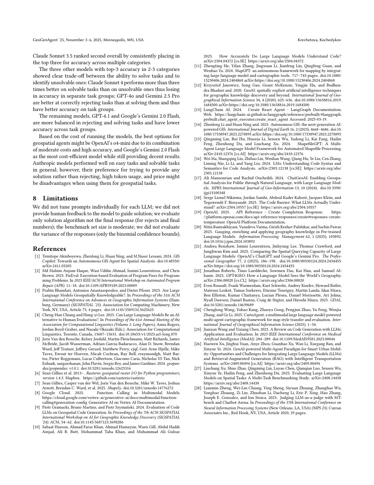

