# GeoBenchX: Benchmarking LLMs in Agent Solving Multistep Geospatial Tasks — 中文译文（工作稿）

> 中文译文以原文内容为依据，术语及数值以英文原始论文为准。

## PDF 第 001 页

原论文页面图像（用于校对译文与图表）

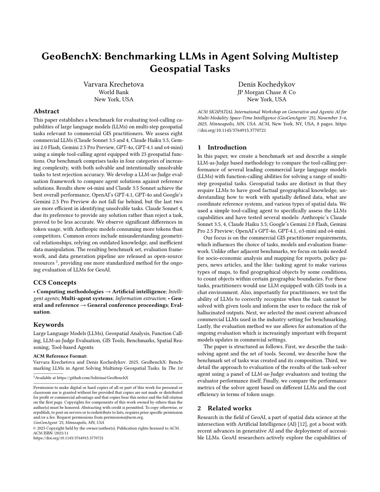

## PDF 第 002 页

原论文页面图像（用于校对译文与图表）

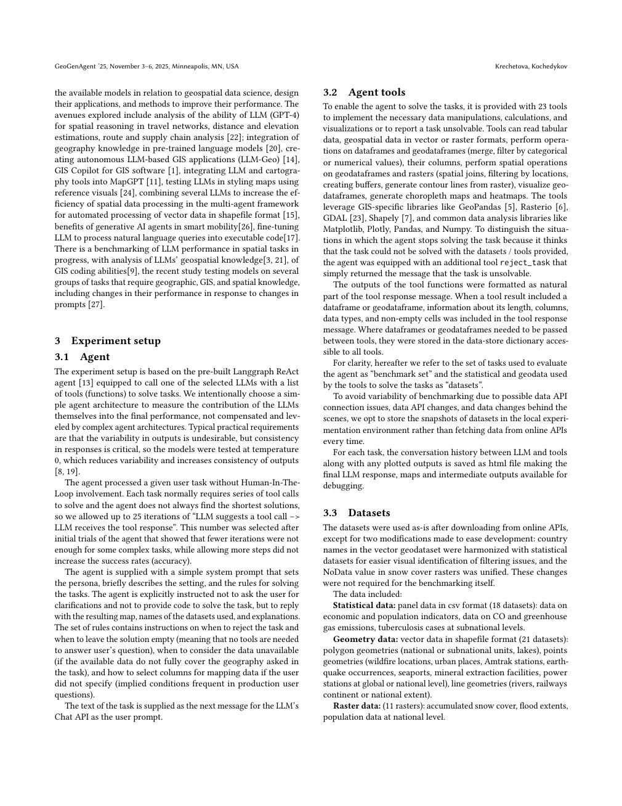

## PDF 第 003 页

原论文页面图像（用于校对译文与图表）

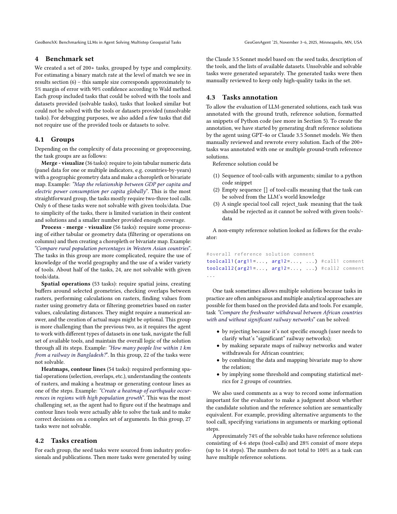

## PDF 第 004 页

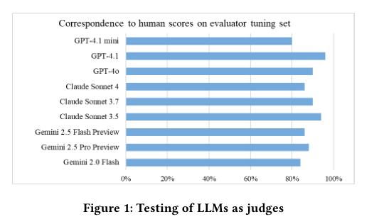

原论文页面图像（用于校对译文与图表）

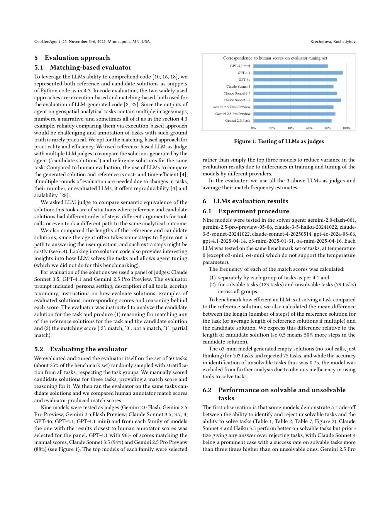

## PDF 第 005 页

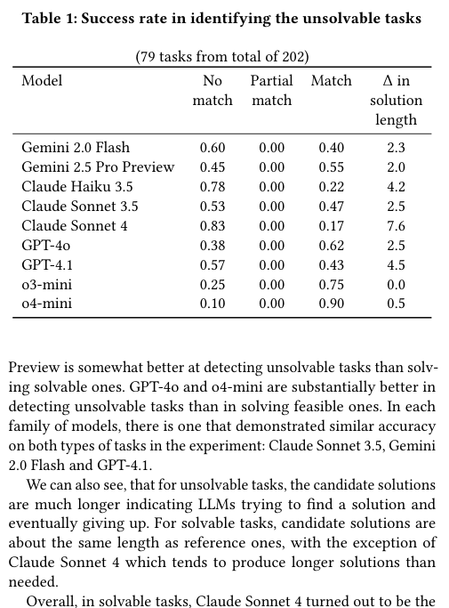

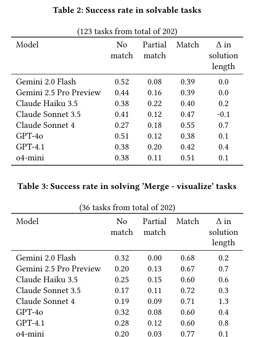

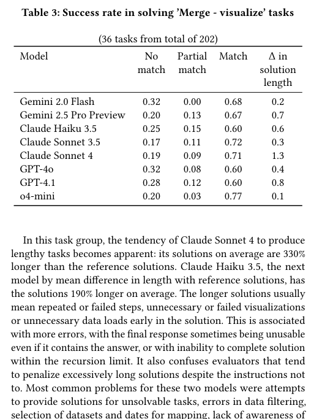

原论文页面图像（用于校对译文与图表）

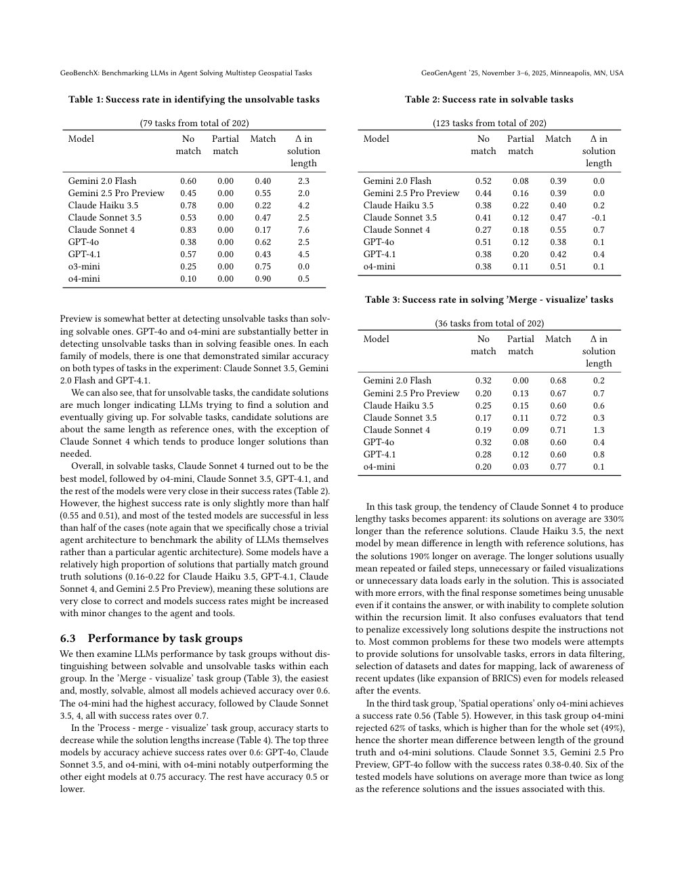

## PDF 第 006 页

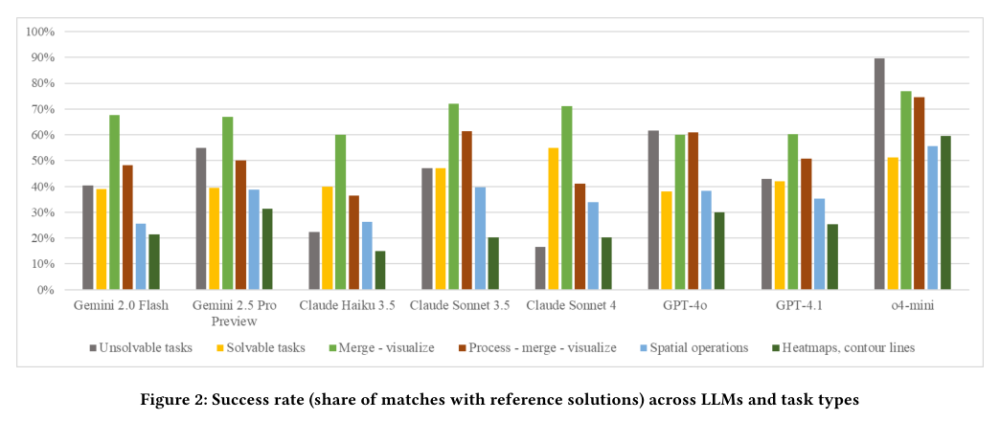

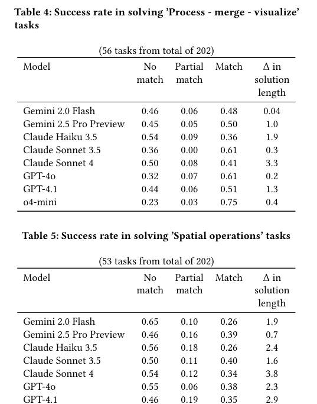

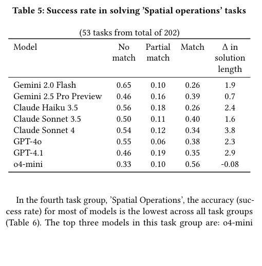

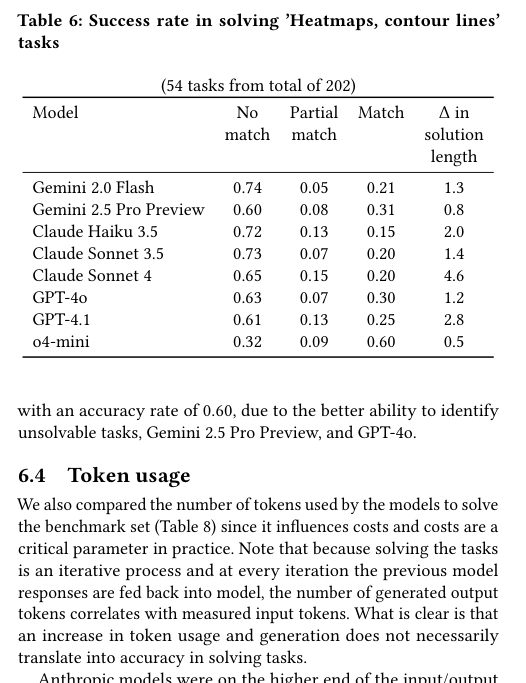

原论文页面图像（用于校对译文与图表）

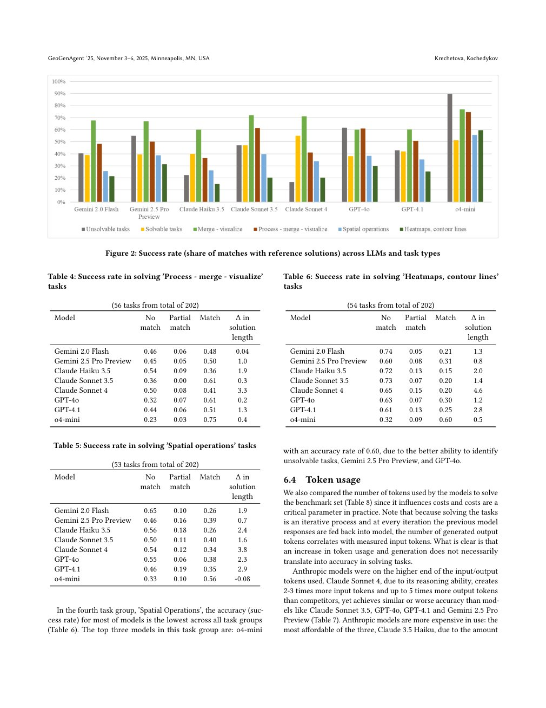

## PDF 第 007 页

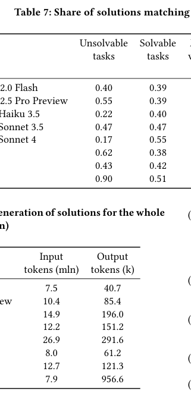

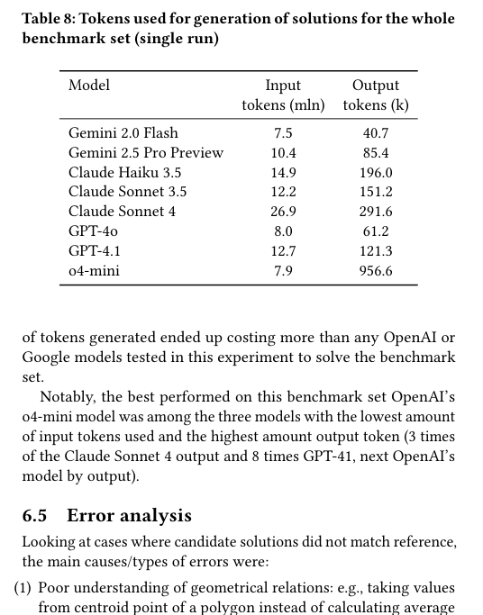

原论文页面图像（用于校对译文与图表）

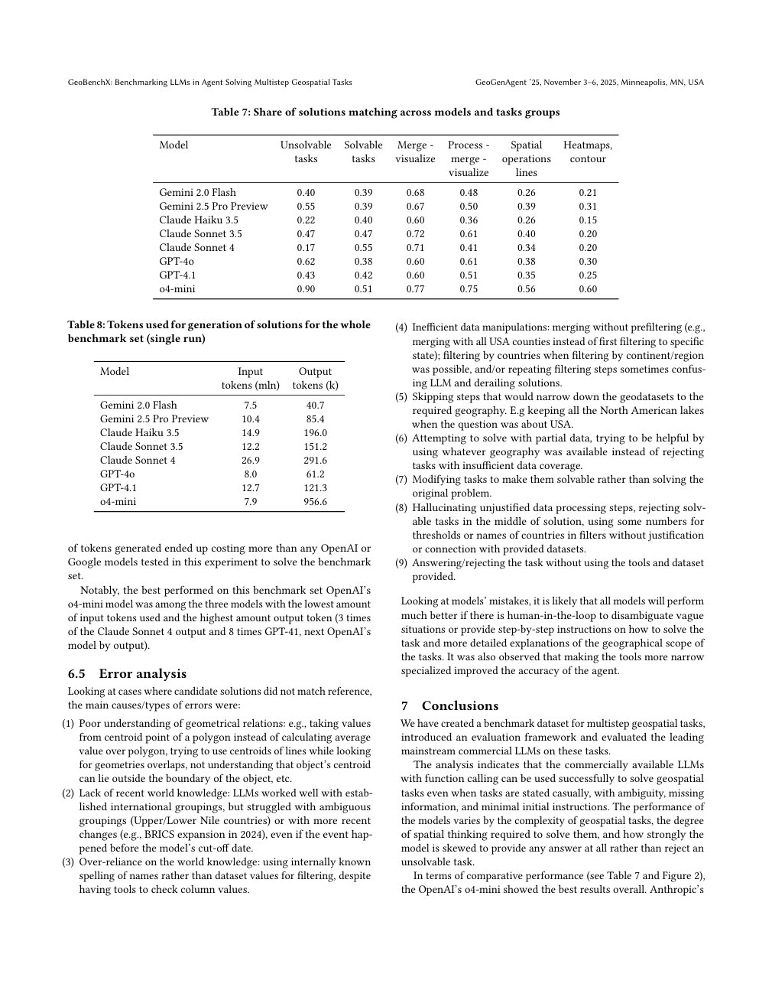

## PDF 第 008 页

原论文页面图像（用于校对译文与图表）

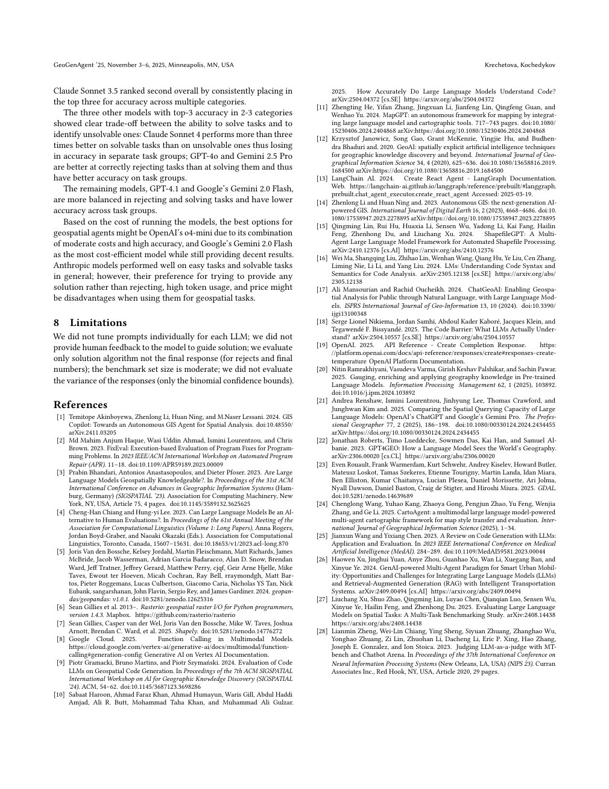

