# GeoCode-GPT：面向地理空间代码生成的大语言模型

**原论文**：GeoCode-GPT_A_large_language_model_for_geospatial_code_generation
**作者**：Shuyang Hou、Zhangxiao Shen、Anqi Zhao、Jianyuan Liang、Zhipeng Gui、Xuefeng Guan、Rui Li、Huayi Wu
**PDF 页数**：15

> 阅读说明：本文件提供按照原文结构整理的中文学术译述（涵盖研究背景、方法、评价、结果、附录说明），不是逐词、逐句覆盖全部英文的严格全文翻译。原 PDF 全部页面的英语文字、图表和参考文献保留于 `英文原文_逐页.md`、`original.pdf` 和 `source_pages/`。代码、模型名称、API 和学术引用保留原样，详情见 `QA_逐页核查.md`。

## 论文摘要（中文译文）

随着地球科学领域对时空数据和建模任务的需求不断增长，地理空间代码生成技术已成为提高生产效率的重要因素。尽管大语言模型（LLM）在代码生成方面展现出潜力，但由于缺乏领域专用知识与代码语料，它们在地理空间代码生成中经常出现拒绝生成代码或产生幻觉等问题。为此，本文构建并开源 GeoCode-PT 预训练语料库、GeoCode-SFT 监督微调语料库和 GeoCode-Eval 评价数据集。在此基础上，利用 QLoRA 和 LoRA 分别开展预训练与微调，从 Code Llama-7B 构建了面向地理空间代码生成的 GeoCode-GPT-7B。研究还提出结合选项匹配、专家核验和提示工程评分的综合评价框架，并使用 GeoCode-Eval 进行系统测试。实验表明，GeoCode-GPT 在多项任务上显著超越现有模型：多项选择任务的准确率相较对比模型提高 9.1—32.1 个百分点；代码摘要在完整性、准确性和可读性方面提高 1.7—25.4 分；代码生成在准确性、可读性和可执行性方面提高 1.2—25.1 分。研究证明，针对地理空间代码构建专用语料并进行领域微调，可以有效改善模型表现，拓展地理空间大模型的应用边界。

## 图片与原文索引

- 全文英文逐页提取：[英文原文_逐页.md](./英文原文_逐页.md)
- 逐页原稿截图：[逐页原稿_视觉索引.md](./逐页原稿_视觉索引.md)
- 图表索引：[图表索引.md](./图表索引.md)
- 核查与翻译覆盖说明：[QA_逐页核查.md](./QA_逐页核查.md)

---

## 中文正文（按 PDF 页码对应）

### PDF 第 1 页

## 1. 引言（上）
代码生成技术将自然语言转化为源代码（NL2Code），既可以用于 Python、C、JavaScript 等通用编程语言，也可以用于 MATLAB、Bioconductor、Google Earth Engine（GEE）等专门平台。地理空间代码通常用于 GEE、ArcGIS 等地理分析平台，或通过 Python 中的 GDAL、ArcPy、R 语言的 Raster 与 Terra 等工具来完成专用地理计算。随着时空数据规模增长，代码驱动的地理空间建模日益成为提高生产力的重要方式。

早期代码生成依赖启发式规则、专家系统、概率文法或小型预训练模型，通常需要人工标注，适用范围和扩展性有限。基于 Transformer 与自注意力机制的大语言模型出现后，模型逐步表现出任务执行、上下文学习和推理等能力；Code Llama、DeepSeek Coder、WizardCoder 等通用代码模型也推动了代码生成研究。然而，地理空间编程具有独特的数据、算子和平台依赖，直接使用通用模型仍面临困难。

<small>对照：[原稿第 1 页](./source_pages/page-001.jpg) · [英文全文](./英文原文_逐页.md)</small>

---

### PDF 第 2 页

## 1. 引言（续）
通用代码生成模型主要学习标准编程任务，而地理空间代码需要处理地理坐标、多维栅格、多波段光谱及规模庞大的遥感影像集合等复杂时空数据。各类平台具有专有的函数语法、数据流控制方式以及内部数据集索引和命名规范，因而模型可能出现算子选择错误、参数不合理、语法不符合平台要求、逻辑不完整以及输入输出类型不匹配等“代码幻觉”，甚至因不熟悉 API 而直接拒绝生成代码（图1）。

针对这些挑战，作者建设三类资源：GeoCode-PT 汇集 GEE、PIE Engine、ArcGIS、MATLAB、R 和 Python 等平台的代码及知识，包含 275,374 段代码、10,190 条算子知识、853 条数据集知识和 14 篇百科文档；GeoCode-SFT 通过结构化遍历与 Self-Instruct 产生 502,047 条指令数据；GeoCode-Eval 则包含 3,000 道选择题、500 道代码生成题和 500 道代码摘要题。通过 QLoRA 轻量预训练与 LoRA 指令微调，研究获得 GeoCode-GPT-7B。

**Fig. 1：代码生成中的“拒绝编程”与“代码幻觉”案例（算子、参数、语法、输入输出及逻辑错误）**

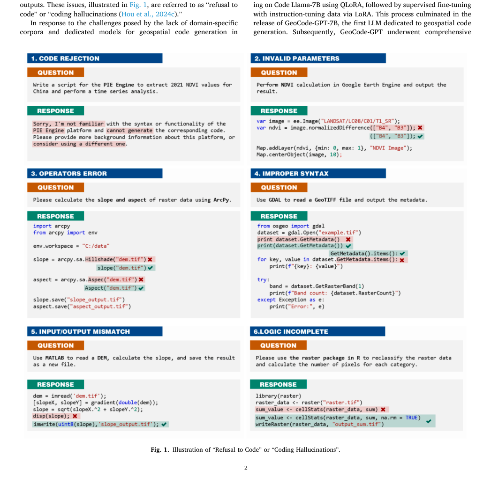

<small>对照：[原稿第 2 页](./source_pages/page-002.jpg) · [英文全文](./英文原文_逐页.md)</small>

---

### PDF 第 3 页

## 1. 引言（研究贡献）
作者从算子知识、数据集知识、平台/工具知识、平台识别、编程语言识别、实体提取、代码摘要和代码生成八个维度开展评价。评价结合选项匹配、专家人工核验与面向 LLM 的评分提示。领域知识注入使 GeoCode-GPT 相较通用模型在若干能力上占优；即使参数量显著小于商业模型，其部分成绩仍与商业模型接近。

本文贡献包括：（1）提出针对地理空间代码生成的 GeoCode-GPT-7B；（2）发布 GeoCode-PT、GeoCode-SFT 与 GeoCode-Eval，为领域预训练、指令微调和系统评价提供语料基础；（3）组合 QLoRA 与 LoRA，在计算资源和训练效率之间折中；（4）设计涵盖自动匹配、专家评价和 LLM 评分的综合评价体系。

## 2. 相关工作
**2.1 地理空间建模。** 地理空间建模采用数学模型及模拟来理解动态地理过程，已广泛用于环境监测、资源管理和城市规划。GEE 与 ArcGIS 等平台使图形化建模变得普及，但 GUI 依赖人工操作与预定义工具，限制了自动化和可扩展性；通过 Python、GDAL、MATLAB 工具箱等进行代码建模虽然更灵活，却要求使用者具备编程与地学知识。GeoGPT、MapGPT 等已有研究在自然语言交互方面取得进展，但代码驱动的专业地理建模仍需要专门模型支持。

**2.2 领域专用化的挑战。** 一方面，重新训练大型模型需要巨大的计算资源，领域知识难以及时更新；另一方面，通用语料缺少特定领域资料，导致模型在专业问题上生成看似合理但实际错误的内容。领域专用知识增强由此成为重要方向。

**Fig. 2：GeoCode-GPT 技术路线：语料、QLoRA 预训练、LoRA 微调与评价**

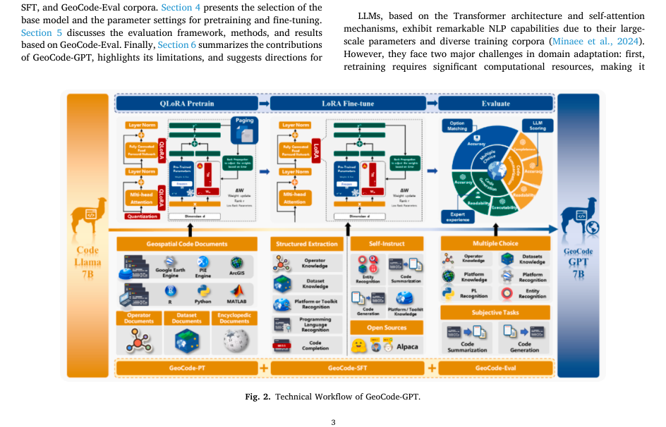

<small>对照：[原稿第 3 页](./source_pages/page-003.jpg) · [英文全文](./英文原文_逐页.md)</small>

---

### PDF 第 4 页

## 2.3 代码生成的微调策略与指令数据生成
代码生成要求模型理解指令、学习上下文并进行推理，将自然语言需求转为可执行程序。高质量指令数据至关重要，但人工构建受数据稀缺、费用和隐私限制。Self-Instruct 可利用模型自动合成指令；通常先在大量无标注代码上预训练以学习语法和语义，再用监督微调提高任务遵循能力。全参数微调的计算负担较重，LoRA 通过低秩适配减少可训练参数，QLoRA 再结合 4 位量化提高资源受限环境的训练效率。现有 Code Llama、DeepSeek Coder 等开源模型尚缺少专门的地理空间预训练和指令语料，形成研究空白。

## 2.4 LLM 代码生成评价
Exact Match、BLEU、ROUGE 等字符串或词元匹配指标无法充分反映代码可执行性、语法正确性及功能正确性。pass@k 等基于执行的指标更可靠，但地理空间程序往往依赖影像处理和平台专有操作，难以实现完全自动化测试。代码的可读性、简洁性以及数据引用准确性同样重要。人工评价可以判断质量，却存在主观性和一致性问题；AlpacaEval、MT-bench、ICE-Score 等以 LLM 为评价器的方法提供了新途径，但如何可靠地评价地理空间代码仍需探索。

## 3. 数据集构建：3.1 GeoCode-PT
GeoCode-PT 为无标注领域预训练语料，分为四类：代码文档、算子知识、数据集知识与百科文本。代码文档涵盖遥感影像处理与 GIS 空间分析：前者包括土地覆盖分类、变化检测、时序分析、NDVI/NDWI 等指数计算；后者包括缓冲区、叠置、矢量与栅格处理、地形分析、属性查询等。表1提供平台、语言、文件格式与数量清单，是本研究复现语料收集的重要依据。

**Table 1：GeoCode-PT 预训练语料构成与各平台数量**

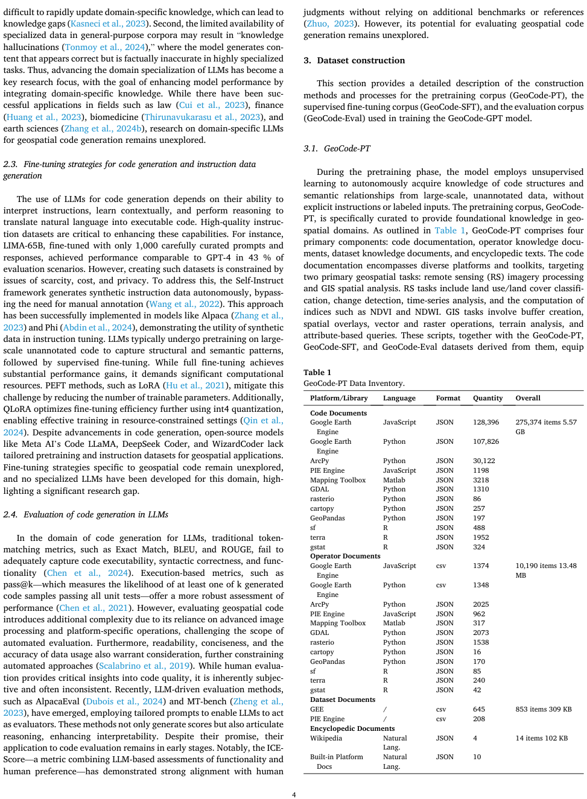

<small>对照：[原稿第 4 页](./source_pages/page-004.jpg) · [英文全文](./英文原文_逐页.md)</small>

---

### PDF 第 5 页

## 3.1 GeoCode-PT（续）
代码资料来自 GEE、PIE Engine 等云平台以及 ArcGIS、MATLAB、RStudio 和 Python 等本地工具，研究人员从 GitHub、Stack Overflow、Hugging Face 等来源收集了 275,374 段代码，检查语法并补充注释。10,190 条算子知识来自平台官方文档，记录名称、缩写、描述、输出类型与参数。853 条数据集知识包含标识符、名称、所属平台、目录、标签、DOI 和链接。14 篇百科文档描述地理空间平台及工具的概况。

## 3.2 GeoCode-SFT
监督微调语料采用“指令—输入—输出”（Instruct–Input–Output）结构：指令说明目标，输入给出数据或上下文，输出对应正确结果。语料既包含地理空间代码相关指令，也包含自然语言任务，以保持模型通用语言能力。其构建来源为开放数据、基于规则的结构化抽取与利用 LLM 的 Self-Instruct（表2）。

**3.2.1 规则结构化抽取。** 第一种方法为规则切分，针对 CSV、JSON 等结构化文件提取主体、属性以及对应值，形成指令与问答；第二种为规则遮蔽，从代码中挑选核心语句并掩盖，以不完整程序为输入、被遮蔽内容为输出，构造补全任务（图3）。

**3.2.2 Self-Instruct 生成。** 结构化抽取主要整理表面信息，难以体现深层语义和逻辑关联。Self-Instruct 通过模型推理与自我概括生成更丰富的指令。其一是以代码摘要等中间结果双向构造任务，其二是提供一个示例让模型从百科、工具说明等材料生成新指令，分别见图4、图5。

**3.2.3 自然语言风格指令。** 为防止仅使用代码指令造成通用理解与多语言能力退化，研究还纳入 Alpaca-GPT-4 的中、英、日、阿拉伯语、法语等多语言指令。

## 3.3 GeoCode-Eval
以布卢姆教育目标分类为参考，GeoCode-Eval 分为“认知与记忆”“理解与阐释”“创新与创造”三层。基础层用选择题测试算子与数据集、平台和语言识别、实体抽取；理解层测试代码摘要；创造层测试代码生成。作者通过考试题库与 Self-Instruct 收集选择题并人工核验答案和干扰选项。

**Table 2：GeoCode-SFT 监督微调数据构成**

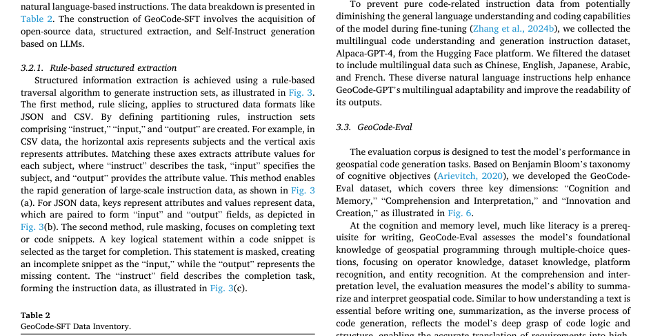

<small>对照：[原稿第 5 页](./source_pages/page-005.jpg) · [英文全文](./英文原文_逐页.md)</small>

---

### PDF 第 6 页

## 3.3 GeoCode-Eval（续）
代码摘要及代码生成题参照 GeoCode-SFT 的构建逻辑，使用有效代码片段和提示词生成问题及参考输出。摘要须准确表达代码功能、数据实体与重要逻辑，同时语言简练；500 个摘要样例及 500 个代码生成样例均经过人工检查。图7展示相关示例。

## 4. 模型训练
为降低训练资源需求，作者选用 QLoRA 完成领域预训练、用 LoRA 完成面向指令的微调。文中认为 QLoRA 可减少约 75% 的显存开销，而 LoRA 可加快微调收敛。两阶段训练使模型既学习领域代码分布，也强化理解和执行用户指令的能力。

**4.1 基础模型。** 基座采用 Code Llama-7B。Code Llama 建立在 LLaMA-2 之上，针对代码生成、补全和长上下文进行了专门训练；在 7B、13B、34B 三种规模中，7B 被选为性能、资源开销和低秩适配之间的平衡点。

**4.2 预训练。** 使用 GeoCode-PT 与 QLoRA 训练一个 epoch：全局批量 64、4 位量化、初始学习率 0.0002、余弦退火、前 5% 步数线性预热、权重衰减 0.1、梯度累积 4、最大输入长度 4096 tokens。训练硬件为两张 NVIDIA A100 40GB；QLoRA 秩 64、NF4 量化、缩放系数 128；优化 q_proj、k_proj、v_proj、o_proj 和 MLP 层，dropout 0.05。

**4.3 微调。** 随后的 LoRA 微调降低初始学习率以保持稳定。

**Fig. 3：基于规则的结构化指令抽取方法**

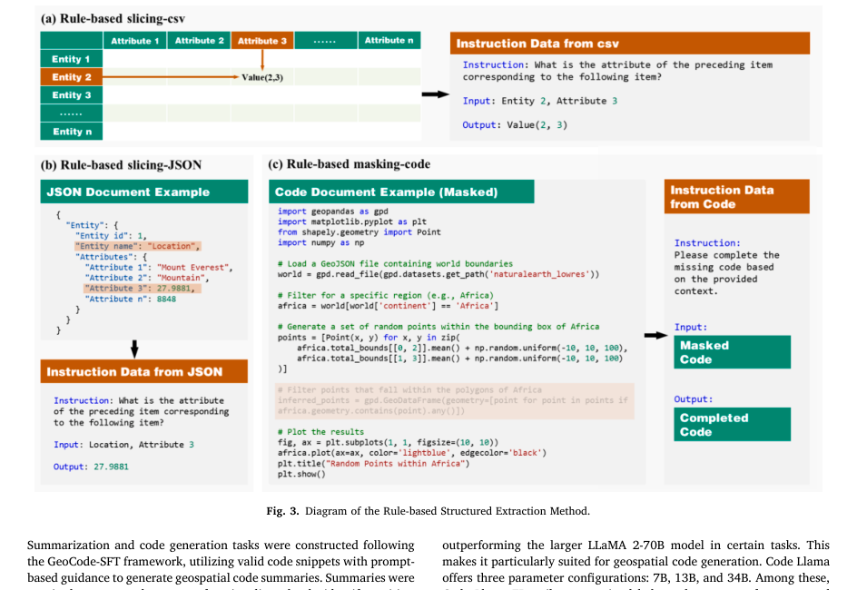

<small>对照：[原稿第 6 页](./source_pages/page-006.jpg) · [英文全文](./英文原文_逐页.md)</small>

---

### PDF 第 7 页

## 4.3 微调（续）
LoRA 指令微调的初始学习率设置为 0.0001，全局批量从预训练的 64 调整到 32，并通过梯度累积使有效批量达到 128；最大输入长度保持 4096 tokens。该阶段侧重任务专门化参数调整和复杂指令遵循能力。图4介绍基于中间结果的指令生成，图5介绍一次示例（one-shot）生成策略。

## 5. 评价
评价基于 GeoCode-Eval，覆盖专有商业模型、通用开源模型及代码模型，并与 Code Llama 基线比较，以检验领域语料和微调策略是否有效。

**Fig. 4：基于“中间结果生成”的 Self-Instruct 方法**

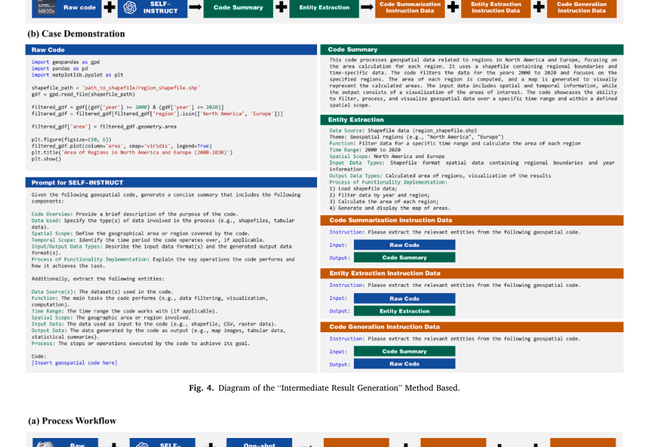

**Fig. 5：一次示例（one-shot）指令生成方法**

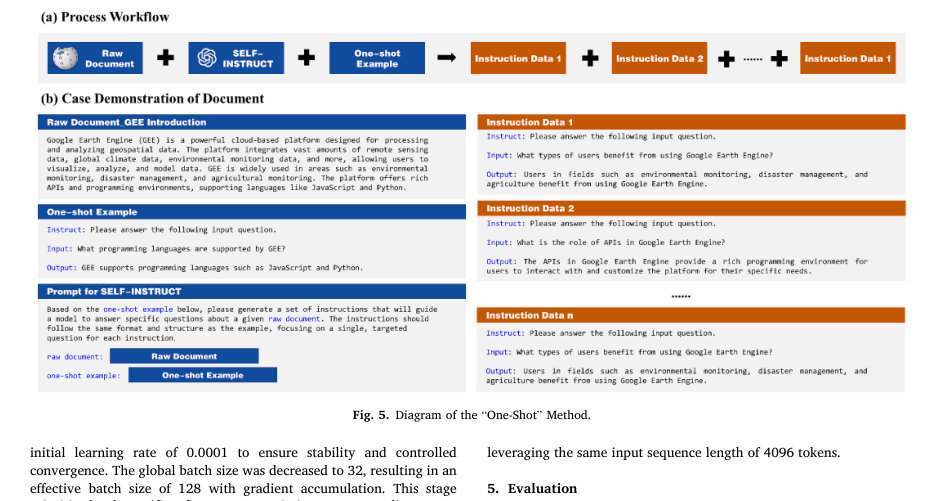

<small>对照：[原稿第 7 页](./source_pages/page-007.jpg) · [英文全文](./英文原文_逐页.md)</small>

---

### PDF 第 8 页

## 5.1 多项选择题
作者比较了 GPT-4、GPT-3.5、ERNIE 4.0、LLaMA 2-7B、LLaMA 3-8B、CodeGemma-7B、StarCoder 2-7B、CodeGeeX 2-6B、Code Llama-13B、Code Llama-7B 与 GeoCode-GPT-7B。3,000 道单选题均有四个选项和一个正确答案，覆盖算子知识（OK）、数据集知识（DK）、平台/工具知识（PTK）、平台/工具识别（PTR）、编程语言识别（PLR）和实体抽取（EE）六个维度，通过准确率比较模型表现。

GeoCode-GPT-7B 在全部维度上超过其基座 Code Llama-7B，提升幅度最小的是编程语言识别（8 个百分点），最大的是数据集知识（50.8 个百分点），六类平均提升 27.6 个百分点。相较 GPT-4，GeoCode-GPT 在平台/工具知识及实体抽取两类上分别落后 3.2 和 10.6 个百分点，但在其余维度更有优势。图6显示评价层级，表3列出题型与样本数量；图7给出具体试题。

**Table 3：GeoCode-Eval 评价题型与数量**

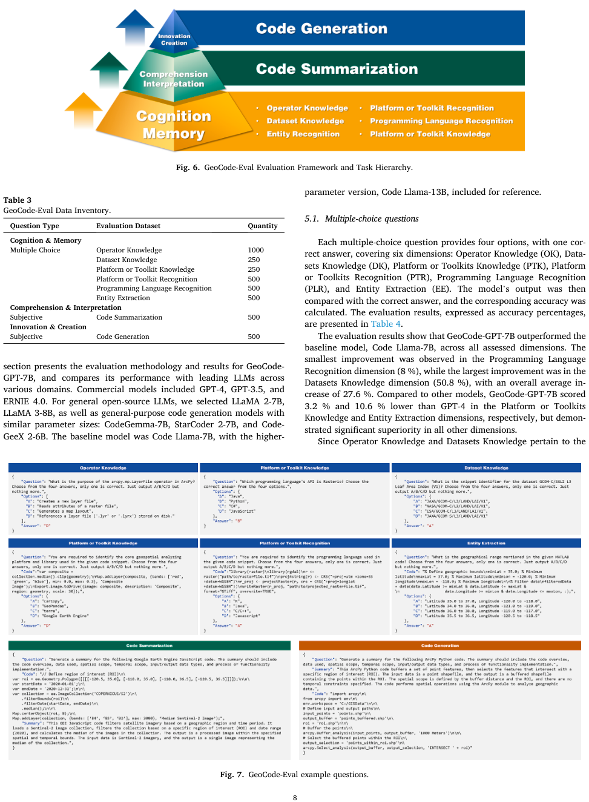

**Fig. 6：GeoCode-Eval 评价框架与任务层级**

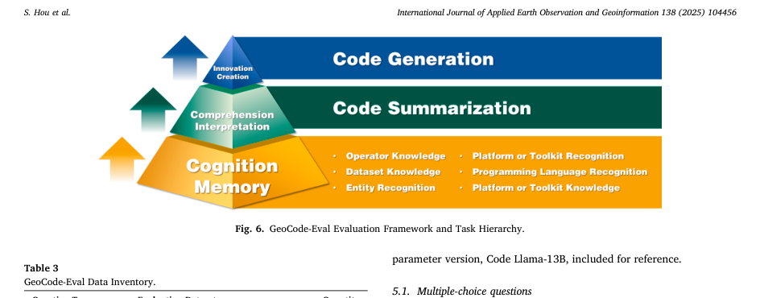

**Fig. 7：GeoCode-Eval 评价样题**

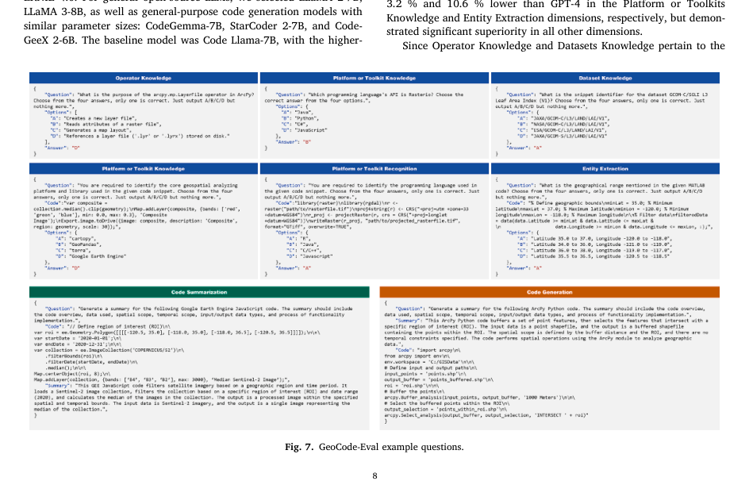

<small>对照：[原稿第 8 页](./source_pages/page-008.jpg) · [英文全文](./英文原文_逐页.md)</small>

---

### PDF 第 9 页

## 5.1 多项选择题（结果解释）
表4显示，GeoCode-GPT-7B 在六个维度上的准确率分别为：算子知识 87.3%、数据集知识 79.2%、平台/工具知识 75.2%、平台识别 90.2%、语言识别 95.4%、实体提取 74.6%，平均 84.8%。由于平台内置数据集及算子知识高度专业化，在通用模型语料中出现不足，许多基线模型在数据集知识上表现较差。通用模型往往能够判断编程语言，却难以识别小众平台或准确匹配具体 API；领域指令训练弥补了这一弱点。

在实体提取任务中，需要较强的语义理解，通用 LLM 通常略优于通用代码生成模型，而 GeoCode-GPT 只落后于 GPT-4。综合结果说明，针对领域专有知识构建语料和微调有实际价值。

## 5.2 主观题评价
地理空间代码经常处理遥感影像、时空数据及依赖专业平台的算子，普通编译器不一定能直接运行或展示结果；而人工审查成本高，且可能存在主观偏差。作者设计了专用提示词，让 GPT-4 作为自动评价器，同时对代码摘要与代码生成分别使用不同的维度和规则。

**5.2.1 代码摘要。** 摘要的三项指标为完整性（Completeness）、准确性（Accuracy）与可读性（Readability）。完整性重点考查代码概况、使用数据集、空间范围、时间范围、输入输出数据类型及功能描述，准确性关注语义/实体是否忠实于代码，可读性关注表达清晰度。

**Table 4：多项选择题各模型准确率**

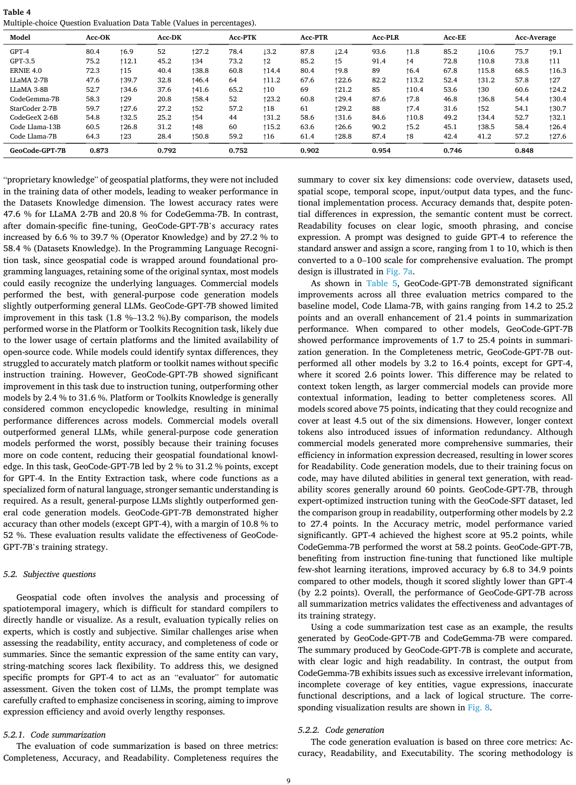

<small>对照：[原稿第 9 页](./source_pages/page-009.jpg) · [英文全文](./英文原文_逐页.md)</small>

---

### PDF 第 10 页

## 5.2.1 代码摘要（结果）
表5给出百分制评分。GeoCode-GPT-7B 的完整性、准确性、可读性分别为 91.6、93.0、89.6 分，综合 91.4 分。相对基座 Code Llama-7B，其综合成绩提高 21.4 分；相较 GPT-4，完整性与准确性稍低，但可读性高 10 分，综合成绩高 1.7 分。图7a展示评价提示词，是判断此类 LLM-as-a-Judge 指标如何构造的重要依据。

**5.2.2 代码生成。** 作者采用准确性、可读性和可执行性三个维度。准确性由专用提示词提取代码中的关键实体——数据来源、时间、空间、输入与输出等——并比较其与题目要求是否一致。可执行性由专家在相应平台运行程序，以成功执行的比例评分。可读性采用盲审排序：专家同时查看 11 个模型为同一道题生成的代码，按易读性从 1（最好）到 11（最差）排序，汇总 500 道题的排名后归一化。原文中用符号 \(R_i\) 表示模型的平均排名，并用 \((11-R_i)/11	imes100\) 转换评分；正文公式周围的指标名称存在排版上易混淆之处，应以原图与上下文共同核对。

**Table 5：代码摘要评价结果（百分制）**

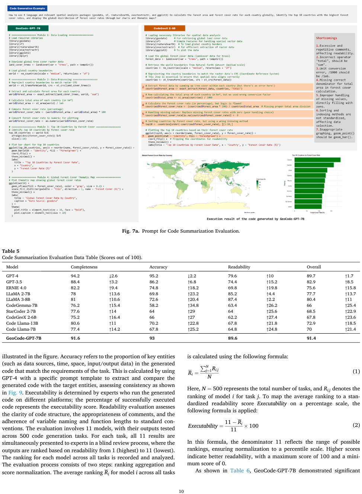

**Fig. 7a：代码摘要评价提示词示例**

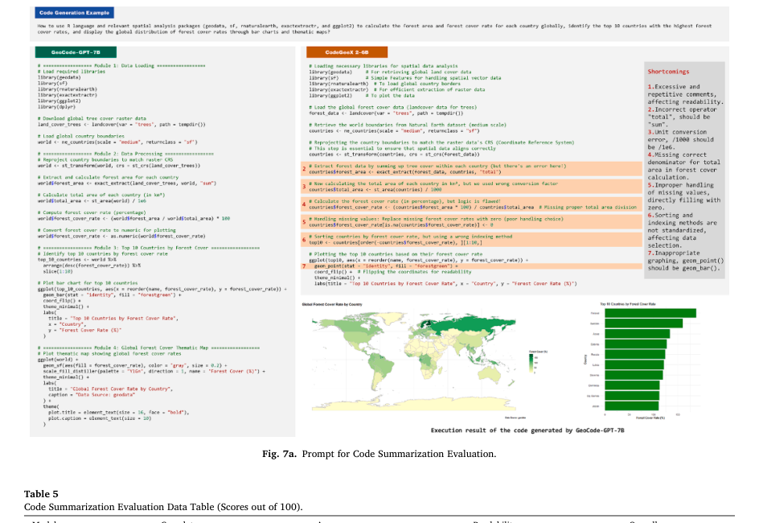

<small>对照：[原稿第 10 页](./source_pages/page-010.jpg) · [英文全文](./英文原文_逐页.md)</small>

---

### PDF 第 11 页

## 5.2.2 代码生成（结果）
表6显示，GeoCode-GPT-7B 在代码生成的准确性、可读性、可执行性上分别获得 70.6、69.8、50.4 分，综合 63.6 分。与 Code Llama-7B 相比，综合提高 25.1 分，可读性提高 37.3 分；与 GPT-4 相比，三个维度仍分别落后 3.6、16.4、2.4 分。GeoCode-GPT 在可执行性上虽明显优于若干开源模型，但其 50.4 分也说明真实平台运行仍然是重要瓶颈。文中通过 GeoCode-GPT 与 CodeGeeX2-6B 的代码案例对比，指出后者可能产生冗余注释、错误参数、API 用法不当、逻辑缺陷或功能缺漏（图10）。

## 6. 结论
研究建立 GeoCode-PT、GeoCode-SFT 和 GeoCode-Eval 三项资源，并从 Code Llama-7B 构建了专用于地理空间代码生成的 GeoCode-GPT-7B。基于 QLoRA、LoRA 的训练策略与结合选项匹配、专家核验、LLM 自动评分的评价框架，使模型在多种任务中表现优于基线和不少更大规模模型，但部分维度与 GPT-4 仍存在差距。

## 6.1 局限性
作者提出进一步扩充高质量指令和代码语料、加强结构化知识表达、使用更强计算资源与更充分训练，以提升复杂代码的可执行性。现有工作主要评价单模态自然语言驱动的代码生成，尚未直接处理图像；有关知识问答、调试、补全和跨语言翻译的应用也尚未系统展开，多模态能力仍有待发展。

## 6.2 展望
未来可建设更大的专用模型、多模态多场景数据和基准，集成跨平台接口与自动化代码测试；还可探索仓库级地理空间代码生成中的索引、上下文、记忆及多智能体协作，提高自动生成、测试和优化流程的可靠性。

**Fig. 8：代码摘要评价的对比结果**

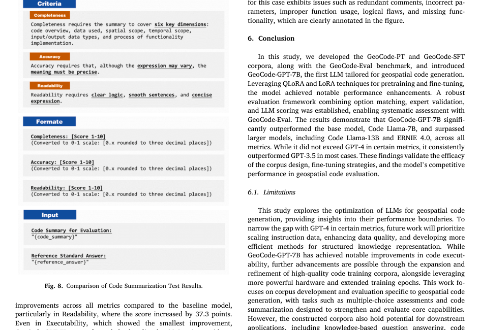

<small>对照：[原稿第 11 页](./source_pages/page-011.jpg) · [英文全文](./英文原文_逐页.md)</small>

---

### PDF 第 12 页

## 6.2 展望（续）
论文继续强调代码生成、测试、改进的自动化工作流，认为跨平台代码翻译可以降低工具语法门槛，多智能体协作可能进一步提高代码质量和生成效率。图9展示代码生成准确性评价提示词，表6是 11 个对比模型在代码生成维度的核心结果，相关数值以原图为准。

**Table 6：代码生成评价结果（百分制）**

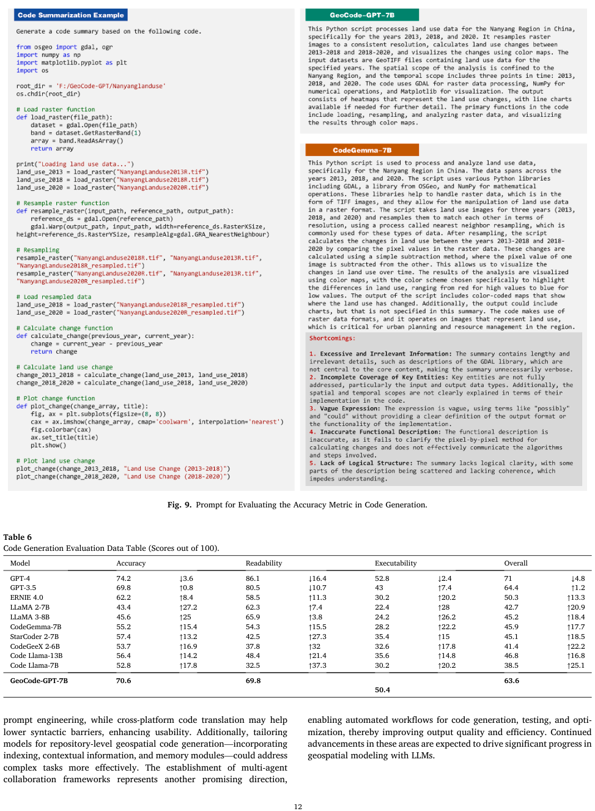

**Fig. 9：代码生成准确性指标的评价提示词**

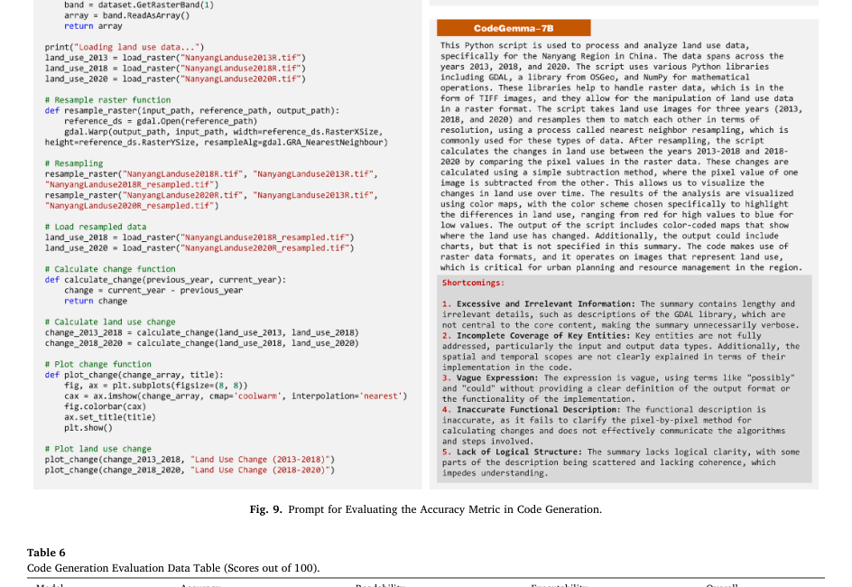

<small>对照：[原稿第 12 页](./source_pages/page-012.jpg) · [英文全文](./英文原文_逐页.md)</small>

---

### PDF 第 13 页

## 作者贡献及声明
本页包括作者贡献（CRediT authorship contribution）、利益冲突声明和补充资料入口等。姓名、资助单位和原文书目信息应保持原样以便引用。完整英文见 `英文原文_逐页.md` 和 `original.pdf`。

**Fig. 10：GeoCode-GPT 与对比模型生成代码案例**

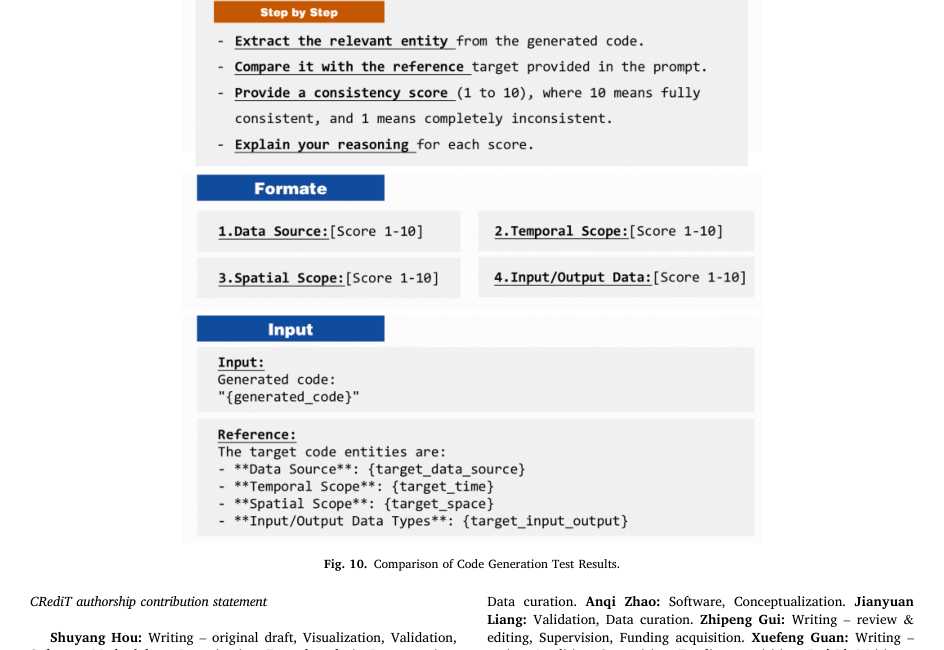

<small>对照：[原稿第 13 页](./source_pages/page-013.jpg) · [英文全文](./英文原文_逐页.md)</small>

---

### PDF 第 14 页

## 致谢、补充资料与参考文献（起）
本页涉及数据与代码获取、利益冲突和参考文献内容。参考文献作者、出版年份、期刊、卷期和 DOI 均在英文逐页稿中完整保留，以便准确检索。

<small>对照：[原稿第 14 页](./source_pages/page-014.jpg) · [英文全文](./英文原文_逐页.md)</small>

---

### PDF 第 15 页

## 参考文献（续）
该页主要为参考文献。为避免破坏国际通行的英文书目信息和 DOI，参考文献完整保留在逐页英文稿中，本页对应的原稿截图也可直接打开核对。

<small>对照：[原稿第 15 页](./source_pages/page-015.jpg) · [英文全文](./英文原文_逐页.md)</small>

---

## 专业术语对照

| 英文原词 | 中文处理 |
|---|---|
| geospatial code generation | 地理空间代码生成 |
| parameter-efficient fine-tuning (PEFT) | 参数高效微调 |
| QLoRA | 量化低秩适配 |
| LoRA | 低秩适配 |
| instruction tuning | 指令微调 |
| coding hallucination | 代码幻觉 |
| refusal to code | 拒绝生成代码 |
| operator knowledge | 算子知识 |
| dataset knowledge | 数据集知识 |
| executability | 可执行性 |
| completeness | 完整性 |
| readability | 可读性 |

## 参考文献说明

论文参考文献书目保留作者、年份、刊物、英文题名和 DOI 的正式格式。请参见 [参考文献与英文附录_原文.md](./参考文献与英文附录_原文.md)，以及原始 PDF。
