# GeoCode-GPT — 原始英文全文（按PDF页码提取）

> 提取顺序：优先按双栏从左到右、从上到下；图表/特殊公式排版请以所附原始 PDF 及 source_pages 为准。

原始 PDF 页数：**15**。

## PDF 第 1 页

International Journal of Applied Earth Observation and Geoinformation 138 (2025) 104456

Contents lists available at ScienceDirect

International Journal of Applied Earth  
Observation and Geoinformation

journal homepage: www.elsevier.com/locate/jag

GeoCode-GPT: A large language model for geospatial code generation☆

Shuyang Hou a, Zhangxiao Shen a, Anqi Zhao a, Jianyuan Liang a, Zhipeng Gui b, Xuefeng Guan a,  
Rui Li a, Huayi Wu a,*

a State Key Laboratory of Information Engineering in Surveying, Mapping and Remote Sensing, Wuhan University, Wuhan, China
b School of Remote Sensing and Information Engineering, Wuhan University, Wuhan, China

A R T I C L E  I N F O

A B S T R A C T

Keywords:
Large language model (LLM)
Geospatial code generation
Fine-tuning
Corpus
Self-supervision
Hallucination

The increasing demand for spatiotemporal data and modeling tasks in geosciences has made geospatial code 
generation technology a critical factor in enhancing productivity. Although large language models (LLMs) have 
demonstrated potential in code generation tasks, they often encounter issues such as refusal to code or hallu­
cination in geospatial code generation due to a lack of domain-specific knowledge and code corpora. To address 
these challenges, this paper presents and open-sources the GeoCode-PT and GeoCode-SFT corpora, along with the 
GeoCode-Eval evaluation dataset. Additionally, by leveraging QLoRA and LoRA for pretraining and fine-tuning, 
we introduce GeoCode-GPT-7B, the first LLM focused on geospatial code generation, fine-tuned from Code 
Llama-7B. Furthermore, we establish a comprehensive geospatial code evaluation framework, incorporating 
option matching, expert validation, and prompt engineering scoring for LLMs, and systematically evaluate 
GeoCode-GPT-7B using the GeoCode-Eval dataset. Experimental results reveal that GeoCode-GPT significantly 
outperforms existing models across multiple tasks. For multiple-choice tasks, its accuracy improves by 9.1% to 
32.1%. In code summarization, it achieves superior scores in completeness, accuracy, and readability, with gains 
ranging from 1.7 to 25.4 points. For code generation, its performance in accuracy, readability, and executability 
surpasses benchmarks by 1.2 to 25.1 points. Grounded in the fine-tuning paradigm, this study introduces and 
validates an approach to enhance LLMs in geospatial code generation and associated tasks. These findings extend 
the application boundaries of such models in geospatial domains and offer a robust foundation for exploring their 
latent potential.

1. Introduction

Code generation technology translates natural language into source 
code (NL2Code), which can pertain to general-purpose programming 
languages such as Python, C, or JavaScript, or domain-specific lan­
guages for specialized platforms like MATLAB, Bioconductor, or Google 
Earth Engine (GEE) (Jiang et al., 2024). Geospatial code is specifically 
designed for geospatial analysis platforms (e.g., GEE, ArcGIS) or 
modeling tasks, typically implemented through wrappers around 
general-purpose languages or by invoking specialized geocomputational 
tools and libraries, such as GDAL and ArcPy in Python, or the Raster and 
Terra packages in R (Coetzee et al., 2020). With the surge in spatio­
temporal data, the growing demand for geospatial modeling tasks has 
made geospatial code generation technology a critical factor in 
enhancing productivity (Hou et al., 2024a).

Code generation is fundamentally a subset of natural language pro­
cessing (NLP). Early research in this area primarily relied on heuristic 
rules (Nymeyer and Katoen, 1997) and expert systems (Lirov, 1991), 
such as probabilistic grammar-based frameworks (Kifetew et al., 2017) 
and small-scale pretrained models (Li et al., 2019). These methods 
depended on annotated data, had limited applicability, and were diffi­
cult to scale. With the advent of large language models (LLMs) based on 
self-attention mechanisms and the Transformer architecture, models 
trained on vast corpora have demonstrated “emergent” abilities, such as 
task execution, in-context learning, and reasoning (Zhao et al., 2023). 
General-purpose LLMs specifically designed for code generation, such as 
Code LLaMA (Roziere et al., 2023), DeepSeek Coder (Guo et al., 2024), 
and WizardCoder (Luo et al., 2023), are reshaping the research para­
digm in this field. These models’ instruction-based code generation ca­
pabilities allow even programming novices to produce functional code,

☆This article is part of a special issue entitled: ‘Foundation models EO’ published in International Journal of Applied Earth Observation and Geoinformation.

* Corresponding author.

E-mail address: wuhuayi@whu.edu.cn (H. Wu).

https://doi.org/10.1016/j.jag.2025.104456
Received 23 October 2024; Received in revised form 24 February 2025; Accepted 27 February 2025

Available online 5 March 2025 
1569-8432/© 2025 The Authors. Published by Elsevier B.V. This is an open access article under the CC BY-NC license ( http://creativecommons.org/licenses/by- 
nc/4.0/ ).

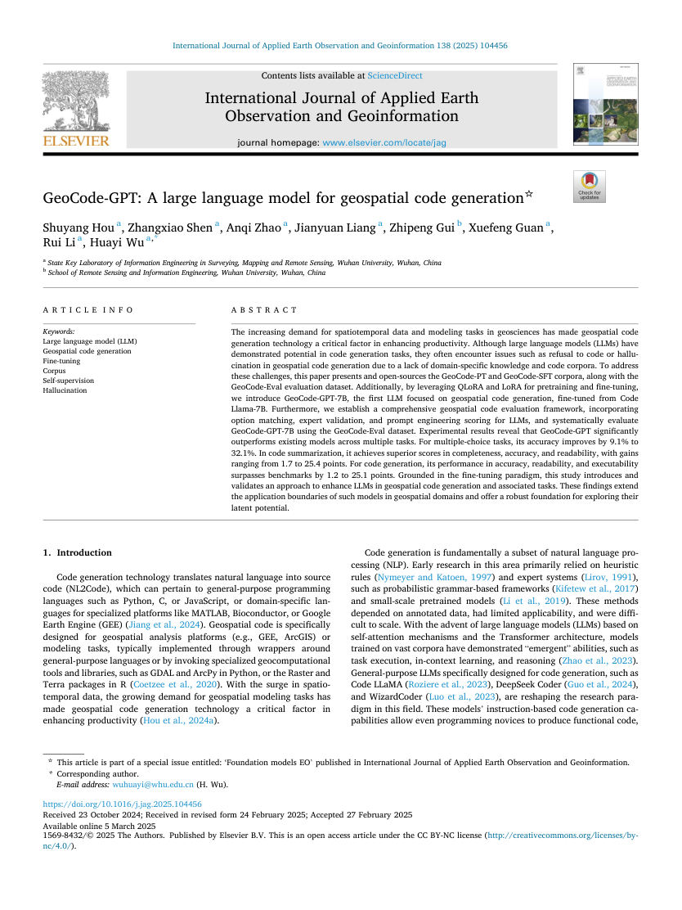

## PDF 第 2 页

S. Hou et al.                                                                                                                                                                                                                                     
International Journal of Applied Earth Observation and Geoinformation 138 (2025) 104456

driving the democratization of programming and significantly boosting 
productivity, enabling users to focus on higher-level logic and planning.

General-purpose code generation LLMs are predominantly trained on 
code related to standard programming tasks. In contrast, geospatial code 
typically handles complex spatiotemporal data, characterized by spe­
cific data formats (e.g., geographic coordinates, multi-dimensional ras­
ters, multi-band spectra) and massive datasets (e.g., global remote 
sensing collections) (Hou et al., 2024b). Since geospatial code is often 
executed on specialized platforms with unique function syntax and data 
flow control logic, it significantly differs from general-purpose code 
(Cinquini et al., 2014). Furthermore, these platforms’ built-in datasets 
frequently use proprietary internal indexing and naming conventions, 
which general LLMs are usually unfamiliar with. As a result, when 
generating geospatial code, models may fail to encode correctly, or 
produce code with incorrect operator choices, non-compliant syntax, 
unreasonable parameters, incomplete logic, or mismatched inputs and 
outputs. These issues, illustrated in Fig. 1, are referred to as “refusal to 
code” or “coding hallucinations (Hou et al., 2024c).”

In response to the challenges posed by the lack of domain-specific 
corpora and dedicated models for geospatial code generation in

general LLMs, this study introduces the GeoCode-PT pretraining corpus, 
the GeoCode-SFT supervised fine-tuning corpus, and the GeoCode-Eval 
evaluation dataset. GeoCode-PT aggregates multi-source data closely 
related to geospatial code, including specialized code from platforms 
like GEE and PIE Engine, as well as geocomputational tool code from 
platforms such as ArcGIS, Matlab, RStudio, and Python. It comprises a 
total of 275,374 code snippets, 10,190 operator knowledge entries, 853 
dataset knowledge entries, and 14 common knowledge documents on 
platforms and toolsets. GeoCode-SFT, built using a structured traversal 
algorithm and the Self-Instruct framework, generated 502,047 instruc­
tion data entries, covering operators, datasets, platform language un­
derstanding, and code summarization. GeoCode-Eval consists of 3,000 
multiple-choice questions, 500 code generation tasks, and 500 code 
summarization tasks.

Based on GeoCode-PT and GeoCode-SFT, this study employs an 
autoregressive unsupervised approach to conduct lightweight pretrain­
ing on Code Llama-7B using QLoRA, followed by supervised fine-tuning 
with instruction-tuning data via LoRA. This process culminated in the 
release of GeoCode-GPT-7B, the first LLM dedicated to geospatial code 
generation. Subsequently, GeoCode-GPT underwent comprehensive

Fig. 1. Illustration of “Refusal to Code” or “Coding Hallucinations”.

2

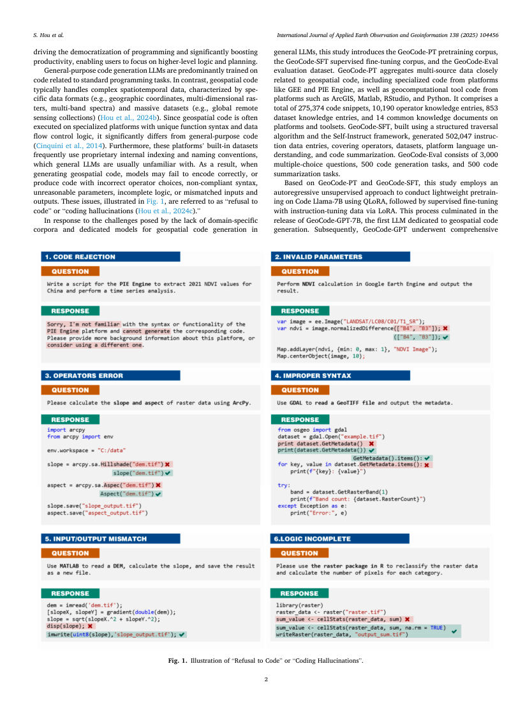

## PDF 第 3 页

S. Hou et al.                                                                                                                                                                                                                                     
International Journal of Applied Earth Observation and Geoinformation 138 (2025) 104456

evaluation using GeoCode-Eval, across eight key dimensions closely 
related to geospatial code generation: Operator Knowledge, Dataset 
Knowledge, Platform or Toolkit Knowledge, Platform or Toolkit 
Recognition, Programming Language Recognition, Entity Extraction, 
Code Summarization, and Code Generation. The evaluation was con­
ducted through option matching, expert validation, and prompt engi­
neering scoring. With the enrichment of extensive geospatial 
knowledge, GeoCode-GPT outperforms general-purpose models in 
several capabilities, and despite having significantly fewer parameters 
than commercial models, it approaches their performance in certain 
metrics. This achievement advances the application and development of 
LLMs in geospatial code generation. The overall research framework is 
illustrated in Fig. 2.

Our contributions are summarized as follows:

• We introduce GeoCode-GPT-7B, the first LLM specifically designed 
for geospatial code generation tasks.
• We developed and open-sourced the GeoCode-PT and GeoCode-SFT 
corpora, as well as the GeoCode-Eval evaluation set, providing a 
systematic corpus foundation and evaluation tools for pretraining 
and fine-tuning LLMs in geospatial code generation tasks. https:// 
github.com/whuhsy/GeoCode-GPT.
• We propose a novel pretraining and fine-tuning strategy that com­

bines QLoRA and LoRA, offering a new approach to balancing 
computational resources and training efficiency.
• We established a comprehensive evaluation framework for geo­

spatial code, incorporating option matching, expert validation, and 
prompt engineering scoring for LLMs, providing insights for the 
holistic evaluation of domain-specific models.

The structure of this paper is as follows: Section 2 reviews related 
research on geospatial modeling, domain-specific challenges for LLMs, 
fine-tuning strategies for code generation, and instruction data genera­
tion. Section 3 outlines the construction of the GeoCode-PT, GeoCode- 
SFT, and GeoCode-Eval corpora. Section 4 presents the selection of the 
base model and the parameter settings for pretraining and fine-tuning. 
Section 5 discusses the evaluation framework, methods, and results 
based on GeoCode-Eval. Finally, Section 6 summarizes the contributions 
of GeoCode-GPT, highlights its limitations, and suggests directions for

future research.

2. Related work

2.1. Geospatial modeling

Geospatial modeling, a core method in geographic information sci­
ence, employs mathematical models and simulations to analyze dynamic 
geographic phenomena, supporting applications such as environmental 
monitoring, resource management, and urban planning (Tao, 2013). 
Platforms like GEE and ArcGIS have popularized GUI-based modeling, 
which, while user-friendly, is constrained by reliance on manual in­
teractions and prebuilt functions, limiting efficiency and scalability 
(Tamiminia et al., 2020). In response, code-driven modeling has 
emerged, allowing users to leverage APIs for more flexible analyses, 
function extensions, and reusable scripts (Kessel and Atkinson, 2024). 
Tools like Python’s GDAL library and Matlab’s Mapping Toolbox 
exemplify this paradigm, offering specialized support for geospatial data 
processing. Despite these advancements, the technical demands of 
scripting—requiring both programming expertise and geospatial 
knowledge—limit accessibility for non-experts and pose challenges for 
interdisciplinary use. Recent progress in LLMs presents new possibilities 
for geospatial modeling. Studies like GeoGPT (Zhang et al., 2024c) and 
MapGPT (Zhang et al., 2024a) have shown how LLMs can facilitate 
natural language interactions, enhancing user engagement with geo­
spatial tools, particularly in GUI-based workflows. However, these ef­
forts largely focus on improving GUI functionalities and offer limited 
support for code-driven modeling. Addressing this gap, this study in­
troduces a fine-tuned LLM framework specifically for geospatial code 
generation, aiming to expand the scope and capabilities of advanced 
geospatial modeling tasks.

2.2. Challenges in domain specialization for LLMs

LLMs, based on the Transformer architecture and self-attention 
mechanisms, exhibit remarkable NLP capabilities due to their large- 
scale parameters and diverse training corpora (Minaee et al., 2024). 
However, they face two major challenges in domain adaptation: first, 
retraining requires significant computational resources, making it

Fig. 2. Technical Workflow of GeoCode-GPT.

3

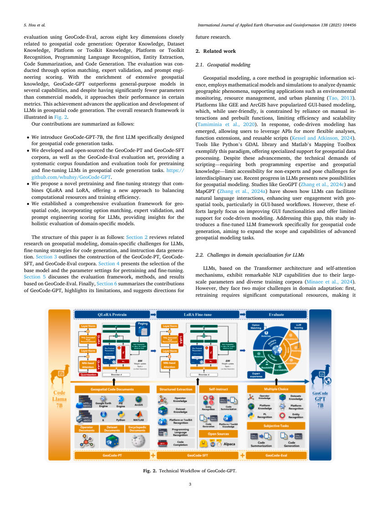

## PDF 第 4 页

S. Hou et al.                                                                                                                                                                                                                                     
International Journal of Applied Earth Observation and Geoinformation 138 (2025) 104456

difficult to rapidly update domain-specific knowledge, which can lead to 
knowledge gaps (Kasneci et al., 2023). Second, the limited availability of 
specialized data in general-purpose corpora may result in “knowledge 
hallucinations (Tonmoy et al., 2024),” where the model generates con­
tent that appears correct but is factually inaccurate in highly specialized 
tasks. Thus, advancing the domain specialization of LLMs has become a 
key research focus, with the goal of enhancing model performance by 
integrating domain-specific knowledge. While there have been suc­
cessful applications in fields such as law (Cui et al., 2023), finance 
(Huang et al., 2023), biomedicine (Thirunavukarasu et al., 2023), and 
earth sciences (Zhang et al., 2024b), research on domain-specific LLMs 
for geospatial code generation remains unexplored.

2.3. Fine-tuning strategies for code generation and instruction data 
generation

The use of LLMs for code generation depends on their ability to 
interpret instructions, learn contextually, and perform reasoning to 
translate natural language into executable code. High-quality instruc­
tion datasets are critical to enhancing these capabilities. For instance, 
LIMA-65B, fine-tuned with only 1,000 carefully curated prompts and 
responses, achieved performance comparable to GPT-4 in 43 % of 
evaluation scenarios. However, creating such datasets is constrained by 
issues of scarcity, cost, and privacy. To address this, the Self-Instruct 
framework generates synthetic instruction data autonomously, bypass­
ing the need for manual annotation (Wang et al., 2022). This approach 
has been successfully implemented in models like Alpaca (Zhang et al., 
2023) and Phi (Abdin et al., 2024), demonstrating the utility of synthetic 
data in instruction tuning. LLMs typically undergo pretraining on large- 
scale unannotated code to capture structural and semantic patterns, 
followed by supervised fine-tuning. While full fine-tuning achieves 
substantial performance gains, it demands significant computational 
resources. PEFT methods, such as LoRA (Hu et al., 2021), mitigate this 
challenge by reducing the number of trainable parameters. Additionally, 
QLoRA optimizes fine-tuning efficiency further using int4 quantization, 
enabling effective training in resource-constrained settings (Qin et al., 
2024). Despite advancements in code generation, open-source models 
like Meta AI’s Code LLaMA, DeepSeek Coder, and WizardCoder lack 
tailored pretraining and instruction datasets for geospatial applications. 
Fine-tuning strategies specific to geospatial code remain unexplored, 
and no specialized LLMs have been developed for this domain, high­
lighting a significant research gap.

2.4. Evaluation of code generation in LLMs

In the domain of code generation for LLMs, traditional token- 
matching metrics, such as Exact Match, BLEU, and ROUGE, fail to 
adequately capture code executability, syntactic correctness, and func­
tionality (Chen et al., 2024). Execution-based metrics, such as 
pass@k—which measures the likelihood of at least one of k generated 
code samples passing all unit tests—offer a more robust assessment of 
performance (Chen et al., 2021). However, evaluating geospatial code 
introduces additional complexity due to its reliance on advanced image 
processing and platform-specific operations, challenging the scope of 
automated evaluation. Furthermore, readability, conciseness, and the 
accuracy of data usage also warrant consideration, further constraining 
automated approaches (Scalabrino et al., 2019). While human evalua­
tion provides critical insights into code quality, it is inherently subjec­
tive and often inconsistent. Recently, LLM-driven evaluation methods, 
such as AlpacaEval (Dubois et al., 2024) and MT-bench (Zheng et al., 
2023), have emerged, employing tailored prompts to enable LLMs to act 
as evaluators. These methods not only generate scores but also articulate 
reasoning, enhancing interpretability. Despite their promise, their 
application to code evaluation remains in early stages. Notably, the ICE- 
Score—a metric combining LLM-based assessments of functionality and 
human preference—has demonstrated strong alignment with human

judgments without relying on additional benchmarks or references 
(Zhuo, 2023). However, its potential for evaluating geospatial code 
generation remains unexplored.

3. Dataset construction

This section provides a detailed description of the construction 
methods and processes for the pretraining corpus (GeoCode-PT), the 
supervised fine-tuning corpus (GeoCode-SFT), and the evaluation corpus 
(GeoCode-Eval) used in training the GeoCode-GPT model.

3.1. GeoCode-PT

During the pretraining phase, the model employs unsupervised 
learning to autonomously acquire knowledge of code structures and 
semantic relationships from large-scale, unannotated data, without 
explicit instructions or labeled inputs. The pretraining corpus, GeoCode- 
PT, is specifically curated to provide foundational knowledge in geo­
spatial domains. As outlined in Table 1, GeoCode-PT comprises four 
primary components: code documentation, operator knowledge docu­
ments, dataset knowledge documents, and encyclopedic texts. The code 
documentation encompasses diverse platforms and toolkits, targeting 
two primary geospatial tasks: remote sensing (RS) imagery processing 
and GIS spatial analysis. RS tasks include land use/land cover classifi­
cation, change detection, time-series analysis, and the computation of 
indices such as NDVI and NDWI. GIS tasks involve buffer creation, 
spatial overlays, vector and raster operations, terrain analysis, and 
attribute-based queries. These scripts, together with the GeoCode-PT, 
GeoCode-SFT, and GeoCode-Eval datasets derived from them, equip

Table 1 
GeoCode-PT Data Inventory.

Platform/Library
Language
Format
Quantity
Overall

Code Documents
Google Earth 
Engine

JavaScript
JSON
128,396
275,374 items 5.57 
GB
Google Earth 
Engine

Python
JSON
107,826

ArcPy
Python
JSON
30,122
PIE Engine
JavaScript
JSON
1198
Mapping Toolbox
Matlab
JSON
3218
GDAL
Python
JSON
1310
rasterio
Python
JSON
86
cartopy
Python
JSON
257
GeoPandas
Python
JSON
197
sf
R
JSON
488
terra
R
JSON
1952
gstat
R
JSON
324
Operator Documents
Google Earth 
Engine

JavaScript
csv
1374
10,190 items 13.48 
MB
Google Earth 
Engine

Python
csv
1348

ArcPy
Python
JSON
2025
PIE Engine
JavaScript
JSON
962
Mapping Toolbox
Matlab
JSON
317
GDAL
Python
JSON
2073
rasterio
Python
JSON
1538
cartopy
Python
JSON
16
GeoPandas
Python
JSON
170
sf
R
JSON
85
terra
R
JSON
240
gstat
R
JSON
42
Dataset Documents
GEE
/
csv
645
853 items 309 KB
PIE Engine
/
csv
208
Encyclopedic Documents
Wikipedia
Natural 
Lang.

JSON
4
14 items 102 KB

Built-in Platform 
Docs

Natural 
Lang.

JSON
10

4

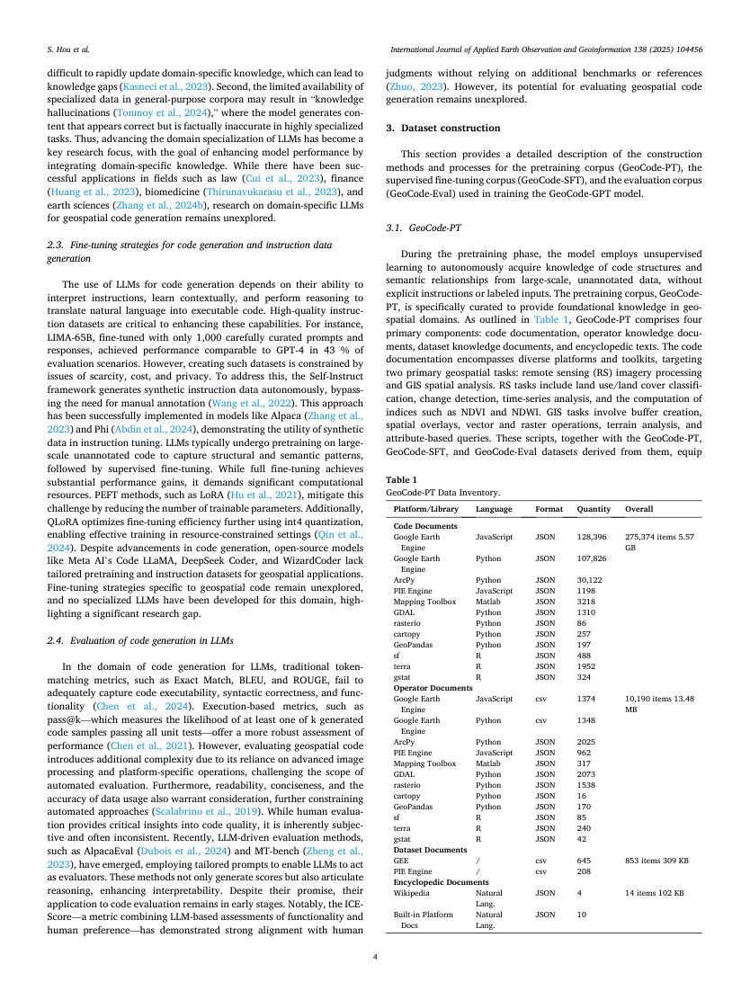

## PDF 第 5 页

S. Hou et al.                                                                                                                                                                                                                                     
International Journal of Applied Earth Observation and Geoinformation 138 (2025) 104456

GeoCode-GPT to effectively manage both raster and vector data, facili­
tating comprehensive geospatial analysis.

The code documentation comprises specialized scripts from cloud 
platforms like GEE and PIE Engine, along with locally developed code 
using tools such as ArcGIS, Matlab, RStudio, and Python. A total of 
275,374 code snippets were sourced from platforms like GitHub, Stack 
Overflow, and Hugging Face, screened for syntax accuracy, and anno­
tated with comments. The operator knowledge documents aggregate 
10,190 commonly used operators and their syntactic details from official 
geoscience platform documentation, including full names, abbrevia­
tions, descriptions, output types, and parameters. The dataset knowl­
edge documents cover 853 built-in datasets from platforms such as GEE 
and PIE Engine, extracted from official resources. Each entry includes 
identifiers, names, platforms, directories, tags, DOIs, and links. Addi­
tionally, 14 encyclopedic documents from Wikipedia provide summaries 
of geospatial analysis platforms and their tools. Dimensional informa­
tion for each document category is summarized in Appendix 1.

3.2. GeoCode-SFT

The supervised fine-tuning corpus consists of high-quality, domain- 
specific instructions following an “Instruct-Input-Output” structure, 
where the “Instruct” prompts the task, the “Input” provides the input 
data, and the “Output” generates the correct answer (Wang et al., 2024). 
These instructions are designed to enhance the model’s ability to 
generate geospatial code, ensuring that GeoCode-GPT can accurately 
interpret human instructions and produce natural language outputs. 
GeoCode-SFT includes both geospatial code-related instructions and 
natural language-based instructions. The data breakdown is presented in 
Table 2. The construction of GeoCode-SFT involves the acquisition of 
open-source data, structured extraction, and Self-Instruct generation 
based on LLMs.

3.2.1. Rule-based structured extraction

Structured information extraction is achieved using a rule-based 
traversal algorithm to generate instruction sets, as illustrated in Fig. 3. 
The first method, rule slicing, applies to structured data formats like 
JSON and CSV. By defining partitioning rules, instruction sets 
comprising “instruct,” “input,” and “output” are created. For example, in 
CSV data, the horizontal axis represents subjects and the vertical axis 
represents attributes. Matching these axes extracts attribute values for 
each subject, where “instruct” describes the task, “input” specifies the 
subject, and “output” provides the attribute value. This method enables 
the rapid generation of large-scale instruction data, as shown in Fig. 3
(a). For JSON data, keys represent attributes and values represent data, 
which are paired to form “input” and “output” fields, as depicted in 
Fig. 3(b). The second method, rule masking, focuses on completing text 
or code snippets. A key logical statement within a code snippet is 
selected as the target for completion. This statement is masked, creating 
an incomplete snippet as the “input,” while the “output” represents the 
missing content. The “instruct” field describes the completion task, 
forming the instruction data, as illustrated in Fig. 3(c).

Table 2 
GeoCode-SFT Data Inventory.

Production Method
Dataset Type
Quantity

Structured
Operator Knowledge
26,130
Dataset Knowledge
2,511
Platform or Toolkit Recognition
18,827
Programming Language Recognition
18,827
Code Completion
14,817
Large Model
Entity Extraction
18,827
Code Summarization
18,827
Code Generation
18,827
Platform or Toolkit Knowledge
454

Open Source
Alpaca
7*52,000

3.2.2. Self-Instruct generation

The instruction tuning data from structured extraction primarily 
organizes the textual content of the pretraining data in sequence, 
functioning as a form of “pre-disclosure” for downstream tasks. This 
method emphasizes surface-level information organization but lacks 
deeper semantic connections. In contrast, the Self-Instruct framework 
generates synthetic instruction sets through the model’s reasoning 
abilities, uncovering the underlying semantic relationships and logical 
patterns. This approach not only systematically organizes knowledge 
but also reveals deeper logical relationships, aiming to significantly 
enhance the model’s understanding and application capabilities in 
geospatial code generation tasks. The construction process is illustrated 
in Fig. 4 and Fig. 5.

The Self-Instruct framework centers on guiding LLMs to self- 
summarize via prompt engineering, enabling the generation of task- 
specific instruction sets. This process involves two approaches. The 
first utilizes intermediate results, constructing instruction sets through 
predefined rules and machine learning algorithms, as illustrated in Fig. 4
(a). For example, high-quality code from GeoCode-PT is selected to 
generate summaries, with instructions created by bidirectionally pairing 
the code and its summary, as shown in Fig. 4(b). The second approach 
leverages one-shot learning, where a few examples are provided to 
enable the model to autonomously summarize knowledge and generate 
instructions. The workflow is depicted in Fig. 5(a). An example is the 
extraction of cognitive instructions for platforms and toolkits from 
encyclopedic documents, as demonstrated in Fig. 5(b).

3.2.3. Natural language style instruction tuning data

To prevent pure code-related instruction data from potentially 
diminishing the general language understanding and coding capabilities 
of the model during fine-tuning (Zhang et al., 2024b), we collected the 
multilingual code understanding and generation instruction dataset, 
Alpaca-GPT-4, from the Hugging Face platform. We filtered the dataset 
to include multilingual data such as Chinese, English, Japanese, Arabic, 
and French. These diverse natural language instructions help enhance 
GeoCode-GPT’s multilingual adaptability and improve the readability of 
its outputs.

3.3. GeoCode-Eval

The evaluation corpus is designed to test the model’s performance in 
geospatial code generation tasks. Based on Benjamin Bloom’s taxonomy 
of cognitive objectives (Arievitch, 2020), we developed the GeoCode- 
Eval dataset, which covers three key dimensions: “Cognition and 
Memory,” “Comprehension and Interpretation,” and “Innovation and 
Creation,” as illustrated in Fig. 6.

At the cognition and memory level, much like literacy is a prereq­
uisite for writing, GeoCode-Eval assesses the model’s foundational 
knowledge of geospatial programming through multiple-choice ques­
tions, focusing on operator knowledge, dataset knowledge, platform 
recognition, and entity recognition. At the comprehension and inter­
pretation level, the evaluation measures the model’s ability to summa­
rize and interpret geospatial code. Similar to how understanding a text is 
essential before writing one, summarization, as the inverse process of 
code generation, reflects the model’s deep grasp of code logic and 
structure, enabling the accurate translation of requirements into high- 
quality code. Finally, at the innovation and creation level, the model’s 
code generation capabilities are directly evaluated through coding tasks. 
The detailed data breakdown is presented in Table 3.

To ensure fairness and prevent knowledge leakage, all multiple- 
choice questions in GeoCode-Eval were sourced from platforms such 
as Baidu Wenku, Niuke, and Daoke Wenku, covering university exams 
and basic programming tests, or generated using the Self-Instruct 
framework with GeoCode-PT data. Each question underwent manual 
validation to ensure the uniqueness of correct answers and the plausi­
bility of distractors, resulting in 3,000 multiple-choice questions.

5

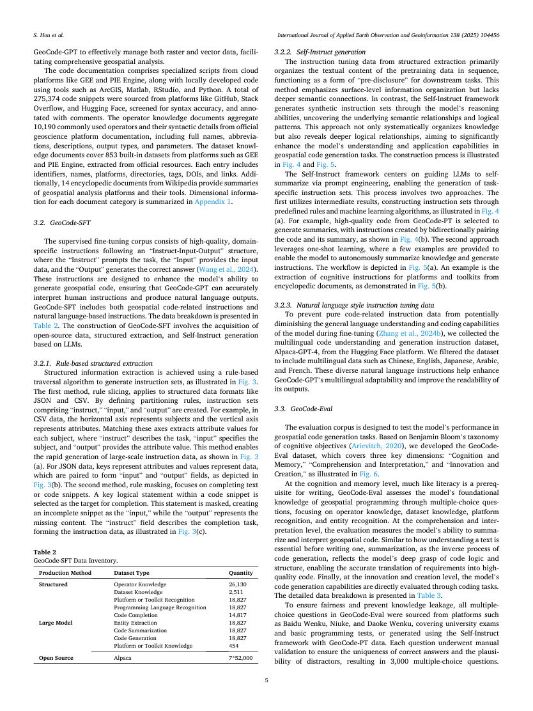

## PDF 第 6 页

S. Hou et al.                                                                                                                                                                                                                                     
International Journal of Applied Earth Observation and Geoinformation 138 (2025) 104456

Fig. 3. Diagram of the Rule-based Structured Extraction Method.

Summarization and code generation tasks were constructed following 
the GeoCode-SFT framework, utilizing valid code snippets with prompt- 
based guidance to generate geospatial code summaries. Summaries were 
required to accurately capture functionality, clearly identify entities, 
and maintain concise language. In total, 500 summarization tasks and 
500 code generation tasks were created, with all questions and answers 
manually verified for quality and clarity. The example questions are 
shown in Fig. 7.

4. Model training

A robust base model is essential for effective fine-tuning. While 
general-purpose code generation models are optimized for coding tasks, 
they lack domain-specific knowledge of geospatial code, making fine- 
tuning indispensable. This study employs a general code generation 
model as the foundation. QLoRA reduces GPU memory usage by 
approximately 75 %, enabling larger batch sizes and longer sequences, 
making it well-suited for large-scale code processing in resource-limited 
settings. Conversely, LoRA accelerates fine-tuning convergence by 
approximately 66 %, making it ideal for high-precision instruction 
tuning. Accordingly, QLoRA is utilized for pretraining and LoRA for fine- 
tuning, achieving a balance between computational efficiency and 
training precision. This section introduces the base model, Code Llama- 
7B, and the two training stages of GeoCode-GPT.

4.1. Base model

Code Llama was selected as the base model. Built on the widely 
adopted LLaMA-2 foundation, Code Llama incorporates specialized 
training for code generation tasks. It has demonstrated strong perfor­
mance in benchmarks such as HumanEval and MBPP, excelling in code 
generation, code completion, and handling long contexts, even

outperforming the larger LLaMA 2-70B model in certain tasks. This 
makes it particularly suited for geospatial code generation. Code Llama 
offers three parameter configurations: 7B, 13B, and 34B. Among these, 
Code Llama-7B strikes an optimal balance between performance and 
resource efficiency while supporting effective LoRA fine-tuning. 
Considering its performance, flexibility, and lower training costs, Code 
Llama-7B was chosen as the base model for this study.

4.2. Pretraining

During the pretraining phase, we optimized the Code Llama-7B 
model using the GeoCode-PT corpus with QLoRA, combining quanti­
zation and low-rank adaptation to reduce memory usage and support the 
longest possible input sequences, thereby improving the model’s 
learning efficiency. The specific hyperparameter configuration is as 
follows: a global batch size of 64, int4 quantization precision, and one 
training epoch. The initial learning rate was set at 0.0002, with a cosine 
decay scheduler and linear warmup over the first 5 % of steps. A weight 
decay factor of 0.1 was applied to prevent overfitting. Gradient accu­
mulation steps were set to 4, and the maximum input sequence length 
was 4096 tokens, ensuring smooth operation on two NVIDIA A100 40 
GB GPUs. For the QLoRA configuration, we set the rank value to 64, used 
NF4 quantization, and a scaling factor of 128. The main modules opti­
mized included the q_proj, v_proj, k_proj, o_proj, and MLP layers. A 
dropout probability of 0.05 was applied to mitigate the risk of 
overfitting.

4.3. Fine-tuning

Following QLoRA pretraining, fine-tuning was performed using 
LoRA to further enhance task-specific capabilities and adaptability. 
Distinct from the pretraining phase, fine-tuning employed a reduced

6

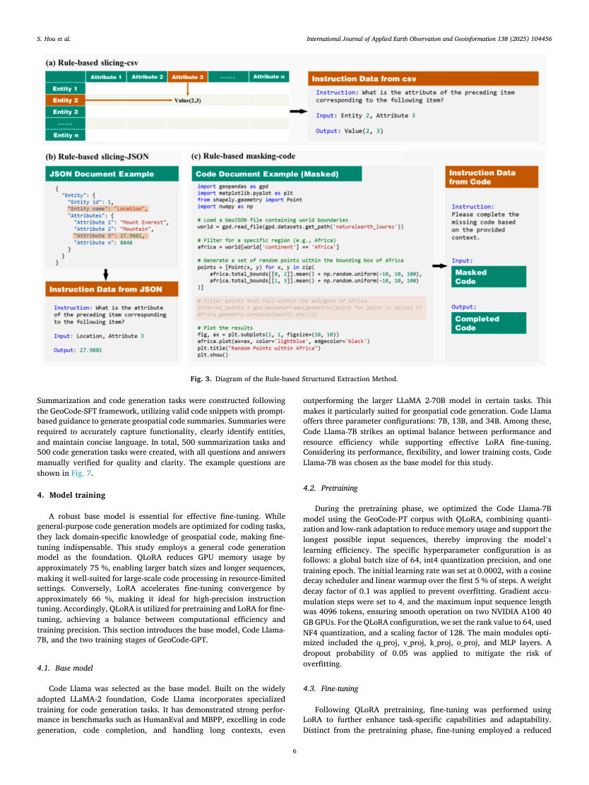

## PDF 第 7 页

S. Hou et al.                                                                                                                                                                                                                                     
International Journal of Applied Earth Observation and Geoinformation 138 (2025) 104456

Fig. 4. Diagram of the “Intermediate Result Generation” Method Based.

Fig. 5. Diagram of the “One-Shot” Method.

initial learning rate of 0.0001 to ensure stability and controlled 
convergence. The global batch size was decreased to 32, resulting in an 
effective batch size of 128 with gradient accumulation. This stage 
prioritized task-specific refinements to optimize parameter adjustments, 
improving the model’s ability to follow complex instructions while

leveraging the same input sequence length of 4096 tokens.

5. Evaluation

The evaluation was conducted using the GeoCode-Eval dataset. This

7

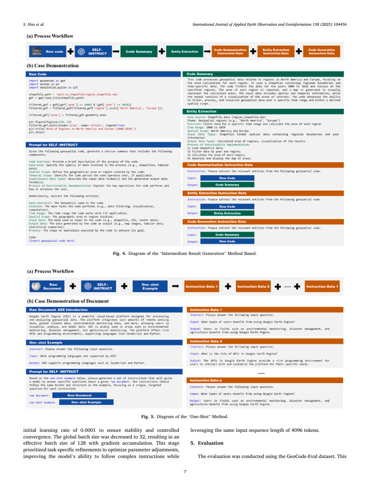

## PDF 第 8 页

S. Hou et al.                                                                                                                                                                                                                                     
International Journal of Applied Earth Observation and Geoinformation 138 (2025) 104456

Fig. 6. GeoCode-Eval Evaluation Framework and Task Hierarchy.

Table 3 
GeoCode-Eval Data Inventory.

Question Type
Evaluation Dataset
Quantity

Cognition & Memory
Multiple Choice
Operator Knowledge
1000
Dataset Knowledge
250
Platform or Toolkit Knowledge
250
Platform or Toolkit Recognition
500
Programming Language Recognition
500
Entity Extraction
500
Comprehension & Interpretation
Subjective
Code Summarization
500
Innovation & Creation
Subjective
Code Generation
500

section presents the evaluation methodology and results for GeoCode- 
GPT-7B, and compares its performance with leading LLMs across 
various domains. Commercial models included GPT-4, GPT-3.5, and 
ERNIE 4.0. For general open-source LLMs, we selected LLaMA 2-7B, 
LLaMA 3-8B, as well as general-purpose code generation models with 
similar parameter sizes: CodeGemma-7B, StarCoder 2-7B, and Code­
GeeX 2-6B. The baseline model was Code Llama-7B, with the higher-

parameter version, Code Llama-13B, included for reference.

5.1. Multiple-choice questions

Each multiple-choice question provides four options, with one cor­
rect answer, covering six dimensions: Operator Knowledge (OK), Data­
sets Knowledge (DK), Platform or Toolkits Knowledge (PTK), Platform 
or Toolkits Recognition (PTR), Programming Language Recognition 
(PLR), and Entity Extraction (EE). The model’s output was then 
compared with the correct answer, and the corresponding accuracy was 
calculated. The evaluation results, expressed as accuracy percentages, 
are presented in Table 4.

The evaluation results show that GeoCode-GPT-7B outperformed the 
baseline model, Code Llama-7B, across all assessed dimensions. The 
smallest improvement was observed in the Programming Language 
Recognition dimension (8 %), while the largest improvement was in the 
Datasets Knowledge dimension (50.8 %), with an overall average in­
crease of 27.6 %. Compared to other models, GeoCode-GPT-7B scored 
3.2 % and 10.6 % lower than GPT-4 in the Platform or Toolkits 
Knowledge and Entity Extraction dimensions, respectively, but demon­
strated significant superiority in all other dimensions.

Since Operator Knowledge and Datasets Knowledge pertain to the

Fig. 7. GeoCode-Eval example questions.

8

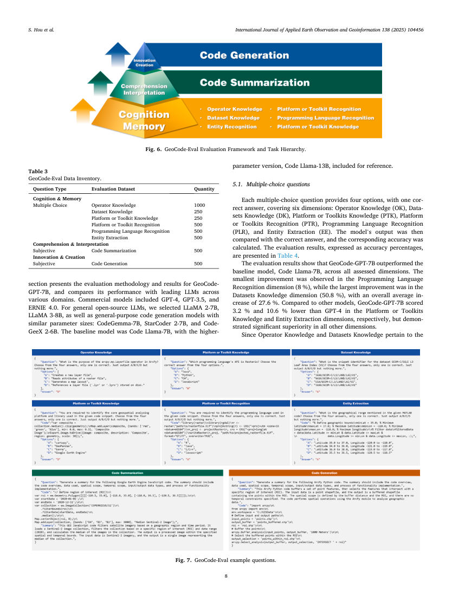

## PDF 第 9 页

S. Hou et al.                                                                                                                                                                                                                                     
International Journal of Applied Earth Observation and Geoinformation 138 (2025) 104456

Table 4 
Multiple-choice Question Evaluation Data Table (Values in percentages).

Model
Acc-OK
Acc-DK
Acc-PTK
Acc-PTR
Acc-PLR
Acc-EE
Acc-Average

GPT-4
80.4
↑6.9
52
↑27.2
78.4
↓3.2
87.8
↓2.4
93.6
↑1.8
85.2
↓10.6
75.7
↑9.1
GPT-3.5
75.2
↑12.1
45.2
↑34
73.2
↑2
85.2
↑5
91.4
↑4
72.8
↑10.8
73.8
↑11
ERNIE 4.0
72.3
↑15
40.4
↑38.8
60.8
↑14.4
80.4
↑9.8
89
↑6.4
67.8
↑15.8
68.5
↑16.3
LLaMA 2-7B
47.6
↑39.7
32.8
↑46.4
64
↑11.2
67.6
↑22.6
82.2
↑13.2
52.4
↑31.2
57.8
↑27
LLaMA 3-8B
52.7
↑34.6
37.6
↑41.6
65.2
↑10
69
↑21.2
85
↑10.4
53.6
↑30
60.6
↑24.2
CodeGemma-7B
58.3
↑29
20.8
↑58.4
52
↑23.2
60.8
↑29.4
87.6
↑7.8
46.8
↑36.8
54.4
↑30.4
StarCoder 2-7B
59.7
↑27.6
27.2
↑52
57.2
↑18
61
↑29.2
88
↑7.4
31.6
↑52
54.1
↑30.7
CodeGeeX 2-6B
54.8
↑32.5
25.2
↑54
44
↑31.2
58.6
↑31.6
84.6
↑10.8
49.2
↑34.4
52.7
↑32.1
Code Llama-13B
60.5
↑26.8
31.2
↑48
60
↑15.2
63.6
↑26.6
90.2
↑5.2
45.1
↑38.5
58.4
↑26.4
Code Llama-7B
64.3
↑23
28.4
↑50.8
59.2
↑16
61.4
↑28.8
87.4
↑8
42.4
41.2
57.2
↑27.6

GeoCode-GPT-7B
0.873
0.792
0.752
0.902
0.954
0.746
0.848

“proprietary knowledge” of geospatial platforms, they were not included 
in the training data of other models, leading to weaker performance in 
the Datasets Knowledge dimension. The lowest accuracy rates were 
47.6 % for LLaMA 2-7B and 20.8 % for CodeGemma-7B. In contrast, 
after domain-specific fine-tuning, GeoCode-GPT-7B’s accuracy rates 
increased by 6.6 % to 39.7 % (Operator Knowledge) and by 27.2 % to 
58.4 % (Datasets Knowledge). In the Programming Language Recogni­
tion task, since geospatial code is wrapped around foundational pro­
gramming languages, retaining some of the original syntax, most models 
could easily recognize the underlying languages. Commercial models 
performed the best, with general-purpose code generation models 
slightly outperforming general LLMs. GeoCode-GPT-7B showed limited 
improvement in this task (1.8 %–13.2 %).By comparison, the models 
performed worse in the Platform or Toolkits Recognition task, likely due 
to the lower usage of certain platforms and the limited availability of 
open-source code. While models could identify syntax differences, they 
struggled to accurately match platform or toolkit names without specific 
instruction training. However, GeoCode-GPT-7B showed significant 
improvement in this task due to instruction tuning, outperforming other 
models by 2.4 % to 31.6 %. Platform or Toolkits Knowledge is generally 
considered common encyclopedic knowledge, resulting in minimal 
performance differences across models. Commercial models overall 
outperformed general LLMs, while general-purpose code generation 
models performed the worst, possibly because their training focuses 
more on code content, reducing their geospatial foundational knowl­
edge. In this task, GeoCode-GPT-7B led by 2 % to 31.2 % points, except 
for GPT-4. In the Entity Extraction task, where code functions as a 
specialized form of natural language, stronger semantic understanding is 
required. As a result, general-purpose LLMs slightly outperformed gen­
eral code generation models. GeoCode-GPT-7B demonstrated higher 
accuracy than other models (except GPT-4), with a margin of 10.8 % to 
52 %. These evaluation results validate the effectiveness of GeoCode- 
GPT-7B’s training strategy.

5.2. Subjective questions

Geospatial code often involves the analysis and processing of 
spatiotemporal imagery, which is difficult for standard compilers to 
directly handle or visualize. As a result, evaluation typically relies on 
experts, which is costly and subjective. Similar challenges arise when 
assessing the readability, entity accuracy, and completeness of code or 
summaries. Since the semantic expression of the same entity can vary, 
string-matching scores lack flexibility. To address this, we designed 
specific prompts for GPT-4 to act as an “evaluator” for automatic 
assessment. Given the token cost of LLMs, the prompt template was 
carefully crafted to emphasize conciseness in scoring, aiming to improve 
expression efficiency and avoid overly lengthy responses.

5.2.1. Code summarization

The evaluation of code summarization is based on three metrics: 
Completeness, Accuracy, and Readability. Completeness requires the

summary to cover six key dimensions: code overview, datasets used, 
spatial scope, temporal scope, input/output data types, and the func­
tional implementation process. Accuracy demands that, despite poten­
tial differences in expression, the semantic content must be correct. 
Readability focuses on clear logic, smooth phrasing, and concise 
expression. A prompt was designed to guide GPT-4 to reference the 
standard answer and assign a score, ranging from 1 to 10, which is then 
converted to a 0–100 scale for comprehensive evaluation. The prompt 
design is illustrated in Fig. 7a.

As shown in Table 5, GeoCode-GPT-7B demonstrated significant 
improvements across all three evaluation metrics compared to the 
baseline model, Code Llama-7B, with gains ranging from 14.2 to 25.2 
points and an overall enhancement of 21.4 points in summarization 
performance. When compared to other models, GeoCode-GPT-7B 
showed performance improvements of 1.7 to 25.4 points in summari­
zation generation. In the Completeness metric, GeoCode-GPT-7B out­
performed all other models by 3.2 to 16.4 points, except for GPT-4, 
where it scored 2.6 points lower. This difference may be related to 
context token length, as larger commercial models can provide more 
contextual information, leading to better completeness scores. All 
models scored above 75 points, indicating that they could recognize and 
cover at least 4.5 out of the six dimensions. However, longer context 
tokens also introduced issues of information redundancy. Although 
commercial models generated more comprehensive summaries, their 
efficiency in information expression decreased, resulting in lower scores 
for Readability. Code generation models, due to their training focus on 
code, may have diluted abilities in general text generation, with read­
ability scores generally around 60 points. GeoCode-GPT-7B, through 
expert-optimized instruction tuning with the GeoCode-SFT dataset, led 
the comparison group in readability, outperforming other models by 2.2 
to 27.4 points. In the Accuracy metric, model performance varied 
significantly. GPT-4 achieved the highest score at 95.2 points, while 
CodeGemma-7B performed the worst at 58.2 points. GeoCode-GPT-7B, 
benefiting from instruction fine-tuning that functioned like multiple 
few-shot learning iterations, improved accuracy by 6.8 to 34.9 points 
compared to other models, though it scored slightly lower than GPT-4 
(by 2.2 points). Overall, the performance of GeoCode-GPT-7B across 
all summarization metrics validates the effectiveness and advantages of 
its training strategy.

Using a code summarization test case as an example, the results 
generated by GeoCode-GPT-7B and CodeGemma-7B were compared. 
The summary produced by GeoCode-GPT-7B is complete and accurate, 
with clear logic and high readability. In contrast, the output from 
CodeGemma-7B exhibits issues such as excessive irrelevant information, 
incomplete coverage of key entities, vague expressions, inaccurate 
functional descriptions, and a lack of logical structure. The corre­
sponding visualization results are shown in Fig. 8.

5.2.2. Code generation

The code generation evaluation is based on three core metrics: Ac­
curacy, Readability, and Executability. The scoring methodology is

9

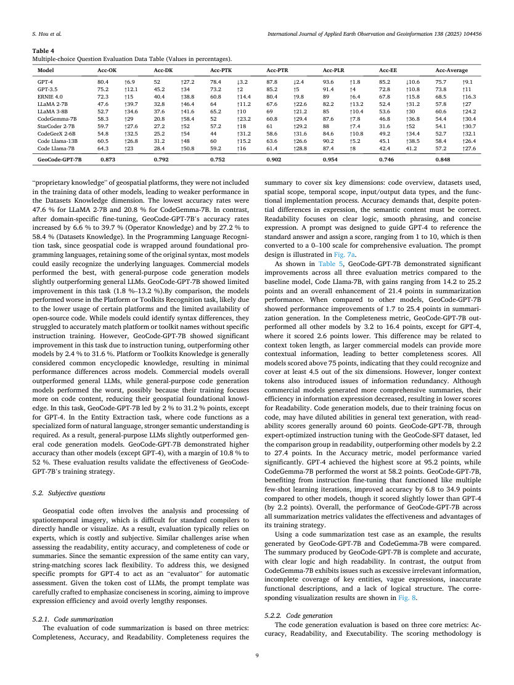

## PDF 第 10 页

S. Hou et al.                                                                                                                                                                                                                                     
International Journal of Applied Earth Observation and Geoinformation 138 (2025) 104456

Fig. 7a. Prompt for Code Summarization Evaluation.

Table 5 
Code Summarization Evaluation Data Table (Scores out of 100).

Model
Completeness
Accuracy
Readability
Overall

GPT-4
94.2
↓2.6
95.2
↓2.2
79.6
↑10
89.7
↑1.7
GPT-3.5
88.4
↑3.2
86.2
↑6.8
74.4
↑15.2
82.9
↑8.5
ERNIE 4.0
82.2
↑9.4
74.8
↑18.2
69.8
↑19.8
75.6
↑15.8
LLaMA 2-7B
78
↑13.6
69.8
↑23.2
85.2
↑4.4
77.7
↑13.7
LLaMA 3-8B
81
↑10.6
72.6
↑20.4
87.4
↑2.2
80.4
↑11
CodeGemma-7B
76.2
↑15.4
58.2
↑34.8
63.4
↑26.2
66
↑25.4
StarCoder 2-7B
77.6
↑14
64
↑29
64
↑25.6
68.5
↑22.9
CodeGeeX 2-6B
75.2
↑16.4
66
↑27
62.2
↑27.4
67.8
↑23.6
Code Llama-13B
80.6
↑11
70.2
↑22.8
67.8
↑21.8
72.9
↑18.5
Code Llama-7B
77.4
↑14.2
67.8
↑25.2
64.8
↑24.8
70
↑21.4

GeoCode-GPT-7B
91.6
93
89.6
91.4

illustrated in the figure. Accuracy refers to the proportion of key entities 
(such as data sources, time, space, input/output data) in the generated 
code that match the requirements of the task. This is calculated by using 
GPT-4 with a specific prompt template to extract and compare the 
generated code with the target entities, assessing consistency as shown 
in Fig. 9. Executability is determined by experts who run the generated 
code on different platforms; the percentage of successfully executed 
code represents the executability score. Readability evaluation assesses 
the clarity of code structure, the appropriateness of comments, and the 
adherence of variable naming and function lengths to standard con­
ventions. The evaluation involves 11 models, with their outputs tested 
across 500 code generation tasks. For each task, all 11 results are 
simultaneously presented to experts in a blind review process, where the 
outputs are ranked based on readability from 1 (highest) to 11 (lowest). 
The ranking for each model across all tasks is recorded and analyzed. 
The evaluation process consists of two steps: ranking aggregation and 
score normalization. The average ranking Ri for model i across all tasks

is calculated using the following formula:

∑N
j=1Ri,j

N
(1)

Ri =

Here, N = 500 represents the total number of tasks, and Ri,j denotes the 
ranking of model i for task j. To map the average ranking to a stan­
dardized readability score Executability on a percentage scale, the 
following formula is applied:

Executability = 11 −Ri

11
× 100
(2)

In this formula, the denominator 11 reflects the range of possible 
rankings, ensuring normalization to a percentile scale. Higher scores 
indicate better readability, with a maximum score of 100 and a mini­
mum score of 0.

As shown in Table 6, GeoCode-GPT-7B demonstrated significant

10

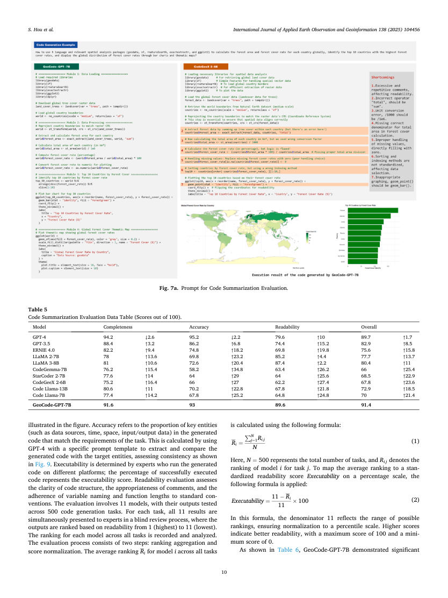

## PDF 第 11 页

S. Hou et al.                                                                                                                                                                                                                                     
International Journal of Applied Earth Observation and Geoinformation 138 (2025) 104456

Fig. 8. Comparison of Code Summarization Test Results.

improvements across all metrics compared to the baseline model, 
particularly in Readability, where the score increased by 37.3 points. 
Even in Executability, which showed the smallest improvement, 
GeoCode-GPT-7B outperformed the baseline by 20.2 points, with an 
overall performance increase of 25.1 points. While there remains a gap 
between GeoCode-GPT-7B and commercial models like GPT-4 in Accu­
racy, Readability, and Executability (3.6, 16.4, and 2.4 points, respec­
tively), and a 10.7-point gap in Readability compared to GPT-3.5, 
GeoCode-GPT-7B outperformed other open-source models by 8 to 37.3 
points across all metrics. In terms of Accuracy, general-purpose LLMs 
and code generation models showed lower accuracy in handling code 
entities (43.4–57.4 points), likely due to their lack of geospatial 
modeling knowledge (e.g., operator syntax and dataset references). 
Even commercial models failed to exceed an accuracy score of 75 points 
in this dimension. Moreover, models without specialized training per­
formed worse in Executability, such as LLaMA 2-7B, which achieved a 
score of only 22.4 points. GeoCode-GPT-7B, despite scoring 50.4 points, 
still showed an improvement of 7.4 to 28 points over other models, 
highlighting the effectiveness of its training strategy. In Readability, 
there was considerable variation among models. GeoCode-GPT-7B 
scored 69.8 points, with an average ranking of 3.322, slightly lower 
than GPT-4′s ranking of 1.529. However, compared to the worst- 
performing model, Code Llama-7B, GeoCode-GPT-7B improved by 
4.103 ranks. Overall, except for a 4.8-point gap with GPT-4, GeoCode- 
GPT-7B outperformed other models by 1.2 to 25.1 points, demonstrating

the potential of fine-tuning for enhancing open-source models in geo­
spatial code generation tasks.

Using a code generation test case as an example, we compare the 
outputs generated by GeoCode-GPT-7B and CodeGeeX2-6B. The code 
generated by GeoCode-GPT-7B is logically clear, with concise comments 
and correct, executable functionality, as demonstrated in the corre­
sponding visualization in Fig. 10. In contrast, CodeGeeX2-6B’s output 
for this case exhibits issues such as redundant comments, incorrect pa­
rameters, improper function usage, logical flaws, and missing func­
tionality, which are clearly annotated in the figure.

6. Conclusion

In this study, we developed the GeoCode-PT and GeoCode-SFT 
corpora, along with the GeoCode-Eval benchmark, and introduced 
GeoCode-GPT-7B, the first LLM tailored for geospatial code generation. 
Leveraging QLoRA and LoRA techniques for pretraining and fine-tuning, 
the model achieved notable performance enhancements. A robust 
evaluation framework combining option matching, expert validation, 
and LLM scoring was established, enabling systematic assessment with 
GeoCode-Eval. The results demonstrate that GeoCode-GPT-7B signifi­
cantly outperformed the base model, Code Llama-7B, and surpassed 
larger models, including Code Llama-13B and ERNIE 4.0, across all 
metrics. While it did not exceed GPT-4 in certain metrics, it consistently 
outperformed GPT-3.5 in most cases. These findings validate the efficacy 
of the corpus design, fine-tuning strategies, and the model’s competitive 
performance in geospatial code evaluation.

6.1. Limitations

This study explores the optimization of LLMs for geospatial code 
generation, providing insights into their performance boundaries. To 
narrow the gap with GPT-4 in certain metrics, future work will prioritize 
scaling instruction data, enhancing data quality, and developing more 
efficient methods for structured knowledge representation. While 
GeoCode-GPT-7B has achieved notable improvements in code execut­
ability, further advancements are possible through the expansion and 
refinement of high-quality code training corpora, alongside leveraging 
more powerful hardware and extended training epochs. This work fo­
cuses on corpus development and evaluation specific to geospatial code 
generation, with tasks such as multiple-choice assessments and code 
summarization designed to strengthen and evaluate core capabilities. 
However, the constructed corpora also hold potential for downstream 
applications, including knowledge-based question answering, code 
debugging, completion, and programming language translation. To 
maintain a clear focus on fine-tuning for geospatial tasks, this study does 
not extensively explore broader applications, which remain promising 
avenues for future research and optimization. Currently, code genera­
tion tasks primarily focus on processing single-modality natural lan­
guage text and lack the capability to directly handle image datasets. 
Therefore, future research should aim to enhance the model’s capacity 
for multi-modal tasks, thereby expanding its potential for broader 
applications.

6.2. Outlook

This study offers a preliminary exploration of LLM applications in 
geospatial modeling, highlighting opportunities for further advance­
ments. Future efforts could focus on developing larger-scale models and 
specialized geospatial code generation frameworks, supported by high- 
quality multimodal, multi-scenario, and multi-task training datasets 
and evaluation benchmarks. These enhancements could expand the 
model’s applicability beyond code generation to broader geospatial 
tasks, fostering the creation of models with improved generalization 
capabilities. Integrating multi-platform interfaces and enabling auto­
mated code testing could reduce reliance on expert knowledge and

11

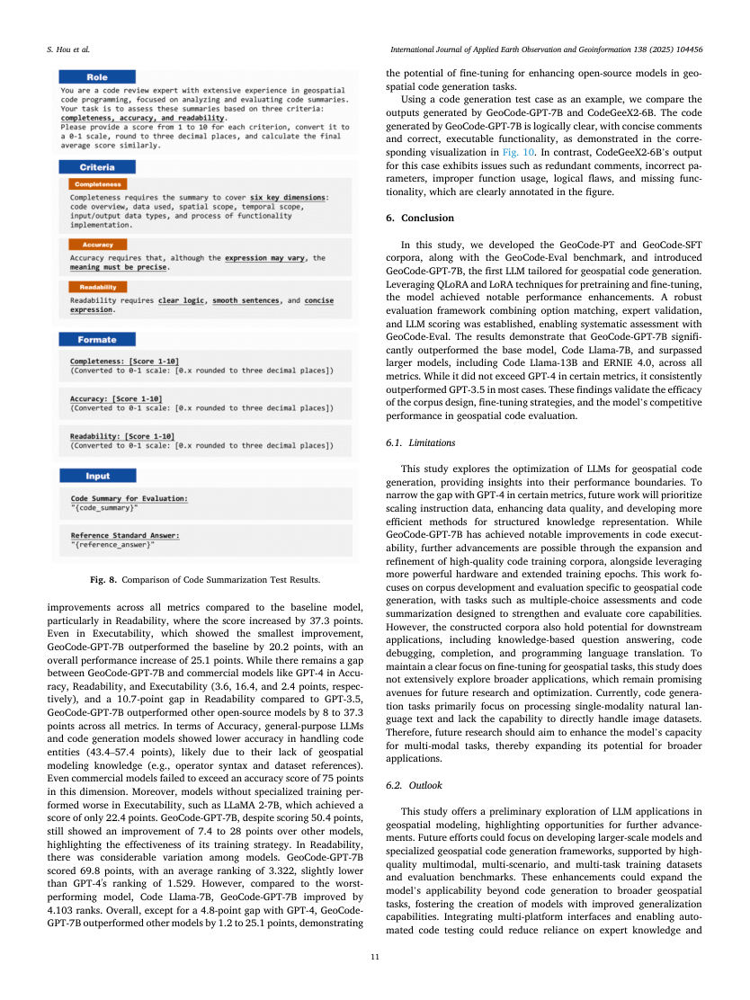

## PDF 第 12 页

S. Hou et al.                                                                                                                                                                                                                                     
International Journal of Applied Earth Observation and Geoinformation 138 (2025) 104456

Fig. 9. Prompt for Evaluating the Accuracy Metric in Code Generation.

Table 6 
Code Generation Evaluation Data Table (Scores out of 100).

Model
Accuracy
Readability
Executability
Overall

GPT-4
74.2
↓3.6
86.1
↓16.4
52.8
↓2.4
71
↓4.8
GPT-3.5
69.8
↑0.8
80.5
↓10.7
43
↑7.4
64.4
↑1.2
ERNIE 4.0
62.2
↑8.4
58.5
↑11.3
30.2
↑20.2
50.3
↑13.3
LLaMA 2-7B
43.4
↑27.2
62.3
↑7.4
22.4
↑28
42.7
↑20.9
LLaMA 3-8B
45.6
↑25
65.9
↑3.8
24.2
↑26.2
45.2
↑18.4
CodeGemma-7B
55.2
↑15.4
54.3
↑15.5
28.2
↑22.2
45.9
↑17.7
StarCoder 2-7B
57.4
↑13.2
42.5
↑27.3
35.4
↑15
45.1
↑18.5
CodeGeeX 2-6B
53.7
↑16.9
37.8
↑32
32.6
↑17.8
41.4
↑22.2
Code Llama-13B
56.4
↑14.2
48.4
↑21.4
35.6
↑14.8
46.8
↑16.8
Code Llama-7B
52.8
↑17.8
32.5
↑37.3
30.2
↑20.2
38.5
↑25.1

GeoCode-GPT-7B
70.6
69.8

prompt engineering, while cross-platform code translation may help 
lower syntactic barriers, enhancing usability. Additionally, tailoring 
models for repository-level geospatial code generation—incorporating 
indexing, contextual information, and memory modules—could address 
complex tasks more effectively. The establishment of multi-agent 
collaboration frameworks represents another promising direction,

63.6

50.4

enabling automated workflows for code generation, testing, and opti­
mization, thereby improving output quality and efficiency. Continued 
advancements in these areas are expected to drive significant progress in 
geospatial modeling with LLMs.

12

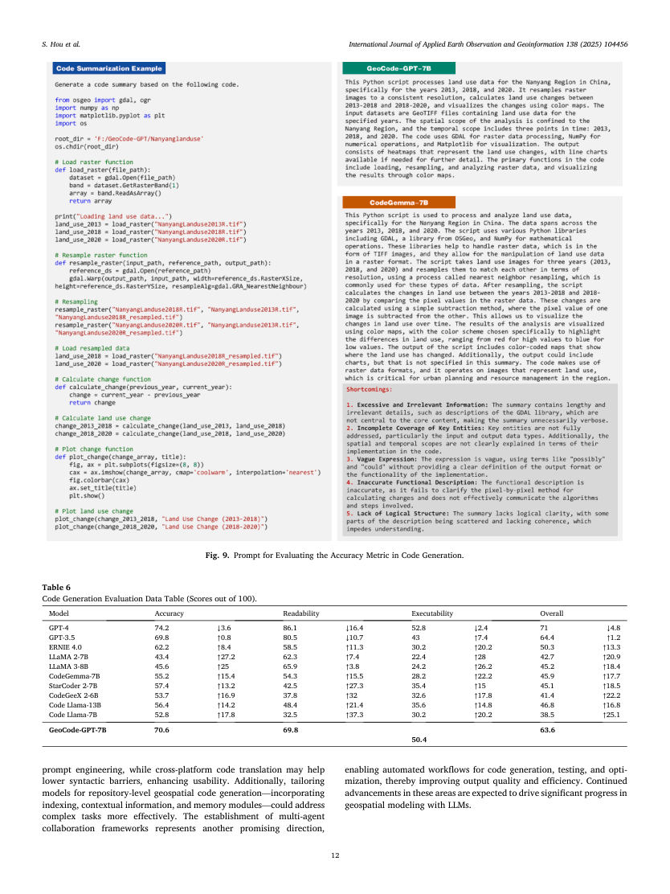

## PDF 第 13 页

S. Hou et al.                                                                                                                                                                                                                                     
International Journal of Applied Earth Observation and Geoinformation 138 (2025) 104456

Fig. 10. Comparison of Code Generation Test Results.

CRediT authorship contribution statement

Shuyang Hou: Writing – original draft, Visualization, Validation, 
Software, Methodology, Investigation, Formal analysis, Data curation, 
Conceptualization. Zhangxiao Shen: Software, Project administration,

Data curation. Anqi Zhao: Software, Conceptualization. Jianyuan 
Liang: Validation, Data curation. Zhipeng Gui: Writing – review & 
editing, Supervision, Funding acquisition. Xuefeng Guan: Writing – 
review & editing, Supervision, Funding acquisition. Rui Li: Writing – 
review & editing, Supervision, Funding acquisition. Huayi Wu: Writing

13

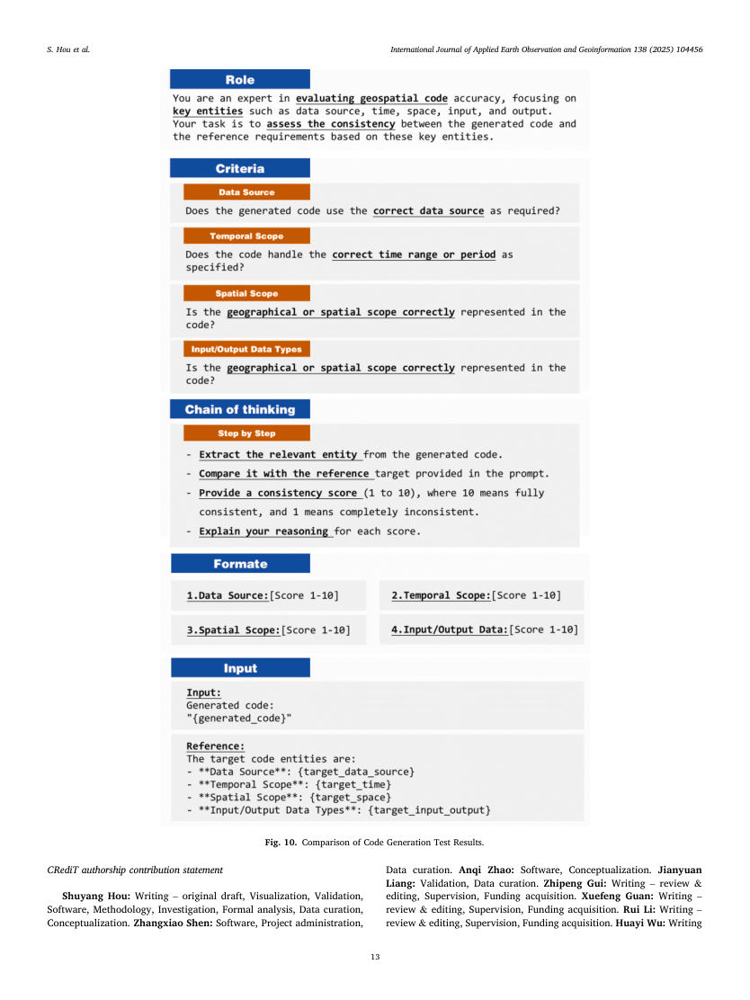

## PDF 第 14 页

S. Hou et al.                                                                                                                                                                                                                                     
International Journal of Applied Earth Observation and Geoinformation 138 (2025) 104456

– review & editing, Supervision, Funding acquisition.

Declaration of competing interest

The authors declare that they have no known competing financial

Appendix 1

interests or personal relationships that could have appeared to influence 
the work reported in this paper.

The attributes of each file type are listed in the table below. For detailed content, please refer to the open-source repository: https://github.com/wh 
uhsy/GeoCode-GPT.

Table GeoCode-PT Data Attribute Table

Type
Attribute

Code documents
Code_id
Language
Platform
Library
Title
Description
Content
Dataset documents
Dataset_id
Name
Provide
Snippet
Tags
Description
DOI
Website
Operator documents
Operator_id
Full_name
Short_name
Library_name
Language
Platform
Description
Usage
Parameters
Output_type
Encyclopedic Documents
Name
Text

Appendix A. Supplementary data

Supplementary data to this article can be found online at https://doi.org/10.1016/j.jag.2025.104456.

Data availability

Data will be made available on request.

References

Abdin, M., Jacobs, S.A., Awan, A.A., Aneja, J., Awadallah, A., Awadalla, H., Bach, N., 
Bahree, A., Bakhtiari, A., Behl, H., 2024. Phi-3 technical report: A highly capable 
language model locally on your phone. arXiv preprint arXiv:2404.14219. htt 
ps://doi.org/10.48550/arXiv.2404.14219.
Arievitch, I.M., 2020. Reprint of: The vision of Developmental Teaching and Learning 
and Bloom’s Taxonomy of educational objectives. Learn. Cult. Soc. Interact. 27, 
100473. https://doi.org/10.1016/j.lcsi.2020.100473.
Chen, L., Guo, Q., Jia, H., Zeng, Z., Wang, X., Xu, Y., Wu, J., Wang, Y., Gao, Q., Wang, J., 
2024. A survey on evaluating large language models in code generation tasks. arXiv 
preprint arXiv:2408.16498. https://doi.org/10.48550/arXiv.2408.16498.
Chen, M., Tworek, J., Jun, H., Yuan, Q., Pinto, H.P.D.O., Kaplan, J., Edwards, H., Burda, 
Y., Joseph, N., Brockman, G., 2021. Evaluating large language models trained on 
code. arXiv preprint arXiv:2107.03374. https://doi.org/10.48550/arXiv.2107. 
03374.
Cinquini, L., Crichton, D., Mattmann, C., Harney, J., Shipman, G., Wang, F., 
Ananthakrishnan, R., Miller, N., Denvil, S., Morgan, M., 2014. The Earth System Grid 
Federation: An open infrastructure for access to distributed geospatial data. Futur. 
Gener. Comp. Syst. 36, 400–417. https://doi.org/10.1016/j.future.2013.07.002.

Coetzee, S., Iv´anov´a, I., Mitasova, H., Brovelli, M.A., 2020. Open geospatial software and 
data: A review of the current state and a perspective into the future. ISPRS Int. J. 
Geo-Inf. 9, 90. https://doi.org/10.3390/ijgi9020090.
Cui, J., Li, Z., Yan, Y., Chen, B., Yuan, L., 2023. Chatlaw: Open-source legal large 
language model with integrated external knowledge bases. arXiv preprint arXiv: 
2306.16092. https://doi.org/10.48550/arXiv.2306.16092.
Dubois, Y., Galambosi, B., Liang, P., Hashimoto, T.B., 2024. Length-controlled 
alpacaeval: A simple way to debias automatic evaluators. arXiv preprint arXiv: 
2404.04475. https://doi.org/10.48550/arXiv.2404.04475.
Guo, D., Zhu, Q., Yang, D., Xie, Z., Dong, K., Zhang, W., Chen, G., Bi, X., Wu, Y., Li, Y.K., 
2024. DeepSeek-Coder: When the Large Language Model Meets Programming–The 
Rise of Code Intelligence. arXiv preprint arXiv:2401.14196. https://doi.org/10.4855 
0/arXiv.2401.14196.
Hou, S., Jiao, H., Shen, Z., Liang, J., Zhao, A., Zhang, X., Wang, J., Wu, H., 2024a. Chain- 
of-Programming (CoP): Empowering Large Language Models for Geospatial Code 
Generation. arXiv preprint arXiv:2411.10753. https://doi.org/10.48550/arXiv.2 
411.10753.
Hou, S., Liang, J., Zhao, A., Wu, H., 2024b. GEE-OPs: An Operator Knowledge Base for 
Geospatial Code Generation on the Google Earth Engine Platform Powered by Large 
Language Models. arXiv preprint arXiv:2412.05587. https://doi.org/10.4855 
0/arXiv.2412.05587.
Hou, S., Zhangxiao, S., Jianyuan, L., Anqi, Z., Zhipeng, G., Rui, L., Wu, H., 2024c. Can 
Large Language Models Generate Geospatial Code? arXiv preprint arXiv: 
2410.09738. https://doi.org/10.48550/arXiv.2410.09738.

14

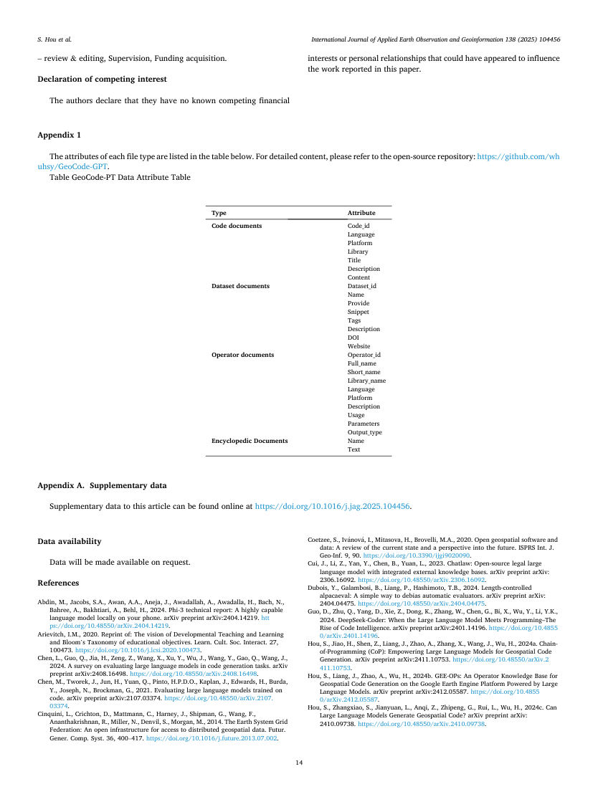

## PDF 第 15 页

S. Hou et al.                                                                                                                                                                                                                                     
International Journal of Applied Earth Observation and Geoinformation 138 (2025) 104456

Hu, E.J., Shen, Y., Wallis, P., Allen-Zhu, Z., Li, Y., Wang, S., Wang, L., Chen, W., 2021. 
Lora: Low-rank adaptation of large language models. arXiv preprint arXiv: 
2106.09685. https://doi.org/10.48550/arXiv.2106.09685.
Huang, A.H., Wang, H., Yang, Y., 2023. FinBERT: A large language model for extracting 
information from financial text. Contemp. Account. Res. 40, 806–841. https://doi. 
org/10.1111/1911-3846.12832.
Jiang, J., Wang, F., Shen, J., Kim, S., Kim, S., 2024. A Survey on Large Language Models 
for Code Generation. arXiv preprint arXiv:2406.00515. https://doi.org/10.4855 
0/arXiv.2406.00515.
Kasneci, E., Seßler, K., Küchemann, S., Bannert, M., Dementieva, D., Fischer, F., 
Gasser, U., Groh, G., Günnemann, S., Hüllermeier, E., 2023. ChatGPT for good? On 
opportunities and challenges of large language models for education. Learn. Individ. 
Differ. 103, 102274. https://doi.org/10.1016/j.lindif.2023.102274.
Kessel, M., Atkinson, C., 2024. Code search engines for the next generation. J. Syst. 
Softw. 215, 112065. https://doi.org/10.1016/j.jss.2024.112065.
Kifetew, F.M., Tiella, R., Tonella, P., 2017. Generating valid grammar-based test inputs 
by means of genetic programming and annotated grammars. Empir. Softw. Eng. 22, 
928–961. https://doi.org/10.1007/s10664-015-9422-4.
Li, L., Jiang, X., Liu, Q., 2019. Pretrained language models for document-level neural 
machine translation. arXiv preprint arXiv:1911.03110. https://doi.org/10.4855 
0/arXiv.1911.03110.
Lirov, Y., 1991. Computer-aided software engineering of expert systems. Expert Syst. 
Appl. 2, 333–343. https://doi.org/10.1016/0957-4174(91)90039-H.
Luo, Z., Xu, C., Zhao, P., Sun, Q., Geng, X., Hu, W., Tao, C., Ma, J., Lin, Q., Jiang, D., 
2023. Wizardcoder: Empowering code large language models with evol-instruct. 
arXiv preprint arXiv:2306.08568. https://doi.org/10.48550/arXiv.2306.08568.
Minaee, S., Mikolov, T., Nikzad, N., Chenaghlu, M., Socher, R., Amatriain, X., Gao, J., 
2024. Large language models: A survey. arXiv preprint arXiv:2402.06196. htt 
ps://doi.org/10.48550/arXiv.2402.06196.
Nymeyer, A., Katoen, J.P., 1997. Code generation based on formal BURS theory and 
heuristic search. Acta Inform. 34, 597–635. https://doi.org/10.1007/ 
s002360050099.
Qin, H., Ma, X., Zheng, X., Li, X., Zhang, Y., Liu, S., Luo, J., Liu, X., Magno, M., 2024. 
Accurate lora-finetuning quantization of llms via information retention. arXiv 
preprint arXiv:2402.05445. https://doi.org/10.48550/arXiv.2402.05445.
Roziere, B., Gehring, J., Gloeckle, F., Sootla, S., Gat, I., Tan, X.E., Adi, Y., Liu, J., 
Sauvestre, R., Remez, T., 2023. Code llama: Open foundation models for code. arXiv 
preprint arXiv:2308.12950. https://doi.org/10.48550/arXiv.2308.12950.
Scalabrino, S., Bavota, G., Vendome, C., Linares-Vasquez, M., Poshyvanyk, D., 
Oliveto, R., 2019. Automatically assessing code understandability. IEEE Trans. 
Softw. Eng. 47, 595–613. https://doi.org/10.1109/TSE.2019.2901468.

Tamiminia, H., Salehi, B., Mahdianpari, M., Quackenbush, L., Adeli, S., Brisco, B., 2020. 
Google Earth Engine for geo-big data applications: A meta-analysis and systematic 
review. ISPRS-J. Photogramm. Remote Sens. 164, 152–170. https://doi.org/ 
10.1016/j.isprsjprs.2020.04.001.
Tao, W., 2013. Interdisciplinary urban GIS for smart cities: advancements and 
opportunities. Geo-Spat. Inf. Sci. 16, 25–34. https://doi.org/10.1080/ 
10095020.2013.774108.
Thirunavukarasu, A.J., Ting, D.S.J., Elangovan, K., Gutierrez, L., Tan, T.F., Ting, D.S.W., 
2023. Large language models in medicine. Nat. Med. 29, 1930–1940. https://doi. 
org/10.1038/s41591-023-02448-8.
Tonmoy, S.M., Zaman, S.M., Jain, V., Rani, A., Rawte, V., Chadha, A., Das, A., 2024. A 
comprehensive survey of hallucination mitigation techniques in large language 
models. arXiv preprint arXiv:2401.01313. https://doi.org/10.48550/arXiv.2401. 
01313.
Wang, J., Zhang, B., Du, Q., Zhang, J., Chu, D., 2024. A Survey on Data Selection for LLM 
Instruction Tuning. arXiv preprint arXiv:2402.05123. https://doi.org/10.4855 
0/arXiv.2402.05123.
Wang, Y., Kordi, Y., Mishra, S., Liu, A., Smith, N.A., Khashabi, D., Hajishirzi, H., 2022. 
Self-instruct: Aligning language models with self-generated instructions. arXiv 
preprint arXiv:2212.10560. https://doi.org/10.48550/arXiv.2212.10560.
Zhang, X., Tian, C., Yang, X., Chen, L., Li, Z., Petzold, L.R., 2023. Alpacare: Instruction- 
tuned large language models for medical application. arXiv preprint arXiv: 
2310.14558. https://doi.org/10.48550/arXiv.2310.14558.
Zhang, Y., He, Z., Li, J., Lin, J., Guan, Q., Yu, W., 2024a. MapGPT: An autonomous 
framework for mapping by integrating large language model and cartographic tools. 
Cartogr. Geogr. Inf. Sci. 51, 717–743. https://doi.org/10.1080/ 
15230406.2024.2404868.
Zhang, Y., Wang, Z., He, Z., Li, J., Mai, G., Lin, J., Wei, C., Yu, W., 2024b. BB-GeoGPT: A 
framework for learning a large language model for geographic information science. 
Inf. Process. Manage. 61, 103808. https://doi.org/10.1016/j.ipm.2024.103808.
Zhang, Y., Wei, C., He, Z., Yu, W., 2024c. GeoGPT: An assistant for understanding and 
processing geospatial tasks. Int. J. Appl. Earth Obs. Geoinf. 131, 103976. https://doi. 
org/10.1016/j.jag.2024.103976.
Zhao, W.X., Zhou, K., Li, J., Tang, T., Wang, X., Hou, Y., Min, Y., Zhang, B., Zhang, J., 
Dong, Z., 2023. A survey of large language models. arXiv preprint arXiv:2303.18223. 
https://doi.org/10.48550/arXiv.2303.18223.
Zheng, L., Chiang, W.-L., Sheng, Y., Zhuang, S., Wu, Z., Zhuang, Y., Lin, Z., Li, Z., Li, D., 
Xing, E., 2023. Judging LLM-as-a-judge with MT-Bench and Chatbot Arena. arXiv 
preprint arXiv:2306.05685. https://doi.org/10.48550/arXiv.2306.05685.
Zhuo, T.Y., 2023. ICE-Score: Instructing Large Language Models to Evaluate Code. arXiv 
preprint arXiv:2304.14317. https://doi.org/10.48550/arXiv.2304.14317.

15

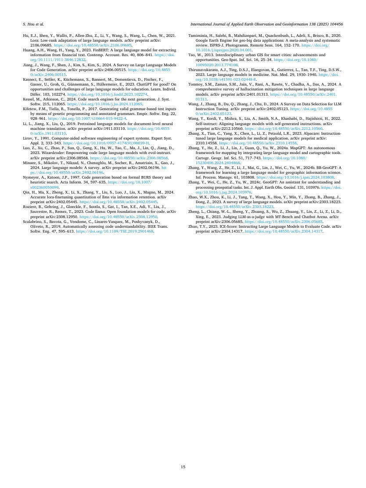
