# GeoContra：从流畅 GIS 代码到可验证的空间分析——基于地理约束的修复

**原题**：*GeoContra: From Fluent GIS Code to Verifiable Spatial Analysis with Geography-Grounded Repair*  
**作者**：Yinhao Xiao、Rongbo Xiao、Yihan Zhang  
**版本**：arXiv:2605.00782v1，2026-05-01  
**原稿页数**：19 页

> **使用说明与译文范围**：本文件为中文学术精读稿，包含原文摘要的完整中文翻译，以及对正文、方法、实验、讨论与结论的较详尽中文译述和核心表格。它**不是逐句对照的全文翻译**。为确保任何一段原文、公式、参考文献与算法都不缺失，请配合 `GeoContra_英文全文逐页提取.md` 和 `source_pages/`。下文图表截图沿用原始英文标注，文字说明以中文呈现。代码函数、字段名和公式符号不改写。

## 摘要（完整翻译）

可靠的空间分析是地理信息科学（GIScience）中的一项富有挑战性的任务。分析过程必须保持坐标参考语义、空间谓词、拓扑、度量单位、空间支撑（spatial support）以及地理合理性。当前存在的差距在于：基于大型语言模型（LLM）的 GIS 系统越来越能够生成流畅的脚本与工具工作流，但很少明确表达这些地理规则，也极少在真实本地 GIS 数据上大规模验证这些规则。本文提出 **GeoContra**，一个面向 LLM 驱动的 Python GIS 工作流、以地理知识为依据的验证与修复框架。GeoContra 将每项任务表示为**可执行的地理空间契约（executable geospatial contract）**，涵盖自然语言空间问题、数据集模式、坐标参考系（CRS）元数据、预期输出、空间关系语义、拓扑与度量约束、必须使用的 GIS 操作，以及禁止采用的捷径。生成的程序将接受静态地理规则检查、运行时成果验证和任务层语义验证；发现的违规事项被反馈给模型，进入有次数上限的修复循环。作者在覆盖大波士顿地区 15 个区域、9 类 GIS 任务的 **7,079 个真实地理数据任务**上开展评测，并对 11 个开源模型分别进行了每模型 600 次运行。根据作者的了解，这是首个专门围绕可执行、可用契约验证的 LLM GIS 工作流而构建的大规模基准。在完整闭源模型基准上，GeoContra 将 DeepSeek-V4 的空间正确率由 **47.6% 提升到 77.5%**，将 Kimi-K2.5 的空间正确率由 **57.7% 提升到 81.5%**。对于 11 个开源模型，平均空间正确率提高 **26.6 个百分点**。其方法论意义在于：GeoContra 通过检测负数行程时间、CRS 与字段模式违规、缺失的空间谓词以及脆弱的输出类型转换等问题，将 LLM GIS 自动化从生成流畅代码推进为**可验证的空间分析**；这些问题原本可能让程序虽然可执行，却在地理意义上无效。

**关键词**：地理信息科学；地理空间人工智能；可信 GeoAI；可复现空间分析；空间验证；LLM 驱动 GIS。

## 1 引言

论文首先区分了两个容易混淆的目标：**代码可以运行**与**分析保留了原本的地理意义**。传统 GIS 脚本即使没有语法错误，也可能在经纬度单位下执行以米为单位的缓冲区运算、使用错误的空间单元聚合、丢失零匹配要素、用欧氏距离代替道路网络可达性，或者报告不可能出现的负数行程时间。这些情况不仅是编程缺陷，更意味着程序已经回答了一个与用户所问不同的地理问题。

作者认为，基于 LLM 的 GIS 自动化应当在生成之前明确分析所需的地理约束，生成之后再核验约束。GeoContra 因此不是一种新的 LLM，也不是单纯的提示词模板，而是一套以**任务契约—程序生成—分层检查—证据反馈—有限轮修复**为闭环的系统。它采用本地真实地理数据，组合矢量、栅格、道路网络、拓扑质量与多步 GIS 工作流，以便区分程序执行成功与空间语义正确。

论文提出的主要贡献包括：将 CRS、空间关系、拓扑、度量单位和空间支撑编码为可机器检查的任务契约；构建 7,079 任务、15 个城市区域与 9 类任务组成的 GeoContra-Real；设计静态、运行时、语义三层验证及有限轮修复；通过闭源和开源模型实验检验其有效性。

## 2 相关工作

原文将相关工作分为地理空间基础模型、地理空间工具使用与代码生成、地理空间代码评测，以及可复现可信空间分析。K2、BB-GeoGPT 等模型强调地学知识适配；GeoTool-GPT、GeoCogent、GeoAgent、ChatGeoAI、GeoGPT、MapGPT 等系统改进工具使用、任务规划或制图操作；GeoCode-Eval、AutoGEEval++ 等工作研究代码生成评测。GeoContra 的区别在于：它不把代码可执行性直接当作地理正确性，而是把 GIScience 特有的**不变量**变为任务契约中的可执行断言，并利用违反这些断言所形成的证据驱动修复。

## 3 问题形式化

一项地理空间任务表示为：

\[
\tau=(q,D,Y,C,M^+,M^-)
\]

其中，`q` 为自然语言请求，`D` 为含字段模式和 CRS 的输入数据集，`Y` 指定输出路径、列、行数约束和度量范围，`C` 为地理空间约束，`M+` 为预期使用的方法，`M−` 为被禁止的捷径。模型首先得到程序 `p₀ = Gθ(ϕ(τ))`。

作者区分三类验证器：**静态验证器** `V_s` 在执行之前检查源码是否存在 CRS/单位处理、空间谓词方向、字段引用、拓扑与禁止方法等问题；**运行时验证器** `V_r` 执行程序并核验输出文件是否可读取、字段与行数是否正确、是否出现重复 ID、负值或超界比率；**任务语义验证器** `V_t` 判断程序是否使用该任务实际需要的 GIS 方法，例如缓冲区计算、空间叠置、栅格采样或路网最短路径。违规集合为：

\[
V(p,\tau)=V_s(p,\tau)\cup V_r(p,\tau)\cup V_t(p,\tau)
\]

只有程序可执行且违规集合为空时，论文才将其判作空间正确：

\[
S(p,\tau)=\mathbb I[\operatorname{exec}(p,\tau)=1\ \land\ |V(p,\tau)|=0]
\]

注意：这里的“空间正确”是**通过论文定义的契约与验证器**，并非逐像元或逐要素与完美参考输出一致。作者在讨论部分明确承认语义验证仍然有限。

修复阶段将任务契约、上一轮程序和违规证据一起输入模型，并限制最大轮数，以便得到更符合地理要求的程序。

## 4 GeoContra 框架

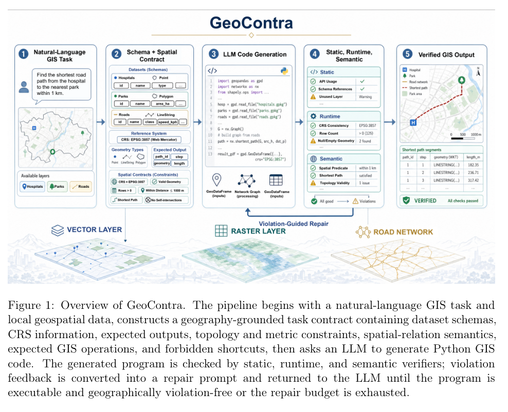

*图 1：系统将自然语言 GIS 请求与本地地理空间数据转换为带字段模式、CRS、输出与地理约束的任务契约；LLM 生成 Python 工作流；静态、运行时与语义验证器检查结果；违规信息被转成修复提示，循环直到成果合规或达到预算上限。*

### 4.1 任务契约

每项任务用 JSON 契约记录，内容包括输入路径、数据类型、几何类型、CRS、字段、要素总数、目标文件路径与输出字段，以及必须满足的地理规则。例如，缓冲区计数任务需要在投影 CRS 下计算、每个源对象保留一行并确保数量非负；网络可达性任务要求使用图网络距离与分钟单位的行程时间，并禁止用点与点之间的直线距离直接替代。

### 4.2 约束感知提示

LLM-only 基线仅获得问题、文件路径、数据模式及输出要求；GeoContra 设置额外向模型提供任务约束、预期算法和禁止方法。提示还明确要求保存没有匹配对象的源要素、不得臆造字段、使用稳定的 GeoPandas API、妥善处理缺失 CRS 元数据，并写入指定输出文件。

### 4.3 验证与修复引擎

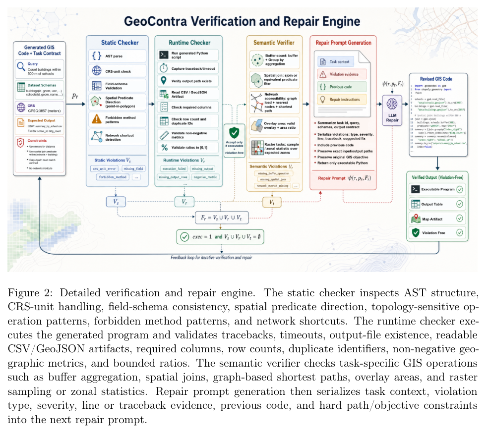

*图 2：分层检查包含代码静态检查、运行时输出检查和任务特定语义检查，失败时返回可定位的违规类型和上下文。*

**算法 1 — GeoContra-Real 的构建**：以 15 个研究区、OSM 派生数据和生成配置为输入，构建矢量、栅格、步行网络、拓扑扰动与分析单元；将各层规范化为带路径、CRS、字段和要素计数的模式记录；根据不同任务模板实例化具体距离、最近邻 `k`、输出字段；最后附加空间约束、要求方法与禁止方法，得到 JSON 契约集合。

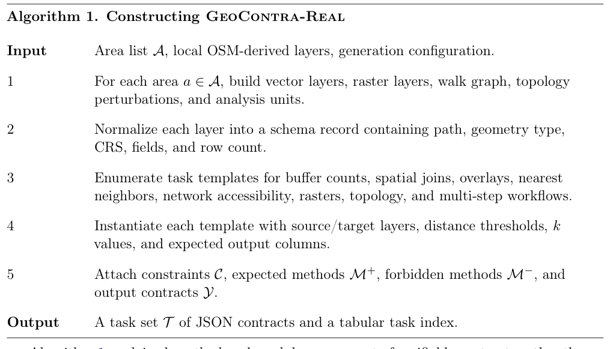

**算法 2 — 验证器引导的生成与修复**：先生成程序，执行静态检查，随后在本地执行并收集运行时违规，再对输出与源码执行任务语义检查；若执行成功且所有违规集合为空，则接受输出，否则在修复预算内向模型提供结构化错误摘要与上一轮代码。

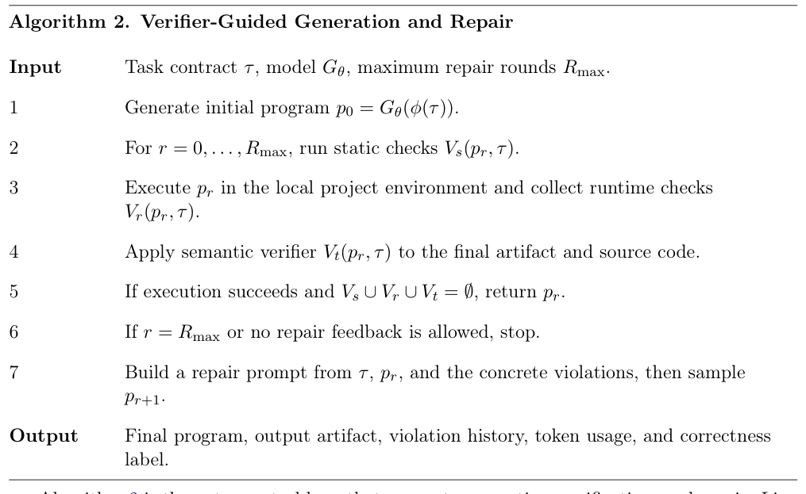

**算法 3—6** 分别详细规定静态检查器、运行时检查器、语义检查器、修复提示生成器的规则与输出。原始截图如下：

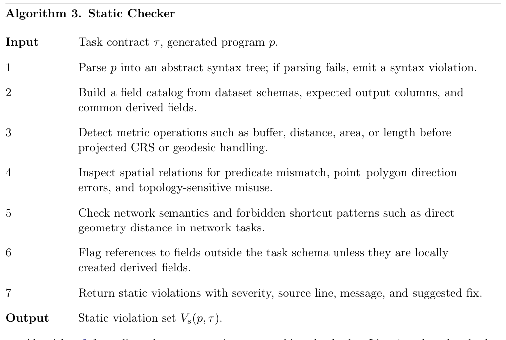
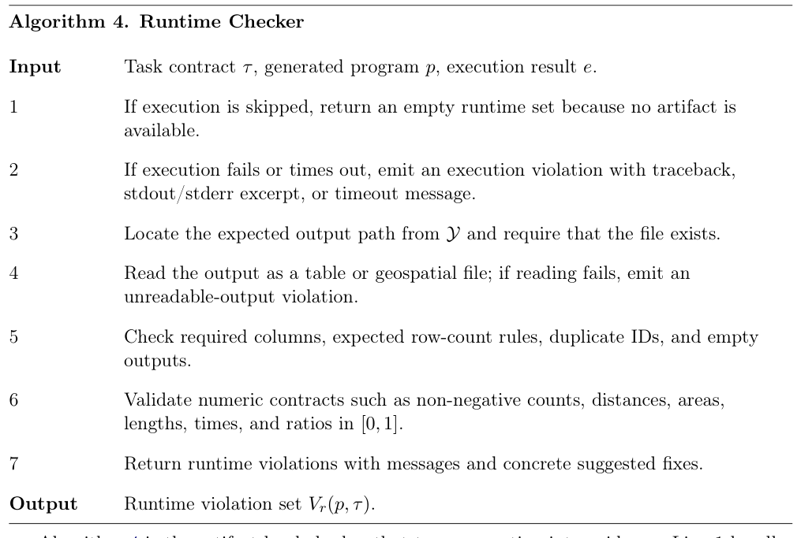
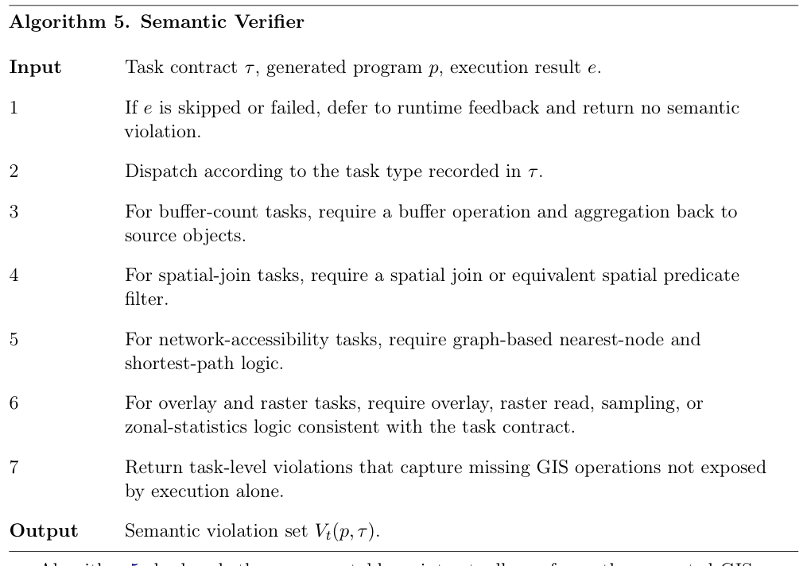
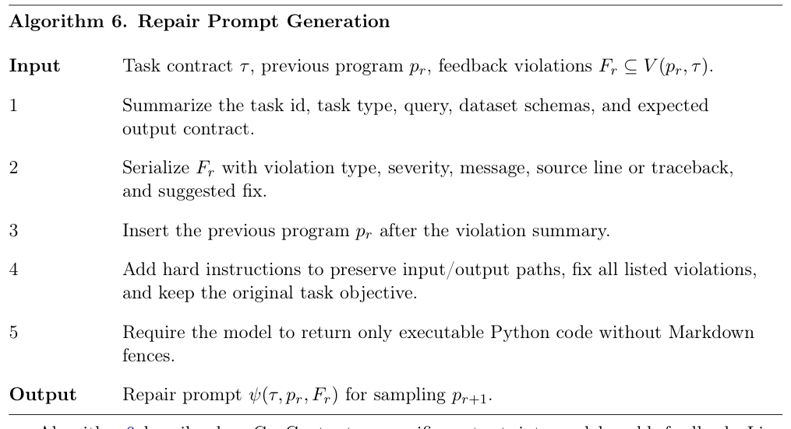

### 4.4 配对评测

所有模型在相同任务与本地数据上分别运行 LLM-only 和 GeoContra 两种条件。作者使用成对比较控制任务分布，让提升主要归因于任务契约及其反馈修复流程。

## 5 实验与结果

### 5.1 数据、模型与实验规模

基准有 7,079 个任务，来自大波士顿地区 15 个区域。数据包含 OSM 派生的公园、学校、医院、公交站、图书馆、超市、消防设施、水体、住宅等兴趣要素，步行路网 GraphML 与道路边 GeoJSON，还派生规则网格分析单元、点质心、水域缓冲区、50 m GeoTIFF 栅格等。为测试拓扑问题，作者另行构造了受控的无效与重叠几何层。**任务使用真实地理要素，但题目经模板实例化生成；不能等同于真实 GIS 从业者自然提出的任务。**

| 任务家族 | 简单 | 中等 | 困难 | 总数 | 占比 |
|---|---:|---:|---:|---:|---:|
| 缓冲区计数 | 0 | 3006 | 0 | 3006 | 42.5% |
| 最近邻 | 0 | 1395 | 0 | 1395 | 19.7% |
| 网络可达性 | 0 | 0 | 1325 | 1325 | 18.7% |
| 栅格采样 | 0 | 444 | 0 | 444 | 6.3% |
| 栅格分区统计 | 0 | 300 | 0 | 300 | 4.2% |
| 空间连接 | 267 | 30 | 0 | 297 | 4.2% |
| 拓扑质量 | 0 | 45 | 75 | 120 | 1.7% |
| 叠置面积 | 0 | 90 | 15 | 105 | 1.5% |
| 多步工作流 | 0 | 0 | 87 | 87 | 1.2% |
| **合计** | **267** | **5310** | **1502** | **7079** | **100%** |

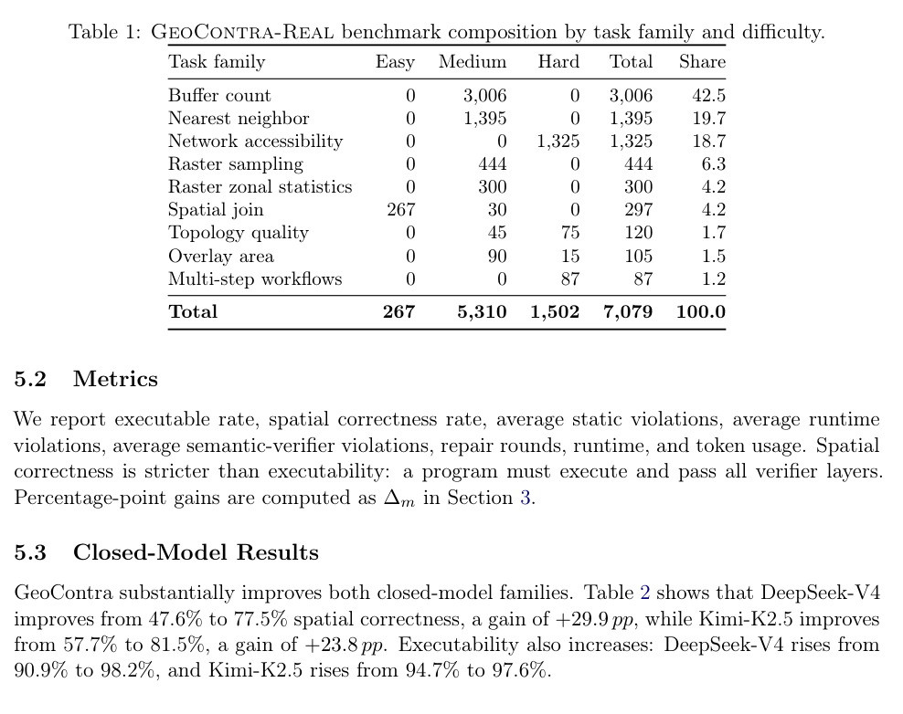

### 5.2 指标

报告程序可执行率、通过全部验证器的空间正确率、静态/运行时/语义违规的平均数量、修复轮数、运行时间与令牌消耗。空间正确率比可执行率严格：程序不仅要能执行，还要通过所有检查。论文中的提升以**百分点**计，而非相对百分比。

### 5.3 闭源模型结果

| 模型 | 条件 | 可执行率 | 空间正确率 | 平均静态违规数 | 平均运行时违规数 |
|---|---|---:|---:|---:|---:|
| DeepSeek-V4 | LLM-only | 90.9% | 47.6% | 0.515 | 0.102 |
| DeepSeek-V4 | GeoContra | 98.2% | 77.5% | 0.221 | 0.027 |
| Kimi-K2.5 | LLM-only | 94.7% | 57.7% | 0.392 | 0.092 |
| Kimi-K2.5 | GeoContra | 97.6% | 81.5% | 0.165 | 0.028 |

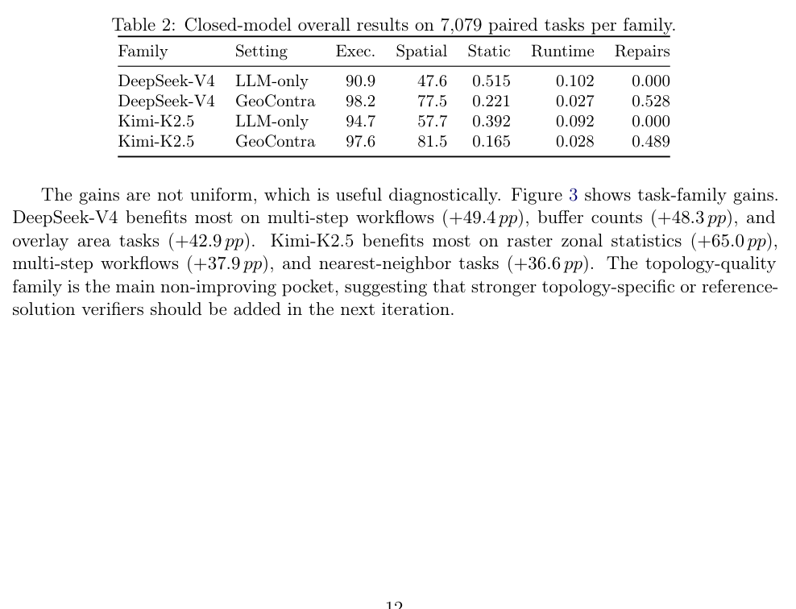

各类别提升存在明显差别。DeepSeek-V4 在多步工作流、缓冲区计数和叠置面积任务上的提升较大；Kimi-K2.5 在栅格分区统计、连续工作流与最近邻任务中提升显著。**拓扑质量**是一个主要未改善或反而退步的类别，表明轻量级验证器仍难覆盖复杂拓扑语义。

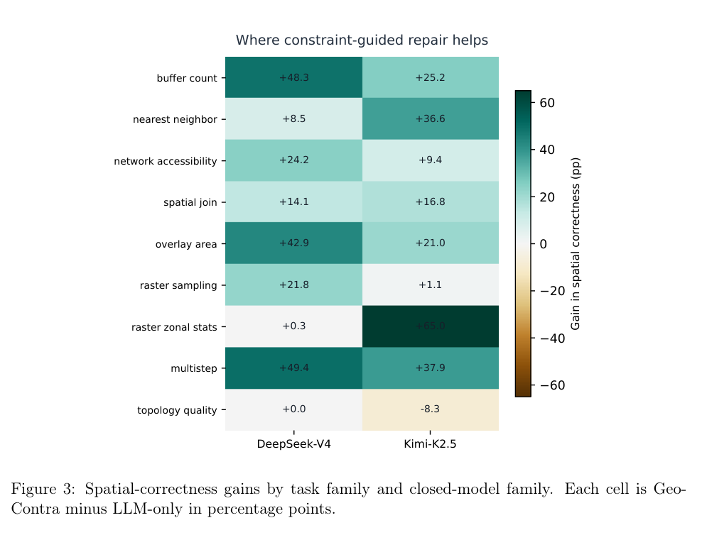

### 5.4 开源模型结果

11 个开源模型的平均空间正确率从 **18.3% 上升至 44.9%**，提升 **26.6 个百分点**；平均可执行率由 **33.3% 增至 61.7%**。全部 11 个模型均得到提升，但提升程度不同：若模型能够遵循约束并对错误进行局部修改，修复收益较大；若模型持续生成无法执行的代码或不遵守基础 API 约束，收益有限。这里体现的是系统增强而非仅靠扩大模型参数量。

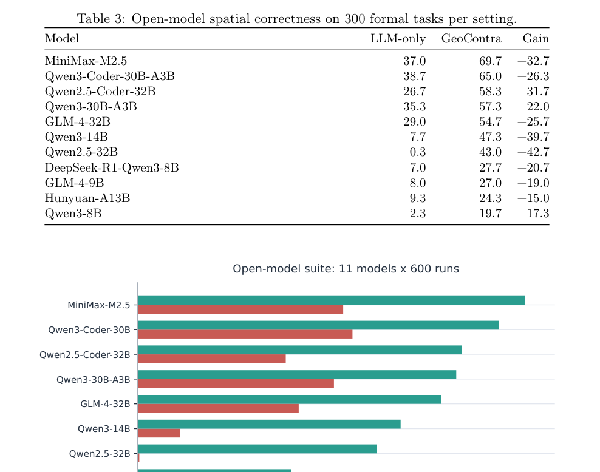
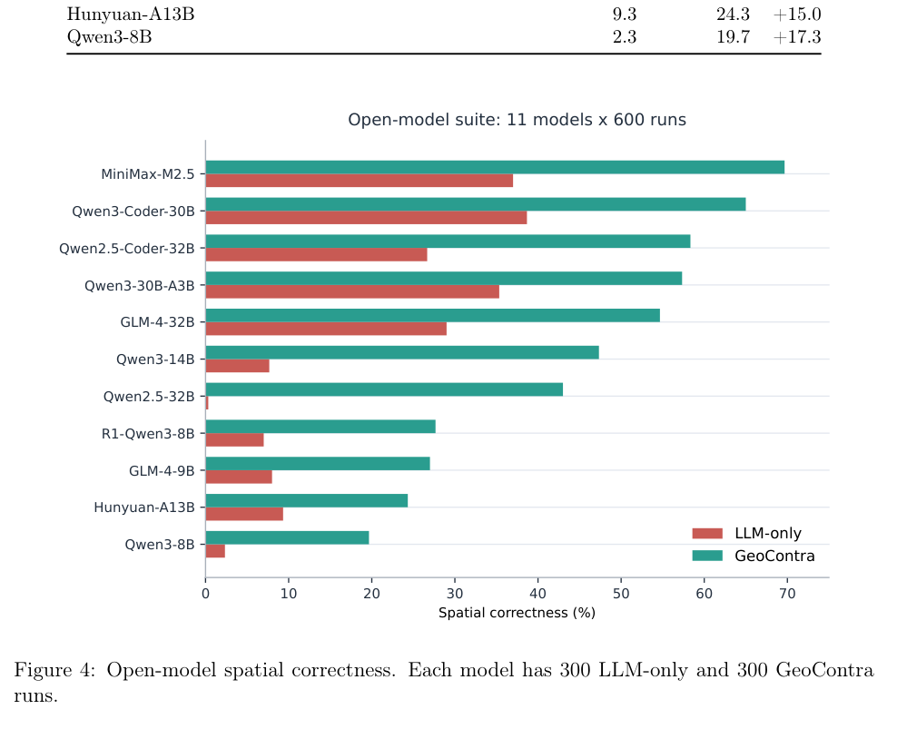

### 5.5 失败诊断

GeoContra 减少了最终的静态与运行时违规。DeepSeek-V4 每任务平均运行时违规由 0.102 降至 0.027，Kimi-K2.5 由 0.092 降至 0.028；静态违规同样明显下降。这说明不少 LLM-only 程序虽然可以运行，却没有遵守空间契约。

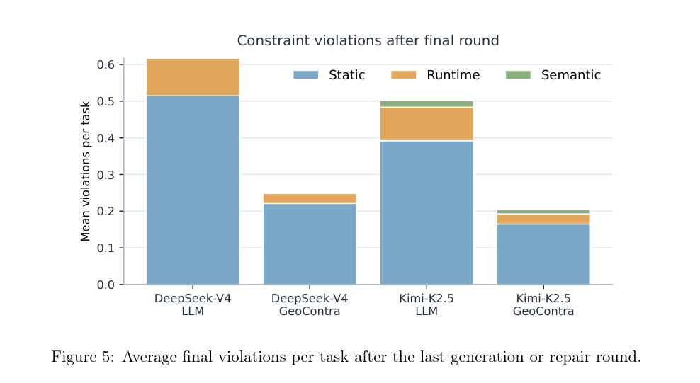

### 5.6 案例研究

原文选取四种典型问题：Watertown 医院网络可达性出现负数通行时间；Revere 住宅可达性中错误地把直线几何距离代替路网距离；Watertown 公交站分配任务将字符串 ID 错转成整数；Somerville 道路与水域缓冲区相交任务遗漏空间连接/谓词筛选。契约引导的生成与修复能够分别通过网络方法约束、明确禁止捷径、输出字段约束和任务语义检查修正这些问题。

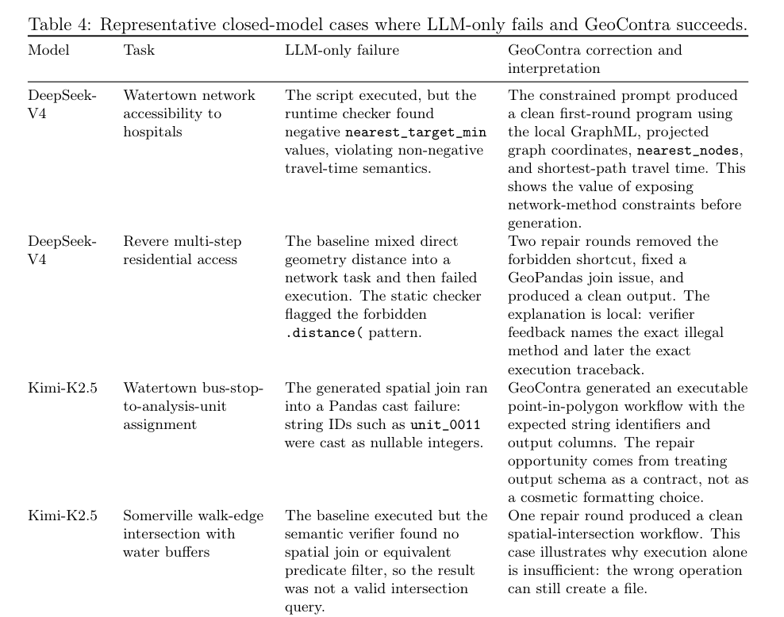

## 6 讨论

作者认为，LLM-GIS 的可靠性不只取决于模型大小，也取决于模型外围的任务表示与反馈结构。GeoContra 通过显式地理约束使一些弱模型的结果得到明显改善；对较强模型，它又能抑制“代码看似可信但地理含义错误”的情况。最适合轻量契约检验的错误包括保留源行、CRS 与单位、空间谓词、网络算法和输出模式。

但 GeoContra 并非完备的地理正确性判定器。其语义验证主要检查是否执行了契约规定的 GIS 操作，尚不足以判断复杂的多图层空间关系、空间分布模式、自相关、邻域效应或地图在地理上是否合理。若任务本身欠明确、输入数据缺失或模型持续出现编程错误，修复可能失败。未来需要更强的任务参考求解器、分布感知的空间诊断和拓扑几何比较。

## 7 结论

GeoContra 的核心主张是：**自动化 GIS 的评价标准应当是地理意义是否被保留，而不仅是是否生成了流畅且可运行的代码。**论文通过 7,079 个任务与额外 11 个开源模型展示了空间契约、分层验证和针对性修复的价值。不过，该研究的“正确率”受现有验证器覆盖能力制约，不能直接理解为所有产出都与唯一权威 GIS 结果完全相同。

## 数据可用性和写作声明

作者报告基准数据、任务契约、生成成果、评测结果与源码发布于 `GeoContra-Real-Benchmark` 仓库；写作声明中说明曾使用 ChatGPT 5.4 与 Google Gemini 协助润色和技术实现，最终责任由作者承担。原始英文参考文献及声明全文保存在英文逐页提取稿对应页。

## 图表和附录索引

原文包含图 1—5、表 1—5 和算法 1—6。上述 16 个截图文件均在 `images/` 中，逐页原始截图在 `source_pages/` 中。原始公式、所有英文参考文献及原稿每页文字见 `GeoContra_英文全文逐页提取.md`。不在此另行猜测参考文献标题或 DOI。
