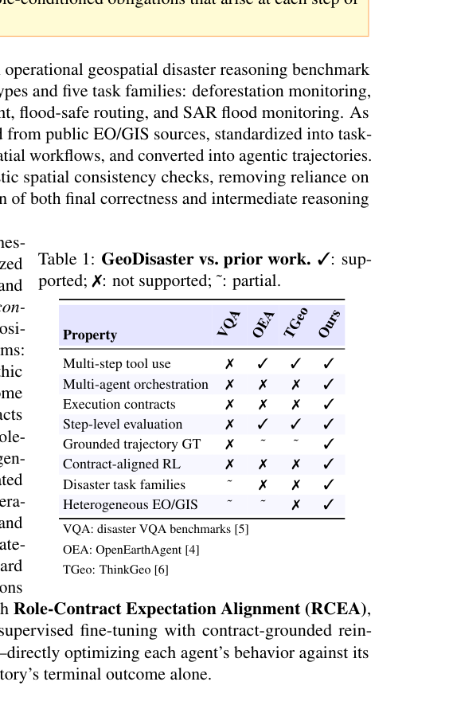
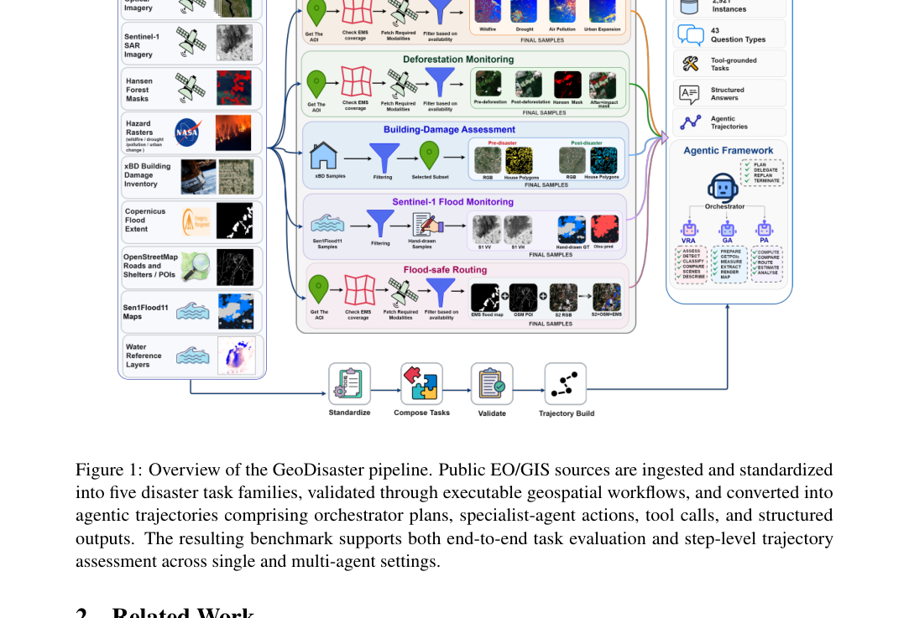
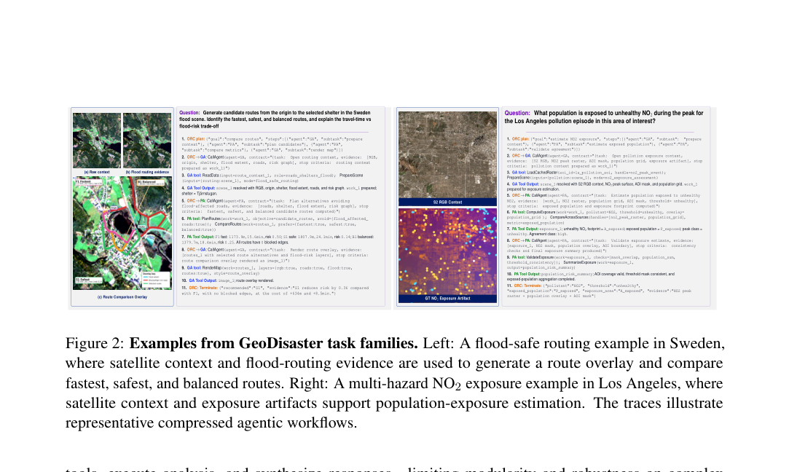
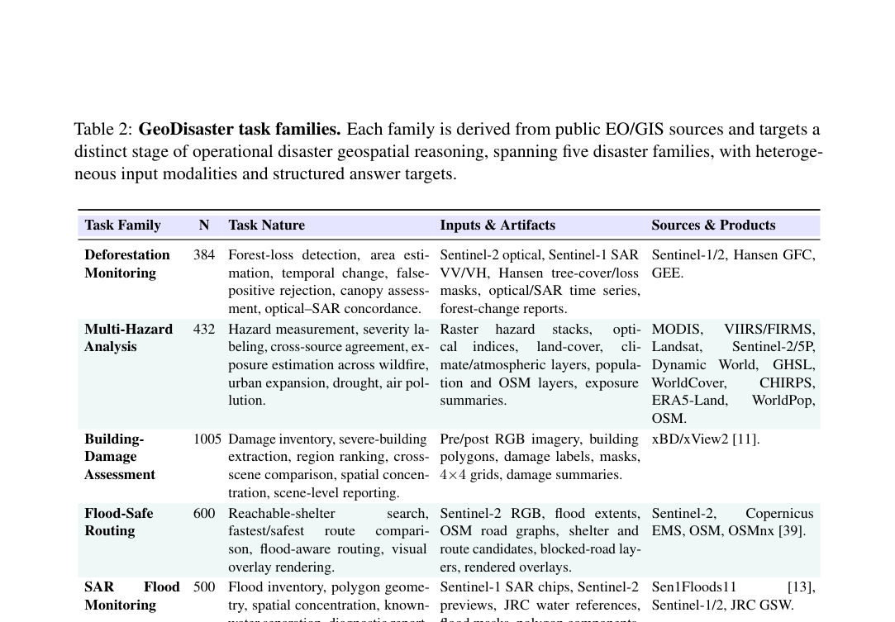
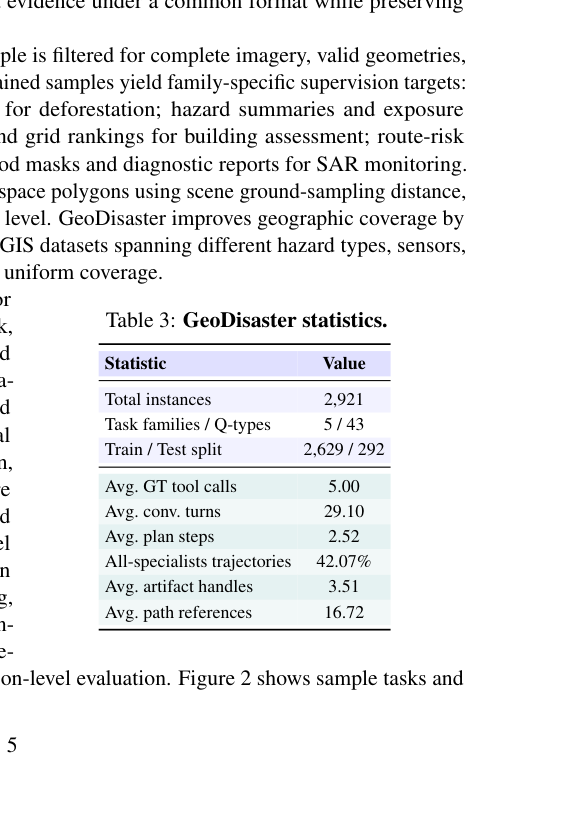
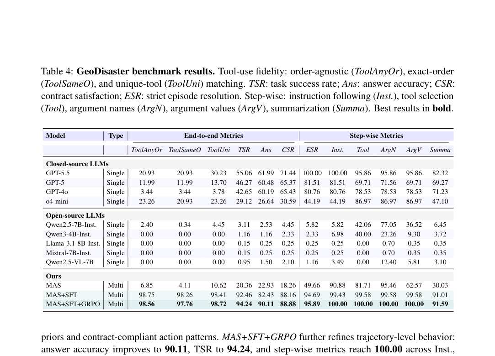
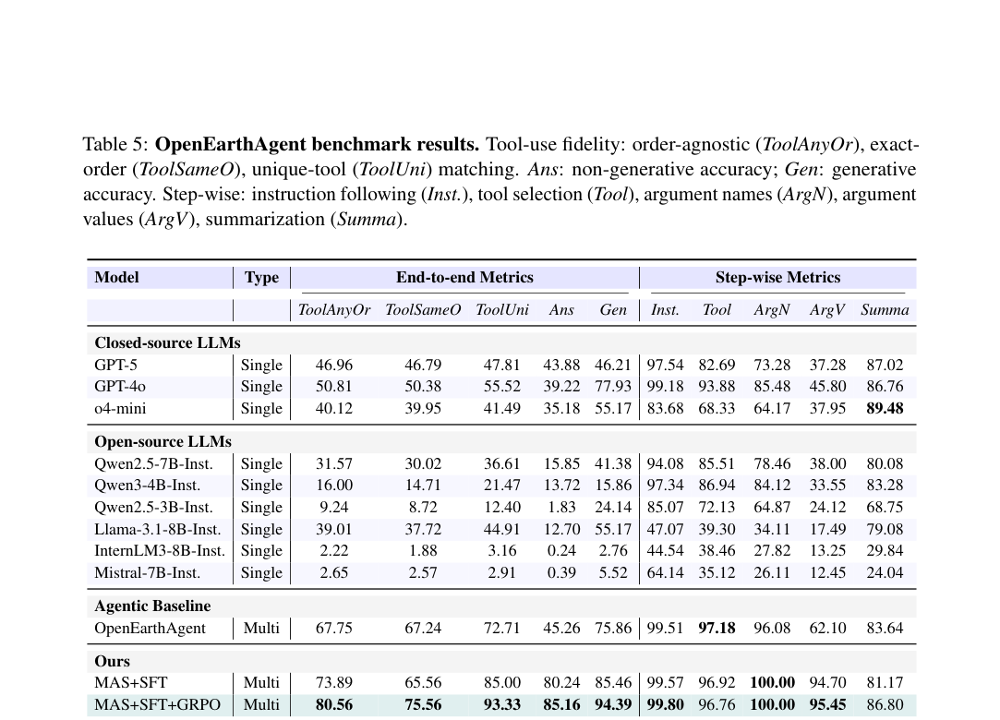
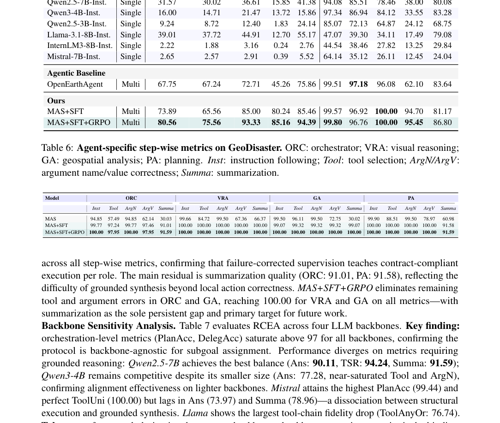

# GeoDisaster：面向业务化灾害地理空间情报的协同智能体基准评测

**原文题目：** GeoDisaster: Benchmarking Orchestrated Agents for Operational Disaster Geo-Intelligence

**原始 PDF：** [原始论文](./原始论文.pdf)（共 28 页）

> **翻译覆盖声明（请先阅读）**：本文件提供**摘要完整中文翻译**及主要研究章节的**中文学术译述**，不等同于逐字逐句的全文译本。为避免遗漏资料，原 PDF 全部页面的英文文字与附录、参考文献均已收录在 `英文原文_逐页.md` 和 `英文全文_保留版面.txt`，图、表另见 `图表索引.md`。不可把本文档当作全部正文及附录均已翻译的材料。

---

## 摘要（完整中文翻译）

遥感视觉语言模型（RS-VLM）已经推动地球观测分析向视觉理解和指令遵循发展，但仍难以满足业务化地理空间情报分析的要求；后者必须具有以工具执行为依据的空间推理能力，并形成结构化、具有证据支撑的决策。本文提出 GeoDisaster：一个面向灾害业务化地理空间推理的基准，涵盖 2,921 个经过验证的样本、43 种问题类型和五大任务族，分别为森林砍伐监测、多灾种分析、建筑物损毁评估、洪水安全路径规划，以及基于 Sentinel-1 合成孔径雷达（SAR）的洪水监测。样本整合了异构地球观测及 GIS 证据，包括光学与 SAR 影像、栅格掩膜、矢量几何、道路网络和暴露度图层，任务涉及灾害识别、损毁评估、暴露度估计与诊断报告生成。真实值答案由可执行地理空间工作流和确定性一致性检查提供支撑，不依赖语言模型生成标注。作者还提出一种由 18 种灾害专用工具支撑的协同多智能体框架，角色专用智能体通过显式执行契约进行协调，并利用“角色—契约期望对齐”（Role-Contract Expectation Alignment，RCEA）完成训练。RCEA 将故障感知的监督微调与基于契约的强化学习相结合，利用密集的步骤级信号实现对齐。实验表明，GeoDisaster 对现有遥感视觉语言模型和智能体系统提出了较高挑战，而 RCEA 能改善工具使用、证据溯源、状态一致性和决策生成。

## 主要研究章节（中文学术译述）

### 研究背景与问题定义

传统灾害遥感基准多围绕单幅影像开展识别、分割或视觉问答，通常仅对最终答案评分。业务化应急场景还需要跨源数据整合、空间计算、路径规划、图层状态管理和可信的报告编写。因此，评价对象应由单次视觉回答扩展至多工具、可执行、可核验的连续工作流。本文认为，现有单智能体轨迹及仅以最终结果为导向的对齐方案，难以明确判定每一角色在协作流程中的责任是否已履行。

### Benchmark 任务体系

GeoDisaster 的五种任务族对应从观测到行动的灾害业务流程：①森林砍伐监测；②多灾种综合分析；③建筑物损毁评估；④洪水情景下的安全路径规划；⑤Sentinel-1 SAR 洪水监测。2,921 个样本覆盖 43 种问题类型。输入可同时包含光学影像、雷达数据、栅格掩膜、矢量几何、路网和人口暴露信息。与纯图像问答不同，任务需要工具序列、空间分析中间结果和结构化成果。

### 真实值及有效性

作者以执行过的地理空间工作流构建真实值（ground truth, GT），使用确定性空间一致性检查校验答案，使最终结果和中间过程均可检验。这能减少以语言模型直接生成标准答案所带来的偏差。不过，“可执行”不自动等于“评价完全有效”；跨数据源单位、空间尺度、拓扑约束和任务解释歧义仍应逐一核对。

### 多智能体框架

框架通过协调器（orchestrator）向各专用角色分配任务，并向角色发布带有可验证义务的执行契约。合约约束角色应输入何种证据、调用哪些能力、交付什么中间成果以及在何种条件下停止。18 个灾害导向工具覆盖感知、地理空间操作和业务分析。角色之间的交接不再依赖完全自由形式的自然语言沟通，而是使用明确的执行条件。

### RCEA 的训练思路

角色—契约期望对齐（RCEA）包含两个相互衔接的阶段。首先进行故障感知、角色条件化的监督微调；随后将契约履行情况转化为步骤级奖励，使用强化学习对角色策略进行优化。相比只查看整条轨迹是否成功，这种方法旨在改善角色之间的奖励归因、工具调用错误与中间状态不一致问题。

### 评价维度与论文使用提示

本文同时报告任务级和步骤级指标，重点包括任务成功、工具调用保真度、成果证据落地性、执行状态一致性及轨迹效率。原文的工具调用指标进一步区分忽略顺序的匹配和严格调用顺序的匹配（例如 ToolAnyOr、ToolSameO）；具体统计口径与公式应以原文实验章节及表格为准。对地学 Benchmark 评价可靠性研究而言，尤其值得复核“步骤正确”与“最终结果正确”是否一致，以及中间成果可验证程度。

## 专业术语中英对照

| English | 中文术语 |
|---|---|
| operational geo-intelligence | 业务化地理空间情报 |
| orchestrated agents | 协同编排智能体 |
| execution contract | 执行契约 |
| role-conditioned | 角色条件化 |
| step-level signals | 步骤级信号 |
| deterministic consistency checks | 确定性一致性检查 |
| artifact grounding | 成果证据落地性 |
| state consistency | 状态一致性 |

## 图表与逐页原文导航

独立裁图共 **23** 张；完整原版页面截图共 **28** 张。

- [全部图表索引](./图表索引.md)
- [逐页原文与对应图表](./逐页原文与配图.md)
- [英文原文逐页](./英文原文_逐页.md)
- [参考文献英文原文](./参考文献_英文原文.md)
- [QA 逐页核查报告](./QA_逐页核查报告.md)

### 代表性原始图表

**表1（第 2 页）**

> Table 1: GeoDisaster vs. prior work. ✓: sup- ported; ✗: not supported; ˜: partial.

**图1（第 3 页）**

> Figure 1: Overview of the GeoDisaster pipeline. Public EO/GIS sources are ingested and standardized into five disaster task families, validated through executable geospatial workflows, and converted into agentic trajectories comprising orchestrator plans, specialist-agent actions, tool calls, and structured outputs. The resulting benchmark supports both end-to-end task evaluation and step-level trajectory assessment across single and multi-agent settings.

**图2（第 4 页）**

> Figure 2: Examples from GeoDisaster task families. Left: A flood-safe routing example in Sweden, where satellite context and flood-routing evidence are used to generate a route overlay and compare fastest, safest, and balanced routes. Right: A multi-hazard NO2 exposure example in Los Angeles, where satellite context and exposure artifacts support population-exposure estimation. The traces illustrate representative compressed agentic workflows.

**表2（第 5 页）**

> Table 2: GeoDisaster task families. Each family is derived from public EO/GIS sources and targets a distinct stage of operational disaster geospatial reasoning, spanning five disaster families, with heteroge- neous input modalities and structured answer targets.

**表3（第 5 页）**

> Table 3: GeoDisaster statistics.

**表4（第 10 页）**

> Table 4: GeoDisaster benchmark results. Tool-use fidelity: order-agnostic (ToolAnyOr), exact-order (ToolSameO), and unique-tool (ToolUni) matching. TSR: task success rate; Ans: answer accuracy; CSR: contract satisfaction; ESR: strict episode resolution. Step-wise: instruction following (Inst.), tool selection (Tool), argument names (ArgN), argument values (ArgV), summarization (Summa). Best results in bold.

**表5（第 11 页）**

> Table 5: OpenEarthAgent benchmark results. Tool-use fidelity: order-agnostic (ToolAnyOr), exact- order (ToolSameO), unique-tool (ToolUni) matching. Ans: non-generative accuracy; Gen: generative accuracy. Step-wise: instruction following (Inst.), tool selection (Tool), argument names (ArgN), argument values (ArgV), summarization (Summa).

**表6（第 11 页）**

> Table 6: Agent-specific step-wise metrics on GeoDisaster. ORC: orchestrator; VRA: visual reasoning; GA: geospatial analysis; PA: planning. Inst: instruction following; Tool: tool selection; ArgN/ArgV: argument name/value correctness; Summa: summarization.
