# 图表索引

来源：**GeoDisaster: Benchmarking Orchestrated Agents for Operational Disaster Geo-Intelligence**，共 28 页。按原 PDF 页码列出图表；截图保留原版文字。

## 表1 — 原文第 2 页

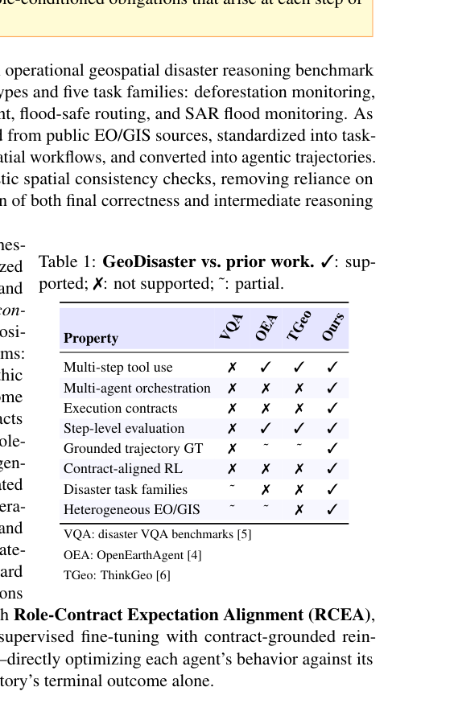

**Caption（原文）：** Table 1: GeoDisaster vs. prior work. ✓: sup- ported; ✗: not supported; ˜: partial.

[查看完整第 2 页](./source_pages/page-002.jpg)

## 图1 — 原文第 3 页

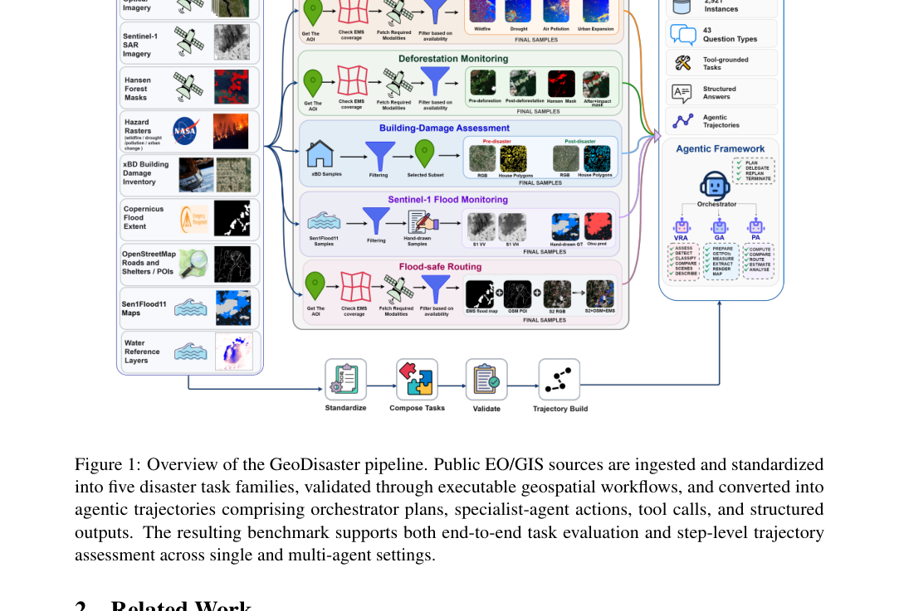

**Caption（原文）：** Figure 1: Overview of the GeoDisaster pipeline. Public EO/GIS sources are ingested and standardized into five disaster task families, validated through executable geospatial workflows, and converted into agentic trajectories comprising orchestrator plans, specialist-agent actions, tool calls, and structured outputs. The resulting benchmark supports both end-to-end task evaluation and step-level trajectory assessment across single and multi-agent settings.

[查看完整第 3 页](./source_pages/page-003.jpg)

## 图2 — 原文第 4 页

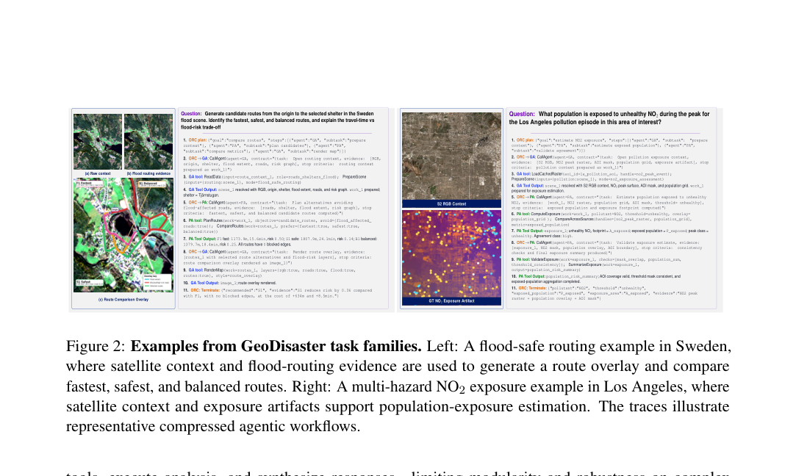

**Caption（原文）：** Figure 2: Examples from GeoDisaster task families. Left: A flood-safe routing example in Sweden, where satellite context and flood-routing evidence are used to generate a route overlay and compare fastest, safest, and balanced routes. Right: A multi-hazard NO2 exposure example in Los Angeles, where satellite context and exposure artifacts support population-exposure estimation. The traces illustrate representative compressed agentic workflows.

[查看完整第 4 页](./source_pages/page-004.jpg)

## 表2 — 原文第 5 页

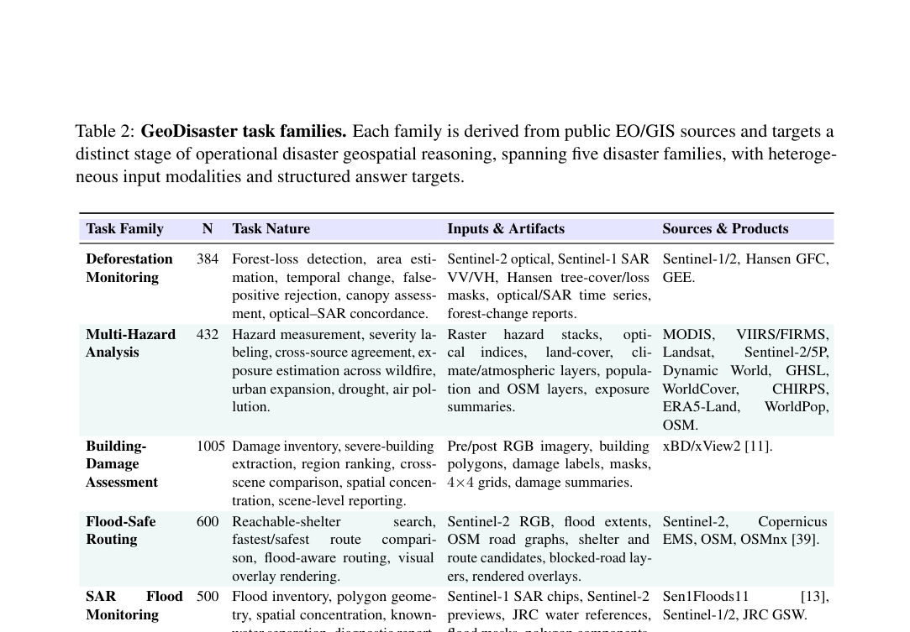

**Caption（原文）：** Table 2: GeoDisaster task families. Each family is derived from public EO/GIS sources and targets a distinct stage of operational disaster geospatial reasoning, spanning five disaster families, with heteroge- neous input modalities and structured answer targets.

[查看完整第 5 页](./source_pages/page-005.jpg)

## 表3 — 原文第 5 页

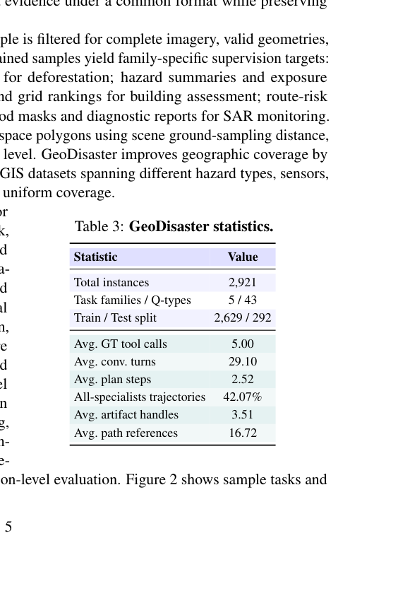

**Caption（原文）：** Table 3: GeoDisaster statistics.

[查看完整第 5 页](./source_pages/page-005.jpg)

## 表4 — 原文第 10 页

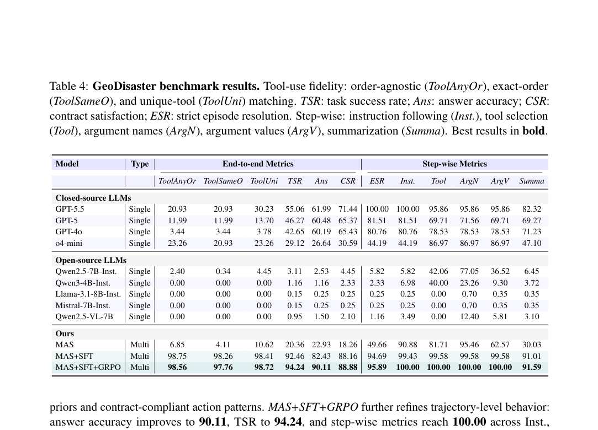

**Caption（原文）：** Table 4: GeoDisaster benchmark results. Tool-use fidelity: order-agnostic (ToolAnyOr), exact-order (ToolSameO), and unique-tool (ToolUni) matching. TSR: task success rate; Ans: answer accuracy; CSR: contract satisfaction; ESR: strict episode resolution. Step-wise: instruction following (Inst.), tool selection (Tool), argument names (ArgN), argument values (ArgV), summarization (Summa). Best results in bold.

[查看完整第 10 页](./source_pages/page-010.jpg)

## 表5 — 原文第 11 页

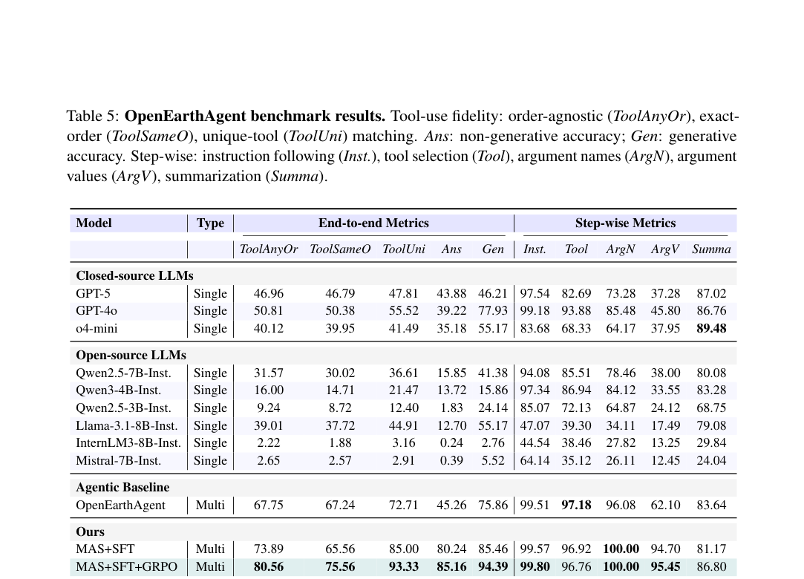

**Caption（原文）：** Table 5: OpenEarthAgent benchmark results. Tool-use fidelity: order-agnostic (ToolAnyOr), exact- order (ToolSameO), unique-tool (ToolUni) matching. Ans: non-generative accuracy; Gen: generative accuracy. Step-wise: instruction following (Inst.), tool selection (Tool), argument names (ArgN), argument values (ArgV), summarization (Summa).

[查看完整第 11 页](./source_pages/page-011.jpg)

## 表6 — 原文第 11 页

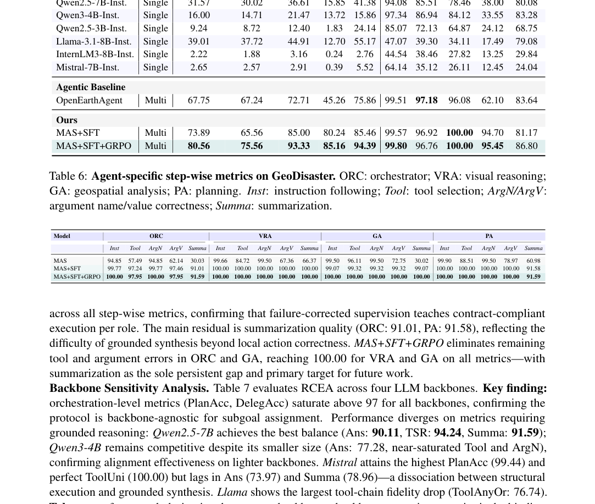

**Caption（原文）：** Table 6: Agent-specific step-wise metrics on GeoDisaster. ORC: orchestrator; VRA: visual reasoning; GA: geospatial analysis; PA: planning. Inst: instruction following; Tool: tool selection; ArgN/ArgV: argument name/value correctness; Summa: summarization.

[查看完整第 11 页](./source_pages/page-011.jpg)

## 表7 — 原文第 12 页

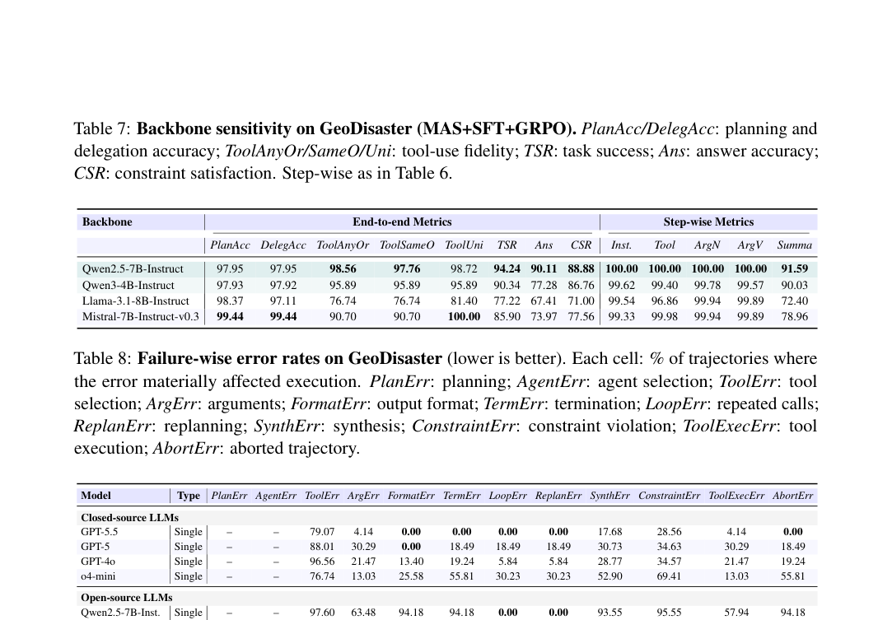

**Caption（原文）：** Table 7: Backbone sensitivity on GeoDisaster (MAS+SFT+GRPO). PlanAcc/DelegAcc: planning and delegation accuracy; ToolAnyOr/SameO/Uni: tool-use fidelity; TSR: task success; Ans: answer accuracy; CSR: constraint satisfaction. Step-wise as in Table 6.

[查看完整第 12 页](./source_pages/page-012.jpg)

## 表8 — 原文第 12 页

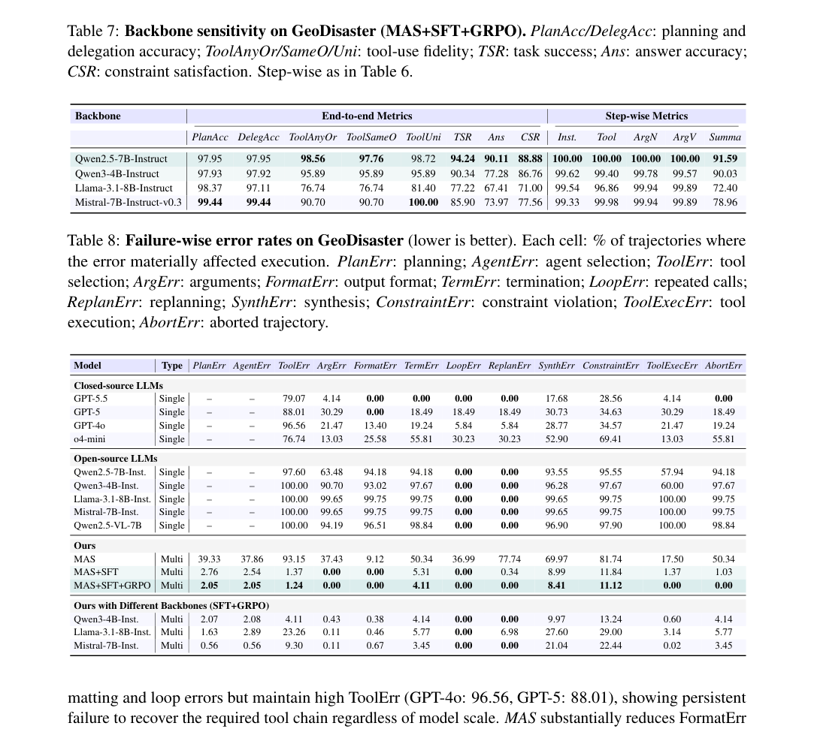

**Caption（原文）：** Table 8: Failure-wise error rates on GeoDisaster (lower is better). Each cell: % of trajectories where the error materially affected execution. PlanErr: planning; AgentErr: agent selection; ToolErr: tool selection; ArgErr: arguments; FormatErr: output format; TermErr: termination; LoopErr: repeated calls; ReplanErr: replanning; SynthErr: synthesis; ConstraintErr: constraint violation; ToolExecErr: tool execution; AbortErr: aborted trajectory.

[查看完整第 12 页](./source_pages/page-012.jpg)

## 表9 — 原文第 13 页

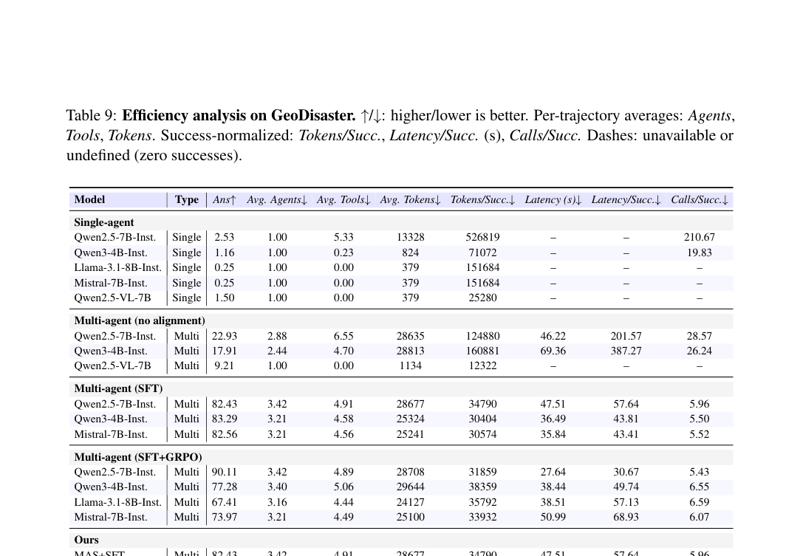

**Caption（原文）：** Table 9: Efficiency analysis on GeoDisaster. ↑/↓: higher/lower is better. Per-trajectory averages: Agents, Tools, Tokens. Success-normalized: Tokens/Succ., Latency/Succ. (s), Calls/Succ. Dashes: unavailable or undefined (zero successes).

[查看完整第 13 页](./source_pages/page-013.jpg)

## 图S1 — 原文第 17 页

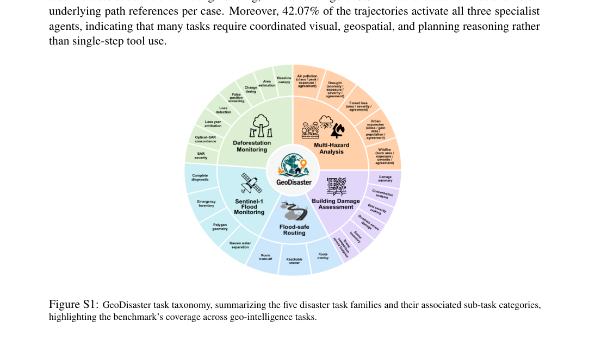

**Caption（原文）：** Figure S1: GeoDisaster task taxonomy, summarizing the five disaster task families and their associated sub-task categories, highlighting the benchmark’s coverage across geo-intelligence tasks.

[查看完整第 17 页](./source_pages/page-017.jpg)

## 表S1 — 原文第 18 页

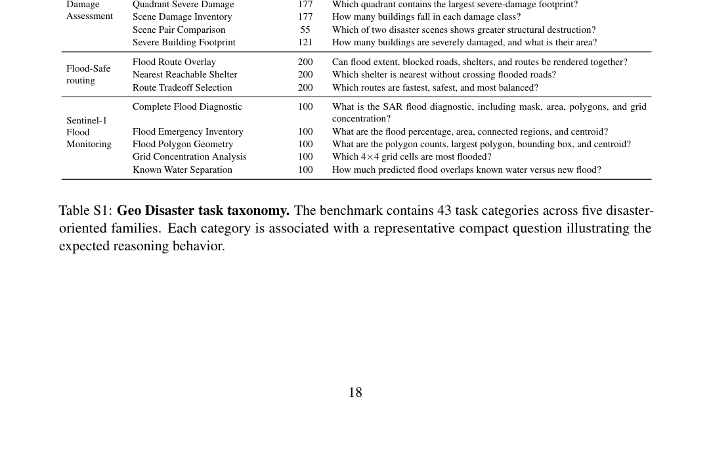

**Caption（原文）：** Table S1: Geo Disaster task taxonomy. The benchmark contains 43 task categories across five disaster- oriented families. Each category is associated with a representative compact question illustrating the expected reasoning behavior.

[查看完整第 18 页](./source_pages/page-018.jpg)

## 图S2 — 原文第 19 页

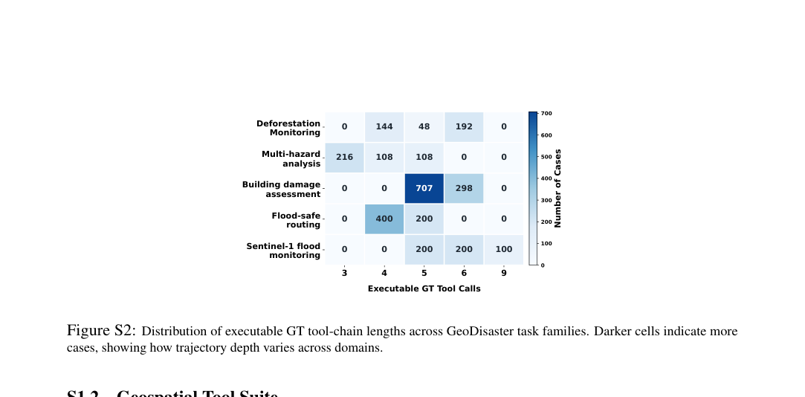

**Caption（原文）：** Figure S2: Distribution of executable GT tool-chain lengths across GeoDisaster task families. Darker cells indicate more cases, showing how trajectory depth varies across domains.

[查看完整第 19 页](./source_pages/page-019.jpg)

## 表S2 — 原文第 20 页

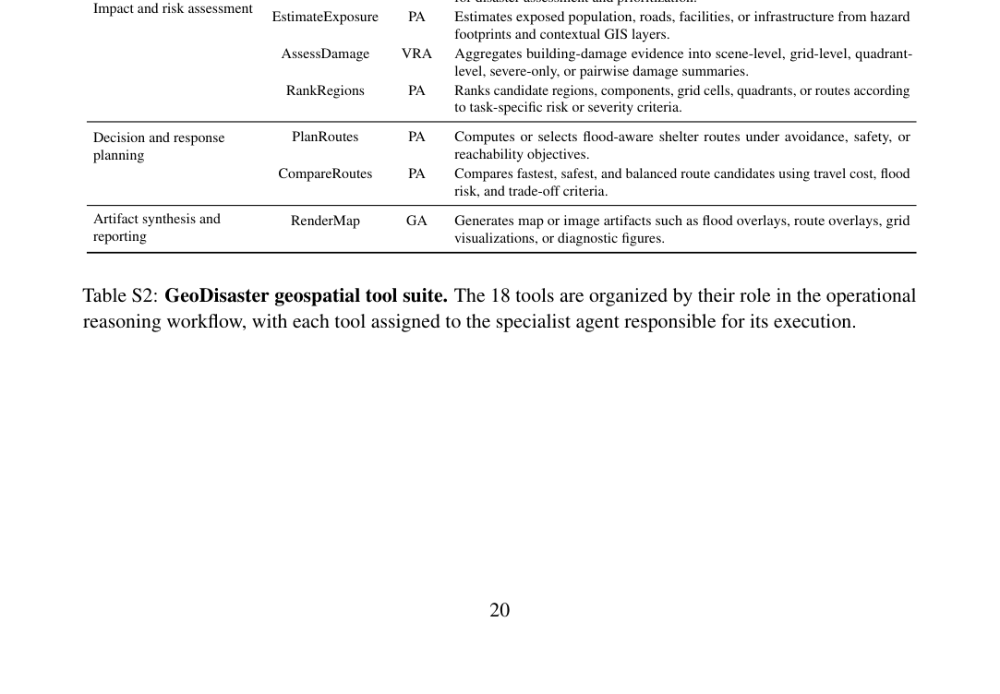

**Caption（原文）：** Table S2: GeoDisaster geospatial tool suite. The 18 tools are organized by their role in the operational reasoning workflow, with each tool assigned to the specialist agent responsible for its execution.

[查看完整第 20 页](./source_pages/page-020.jpg)

## 表S3 — 原文第 21 页

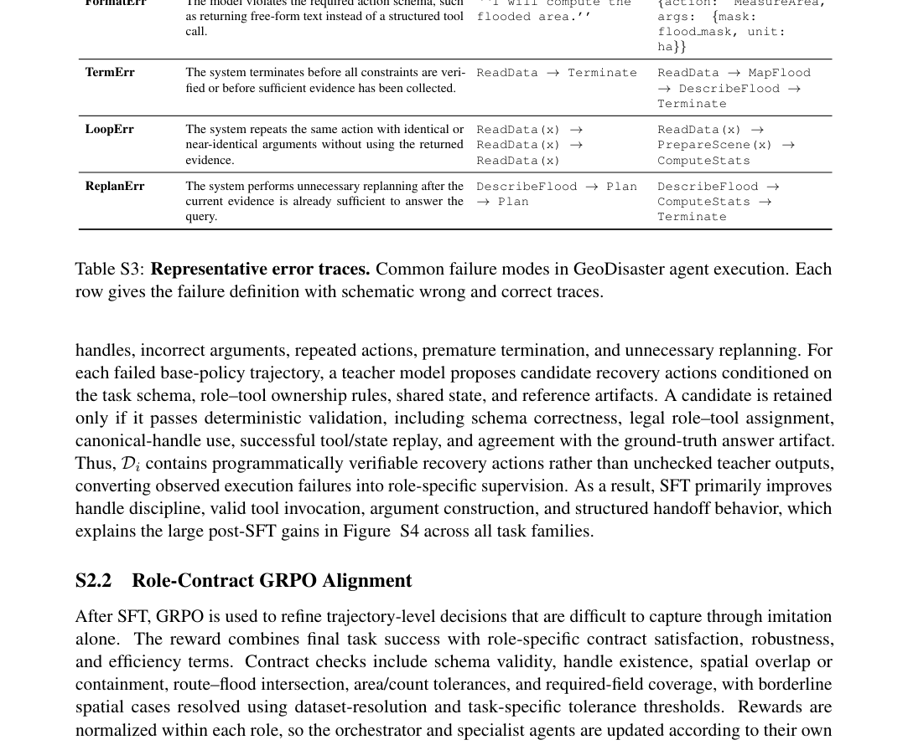

**Caption（原文）：** Table S3: Representative error traces. Common failure modes in GeoDisaster agent execution. Each row gives the failure definition with schematic wrong and correct traces.

[查看完整第 21 页](./source_pages/page-021.jpg)

## 图S3 — 原文第 22 页

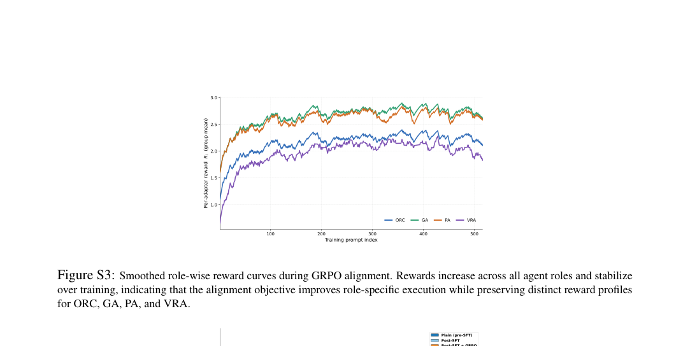

**Caption（原文）：** Figure S3: Smoothed role-wise reward curves during GRPO alignment. Rewards increase across all agent roles and stabilize over training, indicating that the alignment objective improves role-specific execution while preserving distinct reward profiles for ORC, GA, PA, and VRA.

[查看完整第 22 页](./source_pages/page-022.jpg)

## 图S4 — 原文第 22 页

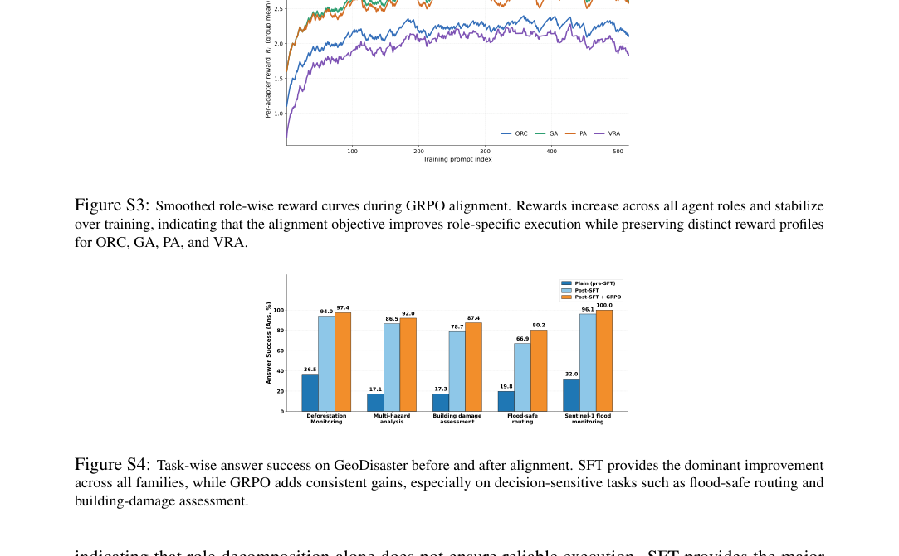

**Caption（原文）：** Figure S4: Task-wise answer success on GeoDisaster before and after alignment. SFT provides the dominant improvement across all families, while GRPO adds consistent gains, especially on decision-sensitive tasks such as flood-safe routing and building-damage assessment.

[查看完整第 22 页](./source_pages/page-022.jpg)

## 图S5 — 原文第 25 页

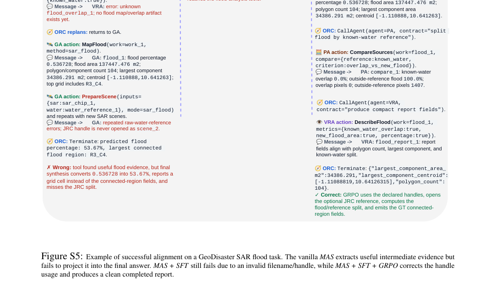

**Caption（原文）：** Figure S5: Example of successful alignment on a GeoDisaster SAR flood task. The vanilla MAS extracts useful intermediate evidence but fails to project it into the final answer. MAS + SFT still fails due to an invalid filename/handle, while MAS + SFT + GRPO corrects the handle usage and produces a clean completed report.

[查看完整第 25 页](./source_pages/page-025.jpg)

## 图S6 — 原文第 26 页

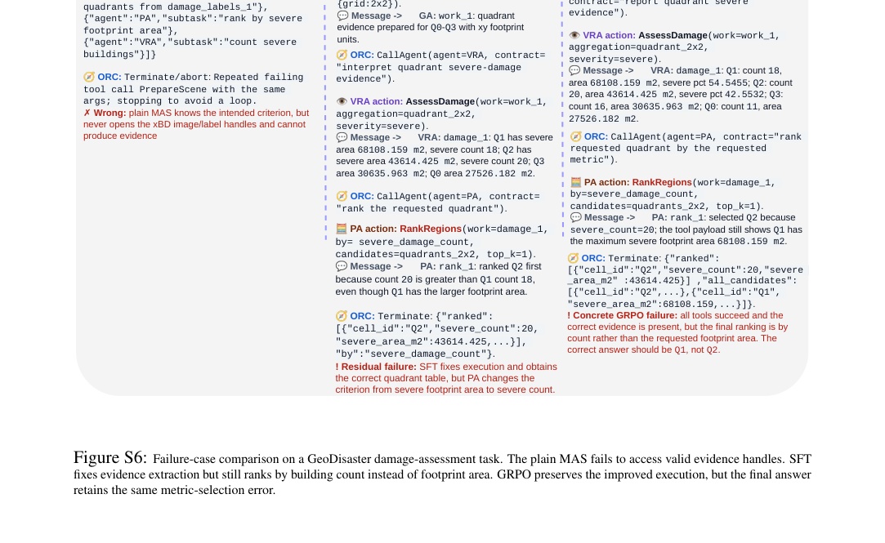

**Caption（原文）：** Figure S6: Failure-case comparison on a GeoDisaster damage-assessment task. The plain MAS fails to access valid evidence handles. SFT fixes evidence extraction but still ranks by building count instead of footprint area. GRPO preserves the improved execution, but the final answer retains the same metric-selection error.

[查看完整第 26 页](./source_pages/page-026.jpg)

## 图S7 — 原文第 27 页

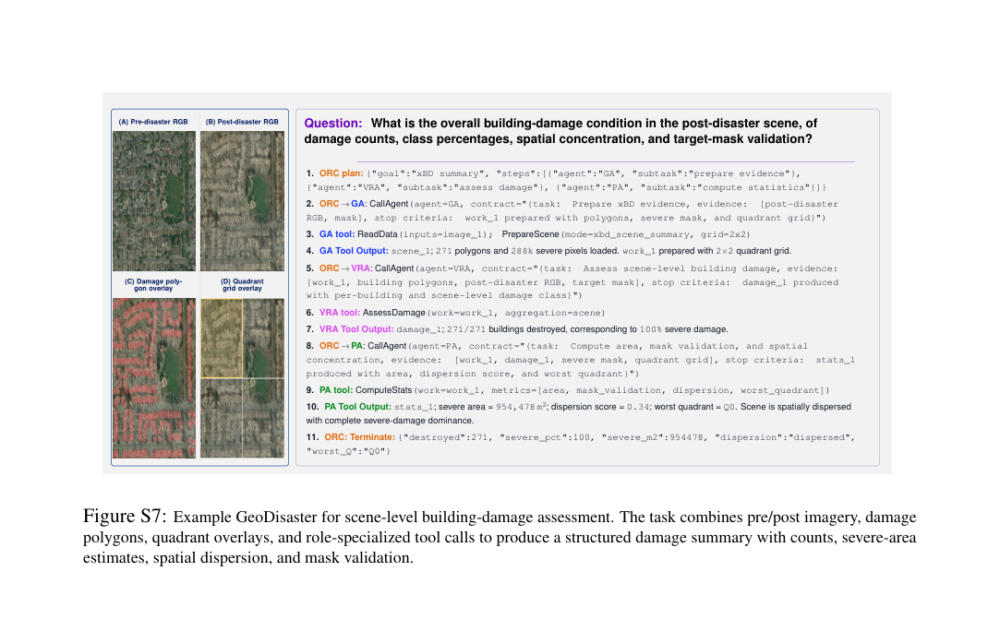

**Caption（原文）：** Figure S7: Example GeoDisaster for scene-level building-damage assessment. The task combines pre/post imagery, damage polygons, quadrant overlays, and role-specialized tool calls to produce a structured damage summary with counts, severe-area estimates, spatial dispersion, and mask validation.

[查看完整第 27 页](./source_pages/page-027.jpg)

## 图S8 — 原文第 27 页

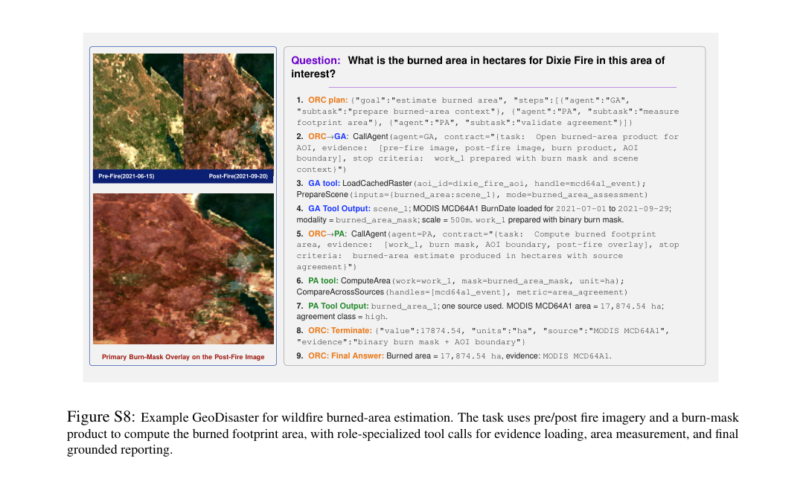

**Caption（原文）：** Figure S8: Example GeoDisaster for wildfire burned-area estimation. The task uses pre/post fire imagery and a burn-mask product to compute the burned footprint area, with role-specialized tool calls for evidence loading, area measurement, and final grounded reporting.

[查看完整第 27 页](./source_pages/page-027.jpg)

## 图S9 — 原文第 28 页

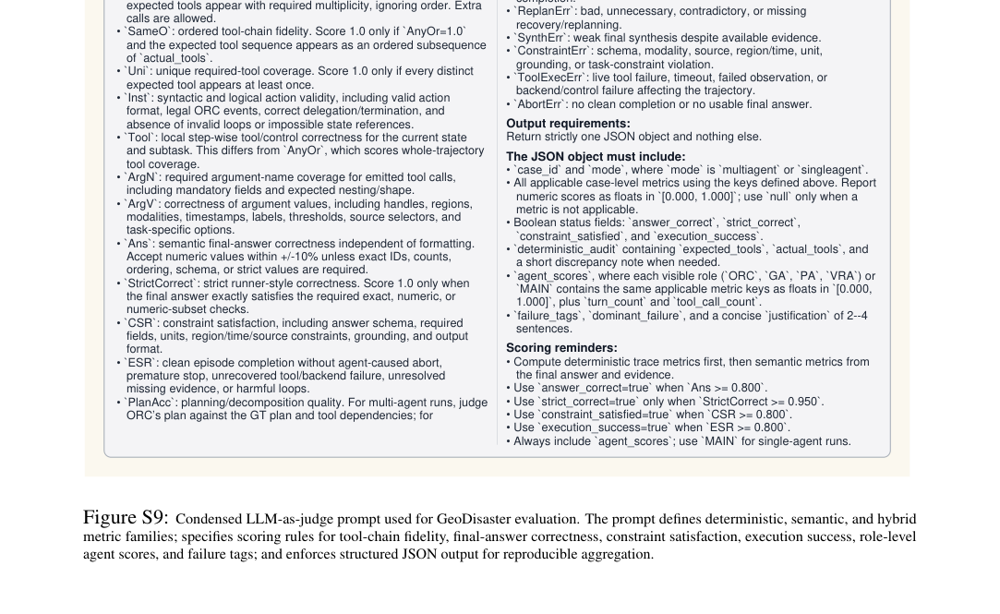

**Caption（原文）：** Figure S9: Condensed LLM-as-judge prompt used for GeoDisaster evaluation. The prompt defines deterministic, semantic, and hybrid metric families; specifies scoring rules for tool-chain fidelity, final-answer correctness, constraint satisfaction, execution success, role-level agent scores, and failure tags; and enforces structured JSON output for reproducible aggregation.

[查看完整第 28 页](./source_pages/page-028.jpg)
