# GeoLLM-Engine：用于构建地理空间 Copilot 的真实环境

> **翻译范围说明**：以下摘要完整翻译，方法及实验为准确性优先的节译和概述；完整英文逐页原文及参考文献另附。

## 原文摘要｜完整中文翻译

地理空间 Copilot 使用户能够通过自然语言指令开展地球观测应用，释放了前所未有的潜力。然而，现有智能体往往依赖过度简化的单项任务以及基于模板生成的提示，与真实场景之间存在明显脱节。本文提出 GeoLLM-Engine：一种面向工具增强智能体的环境，支持遥感平台分析人员日常执行的复杂任务。作者为该环境集成了地理空间 API 工具、动态地图和用户界面，以及外部多模态知识库，以正确评价智能体理解真实高层自然语言命令的能力和完成任务时的功能正确性。为了减轻通常由人工参与基准构建带来的开销，作者利用 100 个 GPT-4-Turbo 节点组成的大规模并行引擎，将基准扩展到超过五十万个多工具任务及一百一十万幅卫星影像。该研究突破了传统单任务图像描述范式，并使用长时程提示比较先进智能体和提示策略。

## 研究动机｜节译

作者认为，研究中的关键问题并不是不断增加同质化图像描述和问答样本，而是构建真实、可交互、包含多种地理空间工具的任务环境。这样才能考察 Agent 是否理解用户的高层意图、能否选择正确工具，以及最终是否真正完成任务。

## 环境架构｜重点译述

GeoLLM-Engine 集成地理空间 API、动态地图与 Web UI、外部知识源，以及工具增强的智能体执行链。研究任务不仅包括物体检测、土地覆盖识别和场景总结，还包括影像变化分析、知识检索、地图可视化、Web 操作和文档查询。复杂任务可能需要多个工具以及不同层次的任务计划。

在 Benchmark 生成阶段，作者使用程序化工具与大规模并行模型生成扩展任务库；在评价阶段采用与工具环境有关的**模型检查机制（model checks）**，判断智能体执行是否满足预期功能，而不只比较自然语言答案的表面相似程度。

## 实验与评价机制｜重点译述

论文测试了不同模型与提示方法，并讨论任务规模、任务复杂度对评价结论的影响。作者特别指出：如果只增加相同难度的大量样本，评测结果的区分度未必得到提升；而增加任务类型和复杂程度，能够更全面地暴露 Agent 的不足。这一观点可以直接用于地学 Benchmark 的“覆盖度不等于有效性”讨论。

## 图表阅读提示

- **图 1**：真实遥感业务场景的任务类别及自然语言指令示例。
- **图 2**：包含 API、地图工具、评测引擎和检查机制的系统架构。
- **表 1**：GeoLLM-Engine 的工具模块清单。
- **表 3**：用于判断智能体操作结果的 model checks。

## 核心学术术语对照

| 英文术语 | 中文译法 | 注释 |
|---|---|---|
| Benchmark | 评测基准 | 与数据集、任务集合、执行环境和评分协议区分 |
| Ground Truth (GT) | 参考真值、标准答案 | 可能是答案、代码、执行结果或轨迹，需按论文实际定义 |
| Agentic AI | 智能体人工智能 | 具有规划、工具操作、反馈利用等能力的系统 |
| Tool-Augmented Agent | 工具增强智能体 | 可调用外部 API、程序或领域工具的智能体 |
| Tool Calling | 工具调用 | 包含工具选择和参数绑定，而不只是文本中提及工具 |
| Workflow | 工作流 | 有依赖关系的操作流程 |
| Trajectory | 执行轨迹 | 动作、调用参数、环境反馈和可能的中间产物 |
| Geospatial Grounding | 地理空间锚定 | 将模型输出与实际地物、坐标、尺度、属性或数据对应 |
| Vision-Language Model (VLM) | 视觉语言模型 | 同时处理视觉输入和语言的模型 |
| Multimodal Large Language Model (MLLM) | 多模态大语言模型 | 支持多模态理解和推理 |
| Remote Sensing (RS) | 遥感 | 本研究语境中的对地观测数据分析 |
| Earth Observation (EO) | 地球观测 | 涵盖卫星、航空以及相关环境观测 |
| Retrieval-Augmented Generation (RAG) | 检索增强生成 | 通过外部信息检索增强生成和推理 |
| Semantic Similarity | 语义相似性 | 与正确执行并不等价 |
| Execution-Based Evaluation | 基于执行的评价 | 需要真实或受控的运行环境及验证标准 |
| Multiple-Choice Question (MCQ) | 多项选择题 | 不等同于多工具执行任务 |
| Multispectral | 多光谱 | 传感器多波段观测 |
| Synthetic Aperture Radar (SAR) | 合成孔径雷达 | 主动微波遥感成像方式 |
| Refined Caption | 改进图注 | 利用论文上下文补充的科学图注 |

---

## 原论文全部图表（按照 PDF 页码）

> 图表图片不重新绘制，使用原始 PDF 区域截图；复杂或包含跨栏内容的图表，请点击对应原始页面进行视觉核对。以下逐图展示是为了保证译稿中的图片引用完整，而非宣称邻近英文图题均已翻译。

### Figure 1 — 原论文第 1 页

**原文图题（保留英文）：** Figure 1. GeoLLM-Engine offers a realistic web environment equipped with comprehensive APIs for developing, deploying, and eval- uating geospatial Copilots on tasks that authentically reflect the workflows of remote sensing analysts. Unlike existing LLM benchmarks which rely on simplified question-answer pairs, GeoLLM-Engine introduces nuanced, long-horizon natural-language commands over a wide range of tasks - from object detection and land classification to document retrieval and web search.

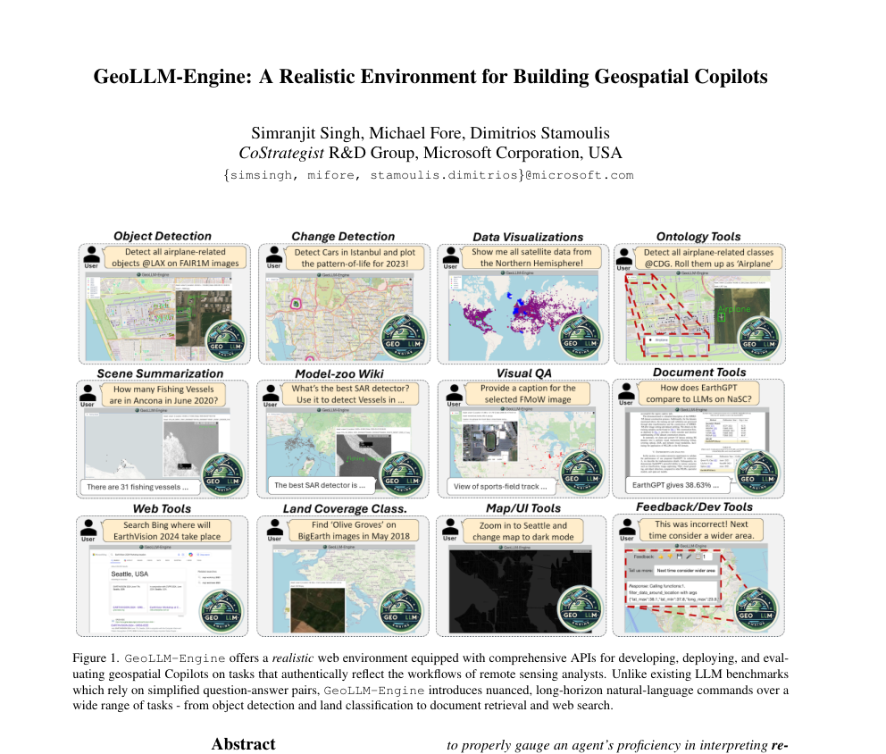

[查看完整原论文第 1 页](./source_pages/page-001.jpg)

### Figure 2 — 原论文第 2 页

**原文图题（保留英文）：** Figure 2. Paper overview: GeoLLM-Engine is a realis- tic environment for building and evaluating agents on complex EO tasks. Our GPT-driven benchmark-engine and the agent- correctness checker minimize the need for human intervention for benchmark curation. This allows us to develop a large-scale benchmark with more than 500, 000 long-horizon geospatial tasks on 1, 100, 000 satellite images.

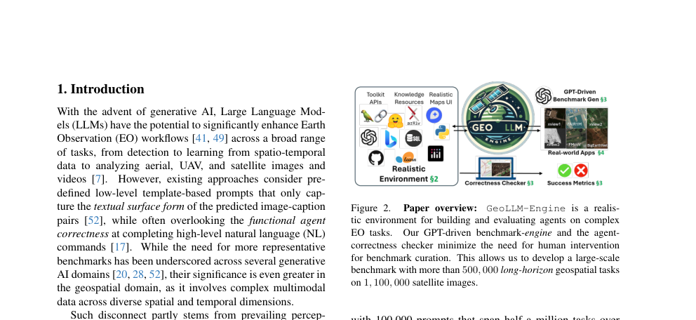

[查看完整原论文第 2 页](./source_pages/page-002.jpg)

### Table 1 — 原论文第 3 页

**原文图题（保留英文）：** Table 1. GeoLLM-Engine module inventory: Tool Space T

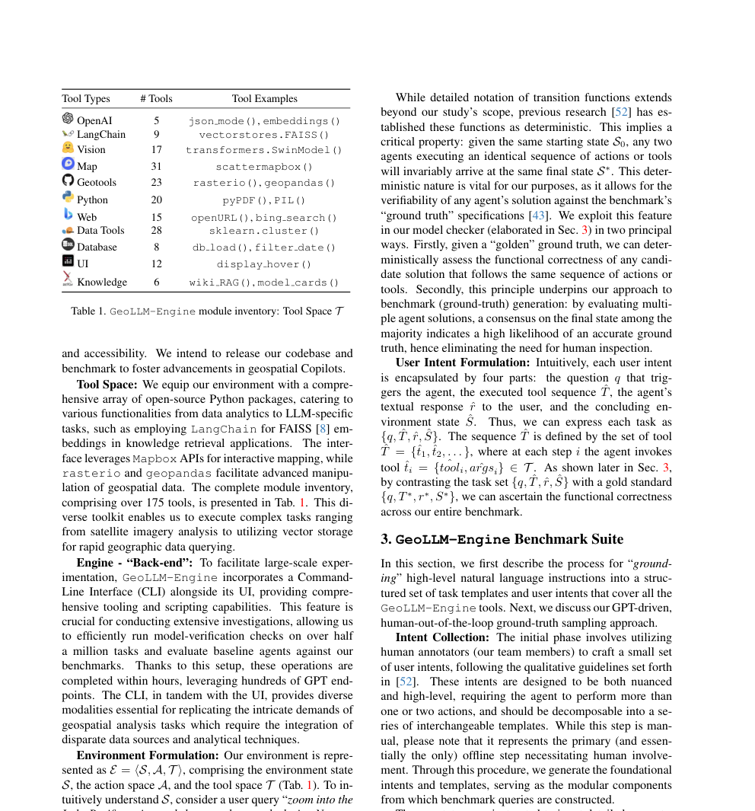

[查看完整原论文第 3 页](./source_pages/page-003.jpg)

### Table 2 — 原论文第 4 页

**原文图题（保留英文）：** Table 2. Examples of realistic GeoLLM-Engine tasks across three primary “Intent” categories. Please note the long-horizon high-level natural language commands, which constitutes a novel departure from existing single-task template-based geospatial LLM benchmarks.

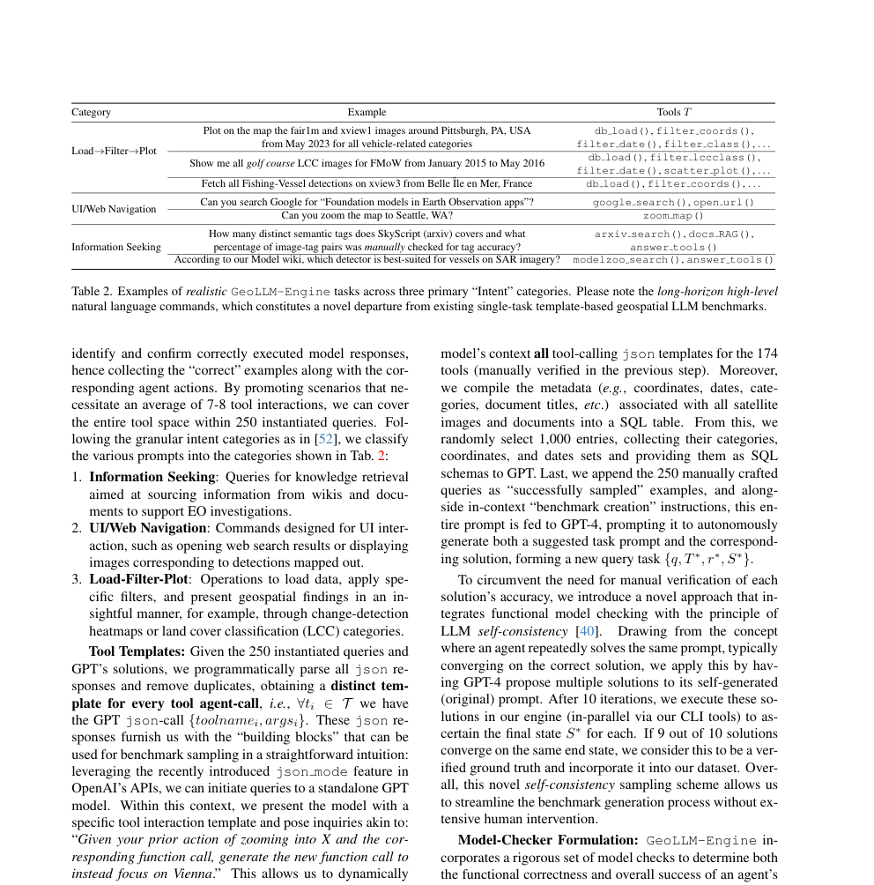

[查看完整原论文第 4 页](./source_pages/page-004.jpg)

### Table 3 — 原论文第 5 页

**原文图题（保留英文）：** Table 3. We define model-checks to obtain the agent success and correctness at performing each task.

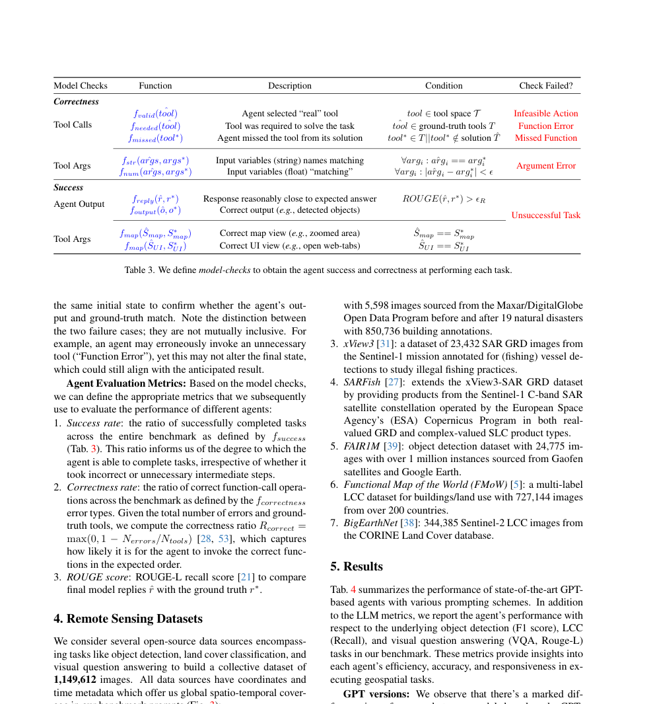

[查看完整原论文第 5 页](./source_pages/page-005.jpg)

### Figure 3 — 原论文第 6 页

**原文图题（保留英文）：** Figure 3. Dataset overview with a wide spatial and temporal range. The satellite imagery serves as task contexts for LLM agents to perform function calls (e.g., given image coordinates, we can assess the agents’ ability to fetch the proper set of images around a user-specified location) and is not employed for any LLM-finetuning or other downstream tasks, enabling our research-purposes investigation.

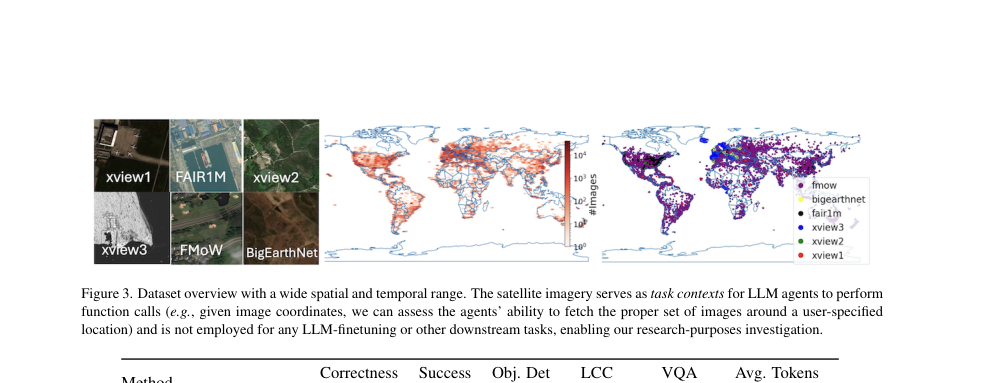

[查看完整原论文第 6 页](./source_pages/page-006.jpg)

### Table 4 — 原论文第 6 页

**原文图题（保留英文）：** Table 4. The overall performance of different methods and prompting strategies on GeoLLM-Engine-10k.

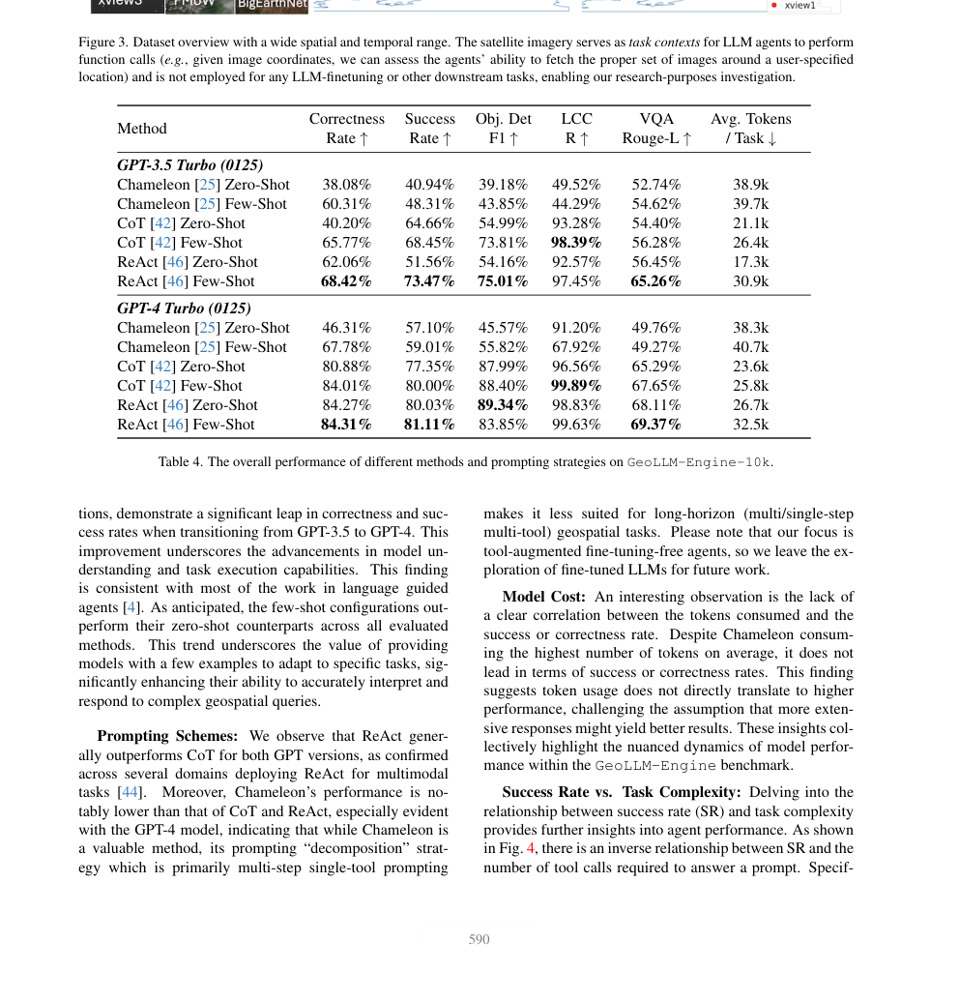

[查看完整原论文第 6 页](./source_pages/page-006.jpg)

### Figure 4 — 原论文第 7 页

**原文图题（保留英文）：** Figure 4. Success Rate vs. Task Complexity (left), Benchmark size (middle), and Error Tolerance (right). All methods use GPT-4-Turbo.

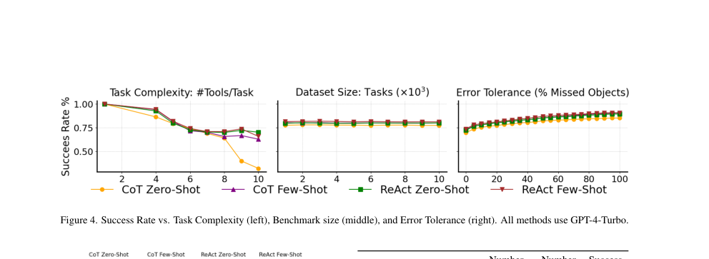

[查看完整原论文第 7 页](./source_pages/page-007.jpg)

### Table 5 — 原论文第 7 页

**原文图题（保留英文）：** Table 5. Success Rate of GPT-4 CoT on massively large-scale benchmark with 100k queries

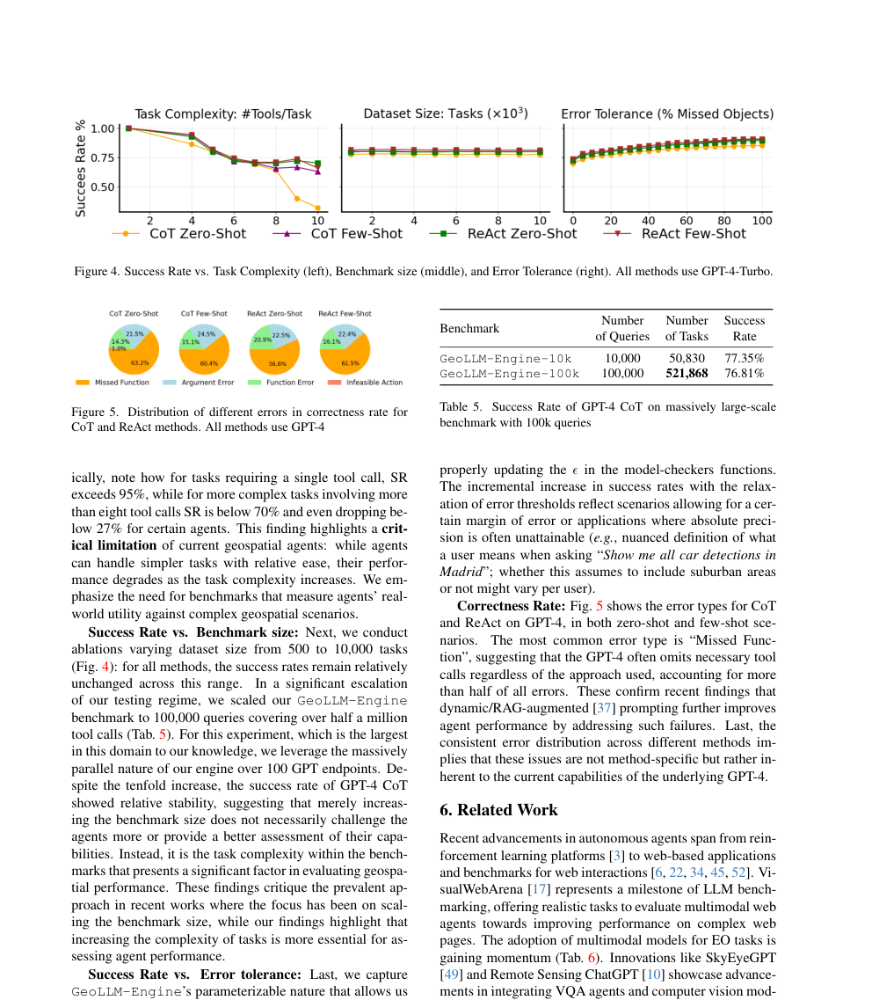

[查看完整原论文第 7 页](./source_pages/page-007.jpg)

### Figure 5 — 原论文第 7 页

**原文图题（保留英文）：** Figure 5. Distribution of different errors in correctness rate for CoT and ReAct methods. All methods use GPT-4

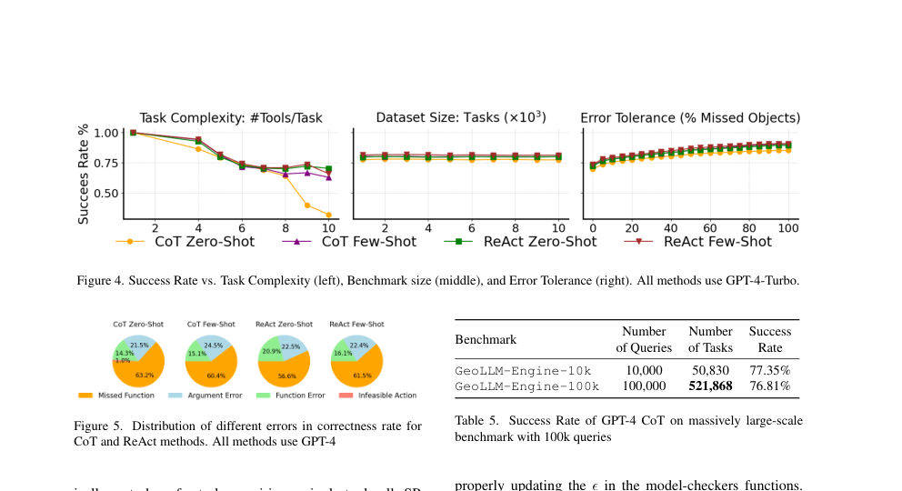

[查看完整原论文第 7 页](./source_pages/page-007.jpg)

### Table 6 — 原论文第 8 页

**原文图题（保留英文）：** Table 6. Comparison GeoLLM-Engine to existing geospatial LLM-related benchmarks. †Note: while these works consider dynamic chatGPT-like prompting capabilities, the underlying agent execution is conducted mainly across multiple steps via conversational prompt- ing of separate tasks (i.e., multi-step single-task), rather that multiple tasks (tools) per query (i.e., single/multi-step multi-task).

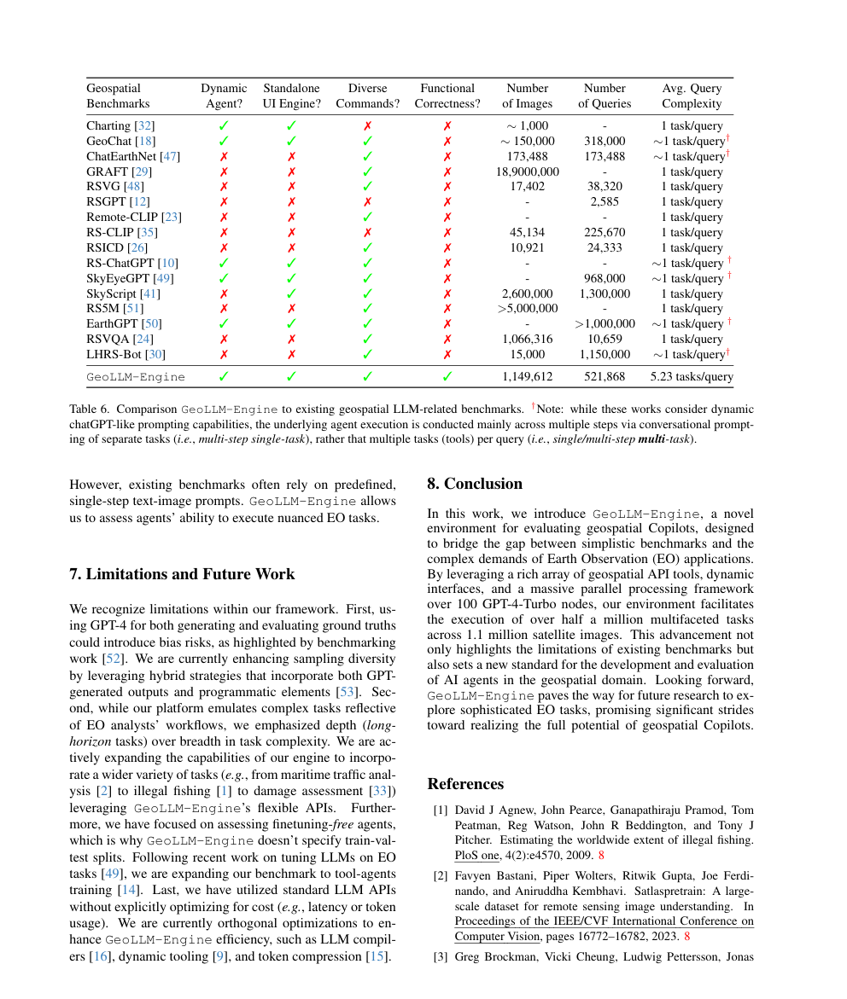

[查看完整原论文第 8 页](./source_pages/page-008.jpg)

## 逐页原文与翻译覆盖记录

| PDF 页码 | 英文原文 | 中文翻译状态 | 原版截图 |
|---|---|---|---|
| 1 | [英文原文](./英文原文_逐页全文.md) | 摘要已完整翻译；同页其他段落不保证全译 | [页面](./source_pages/page-001.jpg) |
| 2 | [英文原文](./英文原文_逐页全文.md) | 核心内容译述／本页未逐段全文翻译 | [页面](./source_pages/page-002.jpg) |
| 3 | [英文原文](./英文原文_逐页全文.md) | 核心内容译述／本页未逐段全文翻译 | [页面](./source_pages/page-003.jpg) |
| 4 | [英文原文](./英文原文_逐页全文.md) | 核心内容译述／本页未逐段全文翻译 | [页面](./source_pages/page-004.jpg) |
| 5 | [英文原文](./英文原文_逐页全文.md) | 核心内容译述／本页未逐段全文翻译 | [页面](./source_pages/page-005.jpg) |
| 6 | [英文原文](./英文原文_逐页全文.md) | 核心内容译述／本页未逐段全文翻译 | [页面](./source_pages/page-006.jpg) |
| 7 | [英文原文](./英文原文_逐页全文.md) | 核心内容译述／本页未逐段全文翻译 | [页面](./source_pages/page-007.jpg) |
| 8 | [英文原文](./英文原文_逐页全文.md) | 核心内容译述／本页未逐段全文翻译 | [页面](./source_pages/page-008.jpg) |
| 9 | [英文原文](./英文原文_逐页全文.md) | 核心内容译述／本页未逐段全文翻译 | [页面](./source_pages/page-009.jpg) |
| 10 | [英文原文](./英文原文_逐页全文.md) | 核心内容译述／本页未逐段全文翻译 | [页面](./source_pages/page-010.jpg) |

> 如需获得完全逐句对应的中文版本，必须继续翻译原文主体与附录，并逐段人工校订。
