# GeoLLM-Engine: A Realistic Environment for Building Geospatial Copilots：图表索引

**已识别明确标题的图表裁图：11 处。** PDF 中另有无单独标题的图片、图例和内嵌示意，均保留在 1:1 页码对应的完整截图中。

## Figure 1（第 1 页）

Figure 1. GeoLLM-Engine offers a realistic web environment equipped with comprehensive APIs for developing, deploying, and eval- uating geospatial Copilots on tasks that authentically reflect the workflows of remote sensing analysts. Unlike existing LLM benchmarks which rely on simplified question-answer pairs, GeoLLM-Engine introduces nuanced, long-horizon natural-language commands over a wide range of tasks - from object detection and land classification to document retrieval and web search.

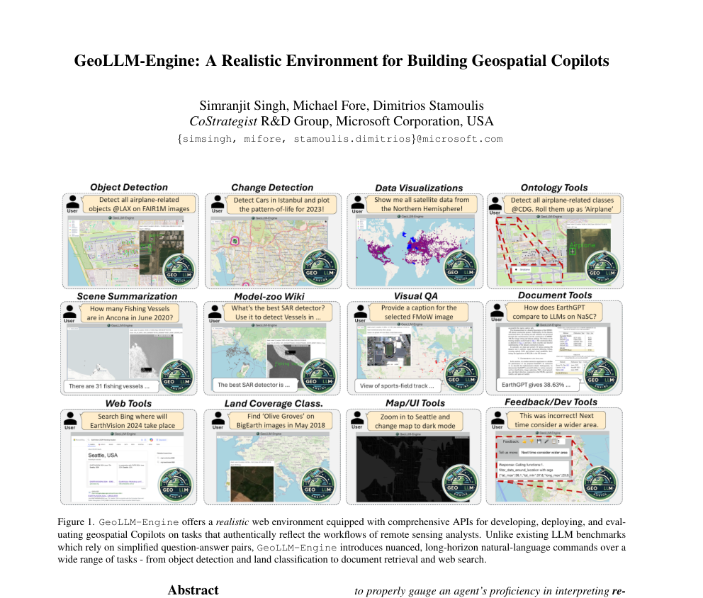

[查看第 1 页原始版面](./source_pages/page-001.jpg)

## Figure 2（第 2 页）

Figure 2. Paper overview: GeoLLM-Engine is a realis- tic environment for building and evaluating agents on complex EO tasks. Our GPT-driven benchmark-engine and the agent- correctness checker minimize the need for human intervention for benchmark curation. This allows us to develop a large-scale benchmark with more than 500, 000 long-horizon geospatial tasks on 1, 100, 000 satellite images.

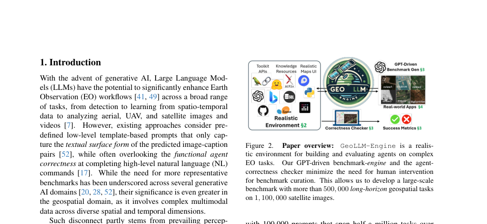

[查看第 2 页原始版面](./source_pages/page-002.jpg)

## Table 1（第 3 页）

Table 1. GeoLLM-Engine module inventory: Tool Space T

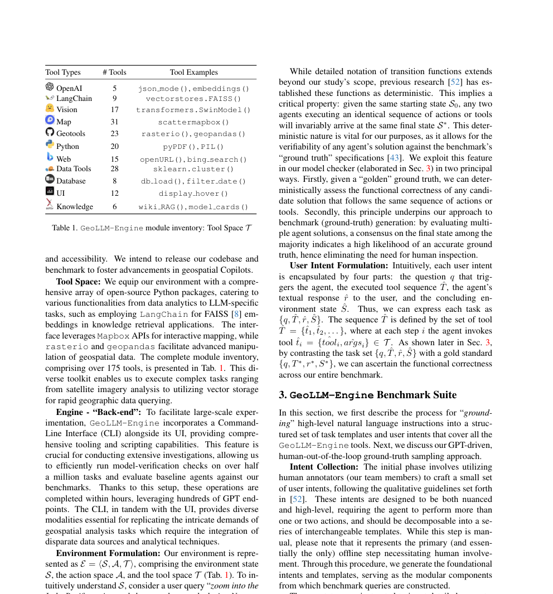

[查看第 3 页原始版面](./source_pages/page-003.jpg)

## Table 2（第 4 页）

Table 2. Examples of realistic GeoLLM-Engine tasks across three primary “Intent” categories. Please note the long-horizon high-level natural language commands, which constitutes a novel departure from existing single-task template-based geospatial LLM benchmarks.

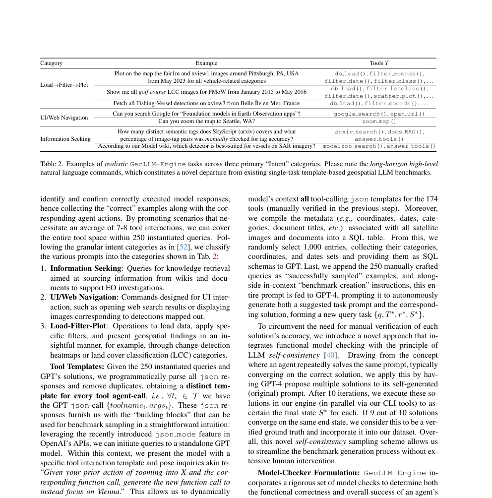

[查看第 4 页原始版面](./source_pages/page-004.jpg)

## Table 3（第 5 页）

Table 3. We define model-checks to obtain the agent success and correctness at performing each task.

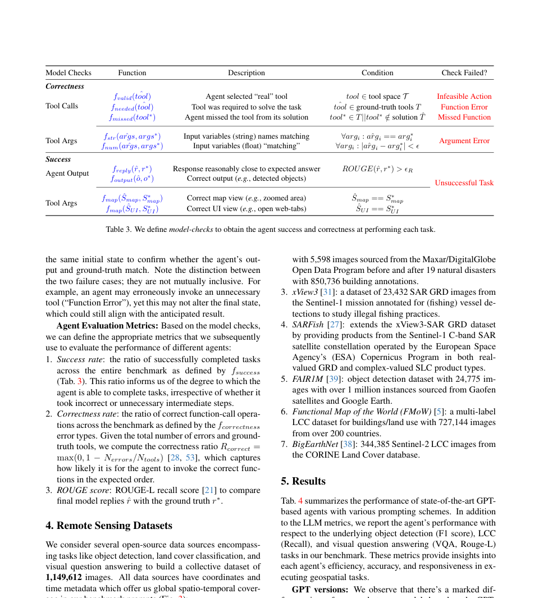

[查看第 5 页原始版面](./source_pages/page-005.jpg)

## Figure 3（第 6 页）

Figure 3. Dataset overview with a wide spatial and temporal range. The satellite imagery serves as task contexts for LLM agents to perform function calls (e.g., given image coordinates, we can assess the agents’ ability to fetch the proper set of images around a user-specified location) and is not employed for any LLM-finetuning or other downstream tasks, enabling our research-purposes investigation.

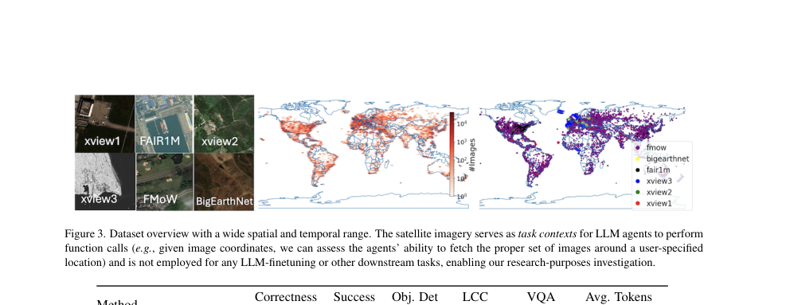

[查看第 6 页原始版面](./source_pages/page-006.jpg)

## Table 4（第 6 页）

Table 4. The overall performance of different methods and prompting strategies on GeoLLM-Engine-10k.

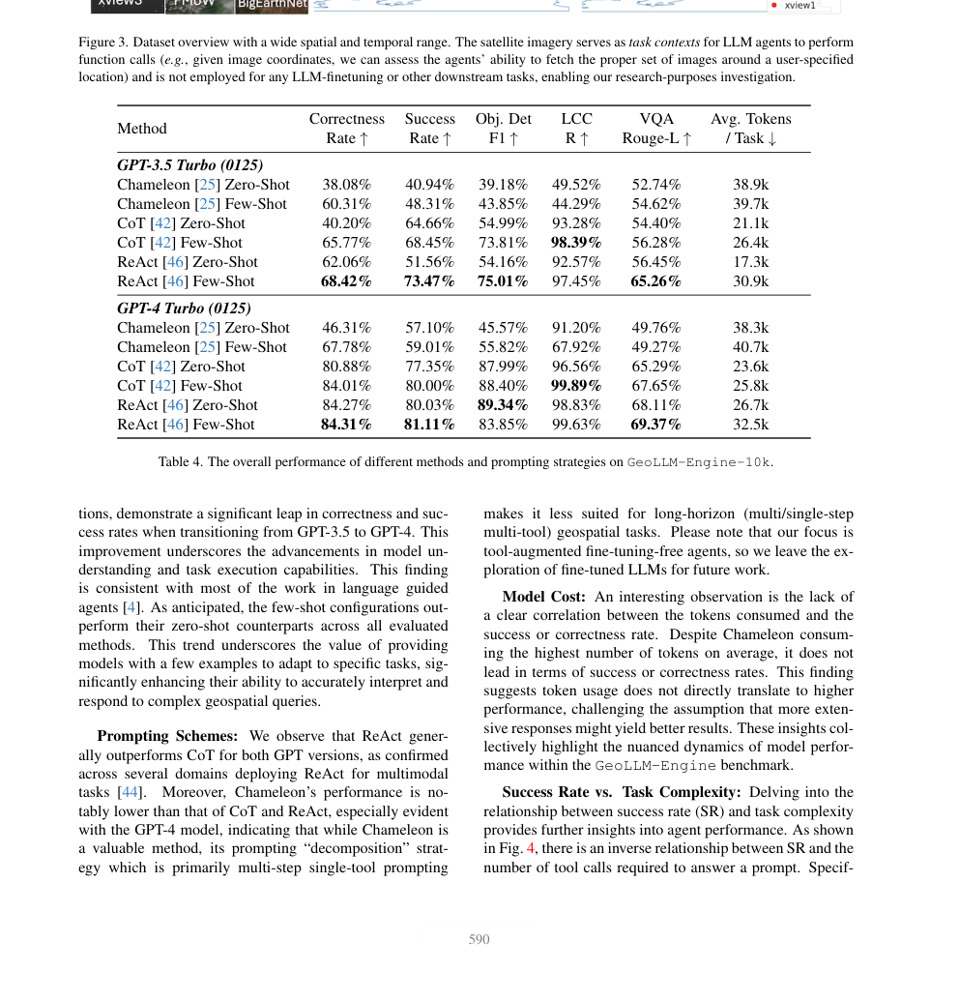

[查看第 6 页原始版面](./source_pages/page-006.jpg)

## Figure 4（第 7 页）

Figure 4. Success Rate vs. Task Complexity (left), Benchmark size (middle), and Error Tolerance (right). All methods use GPT-4-Turbo.

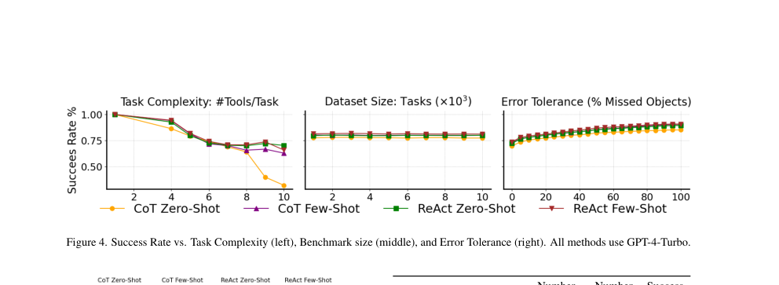

[查看第 7 页原始版面](./source_pages/page-007.jpg)

## Table 5（第 7 页）

Table 5. Success Rate of GPT-4 CoT on massively large-scale benchmark with 100k queries

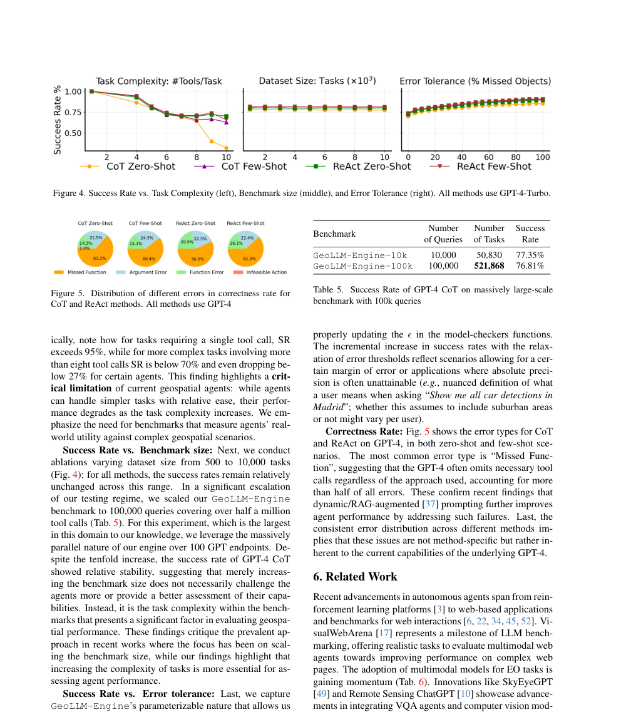

[查看第 7 页原始版面](./source_pages/page-007.jpg)

## Figure 5（第 7 页）

Figure 5. Distribution of different errors in correctness rate for CoT and ReAct methods. All methods use GPT-4

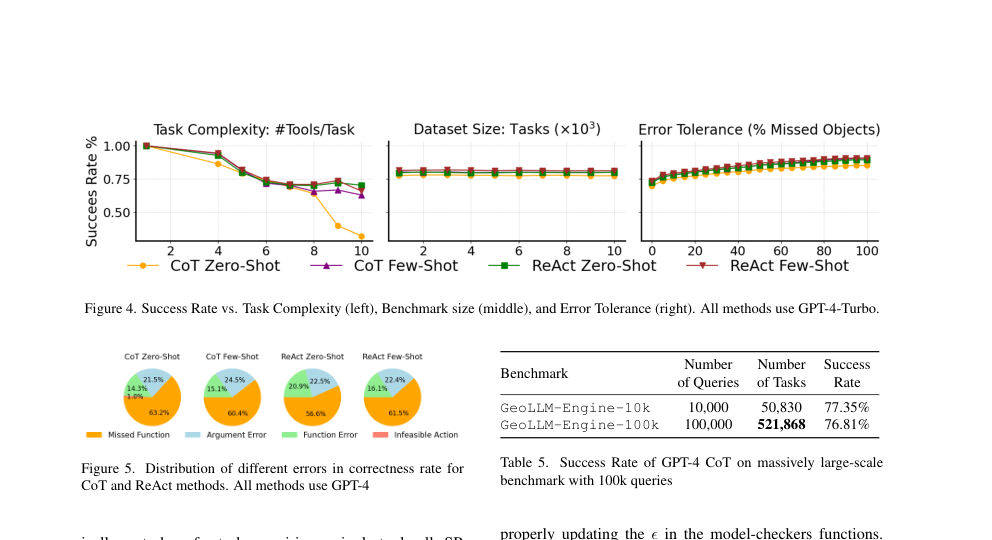

[查看第 7 页原始版面](./source_pages/page-007.jpg)

## Table 6（第 8 页）

Table 6. Comparison GeoLLM-Engine to existing geospatial LLM-related benchmarks. †Note: while these works consider dynamic chatGPT-like prompting capabilities, the underlying agent execution is conducted mainly across multiple steps via conversational prompt- ing of separate tasks (i.e., multi-step single-task), rather that multiple tasks (tools) per query (i.e., single/multi-step multi-task).

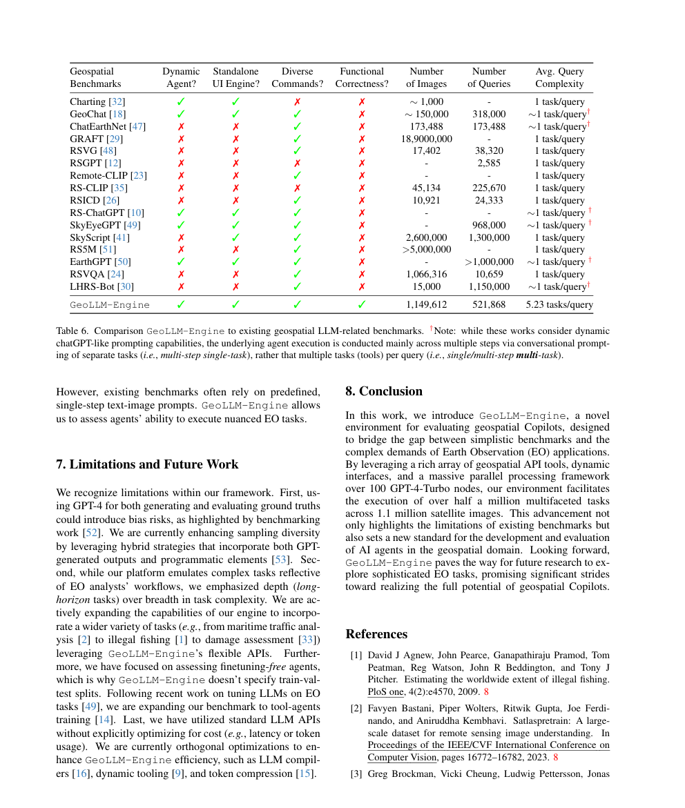

[查看第 8 页原始版面](./source_pages/page-008.jpg)
